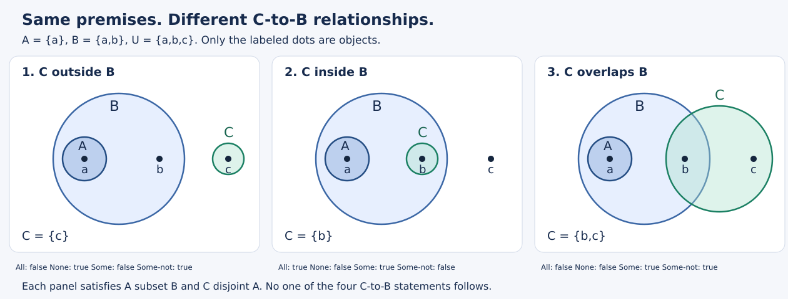

# Euler 第CIII信：从一幅图到必然结论

## 1768年出版的完整书信章节精读

**“这幅图里看得出来”，还不等于“只要前提成立，结论就必定成立”。** Euler第CIII信的关键进展，是不再仅给四类命题配圆图，而是让第三个项加入，观察哪些关系随之确定、哪些仍可变化。最值得学的不是记住九组三行句子，而是追问：结论中的那个对象从哪里来？图里没有画出的另一种情况是否也满足前提？

本篇沿一封完整教学书信的十二个印页位置阅读，解释各组推理、反例与存在性边界，并交付可运行的现代语义核验。它不是独立期刊论文；完成本信不等于完成整卷或Euler全部三段论体系。第一前提为特称的后续讨论，原信明确留给下封信。

### 文献信息与版本声明

- 作者：Leonhard Euler。
- 原著：*Lettres à une princesse d’Allemagne sur divers sujets de physique & de philosophie*，Tome second，Lettre CIII。
- 出版：Saint Pétersbourg，de l’Imprimerie de l’Académie Impériale des Sciences，**1768年**。具体发行月日未核定。
- 篇界：原印100页下部LETTRE CIII起，至111页 **le 17 Fevrier 1761** 署日止。1761-02-17是原印书信日期，未经本篇另作历法换算，不是出版日。100页上部属于CII，111页下部CIV排除。
- E344是第二卷整体的Eneström编号，不是CIII单独的论文编号。[Euler Archive机构记录](https://scholarlycommons.pacific.edu/euler-works/344/)
- 原版基础副本：[Oxford藏本Google扫描的Internet Archive记录](https://archive.org/details/lettresuneprinc01eulegoog)，[PDF中CIII开始处](https://archive.org/download/lettresuneprinc01eulegoog/lettresuneprinc01eulegoog.pdf#page=119)。该扫描106页两次重复均有遮挡，110页亦有遮挡；107页采用较清晰的第二次扫描。实际补本为Mietau et Leipsic、Steidel et Compagnie的1770版，CIII印105–116；原106/110分别以其111/115页补核。两版九式及图序的对应不证明被遮挡原字逐字一致。补读版本及逐项差异详见[来源账本](euler-letter-ciii.sources.zh-CN.md)。绝不把OCR猜补称作原版核图。

**阅读路线。** 想掌握主线，读第1–5、8节；想逐式重建，读第6–7节；想复核程序与证据，读第9–12节。先备知识只有集合、包含、相交和“至少一个”。

全文区分：**原文**是可定位的文字与图；**现代重构**是本文声明的集合与量词模型；**本文审计**是对论证条件的检查；**实跑**只指程序实际输出。现代符号和算法不归给原作者，有限检查也不替代一般证明。

## 1 为什么命题的图像还不是推理方法

**原文，100–101页。** Euler说圆形，确切说是空间，可以帮助思考；取什么具体形状并不重要。他把这种表示的好处说得很强：逻辑中费力证明的奥秘，用这些标志便显现在眼前。101页重列全称肯定、全称否定、特称肯定、特称否定四种“徽记”。这张四格汇总属于CIII，不能算进前封CII的图数。

“圆”在这里首先表示一个一般观念所涵盖的对象范围。字母A标主项，B标谓项；位置、面积、半径没有对象计数或概率含义。作者自己说可自由选形状，已经提示我们应保持的是包含、相离、共同部分等关系，而非圆的几何度量。

但一种图至少可能承担两种角色：

1. **一个完整配置。** 这张图确实显示了某些关系，并可能满足多个命题。
2. **一个命题的全部条件。** 它只规定命题要求的关系，其他尚未知道的部分不能擅自确定。

两者若混淆，就会把“所画的例子里还有某个区域”变成“所有许可情况都必须有这个区域”。本信102页立即承认特称图还有不确定性，105–106及109–110页又画不同配置。这是本篇推理方法的重要组成，不应只摘三行结论而删掉那些“或”的图。

## 2 102–103页：同一个关系可以说出几句话

### 2.1 梨树与树：包含、存在、严格性是三项条件

**原文，102页。** 对特称命题，Euler提醒读者：尚未决定A有多大部分在B内或外，甚至A可以整个包含B。他以A为树、B为梨树，画B在A中，并从图列出三句话：所有梨树是树；有些树是梨树；有些树不是梨树。

**现代审计。** 第一项是包含，第二项需要梨树存在，第三项需要不是梨树的树存在。把它们合成一个有限例子很容易：令树A={p,o}，梨树B={p}；p见证第二句，o见证第三句。可是仅有B包含于A时，后两句都不能不加条件地推出。

- A={o}、B为空：所有梨树是树仍真，但没有树是梨树。
- A=B={p}：所有梨树是树、有些树是梨树都真，却没有不是梨树的树。

这些不是说现实世界没有梨树或橡树，而是在拆开**逻辑形式**与**例子的事实知识**。日常理解让我们知道梨树存在、还有其他种树；这种背景可以支持原例，却不能暗中充当任意字母A、B的普遍公理。

```math
B\subseteq A,\quad B\ne\varnothing,\quad A\setminus B\ne\varnothing
```

三项合起来足以支持原例的三句，而第一项单独不足。这是本信后来存在性问题的预演。

### 2.2 相离与交叠：为什么有的换项合法

**原文，102–103页。** 两域完全相离时，Euler把“没有A是B”和“没有B是A”并列，以人与树为例。交叠配置则列出四句：有些A是B、有些B是A、有些A不是B、有些B不是A。

前两项特称肯定共用一个交集见证，所以可换方向；全称否定也因交集对称而可换方向。但四句来自一幅具有共同部分和两侧独有部分的配置，**不意味着第一句单独推出其余三句**。

取A=B={x}，有些A是B及其换项真，两项特称否定都假。取A={x,y}、B={x}，共同部分和A独有部分存在，B独有部分却不存在。因此，从“有些A是B且有些A不是B”仍不能推出“有些B不是A”。

原书全称否定仍印“Nul A n’est pas B”。本文保留读数，按其明确的否定分类和相离图理解预期关系，不默改为今日法文，也不把它按孤立的字面双重否定解释成肯定。没有找到作者正式订正该表达的证据。

## 3 在开始证明前固定符号与假设

### 3.1 对象、项、命题不可混为一谈

**现代重构。** 取非空论域U，A、B、C是U的三个子集，允许彼此相等；我们先允许它们为空，随后单独增加非空条件。小写x表示一个对象。字母项沿用原信A/B/C，而四种命题写成具名关系，以免“A这个集合”和“A类命题”混淆。

| 记号 | 中文读法 | 集合条件 |
| --- | --- | --- |
| $`\mathsf{All}(X,Y)`$ | 所有X是Y | $`X\subseteq Y`$ |
| $`\mathsf{None}(X,Y)`$ | 没有X是Y | $`X\cap Y=\varnothing`$ |
| $`\mathsf{Some}(X,Y)`$ | 有些X是Y | $`X\cap Y\ne\varnothing`$ |
| $`\mathsf{NotAll}(X,Y)`$ | 有些X不是Y | $`X\setminus Y\ne\varnothing`$ |

代码为便于枚举用A/E/I/O作为四种关系的短名；正文中的All/None/Some/NotAll和它们逐一对应。NotAll表示不是所有，不表示所有都不是；Some明确解释成至少一个，不附加“但不是全部”。这是一套公开的现代约定，不假称原信已经写出这些量词定义。

```math
\begin{aligned}
\mathsf{All}(X,Y)&\iff \forall x\in U\;(x\in X\Rightarrow x\in Y),\\
\mathsf{None}(X,Y)&\iff \forall x\in U\;(x\in X\Rightarrow x\notin Y),\\
\mathsf{Some}(X,Y)&\iff \exists x\in U\;(x\in X\land x\in Y),\\
\mathsf{NotAll}(X,Y)&\iff \exists x\in U\;(x\in X\land x\notin Y).
\end{aligned}
```

包含允许相等；严格包含另写 $`X\subsetneq Y`$。论域非空不保证每个项非空。若X为空，前两项都真，后两项都假。这不是逻辑爆炸，而是根本没有X成员构成全称断言的反例。

### 3.2 推理有效要求检查哪些模型

两前提记为P、Q，结论记为R。有效的含义是：**每一个满足P和Q的许可模型，也满足R**。一幅满足全部三句的图，只给出一个好例子；若有另一模型使前提真而结论假，就已足够反驳有效性。

“许可”必须写明。本文比较三层：

- 允许A、B、C为空；
- 只为某条推理补上实际需要的项非空；
- 强制三个项都非空。

第三层很符合许多日常圆图的直觉，但往往比证明所需条件强，不能替代寻找最小假设。原信没有完整声明一套处理空项的形式系统，因此这些模式都以现代审计名义出现。

### 3.3 三种实际证明动作

后面所有式子反复使用三种动作：

1. **任取。** 为证明所有X是Y，假设一个任意x在X内，把它传到Y；这不擅自断言X有成员。
2. **取见证。** 前提已经说有些X是Y，就选其共同成员x；它确实存在。
3. **排除。** 若某x必须在B，而另一个前提禁止某类成员在B，就可否定它属于那一类。

最危险的偷换发生在“任取”变成“取见证”时：从“任何A若存在都在C”跳到“存在一个A在C”，需要额外一步。第6.5节专门检查这个跳跃。

## 4 103–105页：第三个项怎样进入

**原文，103页。** Euler把用词说出的推理称为Syllogismes：从若干给定命题推出正确结论。他先固定第一命题“所有A是B”，即A在B中，再讨论第三项C与A或B的关系。

**原文，104–105页的具体例子。** A是树，B是有根的事物，C是樱桃树。所有树有根；所有樱桃树是树；因此所有樱桃树有根。形式上是C包含于A，A包含于B，所以C包含于B。

这个例子把一般规则落到词语上，但有两项限制。第一，图不证明植物学前提真的成立；它只说明若按这些概念和前提理解，结论怎样跟随。第二，中项“树”在两句中的意思必须一致。若前一句“树”是植物，后一句是数据结构，字面相同也不是同一个集合A。

**现代手算。** 令U={c,a,b}，C={c}，A={c,a}，B={c,a,b}。检查C唯一成员c：它在A，而A的每个成员均在B，所以c在B。接着把三项全改成{c}，两前提和结论仍都成立。因此证明用的是一般包含，不是图中三圈之间必须各留一个有对象的环。

## 5 一次失败的推断比一个漂亮例子更有价值

**原文，105–106页括号星号段。** 固定A在B中以后，如果C整个在A外，关于C与B却不能作所期待的确定结论。作者画出C整个在B外、整个在B内、部分在B内的配置；这个星号是正文中的旁论标记，不是本文发现的新脚注。原扫描106页中部遮挡必须由清晰补本核图，不用OCR补图。

**现代重构。** 前提只是：

```math
A\subseteq B,\qquad C\cap A=\varnothing.
```

令A={a}、B={a,b}，用三个非空C作比较：

| C | C与A相离吗 | C与B的关系 |
| --- | --- | --- |
| {c} | 是 | 完全相离 |
| {b} | 是 | 整个包含于B |
| {b,c} | 是 | 有共同成员，也有B外成员 |

其中U统一取{a,b,c}，三项都非空。第一模型否定“有些C是B”与“所有C是B”；第二模型否定“没有C是B”与“有些C不是B”。所以以C为主项、B为谓项的四类句子，没有一个可由这两前提必然推出。

“什么也推不出”应限于此处欲确定的端项关系，不能扩成没有任何逻辑后果：前提自己当然仍是后果，含析取的新句子也可能成立；如果允许别的方向并增加A非空，还能推出有些B不是C，因为A成员既在B内又不在C内。这恰好说明，要讨论完整性，须说明结论方向和允许形式，不能只重复作者一句修辞。



图只把a、b、c三个点视作对象；圆域空白不是额外成员。图像已实际渲染检查，参见[图形复核记录](../../reproduction/euler-1768-ciii/qa/visual-review.zh-CN.md)。

这组三模型的共同意义是：**否定关系不能沿包含反向传播。** C避开较小的A，不保证避开较大的B；反过来，C若避开B，必然避开A。两者只换了一个字母，逻辑强度完全不同。

## 6 第一前提为全称肯定：五种原列形式逐步重建

本节按原文I–V顺序列出五式，编号A1–A5是本文定位用名。这里“第一前提全称”不等于“两前提都全称”；A2和A4的第二前提正是特称句。原文有些式子把换项后的另一表达并列，本文保留其语义等价而不重复计数。

### 6.1 A1 包含传递：从C经过A到B

**原文，104页。** 所有A是B；所有C是A；所以所有C是B。

```math
A\subseteq B,\quad C\subseteq A\quad\Rightarrow\quad C\subseteq B.
```

证明：任取x属于C。第二前提给x属于A，第一前提给x属于B。因为x任意，C的全部成员都在B内。若C为空，结论仍真；若A为空，第二前提强制C也空，结论仍真。因此这条传递不需要存在性。

原图为三层嵌套；证明没有使用圆形、半径或严格环带。把A、B、C取成相等集合也不破坏结论。

### 6.2 A2 见证沿包含前进：C不必全部在B里

**原文，105页。** 所有A是B；有些C是A；所以有些C是B。作者并列两图，一图C仍完全在B中，另一图C伸到B外。

```math
A\subseteq B,\quad C\cap A\ne\varnothing
\quad\Rightarrow\quad C\cap B\ne\varnothing.
```

证明：从第二前提取见证x，x既在C也在A。第一前提把这个**同一个x**送进B。因此x同时在C和B，结论成立。

为什么结论只是特称？令A={a}，B={a,b}，C={a,c}。a见证结论，但c不在B，故“所有C是B”假。原文两图的作用正是提醒C与B的其余关系未定；C的外部部分不会破坏已有见证，也不能由图的某一选择而被宣布不存在。

### 6.3 A3 相离沿包含缩小：避开大集合就避开小集合

**原文，106–107页。** 所有A是B；没有C是B（或没有B是C）；所以没有C是A。

```math
A\subseteq B,\quad C\cap B=\varnothing
\quad\Rightarrow\quad C\cap A=\varnothing.
```

证明：假设存在x同时在C和A。由A包含于B，x也在B，于是x同时在C和B，与第二前提冲突。因此C与A不可能有共同对象。

换项“没有B是C”合法，因为交集对称；没有把“所有A是B”反转成“所有B是A”。这条也不需要任何项非空。与第5节并看，读者应能判断否定能往哪一边传播。

### 6.4 A4 反例向小集合传播：B外的C必定也在A外

**原文，107页。** 所有A是B；有些C不是B；所以有些C不是A。

```math
A\subseteq B,\quad C\setminus B\ne\varnothing
\quad\Rightarrow\quad C\setminus A\ne\varnothing.
```

证明：取x属于C且不属于B。如果x属于A，第一前提会使它属于B，矛盾。所以x不属于A，而它仍属于C；这个x见证结论。

原图画C与B部分相交、与A分离，但前提不要求C完全避开A。取A={a}，B={a,b}，C={a,c}：c在B外，见证两项特称否定；a又同时在A与C。因此不可从原示例图的分离额外推出“没有C是A”。证明只保留**同一个B外见证**，没有把C全体排除。

### 6.5 A5 从链到特称：存在见证不能靠圈凭空获得

**原文，107–108页。** 所有A是B；所有B是C；所以有些C是A。图为A在B内、B在C内。

```math
A\subseteq B,\quad B\subseteq C
\quad\Rightarrow\quad \mathsf{Some}(C,A)
\qquad\text{需要补充 } A\ne\varnothing.
```

先做不需额外条件的部分：任取A成员，由两次包含可知它在C，因此 $`A\subseteq C`$。这时还没有选出任何实际对象。

再加入A非空：选a属于A，两前提保证a也在C。于是a属于C与A的交集，特称结论成立。这里A非空不只是一个方便的充分假设；在两前提下有 $`A\cap C=A`$，所以结论为真**当且仅当A非空**。

反例一：U={x}，A为空、B=C={x}。两前提真，B和C还确实非空，但不存在既在C又在A的对象，结论假。故只保证B、C存在也不够。

反例二：A=B=C为空、U={x}。两前提都真、特称结论假。外部对象x保证论域非空，说明问题并不来自空论域。

**本文修复，不冒称历史勘误。** 要保留原特称结论，就显式增加A非空；要在允许空项的现代语义下保留无条件推断，可把结论改成“所有A是C”。后者是由相同前提得到的普遍包含，不是作者已正式发布的修订。三个项都非空足以恢复原式，却不是最小补充条件。

## 7 第一前提为全称否定：四种原列形式

**原文，108页转折。** Euler改从没有A是B，即A与B相离出发。两项相离对称，但第二前提究竟把C送入A还是B，仍决定结论中应否定哪一项。以下E1–E4是本文标签，原信另起I–IV。

### 7.1 E1：C在B内，所以C避开A

**原文，108–109页。** 没有A是B；所有C是B；所以没有C是A。

```math
A\cap B=\varnothing,\quad C\subseteq B
\quad\Rightarrow\quad C\cap A=\varnothing.
```

证明：若x同时在C和A，由C包含于B可知x也在B，从而落在被禁止的A与B交集中。矛盾。因此C与A相离。C、A或B为空都不破坏这个论证。

### 7.2 E2：C在A内，所以C避开B

**原文，109页。** 没有A是B；所有C是A；所以没有C是B。

```math
A\cap B=\varnothing,\quad C\subseteq A
\quad\Rightarrow\quad C\cap B=\varnothing.
```

任取x属于C，则x在A。第一前提禁止任何A成员进入B，因此x不在B。于是没有C是B。这与E1可通过交换A/B及全称否定换项联系起来，但原信各列一种位置，不能为了现代压缩而声称作者只列一式。

### 7.3 E3：C在A中的见证必定在B外

**原文，109–110页。** 没有A是B；有些C是A（或有些A是C）；所以有些C不是B。作者用三种C相对B的布局展示同一推断。

```math
A\cap B=\varnothing,\quad C\cap A\ne\varnothing
\quad\Rightarrow\quad C\setminus B\ne\varnothing.
```

取x属于C与A。因为A和B相离，x不属于B；所以x属于C差B。见证就是第二前提给出的对象，不需要再假设C或A非空；它们的非空已被特称前提保证。

C的其他成员可以进入B。取A={a}、B={b}、C={a,b}：a支持结论，而b使“没有C是B”变假。因此特称否定不能提升为全称否定。原文三图正帮助读者把这个尚未确定的部分保留下来。

### 7.4 E4：C在B中的见证必定在A外

**原文，110–111页。** 没有A是B；有些C是B（或有些B是C）；所以有些C不是A。

```math
A\cap B=\varnothing,\quad C\cap B\ne\varnothing
\quad\Rightarrow\quad C\setminus A\ne\varnothing.
```

取x属于C与B。由于B成员不可能在A中，x不属于A；它仍在C中，故见证特称否定。将上例A/B交换，就可看到C也可能另有A成员。不得从其中一幅C完全避开A的图读成“所有C不是A”。

本信111页随后明确说：第一命题为特称肯定或特称否定时，还剩其他形式，将于下一次介绍。接着署日1761-02-17，下面才开始CIV。本篇到署日止，没有把后续论证或体系完备性纳入完成范围。

## 8 图的可靠使用与“所有形式”的边界

### 8.1 九个展示式不是九个互不等价的现代定理

A3与E1都用相离和包含，只是前提顺序及字母角色不同；E1/E2、E3/E4又涉及A/B交换。原文按图形入口组织教学，与现代把一切换项、重命名和前提交换合并的计数不是同一标准。

因此“原文列五种再四种”只是可复核的排版与论述事实，不等于“恰有九种独立有效三段论”，更不等于“本信穷尽四格传统三段论”。必须先定义什么算同一种，才可比较数量。

### 8.2 108页的排他性说法不能不经检查照搬

在肯定分支五式之后，原文声称第一命题仍为全称肯定时没有其他形式。本文把这句作为作者主张保留，而不是直接当作现代完备性定理。

一个值得检查的现代补充情形是：

```math
A\subseteq B,\quad A\subseteq C,\quad A\ne\varnothing
\quad\Rightarrow\quad B\cap C\ne\varnothing.
```

证明只需选一个A成员，它同时属于B与C。这是**共同来源**，不是A5的连续包含链。A5用B作两前提共享的项；这里共享的是A，而且两条包含都从A出发。令A={a}、B={a,b}、C={a,c}，结论有见证，但B/C互不包含，不能把图强画成三层链。

还有一个不需要新增存在假设的补充：

```math
A\subseteq B,\quad A\setminus C\ne\varnothing
\quad\Rightarrow\quad B\setminus C\ne\varnothing.
```

取一个在A而不在C的见证，A包含于B使它也在B，故有些B不是C。这与A4“B外见证也在A外”的方向不同：这里把**作为主项的见证**从A送到B，那里则把**被排除的谓项**从B缩到A。第二前提仍含第三项C，第一前提仍全称肯定；按本文的明确形式空间，它是需要计入的另一后承。它也提醒我们，不能把原列五式当作连允许空项语义都已经穷尽的现成定理。

另一情形在第5节已经出现：A包含于B且C与A相离，若A非空，就可推出有些B不是C。它不是C为主项、B为谓项的同方向结论。这说明作者“不能推出”的说法也需要按所关注的方向理解。

本文不把这项补充冒称新发现的历史勘误。原信没有在本处给出严格的等价式归并规则；我们能确认的是：若按本文声明的现代语义、允许端项双向结论和所有指定第二前提来读，“五个展示式已经包办全部形式”不能直接成立。程序会用明确的比较规则核查，而不替作者补出未写明的系统。

### 8.3 图形必须保持什么

一张可靠教学图至少应配一个使用契约：哪些区域被禁止，哪里必须有见证，其他区域是否未定。本文的现代图只把标出的离散点当作对象；纸面连续空间本身不算无穷多个对象。

- 全称前提只排除反例区域，不保证某区域有人。
- 特称前提给出至少一个见证，不决定所有其他区域。
- 一幅容许图展示可满足性；一项有效性证明必须对所有容许模型成立。
- 圆的面积、交叠比例和距离不参与这封信的逻辑含义。
- 换词需要检查同一术语是否保持同一外延；逻辑有效不保证事实前提为真。

这种纪律保留圆图的直觉优势，也避免用图的多余细节替代前提。

## 9 从八个区域得到可执行检查

### 9.1 为什么三项产生八种成员类型

每个对象分别回答“在A吗”“在B吗”“在C吗”，三项是/否共有八种组合。记区域 $`R_{abc}`$，其中a、b、c各为0或1，表示对应成员资格。

```math
R_{abc}=A_a\cap B_b\cap C_c,\qquad
A_1=A,\quad A_0=U\setminus A
```

B、C同样定义。例如R101是在A、在C但不在B的对象；R000是三个项之外的对象。八区互不相交并覆盖U。

全称肯定A包含于B，就是A为1、B为0的两区R100与R101都空；特称C是A，就是R101与R111的并非空；其他式子也只查看相关区域的空或非空。程序无需知道某非空区究竟有一个还是一万个对象。

### 9.2 有限覆盖的证明与限制

给定任意模型，从每个非空区域取一个代表，保留其三项标签。至多八个代表，保持八区空/非空，因而保持A/E/I/O的每个有向实例、项非空条件，以及这些命题的任何有限布尔组合。因为U非空，至少有一个区域非空。反过来，每个非全零的八位状态，都能用一个对象代表每个置1区域造出模型。

所以完整保留八区信息时，共有256个原始位掩码，排除全零后是255个非空论域模式。若实现把全零先补一个三项外的对象，则它与只含R000的模式重复，并不产生第256个不同模型。必须明确计数口径，不能同时把论域定义为非空又悄悄保留空论域。

这个覆盖证明对无限模型也适用，因为当前语句只看有关区域有没有对象。它不能保持“至少两个共同对象”、二元关系、量词嵌套对任意新谓词的要求，或现实类别知识。程序不是自然语言逻辑万能判定器，也不是Euler全部书信体系的形式化。

### 9.3 实际运行范围

[可运行附件](../../reproduction/euler-1768-ciii/README.md)包括原创标准库源码、30项主测试、精确集合语义、完整JSON、文本结果、运行环境及日志。实际环境为CPython 3.12.14、Linux x86_64；无安装新依赖，逻辑运行不访问网络。它是可直接执行的脚本，本任务没有制作无必要Notebook，也不声称Jupyter内核运行。

| 存在约定 | 原始掩码/不同占位模型 | 九个原列式有效数 | 28个E/I换项写法中有效数 |
| --- | --- | --- | --- |
| 允许空项 | 256 / 255 | 8 / 9 | 26 / 28 |
| 三项均非空 | 218 / 218 | 9 / 9 | 28 / 28 |
| 仅A非空 | 240 / 240 | 9 / 9 | 28 / 28 |

A5在允许空项时有16个原始前提掩码，对应15个不同占位模型；失败8个原始掩码，对应7个不同反模型。差一来自全零掩码补项外对象后与仅R000非空的掩码重复。这里“不同模型”只指不同八区占位状态，不是所有可能集合模型总数，也不是逻辑真值等价类。两套计数均真实报告，没有把重复见证算成新反例。

**有界覆盖审计。** 固定第一前提为All(A,B)或None(A,B)，第二前提取C与A/B之一的任意有向A/E/I/O，得到16种；结论取另外两个未共享端项间的任意方向和四种量质，得到8种。每个首前提因此有128个有序候选，两种首前提共256，三套存在约定共768个候选/模式检查。

| 存在约定 | 首前提All：有效/128 | 首前提None：有效/128 |
| --- | --- | --- |
| 允许空项 | 12 | 8 |
| 三项非空 | 24 | 14 |
| 仅A非空 | 20 | 10 |

这些是规定语法里的**有序候选数量**，不是Euler声称的历史式数。比较是否已经列入九式时，程序明确尝试双射项重命名、E/I换项，分别报告保留前提顺序和另允许前提互换的两种准则；没有默加弱化、下属推理或多步演绎。在允许空项的12个肯定首前提有效候选中，允许前提互换后有11个匹配九式，余下就是第8.2节的A⊆B与有些A不是C推出有些B不是C。所有项非空时，共同主项的两包含也有效且在这两种准则下仍未匹配。它们是明确现代比较下的补充，不冒充已重建作者完整的“形式”概念。

**独立代码复核也实际执行。** [独立oracle审查](../../reproduction/euler-1768-ciii/review/review.zh-CN.md)重新用普通集合与逐元素量词生成预期结果，8个审查组通过：含9,216个原子求值、九式三约定、全部768候选/约定及每项完整反例列表、192个重命名/换项/前提交换后公式的三约定比较、584个1–3对象赋值模型及21,024个原子比较、8个具名例子。另独立重跑30项主测试与CLI，保存报告逐字节一致。主测试和独立测试不是一件事，所审源码SHA-256与执行命令均保留。

具体证据见[主测试日志](../../reproduction/euler-1768-ciii/results/tests.log)、[完整结果](../../reproduction/euler-1768-ciii/results/report.json)、[可读摘要](../../reproduction/euler-1768-ciii/results/report.txt)及[独立运行记录](../../reproduction/euler-1768-ciii/review/independent_results.json)。第9.2节提供一般覆盖证明；机器运行确认实现符合所规定问题，不拿有限次数本身代替证明。原创SVG已经转成PNG并查看实际像素，图形QA不等于远端GitHub页面QA。

## 10 本信贡献与后续联系的界限

本信把四类命题的静态图像变成一种实际推理练习：固定一个关系，加入第三项，追踪被迫保留的包含、相离或存在见证；当关系未定时，列多个容许配置。这使逻辑有效与“看着像”的差异可以被具体讨论，而不只靠背诵术语。

同样重要的是保留尚未解决的事：原文没有给出空项的完整语义，没有把每个图中区域存在性编码为公理，没有严格定义“同一种形式”的归并规则，也没有在CIII处理第一命题为特称的全部后续情形。读完本信，不能据此宣布完整Euler逻辑体系已形式化。

**历史证据边界。** 本信100–111页没有列更早图解逻辑作者的参考文献，不等于Euler首创。它是书信式教学，不是现代研究论文的实验报告。亚里士多德、Galen、Port-Royal、’s Gravesande等前驱线索和具体版本关系仍需独立研究；本篇也未证明Gergonne实际采用哪一版Euler。1768是此次所核著作的出版年，不是宣定AI或逻辑的历史起点。

**本文延伸。** 今天做规则系统、形式验证或模型检查，也会先规定语义，再查是否存在“前提真、结论假”的反例。A2、A4、E3、E4展示见证如何保留；A5展示接口中漏掉存在条件会怎样产生错误；第5节展示一张满意的图不够支持通用结论。这样联系方法是有用的，但不是对Euler到某个现代AI系统直接影响链的历史证明。

这里没有训练集、性能指标、概率预测或学习算法。八区程序只检查固定单项谓词语言；它不能判断“所有树有根”在何种生物学定义下为真，不能通过画圈处理术语多义，也不能以有限枚举取代一般推理所需的假设分析。

## 11 证据页码与复盘路线

正文页码以1768原印为准；106/110缺损处明确由1770版对照补核。更细的版次、图数和下载指纹见[来源账本](euler-letter-ciii.sources.zh-CN.md)，独立结论见[原典与数学审计](euler-letter-ciii.audit.zh-CN.md)。

| 1768印页 | 对应1770印页 | 关键证据 | 不可越界的解释 |
| --- | --- | --- | --- |
| 100下部–101 | 105下部–106 | 任意形状的空间；四类命题徽记 | 101四格属于CIII，不属CII |
| 102 | 107 | 特称不确定性；树与梨树；相离图 | 包含本身不保证存在或严格性 |
| 103 | 108 | 相离换项、严格交叠四句；转入Syllogismes | 一图同时真不等于四句互推 |
| 104–105 | 109–110 | A1及树/根/樱桃树例；A2双图 | 前提真值是另一问题；特称见证不扩为全称 |
| 105–106 | 110–111 | 星号旁论的三种C/B关系 | 106遮挡用1770核图；“无结论”需限定方向 |
| 106–107 | 111–112 | A3相离缩小；A4外部见证 | 107第二扫描清楚；不能反转包含方向 |
| 107–108 | 112–113 | A5链式包含而结论特称；排他性说法 | A非空是缺失的现代假设；不照搬完备性 |
| 108–109 | 113–114 | 全称否定第一前提；E1/E2 | A/B交换与条目计数分开 |
| 109–110 | 114–115 | E3三种容许图及结论 | 110遮挡由1770补核；不声称原版缺字逐字相同 |
| 110–111署日 | 115–116署日 | E4三图与结论；下封信预告 | 第一前提为特称的后续未完成；CIV排除 |

## 12 自测练习与答案

### 题1 三种“树与梨树”句子需要哪些条件

把A视作树、B视作梨树，分别给出“所有梨树是树”“有些树是梨树”“有些树不是梨树”的集合条件。只给第一个能否推出后两个？

**答案。** 分别为B包含于A、A与B交集非空、A差B非空。第一个单独不能。B为空反驳第二个；A=B={p}反驳第三个。事实背景可以补条件，图本身不应偷偷补。

### 题2 同一个见证为何重要

在A2中，为什么不能随便从C拿一个对象就宣布它在B？

**答案。** 第二前提只保证C与A的交集有成员，不保证每个C成员在A。必须取这个交集见证x，再经A包含于B把同一个x传入B。取A={a}、B={a,b}、C={a,c}，c便是随便取C成员会失败的例子。

### 题3 交换“避开谁”会发生什么

A包含于B时，“C与A相离”能否推出“C与B相离”？反向呢？

**答案。** 前向不能，A={a}、B={a,b}、C={b}是反例；反向可以，因为C与A的任何共同成员都会同时在B，违反C与B相离。后者不需要三项非空。

### 题4 A4那幅相离图多说了什么

给出A包含于B、有些C不在B中，但仍有C成员在A中的模型。

**答案。** A={a}、B={a,b}、C={a,c}。c见证C差B及C差A非空，a见证C与A相交。所以原图C完全避开A只是一个容许配置，不能当作结论。

### 题5 A5最少补哪一项存在

在A包含于B、B包含于C下，为何要求B和C非空还不够？

**答案。** A为空、B=C={x}使两个全称前提真、B/C存在，但有些C是A仍假。补A非空足够且必要，因为两前提下A与C的交集恰是A。也可不补存在而把结论改成所有A是C，但那是本文现代修复，不是正式历史勘误。

### 题6 两条包含为何不一定画成一条链

A包含于B、A包含于C、A非空，能推出什么关于B与C的特称句？能推出B包含于C吗？

**答案。** 取A见证可推出有些B是C及其换项。不能推出B包含于C；A={a}、B={a,b}、C={a,c}反驳它。共同来源的“叉形”结构与连续包含的链不同。

### 题7 从“无结论”中找一个限定

A包含于B且C与A相离，A非空。虽然以C为主项的四种C/B句子都未确定，是否可以推出有些B不是C？

**答案。** 可以。选一个A成员a，它在B，却不能在C。原文旁论的“不知C相对B是哪种配置”不能升级为“任何方向没有任何后果”。这也提醒读者，完整性检验必须明确结论方向。

### 题8 八区压缩什么时候失效

把每个非空区的全部对象缩成一个，为什么能保持本文的命题？若增加“至少两个A是C”呢？

**答案。** A/E/I/O与项非空只问有关区域有没有对象，一代表保持这些答案。至少两个则询问数量；原区有两个对象、压成一个后会改变真值。有限覆盖论证必须随语言变化重新检查。

### 题9 一封信为什么出现两个出版年

本篇用1768与1770两版，是否意味着CIII写于1770？是否可声称1768所有字都直接看清？

**答案。** 都不可以。原信署1761-02-17，1768是基础版出版年，1770是明确标出的补核版；原1768的106/110遮挡仍是扫描缺口。后版帮助完整理解章节并校核对应内容，不证明遮挡字面逐字同版。

### 题10 用五句话复述本信

**参考答案。** 空间图代表一般观念及命题关系。特称命题留下其他区域未定，所以一幅交叠图不是全部模型。加入第三项后，包含与相离能传递约束，特称见证能支持特称结论。全称链推出存在句时须额外保证相应项存在，作者的形式列表也不能脱离计数准则当作完备性定理。CIII只完成第一前提为全称的教学段落，第一前提为特称的下一封信仍未读完。

## 13 本次完成口径

完成口径是**1768基础文本与1770补核版结合的完整CIII教学章节精读**，不是“1768扫描十二页无缺”。本篇逐一解释九个原列形式、替代图、星号旁论、署日与转入下一封信的边界；现代证明、反例、完整性审计和程序复现另标层次。

106/110的原版扫描遮挡保留为版本证据缺口；1770已核对应文字与图，没有把后版误称原版传真。所查正式增补更正范围与本篇自提出的存在性修复分开，未穷尽手稿及所有后期编辑修订。CIV、整卷、全书、更早图解逻辑源流以及全部既有未读文献仍开放。
