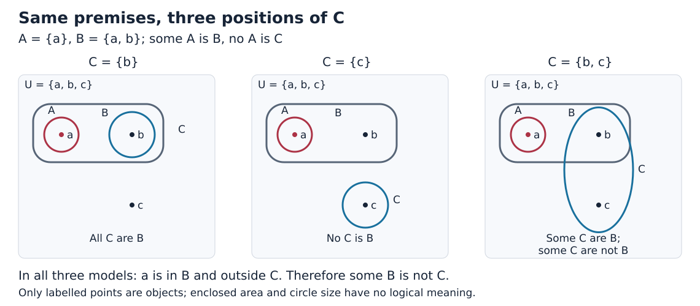

# Euler 第CIV信 特称见证与十九种形式的边界

## 1768年出版的完整书信章节精读

**一句“有些”已经给出了存在见证；一句“所有”只约束对象去哪里，并不自动给出对象。** Euler第CIV信把这两类信息放在圆域中传递，继而列出二十个三段式，把其中两个认作同式而留下十九。读这封信，最重要的不是背下十九这个数字，而是能说明：哪个对象保证结论成立；同一幅图还允许哪些变化；按什么标准才算两条规则相同。

本篇逐段解释特称前提的四条推理、十九个图形配置、二十式汇总、包含的两个原则，以及信末关于发现真理的强主张。附带的现代程序审计保留原印与教学修复两条轨道，并检查空项、存在前提和计数标准。它是AI思想与数学前史的继续回填，不是独立期刊论文，更不宣称是第一篇AI论文或逻辑图的历史起点。

### 文献信息与阅读范围

- 作者：Leonhard Euler。
- 原著：*Lettres à une princesse d’Allemagne sur divers sujets de physique & de philosophie*，Tome second，Lettre CIV。
- 出版：Saint Pétersbourg，de l’Imprimerie de l’Académie Impériale des Sciences，1768。具体发行月日未核。
- 书信署日：**1761年2月21日**，按原印记录，未另作历法换算；不能把署日当作出版日。
- 完成单位：1768原印111页下部LETTRE CIV起，至119页上部署日止，共九个印页位置。111页上部CIII和119页下部CV不属本次完成范围。E344是第二卷整卷编号。[Euler Archive机构书目](https://scholarlycommons.pacific.edu/euler-works/344/)
- 底本：[1768 Oxford藏本Google扫描](https://archive.org/details/lettresuneprinc01eulegoog)，对应[PDF132–140](https://archive.org/download/lettresuneprinc01eulegoog/lettresuneprinc01eulegoog.pdf#page=132)。112、114、116、118页有裁切或版面移位，不能称原版所有字均直接读清。补核使用ETH的1770年Mietau et Leipsic、Steidel et Compagnie版，CIV印116–124，全信逐页对照；不是同版传真。[ETH机构记录](https://www.e-rara.ch/zut/content/titleinfo/2380138)
- 版本发现：1768印117及1770印122的第XVI式末项均为B，和前页展开及后页同式解释冲突。本文保留该原印，另列C作为有根据的教学修复，**没有把它宣布成作者正式勘误**。证据、图数、扫描缺损和检索范围见[逐页账本](euler-letter-civ.sources.zh-CN.md)与[独立原典和数学审计](euler-letter-civ.audit.zh-CN.md)。

**阅读路线。** 第1–4节建立直觉并重建四条证明；第5–8节核查二十式、存在性与计数；第9–10节说明可运行模型和真正实跑的范围；第11–13节讨论意义、练习和开放问题。只需理解集合、包含与“至少一个”。

本文四种标记：**原文**指可定位的历史文字或图；**现代重构**指本文声明的逻辑语言；**本文审计**指对原主张条件的检查；**实跑**只指附件实际执行的输出。有限实验、一般证明和历史事实分别陈述。

## 1 为什么先问特称前提中的对象在哪

**原文，111页。** 上封CIII考察第一命题为全称的推理，第二命题并不一定全称。本封转入第一命题为特称肯定或特称否定，以补齐能得确定结论的形式。这一历史顺序值得保留，不能把本信开头改写成现代四格三段论表已经完整给定。

若我们知道“有些A是B”，至少有一个对象同时属于A与B。再知道“所有A是C”，这个已有对象便不得不属于C。因此，我们得到“有些C是B”。推理不需要知道A和B到底有多少成员，也不需要画出全部对象。

相反，若第二句是“所有C是A”，C可能碰到A与B共有的那部分，也可能避开。这里的不确定性不是计算精度不足，而是前提本身没有约束足够的信息。画得再漂亮也不能把缺少的前提补出来。

这使本信有两个不同的任务：

1. 找到可以传递同一个见证的结构，证明结论保真。
2. 在不能传递时构造多个许可配置，说明为什么不能硬推。

CII提供四类命题及其图示，CIII提供三项推理和特称不确定性背景；本信直接依赖这套约定。它没有机器、训练数据、统计学习或计算复杂度论证。本文与后来的符号推理联系属于解释性延伸，不是给Euler追加现代研究目标。

## 2 符号 语义与必须公开的假设

**现代重构。** 固定一个非空论域U，A、B、C是它的子集，允许子集为空。所有命题在同一个论域、同一个时刻、同一个词义下解释。圆的面积不表示概率或人数，包含不要求严格包含，相交不要求双方各有独有成员。

| 符号 | 中文读法 | 精确定义 | 是否保证存在对象 |
| --- | --- | --- | --- |
| $`\mathsf A(X,Y)`$ | 所有X是Y | $`X\subseteq Y`$ | 否 |
| $`\mathsf E(X,Y)`$ | 没有X是Y | $`X\cap Y=\varnothing`$ | 否 |
| $`\mathsf I(X,Y)`$ | 有些X是Y | $`X\cap Y\ne\varnothing`$ | 是，X与Y共有见证 |
| $`\mathsf O(X,Y)`$ | 有些X不是Y | $`X\setminus Y\ne\varnothing`$ | 是，X有见证；不保证Y非空 |
| $`x`$ | 一个对象或见证 | $`x\in U`$ | 从特称前提或额外非空条件取得 |
| $`\Gamma\models q`$ | 前提在语义上保证q | 每个满足所有前提的模型都满足q | 不等于某个例子中q碰巧为真 |

命题类型用正体字母，集合用普通字母。例如 $`\mathsf A(A,B)`$ 的第一个A是“全称肯定”类型，括号里的A才是集合名。

```math
\begin{aligned}
\mathsf A(X,Y)&\iff \forall x\,(x\in X\Rightarrow x\in Y),\\
\mathsf E(X,Y)&\iff \forall x\,(x\in X\Rightarrow x\notin Y),\\
\mathsf I(X,Y)&\iff \exists x\,(x\in X\land x\in Y),\\
\mathsf O(X,Y)&\iff \exists x\,(x\in X\land x\notin Y).
\end{aligned}
```

特称肯定的“有些”是至少一个，不是“有些但不是全部”。A=B={x}满足特称肯定。特称否定也不保证A与B交叠：A={x}、B={y}已经满足“有些A不是B”。原图画成交叠圆只是一个容许配置，不能把没有说出的交集或独有部分当成前提。

全称否定与特称肯定可以换项：交集的有无与方向无关。全称肯定和特称否定一般不可以。取A={x}、B={x,y}，“所有A是B”为真，“所有B是A”为假；“有些B不是A”为真，“有些A不是B”为假。

本文同时检查“允许空项”和“A、B、C全非空”两种制度。后者有助于辨认图形容易暗示的存在条件，**不是声称Euler用现代公理明确写下了这一制度**。更精细的证明会指出到底只需哪个项非空。

## 3 四条新推理怎样逐步传递见证

### 3.1 有些A是B 而所有A是C

**原文，113–114页，汇总XIII。** C把A全部包住，无论C是否还包含B的其他部分，都包含A与B共有的那部分。

```math
\mathsf I(A,B),\quad\mathsf A(A,C)
\quad\models\quad\mathsf I(C,B).
```

**现代重构的逐步证明。**

1. 第一前提提供某个x，满足x属于A且属于B。
2. 第二前提适用于每个A成员，所以适用于这个x；得到x属于C。
3. 第一步还保证x属于B，因此同一个x属于C与B。
4. 这个对象就是特称结论的见证。

不能在第三步偷偷换成另一个对象。也不需要额外假设C非空，因为C的存在已经从已有见证推出。教学例：A={a,b}、B={b,d}、C={a,b,c}，b沿A到C的包含关系传递。

### 3.2 有些A是B 而所有B是C

**原文，114页，汇总XIV。** 作者改为比较C与B；只要C包含全部B，同一个共有对象就在C中。

```math
\mathsf I(A,B),\quad\mathsf A(B,C)
\quad\models\quad\mathsf I(C,A).
```

取x属于A与B；由B包含于C得x属于C；故x属于C与A。这里不把结论写成“所有C是A”：C还可以包含任意多不属于A的对象。例如A={a}、B={a,b}、C={a,b,c}，结论只需要a。

### 3.3 有些A不是B 而所有A是C

**原文，115页，汇总XV。** A在B外的那部分既然属于A，就被包含A的C一起收入。

```math
\mathsf O(A,B),\quad\mathsf A(A,C)
\quad\models\quad\mathsf O(C,B).
```

第一前提提供x属于A且不属于B；第二前提使x属于C。于是x属于C而不属于B。B可以为空，证明仍成立；C不需要预先单列非空，因为x已在其中。取A={a,b}、B={b}、C={a,b,c}，a见证两项特称否定。

### 3.4 有些A不是B 而所有C是B

**原文，115–116页的展开式。** C全部在B中，所以A在B外的对象也不可能落在C中。这是后来汇总XVI应对应的推理。

```math
\mathsf O(A,B),\quad\mathsf A(C,B)
\quad\models\quad\mathsf O(A,C).
```

1. 由第一前提取x属于A且不属于B。
2. 假定这个x属于C。
3. 由所有C是B，得到x属于B，和第一步矛盾。
4. 所以x不属于C，而x仍属于A，结论成立。

这一步只用了针对同一个对象的包含约束。不存在“把否定任意倒转方向”的许可。取A={a,b}、B={b,c}、C={c}，a保证结论；若改成“有些C不是A”，则C可能为空，或者被A包含，均不能保证。

四条推理已经展示一种有效的阅读方法：先把特称句中的x取出来，再沿包含关系更新它的成员身份。**不需要把整个圆域的形状都确定，才有权作一个存在结论。**

## 4 无法得出结论 究竟没有哪一种结论

### 4.1 第112页的多个图不是装饰

**原文，112–113页。** Euler令C包含于A、部分在A中、或全在A外，并画出C相对于B的不同位置。这里有九个展示配置，再加C包含A的两个配置；加上本信其他页共十九配置。计数单位是一组关系图，而非单个圆。

**现代反模型。** 固定A={a,b,c}、B={b}，只知道有些A是B且所有C是A：

- C={b}时，所有C是B为真，没有C是B为假。
- C={a}时，没有C是B为真，有些C是B为假。
- C={a,b}时，有些C是B及有些C不是B都真。

每个模型都满足两条前提，且三项均非空。它们合起来分别否定四种候选结论的必然性：全称肯定、全称否定、特称肯定、特称否定，没有一种固定的C对B结论被前提保证。不是挑一张图“看不清”，而是给出满足前提但翻转结论的不同模型。

若只有两个特称肯定，也不能把见证合并。令A={a,b}、B={a}、C={b}。有些A是B、有些A是C均真，但是B与C没有共有对象。两个“有些”可以由不同对象实现。

### 4.2 换一下结论方向 会发现原话需要限定

**原文，113页；1770补本118页。** 对C全在A外的配置，作者仍说不能得结论，因为C可以全部、部分或完全不在B中。

**本文审计。** 若“结论”专指以C为主项、B为谓项的四种句子，这种不确定性确实存在。可是若允许两项互换方向，就有确定的特称否定：

```math
\mathsf I(A,B),\quad\mathsf E(A,C)
\quad\models\quad\mathsf O(B,C).
```

证明只有两步：取x属于A与B；因A与C相离，x不属于C，所以x属于B而不属于C。取固定A={a}、B={a,b}，让C分别等于{b}、{c}、{b,c}，C相对于B可以全在内、全在外或部分交叠，但a始终见证“有些B不是C”。



原创教学图：三个面板的前提都是有些A是B、没有A是C；蓝色C依次为{b}、{c}、{b,c}。仅标出的点代表对象，几何区域中的其他位置不是额外对象。图中a始终在B内、C外；英文短标分别表示C全在B中、全在B外、部分在B中。图像生成代码、PNG及[像素核验](../../reproduction/euler-1768-civ/qa/visual-review.zh-CN.md)公开，非原版扫描复制。

因此，“C的位置仍不确定”不能升级成“B与C之间任何方向的结论都没有”。同样，114页关于C与B的“除非包含全部B”的说法，若不限结论类型，也会漏掉相离时的否定结论。

这并非二十式汇总完全不知道这种推理。把全称否定放到第一前提并适当更名，就能在IX–XII那一组找到它。这里发现的是**局部分类说明的输出方向边界**；不能把同一个问题重复算作整个汇总另缺一条规则。

## 5 二十式汇总 先忠实登记再审计

**原文，116–117页；1770对应121–122页。** Euler把之前的规则汇在二十个带罗马编号的格子里。下面是为核查而作的现代符号索引，保留原次序与项方向；不是原表全文翻译。分号隔开两前提，箭头后为结论。

| 原号 | 现代结构 | 证明要点或附加条件 |
| --- | --- | --- |
| I | $`\mathsf A(A,B);\mathsf A(C,A)\Rightarrow\mathsf A(C,B)`$ | 包含传递 |
| II | $`\mathsf A(A,B);\mathsf I(C,A)\Rightarrow\mathsf I(C,B)`$ | 已有见证沿A到B传递 |
| III | $`\mathsf A(A,B);\mathsf E(C,B)\Rightarrow\mathsf E(C,A)`$ | A在B内，C在B外 |
| IV | $`\mathsf A(A,B);\mathsf E(B,C)\Rightarrow\mathsf E(C,A)`$ | III的否定换项 |
| V | $`\mathsf A(A,B);\mathsf O(C,B)\Rightarrow\mathsf O(C,A)`$ | C中在B外的见证也在A外 |
| VI | $`\mathsf A(A,B);\mathsf A(B,C)\Rightarrow\mathsf I(C,A)`$ | 需A非空 |
| VII | $`\mathsf E(A,B);\mathsf A(C,A)\Rightarrow\mathsf E(C,B)`$ | C全部承受A与B的分离 |
| VIII | $`\mathsf E(A,B);\mathsf A(C,B)\Rightarrow\mathsf E(C,A)`$ | VII交换A与B，并对E换项 |
| IX | $`\mathsf E(A,B);\mathsf I(C,A)\Rightarrow\mathsf O(C,B)`$ | C与A的见证不在B |
| X | $`\mathsf E(A,B);\mathsf I(A,C)\Rightarrow\mathsf O(C,B)`$ | IX的特称肯定换项 |
| XI | $`\mathsf E(A,B);\mathsf I(C,B)\Rightarrow\mathsf O(C,A)`$ | C与B的见证不在A |
| XII | $`\mathsf E(A,B);\mathsf I(B,C)\Rightarrow\mathsf O(C,A)`$ | XI的特称肯定换项 |
| XIII | $`\mathsf I(A,B);\mathsf A(A,C)\Rightarrow\mathsf I(C,B)`$ | 第3.1节 |
| XIV | $`\mathsf I(A,B);\mathsf A(B,C)\Rightarrow\mathsf I(C,A)`$ | 第3.2节 |
| XV | $`\mathsf O(A,B);\mathsf A(A,C)\Rightarrow\mathsf O(C,B)`$ | 第3.3节 |
| XVI原印 | $`\mathsf O(A,B);\mathsf A(C,B)\Rightarrow\mathsf O(A,B)`$ | 仅重述第一前提；和展开不一致 |
| XVII | $`\mathsf A(A,B);\mathsf I(A,C)\Rightarrow\mathsf I(C,B)`$ | II的特称肯定换项 |
| XVIII | $`\mathsf E(A,B);\mathsf A(A,C)\Rightarrow\mathsf O(C,B)`$ | 需A非空 |
| XIX | $`\mathsf E(A,B);\mathsf A(B,C)\Rightarrow\mathsf O(C,A)`$ | 需B非空 |
| XX | $`\mathsf A(A,B);\mathsf A(A,C)\Rightarrow\mathsf I(C,B)`$ | 需A非空 |

### 5.1 为什么程序可能完全抓不到XVI的排印问题

XVI原印在逻辑上当然有效：前提之一就是结论。给它跑多少真值模型，也不会出现“两前提真、结论假”。但它没有表达前页推理所得的“有些A不是C”，也不符合后页把XVI归并为V的换项说明。**有效性测试不能独自保证转录忠实或研究目标正确。**

1768印116展开式末项C清楚可辨；印117表内XVI末项B也清楚可辨。1770印121/122保留相同分歧。再加118页的更名与换序说明，三项证据支持下面的教学修复：

```math
\text{XVI教学修复：}\quad
\mathsf O(A,B),\ \mathsf A(C,B)
\Rightarrow\mathsf O(A,C).
```

这不是根据OCR猜出作者没写的东西。相反，原印不一致被明确保留，修复根据本信内部证据提出。附件分别保存原印与修复规则，不用修复悄悄覆盖原式；也不声称已定位正式勘误或作者手稿。

### 5.2 表之外的证明结构

其余式可分为三种基本操作：包含传递、相离的继承、带见证的传递。III的证明例如是：若有x既在C又在A，则因A在B内，x也在B，违背C与B相离，所以不存在这种x。VII的证明把C包含于A的关系放在同一条链上。V和修复XVI则把“在大集合外”传递到“在小集合外”。

II、IX及其换项变体都有明确的特称前提，因此对象的存在不需从图中猜。VI、XVIII、XIX、XX恰好相反：两前提都是全称，却给出特称结论；必须单独检查见证来源。

## 6 四条存在性敏感规则分别需要什么

### 6.1 VI 包含链并不创造成员

由A包含于B、B包含于C，可推出A包含于C。要进一步得到C与A共有对象，必须有A成员。

```math
A\subseteq B\subseteq C,\quad A\ne\varnothing
\quad\Longrightarrow\quad A\cap C=A\ne\varnothing.
```

因此在这两前提下，结论成立恰好等价于A非空。B或C非空不能替代A非空：令A为空、B=C={b}，两前提真，特称结论假。

### 6.2 XVIII与XIX 从相离得到特称否定也需要人选

XVIII中A与B相离，A又包含于C，所以任何A成员都在C而不在B。A非空足够。取A为空、B=C={b}，结论“有些C不是B”是假，说明单有两个全称前提不够。

但这里不要说“A非空是结论在每个模型中成立的必要条件”。A为空时，C仍可能有别的成员在B外。例如A为空、B={b}、C={c}，特称结论也真。准确说法是：**把存在条件只限为若干项非空时，A非空是一项最小、足以普遍担保该推理的补充条件。**

XIX完全对称，需要B非空作为这样的最小补充。反例取B为空、A=C={a}；两个全称前提都真，却没有C成员在A外。

### 6.3 XX 同属两个大类的空小类不给共有见证

若A包含于B且包含于C，则A包含于B与C的交集；A非空便保证交集非空。

```math
A\subseteq B,\quad A\subseteq C,\quad A\ne\varnothing
\quad\Longrightarrow\quad B\cap C\ne\varnothing.
```

空项反例是A为空、B={b}、C={c}且b与c不同。B和C各自存在也不能代替A存在。另一方面，A为空并不迫使B与C不交；它们可能恰巧重合。所以和XVIII一样，应区分“保证规则的最小附加假设”和“单个模型中结论为真的充要条件”。

**原文，118页。** 作者以XX再次解释包含：A同时在B与C中，便把C的一部分放入B。这里“这一部分”正是现代审计要追问是否有成员的地方。画出非空区域让它显得自然，却不能免除语言层面的存在条件。

## 7 从二十到十九 为什么不能直接和现代计数对齐

### 7.1 原文实际只做了一次具体归并

**原文，118页；1770印123。** Euler说XVI与V是同一式：交换A与C，并先写第二前提，便从一个得到另一个，因此二十剩十九。

把V完整写出来并更名：

```math
\begin{aligned}
&\mathsf A(A,B),\ \mathsf O(C,B)\Rightarrow\mathsf O(C,A),\\
&A\leftrightarrow C:\quad
\mathsf A(C,B),\ \mathsf O(A,B)\Rightarrow\mathsf O(A,C),\\
&\text{交换前提次序：}\quad
\mathsf O(A,B),\ \mathsf A(C,B)\Rightarrow\mathsf O(A,C).
\end{aligned}
```

结果恰好是XVI的教学修复，不是末项B的原印。这个换名过程也说明字母只是位置占位符，不自带固定的“中项”身份。

### 7.2 字面条目 相同语义与改名同式是三种问题

只要允许E与I换项，III和IV、IX和X、XI和XII、II和XVII已经各成一对。因此十九不能解读为“在全部显然的语义对称下去重后的独立规则数”。若进一步允许全局更名和交换前提，还会有更多归并。

本文代码定义一种可复查的**结构等价**：对A、B、C同时置换；允许交换两前提；只对E、I允许两参数交换；结论仍保留其量质。这不是把所有真值等价关系都任意合并，也不是Euler明定的计数公理。特别是在全非空制度下，一条全称结论和其特称弱化都可有效，但此处不因“都有效”就把两者当成同一式。

有一项正面的核验值得强调：若只准许全局更名与前提换序，**不准许E/I换项**，修复后的二十式恰好归为十九组，唯一合并的正是V与XVI。这为作者的这一步计数提供了可重建的窄判准，虽然本信没有另写一套形式化等价关系定义。加入E/I换项后，得到九组：I；II/XIII/XIV/XVII；III/IV/VII/VIII；V/XVI；VI；IX/X/XI/XII；XV；XVIII/XIX；XX。

这套现代比较有助于理解何种操作改变计数，却不能反过来规定十八世纪作者必须采用最宽判准。严谨的历史结论是：**原信展示二十条并说明一次归并；窄判准能重建十九，较宽的判准给出九。两者回答不同问题。**

### 7.3 怎样公平检查是否列全

**现代重构。** 固定结论为S对P，M为只出现在两前提中的中项。让每个命题取A、E、I、O四种量质，两前提的项位置取下面四格：

| 格 | 第一前提项对 | 第二前提项对 | 结论项对 |
| --- | --- | --- | --- |
| 1 | M、P | S、M | S、P |
| 2 | P、M | S、M | S、P |
| 3 | M、P | M、S | S、P |
| 4 | P、M | M、S | S、P |

共有 $`4\times4^3=256`$ 个有序候选。允许空项时和三项非空时，有效候选数不同；它们又都不是对Euler二十个印格作同一种计数。附件输出逐项名单与有效性判定，并为二十式汇总表的失败情形给出反模型，而不是只打印一个神秘总数。

一个不靠总数也能检查的例子是：

```math
\mathsf E(A,B),\quad\mathsf A(C,A),\quad C\ne\varnothing
\quad\models\quad\mathsf O(C,B).
```

这条推理先由VII得到没有C是B，再用C非空降为有些C不是B。若不允许这种较弱结论算独立候选，当然可以不单列；若说枚举所有有效的A/E/I/O候选，它就必须被考虑。它与XVIII的差别是包含方向：C在A中，和A在C中，需要的存在项也不同。

按常规的S/P/M角色把原表整理到四格，而不任意倒转结论以另造一条标准写法，修复后的原表对应通常的十九式。256候选中，全非空下另有五个有效的弱化写法：AAI-1、EAO-1、AEO-2、EAO-2、AEO-4。这里三字母依次是两前提和结论的量质，末尾数字是上表格号。它们均可从原表代表的较强全称结论加主体非空获得。

若再按上一节最宽的结构等价归并，二十四个标准有效候选成为十一类，原表仍是九类：上述五个写法中的AAI-1与原表VI已经同属包含链特称结论类；其余四个对应两种额外的否定弱化类。因此“缺五个标准写法”和“少两种宽结构类”并不矛盾，**也不等于作者缺少推导这些弱结论的能力**。程序与审计文件公开了映射和同式标准。

所以，评估“所有形式”至少要公布：是否允许空项；是否保留全称结论的特称弱化；是否固定前提顺序；E/I换项和字母更名算不算同式。单说“历史上十九、现代程序二十四”而不给这些前提，是把不同对象放进同一张排行榜。

## 8 包含的两个原则到底证明了多大范围

**原文，118–119页。** 作者把这些形式归于包含者与被包含者的两个原则：在被包含者中的对象，也在包含者中；在包含者之外的对象，也在被包含者之外。他随后定义两个前提与一个结论，说明前提真时结论必真，并把三段论说成发现未知真理的唯一方式。信末还按出现顺序把第一前提称为大前提，第二称为小前提。

### 8.1 两个原则的现代证明

令X包含于Y，第一个原则就是包含定义对任意对象的实例化。第二个原则为：

```math
X\subseteq Y\quad\Longrightarrow\quad
\bigl(x\notin Y\Rightarrow x\notin X\bigr).
```

若x不在Y却在X，就由包含推出它在Y，矛盾。因此第二个原则在本文的经典集合模型中成立。等价的集合写法是：

```math
X\subseteq Y\quad\Longrightarrow\quad
U\setminus Y\subseteq U\setminus X.
```

补集相对于同一个U；如果两个词在不同论域里解释，这个式子不能直接照搬。两原则是成员约束，不产生新对象。仅靠它们，从空A推不出VI或XX的存在结论。

### 8.2 可靠性 完备性与发现不是一回事

- **可靠性：** 指定的一条规则，每次前提真，结论也真。第3、5、6节给了逐式证明及必要限定。
- **枚举覆盖：** 一个规则表是否包括所声明语言中的全部有效候选。需要像第7节那样先定义候选空间和同式标准。
- **发现方法：** 人如何找到值得相信的前提、形成新概念、提出新问题。规则的保真性本身不回答这些问题。

因此，即便十九条都在适当假设下可靠，也不能由此推出它们包办一切科学发现或所有数学推理。本信没有形式化自然语言的全部表达力，也没有证明多重关系、任意量词嵌套、概率论证都能化为这张表。把“所有真理来自前提确定的三段论”读成作者的认识论主张，既忠实于信末，也避免冒充已经完成的数学定理。

一个具体的可靠但不发现的例子：所有已获某认证的物品都通过检验；某物品已获认证；于是它通过检验。逻辑形式保证传递，但“认证记录是否真实”“认证规则是否适用当前批次”仍是外部事实问题。本篇不替Euler添加这样的现代例子为历史论据，它只是说明适用边界。

### 8.3 大前提这个名字不能固定在字母A上

原信末按先后介绍大、小前提；现代四格表通常按结论谓项P与主项S区分两前提。做比较时应重新确定S、P、M。例如XIII结论是C对B，中项才是A；XIV结论是C对A，中项变成B。不能把每条的第一个字母A机械当作同一种语法位置。

## 9 把图域压缩成可以穷举的模型

### 9.1 八个成员类型

**现代重构。** 一个对象相对于A、B、C只有八种成员身份。用三位二进制记录它是否在A、B、C中，例如101表示在A与C中而不在B中；000表示三个项以外的对象。程序为每个类型记录“有没有至少一个对象”，不记录对象数。

```math
\tau(x)=\bigl(\mathbf1_A(x),\mathbf1_B(x),\mathbf1_C(x)\bigr)
\in\{0,1\}^3.
```

上式元组按(A,B,C)顺序读；程序整数编码另采用A位权1、B位权2、C位权4。它的普通二进制显示从高位到低位是C、B、A，不能将两种顺序混读。

集合是否包含、是否相交、是否有差集，只依赖哪些类型出现。例如A包含于B，恰好要求A位为1、B位为0的所有类型都不出现；有些A不是B，恰好要求其中至少一种出现。

非空论域下，八类型占用模式有 $`2^8-1=255`$ 种。允许空项不等于论域为空：只占用000的模型就是非空论域、三个项全空。程序明确保留它，不把“没有任何项成员”误写成“根本没有模型”。

### 9.2 为什么小模型足够 以及程序没有替我们证明什么

**覆盖论证。** 从任意非空模型出发，不管它有限还是无限，把每个出现的成员类型选一个代表。至多八个对象组成新模型。对每条A/E/I/O命题：

1. 若它是全称肯定或否定，原模型中有没有违反条件的成员类型保持不变。
2. 若它是特称肯定或否定，原模型中有没有满足条件的见证类型保持不变。
3. 因而每条基本命题真假不变，它们组成的有限布尔组合也因联结词逐层保真而不变。
4. 每个项是否非空同样保持。

反过来，每个占用模式都能由“每个占用类型放一个对象”实现。所以如果这个固定三项语言中的推理存在反例，就有至多八对象的反例。**这段论证才解释为何可做完备的有限搜索；跑完255个模型只是对实现和具体候选的检查。**

这不是任意一阶逻辑的小模型定理。若加入“至少有两个A”、精确人数、对象之间的二元关系或更多谓词，压缩可能丢信息，八类型程序便不再适用。只凭多个测试通过也不能认证程序本身无bug，所以另设不复用主判断函数的独立核验。

### 9.3 原印审计与形式化审计是两层测试

XVI原印只重述前提，因此在255模型上全有效，但它不是标准三段论端点输出：共享项B还留在结论中，C却消失了。程序应分别回答：语义上有效吗？结构上有三项消去吗？忠实于展开式和作者的归并说明吗？最后一问仍需来源阅读。

原印、教学修复、模型制度和候选空间都写进结果文件。这让后来的读者能在不相信本文一句总评的情况下，重新运行同一问题，或者明确修改自己的假设。

## 10 可运行附件与实跑范围

本篇附[标准库复现说明](../../reproduction/euler-1768-civ/README.md)，包含原印/修复规则数据、模型检查器、逐步教学脚本、测试、环境与真实日志；[独立代码审计](../../reproduction/euler-1768-civ/review/review.zh-CN.md)与[独立原典数学审计](euler-letter-civ.audit.zh-CN.md)分别记录实现和来源核查。无需第三方安装；本次不为九页章节附造一个空壳Notebook，也不声称Jupyter内核执行。

### 10.1 实际命令与结果

本轮在CPython3.12.14、Linux x86_64环境实跑。代码要求Python3.10及以上；这一兼容要求不等于声称每个版本都实际跑过。从附件目录执行：

```sh
python3 report.py --check outputs/report.json
python3 -m unittest discover -s tests -v
python3 run_checks.py
python3 review/run_independent_checks.py
```

主命令日志见[outputs/run.log](../../reproduction/euler-1768-civ/outputs/run.log)，环境及输入散列见[environment.json](../../reproduction/euler-1768-civ/outputs/environment.json)，完整数据见[report.json](../../reproduction/euler-1768-civ/outputs/report.json)。已实际通过23个单元测试方法，包括全部基本命题求值、四对象的4,096个成员配置、规则/存在条件、候选唯一性、两种归并、非法输入和确定性回归。

| 实际核验对象 | 候选数 | 允许空项的有效数 | 三项均非空的有效数 |
| --- | ---: | ---: | ---: |
| 二十原印式 | 20 | 16 | 20 |
| 仅修复XVI后的二十式 | 20 | 16 | 20 |
| 四格有序候选 | 256 | 15 | 24 |
| 下述扩展三项候选 | 512 | 30 | 48 |
| 扩展空间的特称首前提切片 | 256 | 10 | 10 |

每种规则都枚举255个非空论域占用模式；其中218个满足A、B、C全非空。二十式还逐条核全部八种“哪些项非空”的假设组合，输出按包含关系最小的充分假设；失败情形给出按对象数、再按掩码排序的最小反模型。最小反例不是唯一反例，正文为了教学另给B、C非空的更有区分力的例子。

扩展512空间的定义为：第一前提固定成q(A,B)；第二前提项对取(A,C)、(C,A)、(B,C)、(C,B)之一；结论使用剩余的那对项并准许两个方向；三处命题种类各自取A/E/I/O。总数为4×16×8。第一处只取I或O就是256特称切片；它与四格256虽然数量相同，候选定义不同，不混作同一个检查。

特称切片中十个有效写法包括第3节四条及其I换项表达，也包括把相离前提放后面的四个否定推理。这正好把第4.2节“不能作任何方向结论”的过强解读暴露出来；它们能在整张二十式表经更名和前提换序后找到，因此不把局部说明缺口重复计算为全表缺式。

### 10.2 独立检查和失败路径

独立核对器不导入主实现的语义或归并函数，用显式集合及另写的变换核对报告；通过8,653项字段比较，并重新运行23项主测试、生成临时报告逐字节比较。还实际篡改一份临时报告，确认检查命令返回预期非零状态，防止“无论内容如何都报成功”。这次预期失败是验证保护机制，不是发布测试残留失败。[独立日志](../../reproduction/euler-1768-civ/review/run.log)及[验证记录](../../reproduction/euler-1768-civ/review/validation.json)可复查。

机器检查没有代替第9节覆盖论证，也没有证明历史文本没有遗漏或所有自然语言推理完备。独立来源审计负责原图、页界、字母与解读；独立代码审计负责实现、结果与可重跑性。原创图另有真实渲染和像素核验；它不是数学正确性的证书。

## 11 对AI前史研究的价值和不该附会的地方

**本文延伸。** 这封信展示了几种后来做符号系统仍要认真处理的工作：把自然语言句子归为有限形式；把对象关系放进可操作表示；用规则传递既有信息；寻找反模型限制过强结论；为多种表达方式建立同式标准。这些是研究方法上的相似点，不能单凭相似就断言某条直接技术传承已获证明。

XVI尤其适合作为可复核的例子：一个系统可以输出永真、却没有回答目标问题的句子。验证器只检查“是否有效”还不够，还要检查“是否对应正确的输入、来源和任务”。这和现代自动推理或生成系统的评估有启发性联系，但不是声称Euler提出了现代机器评估。

另一条启发来自空项：表示层画了一个圈，就容易把它的存在误当作语言层已经给出的事实。现代知识库也需要区分“一个类型被定义了”和“已有这个类型的实例”。全称规则可以约束潜在成员，并不总能生成一个实例。这是由本文模型导出的教学类比，不是历史原信的实验结果。

**局限。** 本文没有完成Euler全书、CV后续论述、所有重印的校勘、手稿来源、更早图解逻辑的优先权研究，也没有把传统三段论的不同存在预设压成唯一正统。既有Boole、Schröder、Whitehead等可得未读书籍以及其他未完候选仍保留。回填1768不是宣布历史已经从这里被穷尽。

## 12 复习与有答案的练习

### 问题

1. 从有些A是B、所有C是A，为什么不能推出有些C是B？给出三项都非空的反例。
2. 把XIV逐步证明写成一个见证的移动过程，指出是否需要另加C非空。
3. VI中仅要求B、C非空够不够？给出反例，并说明哪个条件恰好等价于其结论。
4. XVIII中A非空是否是每个模型里结论为真的必要条件？为什么这和“最小附加存在假设”不矛盾？
5. 对原印XVI跑所有有限模型，为什么抓不到它与展开式的不一致？应该增加哪种检查？
6. 从V得到修复XVI时，依次做了什么？为什么不能只换结论中的字母？
7. 已知有些A是B、没有A是C，给出一个确定结论；再给出C可以全在B内的模型。
8. 若语言新增“恰好两个A”，为什么八类型压缩不再保真？
9. “所有规则保真”能否推出“所有真理都能靠这些规则发现”？指出缺少的论证。

### 参考答案

1. A={a,b}、B={b}、C={a}。第一条由b见证，第二条由C包含于A满足，但C与B不交。反例证明的是这一推理无效，不是说现实中C永远不交B。
2. 由第一条取x属于A与B，由所有B是C得x属于C，仍有x属于A，所以有些C是A。C非空已由x推出，不需另加。
3. 不够。A为空、B=C={b}使两个全称前提真、结论假。在包含链前提下，C与A的交集恰为A，所以结论与A非空等价。
4. 不是。A为空、B={b}、C={c}仍有C成员不在B。但若想让前提对所有许可模型都保证结论，且附加条件只谈各项非空，单独A非空足够且不能省；仅B、C非空仍可能取B=C，使结论假。
5. 因为原印结论重复第一前提，任何模型都自动满足。需来源一致性检查和目标结构检查：它是否对应前页O(A,C)，是否消去两前提共享的B，是否能由作者所说的更名与换序得到。
6. 对整个规则同时交换A与C，再交换两前提的次序。更名必须作用于所有出现位置，否则改变了规则而非只换标签。
7. 有些B不是C。同一个A与B共有对象不在C。A={a}、B={a,b}、C={b}满足两前提，且C全在B内；这不妨碍a见证B在C外有成员。
8. 两个具有同一成员类型的A对象会压成一个；A/E/I/O只问存在与禁止，该新句却区分一与二。模型语言变了，覆盖证明的假设被破坏。
9. 不能。还需说明所有所讨论真理都可在语言中表达、规则在该语言中覆盖全部有效推理，以及可信前提如何取得。保真不自动提供表达完备性、推导完备性或事实发现机制。

## 13 书目 证据与后续问题

### 本次实际使用的主要文献

1. Euler, Leonhard. *Lettres à une princesse d’Allemagne sur divers sujets de physique & de philosophie*. Tome second. Saint Pétersbourg: Imprimerie de l’Académie Impériale des Sciences,1768. Lettre CIV,111下部–119上部，署1761-02-21。[原副本PDF](https://archive.org/download/lettresuneprinc01eulegoog/lettresuneprinc01eulegoog.pdf#page=132)；[机构书目E344](https://scholarlycommons.pacific.edu/euler-works/344/)。
2. Euler. 同书Tome second. A Mietau et Leipsic: Chez Steidel et Compagnie,1770. Lettre CIV,116下部–124上部。ETH-Bibliothek Zürich,Rar5101:2；原图逐页补核。[机构记录](https://www.e-rara.ch/zut/content/titleinfo/2380138)；[持久标识](https://doi.org/10.3931/e-rara-8642)。
3. Euler. 同书1772第三卷题前的*ADDITIONS & CORRECTIONS*，仅作为有界更正检索，不计第三卷正文已读。[题前PDF22](https://archive.org/download/lettresuneprinc00eulegoog/lettresuneprinc00eulegoog.pdf#page=22)。适用范围的谨慎解释见来源账本。
4. 本仓库已完成的[CII](euler-letter-cii.zh-CN.md)与[CIII](euler-letter-ciii.zh-CN.md)提供阅读连续性。它们是现代研究附件，不替代本信原图证据；CIII的原106/110遮挡问题不因本次完成CIV而消失。

公开附件不镜像原扫描、不提供全文转录或全文翻译；只发布原创解释、短语校读、结构化式表、来源位置和自己的代码。

### 仍应追问的问题

- 是否能找到未裁切的独立1768副本，直接认证当前只能用1770补核的字面？后版的对应不证明遮失字逐字相同。
- XVI不一致是否在更早稿本、作者校样或其他版本中得到正式修正？本次内部校核的充分理由不等于已经回答了版本史。
- 作者的十九条是否有更明确的传统命名或取舍准则？本信只足以证明它列了什么及怎样解释一次重复，不能替整部三段论史定数。
- 对图中“部分”的存在含义，后续书信有何补充？CV只核交界，不在本轮完成清单里。

**本篇完成口径：** CIV完整书信章节，以1768可见原印与1770全文补核的复合底本完成；十九图配置、四条展开式、二十式汇总及结尾方法论均纳入。原版裁切字面、全卷、全书、CV及上述历史问题继续开放。
