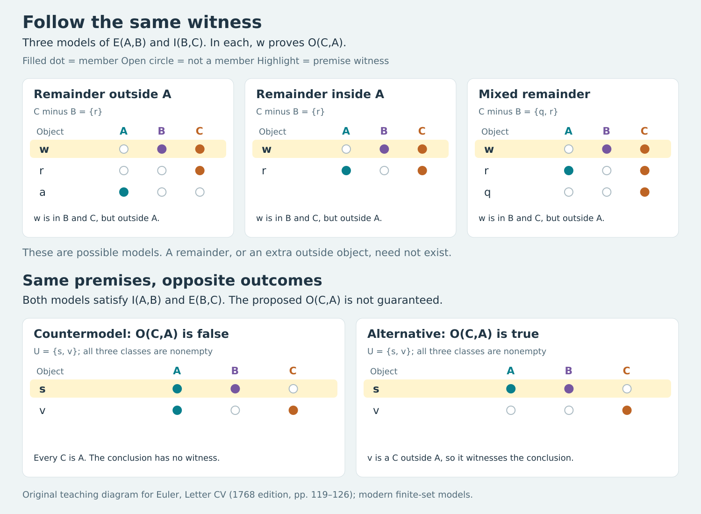

# Euler 第CV信：怎样知道结论真的跟着前提走

## 1768年AI前史精读：同一见证、反模型与保真性的方向

**一个结论碰巧是真的，不等于它是由眼前的前提推出的。** Euler在这封信里把这个区别讲得很具体：先追踪圆图里的一颗星，证明同一个对象怎样从两条前提进入结论；再让第三个圆移动，说明一句听起来有道理的话为什么可能没有根据；最后解释，假前提并不必然带来假结论，但有效推理的假结论必定暴露至少一个假前提。

这一课的中心不是背十九种三段论，而是建立一个可以操作的检查标准：**保留所有前提，能否造出一个结论为假的情形？** 造得出来，形式就不保真；造不出来还不够，需要解释为什么所有容许情形都被覆盖。下文把原信的图示、一般证明和可运行的有限检查接起来，同时指出一幅原印图不能按几何边界直接当成正确集合模型。

这是一篇完整书信章节的原创中文解读，不是逐段翻译，不是独立期刊论文。它属于AI的逻辑思想前史，没有训练、数据集、性能评测，也不被宣称为最早的AI或逻辑文献。

### 文献信息、版本与边界

- 作者：Leonhard Euler，莱昂哈德·欧拉。
- 作品：*Lettres à une princesse d’Allemagne sur divers sujets de physique & de philosophie*，第二卷，Lettre CV。
- 原出版：Saint Pétersbourg，帝国科学院印刷所，1768年；E344是整卷编号，不是本信的论文编号。[Euler Archive书目](https://scholarlycommons.pacific.edu/euler-works/344/)
- 本信署日：1761年2月24日。署日与出版年分开记录，不据署日猜定发行日，也未做历法换算。
- 主底本：1768原印119页中下部，至126页署日；Internet Archive扫描PDF140–147。119页上部属于CIV，126页署日后的CVI不计入。[原版开始页](https://archive.org/download/lettresuneprinc01eulegoog/lettresuneprinc01eulegoog.pdf#page=140)
- 对照本：1770年Mietau et Leipsic、Steidel et Compagnie版，原印124–131，对应全信。它是重新排印的版本，不能替原版逐字担保；本篇逐页看图核对文字、图形和署日，并局部补读原120页受裁的行末字尾。完整阅读因此是1768主底本、1770局部补读与全篇对校，不声称1768每字无缺。[ETH藏本目录](https://www.e-rara.ch/zut/content/titleinfo/2380138)
- 本轮只完成CV；CVI、后续书信、第二卷整体和全书仍未完成。CIII、CIV既有的扫描缺字、图式及版本问题不会因这封信完成而自动关闭。

下文页码若无版本标识，均指1768原印页。细到每页、每图的定位见[来源账本](euler-letter-cv.sources.zh-CN.md)，独立核查与修订边界见[数学和来源复核](euler-letter-cv.audit.zh-CN.md)。

### 如何阅读

想先抓住思想：读第1、3、5、7节，再做第13节练习。想自己重建证明：连读第2–10节。想核对历史和代码：读第4、11、12、14节，并运行[复现附件](../../reproduction/euler-1768-cv/README.md)。

本文区分四个层次：**原文**是有页码的历史内容；**教学重构**是本文定义的集合与逻辑语言；**本文推论**是从这些定义推出的结果；**实跑复现**仅指附件代码实际执行得到的输出。集合论、模型支持掩码和Python不是Euler原信的术语或实验。

## 1 从列出形式，转向解释形式为什么可靠

前两封信已经铺好台阶。[CIII](euler-letter-ciii.zh-CN.md)考察全称首前提怎样约束三项关系；[CIV](euler-letter-civ.zh-CN.md)补入特称首前提，列出二十个编号形式，再归并为十九。CV开头不继续扩张表格，而是回到可靠性的定义：两条前提为真时，结论必须为真。[119–120页](https://archive.org/download/lettresuneprinc01eulegoog/lettresuneprinc01eulegoog.pdf#page=140)

这一步把两个问题分开：

1. 我相信这三句话分别是真的吗？
2. 无论把项换成什么，只要前两句为真，第三句是否就必须为真？

第一问取决于对象与事实，第二问取决于形式。原信用“有德者”“说人坏话者”“有学问者”，以及“吝啬者”作例子。这里将它们当作历史文本中的类名，不把作者对这些群体的事实或道德判断当成本文认定的社会事实。最后的树木例子正好说明：即使更换全部实质内容，坏形式仍能暴露出来。

教学上可以把一个论证看成一台有条件的保真装置。装置不负责自动检验输入前提是否符合现实；它负责保证：**如果输入真，输出就不会假。** 这不是说它会从任意输入制造真理，也不是说看到正确输出就能反查输入全都正确。

CV的结构因此很清楚：119–122页给出有效例及未定区域；123–125页给出无效例和同形式替换；126页总结真假关系与推理表述。理解这条线，比孤立地摘一句“所有推理都是三段论”更接近本信实际完成的工作。

## 2 先固定符号，避免在换例子时换掉问题

### 2.1 一个模型由什么组成

**教学重构。** 取非空论域$`U`$，以及它的三个子集$`A,B,C`$。论域是一回讨论中的所有对象，不是纸上圆的面积；集合成员是对象，不是圆心或笔画。

```math
\mathcal M=(U,A,B,C),\qquad U\ne\varnothing,\qquad A,B,C\subseteq U.
```

类允许为空。这个约定用于现代审计，不冒归为Euler明文采用的空项逻辑。需要考察“三个类都存在”时，再额外加上$`A\ne\varnothing,B\ne\varnothing,C\ne\varnothing`$；两种约定的运行结果分别报告。

四类直言命题写成如下形式。集合字母$`A`$与字体不同的全称肯定符号$`\mathsf A`$不是同一个东西。

| 命题 | 读法 | 集合条件 |
| --- | --- | --- |
| $`\mathsf A(X,Y)`$ | 所有X都是Y | $`X\subseteq Y`$ |
| $`\mathsf E(X,Y)`$ | 没有X是Y | $`X\cap Y=\varnothing`$ |
| $`\mathsf I(X,Y)`$ | 有些X是Y | $`X\cap Y\ne\varnothing`$ |
| $`\mathsf O(X,Y)`$ | 有些X不是Y | $`X\setminus Y\ne\varnothing`$ |

“有些”在这里表示至少一个，不表示“有一些但不包括全部”。$`\mathsf I(X,Y)`$允许$`X\subseteq Y`$，也允许两类相等。图上画出两侧的空白月牙，并不授权我们添加“至少一个X不属于Y”。

$`\mathsf E`$和$`\mathsf I`$可交换两个项；$`\mathsf A`$和$`\mathsf O`$一般不行。尤其$`X\setminus Y`$与$`Y\setminus X`$不是同一个区域。整封信的无效例恰好要求读者盯住这个方向。

### 2.2 有效性是对全部模型的要求

设前提为$`P_1,P_2`$，结论为$`Q`$。写

```math
P_1,P_2\models Q
```

表示：对每个符合约定的模型，只要$`P_1`$与$`P_2`$都真，$`Q`$就真。否定这个断言，只需一个模型：

```math
\mathcal M\models P_1\land P_2\land\neg Q.
```

这叫反模型。它不必像现实世界那么大，不必恢复作者例子里所有社会关系；只须忠实解释当前三类和三个命题。后面会给出两元素、所有类都非空的反模型，因此不能用“你只是利用空类”来避开问题。

原文没有写出这套模型论记号。其123页“前提可以真而结论不真”的检验，正是本文用这些记号重构的对象。

## 3 第XII式：星号的关键是一直指向同一个对象

### 3.1 从自然语言到形式

**原文，119–121页。** Euler给出以下有效例：没有有德者属于说人坏话者；有些说人坏话者有学问；所以有些有学问者不是有德者。120页明确称之为先前的第XII式。

这里固定：$`A`$为有德者，$`B`$为说人坏话者，$`C`$为有学问者。于是

```math
\mathsf E(A,B),\quad\mathsf I(B,C)
\quad\models\quad\mathsf O(C,A).
```

原印使用“Nul … n’est pas …”的否定措辞。本篇不凭这几页确定它是历史用法还是排印问题，也不把其中两个否定词机械相消；120页马上解释为A中没有任何东西在B内，并画出A、B相离。形式化为全称否定，依据是这个明确解释与图示，不是现代法语的逐字替换。[120页](https://archive.org/download/lettresuneprinc01eulegoog/lettresuneprinc01eulegoog.pdf#page=141)

### 3.2 五步见证证明

**教学重构。** 任取一个满足两条前提的模型。

1. 第二前提说$`B\cap C`$非空，所以存在对象$`w`$，同时属于B和C。
2. 第一前提说$`A\cap B`$为空，任何B成员都不可能是A成员。
3. 第1步已经知道$`w\in B`$，所以第2步适用于这个同一的$`w`$，得到$`w\notin A`$。
4. 第1步还保留着$`w\in C`$，没有在途中换人。
5. 因而$`w\in C\setminus A`$。这个差集非空，就是结论。

压缩写成集合关系：

```math
\varnothing\ne B\cap C\subseteq C\setminus A.
```

中间的包含关系来自$`A\cap B=\varnothing`$，不是额外假设。若某个对象属于$`B\cap C`$，它在C内；又因在B内而不在A内，所以在$`C\setminus A`$内。

证明既不需要A非空，也不需要B、C中除此见证外还有人。B、C非空已由特称前提保证。它也不依赖论域有限；即使三类无限，取一个已经由前提保证存在的见证即可。

### 3.3 为什么一个随手画的交叠图还不是证明

121页在B与C的共同部分标星号，随后说这同一部分也属于C，而且由于B整体在A外，它也必须在A外。星号标的是论证中已获得的非空部分，不是一个随意装饰。

如果只画B、C相交，再凭图看出C有一块在A外，很容易偷偷利用多余图形。例如画面可能还显示B的其他区域、C的其他区域或圆外区域，却没有任何前提保证那些地方有对象。上面的证明只用$`B\cap C`$这一已保证非空的区域；其余区域即使全空，推理仍成立。

这是一个可以迁移的检查办法：在存在性论证中给见证起名，记录它从哪个前提来、每一步获得什么性质、有没有被不合法地换成另一个对象。推理失败时，常见原因不是公式太复杂，而是结论需要的人并不是前提给的那个人。

## 4 哪些区域还不知道，以及原印图的一个问题

### 4.1 结论只承诺已得到的那一部分

**原文，121–122页。** Euler特别提醒，结论指向星号所在的部分；C剩下的部分可能在A外、在A内或部分在A内。对不确定的部分，结论不应越界。[121–122页](https://archive.org/download/lettresuneprinc01eulegoog/lettresuneprinc01eulegoog.pdf#page=142)

**教学重构。** 令

```math
W=B\cap C,\qquad R=C\setminus B.
```

前提确定$`W\ne\varnothing`$且$`W\cap A=\varnothing`$；对$`R`$与A的关系没有作出同样的决定。注意：R未必非空。原文为教学画出三种剩余区域关系，不等于证明每个模型都有“剩下的人”。

若R非空，可给出三个严格集合模型。下面三个例子统一用$`U=\{w,r,t\}`$、$`B=\{w\}`$、$`C=\{w,r,t\}`$，只改变A：

| 例子 | A | R与A的关系 | 已保证的见证 |
| --- | --- | --- | --- |
| 全在外 | $`\varnothing`$ | $`R\cap A=\varnothing`$ | w在C而不在A |
| 全在内 | $`\{r,t\}`$ | $`R\subseteq A`$ | w仍在C而不在A |
| 内外都有 | $`\{r\}`$ | r在A，t不在A | w仍在C而不在A |

这三例允许第一例A为空；如要A也非空，另加一个原论域之外的对象a，把论域扩为$`U\cup\{a\}`$，仅将a放入A即可，不改变论证。复现附件另给全类非空的教学实例。三例展示的是“未定部分可以改变而结论不变”，不是用三个样本替代一般证明。

还可取退化例$`U=\{w\},A=\varnothing,B=C=\{w\}`$。这时$`R=\varnothing`$，两前提和结论照样为真。R为空时，“R全在A内”和“R全在A外”两个全称条件会同时成立，因此未加R非空条件时不能把它们当成互斥分支。这个例子也揭示了为什么不能把原图中每块有面积的区域都当成额外存在命题。

### 4.2 122页上图不能被静默当成精确集合图

**来源核查。** 1768年122页上图，A的外边界看起来包入B与C的星号交叠区；1770年127页对应图也有同样的结构。若把这些闭曲线内部逐点解释为集合，就与相邻文字要求的$`A\cap B=\varnothing`$冲突。[1768原图所在页](https://archive.org/download/lettresuneprinc01eulegoog/lettresuneprinc01eulegoog.pdf#page=143) · [1770对应图](https://www.e-rara.ch/i3f/v20/2380278/full/full/0/default.jpg)

需要分清三件事：

- 文字要表达的是“C的其余部分可以全在A内”，不是“整个C连同星号都在A内”。
- 原印几何轮廓并未干净地实现这一文字条件；不能只因为图出自原书就跳过一致性检查。
- 本文给出的离散集合例子实现文字条件，是现代教学重构，不是声称找到了作者正式勘误或恢复了原刻图。

这一问题不影响第3节的见证证明：证明只依赖作者明确写出的两条前提和同一对象。它影响的是将每一幅圆图都无条件当成“前提的精确模型”的做法。后版重复该画法也不能证明它已获作者校正或认可。

更一般地，逻辑图有两层：画面表达的意向，以及把画面严格解释后实际满足的约束。两者需要核对。原图的历史价值与数学上的逐区域正确性，是可以分别讨论的。



上图是现代成员表，不是原图摹本。实心点表示属于，空心圈表示不属于；高亮行是前提给的同一对象。上排三例使用附件中的全类非空实例，与第4.1节的统一论域手算例是同类关系的不同实现。下排将在下一节逐句解释。[可缩放SVG及生成代码](../../reproduction/euler-1768-cv/README.md)。

## 5 无效例：为什么把“有些A不是C”倒过来就错了

### 5.1 换例子以后，字母的意义也重新指定

**原文，123页。** 新例子说：有些有学问者是吝啬者；没有吝啬者是有德者；所以有些有德者不是有学问者。Euler先承认最后一句可能是真的，但它不是由这两条前提保证的。

这里重新指定$`A`$为有学问者、$`B`$为吝啬者、$`C`$为有德者。不要沿用前一个例子的A、B、C释义。待检查的形式是

```math
\mathsf I(A,B),\quad\mathsf E(B,C)
\quad\not\models\quad\mathsf O(C,A).
```

前提确实给了一个$`w\in A\cap B`$；又因B与C相离，得到$`w\notin C`$。因此能安全推出的是

```math
\mathsf I(A,B),\quad\mathsf E(B,C)
\quad\models\quad\mathsf O(A,C).
```

这是“有些A不是C”，不是“有些C不是A”。见证w在A内、C外，根本不能拿来证明C中有人。有效结论的方向是沿着已知见证走，不是把句子主谓对调后仍然成立。

### 5.2 两元素反模型，逐句验算

**教学重构。** 取

```math
U=\{s,v\},\qquad A=\{s,v\},\quad B=\{s\},\quad C=\{v\}.
```

三类都非空。现在按顺序计算：

1. $`A\cap B=\{s\}`$，所以第一前提“有些A是B”为真。
2. $`B\cap C=\varnothing`$，所以第二前提“没有B是C”为真。
3. $`C\setminus A=\varnothing`$，所以原候选结论“有些C不是A”为假。
4. $`A\setminus C=\{s\}`$，所以正确方向的结论为真。

一个模型已经足以推翻有效性。我们没有断言现实中的有德者都属于有学问者；我们只是指出，两条前提本身不排除这种配置。若某个形式声称对所有三类都保真，那么这个容许配置就足以让它失败。

在要求A、B、C全部非空时，两元素还是最小大小：因为B、C非空且相离，不能由同一个对象同时充当它们的成员。上面的模型达到这个下界。允许C为空时，一元素反例也可以：$`U=A=B=\{s\},C=\varnothing`$。我们优先展示两元素例，是为了说明失败并非只来自空类约定。

### 5.3 原结论也可以真，所以“不推出”不等于“推出其否定”

保持$`U=\{s,v\},B=\{s\},C=\{v\}`$，把A改为$`\{s\}`$。两条前提仍真；现在$`C\setminus A=\{v\}`$，原结论也真。于是相同前提容许结论真、也容许结论假。

所以不能从无效性写出

```math
\mathsf I(A,B),\mathsf E(B,C)\models\neg\mathsf O(C,A).
```

那是另一个同样不成立的判断。$`\mathsf O(C,A)`$的否定是$`C\subseteq A`$，不是换项后的$`\mathsf O(A,C)`$。正确结论是：这些前提没有决定该候选结论。123页对此说得很明确；125页称该“形式”错误，不能被摘成“最后一句在任何情形都为假”。

这也是“知道没有证明”与“证明其为假”之间的一条基础分界。本文在这里没有讨论任意形式系统中的不可判定性，只是在这三项语义中展示两种相反的容许模型。

## 6 树、樱桃树与苹果树：反例为什么可以整体替换内容

**原文，125页。** Euler把同一个无效形式换成更容易直观判断的内容：有些树是樱桃树；没有樱桃树是苹果树；所以有些苹果树不是树。[原页](https://archive.org/download/lettresuneprinc01eulegoog/lettresuneprinc01eulegoog.pdf#page=146)

对应仍是$`A=\text{树}`$、$`B=\text{樱桃树}`$、$`C=\text{苹果树}`$。按照这个例子采用的类别划分，苹果树属于树，原候选结论就假。这里不是新增了一套论证规则，而是给同一逻辑骨架选择一组前提真、结论假的解释。

形式的普遍承诺使这种替换有力量。如果某个论证只说“在这一次实际讨论里，我恰好有其他证据知道结论”，替换例子不能反驳那份其他证据；但如果它说“结论仅凭这两条前提就必然成立”，任何合法解释下的失败都能反驳这一主张。

反例中的“苹果树都是树”是构造反模型时采用的解释事实，不是偷偷加入原论证、再声称它来自前提。我们选择一个满足$`C\subseteq A`$的模型，正因为原前提并未禁止它。要否定“所有前提模型都使Q真”，允许挑出其中一个；不需要证明每个前提模型都使Q假。

这种方法还有一个实践优点：当社会名词让人争辩事实时，可以换成中性的集合或有限对象。先核逻辑形状，再讨论前提在现实中的可靠性，避免把“我不喜欢你的例子”误当成逻辑反驳。

## 7 假前提、真结论：126页到底允许推出什么

### 7.1 有效形式排除一个组合，不负责制造逆向保证

**原文，126页。** Euler说，前提真会带来结论真，并不意味着有一条或两条前提为假时，结论也必为假；但当结论假时，至少一条前提必须假。这里承接的是有效三段论的讨论。[原页](https://archive.org/download/lettresuneprinc01eulegoog/lettresuneprinc01eulegoog.pdf#page=147)

令$`P=P_1\land P_2`$。对于有效形式，保证的是

```math
P\Rightarrow Q.
```

经典二值逻辑中，唯一被这个保证排除的组合是P真、Q假。其余真假组合没有仅凭有效性被排除。

| 两前提的合取P | 结论Q | 有效性是否允许 |
| --- | --- | --- |
| 真 | 真 | 允许，而且P真时必须如此 |
| 真 | 假 | 不允许 |
| 假 | 真 | 允许 |
| 假 | 假 | 允许 |

这是对整个推理保证的真假分析，不是说每个具体有效形式都一定实现表中所有“允许”的行；特定命题还可能施加额外限制。下面特选第XII式给出实际模型，证明相关情形确实可能。

### 7.2 一条假前提也能伴随真结论

对有效例$`P_1=\mathsf E(A,B),P_2=\mathsf I(B,C),Q=\mathsf O(C,A)`$，取

```math
U=\{x,y\},\quad A=B=\{x\},\quad C=\{x,y\}.
```

第一前提假，因为A与B共有x；第二前提真，因为B与C共有x；结论真，因为y在C而不在A。这里结论的见证y不是第二前提给的x，所以不能照搬第3节的证明路径，但结论可以凭模型中的其他事实为真。

若取$`U=\{x\},A=B=C=\{x\}`$，同样是第一前提假、第二前提真，结论却假。比较这两例就知道：知道某个前提假，尚不足以决定结论真假。

两条前提都假也可能有真结论。例如$`U=\{x,y\},A=B=\{x\},C=\{y\}`$。A、B不相离，B、C没有共同成员，两前提都假；y依然保证结论真。形式有效不等于所有实例都有真前提；实例有真结论也不等于它通过这些前提得到了可靠证明。

### 7.3 结论假能定位“有错”，不能直接定位“哪条错”

有效性给出逆否形式

```math
\neg Q\Rightarrow\neg(P_1\land P_2)
\quad\Leftrightarrow\quad
\neg Q\Rightarrow(\neg P_1\lor\neg P_2).
```

证明很短：若Q假而两个前提都真，就违反保真性。因而它们不能同时真。在经典二值语义下，这意味着至少一条假。

但这个结论没有指定是哪一条，也没有说两条都假。对于第XII式：

- $`U=\{x\},A=B=C=\{x\}`$实现第一条假、第二条真、结论假。
- $`U=\{x,y\},A=C=\{x\},B=\{y\}`$实现第一条真、第二条假、结论假。

两个情形都可能，因此仅凭Q假不能选定故障来源。更不能在形式尚未验证有效时就照用逆否诊断：第5节恰好提供了两前提真而结论假的无效形式。

这里讨论的是已给定真假的经典语义，不把“未能查实前提”当作前提为假，也不将概率低等同于假。缺失信息、测量误差与多值逻辑需要另加模型。

## 8 一个不靠圆形精度的表示：八种成员类型

**教学重构。** 为了可计算地复核这些例子，只需记录每个对象是否属于A、B、C，而不需要记录姓名、大小或位置。三个真假位产生八类。

用数字$`t=a+2b+4c`$编码，其中$`a,b,c\in\{0,1\}`$分别表示A、B、C成员资格。书写三位时用$`(a,b,c)`$，不要与一般二进制的最高位在左排法混淆。

| t | (a,b,c) | 对象所在区域 |
| --- | --- | --- |
| 0 | (0,0,0) | 三类之外 |
| 1 | (1,0,0) | 仅A |
| 2 | (0,1,0) | 仅B |
| 3 | (1,1,0) | A与B，非C |
| 4 | (0,0,1) | 仅C |
| 5 | (1,0,1) | A与C，非B |
| 6 | (0,1,1) | B与C，非A |
| 7 | (1,1,1) | 三类共有 |

模型的“支持”是实际有对象的类型集合$`S\subseteq\{0,\ldots,7\}`$。论域非空意味着S非空。把支持再编码为整数

```math
m=\sum_{t\in S}2^t,\qquad 1\le m\le255.
```

这里有两层位：对象的类型t使用三个成员位；整个模型的掩码m使用八个占位位。它们不能混为一谈。例如第5节反模型有类型3和5，所以掩码为$`2^3+2^5=40`$；结论为真的替代模型有类型3和4，所以掩码为24。

### 8.1 为什么只问区域是否为空就够了

四类命题都只检验区域空不空。例如

```math
\mathsf E(A,B)\quad\Longleftrightarrow\quad3\notin S\ \land\ 7\notin S,
```

而

```math
\mathsf I(B,C)\quad\Longleftrightarrow\quad6\in S\ \lor\ 7\in S.
```

因此有效例的两前提合起来，排除类型3、7，并强制类型6出现。类型6正好提供“C而非A”的对象。这个编码把星号证明变成了一个非常透明的约束传播：被禁止的类型7不能充当第二前提的见证，剩下的类型6一定存在。

无效例则禁止类型6、7，强制类型3出现。候选结论$`\mathsf O(C,A)`$需要类型4或6；类型6已被禁止，而类型4没有被前提强制出现。类型4存在时结论真，不存在时结论假。错误因此不是程序给出的神秘标签，而是能在两个类型位上解释清楚。

类型0也保留，因为论域可能有三类之外的对象。我们直接枚举255个非空支持，不先枚举256个掩码再给空掩码临时补一个外部对象；后一做法会把外部对象模型重复计算。

## 9 从有限检查到一般结论：需要补上的小模型定理

只运行有限例子，通常不能证明对任意大小的论域都有效。这里之所以能用八类型作为完整判定基础，是因为可以先证明一个非常受限的小模型结果。

**定理，教学重构。** 对只含固定三个一元类A、B、C的AEIO句子，以及这些句子的命题联结组合，每个非空论域模型都有一个至多八个对象的非空模型，与它在该语言中真假相同。

**证明第一步：按类型分组。** 对原模型中的对象x，记录它的三位成员类型$`t(x)`$。所有对象被划入八个互不相交的类型区，每个类型区可能为空。

**第二步：保留有对象的类型。** 令S为所有实际出现的类型。新模型的论域直接取S本身；对$`t\in S`$，按它的三个成员位定义是否属于新A、新B、新C。原论域非空，所以S非空；S最多八元素。这样构造不依赖给每个无限类选择许多代表，只使用实际出现的有限类型集合。

**第三步：逐个检查四类句子。** “有些X是Y”为真，当且仅当某个类型同时拥有X位和Y位；新旧模型保留了完全相同的类型，所以真假不变。“有些X不是Y”同理。全称肯定说不存在“X而非Y”的类型；全称否定说不存在同时X、Y的类型。类型占位一致也保存这两种不存在条件。

**第四步：推广到句子的布尔组合。** 基本句子的真假全都相同，取否定、合取或析取不会改变这一点。因此任意由这些句子组成的有限公式也被保存。

证明完成。它给出两面：任何大模型反例都可压缩成八类型反例；任何支持S也确实实现一个小模型，并非编码中的“伪情形”。所以对这个明确限定的语言，检查全部非空支持可以判定有效性。

### 9.1 这项定理没有证明什么

它不适用于“至少两个A”“恰好三个A”之类计数句。把两个同类型对象压成一个，会改变这些句子的真假。它也没有处理“每个人都喜欢某个人”这样的二元关系和量词交替，没有处理时间、概率、个体身份或学习。

例如一个模型有两个仅属于A的对象，另一个只有一个仅属于A的对象；二者支持都为$`\{1\}`$。AEIO无法区分它们，但“至少有两个A”能区分。若任务扩展到计数，程序必须扩展状态，不可拿现有255个支持继续声称完整。

**实跑与证明的关系：** 一般证明说明为什么这个有限表示足够；代码检查实现是否忠实、具体式子是否得到预期分类。只有实跑没有定理，是有限测试；只有定理而代码写错，也不能保证某次报告正确。两者互相补充，不能互相冒充。

## 10 实跑结果为什么是32、16、24、8

[复现附件](../../reproduction/euler-1768-cv/README.md)使用Python标准库枚举支持模型，公开源代码、测试、环境、命令和真实日志。下面只列与本信三个目标形式直接有关的结果，不把它扩张成全部十九式的重新普查。

| 模型约定 | 总模型数 | 有效例：前提模型/反模型 | 原无效例：前提模型/反模型 | 改正方向：前提模型/反模型 |
| --- | --- | --- | --- | --- |
| U非空，类可空 | 255 | 32 / 0 | 32 / 16 | 32 / 0 |
| A、B、C也各非空 | 218 | 24 / 0 | 24 / 8 | 24 / 0 |

这些是支持配置的数量，不是人数、历史实验次数、自然世界概率或推理“准确率”。同一支持可以由任意多同类型对象实现，程序有意不区分这些重数。

### 10.1 手工推出有效例的32

有效例排除类型3、7，强制类型6；其余类型0、1、2、4、5各可独立出现或不出现，因此有$`2^5=32`$个前提支持。每个都含6，所以全部满足结论。

若要求A非空，类型3、7已经被禁止，必须让类型1或5至少出现一个。这两个位有三种非全零选择；另外0、2、4有八种选择，因此为$`3\times8=24`$。B、C的非空已经由强制类型6保证，不必重复限制。

### 10.2 手工推出无效例的16和8

无效例排除类型6、7，强制类型3；自由类型为0、1、2、4、5，仍有32个前提支持。候选结论需要类型4，因为另一个可作见证的类型6被禁止。反模型把类型4也置空，剩四位自由，所以有$`2^4=16`$个。

若要求三类非空，A、B已有类型3；C只能靠类型4或5。因此前提支持为$`3\times2^3=24`$。反模型又要求类型4不出现，只能强制5出现，0、1、2自由，所以是$`2^3=8`$。

改正方向的结论$`\mathsf O(A,C)`$由已经强制的类型3直接见证，反模型始终为零。

### 10.3 218也可以独立算出

全支持集合有256种，其中包含空支持。A为空时，只能占据A位为零的四种类型，因此有16种；B或C为空也各有16种。两类同时空时，只剩两个类型，有4种；三类同时空时，只剩类型0，有2种。由容斥得

```math
256-3\cdot16+3\cdot4-2=218.
```

这个计算的样本空间有意从256开始，最后要求三类都非空自然排除了空论域。它不等同于实际枚举从1到255时去补外部见证；两条路径给出同一218，是一个有用的交叉核查。

### 10.4 不要把“16/32”读成结论一半可能错

对支持配置均匀计数，不是从真实人群抽样；不同支持也没有由原文提供相同先验概率。16/32只说在这套组合表示下，有一半前提支持反驳候选结论。要说“有50%概率”，还需要定义抽样过程与概率权重，不能从无权枚举凭空产生。

更重要的是，逻辑有效性对一个反模型就已经失败。16个反模型并不比一个反模型“更加无效”；这些计数帮助理解失败区域，不给推理错误分配严重程度。

## 11 十九式与几何：尊重原作者的强主张，也检查证明范围

### 11.1 “没有列入十九式”需要一个明确的比较标准

122、125页把所列十九式的可靠性与其他形式的失败对照。这是原信的论述，不能偷换成现代任意逻辑语言中的完备性定理。

前篇CIV已经说明：表格的十九这个数依赖允许什么换项、更名、前提换序以及是否接受存在预设；二十表内XVI的原印与文字展开也需要分开处理。CV没有重新解决所有这些问题。本篇因而只独立证明它实际展开的有效例，并反驳它实际列出的无效例。

哪怕只看现代AEIO形式，也应先问：结论允许哪两个项、顺序如何、是否纳入由全称推出特称的弱化、是否允许空类、同一形式怎样算作等价。未说清这些规则，就把“十九”与另一个数字比较，没有确定的数学对象。

本信有效例恰好不需要额外存在预设；这不能反推十九式中每个含特称结论的形式都没有存在问题。把一个例子的好性质推广到整表，正是本文希望避免的阅读跳步。

### 11.2 “几何证明可化为形式三段论”是一项纲领性说法

126页认为几何中证明真理的推理可以还原为形式三段论，同时说日常说话、写作不必显式摆成三行。[126页](https://archive.org/download/lettresuneprinc01eulegoog/lettresuneprinc01eulegoog.pdf#page=147)

后半句很好理解：推理的可靠性取决于关系，不取决于句子有没有排成“大前提、小前提、结论”。前半句则更强。本信没有给出几何语言的编码、所有证明规则的翻译，也没有证明该翻译保存有效性与可证明性。读者可以记录作者的主张，但不能把本篇三个类的小模型定理当作它的证明。

现代重构也要避免另一个极端：不能仅因几何涉及关系，就不加论证地说任何形式化都不可能。精确问题是：采用什么语言、允许哪些附加前提、怎样编码关系、要求哪一种保持性质？这些问题超出本轮一封信的范围。

### 11.3 已核的前驱与后续，不等于完整影响史

本篇最直接、证据最强的前驱就是同书CII–CIV：四类命题和空间表示在CII铺陈，三项配置在CIII展开，形式汇总在CIV完成。CV开头直接指向刚讲过的形式，120页又明说第XII式，这种文本内依赖可以定位。

更早的三段论传统、Euler之前图解逻辑的具体谱系，本轮没有重新逐部阅读，不据常见历史概述补造“首次发明”结论。较晚的Gergonne、De Morgan与其他已刊精读可以用来比较外延表示和反模型方法，但主题相似不自动证明直接阅读、借用或影响。

所谓AI前史在这里是本系列的组织视角：把知识表示、有效推理和错误诊断的基本问题放在更长时间线上。它不是把1768年的作者改写成在研究机器学习，也不是给现代系统追认一位唯一祖先。

## 12 对今天有什么启发，在哪里必须停下来

以下均为**本文延伸**，不是Euler的实验或预言。

### 12.1 回答正确与理由成立必须分别评估

一个系统输出了正确结论，但它援引的理由可能不支持该结论。第5节给出最小样板：候选结论在某个模型里真，仍然可能有另一模型满足同样前提而使它假。因此评估论证时，不能只对照最终答案，还要检验理由到答案之间的保真关系。

这也不意味着每个真实问题都能转成三个类、用255个掩码解决。它提供的是审计问题：输入证据实际约束了哪些解释？有没有在解释尚未确定的区域里多承诺一步？

### 12.2 反模型是一种可解释的错误证据

“无效”两个字不容易教会人；给出$`A=\{s,v\},B=\{s\},C=\{v\}`$，并逐条显示前提真、结论假，就能指出错误在差集方向。附件因而保留具体模型，而不是只报告布尔标签。

类似的证据设计可用于受限规则检查器：让失败报告返回对象、属性和前提求值。模型能否代表真实任务，仍需独立验证；再清楚的反模型，如果编码错了自然语言，就只反驳了错误编码。

### 12.3 未知不能被随手填成否定

原信说不确定的其余部分不进入结论。对应现代数据任务，某个对象没有记录为A，可能只是记录不全，不等于已经知道它不是A。本文集合模型采用确定的成员真假；将其用于不完整数据库，需要另行规定“未知”的语义，不能直接以缺失字段充当$`\notin A`$。

这正说明模型假设不是附录里的小字。经典集合能干净解释原信的保真论证，但如果事实来源包含缺失、矛盾或不确定性，就必须重新讨论哪些推理仍可靠。

### 12.4 图、文字、代码是三个需要相互校验的表示

122页的图文张力说明：一幅具有说服力的图，不自动是全部前提的精确模型。代码同样如此：程序可以百分之百忠实地枚举错误编码。正确做法是把每个形式对应回原文，把每个测试对应回定义，再用独立解释检查输出。

本篇做的是受限语义的研究与教学验证，没有对任何大模型、证明助手或图像识别系统做性能实验。没有实测的数据，不以“现代AI会因此改善”之类措辞填补。

## 13 带答案的复习与练习

### 练习一：用一个见证重做有效证明

已知没有A是B，有些B是C。请不用圆图证明有些C不是A，并说明是否需要假设A存在。

**答案。** 取第二前提保证的$`w\in B\cap C`$；第一前提推出$`w\notin A`$，所以$`w\in C\setminus A`$。不需要A非空。B、C存在由特称前提已经保证。

### 练习二：原有效例能否推出“所有C都不是A”

**答案。** 不能。取$`U=\{w,r\},B=\{w\},C=\{w,r\},A=\{r\}`$。A与B相离、B与C相交，前提真；但r同时在A、C，所以$`\mathsf E(C,A)`$假。特称结论仍由w保证。这里改变的正是原文称为未定的其余部分。

### 练习三：反驳无效例时为什么不能只说“我觉得结论不对”

**答案。** 要证明形式无效，必须同时展示前提仍真。取$`U=\{s,v\},A=\{s,v\},B=\{s\},C=\{v\}`$，核出两前提真且$`C\setminus A`$为空即可。若一个例子连前提都不满足，就不能反驳该保真承诺。

### 练习四：无效例可以安全推出哪一句

**答案。** $`\mathsf O(A,C)`$。第一前提见证在A、B内，第二前提让它在C外。把这句交换成$`\mathsf O(C,A)`$不合法。一般地，特称否定不能简单换项。

### 练习五：一个结论有反模型，是否表示它的否定由前提推出

**答案。** 不表示。第5.3节的替代模型满足相同前提和结论。于是Q与非Q都没有被这组前提单独决定。存在一个反模型只否定“所有前提模型都满足Q”。

### 练习六：看见假结论，可以宣布第一前提假吗

**答案。** 不可以。首先必须已经知道形式有效；其次只能推出至少一条前提假。第7.3节两个模型分别让第一条或第二条假，证明单凭结论不能选择哪条。若再独立确定第二前提为真，才可结合有效性与结论假推出第一前提假。

### 练习七：为什么支持掩码是40，而不是类型编号相加的8

**答案。** 反模型有类型3、5；模型掩码记录“哪些类型出现”，所以置第3位和第5位，得$`2^3+2^5=40`$。3和5已经分别编码对象的成员资格；直接相加会丢失占位信息。两层编码必须分开。

### 练习八：如果只枚举七个非外部类型，是否仍可声称列出全部模型

**答案。** 不能在当前非空论域约定下这样声称。三类都空、论域只有外部对象，是一个合法模型，对应类型0支持。对于某些已保证内部见证的具体公式，可以证明外部类型不影响真假后再去重，但那是另一种计数与等价标准，不能混用本篇255模型数。

### 练习九：为什么三个非空类得到218种支持

**答案。** 从256种支持用容斥排除A空、B空、C空：$`256-3\cdot16+3\cdot4-2=218`$。这里16、4、2分别来自可用类型数4、2、1。结果自动排除空支持，不能再减一次。

### 练习十：八类型压缩能否保存“至少有两个A”

**答案。** 不能。两个仅A对象与一个仅A对象都压成支持$`\{1\}`$。AEIO只看区域是否为空，计数句还看重数。要扩展语言，必须扩展表示或另证新的小模型界。

### 练习十一：怎样修理122页上图才算学术上透明

**答案。** 先保留可核事实：两版原图的轮廓与文字条件有张力；再用符合$`A\cap B=\varnothing`$且$`C\setminus B\subseteq A`$的离散集合或新图解释文字。明确标为教学重构，不能把修图署成Euler原图、作者勘误或未经核查的“正确版本”。

### 练习十二：反模型比例能作为可信度吗

**答案。** 本篇不能。支持枚举没有提供真实抽样过程或先验概率。逻辑无效只需一个反模型；32个支持中16个反模型是组合计数，不是自然世界的50%错误率。

## 14 复核清单与本篇的最终结论

本篇读完并解释了CV从119页CV标题开始到126页署日的全部论证：有效式、星号见证、未定区域、无效式、替换反例、十九式的原文说法、几何与表达形式主张、真假方向关系。1768原图与1770对应全信均逐页检视，计九个关系配置、六个单圆字母图例；原120页个别受裁字尾用1770对应页补读，不把OCR当成图形证据，不把后版当原版传真。

形式审计完成三件可以复查的事：

1. 对有效例和改正方向给出任意论域下的见证证明。
2. 对无效例给出两元素且三类非空的反模型，以及同前提下结论为真的模型。
3. 证明限定语言的八类型压缩，再以标准库程序核对支持计数与具体实例。实跑不是原作者的计算实验，也不替代一般证明。

来源上的保留同样重要：122页上图问题是本文图文核查，不称正式历史勘误；版本检索是有界检查，不声称所有重印、手稿或更正都已搜尽。CVI及全书没有因此标成已读，既有候选与书籍缺口仍保留。

**这封信最值得带走的习惯是：每次说“所以”，都问一句“这个所以保留了什么，额外承诺了什么”。** 有效例沿着同一见证，只承诺前提保证的那部分；无效例把差集方向倒过来，要求一个前提没有交给它的见证。把这一步看清，圆图、符号和程序才会成为同一个论证的三种可核表达。

## 参考与可运行材料

- [1768原卷与CV开始页](https://archive.org/download/lettresuneprinc01eulegoog/lettresuneprinc01eulegoog.pdf#page=140)：原印119–126为本轮完整单位。
- [Euler Archive E344](https://scholarlycommons.pacific.edu/euler-works/344/)：整卷作者、1768出版年与书籍类型。
- [1770 ETH藏本](https://www.e-rara.ch/zut/content/titleinfo/2380138)：印124–131全信对照，不作为1768同版复制。
- [逐页来源与主张账本](euler-letter-cv.sources.zh-CN.md)：页界、图数、版本和勘误检索范围。
- [来源与数学独立复核](euler-letter-cv.audit.zh-CN.md)：证明、反模型与原图问题。
- [原始来源字节指纹](euler-letter-cv.source-fingerprints.json)：识别本轮核对字节，不公开镜像扫描。
- [代码、环境、命令、测试和真实日志](../../reproduction/euler-1768-cv/README.md)：可在无第三方依赖的Python环境复查。
