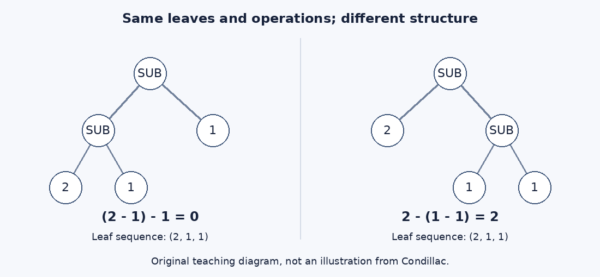

# Condillac论分析怎样形成正确判断

## 《逻辑学》第一部第三章：表象、拆装、默会技能与方法的限度

**知道零件有哪些，不等于知道它们怎样构成一台机器；能说出一个答案，也不等于能把所理解的东西教给另一个人。** Condillac在《逻辑学》第一部第三章把这两种差别接起来：按对象的构成关系获得观念，才能在回忆、说明与制作时重新展开它们。作者进一步主张，这种分析甚至解释了没有自觉学习计划的正确判断、品味与天才。

本章真正值得追问的不是“拆开有用吗”，而是更强的问题：从机器与样衣的例子，能否推出分析是学习、表达乃至一切发现的唯一方法？又怎样区分忠实于对象的次序与只是看起来整齐的次序？本文既保留作者的强主张，也逐步检查它们与例证之间的距离。

这是完整书籍章节的原创中文精读，**不是独立期刊论文，不是全书精读、全文翻译或心理学实验**。代码附件中的有序表达式树是新设计的教学对象，不能被读成十八世纪已有的算法。它可以核验结构记录的可逆性与信息丢失，却不能验证感觉、灵魂、品味或天才的实际机制。

### 文献信息与这次究竟读了什么

- 作者：Étienne Bonnot de Condillac。
- 书名：*La Logique, ou les premiers développemens de l’art de penser*。
- 本章：第一部第三章，*Que l’analyse fait les esprits justes*。这里的 *justes* 指判断正确、思考得当，不是道德上的公正，也不是某个形式演算已被证明可靠。
- 目录年代：沿用作品**1780年版的书目年**；不据此裁定最早版次、准确发行日或本章1780年原页码。[1780版书目线索](https://catalogue.bnf.fr/affiner.do?afficheRegroup=false&critereRecherche=&index=AUT3&listeAffinages=FacLocal_Lcl3RRdjArsMag%3BFacPays_fr&motRecherche=&nbResultParPage=10&numNotice=11897507&triResultParPage=5&trouveDansFiltre=NoticePUB&typeNotice=p)
- 实际正文：1798年巴黎Ch. Houel《Œuvres de Condillac》第二十二卷。题名页印“An VI — 1798”。主底本为IA／Wellcome，另一份Google Books同版册本扫描用于交叉核字。两份扫描不是两个版次。
- 完整篇界：1798版印25–31页，IA PDF33–39，Google PDF35–41；七页正文、五条页边摘要、31页正文中的作者自引均在范围内。32页第四章只核起始边界。
- [本章原书起页](https://archive.org/download/b28772581_0022/b28772581_0022.pdf#page=33)；[同版第二扫描入口](https://books.google.com/books?id=tdSdMhj8gcwC)；[逐页来源、字形与有界勘误账本](condillac-logic-part1-ch3.sources.zh-CN.md)。不把1798年的字句和页码倒用成1780版的证据。

这是接续[第一章](condillac-logic-part1-ch1.zh-CN.md)和[第二章](condillac-logic-part1-ch2.zh-CN.md)的一个单元。它属于AI认知与表征问题的历史前史回填，不宣称Condillac创立AI，不宣称穷尽此前文献，也不关闭全书、旧候选、版本与扫描缺口。

### 四种证据不要混在一起

**原文**是能定位到本章页码的主张；**解释**是本文对论证关系的梳理；**教学重构**添加现代符号、对象与前提；**实跑**仅指实际执行代码留下的结果。某个程序成功往返解析，不是现实世界中的学习实验，也不是作者所有哲学断言都获得证明。

阅读路线：第1–7节按全章论证阅读；第8–10节自己重建例子和一般证明；第11–12节检查现代意义与证据边界；第13节有18道附答案练习。详细定义与可运行文件见[教学附件](../../reproduction/condillac-1780-part1-ch3/README.md)，独立全文复核见[论证审计](condillac-logic-part1-ch3.audit.zh-CN.md)。

## 1 为什么这一章要从景物走向机器和裁缝

### 1.1 前两章留下的任务

第一章解释自然怎样借感觉、需要与经验使人开始辨别，又提醒读者，追溯最初认识时容易填入不可核验的猜想。第二章转而考察观景：短暂地见到整体、依次分辨部分、比较位置和关系，不能混作同一件事。它把分析说明为有次序的分解与重组，并要求整体范围和部分覆盖都得到关注。

第三章没有另起一套三段论规则。它追问这种认识过程的后果：**按照什么方式学进来，会影响以后能否清楚想起、说明以及制作出来。** 所以本章同时讨论认识内容、记忆中的次序、思想的表达与实践技能；只摘出机器例，就会漏掉过半论证。

卷首的有限背景说明了这个写作动机。作者不准备先从定义、公理与原则开讲，而要观察人已经在用的能力。卷首2页还明确把身体与杠杆、思想与其手段之间的类比归于Bacon；3–4页将经验中的使用与改进作为教学起点。这是本卷可见的背景，不是本文已重读Bacon全部方法论的声明。[卷首2–4页](https://archive.org/download/b28772581_0022/b28772581_0022.pdf#page=10)

### 1.2 一个有界的前驱对照

“分析”在较早逻辑教材中并不只有一种用法。Arnauld与Nicole《波尔罗亚尔逻辑》第四部第二章开头，把发现未知真理的方法称为分析，把向他人说明已知真理的方法称为综合。本文核查开头的功能区分及同章由部分求整体说明的公开转写；所用见证是1878年Belin整理本的数字文本，不冒称已逐字核对十七世纪初刊。[该章开头的分析／综合区分](https://fr.wikisource.org/wiki/La_Logique_de_Port-Royal/Quatri%C3%A8me_partie#CHAPITRE_II)

这个对照帮助读懂Condillac的用词：I.III里的分析已经包含重新组合，并同时承担学习和传达的任务。波尔罗亚尔同章也把由部分求整体列入分析问题，因此差别不宜简化为谁拆、谁装；这里对照的是方法按发现与传达所作的功能分工。若读者机械套用“分析只拆、综合才装”或“分析只发现、综合才教学”的分工，就会误读他。

这只是概念对照，不是影响关系的证明。本章没有指名波尔罗亚尔，也没有指名自己批评的“哲学家”是谁。不能因为措辞相对，就把所有批评都归给某位前驱。对该书这里只作背景段落查核，不计为第二篇完成。

### 1.3 作者自己的线索

31页在全章结束前指向自己的 *Cours d’Études, Art de penser, part. 2, chap. 4*。这是作者亲自给出的相关论述位置，比替他补一条名人谱系更可靠。但一个自引不是被引论证已经完成的替代品。本篇核明自引本身，不声称已独立精读该书全部章节、验证其出版史或证明两处文字完全相同。[31页自引](https://archive.org/download/b28772581_0022/b28772581_0022.pdf#page=39)

## 2 从感觉到观念：先限定谈的是什么

### 2.1 当前看见与回忆不相同

**原文，25–26页。** 我们只通过所受的感觉认识可感对象。对象在场时，是它当前引起的感觉；对象不在场时，是先前感觉的回忆。作者据此把关于可感对象的认识，在起点上归于感觉，并把感觉作为对象的表象时称作观念。

这里有三个层次：外在对象、对象引起的感觉、感觉在表象对象时承担的角色。不能把“观念是感觉”缩写成“外物就是我的感觉”。本段也没有把“有一项回忆”当作“该对象现在仍在眼前”的证据。

例如，眼前一件蓝色衣服和昨日见过的蓝色衣服，都可以成为现在谈论的对象；但一个来自当前呈现，一个来自回忆。即使内容近似，取得内容的方式和可检查的条件不同。这是本文辅助例子，不是原文的特定衣服记录。

### 2.2 为什么称它们为“图像”

25页以 *images* 解释 *idées* 的字面含义。这有助于理解作者的表象语言，却不应自动升级成一项生理机制：书中没有说脑内保存二维像素阵列，也没有把声音、触感和其他感觉都化为视觉照片。

26页说，能分辨多少种不同感觉，就能分辨相应种类的观念；观念可能是当前感觉，也可能只是先前感觉的回忆。这里的重点是来源与区分，不是一份已经完成的感觉类型分类表。种类之间怎样建立联系，是后面方法论要承担的任务。

### 2.3 三个不能偷换的断言

1. “关于可感对象的认识以感觉为起点”，不等于本章已证明所有抽象数学命题都只是未经加工的感觉。
2. “感觉具有表象作用”，不等于它永远精确。作者后面要求每一部分的观念准确，正说明准确性仍是条件。
3. “过去的感觉可被回忆”，不等于回忆总是完整、不失真或永久保存。本章随后给出的是关于良好分析有利于清晰回忆的主张，没有实验测量或遗忘函数。

这些边界让我们能够认真读作者的认识论，而不用过度现代化的术语代替它。[25–26页](https://archive.org/download/b28772581_0022/b28772581_0022.pdf#page=33)

## 3 取得观念的次序，怎样成为表达的次序

### 3.1 按分析取得，与随意堆积

**原文，26页。** 通过上一章的分析方法获得观念，它们便有次序地安排在心中，保持所赋予的次序，能够以取得时那样的清楚程度重新呈现。若只是偶然地堆积，观念便处于混乱，并保持混乱；以后难以清楚回忆，谈起来别人也听不明白，因为自己尚未明白。

这段不是说所有“先后排列”都好。下一页和机器例会补充判准：思想中的安排必须对应对象的安排。把零件名称按字母排好，很整齐，却未必告诉我们哪个零件与哪个相连；把读书卡片按日期排列，也未必显示理由和结论的关系。后两个是本文解释例。

这也不是现代记忆实验报告。作者把获取时的组织和后来回忆的组织联系起来，提出的是心理与教学判断，没有对照组、时间间隔、误差率或数据。实际人的记忆是否如此稳定，需要独立证据。

### 3.2 向别人说明，也必须重新组织思想

**原文，26–27页。** 要说得使人明白，必须按分析的次序构想和表达观念；这种次序把每个思想分解并重新组合。作者称它是使观念获得其所能达到的清晰与精确的唯一方法，又把自我学习与向他人传达知识都归于它。

这已经超出“条理有帮助”：作者真的在说**只有这一方法**。解释者不能为了让他更容易被接受而抹掉这个排他性量词。但也不能把这个量词当作经形式证明的结论。章内使用的是反复申明、对日常经验的诉求、机器和手艺类比。

一个有帮助的现代分解是：传达至少涉及“原对象是什么”“讲述者的表示是否忠实”“接收者是否按相同规则解释”三个问题。作者着重讨论前两个并推及第三个，未给出编码格式、共享词典或通信协议。所以读者不能从思想有序，直接推断任何听者都必然听懂。

### 3.3 逻辑知识与懂得术语的差别

作者反对的是把认识的形式感当成认识本身：有一个学术词、能重复一串有秩序的句子，并不保证其中的对象和关系已被弄清。本章后半还会反过来指出：一个没有正式学过逻辑术语的人，可能在实践上更懂分析。

因此，这章的教学目标不只是教人说“分析、综合、方法”，而是让人检查自己能否把复杂对象中的部分与关系重新交代出来。我们稍后会把这个要求限定成一个可证明的小命题，但它仍只是原章论证中的一部分。

## 4 机器例：什么叫“理解了同一台机器”

### 4.1 原文实际给出的四步

**原文，27–28页。** 为认识机器，先分解它，分别研究每一部分；对各部分取得准确观念；能够把它们放回原先的安排；于是能够理解机器。作者再把这种理解描述为一个复合思想，其中的观念与机器各部分逐项相应、各自准确，并处于相同次序。这样的思想在向自己或别人交代时，会自行展开为分析。[27–28页](https://archive.org/download/b28772581_0022/b28772581_0022.pdf#page=35)

逐步说就是：

1. **分出部分。** 不再只把机器看成一团整体。
2. **分别研究。** 不能只记住“有这一块”，还要知道它是什么。
3. **保留安排。** 分离观察不能丢掉整体中的关系。
4. **重建整体并能说明。** 不是得到一堆精确但互不相干的零件观念。

这四步是本文整理，不是作者编号的算法。原文没有指定机器种类、拆卸工具、安全顺序或零件函数。*ordre* 在这里至少关乎构成中的安排，不宜硬译成一列词的线性顺序。

### 4.2 正确局部加任意排列，不保证正确整体

假设两块板、一条轴、一个齿轮各自的形状都记对了，却忘记哪一块固定轴、齿轮安装在什么位置。那么“每项名称都正确”仍不足以恢复整机。缺的是连接和约束。

反过来，画了一张连接得很整齐的图，但把本来会反向传动的部件记成同向，也不能凭图的结构正确就宣称懂了实际机器。这里缺的是局部描述的真实性。

这两个思想实验分别暴露两类条件：**局部内容的准确性**与**关系组织的准确性**。前者不能用“结构一致”代替，后者不能用“零件清单齐全”代替。本章同时要求它们，不能只挑方便编程的一项来代表全部。

### 4.3 “完全理解”在例子中有多强

作者说准确知道各部分并能原样重组，便能完全理解机器。这个标准很有启发，但读者还应问：这些部分的“准确观念”究竟包括什么？材料、摩擦、时间依赖、负载变化、损耗和制造精度是否都已包含？

原文没有逐项列出。若我们额外把所有行为相关性质都塞进“准确”一词，结论会变得很强，却也把困难移入了前提；若只保留外形与位置，则未必足以预测机器的一切行为。本文不能替原文无偿取得那份完整物理知识。

现代模型因此选择一个更小、透明的对象：由明确运算组成的有限表达式。在那个范围中，局部规则已给定，完整结构也可记录；于是可以严格证明可重建性。这个收缩是为了说清能证明什么，不是断言现实机器就只是一棵这样的树。

## 5 裁缝为什么比哲学家更接近本章中心

### 5.1 从理解机器到学会制作

**原文，28页。** 如果给裁缝一件形制特别的样衣，要求制作相似的一件，她们会自然想到把样衣拆开、重新做合，从而学会制作。作者说她们知道分析，并且比坚持另有学习方法的哲学家更了解它的用途。[28页](https://archive.org/download/b28772581_0022/b28772581_0022.pdf#page=36)

例子的作用有两个。一是把分析从理论术语移回手艺中的操作。二是把目标从“能列举部件”推进到“能依样组织并制作”。这比单纯背诵分析的定义提出了更高的要求。

这里不是对某位裁缝的实地访谈，也没有制作成功率。作者请读者以普通经验确认方法的可理解性。我们应保留这个证据层级，而不是给故事补上不存在的参与者、观察记录或实验结果。

### 5.2 实践会做，不要求先有一套术语

裁缝可能说不出一篇方法论论文，却知道先检查哪些接缝、怎样判断样片之间的对应、如何再缝合。这说明的是“方法可以先在实践中被运用，再被明确命名”，不是“实践技能无需学习”。

作者在29页恰好反对后一种误解：那些看似没有学过的人，其实学过，而且学得好，只是未必事先打算上课或沉思。把他的“自然”解释成天生带着全部成品知识，就会抹掉学习过程。

### 5.3 这个例子不排除什么

样衣确实可以通过拆装来研究，但这个成功方式本身并不逻辑地排除其他信息来源：别人可能提供纸样、尺寸、分解图或现场示范。本文不把这些另设情形说成对原章的历史实验反驳；它们只用来检查“有一种有效办法”到“只有这一办法”的推论。

Condillac也可能把阅读纸样、比较尺寸和理解示范都算作广义分析。这样，争论就不能靠方法名称结束，而应问：**“分析”有无可独立识别的条件？哪些活动算，哪些不算？** 若凡成功的认识事后都被命名为分析，唯一性就有定义化、难以独立检验的风险。

对原文最公平的读法，是既承认其分析概念包含很多认知活动，又保留这个广度带来的论证责任。不能先把它缩成“亲手拆实物”，再用不拆实物的学习轻易反驳；也不能把它无限放宽后，宣布已经证成全部心理学。

## 6 无意识分析、品味与天才

### 6.1 看起来没学过，不等于没有学习史

**原文，29页。** 有些人判断正确，却像没有受过学习训练，因为他们看来没有为了学习而刻意沉思。然而他们确实做过良好的学习；自然是他们的老师，使他们对所研究的事物进行分析。他们所知可能不多，但知道得好。[29页](https://archive.org/download/b28772581_0022/b28772581_0022.pdf#page=37)

本段改变了评价认识的尺度：知识数量和正式学习外观，不等于知识质量。作者关注的是对有限对象是否真正分辨并组织清楚。这与后文“做了大量研究却更会推错”的对照相配。

### 6.2 四种能力如何被连在一起

29–30页把若干能力纳入自然使人不自觉分析的说明：

- **本能。** 作者称它为可靠的向导；本章没有用现代生物学定义其先天与后天成分。
- **品味。** 它能判断，而且作者说它在感受的同一时刻就作出判断。
- **才具。** 作者把它说明为品味在产出自己所判断之物时的表现，因而不只是接受，也关乎创作。
- **天才。** 当人不知道思想从何而来时，把灵感归于缪斯；作者用自然所作而不被自觉觉察的工作来解释这种情形。

这些都是原文的心理学与哲学归属，不是本文通过表达式程序测出的机制。尤其“当场判断”不是递归程序的运行时间，“自然不让我们察觉”也不是一个可直接对应神经网络隐藏层的技术说明。[29–30页](https://archive.org/download/b28772581_0022/b28772581_0022.pdf#page=37)

### 6.3 默会能力与可说明性之间仍有距离

本章一方面说良好形成的思想能自行分析、便于交代；另一方面说有些能力的分析过程对行动者自己并不显露。这不必立刻判为自相矛盾：掌握一个有组织的对象，和意识到自己怎样获得这种掌握，确实可以不同。

但这个区别也提醒我们不要过读。作者没有在本章给出一个保证，使所有熟练者都能完整报告自己的学习过程。一个人会做衣服，能够展示步骤，却未必能准确回忆每次判断的来源；这类区分需要更细的观察和定义。

本文把它作为有待补充的认识层次，而不是替他发明已完成的“隐性知识提取算法”。代码只处理显式给出的结构，不从一个熟练者的行为中自动发现结构。

## 7 错方法、空词与“一切发现”的强结尾

### 7.1 方法越一致，为什么还可能错得越远

**原文，30页。** 有些人做过大量学习，自负很有方法，却推理得更差，因为错误方法用得越彻底，走得越偏。他们把模糊观念、没有意义的词当作原则，构成科学行话，误以为自己看见了明证，却没有真正弄清所看、所想和所说。[30页](https://archive.org/download/b28772581_0022/b28772581_0022.pdf#page=38)

这一批评不是“禁止抽象词语”。问题是词与可说明内容的关系没有交代。一个术语可以很抽象，只要含义、适用条件和推理用法清楚；一段话也可以全是日常词，却因关系混乱而无法验证。

“有一套程序”只说明步骤稳定，不说明步骤真。现代程序可以每次都忠实执行一个错误的减法定义，得到稳定却错误的结果。重复性和真实性各有验证任务；本章对任意秩序的批评，恰好支持把这两层拆开讨论。

### 7.2 一个容易被忽略的前提

30页还说，思想只有自身是分析的产物，才可能被分析。可以把它理解为：清楚说明依赖此前清楚组织内容，不能凭后加的术语把混乱自动变成认识。

若把这句话读成绝对不可修复的断言，却会面临问题：我们能否通过后来的重新观察和重新学习，修正先前混乱的观念？本章没有给出这样的修复流程；此前I.I谈过经验中的纠错，不能把这里的修辞一律解释成“第一次学乱了便永远无法改正”。这是篇内主张与全书有限上下文之间应保留的解释空间。

### 7.3 三种不同强度的结论

全章结尾必须拆开看，不能合并成一句“分析最优”：

| 结论 | 本章给出的支撑 | 不能替它补上的东西 |
| --- | --- | --- |
| 分析是最简单的方法 | 30页说因它最自然 | 没有任务成本定义或复杂度比较 |
| 分析也是最短的方法 | 30页以“我们将看到”留待后文 | 不能说本章已给出最短证明 |
| 一切发现及对既有发现的重新取得都由分析完成 | 30–31页的全称宣称，随后把发明方法等同分析 | 没有穷举发现史，也没有量化所有方法的形式定理 |

31页的作者自引给了继续查证的方向，但不能自动填补这些不同结论的证明责任。本文只完成这一个章节，既不会把未读后文冒算成已证明，也不会以此否定作者后续可能给出的论证。

## 8 教学重构：把“结构必须保留”缩成能检查的小问题

### 8.1 我们刻意不模拟什么

下面对象没有感觉、回忆、意识或天才。我们预先给定一棵有限有序树，问一种记录能否把它精确还原。这对应机器例中的一个有限侧面：零件与组合安排已经明确以后，记录是否保留它们。

它**不解决从陌生对象中学出正确结构的问题**。如果输入树一开始就把实际对象记错了，无损编码只能无损保留这个错误。编码器的正确性，不能代替观察和建模的真实性。

### 8.2 对象、构造子和等同性

取整数常量作为叶子，二元运算只有加和减。记 $`L(v)`$ 为值为整数 $`v`$ 的叶子，$`A(s,t)`$ 为左子树 $`s`$ 加右子树 $`t`$，$`S(s,t)`$ 为前者减后者。

```math
T ::= L(v)\; (v\in\mathbb Z)\quad |\quad A(T,T)\quad |\quad S(T,T).
```

这里的竖线表示三种构造选择；每个对象必须通过有限次构造得到。因此它是一棵有限、无循环、左右有序的树。重复出现的相同子表达式在数学上按出现位置算不同节点，不是带共享存储的图。

**结构相同**要求叶值、运算符、左右子树及其层次全部相同。两个对象算出的整数一样，并不使结构自动相同。这个等同标准是本文指定的任务，而不是Condillac列出的定义。

例如：

```math
T_1=S(L(2),L(1)),\qquad T_2=S(L(1),L(2)).
```

两者的叶值多重集都包含一个1和一个2，却分别得到1与−1。零件数量齐全而左右角色丢失，已经足以改写结果。

### 8.3 即使叶子顺序相同，层次仍可能不同

再比较：

```math
T_3=S(S(L(2),L(1)),L(1)),\qquad
T_4=S(L(2),S(L(1),L(1))).
```

两树按从左到右读叶子，都是 $`(2,1,1)`$；运算也全是减法。但第一棵先算 $`2-1=1`$，再算 $`1-1=0`$；第二棵先算右边 $`1-1=0`$，再算 $`2-0=2`$。



图1：本文原创教学图。两边叶值和运算相同，只改变组合层次。图中SUB表示左减右；这不是原典插图，也不是实体机器图。

所以“保持次序”若只指保留叶子线性顺序，还不够。必须知道哪些部分先组成一个子整体，再与其他部分组合。正是在这里，表达式树比无结构清单多保存了信息。

换成现实机器，连接与层次未必是一棵树，因而这个例子只揭示一个信息问题，不是所有机械结构的模型。扩展到共享、反馈或连续动力学，必须重新定义对象和正确性条件。

## 9 为什么完整编码可以重建，丢失的信息不能凭空补回

### 9.1 一种透明的编码

用三个不同类型的记号：叶子记号携带整数，另两个记号分别表示ADD和SUB。编码时先写根，再按左、右顺序写子树：

```math
C(L(v))=[\mathrm{LEAF}(v)],
```

```math
C(A(s,t))=[\mathrm{ADD}]\cdot C(s)\cdot C(t),\qquad
C(S(s,t))=[\mathrm{SUB}]\cdot C(s)\cdot C(t).
```

$`C`$ 是编码函数，方括号是一项记号组成的序列，点号是序列连接。运算记号已知各需要两个子树，叶子不再需要子树，因此没有括号也能解析；这个结论依赖记号类型可区分与元数预先明确。

上一节的 $`T_3`$ 编码是“SUB，SUB，LEAF(2)，LEAF(1)，LEAF(1)”。读到第一个SUB，就必须先读完整左树、再读完整右树；第二个SUB使最前面的两个叶子先组成左子树。这里的记号不是机器指令执行顺序，而是结构描述的读取顺序。

### 9.2 解析过程必须知道何时结束

读到叶子，返回一个叶子和剩余序列；读到ADD或SUB，先解析左子树，再从余下序列解析右子树，组合成对应分支。若需要子树却已没有记号，拒绝；若记号非法，拒绝。最外层读完一棵树后若还有多余记号，也拒绝。

以上是便于手算的从左向右递归描述。附件程序实际从右向左扫描并用栈重建：先读到右树，再读到左树；遇到二元运算时，先弹出左树、再弹出右树。它以显式栈保存同一结构，附件另证明这种实现的栈不变式。不能把本文解释步骤冒称程序逐行执行轨迹。

最后一条很重要：合法树后偷偷加一片叶子，不应被“解析到第一棵就算成功”的实现忽略。思想上能读出一个片段，与整个记录恰好描述一个对象，是不同规格。

### 9.3 一般往返证明，而不是多跑几个样例

**命题。** 对任何上述有限树 $`T`$，完整解析它的编码恰好返回 $`T`$，并耗尽全部记号。

**证明。** 对树的构造归纳。

- 若 $`T=L(v)`$，编码只有一个合法叶子记号，解析按叶子分支返回原叶，没有余项。
- 若 $`T=A(s,t)`$，编码的首记号使解析器选择加法分支。归纳假设保证左树的编码恰好恢复 $`s`$，停在右树编码之前；再由归纳假设恢复 $`t`$，最后组成 $`A(s,t)`$。
- 减法分支同理，但根标签保留为SUB，不得与ADD混淆。

严格地说，递归时还带着后面的余项，所以归纳可加强为：从 $`C(T)`$ 接任意后缀开始，解析一棵树会返回 $`T`$ 与原后缀。这样才解释为什么读取左树不会吞掉右树。每次合法递归处理严格更小的子树，数学解析在有限输入上终止。

于是若 $`C(T)=C(U)`$，对同一序列解析便同时得到两者，所以 $`T=U`$。编码是单射。这个推论来自定义和归纳，不是因为程序对若干千棵树没有出错。

### 9.4 发生碰撞时，不存在万能精确解码器

令 $`R`$ 是某个简化记录。如果存在不同树 $`T\ne U`$，却有 $`R(T)=R(U)`$，那么任何只读取这份记录的确定性解码器，都不能对两者同时准确恢复。因为同一输入只会有同一输出，而正确答案在这两个情形不同。

这个不可恢复性论证并不神秘。零件袋看不出左右角色，叶序列看不出括号，单个输出值看不出完整运算过程；上一节的见证已经给出具体碰撞。没有额外信息时，猜对一次不等于有了对全部对象有效的重建方法。

但碰撞不意味着这种简化记录毫无用处。如果任务只问“最后结果是多少”，保存正确的结果值就可能足够；如果任务问“原结构是什么”，同一记录就不够。**损失要相对于任务判断。** 原文的“准确理解”不能不经说明就被偷换成某个单一输出任务。

### 9.5 三个边界反例

1. **同结果不等于同结构。** $`A(L(1),L(1))`$ 和 $`L(2)`$ 都输出2，但一个有加法节点，另一个没有。
2. **同结构不保证现实解释正确。** 如果记录中的SUB被接收者误解成ADD，完全还原树仍会得出不同结果。共享运算语义是另一个前提。
3. **同词典也不保证输入真实。** 若某叶子本应为2却被观察者记成1，编解码可以完美往返错误树。这证明的是保存性，不是事实正确性。

第三点尤其防止把本章结尾对空词的批评写成“只要符号格式合法，就已有真知识”。本模型用明确定义避免自身符号含糊，却不因此解决符号与外部世界的对应。

## 10 实跑究竟验证了什么

本篇的[代码、环境与命令](../../reproduction/condillac-1780-part1-ch3/README.md)把上面结构表示、解析、求值、叶序列和多重集记录分开。它只用Python标准库，不调用付费服务、模型API或外部数据。没有Notebook，也没有Jupyter内核执行声称。

有界枚举选取叶值集合 $`\{0,1,2\}`$，考察1至4片叶子的所有有限有序二元树，每个内部节点可独立选ADD或SUB。这是公开、人工设定的语法范围，不是人类思维或实际机器的样本分布。

若 $`a_n`$ 是恰有 $`n`$ 片叶子的这种树的数目，那么：

```math
a_1=3,\qquad a_n=2\sum_{k=1}^{n-1}a_k a_{n-k}\quad(n\ge2).
```

理由是根有两种运算选择；左树可有 $`k`$ 片叶子，右树必须有 $`n-k`$ 片；所有不同的左右树可独立配对，且每棵树根部的划分唯一。于是四层计数为3、18、216、3240，总计3477。这是枚举规格的数学推导；实际生成是否重复、遗漏以及每项运行是否正确，仍须由日志与独立检查回答。

作者实际运行18个测试方法，在普通、`-O`、`-OO`三个模式均通过；完整演示、退出码、解释器CPython 3.12.14与时间见[实际日志](../../reproduction/condillac-1780-part1-ch3/validation/author-validation.log)。枚举产生3477棵不同树，对每棵检查树到前缀再回树，以及合法前缀解析后再编码，两方向均成功。

| 记录或观察量 | 3477棵树形成的不同等价类 | 可恢复什么 |
| --- | ---: | --- |
| 完整有类型前缀 | 3477 | 本模型中的整个结构 |
| 按从左到右读出的叶序列 | 120 | 叶值次序，不能恢复操作与分组 |
| 叶值多重集 | 34 | 每种叶值的数量，不能恢复左右关系 |
| 求得的整数结果 | 15 | 当前解释下的结果，不能恢复计算结构 |

这些类数不能简单排成认知能力的高低。叶序列相同可以结果不同；结果相同也可以叶序列、多重集都不同。后两种记录回答的任务并非一条统一粗细链。完整碰撞统计和最小性尺度见[机器可读普查](../../reproduction/condillac-1780-part1-ch3/validation/census.json)。最小结构碰撞有时仍有相同结果，不能把“结构不同”自动写成“数值必不同”。

这里不会把有限运行写成对所有树的归纳证明，也不会把碰撞个数写成人类认知出错概率。[模型与证明](../../reproduction/condillac-1780-part1-ch3/MODEL.zh-CN.md)和[逐步手算](../../reproduction/condillac-1780-part1-ch3/WALKTHROUGH.zh-CN.md)给出从原章到教学对象的映射及限制。

另一路独立检查采用合法前缀形状生成与从左向右的参考解析，核对3477树、求值及全部碰撞统计；它还检查长度0–7、取自三个叶记号与两个运算记号的全部97656个序列，其中3477个被接受，94179个被拒绝。这个计数与作者树生成器的3477一致，但检查对象不同，不能相加当作更多独立实验。代码、日志、优化模式及最终输入指纹见[独立代码审计](../../reproduction/condillac-1780-part1-ch3/independent-review/review.zh-CN.md)。

数学上的任意有限树，仍须与实际Python资源界限区分：核心遍历与解析是迭代的，但深树的dataclass直接相等比较可能触及递归限制，巨大整数转成文字也受运行时设置限制。未承诺无限资源或对任何规模都顺利显示；实跑范围与一般数学命题各自列明。

## 11 今天可以怎样使用这个问题，而不冒充历史影响

### 11.1 解释与重建不是关键词匹配

**现代延伸。** 一份解释若只列出所有重要名词，却遗漏关系、条件和作用域，仍可能无法重建原主张。相同术语在不同层次或不同左右角色中出现，会改变含义。树的例子把这个问题缩小到了可逐步检查的情形。

这不表示所有解释都必须给出完整语法树。真正的要求是先说明解释任务：需要恢复哪些区别，允许忽略哪些区别。面向概览的摘要和面向修理的结构说明，本来可以保存不同的信息。

### 11.2 一个答案不能认证获得答案的方法

程序输出一个正确整数，只验证当前输出；它没有自动展示如何取得输入、有没有遗漏限制或能否应对新的情形。相反，拥有完整结构也不保证外部事实正确。评价一个系统时，可以分别检查结果、过程、输入依据与适用范围。

这是本文从教学模型提出的检验建议，不是声称Condillac已发明现代AI可解释性评测，也不是宣称某个当代模型一定只有表面关联。后一种结论需要针对具体系统的证据。

### 11.3 默会表现与自述应分开检查

本章的手艺与天才段落提示一种长期问题：会做、会说明、知道自己怎样学会，并非显然相同。我们可以分别设计制作任务、结构说明任务与学习来源核查，而不预设其中一个成绩代表全部。

不过，本文没有做这些人类实验，也没有用语言模型生成的自述推断内部机制。把这三个问题拆开，是由原章引出的现代研究问题；要回答它们，还需要额外数据、方法和伦理条件。

### 11.4 不应直接继承的三项强断言

本章的“分析因最自然而最简单”“看似未学者的正确判断及品味、才具和天才可由不自觉分析说明”“一切发现只有分析一路”，都需要比本章例证更广的支持。本文既不把它们当作现成结论，也不因为没有形式证明便把原章降成毫无价值的格言。它的价值在于提出并连起一组问题：认识的来源、组织、可回忆性、可传达性与实践表现之间究竟怎样相互约束。

## 12 全章主张与证据账本

| 主张或问题 | 原页 | 本次处理及界限 |
| --- | --- | --- |
| 可感对象通过感觉而被认识；当前与回忆有别 | 25–26 | 读核原文，不扩大为全部抽象知识的完整证明 |
| 观念是感觉在表象对象时的名称 | 25 | 保留角色限定，不把对象、感觉与像素等同 |
| 有序获取使观念可清楚回忆 | 26 | 心理学主张；没有数据或遗忘模型 |
| 学习与传达均须分析次序 | 26–27 | 保留“唯一”强度，区分类比支撑与一般证明 |
| 机器各部分准确且同序对应 | 27–28 | 全步展开；教学树仅取有限结构侧面 |
| 裁缝拆装样衣以学会仿制 | 28 | 实践例、非实际实验记录；不把每种学习路径排除 |
| 分析是发现的自然方法，不是任意新造秩序 | 28–29 | 区分对象关系与人为整齐排列 |
| 看似未学者其实由自然引导而学 | 29 | 不读成先天具有全部知识 |
| 本能、品味、才具、天才与不自觉分析 | 29–30 | 完整解释该段，未作心理机制验证 |
| 错方法、模糊原则与科学行话 | 30 | 区分程序一致性、语义清楚和事实真实性 |
| 最简单、后文将见最短、一切发现与发明方法 | 30–31 | 分别列出支撑，未把预告当已证定理 |
| Cours d’Études自引 | 31 | 正文括注，非脚注；不计被引书为完成 |
| 前缀往返与有损记录的不可恢复性 | 无 | 本文现代定义及证明，不归给原典 |
| 3477树的有界枚举 | 无 | 公开语法的有限运行，不是心理学样本或普遍证明 |

[独立来源账本](condillac-logic-part1-ch3.sources.zh-CN.md)记录五条边注、篇界与字形处理；[独立全文论证审计](condillac-logic-part1-ch3.audit.zh-CN.md)核查本文是否遗漏强结尾或替作者增加结论。未发现指定核查范围内适用于本章的独立勘误，并不等于所有册本、1780版或后续版本都无勘误。

仍待独立处理的范围包括：1780年版章内影像和原页码、全部异文与修订史、作者所引《思考的艺术》的完整论证、I.IV及后续、全书；模型方面则包括从行为识别结构、噪声、共享与循环、实际心理和物理机制。所有既有文献候选和旧缺口继续保留。

## 13 自测与答案

### 1 本章标题里的“正确”是否等于形式系统可靠

**答案。** 不是。原文谈判断得当、观念清楚与方法适当，没有定义形式系统、语义模型或可靠性定理。现代树的编解码正确性是另一项限定清楚的命题。

### 2 回忆一件物品为什么不证明它此刻在场

**答案。** 25–26页分别说明当前感觉与过去感觉的回忆。二者可以表象同一对象，但不是同一种当前证据；回忆本身并不提供物品现在在场的信息。

### 3 为什么不能把所有“观念”理解成脑内照片

**答案。** 原文用图像说明表象角色，且涉及不同种类的感觉。它没有指定像素格式、神经储存机制或把所有感觉化为视觉图像。

### 4 整齐的词表为什么不一定符合分析次序

**答案。** 按字母排序只保留词的形式次序，未必保留对象之间的构成、依赖或作用关系。作者要求观念对应对象的安排，28–29页还明确反对任意制造的秩序。

### 5 机器例里哪两个“准确”都不能省略

**答案。** 各部分的观念必须准确，部分之间的安排也必须准确。准确零件加错误连接不够；正确连接加错误部件性质同样不够。

### 6 裁缝例证明了分析方法的唯一性吗

**答案。** 它让分析的日常用途和实践可行性变得直观，未穷尽所有学习方式。若将其他成功方式也定义为广义分析，还需说明这个类别怎样独立识别，而不是以成功本身作唯一判准。

### 7 “没有正式学习”为什么不能换成“没有学习”

**答案。** 29页明确说，看似未受教者也做过良好的学习，只是没有预先计划或向教师求课。自然引导与不自觉过程仍被作者当作学习的一部分。

### 8 品味与才具在这里怎样区分

**答案。** 品味偏于在感受时判断；才具是品味在产出自己所判断的东西时的表现。原章把二者相连，并未给出现代心理测量定义或实验区分。

### 9 很有方法的人为什么仍可能越学越错

**答案。** 稳定执行不保证前提、概念或规则正确。30页批评坏方法与空词；一个始终执行错误运算语义的程序也会稳定出错，但后例只是现代类比。

### 10 “最简单”“最短”“所有发现”是否同一结论

**答案。** 不是。最简单在30页以最自然为理由已经断言；最短留待后文展示；所有发现由分析产生是30–31页的全称宣称。本章没有统一成本函数或所有方法的比较证明。

### 11 算出以下两棵树，并指出丢掉了什么会混淆它们

$`S(S(L(2),L(1)),L(1))`$ 与 $`S(L(2),S(L(1),L(1)))`$。

**答案。** 分别为0与2。它们叶序列同为 $`(2,1,1)`$，操作也全是减法；只保留叶顺序而丢掉组合层次便无法区分。

### 12 为什么已知元数的前缀码不必另写括号

**答案。** 叶子需要零个子树，ADD和SUB各需要两个。读取根之后，递归规则决定后续多少内容属于左树、多少属于右树。前提是记号类型不混淆、元数固定且最终检查没有余项。

### 13 往返证明为什么要提任意后缀

**答案。** 解析左树时右树仍在后面；必须证明读取左树恰好停在其编码末尾，保留后缀不动。仅证明孤立叶子或孤立整树能读完，会遗漏递归组合所需的边界不变式。

### 14 一个合法编码后再加一个叶子，为什么应拒绝

**答案。** 完整输入的任务是描述恰好一棵树。若只解析第一棵后忽略剩余内容，可能把错误或额外数据静默丢掉，不能满足完整记录的规格。

### 15 两个不同对象的简化记录相同，会发生什么

**答案。** 只读取该记录的确定性解码器收到同一输入，不能同时输出两个不同正确答案。因此不存在对这两个对象都精确的解码器；增加额外信息或改变恢复任务，才可能解除困难。

### 16 “只存结果值”是不是总坏方法

**答案。** 不是。如果任务仅要求保留计算结果，它可以足够；若要求恢复原表达式结构，就会把多个不同对象混在一起。信息充分性要相对于任务定义。

### 17 编解码完美往返为什么仍可能保留错误

**答案。** 输入树可能在采集阶段就记错对象或数值，也可能由不同运算词典解释。往返只保证选定表示的结构保存，不检验外部事实、原始观察或共享语义。

### 18 3477个例子通过后，还缺什么

**答案。** 对任意有限树成立的结论仍依赖结构归纳；对有限范围内实现行为的信心还需测试与独立代码检查；对人类学习、自然分析、天才和全部发现的主张则需要完全不同的证据。不能把三个任务用一个测试计数替代。

## 14 复盘：本章最值得保留的一条检验链

先问内容从何而来，再问部分是否准确；接着检查构成关系有没有被保存，能否把它重新展开为可理解的说明；最后区分“在一个明确范围中成功”与“所有认识都只能如此”。这条检验链比把分析赞美为万能方法更可操作，也比把原章降成“把东西拆开看”更忠实。

本文由AI辅助完成，属于依据原典的原创中文教学解读。独立来源、全篇论证与代码复核都是分开的检查，不等于人类专家背书、证明助理认证或真实心理实验。深读v1，核验日期2026-10-11。只有本章被新增为完成；历史回填仍是非穷尽的开放工作。
