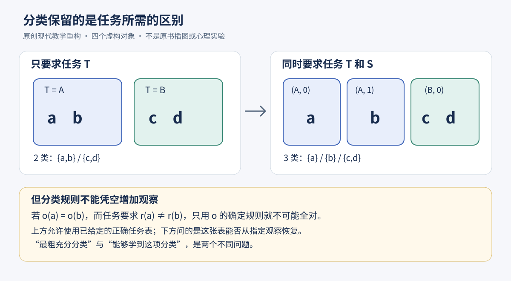

# 孔狄亚克《逻辑》第一部第四章：分类为什么需要节制

## 1780书目年，1798实际底本的AI认知前史精读

**一种分类可以没有说错，却没有说完；一个名称可以方便使用，却没有因此揭示自然的本质。** 本章把这两种容易混淆的事情分开：我们怎样从一个对象的观念形成一般观念，又为什么不能把自己造出的类别当作自然已经交付的答案。

前三章分别讨论自然能力、分析的观察次序及准确思想的形成。第四章把问题推进到分类：儿童先把见到的一棵树叫作“树”，随后把名称推广得过宽，再为实际需要区分樱桃树、桃树、梨树和苹果树。这个故事既说明一般观念的用处，也暴露分类的两个方向性错误：分得太少会误事，分得过多也可能让人失去把握。最后，作者承认精确观念仍不完整，却坚持同一种分析方法可以用于不同科学。

本文读的是**一章完整的哲学与教学著作，不是独立期刊论文，更不是全书**。这是一项非穷尽的历史回填，不将孔狄亚克称为第一位AI研究者，也不把“分类”一词的相似当作现代机器学习的直接传承证据。

### 文献与证据层级

- 作者：Étienne Bonnot de Condillac，孔狄亚克。
- 原题：*Comment la nature nous fait observer les objets sensibles, pour nous donner des idées de différentes espèces*。
- 实际底本：*Œuvres de Condillac*, tome XXII, *La Logique, ou les premiers développemens de l’art de penser*，Paris，Ch. Houel，an VI–1798，第一部第四章，**印页32–48**。
- 主扫描：[Internet Archive / Wellcome，第40–56个PDF页](https://archive.org/download/b28772581_0022/b28772581_0022.pdf#page=40)。第二册同版扫描：[Google Books对象](https://books.google.com/books?id=tdSdMhj8gcwC)，PDF页42–58。两册扫描不是两个版本。
- 1780是作品一个有书目支持的版本年份。本次未取得并逐页核验该年本章影像，不认证最早版次、原页码、发行日期或逐字一致。[日期、逐页主张与校读账本](condillac-logic-part1-ch4.sources.zh-CN.md)
- 第48页最后的作者自引属于本章；第49页第五章只用于确认边界，不列为已完成。全章17条页边摘要，包括45–46页的一条跨页续注。
- 校读保留第44页的局部排印异常“se faires”、第39页末字异常，以及目录与正文边注的措辞差异；它们不冒充作者发布的正式勘误。详见来源账本。

全文明确区分：**原文**是本章可定位的主张；**教学重构**是本文新增的定义、例子和数学证明；**本文评议**检查推论承担的责任；**实跑**只指附件实际执行的代码。原文没有数据集、分区算法、损失函数或心理实验。现代模型的严格性不转移为历史主张已经得到证实。

### 三条阅读路线

1. 概念路线：第1–8节。回答为何分类、为何过度泛化、为何准确不等于完整。
2. 重建路线：第9–11节。亲手构造分类，证明最粗充分分区，找出观察不足的反例。
3. 核查路线：第12–15节及附件。对照页码、假设、实跑范围、评议和附答案练习。

## 1 从已知到未知：一个口号怎样成为教学责任

**原文，32–34页。** 作者开头说，从已知走向未知是理论上陈旧、实践中却常被忽略的原则。没有受过专门训练的人解释陌生事物时，会寻找听者熟悉的比较；比较未必选得好，但至少顾及听者从哪里开始。学者反而可能忘记这个起点。[原文32–34页](https://archive.org/download/b28772581_0022/b28772581_0022.pdf#page=40)

这不是“只许讲听者已经知道的事”。它要求新认识能接到听者已有观念上：教师知道一个术语，不等于学生已经拥有理解术语所需的观念。譬如直接说“这属于某一属下的不同种”，若学生连“按照什么同、按照什么异”都没有把握，分类名称并没有完成解释。

作者的论证可以拆成四步：

1. 他把自己和学者的认识都追溯到感觉。
2. 学者也曾无知，并经一系列认识走到今天。
3. 因而学习者应该有一条从已有认识出发的道路。
4. 教师须重建这条道路，不能把成品术语代替认识的生成过程。

**本文评议。** 前三步使“学习有连续入口”显得可信，却不自动保证每个教师都能恢复最短、最容易的道路。共同具有感觉，不等于具有相同经历、相同感官条件、相同时间或相同先备知识。原文把方法的共同性说得很强；不能偷偷添上这些实际条件已经相同。

第34页解释另一困难：熟练者可能不知道自己怎样学会。他们正确地分析过，却没有注意这件事，甚至把优势看作难以传授的特赐。这里区分的是**能做**与**能说明怎样学会**。这接续第三章对不自觉分析的讨论，不是宣布没有意识的学习已经被实验测量。

## 2 分析的次序：认识的生成，不是成品目录的排列

**原文，34–35页。** 每个人至少在日用事务中有一些准确、安排有序的观念。教学应从这些观念开始，观察其来源与生成；如果观念相继出现的安排符合获得它们的方式，就做到了这里所说的分析。作者因此把分析的次序与观念生成的次序联系起来。[原文34–35页](https://archive.org/download/b28772581_0022/b28772581_0022.pdf#page=42)

区分两种容易混淆的“先后”：

- **书页的先后**：先印属的定义，再印种的定义，再列实例。
- **理解的先后**：读者先会区分具体对象的某些性质，再把名称和区分理由联系起来。

前者可以设计得整齐，却未必完成后者。倒过来，某种观念先被学会，也不意味着它更一般、更难或更抽象。后文儿童的例子恰好打破“由宽到窄逐级下降”这一单向故事。

**教学重构。** 一份教学说明若使用概念B，而B的解释需要概念A，那么把A当作先备条件是合理的。但这只是依赖关系，不是对某个真实儿童学习时间线的观察。依赖图、课堂编排、个人发现史是三个对象；原文没有给出从其中一个唯一恢复另两个的算法。

因此，本章的首个操作性追问不是“你能背出几级分类”，而是：**每添一个类别，你增加了什么可理解的区分？**

## 3 个别对象与一般名称：为什么不给每片叶子一个专名

**原文，36–37页。** 对可感对象的最初观念来自表象它们的感觉；作者同时断言，自然中存在的是个别事物，因而最初观念是这个或那个对象的观念。“自然只有个体”自身不构成关于心理发展先后的独立证明；作者还依赖感觉如何形成最初观念的说明。随后，人们不为每个个体另造一个专名，而是将对象分入用名称区分的类。[原文36–37页](https://archive.org/download/b28772581_0022/b28772581_0022.pdf#page=44)

作者以树为例：一种达到一定高度、分出枝条并形成树冠的植物被列为“树”；再按大小、结构、果实等差异形成从属的类。这些类使用“属”“种”的词汇，但这里的用法首先是上位类和下位类的关系，不能直接套成现代生物分类的固定等级。

为什么分类有价值？第37页提出反事实：假如每个个体都获得不同的名字，名称不断增长会使记忆疲劳，事物的研究与清楚把握都变得困难。类别给对象一个能重新找到的位置。

这里至少有三种工作：

| 工作 | 需要保留什么 | 不足以单独完成的事 |
|---|---|---|
| 识别个体 | 这是哪一个对象 | 不给出它与其他对象的共同点 |
| 按某方面归类 | 按所选方面谁相同、谁不同 | 不自动揭示所有方面或事物本质 |
| 以名称交流 | 听者怎样把词连到观念 | 相同字串不保证双方理解一致 |

**本文评议。** “名字太多会负担记忆”不等于“专名没有用”。寻找一棵需要照料的特定树时，个体标记很有用。作者在这里反对的是以逐个命名替代一般分类的总方案，不是禁止个体辨认。

## 4 儿童并不是先写出属种树，再去认识树

**原文，37–39页。** 儿童跟着成人把初见的一棵树叫作“树”。这个词最初对他只是一个个体的名字。再见相似对象时，他沿用旧词，不一定另问名称。它于是从一个对象扩展到多个，甚至宽到把我们称为“植物”的东西都叫作“树”。作者给出的动因是：沿用已经知道的名字，比另学一个名字方便。[原文37–39页](https://archive.org/download/b28772581_0022/b28772581_0022.pdf#page=45)

这是本章很具体的生成顺序：

1. 先有与一个对象相连的名称。
2. 名称被沿用，观念很快一般化。
3. 一般化有时越过有用的界限，把应该区分的事物混在一起。
4. 新需要促使进一步区分，并获得从属类别的名称。

作者没有让儿童先在心里说：“我过度泛化了，现在应当学习若干下位种。”第38页明确否定这样有意设计的描述。他认为类别和从属类别都可以在未计划、未注意到的活动中形成。

花园里的采果活动给出需要的具体内容：尝到不同果实，儿童会学到樱桃树、桃树、梨树、苹果树等名字。作者想说明，差别先对生活有用，类别细分因此变得有动机，而不是单纯追求术语数量。

**本文评议。** 这是一种发生学解释和日常情境例子，不是报告过受试人数、年龄分组、成功率或对照条件的实验。它也没有证明所有儿童、所有概念、所有语言都必然先过宽再细分。尤其不能把现代的分类泛化误差曲线画出来，再说那就是原作者测得的结果。

“个别→过宽的一般→有用的细分”仍然值得认真读：它提醒读者，一般观念的取得与分类体系的完善不是同一步；减少名称负担和保留必要差异之间存在张力。

## 5 需要塑造分类，但“需要”不是一个已经量化的目标函数

**原文，39–40页。** 类的分化服务于需要；需要相互联系，观念体系的各部分也因此联系起来。体系可大可小，取决于我们如何使用事物。作者认为，人继续依照自然最初教导的方式，才能扩展并改善这一体系。[原文39–40页](https://archive.org/download/b28772581_0022/b28772581_0022.pdf#page=47)

这里的需要至少影响三个环节：

- **注意什么差异**：是否值得察看果实、枝干或大小。
- **保留哪些区分**：哪些差异使行动不同。
- **何时停止细分**：现有类别是否足够指导使用。

但原文没有把需要规定成一个单一数值，也没有证明所有需要能无冲突地汇总。食用、辨认、种植、观赏可能要求不同类别；一些需要会改变，另一些可能互相冲突。后文数学模型把需要写成若干已给定的任务输出，是为了让“足够”有一个可核验意义，而不是还原原作者全部需要哲学。

第40页还有历史性的批评：哲学家本应观察已经形成的分类活动，却仿佛把它当成自己创制的东西，于是掺入任意和荒谬的安排。学习者又把自然的教导误认成教师的发明。这里批评的是脱离经验活动的归类和讲授；本章没有逐一指名被批评者，不能替作者补写敌手名单。

## 6 类别组织观念，并不凭名字造出自然本体

**原文，40–42页。** 把若干被判断为相似的对象放在一类，就是用共同名字称呼它们；再分成不同类，就是用新名字区分被判断为不同的对象。这种办法给观念以秩序，但不能因此断言自然中也存在与名称一一相应的属种。作者强调，存在的是个别的树、苹果树、梨树，不是“一般的树”。[原文40–42页](https://archive.org/download/b28772581_0022/b28772581_0022.pdf#page=48)

**必须保留作者的强说法。** 他不只说“有些分类是人为的”，而且说自然中没有属和种，并把类的区分归于我们的理解方式。把它改写成温和的“命名有时要注意”会失去本章锋芒。

**也必须检查论证边界。** 从“一个一般名称不是另一棵具体树”到“所有可说明的自然种类结构都不存在”，还需要额外论证。名称的公共用法、现实个体之间的稳定相似、由共同机制导致的规律性，是不同层次。本章前面自己依赖对象的相似和差异，并没有取消它们。

因此，这里不能推出“只要我换词，对象的性质就变了”，也不能拿十八世纪的这段话宣告现代生物学的全部物种概念已经被否定。可以忠实地报告作者反对将普遍名称实体化，同时指出：**命名由人实施，并不单凭这一点决定世界有无独立于命名的结构。**

### 一个前驱对照，范围只有一个问题

洛克《人类理解论》第三卷第三章已讨论一般词如何减轻逐个命名的负担，如何从个别观念去掉特定成分，以及把事物按名字归类是理解活动的工作。他同时明确保留自然产生相似事物这一点，并区分名义本质与真实构成。本次只读[第三卷第三章的相关段落](https://englishphilosophy.org/locke/ehu/3/3)，所用网站注明以1700第四版为整理目标，不能当成题名页标1690的初版影像核读。

这个对照说明问题有前史；它不证明本章每一句直接取自洛克。I.IV没有在此处指名洛克。本篇也没有完整读完洛克全书或核定两人的所有概念差异。孔狄亚克本章尤其突出沿用旧词的便利、过度泛化和需要驱动的重新细分；把这些差别抹成“经验主义都一样”也会失真。

## 7 分类分到多细：两种失败不具有同样的代价

**原文，42–43页。** 区分能力越好，可以分出的类越多；若每个个体的每个差异都成为另立类别的理由，在这个条件下便会每个个体一类，秩序重新淹没在细节里。作者甚至说，区分过多会使人迷失，而区分不足至少还保留了一些区分。因此应该停止在足以指导与需要相关的使用之处。第43页进一步把需要称作决定分类的唯一动因，并说我们不会为不打算使用的事物命名。他紧接着说，至少人们自然行事时如此，并另外批评偏离自然的哲学家制造无用细分。这个限定应与“唯有需要”的强说法一起保留；“需要”包括哪些活动、自然行事的范围如何确定，仍需另作论证。[原文42–43页](https://archive.org/download/b28772581_0022/b28772581_0022.pdf#page=50)

这一段并不等于数学定理“类别越少越好”。过少可能把行动不同的对象混在一起；过多可能仍然正确，只是多带负担。两者必须分别检查。

**教学重构的反例。** 假定四个编号对象的当前任务分别要求输出A、A、B、B。

- 全部一类：从类别无法决定应该输出A还是B，任务信息被丢掉了。
- 分成两个同输出的类：足够完成当前任务。
- 每个对象各一类：仍能完成任务，但多保存了当前不必使用的区别。

最后一个方案不“逻辑错误”。它只是相对于声明的任务过细。若任务改成追踪单个对象，它又可能必要。原文对过细区分的认知负担作出强评价；我们的小模型没有人的注意、记忆负荷或学习时间参数，不能用类数直接证明负担大小。

这也说明“够用”不等于永远够用。一个类别体系必须连同服务的需要一起审查，而不能脱离使用条件宣布最终完成。

## 8 边界可以含混；准确认识也可以不完整

### 8.1 树与灌木的交界不是一次命名竞赛

**原文，43–45页。** 作者认为自然中的个体彼此有别，而心智能力有限，只能照亮主要的点，在间隔处仍会混淆。树与灌木似乎分明，但小树和大灌木使边界变得难判。此时争论该叫哪个词，未必是在追问对象究竟是什么；若它仍能有用地被使用，称作“植物”就够了。[原文43–45页](https://archive.org/download/b28772581_0022/b28772581_0022.pdf#page=51)

读这段要防止两次过度推论：

1. “不知道归哪类”不是对象真的同时具有互相矛盾的性质。作者紧接着用不知道把它归到哪种来解释交界情形。
2. “这次命名争议无妨”不是所有类别不确定都无妨。若标签关系到不同的行动，退回上位词就未必提供足够信息。

**教学重构。** 不知道一个对象是否达到自定高度阈值，可以保留“未知”或只说“植物”；不应把缺测自动改为“未达到”。是否需要补测，取决于当前任务是否真的依赖这个区分。原文没有三值逻辑或阈值数值，它只给出限制命名争论的情境。

### 8.2 感觉之外的“本质”不能靠空词补齐

**原文，45–46页。** 作者以感觉是可感对象观念的来源为前提，说我们只能认识它们所表象的方面。对于承载物体诸性质的基体、它的本性或本质，他承认这些词指向某种未知之物，却认为没有可让我们直接观看的相应观念。随后要求，只在看见的范围内判断。[原文45–46页](https://archive.org/download/b28772581_0022/b28772581_0022.pdf#page=53)

这里不是以一句话证明“外部事物不存在”，也不适宜把他直接改造成现代仪器观测论。本章的认识论限制来自其感觉论前提；哪些不可直接感知的对象可经推断获得知识，要另外讨论。下一章正转向不落在感官下的对象，但本轮不提前宣称读完它。

### 8.3 准确与完整是两条坐标轴

**原文，46页。** 作者明确说，经分析所得的准确观念不总是完整的；涉及可感对象时甚至不可能完整，我们只发现一些性质，只能部分认识。

**教学重构。** 设完整描述在小模型里有四项：编号、果类、某时刻高度、能否完成某个指定任务。报告“编号是a，果类是苹果”可以两项都对而遗漏另两项；把四项全填满却把高度写错，则完整填写不保证准确。这只是有限记录的类比，不能把模型给定的四字段当成现实对象的全部性质。

所以“我还不知道全部”不迫使我们把已核实的部分改成猜测；“我已经正确说出一部分”也不允许填入未观察的剩余部分。

### 8.4 方法的统一是一项强承诺

**原文，46–48页。** 作者返回第二章从城堡窗口观察田野的例子：先抓主要关系，再把其余部分联系起来。他断言所有自然现象都以广延与运动为前提，因而研究自然现象时把这两者看作物体的主要性质。这是原章的广泛前提，不是本文已经完成的现代物理学论证。结尾重申不同科学只是把同一种分析方法用于不同对象，做好一次就能懂得如何继续。[原文46–48页](https://archive.org/download/b28772581_0022/b28772581_0022.pdf#page=54)

这不能只被概括为“分析常常有帮助”。作者确实主张方法唯一且一致。但章节没有逐门科学证明专门方法都可无损化约为一套步骤，也没有证明初次成功自动带来跨领域的成功。原文强主张应被保留，支持它的论据则应按实际范围衡量。

章末列出《课程》的《预备课》第一条、《思考艺术》第一部第八章，以及《感觉论》第四部第六章。它们是作者的自引指向，不是本轮额外完成的三个阅读单位。

## 9 教学模型：让“足够分类”有一个明确含义

下面开始完全现代的有限模型。它只抽取“区分服务于需要”这一点：先给定对象、任务和正确输出，再问保留多少类别足够。**它没有解释儿童如何从感觉学得正确任务表。**

### 9.1 先给对象，再给任务

设非空有限对象集合为 $`U`$，有限任务集合为 $`N`$。对每个任务 $`t\in N`$，给定确定函数

```math
r_t:U\longrightarrow A_t.
```

$`A_t`$ 是任务允许输出的集合。例如虚构对象的果类分拣输出可以是“苹果筐”“梨筐”或“略过”。这些是教学数据，不是采集的植物或儿童数据，更不是食用判断建议。

每个对象的**需要签名**是按固定任务次序排列的输出向量：

```math
s_N(x)=(r_t(x))_{t\in N}.
```

签名不包含对象所有性质，只包含当前需要的输出。若没有任务，所有对象得到同一个空向量。

以相同签名定义关系：

```math
x\sim_N y\quad\Longleftrightarrow\quad s_N(x)=s_N(y).
```

等号自反、对称、传递，所以这也是等价关系。它把对象分成互不相交、合起来覆盖全部对象的若干非空块：

```math
P_N=\{\{y\in U:s_N(y)=s_N(x)\}:x\in U\}.
```

重复出现的同一块只保留一次。$`P_N`$ 就是任务输出相同者聚成的分区；给这些块取什么名称，不改变块中有哪些对象。

### 9.2 充分不是“听起来不错”

另取对象分区 $`Q`$。本文称它对任务集N**充分**，意思是：只告诉我们对象属于Q的哪个块，就能无误决定每个任务的输出。

形式地，对每个任务存在一个在Q的块上定义的函数 $`g_t`$，使

```math
r_t(x)=g_t([x]_Q)\qquad\text{对所有 }x\in U.
```

$`[x]_Q`$ 是Q中含x的块。注意，不能让 $`g_t`$ 偷看被分到同一类的具体对象编号；那会使“只根据类别”失去约束。

定义“Q细于P”，写作 $`Q\preceq P`$，当且仅当Q的每块包含在P的某块内。细分意味着保存更多区别，不是块的面积更大。

### 9.3 最粗充分分类定理：逐步证明

**定理，教学重构。** 对上述有限、确定且完整给定的任务表，Q充分，当且仅当

```math
Q\preceq P_N.
```

因此，$`P_N`$ 是唯一的最粗充分分区。名称的拼写可以不同，唯一性指对象如何分块。

**方向一：充分必然细于任务分区。**

1. 假定Q充分。
2. 任取Q同一块中的x、y。因为块相同，给 $`g_t`$ 的输入相同。
3. $`g_t`$ 是函数，所以两个输出相同：对每个t，都有 $`r_t(x)=r_t(y)`$。
4. 因而两个签名相同，x、y在 $`P_N`$ 的同一块。
5. Q的每块均如此，所以 $`Q\preceq P_N`$。

**方向二：细于任务分区必然充分。**

1. 假定 $`Q\preceq P_N`$。
2. 在Q任意非空块B中选一个代表x，规定 $`g_t(B)=r_t(x)`$。
3. B包含于某一签名块，所以B内任意代表的任务输出一样。定义不依赖选谁。
4. 于是每个对象都满足 $`r_t(x)=g_t([x]_Q)`$，Q充分。

**最粗与唯一。** $`P_N`$ 细于自身，所以充分；所有充分Q又都细于它，因此它最粗。如果另有一个最粗充分分区R，那么R与 $`P_N`$ 彼此细化。任取对象，两边含它的块必互相包含，故相等；全部块一致，R就是 $`P_N`$。

这是一项一般的有限模型证明。运行若干分区只能核验程序是否按定义做事，不能代替上述量词论证。它也没有证明 $`P_N`$ 在心理负担、命名长度或计算时间上最优，因为这些成本尚未定义。

## 10 四个对象亲手走完，随后检查需要改变

令 $`U=\{a,b,c,d\}`$。为避免把自然类别冒充必要假设，只给任务表：

| 对象 | 任务T输出 | 任务S输出 |
|---|---|---|
| a | A | 0 |
| b | A | 1 |
| c | B | 0 |
| d | B | 0 |

先只关心T：

```math
P_{\{T\}}=\{\{a,b\},\{c,d\}\}.
```

一类方案 $`\{\{a,b,c,d\}\}`$ 不充分：同一块同时要求A和B。四个单例方案充分，但比当前需要更细。

加入S后，签名分别为 $`(A,0),(A,1),(B,0),(B,0)`$，所以

```math
P_{\{T,S\}}=\{\{a\},\{b\},\{c,d\}\}.
```

旧块 $`\{a,b\}`$ 必须分开；$`\{c,d\}`$ 不必分开。这里无需为每个新需要把所有对象都改成单例。



图中两类变三类对应本节表格；下方说明预先给定正确任务表与从观察恢复任务表是两个问题。可查看[SVG源图](assets/condillac-ch4-task-partitions.svg)。

### 10.1 需要增加，最粗充分分类只会细化

保持同一个对象集U及既有任务输出不变。如果 $`N\subseteq M`$，则

```math
P_M\preceq P_N.
```

理由很短：在所有M任务上输出相同，必然在其中的N任务上输出相同。因此新分区的每块包含在旧分区的一块中。反向不成立，上表a与b就是反例。

进一步，合并两组任务得到的分区，等于两分区所有非空交集组成的共同细化：

```math
P_{N\cup M}=\{B\cap C:B\in P_N,\ C\in P_M,\ B\cap C\ne\varnothing\}.
```

证明：同一交集里的对象在N和M上都相同，所以在合并任务上相同；反过来，合并任务上相同者必同时落在原来两个对应块内。

这个等式的对象是**任务集合的合并**。它没有假定实际教学必须先学N再学M，也没有测量学习成本。

### 10.2 撤销需要，重新合并未必错误

若不再要求S，a和b可以重新合并；保留三类也仍充分，只是不再最粗。于是“类别增加”不是唯一的进步方向。整理任务变化后的分类体系，有时意味着删掉不再有用的差别。这里说的是任务集合的增加或减少；若任意替换任务，两种分区可能彼此都不细于另一种。

### 10.3 相似关系不总是分类关系

原文用相似引出共同名称；数学模型改用“任务签名相等”，付出了重要代价：它确保传递性。随手定义的相似未必传递。

**教学反例。** 三个数值为0、1、2，规定相差不超过1算相似。0与1相似，1与2相似，0与2却不相似。直接把“相似的一律同类”与“不同的一律异类”同时执行，会冲突。取相似链的连通分量又会把0与2合并，改变原来的判准。

所以本模型不是从任意感知相似度自动得到唯一分类的算法。它是在已知任务输出的条件下定义分类，避免把最困难的表征学习问题藏在“相似”一词里。

## 11 观察不足时，最漂亮的分类规则也不能补出事实

前面的正确任务表是强假设。现在另设可观察信息

```math
o:U\longrightarrow V.
```

我们希望仅从观察得到某任务结果r，即寻找函数 $`h:V\to A`$，使 $`r=h\circ o`$。取A非空；对没有任何对象呈现过的观察值，可以任取一个输出，或将h只定义在观察的实际像上。

**可识别性定理，教学重构。** 这样的h存在，当且仅当

```math
o(x)=o(y)\ \Longrightarrow\ r(x)=r(y)
\qquad\text{对所有 }x,y\in U.
```

**必要性。** 若观察相同，h的输入相同，所以输出相同。若要求的r却不同，任何只用o的确定规则都不可能同时正确。

**充分性。** 对每个实际出现的观察值v，选择任一满足 $`o(x)=v`$ 的对象x，并规定 $`h(v)=r(x)`$。上述条件保证选不同代表也得同一答案。这样就构造出h。

**最小反例。** 两对象a、b的观察都是“外表相同”，任务却分别要求A、B。假设h存在，则

```math
h(o(a))=h(o(b)),\qquad r(a)\ne r(b),
```

矛盾。换类别名称、增加推理步骤或让同一观察重复出现，都不解决缺失的区分。补观察、改变任务、允许拒答或接受一定错误是不同的后续选择，不在这个全正确确定模型内。

这帮助理解本章“不要以词代替观察”，却不证明作者关于感觉极限的全部认识论。我们的不可区分是相对于明定的o；增加一种观测，结论可以改变。未知本质与两个给定字段碰巧相等不能画成等号。

### 准确记录的有限类比

设模型里全部待记录字段为F，真实表为v，报告只在子集D上有值，记作p。定义：

```math
\text{准确}\quad\Longleftrightarrow\quad
\forall f\in D,\ p(f)=v(f),
```

```math
\text{模型内完整}\quad\Longleftrightarrow\quad D=F.
```

准确而不完整可以取 $`D`$ 为F的真子集，并在D内全部填对；完整而不准确可以填满F却改错一值。两性质逻辑独立，但空报告的“真空准确”不代表提供了有用知识；仍应检查它是否对当前任务充分。

此处有三层互不替代：报告有没有错，报告有没有填全指定字段，报告够不够完成指定任务。原文“不可完整认识可感对象”不是靠有限字段计数证明的；我们的F本身已是一种有限裁剪。

## 12 可运行附件：程序检查了什么，没有检查什么

[实现、环境、命令与真实运行日志](../../reproduction/condillac-1780-part1-ch4/README.md)提供标准库模型；[模型契约与证明](../../reproduction/condillac-1780-part1-ch4/MODEL.zh-CN.md)及[逐步导读](../../reproduction/condillac-1780-part1-ch4/WALKTHROUGH.zh-CN.md)允许不先读全部代码就复核。

实跑使用八个明确虚构的植物个体，通过已给定的任务表展示共同命名、需要驱动细化、需要撤回、观察冲突与保留未知。它与上节四对象手算例的规模不同：上节是最小化推导，附件是较丰富的演示，二者不可混用计数。

实现的基本流程是：验证对象标识和所需字段，按固定次序取出每项任务输出，把输出向量相同的对象收进同一块，最后按标识排序以得到稳定结果。观察冲突检查则先按允许的观察分组，再在每组内寻找要求不同任务输出的对象对；不会把标识当成额外观测来绕过信息限制。

**作者实跑记录。** CPython 3.12.14、Linux x86_64、标准库环境中，48项单元测试通过；其中二值单任务、0–5对象的任务赋值与候选分区合计1,955例，三值单任务、4对象合计1,215例。主演示的类别数依次为1、2、5、7、8、5；仅凭“都是绿色”出现15对采收输出冲突，补入人为给定的果类观测后为0。种子0和137的两个独立进程生成完全相同的结果JSON和摘要字节；环境时间与耗时不包含在这一确定性承诺中。[真实测试日志](../../reproduction/condillac-1780-part1-ch4/results/tests.log) · [实际摘要](../../reproduction/condillac-1780-part1-ch4/results/summary.txt) · [独立代码审计](../../reproduction/condillac-1780-part1-ch4/independent-review/review.zh-CN.md)

进入运行附件目录后执行：

```sh
python3 run_all.py
```

这个命令会重写该附件的results输出；它不会下载数据或调用外部模型。复核公开结果时，应先保留要比较的原始文件。复跑的退出码、环境及子命令见附件日志。

程序应检查的不是“孔狄亚克正确率有多高”，而是以下契约：

- 输出分区中的块非空、不重叠、合起来覆盖论域。
- 同任务签名恰好落入同块；类别名称本身不影响结果。
- 充分性与细化判据相合；需要增加得到细化，需要减少允许合并。
- 观察冲突能给出具体见证，而不是默默挑一个对象的答案。
- 缺失值不会被自动当作否定值或真实类别。
- 非法输入和重复标识必须按公开契约处理。

一般证明在第9–11节给出；有限枚举是实现的交叉核验，不是对所有心理活动或所有分类历史的证明。本文没有训练模型，没有招募受试者，没有实验复现原作者例子，也不声称Jupyter内核或Notebook渲染验证。

## 13 全章评价：有价值的问题与尚未承担的证明责任

### 13.1 本章真正改变了什么提问方式

它把“属种定义是否背熟”改成三个有方向的问题：观念从哪里来；区分为何值得做；名称究竟保证了什么。尤其是先过宽、再按需要细分的顺序，使分类不再只是一个现成层级表。准确而不完整的区分又阻止我们把认识的有限性一概误作失败。

### 13.2 四项不能以现代模型代劳的强主张

| 原章强主张 | 章内提供的理由或例子 | 仍需另行承担的责任 |
|---|---|---|
| 认识从感觉而来，分析是继续学习的方法 | 学者也曾无知、已有日用知识与观念生成 | 感觉来源如何覆盖所有知识；不同学习道路的比较 |
| 儿童自然地先泛化再按需要细分 | 沿用“树”、尝果学树名 | 具体发展过程、个体差异和反例的实证检验 |
| 自然中没有属种，只有个体 | 一般名称组织观念而非单个现存物 | 人的命名与世界稳定结构之间更完整的本体论论证 |
| 分析是各门研究的同一且唯一方法 | 田野观察、广延运动、已完成的自然学习 | 不同科学方法的具体归约、成功条件及方法失败时的判据 |

不能把这些强主张偷偷降为普通常识，随后宣布全部得到支持；也不能因为它们不是现代统计论文，就否定其中提出问题的价值。严格阅读需要同时保留原作者的力度和证据的限度。

### 13.3 三个内部张力

第一，若每一次成功的认识都在事后被叫作“分析”，分析的唯一性可能部分来自定义。还需要独立说明哪些活动算分析，哪些失败能真正反驳方法主张。

第二，作者一方面强调分类按需要组织，另一方面强调观念应符合事物秩序。两者可以相容：选择观察的方面来自需要，选定方面的关系仍应正确；但“需要”本身不能使错误关系变真。

第三，作者认为过度区分比不足更使人迷乱。就特定任务而言，不足也可能使正确行动根本无从决定。现代模型支持的是条件化判断：充分性先问是否保留所需区别，经济性再问是否多带了无用区别，不能预先宣布少分一类总比多分一类好。

## 14 现代延伸：能借用的是问题结构

以下均为本文延伸，不是历史影响结论，也不是原文已经拥有的算法。

1. **表示应连同任务评估。** 同一对象集合对于不同任务可以有不同的充分表示。只比较类别多少，无法判断表示好坏。
2. **标签不是事实凭证。** 给一个未充分观察的对象贴上现有名称，不增加关于它的证据。应能追溯标签依赖哪些观察和规则。
3. **不确定处可以降到合适粒度。** 较粗的答案有时足够，但是否足够由任务决定；“植物”适合某些用途，不必适合所有用途。
4. **区分表示准确、信息完整与任务充分。** 它们应分别报告，不以一个笼统“准确率”掩盖三种责任。
5. **迁移有条件。** 旧分类对旧任务充分，不意味着新任务也可无误完成。新任务可能揭露旧类内部此前没有保留的差异。

真正可继续研究的扩展包括带噪观察、输出成本不等、允许拒答、连续特征和任务变动。这些需要新增假设与检验。本轮没有实现它们，也不把列出研究方向当成已完成结果。

## 15 练习与答案

### 1 为什么书目栏写1780，引用正文却写1798？

**答：** 1780仅为作品一版的书目年；本次实际读到并核图的是1798卷XXII的32–48页。未读1780章内影像，所以不能倒用1798页码，也不能认证两版逐字一致或最早版次。

### 2 第四章的完整阅读单位止于哪一页？

**答：** 印48页包括接续上页的结尾及三项作者自引。印49页已经出现第五章标题，只用于划界。PDF页序分别为主扫描40–56和边界57。

### 3 “从已知到未知”为什么不等于只讲旧知识？

**答：** 它要求新观念与听者已有观念建立可理解的联系。新内容仍然增加；教师不能以自己已经理解的术语作为学生已经理解的证据。

### 4 为什么熟练者可能不会教？

**答：** 第34页把学会一件事与注意到如何学会分开。不自觉运用分析可以产生熟练，却不保证能重建学习路径。这个解释不是心理实验结果。

### 5 作者描述的观念发展只沿“个别→越来越一般”吗？

**答：** 不是。他先讲个别观念迅速一般化乃至过宽，再讲需要促使从属类别形成。先一般化，随后细分；儿童未必有意规划这一步骤。

### 6 为什么类名有用，不意味着自然里另有一个“一般的树”？

**答：** 名称可以让多个个体被一同考虑，却不因此指向一个额外存在的具体对象。作者据此作出更强的自然无属种断言；名称的功能与客观相似机制的存在仍须分开论证。

### 7 作者认为所有专名都应取消吗？

**答：** 本章反对给所有个体各取不同名字来替代分类。它没有证明在需要追踪某个体时专名无用；逐个辨认与按需归类承担不同任务。

### 8 四对象表中，仅有任务T时，全一类为何不充分？

**答：** 同一块同时含要求A的a和要求B的c。任何只输入类别的确定解码函数只能给同一输入一个输出，不能同时满足这两个要求。

### 9 四对象表中，四个单例一定错误吗？

**答：** 不错误，它对T充分。只是相对于T比最粗充分分区更细，保存了暂时无用的区别；若增加个体追踪任务，这些区别可能必要。

### 10 亲自算加入任务S之后的分区。

**答：** a的签名为(A,0)，b为(A,1)，c和d均为(B,0)，所以分为{a}、{b}、{c,d}。旧块{a,b}被拆分，{c,d}保留。

### 11 最粗充分定理的必要性中，哪一步禁止“偷看对象编号”？

**答：** 输出被要求写成 $`g_t([x]_Q)`$。同一块必须给相同输入，因而给相同输出。若另把x交给解码器，定理不再回答仅凭分类是否足够的问题。

### 12 证明的充分性为什么可以任选一个代表？

**答：** 因为Q的每块包含在一个签名块内，块内每个对象在所有指定任务上都同输出。任选代表定义 $`g_t`$ 都一样，这就是定义良好的关键。

### 13 没有任务时，最粗充分分区是什么？

**答：** 对非空U，所有对象有同一空签名，分区为仅含整个U的一块。它充分是因为没有需要满足的任务，不表示我们已充分认识对象。

### 14 需要增加时，类别数一定严格增加吗？

**答：** 不一定，只能保证分区细化。若新任务在每个旧类上本来就是常值，就不产生新区分，分区和类别数都可不变。

### 15 同样有两个块的两个分区一定同样充分吗？

**答：** 不。对仅有T的四对象表，{a,b}/{c,d}充分，而{a,c}/{b,d}的每块都混合A和B，不充分。类别数不是充分性的判据。

### 16 “相差不超过1”为什么不能直接作为等价分类？

**答：** 对0、1、2，它自反且对称，但不传递：0近1，1近2，0不近2。若强行按传递闭包合并，就改变了原相似规则。任务签名相等没有这个问题。

### 17 相同观察、不同任务输出，能靠多写几个类别名称解决吗？

**答：** 若规则只能使用该观察，不能。相同输入必得到同一输出，与两个不同要求矛盾。须改变信息或成功标准，例如补观察或允许拒答；换名称本身无效。

### 18 称临界对象为“植物”何时不够？

**答：** 当前任务若要求区分上位类内部不同输出，上位词丢失的区别就重要。原文树/灌木例中的无妨不能推广为所有命名歧义都无害。

### 19 给出准确不完整与完整不准确两个报告。

**答：** 若指定表为“编号a，果类苹果，高度3”，只报告“编号a，果类苹果”可准确而不完整；把三项全填成“编号a，果类苹果，高度4”则完整而不准确。数字是教学设定，不是实测。空报告虽可能真空准确，也不因此有用。

### 20 有限枚举通过，可以推出什么？

**答：** 只能在公开输入范围内支持实现符合所检查的定义，并帮助发现错误。最粗充分性和可识别性的一般结论来自证明；作者关于儿童、自然属种、感觉和分析唯一性的主张并不被枚举证实。

## 阅读后的最短总结

本章把分类放回观念如何生成、名称怎样使用、需要怎样变化的问题中。它提出强方法论和本体论主张，也保留了一个尤其重要的限制：**部分认识可以准确，命名的整齐却不能补足未知。** 现代模型能精确化“为哪些任务保留哪些区别”，但不能替原作者证明感觉论、儿童发展史或分析法的唯一性。

- [逐页来源与校读账本](condillac-logic-part1-ch4.sources.zh-CN.md)
- [独立全篇论证审计](condillac-logic-part1-ch4.audit.zh-CN.md)
- [运行附件及独立代码复核入口](../../reproduction/condillac-1780-part1-ch4/README.md)
- 前序：[第一章](condillac-logic-part1-ch1.zh-CN.md) · [第二章](condillac-logic-part1-ch2.zh-CN.md) · [第三章](condillac-logic-part1-ch3.zh-CN.md)

本轮仅完成I.IV。1780本章原图、全部异文与更正史、I.V及后续、全书和自引著作仍非完成范围；旧候选、Euler版本缺口与Curry/Church等未完部分继续保留。
