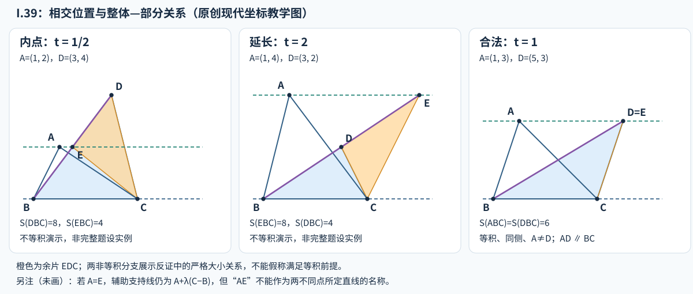

# 《几何原本》I.39：从等积倒推平行，同侧条件为何不能省

> AI 数学推理前史补读 · 深读 v1。作品通常定位于约公元前 300 年；实读 Heath 1908 卷 I 印页 336–337（扫描 PDF 357–358）和 Fitzpatrick 2008 第 39–40 页。本文是一条古代几何命题的原创中文解析，不是现代 AI 论文或全文翻译，不宣称最早或覆盖穷尽。接续 [I.38](euclid-elements-i38.zh-CN.md)，本轮仅完成 I.39；这属于从现代计算文献回到古代的明确年代补读。

## 1. 问题、书目与阅读边界

两个三角形共用一段底边，面积相等，能不能断言两个顶点的连线平行于底边？不能直接说能：如果两个顶点在底线两侧，面积可以相等，连线却会穿过底线。I.39 的精髓，是在倒转 [I.37](euclid-elements-i37.zh-CN.md) 时补出不能由剩余条件推出的**同侧**条件。

这里的“相等三角形”是等积，不是全等。结论恢复的是共同平行带，不是恢复边长、角度或形状。研究动机可以读作：先前从位置获得的面积不变量，现在能否反过来作为判定位置关系的依据？这是本文对证明结构的解释，不是声称保存了 Euclid 本人的心理记录。

| 所读材料 | 精确范围 | 作用 |
| --- | --- | --- |
| Euclid，T. L. Heath 译注，*The Thirteen Books of Euclid's Elements*，Cambridge UP，1908，卷 I | 印 336 全部 I.39；印 337 I.39 的文本注与三段数学评论；卷首 ERRATA | [扫描本](https://archive.org/details/thirteenbookseu02heibgoog)。辨原证明、编辑评论及延长线分支 |
| Richard Fitzpatrick，*Euclid's Elements of Geometry*，2008 修订版 | 第 39 页末命题及设置，第 40 页上半证明与图；引言版本说明 | [希英对照 PDF](https://farside.ph.utexas.edu/Books/Euclid/Elements.pdf)。与 Heath 对照，不把译者补语视为古文逐字表达 |
| 书内直接前驱 | [I.31](euclid-elements-i31.zh-CN.md)、[I.37](euclid-elements-i37.zh-CN.md) | 过点作平行线、同底同平行带等积；共同概念 1 与 5 处理等量传递、整体与部分 |

约公元前 300 年是作品时代估计，不是该命题的精确发表日。Fitzpatrick 的引言把 Euclid 置于 Alexandria，并说明许多材料来自前人；这不足以把 I.39 的首次发现分配给某位可确定的前驱。本文核实的是传世编排与所读近现代版本，未直接研读所有古注或同期手稿。对名作和非名作均采用原文可得、推理可重建、证据可定位的收录标准。

Heath 卷首所列勘误中未见针对印 336–337 的条目；这是指定勘误表的检查结果，不是断言所有版本都无错误。印 337 的第一条注属于**文本史**：Heath 转述 Heiberg 依据纸草材料对设置段插句及连接词改动的判断。它不是对“同侧等积推出平行”的数学反例；本文不把转述写成已亲核纸草原件。详见[独立来源审查](../../reproduction/euclid-elements-i39/source-review.zh-CN.md)。

## 2. 为什么称为部分逆命题

I.37 的结构是：同一底边，加上同一对平行线之间的位置，推出等积。I.39 保留同底，将等积升格为前提，把平行位置作为目标。因此它并不是把所有前提与结论整体交换，也不是把 I.37 直接从右向左读。

| 单元 | 已知 | 所求 |
| --- | --- | --- |
| I.37 | 同底、同一平行带 | 等积 |
| I.39 | 同底、等积、底线同侧 | 同一平行带 |

Heath 印 337 明说这是 I.37 的部分逆命题，并指出同侧在原命题中被其他条件包含，在当前命题中却必须另行要求。这是一个可以逐项核对的依赖变化，不是文字修饰。

I.35–38 先比较平行四边形、三角形的量。Heath 同页转述 Proclus 对只列三角形逆命题的说明；本文只把这当所读评论，不声称已经独立考察 Proclus 原著全部论证。这里不展开或计入后续 I.40 的完成。

## 3. 输入、符号与真正的退化

取不同的 B、C 为同一底段的端点。A、D 均不在直线 BC 上，且在它的同一开半平面内；三角形 ABC、DBC 的面积相等。讨论“直线 AD 平行 BC”时还要求 A 与 D 不同。

- S(XYZ) 表示非负面积，是本文的教学记号，不是原文的函数符号。
- ℓ 是整条底线 BC，m 是过 A 作出的 ℓ 的平行线。
- E 是 m 与直线 BD 的交点；不预设它一定在线段 BD 内。
- “同侧”以整条底线为边界，不是指 A、D 横坐标都在某个区间。

若 A=D，两个三角形完全相同；“存在共同平行带”仍成立，但用两个重合点命名直线 AD 没有定义。本文的定理证书接口选择拒绝这个**连线结论的退化输入**，不声称原命题的支持线版本因此为假。若 B=C，或 A、D 在底线上，则连三角形本身也退化，必须另行排除。

另一种容易误排的情况是 A、B、D 共线而 A≠D。它不是三角形必然退化，因为 C 可以不在该线上；此时构造可能有 E=A。不要试图用重合点写“直线 AE”；仍用独立命名的 m。证明比较的是 EBC 与 DBC，不要求 A、E 是不同点。

## 4. 原证重建：用正确的平行线检验错误的候选

### 4.1 反设与构造

【原文】连 AD，反设它不平行于 BC。按 I.31，过 A 作一条与 BC 平行的线，在原图中标为 AE，并连 EC。原图 E 位于 BD 内部。

【教学补显】将构造明确为 m 与 BD 相交于 E。BD 经过底线上的 B，又包含不在底线上的 D，所以它不能与底线平行；因 m 与底线平行，BD 也不能与 m 平行。以欧氏平面直线的相交性质可取唯一交点。原文没有逐项展开这份存在性与点序论证，不应说“图上画得出来”就是一般证明。

由于 A 与 D 在 ℓ 同侧，交点 E 落在从 B 经过 D 的射线上，而不是 B 的反向延长线上。这使用直线、平行线与半平面的次序性质；第 6 节以正参数补证其模型版本。它不是借助待证的面积结论来猜位置。

如果 E=D，D 已在 m 上，由 A≠D，AD 就是 m，立即与反设矛盾。所以反设下只需比较 E 在 BD 内部和 E 在 D 之外两种情形。

### 4.2 以 I.37 建立中介等量

【原文】ABC 与 EBC 共用底 BC，顶点 A、E 都在 m 上，m 平行 BC。由 I.37：

$$
S(ABC)=S(EBC).
$$

【原文】题设给出 ABC 与 DBC 等积。用共同概念 1，把等于同一量的两个对象连起来：

$$
S(DBC)=S(ABC)=S(EBC).
$$

这两步是反证的“数量侧”。它只依赖先前已有的正向命题，不依赖 I.39 本身，也没有使用底乘高的数值公式。

### 4.3 图示分支：E 在 B 与 D 之间

【教学展开原图】C 不在 BD 上，否则 DBC 退化。连接 EC，把三角形 DBC 切成 EBC 与 DEC。DEC 有正面积，因此 EBC 是 DBC 的真部分。整体大于部分，与刚得到的相等冲突：

$$
S(DBC)=S(EBC)+S(DEC)\gt S(EBC).
$$

分割相加是现代记号表达；原文直接说较大者等于较小者不可能。这里“较大”有包含和非退化的依据，不是凭图的视觉尺寸判断。

### 4.4 必须补的分支：E 在 D 之外

若次序是 B—D—E，则改由 DBC 成为 EBC 的真部分，连接 DC 正好给出分割：

$$
S(EBC)=S(DBC)+S(EDC)\gt S(DBC).
$$

仍与等积矛盾。Heath 印 337 转述 Proclus，明确提醒平行线与 BD 或 CD 在 D 外的延长部分相交时，同样容易证明。本篇选用 BD 一条横截线把两案系统写清，而不把未画出的延长情形略掉。

### 4.5 结论为何成立，原文末句怎么读

两种 E≠D 的可能都导致矛盾；I.31 又保证过 A 的平行线确实存在，所以它只能经过 D。A≠D 时得到 AD 平行 BC。

原文把结尾写作排除 AE 以及其他不是 AD 的候选线。读者不应误解为“刚构造成功的平行线后来真的不平行”，更不应以为在有限张图里穷举所有直线。被排除的是**保持题设同时假定所作平行线不同于 AD**的组合。本文把其反证作用域明确写出；在正确配置中，所作线与 AD 重合，并无矛盾。

## 5. 同侧不可删除：一个可手算反例

令 B=(0,0)、C=(4,0)、A=(1,3)、D=(5,-3)。两个三角形面积都是 6，但 AD 的方向为 (4,-6)，不平行于底线的方向 (4,0)，且线段 AD 在 (3,0) 穿过底线。

它没有反驳 I.39，因为恰好违反同侧条件；它反驳的是删除该条件后的错误命题。面积是非负量，不能区分向上的高度与向下的高度。同侧负责排除这项符号歧义。

注意 (3,0) 是 **AD 的中点**，不是底段 BC 的中点 (2,0)。等积同底且异侧时，两顶点到基线的距离相等，连接线在自身中点处过线，但过线点未必落在底段内。读到简略评论中的“中点”时，应追问是哪一段的中点。

## 6. 现代精确模型：一行代数前，先把符号条件写清

这一节是现代有理坐标教学重构，不冒充原证。取 u=C−B 非零，定义有向二倍面积：

$$
a=\det(u,A-B),\qquad d=\det(u,D-B).
$$

非退化要求 a、d 都不为零，同侧要求二者同号。非负面积分别是其绝对值的一半。故等积给出绝对值相等，而同号把它加强成 a=d。于是：

$$
\det(u,D-A)=d-a=0.
$$

A≠D 保证 D−A 非零；两个非零向量行列式为零意味着方向平行。由于 A 不在底线上，这两条支持线不同而平行。**没有 A≠D 时，零向量同样给出零行列式，却不能定义直线方向**；这正是实现必须检查类型和几何域的原因。

再核查辅助点的点序，而非只核查最终平行性。直线 BD 上点可写成 B+t(D−B)。使它落在过 A 的平行线上，需要：

$$
E=B+t(D-B),\qquad t=\frac{a}{d}\gt 0.
$$

分母非零来自 DBC 不退化，正号来自同侧。t 在 0 与 1 之间时 E 在 BD 内，t 大于 1 时 E 在 D 外，t=1 时 E=D。真实等积输入会使 t=1；为了演示原反证排除的两案，程序另用**同侧但不等积**的输入展示 t 的两种非平凡范围，不能把这些例子冒称满足完整题设的反例。

这个比值不是拿相似三角形或 VI.1 倒证 I.39，而是独立坐标模型中的线性方程求交点。行列式面积解释本身属于现代背景。原证的证据仍是 I.31、I.37、共同概念及点序补足；模型核验与几何重建各有身份。

## 7. 算例、构造走查和输入失败

以下数值均可独立手算，实跑覆盖另见附件，不以本表替代真实日志。

图为本文原创坐标教学示意：前两栏是同侧但不等积的反证分支演示，只有第三栏满足完整等积题设。不是原书图的复制，也不以图形比例充当证明。

| 输入（固定 B=(0,0)、C=(4,0)） | 交点参数与面积 | 正确解释 |
| --- | --- | --- |
| A=(1,3)，D=(5,3) | a=d=12，t=1，E=D；面积各 6 | 合法 I.39；两三角形可不全等 |
| A=(1,2)，D=(3,4) | a=8，d=16，t=1/2，E=(3/2,2)；面积 4 与 8 | 内点分支演示；因不等积不能签发定理证书 |
| A=(1,4)，D=(3,2) | a=16，d=8，t=2，E=(6,4)；面积 8 与 4 | 延长分支演示；同样不是完整题设实例 |
| A=(1,3)，D=(1,3) | 面积相等、同侧，但 AD 无定义 | 支持线表述仍成立；连线接口拒绝 |
| A=(1,3)，D=(5,-3) | 面积相等，但 a、d 异号 | 同侧条件失败；不能只查面积 |
| A=(1,0)，D=(5,0) | 两个面积都为零 | 两三角形退化，“0=0”不构成证书 |

再取 A=(1,2)、D=(2,4)，保持同底。此时 E=A=(1,2)，却不影响分割 EBC 与 DBC 的严格包含；只有“AE”这个两点线名失效。因此程序的构造接口不应把所有跨对象标签重合都当作同一种退化。

第一行中 ABC 的三边平方为 10、18、16，DBC 的为 34、10、16，故不是全等。面积相等恢复不了一般的形状唯一性。把“相等”统一译成“全等”，会误缩适用范围，并误导读者以为面积能恢复形状。若把等积前提替换成全等，命题仍真，但前提更强、适用域更窄，不再忠实表达原命题的一般性。

## 8. 主张与证据位置

| 主张 | 可核位置 | 层次 |
| --- | --- | --- |
| 同底、等积、同侧推出同平行带 | Heath 印 336 命题；Fitzpatrick p.39–40 | 原文 |
| 过 A 作平行线、连 EC、使用 I.37 | Heath 印 336 证明第 8–15 行附近；Fitzpatrick p.40 | 原构造与引证 |
| 共同概念 1 将两项相等传递给 DBC、EBC | Heath 印 336 第 16–18 行附近 | 原引证 |
| 部分逆命题与同侧条件的新增必要性 | Heath 印 337 首段数学评论（文本注之后） | 译注分析 |
| 与 BD 或 CD 延长线相交的分支 | Heath 印 337 I.39 最后评论段 | Heath 转述 Proclus，非亲读古注 |
| 第 5 行设置句及 And/For 的文本判断 | Heath 印 337 第一注；Fitzpatrick 引言的编辑括号说明 | 文本史，不等于数学勘误 |
| 点序、交点存在、A=D 与 E=A 的边界 | 本文第 3、4、6 节 | 教学补显及现代模型 |
| 严格输入、证书绑定、Notebook 输出 | 本篇复现目录 | 真实运行，不是一般定理证明 |

## 9. 最小复现：能检查什么，不能冒充什么

[复现目录](../../reproduction/euclid-elements-i39/README.md)保存原创源码、精确有理数算术、测试、执行环境、命令退出码、真实日志和教学 Notebook。[独立技术审查](../../reproduction/euclid-elements-i39/technical-review.md)另行核查证明、实现和攻击输入；[来源审查](../../reproduction/euclid-elements-i39/source-review.zh-CN.md)核原页与本文映射。两份审查绑定最终正文 SHA256，而非只对早期草稿表示认可。

实际环境为 CPython 3.12.14、Linux x86_64，仅用标准库。17 个单元测试方法在普通、`-O`、`-OO` 三模式全部通过；批量例子覆盖 180 个合法定理输入和 7 个非法几何的直接拒绝。内点、外点构造另各检查 10 个变换实例，它们不计为定理正例。Notebook 的 5 个代码格以标准库 `compile/exec` 顺序实际执行，再在全新命名空间逐格重放，stdout 完全匹配；未启动 Jupyter kernel，也未声称做过 Notebook 界面渲染。

输入只接受严格四点结构、整数或规范有理数字符串，拒绝 bool、浮点和 NaN/无穷。证书绑定全部规范化原始坐标并重算各字段；整数与等值规范整数字符串有意视作同一数学输入，而非字节级签名。测试覆盖证书叶值篡改、缺失/多余字段、类型混淆及同面积换输入。独立核验者另写检查器，三模式每次 4325 项显式检查均通过：216 个独立基向量正例、432 个内外构造分支、439 个非法几何直接拒绝（含前述 432 个不等积分支与 7 个边界）、25 个类型/schema 坏输入、401 次证书子树/类型/缺增键/循环攻击，以及 216 次同面积移绑攻击。这些类别存在明确的复用，不能把它们相加声称是互不重叠的几何样本。

这是理论教学复现，不涉及训练数据、学习基线或性能排行榜。对应的复现条件是输入语法、非退化域、精确算术、构造规则和校验方式。计算在有理数样本上进行，不穷举实数平面；有限样本和三种解释器模式的重复都不能证明一般定理。证书是受限模型中的重新计算记录，不是证明助理认证的 Euclid 全体系。

## 10. 局限、合理延伸与当代意义

1. 同底不能弱化为底长偶然相等，更不能把不同底线混在一起；超出这一输入域需要另行论证，本篇不以 I.40 替代本篇工作。
2. 非负面积丢失方向信息。同侧补回一个离散选择，但没有补回形状；这说明一个不变量的逆向用途必须依赖额外条件。
3. 原证明是欧氏平面框架，不直接覆盖球面或曲面；交点存在、点序和真部分的严格性被展开为教学义务，不宣称古文已经给出完整现代公理化。
4. 从“所有合法输入都满足结论”的数学证明，到“这份程序正确处理所有语法输入”，还需要软件层面的论证。单测和独立攻击降低局部错误风险，不替代完整形式验证。
5. 【分析延伸】自动推理系统复用正向定理时，可以构造一个满足接口的中介对象，再用严格不等式排除替代方案。危险在于让语言模型把“逆命题也显然”当作规则，或把未检查的同侧默默塞进图里。本文不据此宣称古代已有现代 AI 技术。

## 11. 复盘与带答案练习

**题 1：** I.39 为什么不能由 I.37 直接把箭头反过来得到？

**答：** 蕴涵一般不能反向。I.37 的平行带前提还包含同侧信息；只保留等积与同底会失去它。I.39 加同侧后，再通过 I.31 构造、I.37 比较、整体大于部分重新证明。

**题 2：** 原图 E 在 BD 内，但若它落在 D 外，哪个三角形变成真部分？

**答：** B—D—E 时 DBC 是 EBC 的真部分，余下 EDC 非退化且面积为正。不等式方向反过来，仍与两者等积冲突。

**题 3：** 上表内点例中，EBC、DBC、DEC 面积各是多少？

**答：** 分别 4、8、4；用同底数值核验或行列式均可。图形分割给出 8=4+4。它不满足 ABC 与 DBC 等积，所以展示的是反证中要排除的几何关系，不是合法题设下真的出现的配置。

**题 4：** 一个检查器发现 det(C−B,D−A)=0 就通过，有什么漏洞？

**答：** A=D 时第二向量为零，也给出零行列式，但 AD 无定义；B=C 也会使第一向量为零。此外该式不能替代原题同侧、等积和非退化条件检查。

**题 5：** A=E 与 A=D 是否应该同样拒绝？

**答：** 不应。A=D 使所要求的连线结论无定义；A=E 只使辅助线名 AE 不便使用，改名 m 即可，两个待比较三角形可以仍非退化。构造演示需容许后者。

**题 6：** 为什么真实合法样本的辅助参数总是 1，还要测 1/2 和 2？

**答：** 合法等积同侧输入本就迫使 a=d，所以 t=1。1/2 与 2 用于核验独立的构造/分支说明及拒绝行为；不能把它们混计成定理正例。定理证书接口应直接拒绝这些不等积样本。

**题 7：** 沿平行于底线的方向移动 D 后仍等积，旧证书能否直接复用？

**答：** 结论可能仍真，但证书声称对应的输入已经变了。必须绑定完整规范化四点输入并重新核验；只存最终面积相等无法发现这种换样本。

**复盘：** 逆向推理不是倒读句子。I.39 先保住同底与同侧，再用一个可构造的中介三角形，把“另一条候选平行线”转化为真部分与整体相等的矛盾。
