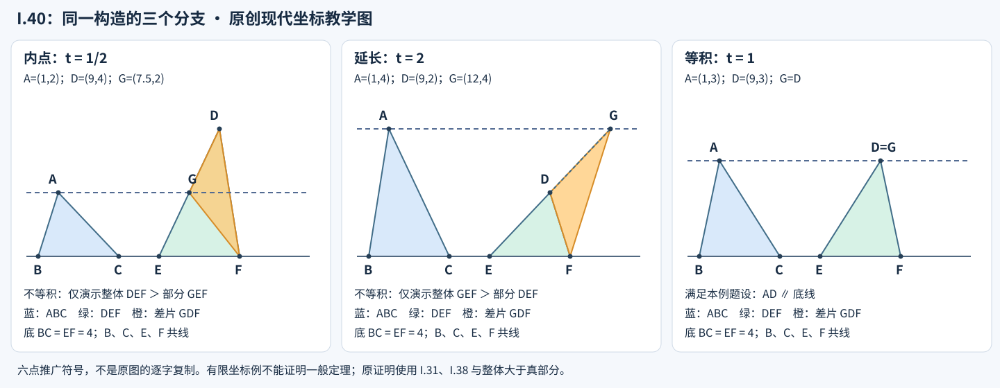

# 《几何原本》I.40：等底等积如何恢复平行，遗漏的共线条件如何补回

> AI 数学推理前史补读 · 深读 v1。接续 [I.39](euclid-elements-i39.zh-CN.md)，本轮只读 I.40。约公元前 300 年是《几何原本》的作品背景，不是本命题可确证的独立成文日期：所读版本均记录其早期插入问题。本文为原创中文解析，不是全文翻译，不称其现代 AI 论文，也不宣称最早或历史覆盖穷尽。

## 1. 问题不是把上一句的“同”改成“等”

[I.39](euclid-elements-i39.zh-CN.md)讨论同一底边上的两个等积三角形。I.40放宽为两条**等长底边**：若面积也相等，两个顶点是否仍能落在同一条平行线上？回答需要说清底边在哪里。“底长相等”只是一项数量条件，不能替代“两条底边在同一直线上”的位置条件；“同侧”也必须有共同的参照直线。

本篇有两个互相独立的问题：数学上怎样把 I.38 的面积结论逆向使用；文本上为何传世命题的设置不足以直接表达其一般性。数学命题可以补严并证明，不表示文本归属问题也随之解决。

这里的“相等三角形”指**等积**，并非全等。等积不能恢复形状、边长或角度。把它换成全等会得到更强的前提和更窄的适用范围，不是忠实的翻译。

## 2. 书目、时代与确实读到的范围

| 材料 | 本轮核读位置 | 证据用途 |
| --- | --- | --- |
| Euclid，T. L. Heath 译注，*The Thirteen Books of Euclid’s Elements*，Cambridge UP，1908，卷 I | 印页337下部至338上部，扫描PDF358–359；卷首ERRATA | [原扫描](https://archive.org/details/thirteenbookseu02heibgoog)：完整I.40、图、依赖标签、整条插入的评论 |
| Richard Fitzpatrick，*Euclid’s Elements of Geometry*，2008修订版 | 第40–41页的I.40及脚注；引言版本说明 | [希英对照版](https://farside.ph.utexas.edu/Books/Euclid/Elements.pdf)：核对命题、证明、译者括号和文本层次 |
| David E. Joyce，*Euclid’s Elements*，I.40 Guide | 命题后评论 | [作者评论](https://mathcs.clarku.edu/~djoyce/elements/bookI/propI40.html)：指出漏写共线以及共端点假设不足；不是古代原文 |
| 书内证明前驱 | I.31、I.38、共同概念1及整体/真部分原则 | [I.31](euclid-elements-i31.zh-CN.md)、[I.38](euclid-elements-i38.zh-CN.md)：平行构造与等底同平行带等积 |

Heath在I.40外加方括号，并于印338转述Heiberg根据前述纸草片断，把整条命题判断为插入；其解释是补入者希望I.39/I.40形成类似I.37/I.38、I.35/I.36的成对编排。Fitzpatrick第41页脚注同样报告Heiberg的“相对早期插入”判断。**这是本轮直接读到的版本证据，不能改写成已亲核纸草或证明了插入者、地点与精确年代。** 本文不把传本中的“I.40”自动当作Euclid本人撰写的保证。

Heath卷首勘误表未见针对印337–338的条目；这只限于所核表，不是“所有版本从无错误”。I.39的文本注、I.40的整条插入判断、数学上需要补写的共线条件，是三种不同事项，不应合并成一个“勘误”。

《几何原本》通常置于约前300年的亚历山大传统，所读引言也提醒其吸收前人材料。本单元没有足够证据把此命题首次发现归给某位具体前驱或同时代人物。我们可以核查书内先后依赖，却不能把书内顺序直接当发现年表。该单元被收入AI前史，是为了研究证明接口、条件保留和一般化，不是因为它享有某种“第一篇AI论文”的身份；同样标准适用于非名作。这里是明确的古代补读与年代跳转。

## 3. 三种表述必须分开

### 3.1 传本文字与原图设置

【原文】命题说等积三角形在等底上且同侧，则处于同一对平行线之间。设置采用ABC和CDE，两底为BC、CE，结论写为AD平行BE。图上B、C、E共线且C在B、E之间；第二三角形也记作DCE，顶点排列并不改变区域。

【文本缺口】标题没有明确说底边共线；“BE”作为共同底线的使用依赖图及设置中的隐含信息。两条任意等底也不必恰有一个共同端点C。Joyce明确指出这两项不足，并说把C拆为两个点后证明仍可用。本文以下将原证和补全分栏说明，不声称古文已经列出了全部输入契约。

### 3.2 本文采用的一般命题

【教学补严】两个非退化三角形ABC、DEF，其底BC和EF都是非零线段，位于同一整直线ℓ上，长度相等；A、D在ℓ同一开半平面，两个三角形等积。则存在过A、D的共同直线m与ℓ平行。若A≠D，可直接说直线AD平行ℓ。

允许两底分离、相接、部分重叠、完全重合，允许端点方向反转。相接不是必要条件。点A=D时，“存在共同平行支持线”仍真，但直线AD这个两点名称无定义；实现会明确返回该边界，而不是把零方向向量误认成一条平行线。

### 3.3 符号与依赖约束

S(XYZ)表示三角形的非负面积，是教学记号。ℓ、m是整直线，不是有限线段。原证辅助点叫F；一般六点版本中F已是第二底端点，故辅助点另叫G。两套字母在第5节作明确映射。

I.38是“等底 + 同平行带 → 等积”。I.40保留等底，把等积变为前提，并补明共线、同侧后重新推出共同平行带。它不是把蕴涵符号机械反转。原证路线只调用I.31/I.38和等量、真部分比较；不用后来的VI.1或底乘高公式证明I.38/I.40。平行公设的影响可以经I.38所依赖的前文进入，不能因为本页未写第五公设就宣称独立于它。

## 4. 按原文字母重建反证

### 4.1 构造，并说明不是看图猜交点

【原文】连AD；反设AD不平行BE。按I.31过A作与BE平行的线，原图称AF，再连FE。图中F在CD内。

【教学补显】令所作线为m，取m与直线CD的交点F。D不在底线而C在底线上，CD不平行于底线；它也不能平行于m，否则由I.30，CD会平行BE，但CD在C与BE相交，矛盾。这是本文为构造存在性补显的额外依赖，不是声称I.40原文明引了I.30。在通常欧氏平面的相交与次序性质下，交点存在且唯一。A、D同侧进一步保证F位于射线CD，而不是C的反向延长线。这些是原文压缩的构造义务；本篇第6节给独立坐标核验，不把数值求交冒充古典公理体系的完整形式化。

若F=D，D就在m上；A≠D时AD=m，已与反设冲突。因此反设只留下C—F—D与C—D—F两种严格点序。A=F也不一定使三角形退化，只使“AF”两点线名失效；独立命名m可避开这项记号问题。

### 4.2 I.38提供的不是最终结论，而是中介等积

【原文】ABC与FCE在等底BC、CE上，顶点A、F在同一条m上，而m平行共同底线。I.38给出第一项相等；题设再给第二项，借共同概念1传递：

$$
S(FCE)=S(ABC)=S(DCE).
$$

等量链中每一项都对应具体三角形。若忘记两底共线，不能把它们说成在**同一对**平行线之间；这是遗漏条件直接破坏证明调用的位置。

### 4.3 内点分支：真部分为什么严格较小

【教学展开原图】C—F—D时，FE将DCE分为FCE与DFE。E不在CD上，否则DCE退化；DFE因此有正面积，FCE是真部分：

$$
S(DCE)=S(FCE)+S(DFE)\gt S(FCE).
$$

这与等量链冲突。原文说较大等于较小不可能；这里用区域分割补出“较大”的根据，而不是凭画面尺寸断言。原文不需要先算任何数值面积。

### 4.4 外点分支：整体和部分交换

【教学补全】C—D—F时，DCE成为FCE的真部分，余下FDE非退化：

$$
S(FCE)=S(DCE)+S(FDE)\gt S(DCE).
$$

矛盾仍在，只是不等式方向反转。Heath印337对前一命题I.39讨论过延长线情形；本段是把同一几何分支方法明确用于I.40的补全，不冒称I.40原文另列了第二幅图。

两种严格点序都被排除，所作平行线只能经过D。原文末段“AF不平行，其他线也不行，只有AD”是在反设作用域内的归谬，不是说I.31构造真的失败。它没有枚举无限多条直线；排除的是“题设成立而所作平行线不通过D”的组合。

## 5. 不靠平移，去掉原图的共端限制

【教学一般化】改用ABC与DEF，BC、EF为任意共线等底。过A作m平行ℓ；m交射线ED于G，连GF。此处无需把任何三角形移动到别处，故也无需额外引入运动保持面积的假设。

I.38直接比较ABC和GEF，因为它们的底BC、EF等长且在ℓ上，顶点A、G在m上。于是GEF与DEF都等于ABC，彼此等积。E—G—D时，GEF是真部分，余下DGF；E—D—G时，DEF是真部分，余下GDF。两者与等积矛盾，故G=D。原图相接情形只需令一般版E=原C、一般版F=原E、G=原辅助F；其余A、B、C、D不变。

这份证明不要求两底分离，也不要求它们的端点排列方向一致。I.38处理长度相等，不是有向向量相等。若实现仅检查F−E=C−B，就会错误拒绝反向标号的合法底边。

A=D时可以在开始就按I.31作共同m，支持线结论直接满足，不能再连一个不存在的AD。若一般版A=G，只是所作线不能借AG两点来命名，后续比较GEF和DEF仍有效。这两种重合不可混成同一个“全拒绝”策略。

## 6. 现代模型：长度方向、同侧和绝对值分别负责什么

【现代教学模型，非原证】坐标采用精确有理数。令u=C−B、v=F−E，u非零。共线且两底等长推出v=u或v=−u；长度检查可以用平方长度相等完成，无需开方。设：

$$
a=\det(u,A-B),\qquad d=\det(u,D-E).
$$

E与B在同一底线上，换基点不改变相对ℓ的有向高度；两者非零表示非退化，a与d同号表示同侧。第二三角形自己的有向二倍面积是det(v,D−E)，它可能等于d，也可能等于−d，不能不管底方向便直接比较有向值。

等底使两三角形的非负二倍面积分别为|a|与|d|；等积给绝对值相等，同侧进一步给a=d。因此：

$$
\det(u,D-A)=d-a=0.
$$

A≠D时两个方向向量均非零，且A不在ℓ上，故是不同的平行支持线。A=D时等式同样成立，但不能由零向量命名AD。计算结果必须保留这项语义区别。

辅助交点也可以直接解线性方程：

$$
G=E+t(D-E),\qquad t=\frac{a}{d}\gt 0.
$$

t为正来自同侧，而非等积。0<t<1与t>1分别给内、外分支；t=1给G=D。完整题设必然t=1，所以程序演示内外分支时必须放松等积并显式标记“不属于定理正例”。这不是相似理论或VI.1倒证，而是独立坐标模型求交。有限有理样本也不能代替实平面的一般证明。

## 7. 手算例与删除条件的反例

以下统一采用六点模型；数值表是可手算教学例，实跑统计另见第9节。固定B=(0,0)、C=(4,0)、E=(6,0)、F=(10,0)，两底长均4。

| A、D | 两个面积与交点 | 意义 |
| --- | --- | --- |
| A=(1,3)，D=(9,3) | 均6；t=1，G=D | 分离等底的合法输入；顶点连线水平 |
| A=(1,2)，D=(9,4) | 4、8；t=1/2，G=(15/2,2) | G在ED内，DEF面积8=GEF面积4+DGF面积4；因不等积不可签发定理证书 |
| A=(1,4)，D=(9,2) | 8、4；t=2，G=(12,4) | G在D外，GEF面积8=DEF面积4+GDF面积4；同样不是正例 |
| A=(1,3)，D=(9,-3) | 均6；异侧 | 删除同侧的反例，AD斜穿底线 |
| A=D=(1,3) | 均6；G=A=D | 支持线成立，AD两点线名无定义 |

图为本篇原创坐标教学示意，不是原书图复制；前两栏不等积，仅第三栏满足完整题设。

等积并不要求全等：保留A=(1,3)，另取D=(11,3)。ABC的三边平方为10、18、16，DEF的为34、10、16，故不全等；面积仍各6，AD仍水平。表中D=(9,3)那一例反而全等，不能拿它作为非全等见证。“看起来形状不同”应有可核算根据。

**删除等底。** 保留第一底长4、高3、面积6；改第二底E=(6,0)、F=(8,0)，D=(9,6)，第二底长2、高6、面积仍6。共线且同侧，却不能得到AD水平。不同底长可以用不同高度补偿。

**删除共线。** 保留ABC面积6；取E=(6,1)、F=(10,1)、D=(9,4)。第二三角形面积也是6，两底长度均4，A、D甚至都在两条水平底线之上，但AD不水平，也不存在一条直线同时包含两条底段。所谓“同侧”若仅各对自己的底线说，就不够。

**允许零底或零面积。** B=C或A落在底线上时，0=0并不提供所需非退化几何。输入契约应先拒绝，而不是等到后面计算除零或把无意义证书标真。

**底方向反转。** 交换E、F不改变区域或定理真假；有向面积符号会变。检查器如果只比较两个本地行列式相等，就会误拒合法输入，必须先统一公共底方向或比较绝对值并单独核同侧。

## 8. 主张、出处与证据层级

| 主张 | 定位 | 层级 |
| --- | --- | --- |
| 等底、等积、同侧命题及ABC/CDE设置 | Heath印337下半；Fitzpatrick p.40 | 传世原文，不是现代条件清单 |
| I.31作AF、连FE、I.38得到ABC=FCE | 同上证明段及引证标签 | 原证 |
| 等量传递与较大等于较小的矛盾 | Heath印337末段、338首段；Fitzpatrick p.40–41 | 原证；本篇补显严格包含 |
| 整条命题的插入判断及配对动机解释 | Heath印338 I.40后唯一评论；Fitzpatrick p.41脚注 | 译注转述Heiberg，不是亲核纸草 |
| 共线漏写及共端点不具一般性 | Joyce I.40 Guide | 现代作者评论；本篇给出完整补证 |
| 内外分支、交点存在、A=D与A=G边界 | 本文第4–6节 | 教学补全与现代模型 |
| 六点输入、证书绑定、错误拒绝、运行输出 | 本篇复现目录 | 真实有限执行，不是一般定理证明 |

## 9. 最小复现与独立审查

[复现说明](../../reproduction/euclid-elements-i40/README.md)保存标准库精确算术实现、测试、Notebook、执行命令、环境和真实日志。[来源审查](../../reproduction/euclid-elements-i40/source-review.zh-CN.md)独立核原页、评论和归属边界；[技术审查](../../reproduction/euclid-elements-i40/technical-review.md)独立核证明、模型、代码与攻击输入。两份报告绑定最终正文SHA256。

已实际用CPython 3.12.14、Linux x86_64标准库执行20项单元测试，普通、`-O`、`-OO`三模式均通过；批量运行168个合法输入，其中84个为A=D的支持线边界，另9个非法几何在生成证书前直接拒绝。内外两种非等积分支另行演示，不计为定理正例。Notebook的5个代码格实际以`compile/exec`顺序执行，并在全新命名空间回放，stdout完全一致；未启动Jupyter kernel，也未声称做过Notebook界面渲染。已阅读安装的Notebook技能，因其本地脚手架不可用，采用自有标准库构建器，没有安装额外依赖。

输入只收六个指定键及二元素坐标list，坐标为严格整数或规范有理数字符串，拒绝bool、float、NaN和无穷。证书只收JSON字符串/list/object树，绑定完整规范化六点并逐字段重算；数学上等值的整数与规范整数字符串有意归一，不是字节级签名。独立技术检查器另在三模式各完成2612项显式检查，包含168个自造有理斜基正例、336个内外分支、346个非法几何直接拒绝、19个类型/schema输入、396个证书子树/键攻击、1个循环对象攻击、168个同面积移绑检查及2个G=A辅助重合分支。检查项包含复用和每例多字段核验，不能把这些数字相加说成互不重叠的几何样本。

这是理论教学复现，没有训练数据、学习基线或性能指标。对应的复现条件是六点输入格式、非退化、等底共线同侧、精确算术和证书校验规则。代码不是Euclid完整公理系统的形式认证；有限计算不证明一般定理，坐标模型不取代原证。公开附件只含原创解析、自有代码和已检查运行证据，不包含原书PDF或全文翻译。

## 10. 局限与合理延伸

- 文本归属与数学真值分开。一个传本单元可能经过后人增补，仍能陈述可证明定理；数学成立也不能倒推作者身份。
- 以图示相接两底为一般输入，是从一个配置偷渡到全部配置。补证应指出同一构造为什么对分离、重叠、反向底边仍可用，而不只增加几张图。
- 同侧解决非负面积的符号歧义；共线解决共同参照问题；等底解决尺度补偿问题。三个条件承担不同任务，不能统称为“常规假设”。
- 平面、直线相交次序和面积可加性构成背景。本文不直接推广到曲面、球面或非欧几何，也不声称把传统证明的全部隐含公理形式化。
- 【分析延伸】自动推理系统若把定理当工具，必须同时保存对象类型、位置和非退化条件。一个工具返回零行列式，不等于它已证明一条由两点确定的直线存在。证书绑定能检测偷换输入，不能取代数学前提的设计与核验。

## 11. 复盘与带答案练习

**题1：I.40与I.38是什么关系？**

答：保留等底，把等积变成前提，目标改为共同平行带；还须明确底共线与顶点同侧。它是带背景条件的部分逆向，不是合法地“直接倒读”I.38。

**题2：原图的共端C为什么不能作为不证自明的一般假设？**

答：两条共线等长线段可以分离或重叠，未必共端。拆成BC和EF后，过A的平行线交ED于G，I.38比较ABC和GEF，后续真部分反证不需要共端。

**题3：t=2时，哪个区域为整体？**

答：E—D—G，GEF为整体，DEF为真部分，余下GDF。等积与严格大于不能同时成立。这里演示了非等积分支，不能称为完整题设的实际配置。

**题4：底反向时a=d是否仍由等积同侧推出？**

答：若a、d都用同一u方向定义，仍然成立。若各用本地底向量u与v，则v=−u会反转第二有向面积，不能直接比较其符号；非负面积仍相等。

**题5：删除共线例中，第二三角形为何仍面积6？**

答：它自己的底线为y=1，D高度差为3，底长4，因此面积6。但A高度y=3、D高度y=4不同，AD不水平。把两条不同底线混成一个共同参照是错误所在。

**题6：A=D与A=G应如何处理？**

答：前者不能命名AD，但共同支持线结论仍成立，应明确返回此边界。后者只使AG线名不便，改用m即可；构造和面积比较可继续。零底和退化三角形则不在本文域内，应直接拒绝。

**题7：两份审查为什么绑定正文哈希而不是只写“通过”？**

答：审查对应具体版本。若修改公式、假设或实跑统计，应重审受影响内容并更新哈希；否则无法知道被发布文本是否就是审查对象。哈希固定对象，不自动保证正确。

**题8：为什么不能直接断言Euclid在约前300年写下I.40？**

答：作品时代与各传本单元的成文层次不同。Heath和Fitzpatrick均记录Heiberg把本条判作早期插入；本轮未亲核纸草，也未确定增补者和日期，必须保留此证据边界。

**复盘：** 从同底推广到等底，难点不只是替换I.37为I.38。要先补共同底线，去掉无理由的共端限制，确认交点与两种点序，再分清数量相等、支持线存在和两点线名三种不同结论。
