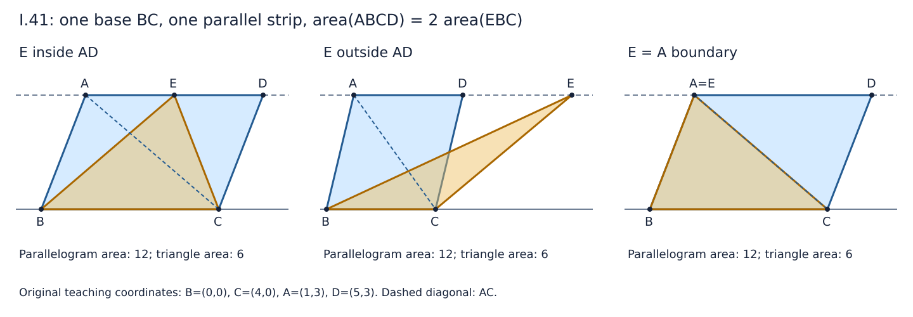

# 《几何原本》I.41：为什么平行四边形是同底同平行带三角形的两倍

> AI 数学推理前史补读 · 深读 v1。本轮接续 [I.40](euclid-elements-i40.zh-CN.md)，只完成 I.41。约公元前300年是《几何原本》的作品背景，不是本条可独立确认的发表日期。本文是原创中文教学解析，不是全文翻译，不把古代几何称为现代AI论文，也不声称收录穷尽或“最早”。

## 1. 一个很短的证明，改变了比较对象的种类

I.35–I.40主要在平行四边形之间、三角形之间比较面积。I.41把两种对象接起来：平行四边形与三角形共用一条底边，并处在同一对平行线之间，前者的面积恰为后者的两倍。

今天常用“一个是底乘高，一个再除二”一句带过。但若本来就要建立三角形面积关系，这样做可能把待说明的结果藏进公式。原证不先算高，也不先引入乘法面积公式，而是选择一个**既属于平行四边形分割，又能与目标三角形等积比较的中间三角形**。其重要性在于证明组合：两条已经证明的关系，通过同一个对象接合。

“二倍”是面积数量关系，不说目标三角形一定装在平行四边形内，更不说两块目标形状必能不重叠地拼成原形。原图将顶点E放在上边延长线上，正好提醒我们不要把等积和实际包含混为一谈。

## 2. 书目、实际阅读与历史边界

| 来源 | 本轮核读范围 | 用途 |
| --- | --- | --- |
| Euclid，T. L. Heath译注，*The Thirteen Books of Euclid’s Elements*，Cambridge UP，1908，卷I | 印338完整I.41；印338–339的Proclus评论；卷首ERRATA | [原扫描](https://archive.org/details/thirteenbookseu02heibgoog)：文字、图、I.37/I.34依赖以及后世延伸 |
| Richard Fitzpatrick，*Euclid’s Elements of Geometry*，2008修订版 | 第41页完整I.41及相邻脚注位置 | [希英对照版](https://farside.ph.utexas.edu/Books/Euclid/Elements.pdf)：面积解释、字母及证明顺序 |
| David E. Joyce，*Euclid’s Elements*，I.41 Guide | 命题、证明、Guide | [教学评论](https://mathcs.clarku.edu/~djoyce/elements/bookI/propI41.html)：与I.34的关系、等底推广和后续引用 |
| 书内前驱 | I.34、I.37及必要时I.38 | [I.34](euclid-elements-i34.zh-CN.md)、[I.37](euclid-elements-i37.zh-CN.md)、[I.38](euclid-elements-i38.zh-CN.md)：本篇直接依赖和扩展接口 |

Heath印338上方及Fitzpatrick第41页上方的“整条命题为早期插入”说明，指的是刚结束的 **I.40**，不是随后标题下的I.41。按页面位置阅读不够，必须核对评论的指向。本篇不把该判断套用到I.41，也不由“没有同样脚注”反推出本条绝无传本问题。

Heath所引Proclus评论是后世对本命题的讨论。本文直接核读的是Heath的引述与证明，不宣称亲核Proclus希腊原著或其所用全部底本。所读ERRATA没有针对印338–339的条目；这是限定范围内的检查，不是所有版本无勘误的保证。

作品背景、书内逻辑先后、后世注释年代和现代译本出版，是四种不同时间信息。这里没有足够一手证据把I.41的首次发现归给特定前驱或同期人物；也不能把I.34排在前面，直接当作它在历史上先被发现的证据。本项目按同一标准纳入这种短命题，是古代证明方法补读及年代跳转，不靠作者名望决定精读深度。

## 3. 把图与输入条件说清

【原文设置】平行四边形ABCD和三角形EBC共底BC，处于BC与AE这两条平行线之间。连接AC，然后使用I.37和I.34。

【教学补严】四边形沿边界依次为A—B—C—D，AB平行CD，BC平行AD，且非退化。B≠C；A不在直线BC上；E在**整条直线AD**上。于是E也不在BC上，EBC是非退化三角形。

- 原图E在D之外，但证明不要求这个次序。E可以在AD内部、左侧延长或右侧延长，也可以与A或D重合。
- E=A时不能再用两个重合点命名“AE直线”。几何命题仍成立，本文改用独立的上边支持线m，或已经存在的AD；这只是修补记号接口，不是取消合法边界。
- “相等三角形”在I.37的调用中指等积，不等于全等。E任意沿m移动通常改变边长与角度。
- S(XYZ)表示三角形面积，Q表示四边形ABCD的面积，均为本文教学记号。原证使用几何量比较，没有下文的行列式坐标语言。

这里的非退化平行四边形在通常欧氏平面中为凸区域。对角线AC把它分为ABC和ACD，内部互不重叠，共同边只有AC。没有这项分割事实，不能随意把两个数相加叫作原四边形的面积。

## 4. 原证逐步重建：先找中间对象，再作替换

### 4.1 选择ABC，不是任意选一个三角形

【原文】按第一公设连AC。ABC一方面是对角分割得到的一个三角形，另一方面恰好保有目标EBC的同一底边BC，第三顶点A、E又同在m上。它同时满足两个已有命题的接口。

【原文I.37的调用】ABC与EBC同底BC，位于BC、m之间，因此等积：

$$
S(ABC)=S(EBC).
$$

如果只知道BC长度相同却不共用该线段，此处不能仍标I.37；应核对另一条等底定理I.38。这不是字面细节，而是不同的前提契约。

### 4.2 二倍来自对角二分，不来自目标图形包含

【原文I.34的调用】AC二分平行四边形。把I.34的结论与面积可加性展开，得到：

$$
Q=S(ABC)+S(ACD)=2S(ABC).
$$

I.34提供两部分等积；可加性提供整体是两部分之和；两者合起来才是二倍。ABC和ACD在更强的意义下也能经前文得到全等，但本步只需等积。

最后用第一步替换右边的面积：

$$
Q=2S(EBC).
$$

【教学解释】若把“二倍”理解为一个量与自身相加，替换只需等量可相加的共同概念，不必建立实数乘法理论。证明没有先证平行四边形面积为底乘高，更没有借用后来的VI.1。平行公设可以通过I.34/I.37的既有证明进入依赖链，不能因本页未直写公设而声称完全不依赖它。

### 4.3 每一步究竟保留什么

最终替换保留的是面积这一量，不保留位置、角度、边长和区域包含。若E远在D之外，EBC有部分区域落在平行四边形外；等式仍由I.37成立。把“二倍面积”读成“原四边形含有两个这个三角形”，是换了命题。

## 5. 现代坐标重构：为什么顶点移动项会消掉

【现代教学模型，非原证】以B为基点，设u=C−B、v=A−B。平行四边形条件给出D=B+u+v，且u、v线性无关。E在AD的整条直线上，故存在唯一实数t，使：

$$
E=B+v+tu,\qquad \Delta=\det(u,v)\ne 0.
$$

t=0和1分别对应E=A、D；0<t<1在上边内部；其他值在延长线上。对非退化平行四边形，它不是面积参数，只标记顶点沿底边方向的位置。

行列式的线性性与同向量行列式为零给出：

$$
\det(u,E-B)=\det(u,v+tu)=\det(u,v)+t\det(u,u)=\Delta.
$$

所以三角形ABC与EBC的非负面积均为|Δ|/2。四边形沿A—B—C—D取鞋带和，所得有向二倍面积为2Δ，非负面积为|Δ|；于是又得到二倍关系。若坐标取向反转，Δ变号，但面积不变，不能把有向数直接当非负面积。

这给出对所有实数参数的一般代数推导，和下文只枚举有理数样本的实跑不是一回事。坐标面积及其可加性本身是现代模型的背景，不是我们已经把Euclid全部公理形式化的证明。

精确有理数实现可无须求长度、平方根、垂线或三角函数。顶点共线检查使用det(u,E−A)=0；四边形检查使用D=A+C−B；必须先检查Δ≠0，才能据此称作真正的平行四边形与三角形。

## 6. 手算、反例和容易误判的边界

固定B=(0,0)、C=(4,0)、A=(1,3)、D=(5,3)。平行四边形面积12，对角两三角形面积各6。

| E | 位置 | EBC面积 | 解释 |
| --- | --- | --- | --- |
| (1,3) | E=A | 6 | 原证中间三角形与目标重合；AE两点名称失效，m仍有定义 |
| (3,3) | AD内部 | 6 | 目标在四边形内，但这不是一般前提 |
| (5,3) | E=D | 6 | 另一个合法端点 |
| (9,3) | D外侧 | 6 | 图形不被包含，二倍面积仍真 |
| (-7,3) | A反向延长 | 6 | 原图之外的另一分支，同一证明适用 |
| (9,6) | 离开同一平行带 | 12 | 原四边形面积12不等于其二倍24 |
| (9,-3) | 底线另一侧 | 6 | 偶然仍满足数值二倍，但不满足原命题前提 |

图为本篇原创坐标教学示意，不是原书图复制。

最后一行很重要：**面积结论成立，不代表输入满足定理前提。** 合格证书不能只比较最后两数是否相等；否则会将反向高度也当作“在同一对平行线之间”。程序应拒绝它作为I.41正例，同时允许在反例教学中说明数值关系为何仍可能成立。

取E=(9,3)时，ABC的三边平方为10、18、16；EBC的为90、34、16。二者等积但不全等。这个可核算例子比“形状看上去不同”更可靠。

**删除平行四边形条件。** 取梯形A=(0,3)、B=(0,0)、C=(4,0)、D=(2,3)，E=(1,3)。同底、同上下平行线仍有意义，四边形面积9而目标三角形面积6，二倍关系失败。只保留一组对边平行不够。

**删除同底/等底。** 原平行四边形仍面积12，改目标三角形为E=(9,3)、F=(0,0)、G=(2,0)，它面积3，二倍只有6。共同高度不能抵消底长变化。

**改变顶点顺序。** A—B—D—C不是同一个边界遍历，可能形成自交折线。鞋带绝对值计算不能自行辨认使用者本想表达的区域；输入命名与顺序属于模型条件。

**零面积。** A落在BC上时，某些数值等式仍是0=2×0，但不再是本条非退化几何对象。不能把这种输入算作证实定理的成功样本。

## 7. 两个延伸，各自注明来源和增加的条件

### 7.1 从同底到等底

Joyce的Guide指出，可以放宽为等底而仍处于同一对平行线之间。【本文补证】设目标为EFG，FG在BC的底线ℓ上、长度等于BC，E在m上。以I.38替换原证的I.37，得到ABC与EFG等积，再沿用I.34即可。两底不需要共享端点，方向反转也不改变长度。

这不是原I.41已经明说了“任意等底”，也不是少了一切位置限制。两条底边必须在同一底线上，两个图形必须共用同一上边支持线；把它们各放在自己的平行带中并不够。

### 7.2 Heath所述Proclus梯形讨论

Heath印338–339描述Proclus的练习：对只有一组对边平行的梯形，其面积小于以较长平行边为底、处于同一平行带的三角形面积的二倍，大于以较短边为底的对应三角形面积的二倍。他还给出非平行腰中点的特殊二倍关系。这里是后世评论，不是Euclid I.41正文。

【按Heath论证教学展开】按Heath图的较长底在下方配置，设凸梯形ABCD的AD、BC平行且BC长于AD，M为腰DC的中点。连MA、MB，延长BM交AD延长线于F。三角形BMC与FMD有M处对顶角相等、由平行线得另一组角相等，又CM=DM，故由I.26全等，得到BM=MF及等积。给两边都加上四边形ABMD，梯形ABCD便与三角形ABF等积。再用I.38：三角形ABM、AMF在等底BM、MF上，顶点同为A，故等积。于是梯形面积为ABM面积的二倍。

该图需凸梯形、腰中点和所述点序，不能把任意四边形或任意边上一点套进去。Heath还将这些情形合并为三类陈述；本文只重建上述腰中点证明，不宣称完整复证Proclus原著。

【独立现代核算】取A=(0,h)、D=(d,h)、B=(0,0)、C=(b,0)，其中b>d>0、h>0。M=((b+d)/2,h/2)，F=(b+d,h)。梯形面积(b+d)h/2，ABM面积(b+d)h/4；较长底和较短底对应的二倍三角形面积分别为bh、dh，所以严格夹在两者之间。数值例b=4、d=2、h=3时分别是9、9/2、12、6。此处公式属于教学核算，不倒过来替换第4节原证。

## 8. 主张与证据位置

| 主张 | 可核位置 | 层级 |
| --- | --- | --- |
| 同底同平行带，平行四边形为三角形二倍 | Heath印338 I.41标题；Fitzpatrick p.41 | 原命题 |
| 连AC，先用I.37，再用I.34 | 同页完整证明及依赖标签 | 原证 |
| E不必在AD线段内，E=A时改用支持线名 | 原命题条件与本文第3–6节 | 教学补显，不称原书列出全部边界 |
| 等底推广 | Joyce I.41 Guide；本文第7.1节 | 现代评论及本文补证 |
| 梯形面积界及腰中点二倍关系 | Heath印338末至339上半 | Heath转述Proclus；本文不宣称亲核原著 |
| 行列式消去、严格输入、证书攻击 | 本文第5、9节及复现目录 | 现代模型与真实有限执行 |

## 9. 最小复现及验收范围

[复现说明](../../reproduction/euclid-elements-i41/README.md)包含原创标准库代码、输入约定、命令、环境、Notebook和真实日志。[独立来源审查](../../reproduction/euclid-elements-i41/source-review.zh-CN.md)核原文、评论指向与证据位置；[独立技术审查](../../reproduction/euclid-elements-i41/technical-review.md)核一般证明、精确模型和代码攻击，两份报告绑定最终正文SHA256。

已在CPython 3.12.14、Linux x86_64环境真实执行22项单元测试，普通、`-O`、`-OO`三模式全部通过。参数族包含180个合法有理输入：E=A与E=D各36例，AD内部36例，AD外部72例；另10个非法输入在生成证书前直接拒绝。Notebook的5个代码格以标准库`compile/exec`真实执行，并在新命名空间回放验证stdout一致；没有启动Jupyter kernel，也不声称做过Notebook界面渲染。

证书绑定规范化五点，记录参数t、顶点位置、四个区域的**二倍面积**与原证链标签。例如固定例中ABCD字段24、EBC字段12，对应实际面积12与6，不能误读为区域面积24与12。验证器重算全部字段，并检查仅由字符串、list和object构成的JSON树；输入坐标只收严格整数或规范有理数字符串，拒绝bool、float、NaN和无穷。整数与等值规范整数字符串归一，不是原始字节签名。

独立技术检查器另在普通、`-O`、`-OO`三模式各完成5992项显式检查，均退出0：包括不依赖原参数生成器的420个有理正例、每例的异侧/离线/错D直接拒绝及同面积换绑检查、36个梯形样本的180项关系检查、10项正文数值核对，以及输入schema、证书子树、缺键/附键和循环攻击。检查计数包含每个几何例的多项核对，不能相加说成互不重叠的样本。主复现程序只实现同底五点版本；第7节等底和Proclus梯形扩展另列为教学推导，独立检查器的梯形核算不计入180个主程序正例。有限测试不能证明一般定理，证书标签不是形式证明核。

这是理论教学复现，没有训练集、学习基线或智能评测。验收对象是指定五点契约、精确面积关系、I.37/I.34证书链、非退化拒绝和输出绑定，不是完整欧氏公理系统或通用几何证明器。程序日志能检查实现行为，不能替代第4节证明，也不能为第7节所有推广作无限域认证。

## 10. 局限与对自动推理的合理启示

1. 原证短，不表示先验少。平面、平行关系、分割、面积可加性和既有定理都承担工作；把它们藏进一个面积函数，不等于消除了依赖。
2. E远移时外观变化很大，关键量不变。推理系统应追踪实际保持的量，而不是把视觉相似性当证明。
3. 【本文分析延伸】组合两个工具时，需要中间对象ABC在两边确实相同，且每个前提均得到核实。只记录最终数值“12=12”，无法解释为什么合法，甚至会接受第6节异侧伪正例。
4. 二倍面积不自动推出全等、包含或某种指定剪拼。不同输出类型不可互换；本篇没有证明任意等积多边形的剪拼定理。
5. 本文不推广到球面或非欧几何，也不把精确有理坐标的有限测试说成浮点计算稳定性研究。这里没有性能指标可用于评价现代AI模型。

## 11. 复盘练习与答案

**1. 为什么连接AC而不是任意一条线？**
答：它同时给出I.34的对角二分和与目标共底BC的三角形ABC，成为两个定理的共同接口。

**2. 二倍关系中，I.34和可加性分别提供什么？**
答：I.34给两部分等积，可加性给整体等于两部分之和。只知道两个三角形等积，不知道它们恰好分割整体，还不能推出二倍。

**3. E在D外侧，EBC不包含于四边形，证明失效吗？**
答：不失效。I.37只需共底和同平行带，不要求目标三角形被包含。等积替换不是区域集合的替换。

**4. E=A是否应拒绝？**
答：不应。目标就是ABC，二倍直接由I.34。应改正AE两点线名，而不是拒绝合法几何。

**5. E=(9,6)时，固定例的结论怎样失败？**
答：BC长4，目标面积12，原四边形面积12，前者的二倍为24。E未在上边支持线上。

**6. E=(9,-3)为何必须拒绝为I.41证书？**
答：虽面积仍6，E与A位于底线两侧，不能与原四边形共用同一对平行线。结论数值相等不足以倒推出前提。

**7. 用坐标指出t为何不影响面积。**
答：E−B=v+tu；det(u,tu)=0，所以沿u的位移没有给有向二倍面积增加任何项。非退化Δ≠0另需检查。

**8. 等积ABC和EBC是否全等？给出见证。**
答：E=(9,3)时两组三边平方分别为{10,18,16}、{90,34,16}，不全等；它们仍均面积6。

**9. 只有一组对边平行够不够？**
答：不够。第6节梯形面积9，目标三角形面积6，二倍不成立；非平行另一组使对角二等分的接口失去保证。

**10. 放宽成等底时应改动哪一行？**
答：用I.38而非I.37比较ABC和目标三角形；仍核查两底共线等长、顶点在共同上边支持线。

**11. Heath的插入评论属于本条吗？**
答：不属于。印338上方评论接I.40，之后才是I.41标题。Fitzpatrick同页脚注也接前条，页面相邻不等于注释归属相同。

**12. 梯形腰中点证明为何用两种三角形比较？**
答：先以I.26证明BMC与FMD全等，得到等积和BM=MF；加共同区域得到梯形与ABF等积；再以I.38给ABM和AMF等积，推出二倍。两步不能只笼统写“显然相等”。

**13. 三模式测试全部通过能证明一般定理吗？**
答：不能。它检查样本和代码在优化模式下的行为，帮助发现依赖assert等实现缺陷。一般证明来自第4节和明确背景下的第5节代数推导。

**14. 用一句话复盘本篇。**
答：选择与目标同底的对角三角形，以I.37保持面积，再将I.34给出的整体二倍关系沿该面积等式传递；同时不丢失非退化、位置和对象类型条件。

本文由AI辅助撰写，依据可定位来源作原创教学分析，独立审查不等于人类专家或证明助理认证。核验日期2026年10月28日。仅本阅读单元完成，不将I.42或全书计为本篇成果；既有暂缓项目不变。
