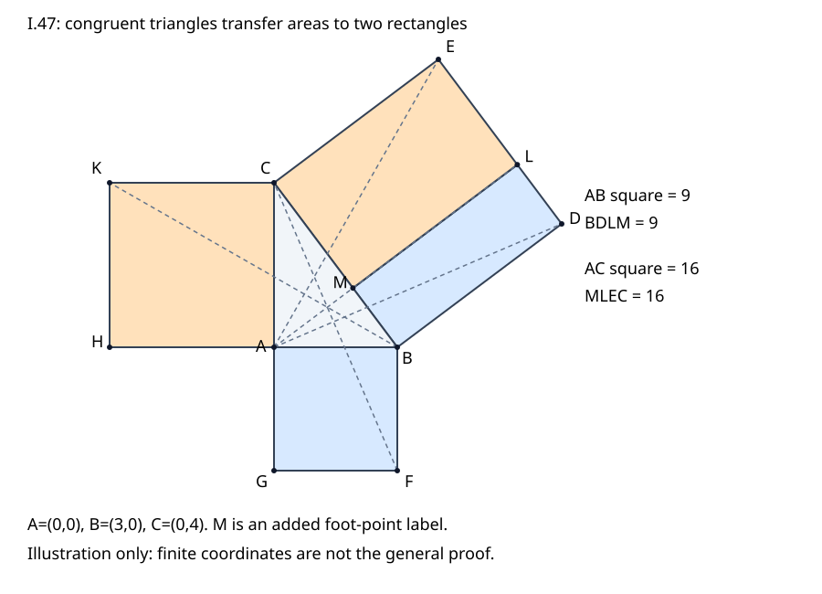

# 《几何原本》I.47：勾股关系怎样由面积证据接成

> AI数学推理前史补读 · 深读v1。接续[I.46](euclid-elements-i46.zh-CN.md)，仅本单元完成I.47。约公元前300年是作品背景，不是可单独确认的命题发表日。本文为原创教学解析，不是全文翻译；古代几何不是现代AI论文，前史目录不声称穷尽。

## 1. 熟悉公式，未必读过这个证明

知道“直角边平方相加等于斜边平方”，并不等于知道Euclid怎样证明它。I.47没有先写长度公式再计算，也不调用第六卷的相似三角形比例。它在三边上作正方形，把斜边正方形切为两块，分别证明每块与一个直角边正方形等积。

关键桥梁是两个不容易一眼看出的三角形：先以边角边建立全等，再把每个三角形与一个面积为其两倍的平行四边形配对。这样，**全等三角形的等积，被搬运成位置不同、形状不同的四边形等积**。第二侧重复这条链，最后相加。

这解释了为何I.46的正方形构造和I.41的倍积关系都要先完成。若程序只输入3、4、5并验证9+16=25，它核验的是一例数值，不是本条证据链。本文先重建原证，随后才给现代坐标核验，二者不互相冒充。

## 2. 书目、实读与历史边界

| 来源 | 实读位置 | 用途 |
| --- | --- | --- |
| Euclid，T. L. Heath译注，*The Thirteen Books of Euclid’s Elements*，1908卷I | 印349–350完整I.47及行注，印350–356相关历史/证明评论；卷首ERRATA | [原扫描](https://archive.org/details/thirteenbookseu02heibgoog)：原证、点名、传本说明与后世解释 |
| Richard Fitzpatrick，*Euclid’s Elements of Geometry*，2008修订版 | 印46–47完整I.47及两脚注 | [希英版](https://farside.ph.utexas.edu/Books/Euclid/Elements.pdf)：对应边次序与追加共同概念 |
| David E. Joyce，I.47及Guide | 全页 | [教学页](https://mathcs.clarku.edu/~djoyce/elements/bookI/propI47.html)：原证依赖与后卷关系；Guide误字另辨 |
| 书内前驱 | I.4、I.14、I.31、I.41、I.46，定义22、第四公设、共同概念2 | 全等、共线、平行、倍积、作方与等量相加 |

【历史说明】常用名称把本关系与毕达哥拉斯联系起来，但名称不能代替首创证据。Heath印350引述Proclus关于归属和献牛故事的记载，印351明确讨论这些证人的晚期性质；印353又承认毕达哥拉斯究竟如何作出一般证明没有正面证据。Heath支持某种归属、猜测早期比例证明，是1908年译注者的判断，不能改写成一份保存下来的毕达哥拉斯原稿。

同一关系在不同数学传统中的数值使用、一般命题表述和普遍证明，是三个不同问题。Joyce的Guide谈到古巴比伦和中国材料；Heath还讨论埃及、印度及中国的比较。这些现代说明提醒我们不能把一条希腊传说当作全球唯一来源。本篇没有独立精读这些早期原件，因此不把它们计入已完成目录，也不据二手叙述确定跨文化传播路径。后续若补读，应另列年代跳转与原件证据。

【文本核查】Heath印350行33注解释原文两边的列举次序与“分别”不匹配；其译文调整为AB、BD分别对应FB、BC。Fitzpatrick印47脚注也指出希腊底本次序问题。本文用明确对应表消除误配，不把长度不等的边硬配在一起。

Heath同页行44注把“相等量的倍量相等”一句括作插入，原因是所引共同概念本身被视为后加。Fitzpatrick也标作追加共同概念。**这不是把整条I.47判为插入**，更不是说倍量推理无效：共同概念2的等量相加即可承担该步。本轮查看1908版ERRATA，未见本条印349–356条目；这里只说明所查版本范围，不声称所有版本没有勘误。

Joyce Guide的相似三角形替代证明末段把两小正方形写成AC与BC；按其前文和本条目标，应为BA与AC。本文不照抄这个误字；这不影响其上方I.47原证正文。扫描图和原PDF仅用于阅读核查，不随仓库公开。

## 3. 输入、对象与点名

【原文】ABC是A处为直角的非退化三角形。在BC上作正方形BDEC，在BA上作GB，在AC上作HC；GB、HC是以对角顶点简称的区域，不是线段面积。

为避免简称遮住边界，本文记三个完整边界为B—D—E—C、A—B—F—G、A—H—K—C。三个方形均在三角形外侧。过A作AL平行BD、CE，连接AD、FC；另一侧还连接AE、BK。

【教学补记】令M为AL与BC的交点，L为AL与DE的交点。原文没有给M命名；本文新增M只为完整描述两块区域：BL是B—D—L—M，CL是M—L—E—C。不要把BL误读成直线段BL，也不要把AL的整条线段当作两块区域的共同边；共同边是ML。

因为BD垂直BC，AL也垂直BC。在直角三角形中，B、C两角由I.17均为锐角；垂足M落在BC内部。若垂足落在B外或C外，相关直角小三角形的外角关系会使原B角或C角不是锐角，与I.16及锐角条件冲突。AL继续进入斜边正方形，在DE内部交于L。这个分割存在性补充不借用勾股公式或相似比例。

三个正方形外作的侧向十分重要：它保证C、A、G接成直线，B、A、H也接成直线，并使后面角的加法确实是相邻角相加。仅输入三个无侧向标记的方形，不能直接复用同一张证明图。

## 4. 原证第一侧：把BA上的方形转成斜边方形的一块

### 4.1 从直角得到共线

角BAC与BAG都为直角，AC、AG位于BA两侧。由I.14，C—A—G共线。这里“两侧”不能省略：同侧两条射线各垂直BA时可能是同一射线，不能组成平角。类似地B—A—H共线。

因此GC所在直线平行FB，它把小正方形的边GA与三角形顶点C放到同一支持线上。后面使用I.41需要的是这条支持线关系，不要求C落在小方形的边段GA内部。

### 4.2 找到真正对应的夹角

角DBC与FBA均为直角。给它们分别加同一个角ABC，得到角DBA等于FBC。直角三角形的底角为锐角，因此所组合的角是普通小于平角的角，不是把跨越一周的角度混算。

方形又给DB=BC、BA=BF。于是对应关系是A↔F、B↔B、D↔C：AB↔FB，BD↔BC，夹角ABD↔FBC。由I.4，三角形ABD与FBC全等，特别地面积相等；AD=FC是同时得到的边结论，但不是下一步倍积比较所需的全部证据。

**本步不是说大三角形ABC与某三角形全等。** 如果只看到两个方形各有等边而遗漏共同顶点B处的夹角，就没有满足边角边的输入。

### 4.3 两次倍积比较

区域B—D—L—M和三角形ABD共底BD；A在平行BD的AL上。因此由I.41，这块区域的面积是三角形ABD的两倍。

方形A—B—F—G和三角形FBC共底FB；C在直线GA的延长线上，与FB平行。因此再由I.41，小方形面积是三角形FBC的两倍。

设方括号表示无向面积，原文这段关系可重写为：

$$
[BDLM]=2[ABD],\qquad [ABFG]=2[FBC],\qquad [ABD]=[FBC].
$$

把最后一个等式各自与自身相加，可得两个倍量相等。所以BDLM与ABFG等积。它们一般不全等，甚至边长比例相差很大；本步需要保持的只是面积。

## 5. 把“同样可证”展开：第二侧及总和

原文第二侧略写“同样”，教学不能只把这三个字当作证明。

1. 连接AE与BK。由正方形，CE=CB、CA=CK。
2. 角BCE与ACK均为直角。在两角上分别加角ACB，得到角ACE等于KCB。
3. 对应A↔K、C↔C、E↔B，应用I.4，三角形ACE与KCB全等，因此等积。
4. 区域M—L—E—C和三角形ACE共底CE、同在CE与AL之间，前者是后者两倍。
5. 方形A—H—K—C和三角形KCB共底CK；B在直线AH的延长线上，AH平行CK，故方形是三角形两倍。
6. 等积三角形的倍量相等，所以MLEC与AHKC等积。

ML把大方形分为内部不相交的两块，共边只是一条零面积边界；区域相加没有重复计入正面积。于是：

$$
[BDEC]=[BDLM]+[MLEC]=[ABFG]+[AHKC].
$$

至此才完成原命题。若再用统一长度单位，把边长记为c、b、a，正方形面积分别记为c²、b²、a²，才得到熟悉的平方关系。原证是区域之间的比较，不依赖边长可公度或能写成整数。

## 6. 现代精确坐标模型及非循环性

【现代教学重构】坐标法不是古代原证明。为展示计算结构，先把直角顶点放在原点，取A=(0,0)、B=(b,0)、C=(0,c)，b、c均为正。外方形的另外顶点是F=(b,−b)、G=(0,−b)、H=(−c,0)、K=(−c,c)。BC向量为w=(−b,c)，向外垂直向量为v=(c,b)，故D=B+v，E=C+v。

令q=b²+c²。这个q首先是直接计算的w点积w，不是调用“斜边平方等于直角边平方和”作为几何公理。解M=B+tw及M·w=0，得到：

$$
t=\frac{b^2}{b^2+c^2},\qquad M=\left(\frac{bc^2}{b^2+c^2},\frac{b^2c}{b^2+c^2}\right),\qquad L=M+(c,b).
$$

由于b、c正，t严格介于0与1，故M、L都在对应边内部。这里的代数存在证明是对第3节几何补严的模型内核查，不能倒称为Euclid所写。

采用行列式面积，ABD、FBC面积分别直接算为b²/2，ACE、KCB分别为c²/2。两长方形面积分别为b²与c²。计算器不能先把区域面积字段设为b²、c²再宣布通过；它必须由各自顶点重算面积，并独立核查方形、共底、平行、全等对应、分割与倍积关系。

更一般地，输入有理坐标A、B、C，先检查u=B−A与z=C−A非零、点积为零且不共线。用四分之一转向量构造外方形，再用直线求交取得M、L。有理坐标和精确分数足以完成这些运算，不必用开方、角度反三角函数或浮点容差。程序的测试范围不等于实数平面的一般定理。

**循环性边界：** 欧氏内积坐标模型本身携带长度与正交的现代定义，因此不能用它声称“完全不含任何与勾股关系相关的背景”。它作为教学实现检验，与前面仅用第一卷前驱命题的综合证明分列。实现不得以待证面积等式为输入筛选规则，也不得先按它填写结果字段。

## 7. 手算例、反例与失败意义

### 7.1 不是只验9+16=25

取b=3、c=4。A=(0,0)、B=(3,0)、C=(0,4)，F=(3,−3)、G=(0,−3)、H=(−4,0)、K=(−4,4)，D=(7,3)、E=(4,7)。q=25，t=9/25，M=(48/25,36/25)，L=(148/25,111/25)。

ABD与FBC各为9/2，ACE与KCB各为8。由四点重算的BDLM、MLEC面积是9、16，大方形为25。这里观察到的是两条“全等→倍积→等积”链，而非仅最后一个总和。

斜边方形左块沿BC的边长为9/5，另一边长5，虽然面积9，却不是3×3小方形的全等复制。这恰好说明等积转移不等于把整块方形刚性搬过去。

### 7.2 斜三角形不能混入直角输入

取A=(0,0)、B=(3,0)、C=(1,4)。两邻边点积为3，不是0。其平方长度为9、17，而BC平方长度20，9+17并不等于20。三个外方形仍可作出，但共线、夹角配对及原证链已不成立；生成器应在前提检查处拒绝，不必等到最后总和失败。

### 7.3 退化输入为何危险

A=B时，零向量与任何向量点积都为零，但零边没有正方形，A处几何角也不存在。“点积为零”必须和两邻边非零、不共线共同检查。用退化三角形数值满足某个等式不能扩大原命题范围。

### 7.4 方形放错侧、点名错配、伪造分割

把AB上的方形放入三角形一侧，方形面积本身不变，却会破坏C—A—G的原证支持线和夹角加法。检查器应区分“某个面积总和仍然真”与“这个证书实现了规定构造”。交换F与G会破坏对应边FB；移动M而保留声称的面积字段会破坏共线或分割；只核查最终数字不能发现这些错误。

### 7.5 大量整数例不涵盖无理边长

取两直角边都为1，原证仍成立，斜边不必是有理长度。坐标(0,0)、(1,0)、(0,1)本身全有理，程序可以核验其方形和面积而不必输出斜边的十进制近似。生成许多勾股整数组只覆盖特殊输入族，不是本命题的完整证明。

## 8. 延伸与不在本篇内的结论

【教学推论】一般向量u、z满足平方长度恒等式：u−z的平方长度等于u的平方长度加z的平方长度再减2u·z。点积为零时交叉项消失。这解释现代代数公式为何对应直角条件，但它是模型内推导，不取代第4–5节的原证。

【后卷关系】相似三角形可把两个直角边方形分别对应到斜边上的两个矩形；Heath印353–354讨论这种路线，并解释第一卷证明避免依赖尚未建立的比例理论。第六卷VI.31推广到三边上的相似图形，不能倒拿该后卷结果证明本条。

逆命题并不是把I.47一句话倒过来就自动成立；书中I.48另作证明。本篇不把I.48计完成，也不把非直角检测程序冒充下一条原文深读。

【方法类比】现代自动推理可以借鉴这种证据组织：把困难目标拆成局部可核查关系，记录对象对应，验证接口条件，最后组合。这里仅是分析类比，不表示Euclid提出了AI算法，也不说明一个测试通过的生成模型就具有一般推理可靠性。

## 9. 主张—证据对照

| 主张 | 位置或根据 | 不应混淆 |
| --- | --- | --- |
| 作三个方形、AL及辅助线 | Heath印349，Fitzpatrick印46 | 外作侧向与单纯面积数值不同 |
| 两组共线及角加法 | 同上，I.14与直角 | 必须明确相反侧 |
| ABD与FBC全等 | Heath印350，Fitzpatrick印47及脚注 | 对应边次序已纠正 |
| 两次倍积与另一侧 | Heath印350，I.41 | 原文略证已教学展开 |
| 倍量句括号 | Heath印350行44注 | 不等于整命题被判插入 |
| 毕达哥拉斯原证不可确知 | Heath印351–354评论 | 猜想和晚期归属不是原始证明 |
| 坐标、M命名、反例及练习 | 本文教学重构 | 不是原文逐句翻译 |
| 代码输入域与运行统计 | 附件README及真实日志 | 有限检查不是普遍定理 |

## 10. 真实最小复现与复盘

【真实实跑】21个单元测试在正常、-O、-OO三种模式均通过；72个合法有理坐标案例与12个非法输入直接拒绝案例完成。Notebook五个代码格经标准库compile/exec执行并独立回放，未启动Jupyter kernel。独立技术检查的范围和结果见审查报告及其原始日志。本项目的核心是检查构造、对应与面积证据，而非训练模型或复现实验论文。没有数据集、训练基线、准确率排行榜或GPU要求。代码采用标准库精确数，环境、命令、正常及优化模式测试、独立检查和Notebook真实执行记录均随附件发布。

Notebook若用标准库compile/exec逐格执行，其输出属于真实Python运行，但不等于启动过Jupyter kernel；附件明确这一边界。第三方软件或付费服务没有新增。原始扫描留在阅读核验区，不公开。

复盘时应依次问：输入是否真为非退化直角三角形？外方形方向是否对？两组共线与全等对应是否匹配？两个倍积比较是否使用正确共底和平行线？大方形是否无重叠分割？最后才问面积总和。这样的顺序比只检查最后一行更能定位错误。

## 11. 练习与答案

1. **本条比较长度还是面积？** 原命题比较三边上正方形的面积；采用统一长度单位后才写成边长平方关系。
2. **GB为什么不是长度？** 它以一对对角顶点简称方形区域，完整边界A—B—F—G。
3. **ABD与FBC怎样对应？** A↔F、B↔B、D↔C，AB↔FB、BD↔BC、AD↔FC。
4. **为何不能配DB↔FB？** DB是斜边方形的边，FB是直角边方形的边，一般不等；原版本次序注正提醒这种误配。
5. **角DBA=FBC靠什么？** 两个直角DBC、FBA分别加同一ABC，且外作侧向保证是所需相邻角。
6. **C在小方形外会使I.41失效吗？** 不会；需要C在GA支持线上、与FB平行，不要求在边段内部。
7. **第二侧全等对象？** ACE与KCB，A↔K、C↔C、E↔B；CE=CB、CA=CK，夹角相等。
8. **为何倍量句可由共同概念2代替？** 把同一个面积等式与自身相加即可得到二倍等式。
9. **3、4例的M与L？** M=(48/25,36/25)，L=(148/25,111/25)，二者差(4,3)。
10. **第一块等积是否全等？** 不是；它为9/5×5的矩形，而小方形为3×3。
11. **A=(0,0)、B=(3,0)、C=(1,4)哪里失败？** 邻边点积3非0，原命题前提不成立，面积总和26不等于20。
12. **两向量点积0足够吗？** 不够；零向量也点积0，需明确非零、非退化和合法角。
13. **外方形换到内侧还能算面积吗？** 可以算，但规定的共线与全等证书可能不成立；不能仅凭面积大小放行原证构造。
14. **为何不先用相似三角形？** 那是另一条依赖比例理论的证明；本条特意用第一卷的全等与倍积工具接合。
15. **一万例测试证明了什么？** 仅表明这些输入下实现通过所列检查；一般定理由符号推导承担，历史归属还需要独立文献证据。

## 12. 阅读与附件

[复现与真实日志](../../reproduction/euclid-elements-i47/README.md) · [独立来源审查](../../reproduction/euclid-elements-i47/source-review.zh-CN.md) · [独立技术审查](../../reproduction/euclid-elements-i47/technical-review.md)。

阅读后应能不用先写勾股公式，独立说清“共线—角相加—边角边—两次倍积—分割相加”的链；也应能指出何处是原文、何处是补严、何处仅是现代有限计算。本单元完成不等于第一卷或全部古代数学已读完。
