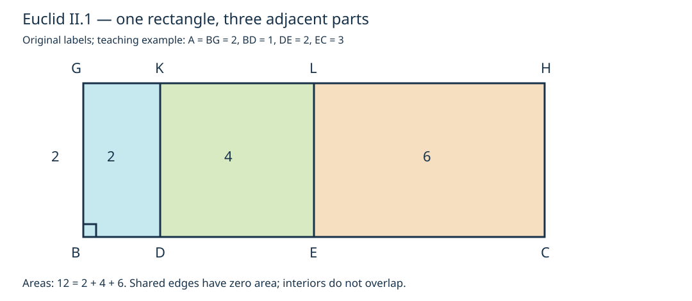

# 《几何原本》II.1：先分割矩形，再理解分配律

## 公元前约300年数学推理前史补读 · 第二卷定义与命题1

**一条边分成几段，为什么可以把整块矩形换成对应的小矩形之和？** 今天容易回答“因为乘法分配律”。但欧几里得的论证方向不是先写乘法公式，再给公式配图；他构造出同高、相邻且覆盖整块的矩形，逐一辨认它们由哪两条线段所围成。这里真正需要学习的是：如何把一句含糊的“分开算就一样”，变成有构造、对应和覆盖保证的证明。

本篇只精读II.1，并说明第二卷两个定义的必要上下文。不把定义另计文章，不把II.2以后当作本篇已读完的内容。它是从1936—1937年图灵样稿向古代证明传统的**前史回填**，不是新的出版年代跳跃，也不称为AI论文或第一篇AI论文。全仓收录是有边界的教学选择，不声称穷尽更早文献。

**阅读层次：**“原文”指可定位的命题或定义；“教学重构”指补足隐含条件、现代符号与证明组织；“分析延伸”指与程序验证等问题的类比；“真实实跑”仅指附件实际执行记录。手算不冒充程序输出，有限测试不冒充一般证明。

## 1 文献、页码与历史边界

- 作品：Euclid，*Elements*，Book II，Definitions 1–2、Proposition 1。作品传统年代约公元前300年，不是这条命题可精确确定的首创年份。现存版本的编纂、校订、翻译史不能压成作者手稿。
- 主读扫描：Thomas L. Heath，*The Thirteen Books of Euclid's Elements*，1908，卷I；定义印页370（PDF391），几何代数评论印页372–374（PDF393–395），II.1印页375（PDF396），后注印页376（PDF397）。[1908卷I扫描](https://archive.org/details/thirteenbookseu02heibgoog)
- 对读：Richard Fitzpatrick，*Euclid's Elements*，2008，第二卷定义与II.1，PDF页50–51。正文跨页须读到结束；其分配律脚注是现代解释，不是欧几里得原式。[双语PDF](https://farside.ph.utexas.edu/Books/Euclid/Elements.pdf)
- 对读：David E. Joyce，Clark University，第二卷[定义](https://mathcs.clarku.edu/~djoyce/elements/bookII/defII.html)、[命题1及Guide](https://mathcs.clarku.edu/~djoyce/elements/bookII/propII1.html)。网页导读与古代命题文本分层使用。
- 勘误范围：已检查所用Heath卷首ERRATA页，未列印页370–376的勘误；这不是“所有版本均无误”的断言。图中字母、命题跨页结尾与矩形命名另以对读核实。

**历史问题与思想动机。** 第一卷已经发展平行线、平行四边形、面积相等和作图技术。第二卷在开头定义“由两条线围成的矩形”，于是可以把给定线段之间的关系转移为平面形的分解关系。II.1提供最直接的一种操作：保持一边不变，只分另一边。现代读者可把它与分配律对应，但原对象首先是线段和矩形，不是未经解释的实数乘法。

Heath把第二卷放入“几何代数”解释框架，同时强调原过程是几何的；他在印页372–374讨论线段表示量、不可通约量及后来的代数说明。这是**Heath的史学解释**，不能据此宣称欧几里得使用现代符号代数、环公理或坐标行列式。更不能把这条短命题的发现独归某位前驱。本文核实的是已有文本内的依赖：I.11、I.3、I.31、I.34等；没有独立重建所有前欧几里得传统和传承链。Heath关于后世Heron的讨论也不在这里升级为本篇直接读过Heron原作的结论。

从上一单元[I.48](euclid-elements-i48.zh-CN.md)到这里，是同一部书的卷次转入，而不是两个可独立精确排序的研究论文发表事件。I.48的逆命题证明不构成本命题的直接必要步骤。

## 2 两个定义：矩形不是两个数字，gnomon也不是本题工具

### 2.1 定义1的“围成”

**原文。** 一个直角平行四边形，称为由夹住其直角的两条直线所围成。此处的“直线”在给定长度的语境中按线段理解；矩形由两条相邻边的长度指定，而不是任意两条边，更不是两条对角线。

**教学重构。** 记R(u,v)为相邻边长分别为u、v的矩形的面积量。记号不是原文，也暂时不把它定义成数字乘积uv。两个形状可以不同，但比较的是面积量；只有在选定度量与单位后才转成数值。

### 2.2 定义2的gnomon

**原文上下文。** 平行四边形中，围绕一条对角线的某个平行四边形连同两个补形，合起来称为gnomon。不要一见这个词就只想直角的木工曲尺；一般定义不限于那一种直角L形。

它在本命题中**没有被使用**。列出这一点是为了避免把“第二卷开头定义了什么”误当作“每一条命题都依赖什么”。II.1只需矩形的分割，既不需要画gnomon，也不需要对角线。

## 3 输入、符号与隐含条件

原文给两条线段A、BC，并在BC上取D、E。**A是独立给定的一条线段的名称，不是图上另一个顶点。** 沿底边的顺序为B、D、E、C；各段正长。原文“任意分割”不是概率抽样，也不要求等分。

为避免把图名当乘法，先把几个简称解开：

| 原文简称 | 完整矩形顶点（沿边界） | 所围成的边长 |
| --- | --- | --- |
| BH | B、C、H、G | BG与BC |
| BK | B、D、K、G | BG与BD |
| DL | D、E、L、K | DK与DE |
| EH | E、C、H、L | EL与EC |

这里“BH等于BK、DL、EH”比较**由对角顶点命名的矩形面积**，并不是说线段BH等于三条对角线长度之和。后者一般为假。

原证明在平面欧氏几何内进行。取点属于同一直线且次序正确，平行线相交构成相邻条带，矩形面积对有限无重叠分割可加，这些是读图不能跳过的结构条件。纯粹看到三个涂色块，并不能替代确认其边界。

图为原创教学重绘，翻转纸面上下方向不改变点序或平行关系。图中取高2、底边宽1、2、3；数值是教学选择，不是原文条件。

## 4 原证明逐步走通

**第一步：建立共同高。** 在B作BF垂直于BC（I.11）；在该方向截取BG，使BG等于给定线段A（I.3的长度搬移，辅助线须取得足够长，必要时延长）。F是辅助垂线上的点，矩形的角是G，不能误用F当作固定高的终点。

**第二步：建立整块矩形。** 过G作GH平行BC（I.31）；过C作CH平行BG。相邻一角为直角且对边平行，所得BCHG是矩形。原文没有再逐一引I.29重述各角为直角；教学上可以用平行线角关系补全。

**第三步：搬运切点。** 过D、E分别作DK、EL平行BG，与GH相交于K、L。由于D、E在BC内且有序，两条切线落在矩形内，分出BDKG、DELK、ECHL三个相邻矩形。不是在任意位置画两条线就自动获得该分解。

**第四步：先得到整形与部分的关系。** 三块的内部不交，公共边只作为边界共享，三块共同覆盖整块。因此整矩形面积等于三块面积的和。原文这一步十分简短，但它是整个论证的几何骨架，而不是代数公式的插图。

**第五步：逐块核实名字。** 整块有BG=A，因此是R(A,BC)；第一块有同一条BG，因此是R(A,BD)。第二块的高不是肉眼估计出来的：由平行四边形对边相等I.34，DK=BG=A。第三块同理EL=A，故分别是R(A,DE)、R(A,EC)。原文明确在第二块处标出I.34。

**第六步：代换得到结论。** 将第四步里的每块替换为第五步认定的面积量：

$$
R(A,BC)=R(A,BD)+R(A,DE)+R(A,EC).
$$

这串符号是本文压缩原证明的现代写法。它的根据是刚建立的分割和同高，不是先假设了要解释的乘法分配律。

## 5 三段图怎样支撑任意有限段

**原文范围。** 命题陈述允许任意段数，具体证明画了D、E两个切点。下面补出任意有限段的教学重构，既不把三段测试当作归纳，也不把有限分割偷偷换成无限可加性。

取正长底边B=C₀、C₁、…、Cₙ=C，点依次排列，其中n是正整数。过每个内点作平行BG的切线。对于n=1，没有切线，结论只是整块等于自身。若已有n块，再在某一块的底边内部加一个切点，该块被分成两个内部不交且覆盖原块的矩形；其他块保持原样。有限面积可加性允许以新两块的和替换旧一块，因而结论保持。按有限次添点，可得到任意所给有限分割。每次用I.34辨认各块相同的高。

若想更严格地检查图形不重叠，可另用一个**现代坐标模型**：令u为底边向量，v为高向量，两者非零且垂直；点由参数su+tv给出，s、t均在0至1之间。因u、v线性独立，一个点不可能有两组不同的参数。递增切点参数把s区间完整分成相邻小区间，所以条带内部互不相交、且并集是整块。这证明的是分割的结构；并没有以行列式数值替代原文几何证明。

零长段可以在现代面积约定下另作退化扩展，但原来正长矩形构造不应静默接纳它。切点落在端点、重合或倒序，程序会拒绝；这是一种明确的输入合同，不是宣称退化情况绝无数学意义。

## 6 现代分配律解释及循环论证的警报

选取长度单位，令A的度量为a，三段度量为b₁、b₂、b₃。若已建立矩形面积的数字表示为两边度量之积，上一结论写为：

$$
a(b_1+b_2+b_3)=ab_1+ab_2+ab_3.
$$

这是现代分配律解释，Fitzpatrick脚注与Joyce导读都这样联结。不要反过来声称“欧几里得已给出实数域的公理化证明”：原文没有定义实数域，矩形测量公式的基础也不是这里独立建立的。

尤其值得警惕的是计算验证的循环：Python有理数乘加、行列式展开和鞋带面积公式，本来就在现代算术中使用分配律。它们能检查作者实现是否忠实、坐标是否一致、坏输入是否漏检，却不能用来奠定分配律本身。原几何重建与现代算术校验是**不同的证据层**。

不可通约的长度不使原图形分割失效；原论证没有要求两条边有共同整数量尺。但附件只处理精确有理数坐标，并不因此覆盖所有不可通约长度。扩大数学适用范围，靠的是一般证明，而非把分母试得更大。

## 7 两个手算例：面积相等必须带着结构一起看

### 7.1 非等分、分数边长

令共同高为3/2，底边依次分为1/3、5/6、2。底边总长为19/6；整块面积为19/4。各块面积分别为1/2、5/4、3，其和也为19/4。这里不是三等分，也没有要求所有长度为整数。先确认三段首尾相接，再算每块；如果只拿任意三个数字拼出相同的和，尚未验证它们确为该图的分割。

### 7.2 斜着画仍是矩形

取底边向量u=(3,4)、高向量v=(-8,6)。内积为-24+24=0，边长分别为5、10，面积50。以底边参数0、1/5、1/2、1作分割，三个底边长为1、3/2、5/2，三块面积为10、15、25。其和为50。转动图形不改变证明；“矩形”不等于“纸上的水平竖直框”。这些坐标是教学例，不是古代作者的记法。

在一般坐标核验中，可写：

$$
S_i=(t_i-t_{i-1})\,|\det(u,v)|,\qquad
\sum_{i=1}^{n}S_i=|\det(u,v)|.
$$

条件是0=t₀<t₁<…<tₙ=1，且u、v非零垂直。公式数值正确不能反向免除这些条件：一个非矩形平行四边形也可满足行列式条带面积关系，但它不是本命题定义1的输入。

## 8 反例：为什么光看总和会骗人

1. **重叠。** 底边[0,3]、高2，取[0,2]和[1,3]两条带。面积相加8，整块6；中间[1,2]被算了两次。共同高不够，还需内部不交。
2. **有缺口。** 同一整块只取[0,1]和[2,3]，两块和4，少了中间面积2。无重叠也不够，还需完整覆盖。
3. **高不一致。** 底边各长1，三块高为1、2、3，面积和6；高2、底3的整块也为6。这次总数碰巧相同，却不能说明三块就是原构造的同高分割。总和校验单独不可靠。
4. **倒序和有向抵消。** 将切点顺序改成0、3/4、1/4、1，带符号宽度仍望远镜求和为1；中间为负宽度，不是原文的正长矩形分割。对面积取绝对值又会发生重复累计。
5. **误读对角线。** 高1、底分成三个长1的小矩形，整块对角线长√10，而三条小对角线长之和为3√2；二者不等。BH等式不是对角线长度的等式。

反例的作用是定位缺失前提，不是反驳正确的II.1。若允许任意重叠、负宽度或变高，那已经换了命题。

## 9 主张与证据对照

| 主张 | 证据位置 | 本篇处理 |
| --- | --- | --- |
| 矩形由夹直角的两边指定 | Heath印370；Fitz50；Joyce定义1 | 原文定义，不以任意边替代 |
| gnomon定义在卷首但本命题未用 | 同上定义2与完整II.1对照 | 局部依赖观察，不外推全卷 |
| 任意段数陈述、三段图解 | Heath印375开头及图；Fitz50–51 | 原文范围与有限推广分开 |
| 垂线、等长截取、平行线 | Heath印375构造段 | I.11/I.3/I.31逐项解释 |
| 各块共同高由对边相等辨认 | Heath印375证明末段I.34 | 补出EL同理 |
| 几何代数解释应尊重原几何过程 | Heath印372–374 | 史学评论，不冒充古代代数符号 |
| 两个方向都分割的扩展 | Heath印376后注 | 扩展而非II.1原陈述 |
| 分配律数字式 | Fitz51脚注、JoyceGuide | 现代释读 |
| 有理数坐标证书与测试 | 本篇附件源码、日志、Notebook | 真实有限计算，不是形式定理证明 |

Joyce对本命题后续引用次数的导读若被用于研究，应标为他的指南判断；本篇没有独立穷尽《原本》全部依赖图，因此不以它给出自己的全书零引用统计。

## 10 最小复现：检查构造证书，不让一条恒等式掩盖错误

附件实现范围与真实统计见[复现说明](../../reproduction/euclid-elements-ii1/README.md)。设计目标不是“输入数字，输出两边相等”这一种过弱演示，而是把底边向量、高向量、切点参数和矩形顶点作为可核验对象：先检查非零、垂直、端点与严格递增次序，再检查各块顶点、平行关系、公共高和面积分解。所用Python标准库Fraction保留有理数精确性，不用浮点容差把反例抹掉。

Notebook仅是同一低成本探索的可读载体，执行方式、单元范围与回放结果以附件真实记录为准；不把普通Python逐单元执行冒充Jupyter kernel会话。测试应包含合法多段、旋转平移、单段，以及重复/端点/倒序切点、零向量、非垂直和证书篡改等拒绝情形。优化模式仍应保留输入与证书验证，不能依赖会被`-O`删除的`assert`。

本实验没有数据集、训练基线、性能排行榜；它是理论教学的可执行一致性检查。本次真实执行得到96个有效案例通过、16个非法输入被拒绝；21项unittest在普通、`-O`、`-OO`三种模式均通过。Notebook共5个代码格，经`compile/exec`执行及新命名空间逐格回放一致，未启动kernel；七条运行命令退出码均为0。原图数值例面积12=2+4+6，附件斜置例面积25=5+10+10；它们与第7节另外两个手算例不混同。统计按测试用例、枚举证书与Notebook单元分别计数，不混成“证明数量”。源码、环境、命令和真实日志均随附件。

## 11 局限、合理延伸与AI前史联系

**原文局限不是失败。** II.1没有定义带符号面积，没有处理任意弯曲边界，也没有建立无限可加性。它不提供从任意图像自动识别分割的算法。现代证书验证器把切点等结构作为输入，不代表它能从扫描图像发现这些结构。

**合理扩展。** 两边都作有限分割，就形成网格；先按一方向分整形，再在每条带内按另一方向分割，可将面积表示为所有小矩形的和。Heath印376后注也指出增加另一组平行线的做法。这是有限分割原理的应用，不是本轮启动新的命题文章，也不借此宣称已经完成第二卷。

**分析延伸。** 对现代AI或自动推理最有价值的类比，是“生成一个看起来对的答案”与“提交能核实其结构的证书”的差别。总面积相等只是末端指标；构造关系、覆盖、非重叠、边界次序是隐藏合同。如果系统只优化末端相等，变高反例会让它过关。这个比较是本文提出的教学联想，不是古代文本预见现代AI的历史主张。

## 12 复盘：一张图中的四道检查

- **对象检查：** A是线段；BH等是矩形名；面积量与长度量不能混加。
- **构造检查：** BG=A，DK/EL/CH平行BG，GH平行BC，辅助点F不决定矩形的高。
- **分割检查：** 点序保证内部不交与完整覆盖，有限段数明确。
- **解释检查：** 先几何、后数值；现代分配律和行列式可以帮助理解，但不冒充原文或独立基础证明。

读完若只能背出a(b+c)=ab+ac，还没有读到这篇的核心；能够解释为什么第二块的高仍为A、为什么三块没有重复或遗漏，才真正走过证明。

## 13 练习与答案

1. **A是一个点吗？** 答：不是。这里A命名独立给定线段；BG按其长度截取。
2. **为什么用G而不是F作矩形角？** 答：F指定辅助垂线，BG=A才指定高；BF一般不等于A。
3. **DL四个顶点分别是什么？** 答：依边界为D、E、L、K。DL是对角顶点简写，不是对角线长度。
4. **第二块的高为何为A？** 答：DK与BG是平行四边形BDKG的对边，I.34给DK=BG，再用BG=A。
5. **必须等分BC吗？** 答：不必须；只需切点内含且有序，原文的任意分割不意味着随机概率模型。
6. **定义2的gnomon在何处用到？** 答：本命题没有用到。不要凭同卷位置虚构依赖。
7. **高5、底边分成2、3、7，求各块与总面积。** 答：10、15、35，总60，与高5、底12一致；这是选定单位后的数值解释。
8. **复算分数例。** 答：1/3+5/6+2=19/6；乘3/2为19/4；1/2+5/4+3也为19/4。
9. **旋转例的中块底长和面积？** 答：参数差1/2−1/5=3/10，乘底长5得3/2；乘高10得15。
10. **无重叠是否足够？** 答：不足；[0,1]与[2,3]漏掉中间，必须还验证覆盖。
11. **总面积恰好相同是否足够？** 答：不足；高1、2、3的单位宽三块总6，仍不是高2的同高原构造。
12. **倒序切点的有向宽度和仍为1，为什么拒绝？** 答：有负宽度且可能重叠；有向代数抵消不是正长矩形分割证书。
13. **单段如何处理？** 答：没有内部切点，整块就是唯一一块，是有限推广的基例。
14. **一万个有理数实例通过，能证明不可通约边长的一般结论吗？** 答：不能；一般性依靠几何证明。精确有理数测试只证实这些输入及实现检查。
15. **行列式面积实跑能奠定分配律吗？** 答：不能；行列式与有理数运算已使用现代代数规律。它是独立实现路径的一致性检查，而不是无循环的公理基础证明。

## 附件与审查

- [源码、命令、环境、日志与Notebook入口](../../reproduction/euclid-elements-ii1/README.md)
- [独立来源审查](../../reproduction/euclid-elements-ii1/source-review.zh-CN.md)
- [独立技术审查](../../reproduction/euclid-elements-ii1/technical-review.zh-CN.md)

仅公开原创解析、自有教学代码与经检查运行证据。本文不附原版PDF、全文翻译或私人执行上下文。
