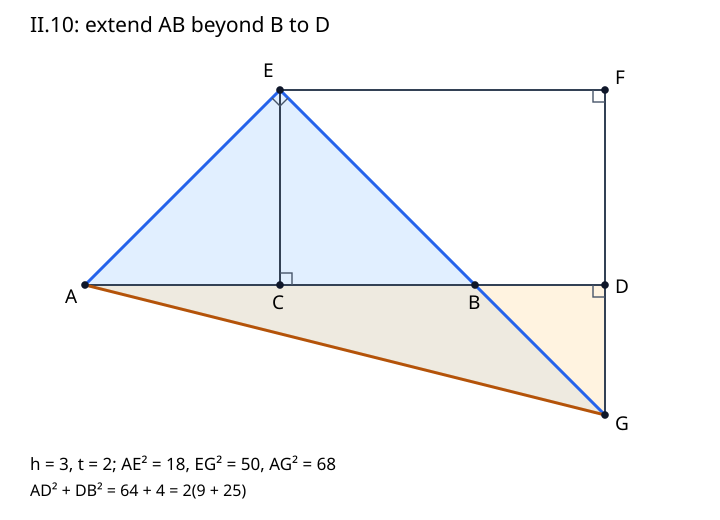

# 《几何原本》II.10：先证明延长线会相交，再让两个平方和汇合

## 约公元前300年 · 数学与推理前史补读 · 深读v1

[II.9](euclid-elements-ii9.zh-CN.md)把切点放在线段内部，本条把它移到端点之外。结论看起来只是同一平方和恒等式，证明却不能机械地把图拉长：辅助交点跑到了基线下方，必须先说明两条延长线确实在指定方向相遇。原文特意调用第五公设，然后才进入等腰直角三角形和四次I.47的计算。这一先后次序，是本篇的阅读中心。

我们完整阅读II.10，另读Heath所附替代证法、边径数评论及推论。正文为原创中文分析，不是任何译本的全文翻译。下文明确区分**原证明、教学补足、近代评注、现代重构、真实实跑**。它是从图灵1936—1937样稿回溯古代的年代跳转与AI推理前史补读，不是现代AI论文，不称图灵或欧几里得为“第一篇AI论文”。收录标准是问题与证据可核查，不因作者、机构名气而改变，也不声称穷尽古代材料。

## 1 书目、历史问题与证据边界

| 材料 | 本次实读位置 | 如何使用 |
| --- | --- | --- |
| Euclid, *Elements*, II.10 | 作品传统年代约公元前300年 | 汇编年代不等于本命题发现年代；不能由署名推定每步证明的个人归属 |
| T. L. Heath, *The Thirteen Books of Euclid's Elements*, 1908, vol. I | 印395–397正文；397–398两种替代证法；398–400边径数；401–402顶部推论；卷首ERRATA | [扫描入口](https://archive.org/details/thirteenbookseu02heibgoog)，相应PDF416–423页。印页和PDF页序不同 |
| Richard Fitzpatrick, *Euclid's Elements of Geometry*, revised and corrected 2008 | 印61–62：希英对照、图、II.10公式脚注 | [PDF](https://farside.ph.utexas.edu/Books/Euclid/Elements.pdf)。脚注代数式是现代解释 |
| David E. Joyce, Clark University | [II.10正文及Guide](https://mathcs.clarku.edu/~djoyce/elements/bookII/propII10.html) | 交叉核对证明；Guide中的变量映射另行检查，不能因网页可靠就免检 |

Heath卷首列出的勘误没有涉及本条印395–402的修订；这是对所查勘误表的有限结论，不声称所有版本都绝无错误。Fitzpatrick页62已出现下一命题标题，本篇不把相邻页上看到标题当作下一单元完成。

### 1.1 这不是单纯的展开括号

若从现代代数入手，取半段长h、外加段长t，展开(2h+t)²+t²就能得到2[h²+(h+t)²]。但欧几里得在这里既没有写这些变量，也没有把“平方展开律”作为公理。原证明要把边上正方形面积的比较归约到四个已获直角资格的三角形。辅助斜边AG的平方是两条证明路线的共同中间对象。

前驱关系有两层：书内依赖包括I.5、I.6、I.11、I.29、I.31、I.32、I.34、I.47及第五公设；历史关系则来自Heath评注对Theon、Proclus、Zeuthen等人的转述。两层不能混为一谈。“原文使用I.47”可直接检查，而“某数学传统先于欧几里得掌握边径数”需要更广的文献考证。本篇保留后者为Heath的史学叙述，不冒充已独立通读全部被引古籍。

### 1.2 相邻命题构成什么序列

II.5/II.6是一对内分与外延的乘积、平方关系；II.9/II.10则是一对平方和关系。前八条常把矩形与正方形画成分割区域，后两条改用三角形的边平方。这个组织事实有助理解证明策略，但并不推出整个第二卷只有一种古代思想来源。Heath印394的策略评论与印398以后更强的历史归属判断，证据力度不同。

## 2 输入、输出和容易漏掉的正性

原图上A、C、B、D依次共线，AC=CB，BD是一段向B外延长的正长度。令AC=CB=h，BD=t，则h>0、t>0，CD=h+t、AD=2h+t。用Q(XY)表示以线段XY为边的正方形面积。原命题是：

$$
Q(AD)+Q(DB)=2\bigl(Q(AC)+Q(CD)\bigr),\qquad h\gt0,\quad t\gt0.
$$

注意DB与BD是同一长度，并不是符号相反的有向数；右侧的2乘整个括号。图里的CD不是新加的一段，它包含原来的半段CB和新增的BD。因此把CD误认作t，会同时破坏原定理、辅助三角形和数论解释。

h=0使原线段AB消失；t=0使D=B、G=B，三角形BDG退化。代数式仍可延续到零，但原来的非退化证明不可逐句照搬。复现拒绝这两类输入。t<0也不是本接口的“负外延”，而是可能返回内分情形，应该另用II.9的输入规范。把整个图反射到左边或把上方换成下方不改变命题，只改变朝向；反射与把长度设为负数不是同一操作。

## 3 构造的第一关：不能先画出G再说它存在

在C处作CE垂直AB，取CE=AC=CB，连接EA、EB。过E作EF平行AD；过D作FD平行CE。F是这两条线的交点；CEFD形成平行四边形，而且C处为直角，所以它是矩形。此处“矩形”是教学说明，原文用平行线与I.34管理相应角和边。

接下来延长EB越过B，延长FD越过D，打算令它们相交于G。对现代坐标读者，这似乎显然；对原文，关键不只是“不是平行”，还包括指定的相交方向。

### 3.1 原文如何调用第五公设

以EF为截线，EC与FD平行，由I.29知角CEF与EFD之和为两直角。射线EB位于角CEF内部，故角FEB严格小于角CEF；于是角FEB与EFD之和严格小于两直角。第五公设遂保证EB、FD沿B、D方向延长会相遇。原文印396开头明确写出这一段，而不是只给示意图。

这里角的严格大小来自B在C与D之间，以及E不在基线上。读图时需检查点序和半平面：若把D画到C左边，原来的“内部角缩小”描述就不再是同一情形。**教学补足：** 正的h、t使B位于所取射线方向，后面的坐标式还可独立验证G确在B、D之外；它是核查，不是替代第五公设的历史证明。

### 3.2 为什么不能把交点存在压进一句“令”

“令G为交点”只有在已知交点存在时才定义了对象。如果平行，就没有这样的G；若交点在反向延长线上，后续角的关系也可能变成补角。原文先处理相交，后处理等长，最后处理面积。自动生成证明或程序构造若省去第一层，后面等式即使代数上能凑对，也不构成同一几何论证。

图为自制教学图，不复制原版插图。A—C—B—D在同一直线上，E—B—G共线，F—D—G共线；AG特意连接两个证明路线。视觉长度不能作证，以下依赖链才说明这些对象为何满足所需条件。

## 4 逐步获得角和等长桥接

### 4.1 小屋顶ACE与ECB

AC=CE，故由I.5，三角形ACE在A、E处的角相等。C处是直角，利用I.32三角形内角和，两角各为半直角。CE=CB，同理三角形ECB在E、B处也各为半直角。

E处的角AEC和CEB相邻，其和为角AEB，因而AEB是直角。E、B、G在同一射线上（从E看B、G方向一致），所以角AEG也是直角。这一步为后面三角形AEG使用I.47提供资格，不需要借助解析几何的斜率相乘为−1。

### 4.2 下面的小三角形BDG

角EBC为半直角。BC与BD反向，BE与BG反向，由I.15对顶角相等，角DBG也是半直角。DG平行CE，DB沿基线方向，由I.29可得角BDG为直角。用I.32，剩余的角DGB也是半直角；再用I.6从等角推出对边相等，得到DG=DB。

依赖方向不可倒置。不能先因为图上BDG像等腰而断言DG=DB，再用这个等长证明角相等；原文恰是先获得角，再获得边。DG=DB是末尾把辅助线段平方换回题设线段平方的唯一桥接，丢掉它就只证明了含DG的另一个式子。

### 4.3 大三角形EFG

G处的射线GE与GB同向，GF与GD同向，所以角EGF等于已得的角DGB，是半直角。CEFD的对角相等，F处为直角，故角EFG为直角。再由I.32，角FEG为半直角，I.6给出FG=FE。

由I.34，矩形CEFD的对边EF=CD。这与上一段合起来是FG=EF=CD。千万不要把FG误写成DG：FG从上方F一直跨过D到G，DG只是下方的一小段；数值上前者为h+t，后者为t。原文把大等腰直角三角形和小等腰直角三角形都用上，分别提供不同替换。

## 5 四次I.47怎样在同一AG汇合

为了不把原文压扁成一句“由勾股”，逐次列出直角所在点、斜边与已得替换。

| 次序 | 三角形与直角 | I.47得到 | 接着使用什么 |
| --- | --- | --- | --- |
| 1 | ACE，C处 | Q(AE)=Q(AC)+Q(CE) | CE=AC，得到Q(AE)=2Q(AC) |
| 2 | EFG，F处 | Q(EG)=Q(EF)+Q(FG) | FG=EF=CD，得到Q(EG)=2Q(CD) |
| 3 | AEG，E处 | Q(AG)=Q(AE)+Q(EG) | 合并前两次，得到右侧目标 |
| 4 | ADG，D处 | Q(AG)=Q(AD)+Q(DG) | DG=DB，得到左侧目标 |

前三次和第四次并不是先后算两个不同量，而是在计算同一条AG的平方。因此由相等关系的传递性可消去这个公共量。用现代记号压缩，原证明的最后结构是：

$$
\begin{aligned}
Q(AG)&=Q(AE)+Q(EG)=2Q(AC)+2Q(CD),\\
Q(AG)&=Q(AD)+Q(DG)=Q(AD)+Q(DB).
\end{aligned}
$$

两行是推导结果，不是实验数据。AG并未被指定成某个预先求好的根式；构造先给出AG，I.47再赋予它两份平方证书。全程无需求AG的实际平方根。这也解释精确复现为何可以只保存有理坐标与平方长度，避免无理斜边的浮点近似。

## 6 现代坐标模型：每一个坐标都要对上原图

取A=(0,0)、C=(h,0)、B=(2h,0)、D=(2h+t,0)、E=(h,h)、F=(2h+t,h)。EB的参数方程为E+λ(B−E)。令横坐标等于D的横坐标，得到λ=1+t/h>1；纵坐标为−t，故G=(2h+t,−t)。这同时核查G在B之后及D下方，FD向D方向延长确实到达G。

但不能用“坐标构造已经成功”声称从欧几里得其他公设推导出了第五公设。标准欧氏坐标模型已经包含欧氏平行结构；这是模型内核验，不是公理独立性证明。

令平方距离为两坐标差平方之和，可直接算出：AE²=2h²，EG²=2(h+t)²，AG²=(2h+t)²+t²。DG²=t²，EF²=FG²=(h+t)²。EG与EA的向量点积为0，AD与DG的向量点积也为0。这些是现代重构里与角证明对应的局部检查。

复现还允许把点(u,v)映成O+uU+vV，其中U、V是非零、正交、等长的有理向量。若公共平方模长为k，全部平方长度乘k；等式两侧都乘同一k，所以仍成立。U、V不必是单位向量。若只正交但不等长，会把等腰三角形拉成不等腰，不能声称仍忠实复现原构造。旋转、反射和平移只是合法变换的一部分，不能借“支持变换”放松这个条件。

## 7 手算、反例和边界检查

### 7.1 一份完整手算证书

取h=3、t=2，则A=(0,0)、C=(3,0)、B=(6,0)、D=(8,0)、E=(3,3)、F=(8,3)、G=(8,−2)。小三角形BDG两直角边都是2，大三角形EFG两直角边都是5。AE²=18，EG²=50，AG²=68；另一方面AD²+DG²=64+4=68。目标右侧2(AC²+CD²)=2(9+25)=68。

不需要计算√68。若输出把AG长度写成68，就把面积量和长度量混淆了。若再选择U=(2,0)、V=(0,2)，68变成272，而不是136；长度放大2倍，平方量放大4倍。

### 7.2 漏掉外加段平方

仍用3、2，若写AD²=2(AC²+CD²)，得到64=68，差的正是DB²=4。本命题不是说长斜边或长水平边单独等于右侧，而是两块平方一起。t越大，这种遗漏越不可能被小数舍入解释。

### 7.3 把CD错作BD

误式AD²+DB²=2(AC²+BD²)给出68=26。根本问题在变量身份：CD包含CB。代码若只检查自己生成的同一误公式，可能在一组人为改名的变量上“通过”，所以独立技术脚本必须从点坐标重新计算线段平方并检查标签。

### 7.4 移动G却保留标题

把G从(8,−2)改到(8,−1)。此时DG²=1≠DB²=4，EA与EG也不再垂直。即便仍有AD垂直DG，第四次I.47成立，也只得到AG²=65，无法和原目标68汇合。因此一条局部勾股式成立不等于整份证明证书合法。

### 7.5 外延长度可大于原半段

取h=1、t=5，AD=7、DB=5、CD=6，左侧49+25=74，右侧2(1+36)=74。II.10没有t<h约束。错误地继承II.9的内分限制会把合法的大外延拒掉。另一方面t=0虽满足代数延续，却使原BDG三角形退化；这两个边界问题不能混淆。

## 8 Heath的两种替代证明：别把不同图的字母接在一起

Heath印397先给一份面积分割思路：在AD的平方里找出两份AC平方和一份CD平方，余下两矩形与CD平方去掉BD平方的区域等积，最后同加BD平方。它与II.1–8的区域思路相接，不调用正文的四个直角三角形。原说明中的AH、KE、BH、GK属于那张替代图；不能把它们当成本篇主图新增线段。本篇确认其分区思路，但没有为这张替代图另写生产验证器，代码覆盖的是主证明。

印398又给统一II.9、II.10的和差平方图。两给定线段一长一短，画出它们和的平方；内部重叠的两个大平方和角落小平方组合，给出“和、差的平方之和等于两原平方和的二倍”。其中AD、DB是给定线段的名称，AB是它们的和；这与正文AB=2h、BD=t的身份不是原封不动的一套命名。只因字母一样就跨图替换，会制造虚假的推导。

现代代数可用p=h+t、q=h，把主结论改写成(p+q)²+(p−q)²=2(p²+q²)，其中p>q>0。它是这两个图结构的统一表达，不证明古人使用过现代多项式环语言。原构造的存在条件、射线方向和直角资格，也不能由最终多项式式子自动恢复。

## 9 从边径数到不变量：近代评论与原创推导分开

### 9.1 可定位的历史线索

Heath印398–400把II.9、II.10与近似√2的“边数、径数”联系，提及Zeuthen在1886年的解释、Theon of Smyrna的数列描述，以及Proclus评论Plato《理想国》的材料。Heath印399讨论5与7的“有理直径”例子，印400转述以II.10说明长度变换的几何论证。这些都是本次实际读到的评注，**不是本篇独立考证Theon、Proclus、Plato各版本后的历史定论**。尤其“整个第二卷的实质属于毕达哥拉斯传统”等强归属，应保留为Heath的判断，不改写成没有争议的事实。

本篇使用整数递推作为教学延伸，不把它称作欧几里得II.10正文给出的算法，也不称这是一份所有Pell方程解的穷尽证明。

### 9.2 一般符号翻转证明

给正整数s、d，定义下一对s'=s+d、d'=2s+d。把II.10的半段h取s、外加段t取d，则AC=CB=s，DB=d，CD=s+d=s'，AD=2s+d=d'。代入原结论，得到d'²+d²=2(s²+s'²)，移项后：

$$
\begin{aligned}
s'&=s+d,\qquad d'=2s+d,\\
d'^2-2s'^2&=2s^2-d^2=-(d^2-2s^2).
\end{aligned}
$$

这不是只在前几对数字上观察到的模式，而是对任意正s、d成立的代数关系；若初始差为−1，下次为+1，再下次为−1。由归纳，全部递推项均保持差的绝对值1。有限代码核查则只验证若干项的实现与这份推导一致。

从(s,d)=(1,1)出发，前八对为(1,1)、(2,3)、(5,7)、(12,17)、(29,41)、(70,99)、(169,239)、(408,577)。对应差d²−2s²依次−1、+1交替。差是整数，不需浮点容差；但“误差1”指平方差，不是d/s与√2的距离等于1。

### 9.3 为什么比值逼近而不是只来回跳

由于s、d始终正，s'=s+d>s，且d≥1，所以s无界增长。由d²−2s²=±1，得(d/s)²−2=±1/s²。再用平方差分解，|d/s−√2|=1/[s²(d/s+√2)]；分母随s增长趋于无穷，故误差趋零。符号正负给出上下交替。这里用到实数、极限与√2，是**现代分析推论**，不是原证明的语言。

还可不求√2而使用保守界：因为d/s>0，分母大于s²，所以误差小于1/s²。这并不等于最优逼近定理，也未证明所有具有差±1的正整数对都出现在该递推中。完整性、最优性是另外的问题。

### 9.4 Joyce Guide的一处映射问题

网页“Side and diagonal numbers”结尾把CD指定为s、BC指定为d，接着又把AC=CB称作s'。这几句若放在本条主图A—C—B—D上，彼此不相容：AC=CB=BC，不能既是d又是s+d；CD也必为CB+BD。正确映射如9.2：AC=CB=s、DB=d、CD=s'、AD=d'。网页最后的符号翻转等式本身可由正确映射恢复，不应因此否定II.10正文。错误位于辅助讲解的标签对应，而不是原定理或数列递推。

用s=1、d=1测试标签尤其容易掩盖问题，因为原始两个数相等；再取s=2、d=3，正确半段2、外加3给CD=5、AD=7，立刻区分各对象。书目交叉核验应使用不对称例子，而非只用第一个巧合例子。

## 10 进一步延伸：中线定理的证据范围

Heath印401转述Pappus用II.9、II.10得到三角形中线关系：两腰的平方和等于中线平方与半底平方之和的二倍。教学重建如下：设D是BC中点，A到BC所在直线的垂足为E。若E在底边内部，线段关系由II.9给出；若E在外部，则由II.10给出。于是BE²+CE²=2(BD²+DE²)。两边加2AE²，并在三个直角三角形上用I.47，得到AB²+AC²=2(AD²+BD²)。E恰在中点或端点时，应单独用退化后的直接等式，而不把非退化命题硬套进去。

这表明内分、外延两条都不是多余重复：它们为垂足落在不同位置提供完整情况覆盖。Heath随后列出平行四边形和一般四边形的平方关系及相关历史归属；本篇只记录这些后续线索，不把它们算作独立验证的发表单元。复现也没有声称覆盖全部这些三角形或四边形推论。

## 11 真实复现与可复核证据

[复现目录与命令](../../reproduction/euclid-elements-ii10/README.md)提供自有Python标准库代码、单测、原始运行日志、环境说明、五格Notebook、原创图和独立审查。代码不是希腊几何公理的自动证明器，而是本命题的有理坐标教学证书检查器。它以显式异常执行生产验证，优化模式不能让关键检查消失。

主构造和其规范校验共享部分模型，因此只运行主函数再调用同源检查还不够。独立技术审查另外生成外部点证书，从差向量、点积、平方距离重新核对，并篡改点、参数及条件。数学证明仍负责所有合法实数长度，有限有理样本不能覆盖无穷输入。

**真实实跑：20项单测在三种模式均通过。** 主单测包含64构形网格，使用normal、-O、-OO三种模式。四算例覆盖默认、分数、反射缩放（兼大外延）、近退化正外延；边径数前八项用整数精确运算。独立审查每模式从外部生成240份构形证书（不调用生产construct生成），比较2640个平方、1440个直角、1200个等长桥、960条I.47路线与240个目标等式，核对各240项两延长关系和点序，拒绝3420项非法输入或坐标篡改；另核64行边径递推与符号不变量、前八项精确数值。三模式均exit 0，见独立脚本、摘要与真实日志。Notebook五个代码格以标准库compile/exec顺序运行，并在新命名空间回放；这不是Jupyter kernel执行，不声称验证了kernel依赖或交互前端。

单位格子的数字不是“原始实验结果”：古代理论没有训练集、基线模型或性能榜。此处基准是独立几何恒等式与非法证书拒绝；不拿运行速度证明历史影响或数学普适性。

## 12 主张—证据位置对照

| 本文主张 | 可核查位置 | 限制 |
| --- | --- | --- |
| 外延相交先调用第五公设 | Heath395末–396开头；Fitz61 | 不是由示意图直接假定G存在 |
| DG=DB、GF=EF | Heath396；Fitz61–62 | 先角相等再I.6得边相等 |
| 四次I.47汇合AG | Heath396末–397；Fitz62 | 每个三角形需先有直角资格 |
| 两种面积替代证明 | Heath397–398 | 另图另标签；复现不假称覆盖替代图 |
| 边径数与历史人物 | Heath398–400 | 按Heath转述归属；非完整古籍考证 |
| 递推符号翻转与收敛 | 本文9.2–9.3 | 前者代数归纳，后者现代分析；实跑只有限项 |
| Joyce标签对应冲突 | Guide末段；本文9.4 | 辅助映射问题，不是正文数学结论失败 |
| 中线关系 | Heath401；本文10 | 垂足边界另案；未代码穷尽 |

## 13 练习与答案

**题1：** h=2、t=3时，写出CD、AD、DG、FG以及左右平方和。

答：CD=5、AD=7、DG=3、FG=5；49+9=58=2(4+25)。DG、FG不能互换。

**题2：** 为什么EB和FD都需要“沿指定方向延长”？

答：交点G位于B之后、D之后。第五公设由EF截线下小于两直角的内角和给出这一侧相交；反向延长会改写所用射线，不能直接沿用角DBG与EBC的对顶关系。

**题3：** 原证明哪一步把辅助长度换回外加段？哪一步把大三角形的直角边换回CD？

答：I.6得到DG=DB用于最后Q(DG)替换；GF=EF由EFG两半直角得到，而EF=CD来自I.34，两者用于Q(EG)=2Q(CD)。

**题4：** 如果只证明Q(AG)=Q(AD)+Q(DG)，能否结束？

答：不能。这只是ADG的I.47，还需DG=DB，以及通过ACE、EFG、AEG证明Q(AG)=2Q(AC)+2Q(CD)。公共中间量两边都要建立。

**题5：** 对U=(2,0)、V=(0,3)，坐标公式仍可运行，为什么不算本复现的合法基？

答：两向量正交但不等长，CE=hV长度3h、AC=hU长度2h，题设辅助等长被破坏。以h=t=1为例，AD²+DG²=36+9=45，而2(AC²+CD²)=2(4+16)=40，含DG的辅助证书失败。原目标AD²+DB²仍为36+4=40，因为水平线段自身保持统一尺度；失败的是DG=DB等构造桥接，不是原线段定理。

**题6：** 从(s,d)=(12,17)走一步，检查平方差符号。

答：下一对(29,41)，旧差289−288=+1，新差1681−1682=−1。两次用整数，不需近似√2。

**题7：** 为什么前八对数字通过不等于一般递推结论已证明？

答：它只覆盖八个状态。一般结论靠d'²−2s'²=−(d²−2s²)对任意正输入成立，再归纳；代码不能把有限枚举变成量词“所有”。

**题8：** 若把Joyce末段的CD=s、BC=d直接代入，何处先矛盾？

答：主图AC=CB=BC=d，但递推要求s'=s+d，不能再令AC=s'；且CD=CB+BD大于BC，不是自由指定的另一个较小数。使用AC=CB=s、DB=d才忠实。

**题9：** 已知比值平方误差是±1/s²，为什么还要除以d/s+√2？

答：平方差不是数值差。由r²−2=(r−√2)(r+√2)，有|r−√2|=|r²−2|/(r+√2)。漏掉分母是把两种误差混同。

**题10：** t=0与t>h应怎样处理？

答：t=0不符合正外加段，BDG退化，接口拒绝；t>h完全允许，不能继承内分命题的上界。退化边界与大参数不是同一类输入。

## 14 复盘：构造合法性比漂亮恒等式更早

本条的证明可以压缩成三层：先由平行关系和第五公设获得G；再由等腰、对顶、平行线角与内角和获得所有直角和等长桥接；最后四次I.47把同一AG平方连到目标两侧。每一层都输出下一层需要的条件，不能只拿最后一层代替全部。

现代延伸中，这种做法类似证书的前置条件检查：对象存在、标签正确、量纲一致之后，才检查不变量。它不说明古人发明了程序验证，却提供可重建的推理范例。边径数旁支又提醒我们：一般代数证明、历史归属与有限运行证据是三种不同的支持，不能互相冒名。

### 附件

- [复现说明、源码与Notebook](../../reproduction/euclid-elements-ii10/README.md)
- [独立来源审查](../../reproduction/euclid-elements-ii10/source-review.zh-CN.md)
- [独立技术审查](../../reproduction/euclid-elements-ii10/technical-review.zh-CN.md)
- [文件SHA256清单](../../reproduction/euclid-elements-ii10/SHA256SUMS)

本单元仅完成II.10与上述明确分层的相关评论，不将II.11或其他推论计为完成。既有暂缓项目保持原状态。
