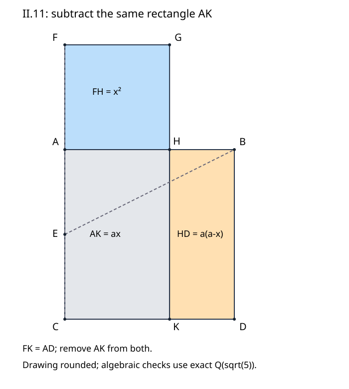

# 《几何原本》II.11：用两次面积消去构造一个无理分点

## 约公元前300年 · 数学与推理前史补读 · 深读v1

给一条线段，不是把它随意切开再检查一个恒等式，而是**找出一个指定分点，使“整段乘剩下的小段”恰好等于“大段的平方”**。II.11的困难在于把存在性变成可执行的几何构造。原文先借直角三角形取得一条长度，再借II.6和I.47配出相等的整体面积，最后减去真正共有的矩形。这两次消去，比记住0.618更能说明证明为何成立。

本篇完整阅读II.11及Heath相关评注，区分**原证明、教学补足、近代史学判断、现代推论、真实实跑**。这是从图灵1936—1937样稿回溯古代的年代跳转与AI推理前史补读，不把古代几何称为现代AI论文，也不宣称图灵是第一篇AI论文。选择依据是问题、推理和来源可核验，作者或机构名气不改变标准；本目录不穷尽古代或同期数学文献。

## 1 书目与阅读边界

| 材料 | 本次实际位置 | 证据角色 |
| --- | --- | --- |
| Euclid, *Elements*, II.11 | 作品传统年代约公元前300年 | 汇编背景不是此构造发现的确切日期，也不能证明个人首创 |
| T. L. Heath, *The Thirteen Books of Euclid's Elements*, 1908, vol. I | 印402–403；扫描PDF423–424；卷首ERRATA（PDF16） | [扫描入口](https://archive.org/details/thirteenbookseu02heibgoog)：原命题译文及403页历史、代数评论分开读 |
| Richard Fitzpatrick, *Euclid's Elements of Geometry*, revised and corrected 2008 | 印62底标题，63完整构造和证明，64顶部结尾及脚注 | [希英对照PDF](https://farside.ph.utexas.edu/Books/Euclid/Elements.pdf)：交叉检查字母、依赖与区域名称 |
| David E. Joyce, Clark University | [II.11正文与Guide](https://mathcs.clarku.edu/~djoyce/elements/bookII/propII11.html) | 对照证明和后章用途；网页Guide不是欧几里得正文 |

所查Heath卷首勘误表未列针对本条印402–403的修订；这不是证明所有版本没有错误。Fitzpatrick的“Golden Section”解释在64页脚注，不是希腊命题正文的术语。本篇不发布扫描件，也不逐句翻译上述版本。

### 1.1 前驱不是一串名人名字

直接可核实的前驱是证明依赖：[I.46](euclid-elements-i46.zh-CN.md)提供正方形构造，I.10提供二等分，I.3支持长度截取；[II.6](euclid-elements-ii6.zh-CN.md)给中点加外延后的矩形—平方关系，[I.47](euclid-elements-i47.zh-CN.md)把同一平方换成两平方之和。与[II.10](euclid-elements-ii10.zh-CN.md)相比，本条不是再给一个任意分段恒等式，而是利用已有等式反过来寻找未知分点。

Heath403页因为此构造服务于正五边形相关命题IV.10、IV.11，把解决它的历史归于毕达哥拉斯传统。这里保留为**Heath的历史推论**，不是本篇独立核验了所有古代文献后的首创定论。同页提及Simson的更一般二次构造，并把本问题联系到VI.30的中外比。前驱命题的直接调用、后世注释的重构、古代作者归属，是三种不同强度的证据。

本次原始文献范围是上述II.11及相关注释，不声称覆盖同期全部几何传统、传本谱系或五边形理论。把“后来非常著名”写成“最初就在研究普遍美学规律”，没有本文证据支持。

## 2 输入、目标和对象类型

输入是非零线段AB。输出是严格位于A、B之间的H，使以AB、BH为邻边的矩形，与以AH为边的正方形等积。用a表示AB长度，x表示AH长度，R表示矩形面积，Q表示正方形面积，现代记号写为：

$$
R(AB,BH)=Q(AH),\qquad a(a-x)=x^2,\qquad 0\lt x\lt a.
$$

这不是令两个线段相等，也不是说两个图形全等。矩形的邻边是**整个AB**与**另一段BH**，平方的边是AH；把AH、BH交换，会改变分点位置。正性不仅为除法服务，也保证真分点、非退化正方形与后面的区域相减有意义。

a=0时数式可写成0=0，却没有本命题要求的非零线段和严格内分点；负a也不是原来的长度。代码只接受正的有理输入尺度，数学证明的范围则是任意正实长度。输入是有理数，不意味着输出分点也能由有理坐标表示。

## 3 构造：用一条斜边确定未知段

依原文字母：在AB上作正方形ABDC，AC是与AB垂直的边；把AC平分于E，连接EB。沿CA越过A延长到F，使EF=EB。以AF作正方形FGHA，选择使AH沿AB方向的一侧。延长GH至与CD交于K。原文把小正方形简写为FH。

操作顺序不能倒过来：H还未知时，先构造的是EB，再转移其长度到射线EA，得到F，最后用正方形把AF转成AH。用现代公式预先算好x再标H，也能画图，但它不是原文展示的构造过程。

### 3.1 教学补足：F为何越过A，H为何没有越过B

原文没有独立展开这项内点保证，示意图却用到了它。直角三角形AEB中，斜边EB大于直角边EA，因此EF=EB大于EA，F落在射线EA越过A的一侧。另一方面，三角形两边之和大于第三边（I.20），即EB小于EA+AB。因此AF=EF−EA小于AB；而AF大于0。正方形给AH=AF，于是H严格在A、B之间。

这里没有使用待证关系a(a−x)=x²来筛选H，所以没有用结论证明构造合法。EB大于EA可由直角与锐角的大小配合I.19得出；若采用平方比较，也必须先有I.47和正长度。两种补足都应标明，不伪装成原文的独立段落。

以E为圆心、EB为半径的圆与AC所在直线有两个交点。必须选射线EA方向那个，不能只写“任选一个交点”。另一交点在C外侧，不能给出原图的F—A—E—C点序。

### 3.2 一张图里的五块区域

图为原创教学示意，颜色只辅助识别，不代替证明。为避免把二字区域名当成线段，明确列出边界：

| 原文简称 | 本篇完整边界 | 身份 |
| --- | --- | --- |
| AD | A—B—D—C | 原正方形 |
| FK | F—G—K—C | 外加后形成的高矩形 |
| AK | A—H—K—C | 两大图共有的矩形 |
| FH | F—G—H—A | 新正方形 |
| HD | H—B—D—K | 原正方形右侧的余矩形 |

FK和AD形状不同，但稍后证明面积相等；AK真正在两者内部，而不是仅有相同面积的一个虚构量。FK去掉AK得到FH，AD去掉AK得到HD。若H跑到AB外面，这种“同一块减去”就不再成立，这正是3.1不能省略的原因。

## 4 逐步证明：先消平方，再消矩形

### 4.1 II.6中的字母如何映射

AC被E平分，FA加在A端之外。II.6要求“整段加外段”乘“外段”，再加半段的平方，等于“半段加外段”的平方。这里对应为CF、FA、AE、EF，故得到R(CF,FA)+Q(AE)=Q(EF)。不要把CF错写成CA，也不要把EF错写成AF：前者包含原整段，后者包含原半段。

### 4.2 长度相等怎样允许换平方

构造给EF=EB，所以其上的正方形等积。角BAE由原正方形为直角，I.47给Q(EB)=Q(BA)+Q(AE)。把两条路线接在同一个EB平方上，得到：

$$
\begin{aligned}
R(CF,FA)+Q(AE)&=Q(EF)=Q(EB),\\
Q(EB)&=Q(BA)+Q(AE),\\
R(CF,FA)&=Q(BA).
\end{aligned}
$$

最后一行是从相等整体中减去共同的Q(AE)，对应共同概念3。第一消去只得到一个大矩形等于原正方形，**尚未得到最终的小正方形等积**。讲解若在这里直接写“所以结论成立”，就隐去了第二次消去的对象识别。

### 4.3 把长度乘积换回实际区域

小正方形有FG=FA。FK的高为CF、宽为FG，因此面积就是R(CF,FA)。AD的面积是Q(BA)。故FK与AD等积。

注意FG不是原AB；只有AF=FG=AH，而一般AH不等于AB。CD平行AB、GH垂直AB，使K位于CD上且AK为矩形。对任意旋转后的图仍应从平行与直角得此结论，而不是依赖“图上竖着”的字面方向。

### 4.4 第二消去闭合目标

FK与AD都含共同区域AK，减去AK，剩下FH与HD等积。FH是边AH的正方形；HD的邻边HB与BD中，BD=AB（原正方形）。所以HD是所需的R(AB,BH)，FH是Q(AH)，目标得到。

这条证明把一个未知分点问题转成两个面积账本的对齐：先用II.6与I.47配出同一平方，再在几何图上配出共同矩形。符号消去与区域消去具有相似形式，但前提不同；前者需要等量，后者还要确认子区域的真实包含和余区身份。

## 5 现代重构：根式不是古代证明的前提

为和图对齐，取A=(0,0)、B=(a,0)、C=(0,a)、D=(a,a)、E=(0,a/2)。令AF=x，则F=(0,−x)、G=(x,−x)、H=(x,0)、K=(x,a)。这里y轴朝图的下方为正只是一种绘图约定，反射不改等积关系。

EB的平方为5a²/4，EF的长度为a/2+x。EF=EB且两者正，得到(a/2+x)²=5a²/4。展开、消去a²/4，得x²+ax=a²；这与原文先II.6再I.47的结构相对应，却使用了现代数与坐标语言。

$$
\begin{aligned}
x^2+ax-a^2&=0,\\
x&=\frac{a(\sqrt5-1)}{2},\qquad a-x=\frac{a(3-\sqrt5)}{2},\\
x^2&=a(a-x)=\frac{a^2(3-\sqrt5)}{2}.
\end{aligned}
$$

另一代数根为−a(1+√5)/2，不是正长度，更不是第二个合法内分点。Heath所谓几何视角只取一个解，不应改写成二次多项式只有一个根。

### 5.1 唯一性可以不靠画图判断

构造已经证明存在。若0<x<y<a且两者都满足t²+at=a²，作差得到(y−x)(x+y+a)=0；两个因子却都正，矛盾。因此给定标签下内分点唯一。这是本文的现代证明补充，而不是把两个根的小数打印出来便宣布唯一。

再比较a/2处：t²+at=3a²/4小于a²，而该表达式在正半轴严格增加，所以x大于a/2，即AH确为大段。也可由√5大于2直接看出。文字“较大段”至此有依据，而非从金色示意图上猜测。

### 5.2 比例语言的后见解释

因a、x、a−x均正，可以把a(a−x)=x²除以x(a−x)，得到a/x=x/(a−x)。这正是全段对大段等于大段对小段；若记φ=a/x，则φ=(1+√5)/2。Fitzpatrick脚注与Heath的VI.30联系可以由此理解。

但II.11正文用矩形与正方形说话，并不把现代φ记号、十进制0.618或“黄金比例”的大众文化含义作为证明前提。把后来比论的语言拿来帮助理解可以，反用尚未建立的VI.30来证明II.11则改变了本书原来的依赖次序。

## 6 算例、反例和数值误差

### 6.1 a=2时完整手算

此时AE=1、EB=√5、AF=AH=√5−1，BH=3−√5。CF=1+√5。第一消去后的矩形为CF·FA=(1+√5)(√5−1)=4，正好等于AB²。共同AK的面积为2(√5−1)；两大区域都减它，得到6−2√5。小正方形(√5−1)²与右侧矩形2(3−√5)确为同一个值。

中间量不是可有可无：若结果相等但FK算成2、共同AK算成√5−1，便把长度倍率与面积倍率混淆了。线性缩放2倍时，面积放大4倍。

### 6.2 中点不是答案

a=2、x=1时，整段乘小段为2，所选段平方为1。它虽然是内部点、两段都正、也有对应正方形，却没有EF=EB这一构造约束。合法地“在内部分割”远弱于“满足本命题构造”。

### 6.3 交换大段和小段会改变对象

a=1时正确x=(√5−1)/2，约为0.618；若把x误记成(3−√5)/2，约0.382，则1−x约0.618而x²约0.146，不相等。对应互换后的另一种式子可能成立，但不是既定AH标签下的目标。测试要比较命名对象，不能只比较一个熟悉的比例常数。

### 6.4 用0.618代替根式并不精确

令a=1、x=618/1000，则x²+x−1=−76/1000000，不是0。若设置误差阈值10⁻³，它会被近似测试接受；这仅说明精度足够某种应用，不能充当精确几何证书。根式域表示把p+q√5保存为两个有理数，零判定是两个系数同时为零，不用浮点容差掩盖差异。

### 6.5 一个只满足终式的伪图

保留正确AH长度，却把E从中点移开，最后a(a−x)=x²仍然成立；但II.6的中点条件不再满足，EF=EB也通常失败。只检查最终等式的程序会错误地把这张图当作原构造证书。复现既要查目标，也要查点标签和规范坐标；它仍不是从任意几何图自动寻找缺失证明的系统。

## 7 延伸：同一分法在加长后的线段上重现

Heath403页指出CF也在A处按同一方式分割。解释时应先换清楚对象：CF=a+x是新的整段，CA=a是较大部分，AF=x是较小部分。第一消去已经给(a+x)x=a²，所以新整段乘小段等于大段平方。它并非声称“CF的分点仍在原AB上”。两条线段分别在竖直与水平方向，关系来自同一面积证书。

这是一个有意义的自相似结构：原来全段a、大段x、小段a−x；加长后全段a+x、大段a、小段x。因a/x=x/(a−x)，比例保持。这个观察可引出连续分割，但本篇没有把它升级为Fibonacci历史起源或所有递推数列的证明。

现代还可研究一般方程t²+at=b²（a、b正）。同样取半段a/2，作直角边a/2和b的三角形，斜边减a/2得到正根。Heath联系Simson的说明正朝这个方向。但当b不是a时，得到的t不必小于原a；例如b=2a时t大于a。因此一般二次构造不是无条件的“在原AB内部切分”。原II.11取b=a，内点保证才与前面的图严密匹配。这项一般化是范围分析，不另计一个发表单元。

## 8 与今天的证明生成和验证有什么关系

**本文分析推论。** 本条很适合区分构造器、证书和检查器。构造器给出F、H、K；证书保留中点、等长、平方资格与共同区域；检查器核验这些明确关系。只给最终小数的生成器没有交付同样强的理由，只给正确等式也没有证明全部辅助对象合法。

然而本文程序并不是一个完备的尺规作图求解器：它预先使用已推导的根式，把所有点与该解析构型比较，再计算长度平方和区域面积。因此它验证的是固定解族的实现一致性，不是独立从欧氏公理发现此解。独立审查手工输入坐标，可以减少“生成器与测试器共享同一错误”的风险，不能把有限回归变成一般定理。

同样，本篇不声称古代几何直接发明了现代AI，也不据一次精确算例评价模型智能。可迁移的是证据纪律：先核对象存在和类型，再核局部关系，最后核整体目标；允许未知而不是把缺失证明补成肯定结论。

## 9 最小复现与真实执行

[复现README](../../reproduction/euclid-elements-ii11/README.md)提供自有标准库代码、明确环境和命令、测试及日志、五格Notebook和原创SVG。计算域为Q(√5)：两个有理系数相加相乘、平方与精确符号比较。实现只接收int/Fraction（排除bool和float）作为输入尺度、原点及基向量系数。

模型允许点(u,v)映为O+uU+vV，要求U、V非零、等长且垂直。平方长度与面积都乘公共模平方k；x字段记录局部系数，不是变换后世界坐标中的物理长度。若只垂直不等长，会把正方形拉成长方形，应拒绝，而不是当成合法“任意仿射变换”。

生产校验用显式异常，不依赖会被-O删除的assert。全部点首先与预定解析构型比较，故域运算和范围检查是实现证据，不能冒充从任意局部约束自动求解。

主单测20项在normal、-O、-OO均通过，包含64构形网格，四算例覆盖单位、分数、旋转缩放和反射；独立核验不用make_certificate手写全部点及12组变换，对9个点逐个篡改均拒绝；另用高精度数值交叉检查3721个Q5符号案例，并以整数平方判定60个√5连分数近抵消案例，检查3个域逆元。这些是本次真实执行的有限覆盖，不是全部输入穷尽。Notebook以标准库compile/exec顺序执行及回放，不是Jupyter kernel执行，不声称已验证交互前端或kernel环境。

本条没有实验数据集、学习基线或训练指标；核验基准是手算、中间几何关系和非法输入拒绝。小实验不能证明一般定理，原证明与第5节符号推导承担一般性。

## 10 主张与证据位置

| 主张 | 定位 | 不能推出什么 |
| --- | --- | --- |
| 正方形、中点、斜边转移的构造 | Heath402；Fitz63 | 不自动提供原文未展开的严格内点论证 |
| II.6与I.47接合，先减AE平方 | Heath402–403；Fitz63 | 尚未直接得到FH=HD |
| FK=AD后共同减AK | Heath403；Fitz63–64顶 | 不把区域名当成线段或全等声明 |
| 毕达哥拉斯传统和五边形关系 | Heath403评论 | 非独立确认个人首创与精确发现年代 |
| 比例名称与VI.30 | Fitz64脚注；Heath403 | 非II.11原文使用现代φ记号 |
| 内点、唯一性、误差反例 | 本文3.1、5.1、6 | 教学补足和现代推论，不伪称逐句原证 |
| CF再次同类分割 | Heath403；本文7 | 不混淆两个图的全段和小段 |
| 精确回归与Notebook执行 | 复现目录真实日志 | 非欧氏公理形式化、非kernel、非无限输入证明 |

## 11 练习、答案与复盘

**1. 为什么不能直接在AB上任选H再画平方？**

答案：任意内点只保证区域存在，不保证II.6的整体矩形与AB平方相等。EF=EB这一特定长度转移才把两条平方路线接起来。a=2、AH=1给2≠1，是最小反例。

**2. 不用目标式证明H确实在内部。**

答案：EA<EB<EA+AB。转移EF=EB并在EA射线上取F，减去EA得0<AF<AB；正方形给AH=AF。因此H在A、B之间。不能先假设目标等式再筛选根当作原构造的内点依据。

**3. 两次消去分别减掉什么？**

答案：第一次是两条面积等式共有的AE平方；第二次是两个已经证明等积的大区域FK、AD实际共有的AK矩形。第一次留下R(CF,FA)=Q(AB)，第二次才留下Q(AH)=R(AB,BH)。

**4. 用a=2算FK、AK、FH、HD。**

答案：FK=4；AK=2√5−2；FH=HD=6−2√5。检验4−(2√5−2)=6−2√5。所有结果都是面积量，不能和AF=√5−1直接相减。

**5. 为什么两个代数根不意味着两个内分点？**

答案：负根−a(1+√5)/2不是正长度。对两个正候选x<y，函数值差(y−x)(x+y+a)>0，又排除两者同时满足同一目标值，所以合法标签下唯一。

**6. 把E移开中点，但保留正确H，最终等式还能成立吗？**

答案：能，终式只含a和x；但不能再按II.6使用AC的中点关系。证书应检查辅助构造，不以目标等式成立替代完整原证明。

**7. 证明新全段CF也按相同方式分割。**

答案：CF=a+x、CA=a、AF=x；第一消去得到CF·AF=CA²，且a>x>0。新全段乘小段等于大段平方，标签随新问题变化，不能仍把a当作新全段。

**8. 为何一般t²+at=b²不能总当成原线段a的内分？**

答案：在t=a时左侧2a²。若b²>2a²，唯一正根大于a；例如b=2a。正根存在和根小于预给长度是两项不同保证。

**9. 3721个符号测试是否证明Q5的比较函数对一切输入正确？**

答案：否。异号系数比较需要在确认双方非负后比较有理平方，例如p>0、q<0时比较p²与5q²；这项算法分析覆盖一般输入，有限网格与近抵消案例只检验具体实现。Decimal交叉核验本身也有有限精度。

复盘可用五句串起整篇：先构造斜边并转移到指定射线；先证明得到正的内部分段；用II.6和I.47消去同一平方；识别真实共同矩形并再次消去；把所得区域翻回题设的边长身份。任何一句若只剩“显然”，就回到具体对象、依赖与输入范围重新检查。

本文为AI辅助的原创中文教学分析，并非全文翻译或人类专家认证。独立[来源审查](../../reproduction/euclid-elements-ii11/source-review.zh-CN.md)与[技术审查](../../reproduction/euclid-elements-ii11/technical-review.zh-CN.md)绑定本文最终SHA256；本次完成仅指II.11单元，后章与全书不据此计完成。
