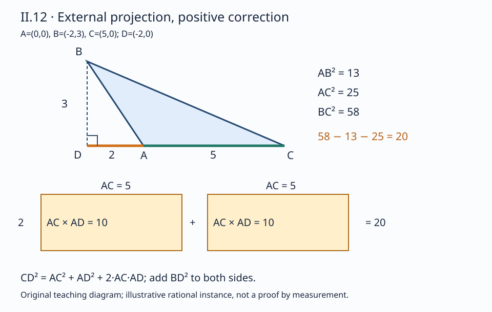

# 《几何原本》II.12：钝角多出的面积从哪里来

## 约公元前300年 · 数学与推理前史补读 · 深读v1

勾股关系要求直角。把夹角张大为钝角，对边平方便超过另外两边的平方和；但“超过”只是定性判断，II.12要精确指出**多出的面积是哪两块矩形**。它没有直接发明一个角度函数，而是作一条落在三角形外的垂线，把同一个高度放进两个直角三角形，再把第二卷的线段平方分割接入第一卷的勾股关系。

本篇区分**原文证明、教学补足、后世评注、现代重构和真实实跑**。这是从图灵1936—1937样稿回溯古代的年代跳转与AI推理前史补读；古代命题不是现代AI论文，图灵样稿也不被称为第一篇AI论文。收录按问题、推理与可核验材料选择，不按作者或机构声望改变标准，不声称穷尽古代或同期数学文献。本次阅读单元只计II.12。

## 1 书目、版本与前驱

| 材料 | 实际阅读位置 | 用途与界限 |
| --- | --- | --- |
| Euclid, *Elements*, II.12 | 作品传统年代约公元前300年 | 汇编背景，不是此命题发现的准确年代或个人首创凭据 |
| T. L. Heath, *The Thirteen Books of Euclid's Elements*, 1908, vol. I | 印403末–404原命题与证明；404–406初评注；PDF424–427；卷前ERRATA在PDF16 | [扫描书目入口](https://archive.org/details/thirteenbookseu02heibgoog)；正文与替代证明、历史归属分开 |
| Richard Fitzpatrick, *Euclid's Elements of Geometry*, revised and corrected 2008 | 印64–65顶部，希英对照、图及65页脚注 | [希英对照PDF](https://farside.ph.utexas.edu/Books/Euclid/Elements.pdf)；核字母和推理，脚注的余弦式是现代解释 |
| David E. Joyce, Clark University | [II.12正文及Guide](https://mathcs.clarku.edu/~djoyce/elements/bookII/propII12.html) | 对照原证明；Guide存在下文指出的公式问题，不据它抄写现代公式 |

所查Heath随卷勘误表没有针对印403–406或II.12的条目；这是有限版本核对，不是“所有版本均无勘误”的声明。Fitzpatrick版本说明以Heiberg 1883–1885希腊文本为底本，2008是修订译本年份，不能挪作古代命题的年代。本篇仅公开原创解析和必要链接，不镜像扫描或作全文翻译。

### 1.1 证明的前驱，比名人归属更直接

直接依赖是[I.12](euclid-elements-i12.zh-CN.md)的垂线构造、[II.4](euclid-elements-ii4.zh-CN.md)的整段平方分割，以及[I.47](euclid-elements-i47.zh-CN.md)的直角三角形平方关系。原证明把这些已知结果组合起来，没有先调用余弦定理。前篇[II.11](euclid-elements-ii11.zh-CN.md)是寻找特定分点的构造题；本篇回到已给三角形，求三个平方之间精确差额。两条的目标类型不同。

Heath印404–405还讨论仿照I.47图形程序、直接比较正方形与矩形的替代路线，并把有关近代证明追溯至Gregory of St Vincent的1647年著作；这是**Heath的历史评述**，本篇未重新遍查该著作或确认最早发现。印405–406经an-Nairizi传述的Heron逆命题也属于后世评注，不是欧几里得II.12正文。可核验的依赖、注释者的归属判断和真实首创史，不能写成同一种证据。

## 2 输入、目标与一个容易错认的线段

输入是非退化三角形ABC，角BAC严格为钝角。从B向直线CA作垂线，垂足为D。原图点序是**D—A—C**：D在CA越过A的延长线上，不在边AC内部。BD是高，AD是外部截下的正长度，CA是原三角形的一条边。

令Q(XY)表示边XY上的正方形面积，R(XY,ZT)表示以两线段长度为邻边的矩形面积。目标不是比较线段之和，而是：

$$
Q(BC)=Q(BA)+Q(AC)+2R(CA,AD),\qquad R(CA,AD)\gt0.
$$

所以BC平方严格大于另外两平方之和。不要把最后一个因子改成高BD，也不要把CA改成BA；它们都可能是图上的醒目线段，却不是同一个面积量。长度平方和矩形面积具有相同量纲，长度与面积则不能直接相加。

### 2.1 为什么垂足一定在外面

**教学补足。** I.12提供向所在直线作垂线。如果D=A，则BA与AC垂直，违反严格钝角。如果D在从A朝C的射线上（包括C或C以外），三角形BAD在D为直角、在A却有钝角BAC，违反I.17“两角之和小于两直角”。因此D只能在相反射线上，且D≠A。B不在AC直线上，则BD非零，两个所需直角三角形都不退化。

这里不能先用待证的平方差为正来“证明D在外部”，那会把结论放回前提。原文紧凑叙述和示意图省略的这项位置分析，应明确标成补足。

## 3 辅助线如何改变问题

图为自有教学示意。大直角三角形BCD与小直角三角形BAD共享BD；它们的另一条直角边分别为CD和AD。沿底边有CD=CA+AD。这正好把难以直接分割的斜边平方，换成第二卷已经能处理的“整段平方”和“分段平方”。

BD的价值不在于它在最后公式里出现，而在于它能**在两条推理路线中扮演同一对象**。如果从不同位置随手画两条高，两个高度平方通常不相同，就不能把它们抵消。画一条合适辅助线，实际上是在设计共同中间量。

## 4 按原证明次序逐步重建

### 4.1 把II.4用在正确的整段

CD被A分成CA和AD，A确在C、D之间。II.4给Q(CD)=Q(CA)+Q(AD)+2R(CA,AD)。这里“任意分割”是说II.4不要求A是中点，不是让本题任意选择一个与垂足无关的A。整段是CD，而不是原三角形的边CA。

### 4.2 两边加上同一个平方

依共同概念2，对刚才相等的面积两边都加Q(DB)。这是保存等式的步骤，不改变需要证明的几何事实。增加的Q(DB)一方面准备与Q(CD)组合，另一方面准备与Q(AD)组合。

### 4.3 两次I.47替换不同的组合

在直角三角形BCD中，BC是斜边，故Q(BC)=Q(CD)+Q(DB)。在直角三角形BAD中，BA是斜边，故Q(BA)=Q(AD)+Q(DB)。两次都因为D处直角才可用I.47，绝不能对原钝角三角形BAC直接套它。连起来就是：

$$
\begin{aligned}
Q(CD)&=Q(CA)+Q(AD)+2R(CA,AD),\\
Q(CD)+Q(DB)&=Q(CA)+Q(AD)+Q(DB)+2R(CA,AD),\\
Q(BC)&=Q(CA)+Q(BA)+2R(CA,AD).
\end{aligned}
$$

### 4.4 等式为何能推出严格不等式

CA和AD都非零且为正长度，所以矩形面积严格正。最后一行不仅给一个形式上的附加项，还给**正的差额**。若AD=0，附加项为零，只得到直角边界；若三点共线，某些代数式仍成立，却不再满足非退化三角形输入。正性、非退化和等式，是三种分别需要检查的条件。

也可以先把两条I.47等式作差，得Q(BC)−Q(BA)=Q(CD)−Q(AD)，再用II.4。那是等价的教学重排；原文采取先II.4、同加DB平方、再替换的路线。重排可以帮助理解，不能冒充逐字原证。

## 5 现代建模：外投影的符号不能丢

令A=(0,0)、C=(b,0)、D=(−p,0)、B=(−p,h)，其中b>0、p>0、h≠0。p=AD是正长度，−p是D的横坐标；h可正可负，反射不改变结论。原命题覆盖一般欧氏长度，代码采用有理坐标作精确教学核验，不宣称穷尽所有实数点。

平方距离给AB²=p²+h²，BC²=(b+p)²+h²，AC²=b²。展开后h²消去，剩下2bp。这个计算解释了为何相同b、p下改变高度，三边平方各自改变，差额却不变；它不是说夹角或边长不变。

### 5.1 余弦关系是后见重述

记a=BC、b=CA、c=AB、θ=角BAC。现代点积给cosθ=−p/c，而不是−p/b。因此：

$$
\begin{aligned}
a^2-b^2-c^2&=2bp,\\
p&=-c\cos\theta,\\
a^2&=b^2+c^2-2bc\cos\theta.
\end{aligned}
$$

钝角的余弦为负，所以最后的“减去”在本例产生正增量。这说明欧几里得用正长度与外部位置编码的关系，可以在现代有符号投影中统一表示；不表示原文已经使用负余弦、向量或现代三角函数记号。Fitzpatrick印65脚注明确给这一对应，脚注与古代正文分开。

### 5.2 网页Guide的三个局部问题

Joyce页面按a、b、c分别为A、B、C的对边定义，却把补偿项写成2c·AD，并把AD对应为−b cos A；在这一命名下应分别是**2b·AD、−c cos A**。其显示的余弦式还在b²与c²之间缺少加号。原页面的命题正文与两次I.47推理是正确的。本篇是依据边名和Fitzpatrick脚注作交叉核对，不把网页辅助说明的排印或标签问题归给欧几里得，也不称为作者正式勘误。

### 5.3 换一条边作投影，为什么差额仍相同

**现代推论。** 令u为向量AB，v为向量AC。恒等式|v−u|²−|u|²−|v|²=−2u·v。对钝角u·v<0，把B投到AC得到p=−u·v/|v|，故|v|p=−u·v。若改把C投到AB，得到外投影长度q=−u·v/|u|，故|u|q是同一个量。两种底边选择给同一矩形面积，不要求两个外投影长度彼此相等。

Heath印405的替代图也得到这类矩形等积，并联系后文III.35；本段采用独立现代向量推导，不反过来调用尚后的命题证明II.12，也不冒充完成了那张替代图的全形式认证。

## 6 算例与误用反例

### 6.1 一例把中间量全部算出来

取b=4、p=2、h=3。则AC²=16，AD²=4，BD²=9，CD²=36，AB²=13，BC²=45。II.4这一步是36=16+4+16；两边再加9，得到45=16+13+16。差额45−13−16=16，正是2×4×2。

若误用高BD，得到2×4×3=24，不等于16。若误用AB作矩形一边，得到4√13，也不等于16。正确公式必须核准对象身份，不能只看量纲同为面积。

### 6.2 改高度不改外投影

仍取b=4、p=2，但h=5：AB²=29、BC²=61，差额61−29−16仍为16。两个三角形的角不相同；不变的是底边和外投影乘积。这个例子说明共同高度消去的作用，不是从两次观察归纳出一般规律；一般性由第4节或第5节展开式给出。

### 6.3 把垂足移到里面，正号就错了

取A=(0,0)、C=(4,0)、B=(2,3)，角A锐、垂足在AC内部。此时BC²=13、AB²=13、AC²=16，差额为−16，绝非+16。若只检查“有一条垂线、AD长度为2”，却不检查D相对A的方向，会接受错误的正号。此例只说明本条的输入边界，不把后续命题计作已完成。

### 6.4 代数恒等式成立不等于几何命题适用

让b=4、p=2、h=0，数式36=4+16+16仍成立，但B、A、C共线；角与非退化直角三角形资格已丢失。让p=0而h≠0，得到直角而非钝角，差额为零。让b=0，则A=C，连三角形的三个不同顶点都没有了。程序应明确拒绝这些原命题域外输入，而不是因为最后等式残差为零就盖章。

### 6.5 近直角不宜只靠浮点残差

取b=1、p=1/10¹⁸、h=1，严格正的差额为2/10¹⁸。有限精度计算若先把大平方相减，可能把差额舍入到零。本文使用有理数精确计算；这不解决带测量噪声的现实几何。若输入是测量值，应给误差区间，并允许“不足以判定”，不能把计算零武断解释为真实直角。

## 7 逆命题：多出的平方能反推钝角吗

Heath印405–406转述Heron的逆向判断：若某一边的平方大于另两边平方和，则另两边夹角为钝角。以下是按该评注重建、另换辅助点名的证明，避免与前图垂足D混淆。

已知BC²>BA²+AC²。在A作AE垂直AC，取AE=AB，并连接EC。由I.47，EC²=AE²+AC²=AB²+AC²，因此BC²>EC²。因边长正，BC>EC。在三角形BAC和EAC中，BA=EA、AC共有，而第三边BC>EC；由I.25，两等边所夹角BAC大于EAC。后者为直角，所以BAC为钝角。

这不是把II.12的箭头直接倒过来：从“钝角推出差额正”并不能单靠逻辑形式得到“差额正推出钝角”。重建使用了一个比较用直角三角形和I.25，补上独立理由。它是有来源的延伸，不改变本次原始命题范围。

## 8 与证明规划、检查器和AI的有限关联

**本文分析推论。** 本条呈现一种可教的证明规划：目标含两个难处理斜边平方，先寻找能同时替换它们的直角三角形，再利用共有高把关系降到共线线段上。辅助构造不是额外装饰，而是为既有定理制造合适的输入类型。

这也提醒证书检查器不能只检验终式。它至少要确认三角形非退化、A为钝角、D在AC所在直线上、BD垂直该线，以及D—A—C的方向。若证书把“外部”擦掉，只剩无符号距离，原本不同的正、负情形可能被混合。

有理坐标检查器可以独立计算点积、行列式和平方距离，避免直接把目标等式作为输入。但它仍预设欧氏坐标度量与精确算术，不是从欧氏公理自动发现辅助线，也不是完备几何证明器。有限测试能发现实现错误，不能证明古代原文的全形式正确性，更不能用来评价任意AI系统的推理能力。本篇没有古代几何直接导致现代AI的历史因果主张。

## 9 最小复现与执行边界

复现材料见[代码、Notebook与日志说明](../../reproduction/euclid-elements-ii12/README.md)。自有Python标准库代码以Fraction表示坐标，主入口construct(A,B,C)可处理任意方向的有理坐标三角形，而不是只验证画好的标准图。它先排除坐标类型错误、A=C及三点共线，再检查角A的点积严格为负；用投影参数t确定D，并保存外垂足、垂直、II.4、两次I.47、终式及严格差额的检查结果。生产检查用显式异常，不依赖会被优化模式删掉的assert。

代码取u=C−A、v=B−A（与第5.3节的u、v命名互换，点积不变），t=(u·v)/(u·u)，D=A+tu，面积AC×AD=−u·v。因此即使个别边长无理，矩形乘积仍可由有理坐标精确取得，无需开方。方便入口normalized(c,d,h)对应本文b=c、p=d；这里代码参数c是底边长度，不是第5.1节约定的对边字母c=AB。对照符号时必须保留命名层次。

本次CPython 3.12.14实际执行20项单测，normal、-O、-OO三模式均通过；其中一项枚举250个有理参数构形，另含平移、精确旋转、反射、放缩、极小正差额、大整数、无理长度的有理乘积及非法输入拒绝。三模式不是三份独立数学证明，250网格也不算250个单测方法。

五个真实算例的首例取底边5、外投影2、高3，得到AB²=13、AC²=25、BC²=58、差额20；原创SVG用此例，因此与第6.1节底边4的手算不同。另有分数、镜像、小差额和斜底边例。第6节手算与这些实跑分别标识，不把未写入日志的手算冒称已执行记录。

独立技术核验另以平方边长和鞋带面积分类，不调用生产代码的点积函数作为判定oracle：每模式检查2401个整数点对，其中960个钝角输入接受、1441个域外输入拒绝；另核216个有理变换构形、69个非法类型输入、三个正文手算和三个近直角精确例，并检查换底边投影的一致性。独立脚本及其真实日志随附件保存。这降低了共享实现错误的风险，不消除共同数学模型的假设。

Notebook共五个代码单元，真实以标准库compile/exec顺序执行，并在新命名空间重放核对输出；未启动Jupyter kernel，也未声称交互前端或完整nbformat模式验证。没有训练数据、学习基线或统计评测；这里的基准是手算、独立坐标关系与拒绝域外输入。有限实跑不能证明一般定理，也不是从欧氏公理生成的形式证书。

## 10 主张与证据账本

| 主张 | 证据位置 | 范围限制 |
| --- | --- | --- |
| 钝角、外垂足及指定矩形差额 | Heath403末–404；Fitz64–65顶 | 原定理是面积关系，不含现代负长度 |
| II.4后同加DB平方，再两次I.47 | Heath404；Fitz64 | 不是直接对钝角使用勾股关系 |
| 垂足位置与严格正性补足 | 本文2.1、4.4，依I.17与非退化 | 教学展开，不伪称原文逐段细证 |
| 现代余弦对应 | Fitz65脚注；本文5.1 | 译者脚注与本文重构，非原文三角函数 |
| Joyce Guide的标签/加号问题 | 所引网页Guide及逐项边名核对 | 不否定网页原命题证明，不冒充正式勘误 |
| 近代替代证明、Heron逆命题 | Heath404–406初评注 | 归属依Heath，不声称已遍查所引原典 |
| 有理坐标、反例和点积解释 | 本文5–8与自有代码 | 现代教学，不是希腊原式的转录 |
| 实际程序覆盖与Notebook方式 | 复现目录真实日志及双审 | 有限回归不是一般定理或证明助理认证 |

## 11 带答案练习

**1. 为什么整段是CD而不是CA？** 答：D—A—C，所以CD=CA+AD，A把CD分为II.4需要的两段。CA本身没有在A处分成CA和AD；把整段写错会凭空多出一段。

**2. 不用平方差证明垂足在外部。** 答：D=A会使A直角；D在朝C的射线上会使BAD同时含钝角和直角，违反I.17；其余只有反向射线。B不共线保证BD非零。

**3. 两次I.47分别替换哪两项？** 答：Q(CD)+Q(DB)换为Q(CB)，Q(AD)+Q(DB)换为Q(AB)。原三角形BAC不是这两次应用的直角三角形。

**4. b=3、p=1/2、h=2时差额多少？** 答：AB²=17/4，BC²=65/4，AC²=9，差额65/4−17/4−9=3=2×3×1/2。非整数边段不影响面积关系。

**5. 为什么矩形不能写CA×BD？** 答：在b=4、p=2、h=3例中，实际差额16，而两倍CA×BD为24。BD是被共同加入并最终合并的高度，不是II.4的分段AD。

**6. 若只检查终式，h=0能否蒙混过关？** 答：能。式子仍是分段平方恒等式，但三个顶点共线。必须另核非零行列式或非退化几何条件，不能让代数残差替代几何输入资格。

**7. 为什么AD=−c cosθ而不是−b cosθ？** 答：AB向AC方向的投影是c cosθ，c是被投影向量AB的长度；该投影为负，其外部正长度才是AD。b是投影所在底边的长度，不是斜边AB。

**8. 另一条边的外投影为何给相同面积？** 答：两种底边乘投影分别为|v|(−u·v/|v|)与|u|(−u·v/|u|)，都等于−u·v。可相等的是乘积，不能据此断言两投影长度相等。

**9. 逆命题能否只把“若钝角则平方差正”倒过来？** 答：不能。需比较用直角三角形AEC，I.47把其对边平方定为两邻边平方和，再由I.25将第三边严格较大转回夹角严格较大。

**10. 一万组精确样本是否证明所有实数三角形？** 答：否。样本支持实现回归；第4节的一般证明或第5节带明示前提的符号展开才覆盖一般对象。代码的有理输入域也不同于全部实数坐标。

## 12 复盘

先问垂足在哪里，再问哪些三角形确为直角；把CD的平方按II.4展开；同加一个DB平方；用两次I.47换掉不同的平方组合；最后用正性解释“多出”的严格含义。若只记住余弦定理，就会漏掉辅助线如何把旧结果组织成新证明；若只看图，则容易把外投影、高和斜边混为一谈。

本文为AI辅助的原创中文教学分析，不是全文翻译、人类专家认证或全书形式化。独立[来源审查](../../reproduction/euclid-elements-ii12/source-review.zh-CN.md)和[技术审查](../../reproduction/euclid-elements-ii12/technical-review.zh-CN.md)绑定最终正文SHA256。后章及全书不据本单元计完成。
