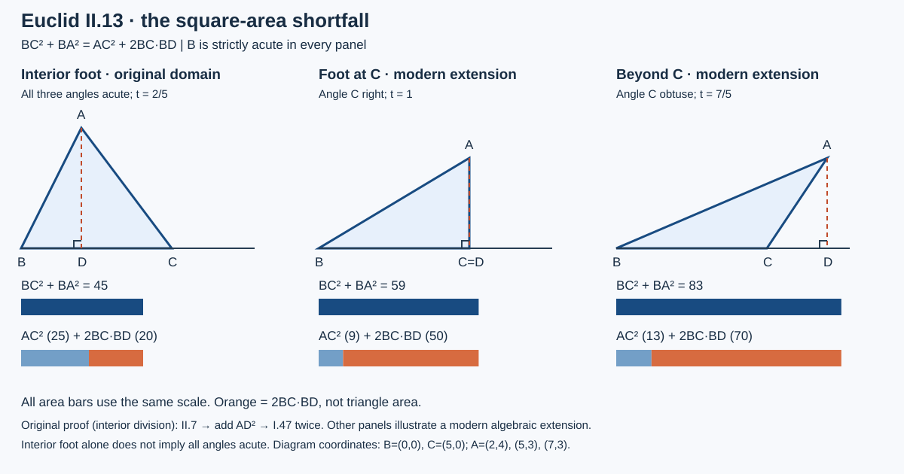

# 《几何原本》II.13：锐角少掉的面积与定理的适用范围

## 约公元前300年 · 数学与推理前史补读 · 深读v1

勾股关系在直角成立，II.12解释钝角为何多出一块面积；II.13则问：夹角锐时，**对边平方比另外两边平方和少多少，为什么恰好少这个量？** 答案不是简单地把上一条的加号改成减号。原证明要选对投影线段，把II.7的面积关系接到两次I.47上；更容易漏掉的是，现存文本明确先限定全锐三角形，而后世评注讨论的范围更广。

本篇将**原文、教学补足、后世评注、现代重构、真实实跑**分别标明。这是从1936—1937图灵样稿回溯古代的年代跳转与AI推理前史补读，不称古代命题为现代AI论文，不称图灵样稿为第一篇AI论文。收录以可核验问题和证据为依据，对作者、机构及声望采用同一标准，不声称穷尽古代或同时期数学。本次仅完成II.13阅读单元。

## 1 读了哪个文本，什么属于后人的话

| 材料 | 本次定位 | 用途与边界 |
| --- | --- | --- |
| Euclid, *Elements*, II.13 | 作品传统年代约公元前300年 | 汇编的年代背景，不是此结果个人首创或发现日的证据 |
| T. L. Heath, *The Thirteen Books of Euclid's Elements*, 1908, vol. I | 印406完整命题与证明；406末–409初评注；PDF427–430；卷前ERRATA在PDF16 | [扫描书目入口](https://archive.org/details/thirteenbookseu02heibgoog)，直接核对原页、图与评注，不把注释当正文 |
| Richard Fitzpatrick, *Euclid's Elements of Geometry*, revised and corrected 2008 | 印65–66，希英对照、图及66页脚注 | [学术托管PDF](https://farside.ph.utexas.edu/Books/Euclid/Elements.pdf)，核对全锐输入和II.7、I.47的次序；余弦式为译者脚注 |
| David E. Joyce, Clark University | [II.13正文](https://mathcs.clarku.edu/~djoyce/elements/bookII/propII13.html) | 辅助对照；其设定只写B锐，而证明仍按D内分BC，应注意其范围与底本的差别 |

Heath随卷勘误表未列针对印406–409或II.13的更正；这只报告本次所查表，不断言所有版本均无勘误。Fitzpatrick以Heiberg 1883–1885希腊文本为底本，2008是修订译本年份，不是古代命题年代。公开附件不含扫描全文或全文翻译。

### 1.1 从依赖而不是名声建立前后关系

原证明直接调用[I.12](euclid-elements-i12.zh-CN.md)作垂线、[II.7](euclid-elements-ii7.zh-CN.md)处理整段和分段平方、[I.47](euclid-elements-i47.zh-CN.md)把直角三角形两直角边平方换成斜边平方。前一条[II.12](euclid-elements-ii12.zh-CN.md)用的是II.4，垂足落在夹角顶点的反方向；本条换了位置关系和可调用的面积模板，不是脱离图形的符号翻转。

Heath印407讨论希腊评注者及后世译注者早已注意到：只要**被讨论的夹角**锐，这个差额关系也可在非全锐三角形中成立。印407–408还给仿照I.47的正方形—矩形面积路线，印408–409转述Heron的逆命题（经an-Nairizi传述）。这些是本次实际阅读的评注材料；本文不声称已逐一阅读它们所指全部原著或判定最早发现者。原文依赖、后世传述与首创史是不同层级的证据。

## 2 输入、符号与目标：先别把“锐角”读错

**原文范围。** ABC是非退化的全锐三角形，选定角ABC来讨论。A向BC所在直线作垂线AD，垂足D位于B与C之间。记Q(XY)为边XY上的正方形面积，R(XY,ZT)为以两线段长度为邻边的矩形面积。所要比较的是AC平方与BC、BA平方之和：

$$
Q(BC)+Q(BA)=Q(AC)+2R(BC,BD),\qquad R(BC,BD)\gt0.
$$

因此AC平方严格较小。修正项使用**从所选角B到垂足D**的线段BD；不是DC，不是高AD，也不是另一条斜边AB。两个长度的乘积与平方同为面积，可以相加；长度不能直接加进这个等式。

### 2.1 为什么D内分BC

**教学补足。** 由于A不在BC上，AD非零。如果D=B或D=C，分别使B或C为直角，违反全锐。若D越过B，ABD在D为直角，在B的角与原锐角ABC互补，因而钝，违反I.17的两角和小于两直角。若D越过C，同理由ACD在C的角与原锐角ACB互补，产生矛盾。于是只能有B—D—C。

这一步使用了B和C都锐，不能仅从B锐推出D在BC内部。另一方面，D在BC内部也不能推出A锐：内垂足的位置与全三角形的角分类并非同一条件。后面的反例会把这一区别具体算出来。

### 2.2 本篇的四种语言

“平方”“矩形”“内分”是原证明的几何对象；Q、R是本文便于追踪对象的教学记号；坐标、点积与余弦是现代重构；程序输出则只是规定有理输入上的真实执行。用现代公式解释旧证明很有帮助，但不能将解释者已有的工具反投射到古代正文。

## 3 为什么只添一条高就足够

图为原创教学示意。第一幅对应原文的全锐内足例；另两幅明确属于所选B角锐的推广。在第一幅原文构形中，AD把斜边AB与AC分别放进直角三角形ABD与ACD。两次勾股关系共享同一个AD平方，所以只要找到BD、DC、BC之间恰当的平方关系，就能用这一共同高度把线上的结论转成三角形的结论。

为何选II.7而不是II.4？II.7正好把“整段平方加一个分段平方”写成“两倍整段乘该分段加另一分段平方”。我们的目标左边含BC平方和BA平方，而BA平方待拆成BD平方与AD平方；于是需要先把BC平方和BD平方配在一起。这个从目标倒查旧定理输入的过程，是教学上的证明规划，不是断言欧几里得写作时的心理记录。

## 4 按原文次序重建，不把等式当黑箱

### 4.1 用II.7时，整段与所选分段是谁

原文将整段CB在D分割，选择BD为与整段组成矩形的分段。II.7给Q(CB)+Q(BD)=2R(CB,BD)+Q(DC)。如果错选DC，得到的也是一个合法II.7式子，但它不会直接配合目标中BA的平方。定理可用与定理用对目标，是两件事。

### 4.2 两边同加AD平方

依共同概念2，两边都加同一个Q(AD)，相等关系保持。左边的Q(BD)+Q(AD)组成直角三角形ABD的两直角边平方；右边的Q(DC)+Q(AD)组成直角三角形ACD的两直角边平方。此时增加的不是任意一块面积，而是为两次替换准备同一个中间量。

### 4.3 两次I.47各自有资格

ABD和ACD都在D为直角，且由于D是严格内点、A不共线，它们都非退化。因此可分别替换为Q(BA)和Q(AC)。完整链条为：

$$
\begin{aligned}
Q(CB)+Q(BD)&=2R(CB,BD)+Q(DC),\\
Q(CB)+Q(BD)+Q(AD)&=2R(CB,BD)+Q(DC)+Q(AD),\\
Q(CB)+Q(BA)&=2R(CB,BD)+Q(AC).
\end{aligned}
$$

不能直接在原三角形ABC上调用I.47，因为它没有直角；也不能把两个小三角形的斜边混淆。CB属于II.7的整段，BA、AC分别是两次I.47的斜边，各有角色。

### 4.4 “少”为什么严格成立

BC和BD都是正长度，所以两倍矩形面积为正。终式因而不仅是一个可移项的等式，也证明Q(AC)严格小于Q(CB)+Q(BA)。若BD为零，差额为零，本条的严格锐角输入已改变；若AD为零，即使代数式偶然成立，几何三角形也退化。最后一行不能替代前面输入资格的检查。

可将两次勾股式先作差，再用II.7，这是一种等价教学重排；上述次序才与所读原文相同。程序中的代数残差不是原文每一步已形式化的证明证书。

## 5 现代坐标把范围问题显露出来

令B=(0,0)、C=(c,0)、A=(d,h)，其中c>0、h≠0；D=(d,0)。d是有符号投影坐标，原文域中它等于正长度BD，且0<d<c。平方距离给BC²=c²、BA²=d²+h²、AC²=(c−d)²+h²，因此：

$$
\begin{aligned}
BC^2+BA^2-AC^2
&=c^2+d^2+h^2-\bigl((c-d)^2+h^2\bigr)\\
&=2cd,\\
\angle B\text{锐}&\Longleftrightarrow d\gt0,\\
ABC\text{全锐}&\Longleftrightarrow 0\lt d\lt c\ \text{且}\ h^2\gt d(c-d).
\end{aligned}
$$

最后一个条件从三个顶点的点积得到：B处是cd，C处是c(c−d)，A处是h²−d(c−d)。在非退化前提下，三个量都正才是全锐。只检验0<d<c会漏掉A钝或A直角。

### 5.1 同一差额不等于同一个三角形

固定c、d改变h，BA与AC的平方同时增加同一个量，所以差额保持2cd。但角A、角B、面积和边长一般都变化。若把“高度消去”说成“高度不重要”，就会忘记高度决定非退化及全锐资格。等式的不变量与定理输入域不可混为一谈。

### 5.2 余弦是后见对应

记θ=角ABC，a=BC、b=AC、s=AB。现代投影关系d=s cosθ，把上式改写为b²=a²+s²−2as cosθ。Fitzpatrick印66脚注明确给这一对应。本篇使用s而非c表示AB，以免与坐标底边参数c混淆。被投影的是AB，故cosθ=BD/AB，分母不是BC；古代正文没有使用三角函数或负坐标。

若交换夹角的两条邻边来作投影，两种“底边×投影”的乘积相同，因为它们都等于向量BA与BC的点积。相等的是矩形面积，不是两条投影长度。这个对称性解释了可以选另一条邻边，却不允许随意把高或余段代进矩形。

## 6 所选角锐的推广：三个垂足位置要分开

**后世评注引出的教学扩展。** Heath印406末–407指出现存文本明确限定全锐，而差额关系适用于任意三角形中的所选锐角；接着讨论不同三角形和替代证明。本节给自有的三种垂足位置推导，不冒称这三段就是古代原文或Heath图证逐字转录。

**内足0<d<c。** 原来的II.7加两次I.47仍然有效，即使A为直角或钝角。证明所需的最小位置条件比原文声明的全锐范围弱。这是发现可推广之处，不是擅自改写底本文字。

**端点d=c。** D与C重合，原三角形在C为直角。I.47直接给BA²=BC²+CA²，故BC²+BA²−CA²=2BC²=2BC·BD。不能说“对直角三角形ACD用I.47”：ACD此时有重合顶点，不是非退化三角形。边界例必须另行处理。

**外足d>c。** 点序B—C—D，C现在内分整段BD。用II.7于这一整段、选择BC为分段，得BD²+BC²=2BD·BC+CD²。两边加AD²，再由ABD与ACD的两次I.47得到同一差额式。这里改了II.7的整段和分点；绝不能继续说“D把BC分成两段”。

所选B锐只要求d>0，因而以上三种位置穷尽这个坐标模型里的非退化输入。它们不穷尽所有三角形的所有角：d=0对应B直角，d<0对应B钝，应与I.47、II.12的关系对照，而不是继续称为本条锐角结论。

## 7 算例、反例与精度陷阱

以下先列可逐项手算的教学例；执行覆盖见第10节真实日志，不把手算自动冒称实跑。

| B=(0,0)，C=(5,0)，A取值 | BA² | AC² | BC²+BA²−AC² | 资格 |
| --- | ---: | ---: | ---: | --- |
| (2,4) | 20 | 25 | 20 | 全锐；原文域；D内足 |
| (2,1) | 5 | 10 | 20 | A钝、B与C锐；仅推广域；仍内足 |
| (5,3) | 34 | 9 | 50 | C直角；端点；仅推广域 |
| (7,3) | 58 | 13 | 70 | C钝；外足；仅推广域 |
| (0,3) | 9 | 34 | 0 | B直角；不属于锐角域 |
| (−2,3) | 13 | 58 | −20 | B钝；锐角差额方向失效 |

### 7.1 原例的每一步

对A=(2,4)，BD²=4，DC²=9，AD²=16。II.7是25+4=20+9；同加16得25+4+16=20+9+16；两次I.47合并得25+20=20+25。差额20来自2×5×2。若误用DC，得到30；若误用高AD，得到40。这两个答案的量纲虽然正确，对象却错了。

### 7.2 内足不是全锐的证书

改为A=(2,1)，B、C处点积仍为10、15，但A处是1−2×3=−5，故A钝。II.7与两个小直角三角形的推导照常成立；不成立的是“这已满足原文全锐假设”的说法。一个检查器若只看投影落在内部，就会把推广案例错标成原域。

### 7.3 域外恒等式与几何资格

取A=(2,0)，终式仍有25+4−9=20，但三点共线；它不是三角形。取C=B，则底边为零，投影参数也无法合法除以底边平方。用最终残差为零来替代非退化、不同顶点和角条件，可能接受毫无几何意义的输入。

### 7.4 极小锐角差额

取c=1、d=1/10¹⁸、h=1，差额为2/10¹⁸，严格为正；三顶点点积也均正，所以仍在全锐域。若用有限精度先算三个较大的平方再相减，可能丢失这一小量。精确Fraction避免这类算术舍入，但不能消除测量误差；对实测坐标应考虑区间和不确定分类，而不是硬把舍入后的零解释为直角。

## 8 逆命题：少掉面积能反推哪一个角

Heath印408–409转述Heron的逆命题：某边平方小于另两边平方和，则另两边夹角锐。以下重建另命名辅助点E，避免与投影垂足D混同。

已知AC²<AB²+BC²。在B作BE垂直BC，取BE=BA，连接EC。由I.47，EC²=BE²+BC²=BA²+BC²，所以AC²<EC²。边长正，故AC<EC。三角形ABC与EBC中，AB=EB、BC共有，而对边AC<EC；由I.25，角ABC小于角EBC。后者为直角，因此B锐。

这里“逆”需要独立比较构造和I.25，不能仅把“若B锐则差额正”的箭头调头。它也**只推出B锐，不推出ABC全锐**；第7节A=(2,1)就是差额正但A钝的反例。原文的全锐范围、扩展正向命题和逆向结论，须各自保留量词与条件。

## 9 对证明检查与AI的有限启发

**本文分析推论。** 一段证明可能在比声明更大的域成立，但扩大范围后必须重新检查每一次定理调用。内足、外足、端点的终式一样，II.7的整段与I.47的合法对象却不同。仅匹配终式的自动检查器容易把位置条件和退化边界抹去；按分支检查的系统则能指出究竟哪一步需要修补。

这也是规格与实现的区别。可以有一个原域接口严格要求全锐，另一个推广接口只要求B锐；两个接口对同一输入可能一个拒绝、一个接受，而都正确履行各自规格。不能为了提高“通过率”悄悄把原域改成推广域，也不能把拒绝域外输入当数学等式的反证。

辅助高与共同平方的使用适合教证明规划、对象身份保持和前提检查；这不证明古代几何直接导致现代AI，不评价任何模型的智能。本文代码不自动发现辅助线，也不是从欧氏公理出发的通用证明助理。它在已选坐标度量中核验有限对象，数学一般性依靠前述明示条件下的推导。

## 10 最小复现与执行范围

[复现目录](../../reproduction/euclid-elements-ii13/README.md)保存自有源码、环境、命令、测试、Notebook和真实运行证据。核心verify(A,B,C)接收任意二维整数或Fraction坐标，先拒绝退化和B非锐，再按三个顶点的点积标记original-domain或modern-extension；original_only=True明确强制全锐原域。投影参数t=(u·v)/(v·v)，其中u=A−B、v=C−B，垂足D=B+tv；BC×BD=u·v，无须把可能无理的边长开方。脚的位置case与全锐domain分别报告，避免混用。

生产代码用显式异常而不是可被优化删除的assert。检查字段II7_algebra、I47_AB、I47_AC表示坐标平方等式；尤其at-C时后一个字段不是在退化ACD上调用几何定理。现代公式可统一计算，原证明的定理调用仍须按第6节分开解释。

本次CPython 3.12.14、仅标准库，实际23项unittest方法在normal、-O、-OO三模式全通过，其中一项遍历54个有理三角形；54不是额外54个单测方法，三模式也不是三份独立数学证明。覆盖严格原域、内足A直/钝、端点、外足、非锐B、共线/重合、非法bool/float等、微小正投影及精确变换。run_all.py的测试、示例、图生成和Notebook步骤共七步均退出码0。

四个演示实跑为A=(2,4)、(5,3)、(7,3)、(2,1)，统一B=(0,0)、C=(5,0)，分别得到总平方和45、59、83、30，对边平方25、9、13、10，差额20、50、70、20。图取前三例，下排面积条使用同一比例尺；橙色表示两倍矩形差，不是三角形面积。第7节表中B直、B钝行用于说明拒绝边界，不被演示程序标为成功输入。

独立技术核验不用生产点积函数作分类oracle，而用三边平方比较与鞋带行列式计算面积。每模式另核2401个整数点对（960接受、1441拒绝）、144个有理变换构形、6个手算证书、12个精确边界及81个非法类型输入；独立重跑23单测三模式也通过。该检查降低共享实现错误风险，但仍使用共同欧氏坐标模型，不能据此声称已做公理级形式认证。

教程Notebook有五个代码单元，实际以标准库compile/exec顺序执行，并由独立只读重放逐字比对输出；**未启动Jupyter kernel**，不声称内核集成或Notebook前端排版验证。已阅读安装的相关技能；指定本地脚手架helper不可用，采用自有标准结构生成器，没有安装新依赖。没有训练数据、学习基线或统计效果指标；本题基准是手算、独立几何量与域外拒绝。有限实跑只支持实现回归，不能证明一般定理。

## 11 主张与证据账本

| 主张 | 可核验位置 | 证据边界 |
| --- | --- | --- |
| 原文先设全锐三角形，垂足内分 | Heath406；Fitz65–66 | 不能自动替换为只要求B锐 |
| II.7、同加AD平方、两次I.47 | Heath406；Fitz65–66 | 原证明，不预先调用余弦定理 |
| 仅所选锐角的更广适用性 | Heath406末–407 | 后世评注；本篇另给位置分支重构 |
| 端点不宜调用退化小三角形I.47 | 本文6；Heath407的直角情形提示 | 本文明确展开，不冒称古代正文逐段分类 |
| 正方形—矩形替代路线及Heron逆命题 | Heath407–409初 | 已读评注；未声称替代大图全部形式认证或首创史核定 |
| 余弦比与余弦公式 | Fitz66脚注；本文5.2 | 译者/现代解释，非原文记号 |
| 全锐的额外高度条件、反例与算法规格 | 本文5–9及自有代码 | 现代分析，有限实现不证明一般定理 |
| 实际测试、输出与独立核验 | 复现日志及两份审查 | 运行证据不等于人类专家认证或完整形式化 |

## 12 带答案练习

**1. 原文为何需要分清全锐与B锐？** 答：所读底本先声明全锐；B锐只保证投影在B朝C的射线上，不保证位于BC内部。若扩大输入域，必须另处理D=C和D越C，不能照搬“D内分BC”。

**2. II.7第一行是哪三个平方？** 答：CB平方与BD平方之和等于两倍CB×BD加DC平方。CB是整段，D是内分点，BD是所选分段；之后添加AD平方才准备好两次I.47。

**3. 为什么不直接对ABC使用勾股关系？** 答：原三角形全锐，没有直角。具有I.47资格的是ABD与ACD，它们在D直角且不退化。

**4. c=3、d=1/2、h=2时，全锐吗，差额多少？** 答：0<d<c且h²=4>d(c−d)=5/4，所以全锐。BA²=17/4、AC²=41/4、BC²=9，差额9+17/4−41/4=3=2cd。

**5. 内足能证明A锐吗？** 答：不能。c=5、d=2、h=1有内足，但A处点积h²−d(c−d)=−5，A钝；它是推广例，不是原域例。

**6. d=c时哪一次调用失效，如何修？** 答：D=C使ACD退化，不能对它用I.47。直接在C直角的ABC用I.47，得BA²=BC²+CA²，然后得到差额2BC²。

**7. d>c时II.7改作用于哪里？** 答：整段BD由C内分，选BC作分段：BD²+BC²=2BD·BC+CD²。再同加AD²，用两个非退化直角三角形替换。

**8. 为什么cos B分母是AB？** 答：AB是被投影的斜边，BD是它沿BC方向的投影，故BD/AB=cos B；BC是投影所在线的既定边，不是该投影比的斜边。

**9. AC²<AB²+BC²可否推出全锐？** 答：只能推出B锐；比较构造BE=BA、BE垂直BC，再I.47与I.25给出B小于直角。A=(2,1)、B=(0,0)、C=(5,0)否定全锐结论。

**10. 大量精确回归是否等于原文完整形式化？** 答：否。它只检查代码定义的有限有理对象和拒绝行为；原文还依赖构造、点序及公理体系，全部实数情形也不可能靠有限枚举穷尽。应分别报告一般证明、现代模型与真实实跑。

## 13 复盘

先核对原文的输入范围；确认B—D—C而不是仅看“画了一条高”；把II.7的整段CB和分段BD代对；同加AD平方；两次I.47把共同高度接到斜边平方；以BD正性得严格差额。然后才讨论范围扩大，逐项修复外足与端点的定理调用。

这条命题的价值不只是记住余弦定理，而是看到**同一终式可以有不同的前提域和证明路径**。本文为AI辅助原创教学分析，不是全文翻译、人类专家认证或全书形式化。[来源审查](../../reproduction/euclid-elements-ii13/source-review.zh-CN.md)与[技术审查](../../reproduction/euclid-elements-ii13/technical-review.zh-CN.md)绑定最终正文SHA256。后章不据本单元计完成。
