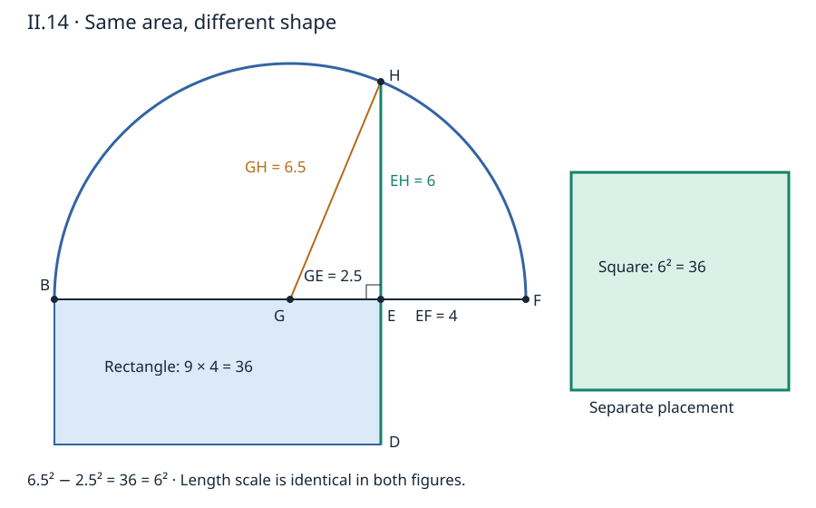

# 《几何原本》II.14：把面积变成一条可构造的边

## 约公元前300年 · 数学与推理前史补读 · 深读v1

给你一个直线围成的区域，怎样作出一个面积恰好相等的正方形？“先求面积，再开平方”是现代数值答案，却还没有交付尺规构造。II.14的办法，是先把形状问题归约为矩形，再把矩形面积写成两个平方之差，最后让一条直角边承担这份差额。**圆不是要被求积的输入，而是产生所需长度的工具。**

本篇从1936—1937图灵样稿回溯古代，属于年代跳转与AI数学推理前史补读；不称古代几何为现代AI论文，不称图灵样稿为第一篇AI论文。收录按问题、来源与可核验程度采用一致标准，不以作者或机构声望替代证据，也不声称穷尽古代或同时期数学。只完成II.14阅读单元，不把后卷和所有面积构造一并计作完成。

下文区分**原文、教学补足、后世评注、现代重构、真实实跑**。正文是原创解析，不是希腊文或现代英译的全文翻译。

## 1 书目与历史层次

| 材料 | 本次实际阅读位置 | 用途与限制 |
| --- | --- | --- |
| Euclid, *Elements*, II.14 | 作品传统年代约公元前300年 | 年代指编纂背景，不是本条可独立考定的首创日期 |
| T. L. Heath, *The Thirteen Books of Euclid's Elements*, 1908, vol. I | 印409–410，PDF430–431完整命题、图、证明和评注；卷前ERRATA在PDF16 | [扫描书目入口](https://archive.org/details/thirteenbookseu02heibgoog)；实际目视扫描，不根据空OCR补写原文 |
| Richard Fitzpatrick, *Euclid's Elements of Geometry*, revised and corrected 2008 | 印66–67，PDF同页，希英对照II.14 | [学术托管PDF](https://farside.ph.utexas.edu/Books/Euclid/Elements.pdf)；2008是修订译本年，希腊底本为Heiberg1883–1885版 |
| David E. Joyce, Clark University | [II.14正文及Guide](https://mathcs.clarku.edu/~djoyce/elements/bookII/propII14.html) | 对照构造与编排；Guide的相似三角形字母有误，见第8节，不将其当原文错误 |

Heath所查随卷勘误表没有指向印409–410或II.14的条目；结论只限这张表，不声称一切版本都没有错误。Fitzpatrick以修订版为本，本次没有发现专列II.14的附加更正。附件不公开扫描或全文翻译。

### 1.1 前驱不是装饰性的名单

[I.45](euclid-elements-i45.zh-CN.md)把给定直线形变为指定角的等积平行四边形；取直角，得到本题所需矩形。[II.5](euclid-elements-ii5.zh-CN.md)把不等分两段构成的矩形，加上偏离中点的平方，变成半段平方。[I.47](euclid-elements-i47.zh-CN.md)则把斜边平方减去一直角边平方，转换为另一直角边平方。II.14恰好把这三个接口接合起来。I.3截取等长、I.10平分线段、圆半径相等及最后I.46作正方形也各有角色。

前两条II.12、II.13将I.47用于非直角三角形的边平方比较；本条转到构造问题，不是再给一条余弦型关系。第二卷的面积恒等式在此不只说明“两个表达式相等”，还成为寻找新长度的工具。

### 1.2 历史推断必须保留署名

Heath印410转述Heiberg以Aristotle《论灵魂》II.2，413a19及《形而上学》996b21讨论“化方”与中比例的关系，并据此推测更早教材可能以比例解释这个问题。这是**Heath转述的Heiberg历史推断**；本文没有据此声称直接核读全部被引古文，也不裁定最早发现者。

Heath还比较II.14与VI.13：构造相同，证明采用的理论不同。前者可依第一、二卷的面积关系完成，后者在比例理论中表达。这能解释编排选择，但不能把现代人的证明规划直接写成欧几里得个人的心理记录。本文只建立有来源的前后关系，不补造发现时间、机构或优先权。

## 2 输入、输出与不变量

**原文任务。** 给定直线形A，作一个与它相等的正方形。“相等”在这里是面积相等，不是同形、全等、同周长或相同顶点数。A是整个区域的代号，不是下图某个点。

先以I.45作矩形BD，边界顺序为B—E—D—C。BD是对角顶点命名的区域，不是把对角线BD的长度称为面积。矩形的邻边是BE与ED。以下用R(s,t)记两正长度围成的矩形面积，Q(s)记边长s的正方形面积；这些是本文教学记号，不是原书代数符号。

要保持的面积关系是：给定区域A与矩形BD等积，矩形BD与最终EH上的正方形等积，于是前后等积。中间形状、周长甚至边长的有理性都可以改变，面积不能改变。

### 2.1 一般直线形范围怎样继承

II.14不再给每种多边形另作分割，而调用I.45。I.45原展示用四边形，向多边形的扩展要有合法内部剖分及有限拼接；并不能默认为已经处理自交边界、带洞区域、曲线边界或零面积输入。本篇复现**从已获得的正边长矩形开始**，没有实现任意多边形到矩形的尺规算法。把一个面积数送进程序，不等于已经提供前面的几何归约证明。

### 2.2 为什么先分等边与不等边

若BE=ED，矩形已有四个直角且邻边相等，正是所求正方形，原文直接结束。若两边不等，则可重新安排矩形方向，取BE较长。令a=BE、b=ED，原文非平凡分支满足a>b>0。

这不是可有可无的程序优化。若仍机械构造中点，等边时G与E重合，所谓三角形GHE退化，不能按原不等边证明调用I.47。最终代数式在a=b时仍成立，不意味着同一几何定理调用仍合法。

## 3 构造：圆如何把差额变成长度

图的具体尺寸和标注属于原创教学，证明的对象关系取自原文。非平凡分支按以下顺序进行。

1. 沿BE超过E延长到F，截取EF=ED=b，因此BF=a+b。
2. 以I.10求BF中点G；半径GB=GF=(a+b)/2。
3. 以G为圆心、GB为半径画位于矩形另一侧的半圆BHF。
4. 将DE通过E向上延长，交半圆于H，连接GH。
5. 在EH上作正方形。原文结尾说可在EH上描述的正方形；把I.46明确写出，是对最终交付动作的教学补足。

为什么让EF复制短边，而不是随意取长？这样BE与EF所围矩形的面积正好就是原矩形BD。为什么平分的是BF而非BE？II.5需要同一整段的中点和另一内分点：G负责等分，E负责不等分，二者都属于BF。错平分BE，会破坏这个接口。

### 3.1 点序与交点资格

a>b>0给B—G—E—F，且GE=(a−b)/2，GF=(a+b)/2。因此0<GE<GF，E严格在直径内部。DE垂直BE，BE与EG共线，故HE垂直EG，三角形GHE在E为直角且非退化。

**现代补足。** 在以G为原点、BF为横轴的坐标中，过E的垂线与圆相交要求纵坐标平方为GF²−GE²。此量等于ab>0，因而有一上一下两个实交点，上半圆指定正的一个H。原文本身直接延长到半圆，未单列现代连续性或实数完备性公理证明；坐标解释可澄清存在性，不能冒称原书已经写出这些基础。

## 4 原证明逐步重建

### 4.1 先只看直径，不看斜边

BF被G平分，被E不等分。II.5给R(BE,EF)+Q(EG)=Q(GF)。注意R的两边是BE与EF，不是整段BF与短段EF；平方补项是中点到分点EG，不是两分段差BE−EF。后者是EG的两倍，平方以后会差四倍。

### 4.2 用半径把平方接到三角形

GF与GH都是同一圆的半径，故Q(GF)=Q(GH)。这一步把线段分割产生的平方搬到直角三角形的斜边上。没有半径相等，这两个看似类似的平方没有理由替换。

### 4.3 再用I.47，把同一补项显露出来

GHE在E为直角，I.47给Q(HE)+Q(EG)=Q(GH)。上一式左边含矩形面积加Q(EG)，此式左边含目标平方加**同一个**Q(EG)。于是有：

$$
\begin{aligned}
R(BE,EF)+Q(EG)&=Q(GF)=Q(GH),\\
Q(HE)+Q(EG)&=Q(GH),\\
R(BE,EF)+Q(EG)&=Q(HE)+Q(EG),\\
R(BE,EF)&=Q(HE).
\end{aligned}
$$

最后一步是共同概念的等量消去。不是把整个图裁成两块后凭视觉说相等，也不是在任意三角形上用勾股定理；每一个平方的对象身份都不可更换。

### 4.4 把输出接回输入

EF=ED，所以R(BE,EF)=R(BE,ED)=面积BD。I.45已保证面积BD=面积A，故Q(EH)=面积A。I.46保证可以在EH上作出正方形，才完成“构造一个对象”的任务，而不只计算了一个数。

这条证明不需要先证明三角形BHF为直角，也不需要调用圆周角定理或相似三角形。真正用到I.47的是GHE，而其直角来自矩形边的延长。用后卷定理当然能另证，但会改变本书此处的依赖顺序。

## 5 用现代式子看见设计原理

**现代重构。** 令r=(a+b)/2、d=(a−b)/2、h=EH。则a=r+d、b=r−d。II.5与I.47在这个坐标模型里接成：

$$
\begin{aligned}
r^2-d^2
&=\left(\frac{a+b}{2}\right)^2-\left(\frac{a-b}{2}\right)^2\\
&=ab,\\
h^2+d^2&=r^2,\\
h^2&=ab,\qquad h=\sqrt{ab}\gt0.
\end{aligned}
$$

平方展开可以迅速验证结果，但不能替代第3节的几何构造，也不能倒过来说欧几里得先用了现代代数。设计的关键是制造r与d，使它们的和、差分别恢复矩形两边，然后安排一个直角三角形让h平方成为r平方减d平方。

### 5.1 输出可能无理，仍然可构造

a=2、b=1时，h²=2，h不是有理数，但由半圆与垂线交点可构造。以有理数表示输入，不意味着输出长度必须有有限小数或分数表示。程序若只保存h²=2，那是保存了平方证书，不是已经把h表示成某个精确Fraction。附带的有理区间只包住正根；区间两端不是精确根的替身。

### 5.2 一般性与唯一性不要混淆

任意正a、b都有正h满足h²=ab。若另一个正k也满足，则h²−k²=(h−k)(h+k)=0，而h+k>0，故h=k。这说明输出的正边长唯一，并不说明输出正方形在平面中的位置、方向唯一，也不说明只有这一种构造法。面积相同与构造相同是不同性质。

### 5.3 为什么短边与长边可以交换

Heath印410转述Simson指出，取BE较长并非构造有效性的必要条件。若不交换而a<b，则图序改为B—E—G—F，GE应取绝对距离；II.5可用对称位置，结果不变。本文程序将边排序后进入非平凡分支，以固定B—G—E—F，避免混用带符号坐标与正长度。

相等时则必须保留原文的直接分支。把“较长条件可省”说成“不必管任何分支”，会错误地把退化三角形带回证明。

## 6 算例与反例：不仅验最后一个数

以下为教学手算，哪些输入已真实执行以复现日志为准。

| 矩形邻边a、b | r | d | h² | 正方形边长 | 证明分支 |
| --- | ---: | ---: | ---: | --- | --- |
| 9、4 | 13/2 | 5/2 | 36 | 6 | 半圆，GHE为5–12–13比例直角三角形 |
| 2、1 | 3/2 | 1/2 | 2 | √2 | 半圆，无理边长 |
| 3、3 | 3 | 0 | 9 | 3 | 已有正方形；不调用退化GHE上的I.47 |
| 9/4、1 | 13/8 | 5/8 | 9/4 | 3/2 | 半圆，有理比例 |
| 4、9 | 排序后13/2 | 排序后5/2 | 36 | 6 | 先交换矩形方向，与第一行同面积 |

### 6.1 把9×4例展开到每个中间量

BF=13，中点G距B为13/2，E距B为9，所以GE=5/2。II.5是36+25/4=169/4；GH=GF=13/2；I.47给HE²+25/4=169/4；消去得HE²=36，所以HE=6。在6上作方形，面积36，与9×4矩形相等。它们周长分别24与26，不相等，这正说明“等积”不保周长。

### 6.2 常见错误各自失败在哪里

- **把半径r直接当输出边。** 9×4时得到边13/2，面积169/4，比36多25/4；漏掉的正是EG平方。只有等边情形d=0时偶然正确。
- **把两边差a−b当GE。** 会算169/4−25=69/4而非36；中点偏移只是差的一半。
- **把直径BF当半径。** 会得到13²−(5/2)²=651/4；圆心到端点只有半段长，不是整段。
- **把长度与面积相减。** 写r²−d不仅量纲不同；9×4时数值也成159/4而非36。
- **先舍入根，再声称精确等积。** 2×1取边1.414得到平方1.999396，不是2。这个误差可以很小，但不能把近似相等改称原命题的精确相等。

### 6.3 零、负数与数值消去

a=0会把E推到直径端点，h=0，输出不是非退化正方形；负边长不是本题的线段。它们可以参与某些形式代数恒等式，却不属于本题输入。布尔值在Python中是整数子类，也不该作为“长度1”悄悄接收。

极端比例a=10¹⁸、b=10⁻¹⁸时，面积和h²仍为1，而r²与d²都是约10³⁵的大数，有限精度直接作差可能严重消去。精确分数运算避免算术舍入，并不证明实测边长没有误差。若输入来自测量，应另建区间模型；本篇没有用精确算术替测量作保证。

## 7 几何平均与固定周长：明确标为推论

由r²=h²+d²且d²≥0，得h≤r，等号仅在a=b。以现代名称表达，就是正数几何平均不超过算术平均。原证明提供了这个关系的几何结构，但本节命名和优化解读是现代教学，不把它当II.14正文原题。

如果a+b=s固定，则ab=s²/4−(a−b)²/4，矩形面积最多s²/4，且仅正方形达到。固定周长矩形中正方形最大，与“任一矩形都有等积正方形”是相关却不同的陈述：前者固定周长比较面积，后者固定面积改变形状。不能因为两者都出现平方，就把优化问题的约束偷换掉。

反向看来，固定面积K>0时，a+b≥2√K。9×4与6×6例恰好展示等积而周长缩短；这不意味着本篇构造覆盖所有平面图形的等周问题。

## 8 相似三角形替代证法，以及网页不能照抄之处

**后见教学重构。** 在半圆构形中另连BH、FH。用后卷的半圆角为直角及相似三角形理论，三角形BHF、BHE、FHE互相相似，适当配对可得BE/EH=EH/EF，从而EH²=BE·EF。这是另一条有效路线，但它引入本书此处尚未展开的圆角与比例理论，不是第4节的原证明。

Joyce Guide在这段写新增BH与BF，并将第三个相似三角形列作HGE。BF本来就是直径；一般应新增BH与FH，并将第三个三角形改为FHE。对此不能只凭排字直觉修正：9×4例中GHE的两直角边为5/2、6，比例5:12；BHE的两直角边为9、6，比例3:2，它们并不相似。BHE与FHE的对应直角边比则是9/6=6/4=3/2。

这是一处本次交叉核查发现的网页Guide问题，不能记成古希腊原文或Heath证明的勘误。修正后的相似路线也不是本篇复现声称完成了整个第五、六卷的理由。

## 9 对证明规划与AI的有限启发

**本文分析。** II.14展示了目标分解：先把任意形状归约为标准矩形，再为面积寻找一条长度见证。子程序必须交付正确对象和条件：I.45交等积矩形，II.5要同一整段的中点和内分点，I.47要非退化直角三角形，I.46要正线段。若一个系统只检查最后h²=ab，就可能漏过错半径、错图序或退化调用。

等边分支是尤其好的规格测试：代数统一式仍正确，但证明步骤必须切换。工具应分别报告“数值恒等式通过”和“这次几何定理调用合法”，不能把其中一个替代另一个。

这一联系只说明古代构造适合用来教学模块化证明、前提管理和证书检查；不证明欧几里得直接导致现代AI，不评价任何模型智能，也不声称本代码是自动发现辅助线的系统。正文的一般证明、现代坐标模型、有限执行证据有不同责任。

## 10 最小复现：实现范围与真实执行

[复现目录](../../reproduction/euclid-elements-ii14/README.md)保存原创源码、环境、命令、测试、Notebook及真实日志。程序从正整数或Fraction邻边开始，精确构造r、d和h²；等边直接返回已有正方形，不把G=E当有效直角三角形。不等边按长短排序，检查II.5、半径和I.47对应的平方等式，并给正根的有理包围区间。

它不输出一个假装精确的无理Fraction，不接收任意实数或浮点测量数据，不实现I.45的任意多边形归约，也不是尺规动作的公理级证明助理。一般性来自第2–5节的带条件证明；实跑只支持已声明实现的回归核验。

本次CPython 3.12.14、仅标准库实际运行23项unittest，在normal、-O、-OO三模式全部通过，其中一项遍历400组精确矩形。400组不是400个额外单测方法，三种优化模式也不是三份独立数学证明。覆盖等边、交换、正有理边、无理输出、极端比例10¹²⁰与10⁻¹²⁰、极小面积、接近等边、尺度变换、非法类型与非正输入。生产校验使用显式异常，不依赖可被优化删除的assert。

八个命名算例的实跑平方依次为36、2、9、1、36、1/100000、1000000000000000000000000000001/1000000000000000000000000000000、1。根区间另以16次二分得到11585/8192≤√2≤46341/32768，宽度1/32768；两端的平方可直接作有理数比较。根算法保证包围和绝对宽度，不保证固定相对精度，也不保证每个有理根有限步恰好命中。初始上端已是根时须直接返回；开发中这一端点缺口由测试发现，修正后全部重跑通过。

独立技术核验使用展开式而不调用生产内部恒等式作为oracle，另核1600组有理矩形、20个尺度案例、18个边界、6个手算例、40组根区间及35个非法输入，三模式通过。即使这些核验都正确，程序中的II5、I47字段仍只是已选现代坐标模型里的平方等式；部分关系由量的定义直接成立，不是古代定理已被公理级形式认证。

Notebook五个代码单元已按序实际以标准库compile/exec执行，并独立只读回放与保存输出逐字比较；**没有启动Jupyter kernel**，不声称验证内核集成、Notebook前端或浏览器排版。已阅读安装技能；本地脚手架helper不可用，采用自有标准结构生成器，没有安装新包。原创SVG用同一比例尺展示9×4矩形与边6正方形，渲染核验另存审计。没有训练数据、学习基线或统计性能结论；本题验收项是域检查、精确等式、区间不变量与真实退出码。

## 11 主张与证据位置

| 主张 | 证据位置 | 边界 |
| --- | --- | --- |
| 给定直线形先转等积矩形 | Heath409；Fitz66，调用I.45 | 本篇程序没有实现一般预处理 |
| 等边直接完成，不等边才作半圆 | Heath409；Fitz66 | 不在退化GHE上用I.47 |
| EF复制ED、BF中点G、延DE交H | 两版原图与构造段 | 图序B—G—E—F依BE较长 |
| II.5、半径相等、I.47、消去 | Heath409–410；Fitz66–67 | 原证明，不依相似三角形 |
| 最后在EH上作正方形 | 两版结尾；I.46 | 显式点名I.46为教学补足 |
| 较长条件可去及更早比例路线 | Heath410评注 | Simson意见及Heiberg推断，不冒称首创史定论 |
| 正根、坐标交点、算术几何平均、反例 | 本文3、5–8 | 现代教学与分析，不反投射原文 |
| Joyce Guide字母问题 | 所引网页Guide；9×4独立反例 | 网页解释错误，不是原命题错误 |
| 有限测试、区间、Notebook | 复现日志与独立技术审查 | 不替代一般证明、测量精度或完整形式认证 |

## 12 带答案练习

**1. 为什么I.45还不够？** 答：它交付等积平行四边形，取直角得矩形，但邻边未必等长。II.14还需把两邻边乘积变成一个正边长的平方。

**2. BD代表哪一个对象？** 答：原文在这里用它简称边界B—E—D—C的矩形，不是对角线长度；面积为BE与ED所围矩形面积。

**3. II.5中的整段、中点、非中点各是谁？** 答：BF、G、E。矩形两段为BE与EF；补平方为EG，整段半长为GF。

**4. a=16、b=9时求所有关键长度。** 答：BF=25，r=25/2，d=7/2，h²=625/4−49/4=144，h=12。若误把两边差7当d，会得到429/4，不能等于144。

**5. a=b=5时为什么不继续对GHE用I.47？** 答：G=E使三角形退化。矩形原已是边5的正方形，直接完成；h²=25只是统一代数值，不补救非法定理调用。

**6. a=1/2、b=8时结果如何？** 答：排序为8、1/2，r=17/4、d=15/4，h²=(289−225)/16=4，h=2。交换输入不改变面积，但须一致安排字母和图序。

**7. 输入为有理数，输出一定有理吗？** 答：否，2与1给√2。程序可保存精确平方2及有理包围区间；把某个区间端点称精确边长是错误的。

**8. 等积正方形是否保持周长？** 答：不保持。9×4矩形周长26，边6正方形周长24。固定面积与固定周长问题不能混淆。

**9. 为何原证明不需先证明角BHF直？** 答：I.47作用于GHE，其直角来自ED垂直BE。BHF直角用于相似三角形替代路线，非原证明必需前提。

**10. 如果直接输入多边形面积K并返回√K，是否复现全部原构造？** 答：没有。还缺合法剖分、I.45等积矩形及各尺规操作的证明。正确报告是数值或矩形阶段的教学模型。

**11. 怎样用一个例子发现网页第三个相似三角形有误？** 答：9×4时GHE的直角边比5:12，而BHE为3:2，两者不相似；正确配对的FHE直角边比6:4=3:2。

**12. 有限精确测试能证明所有正实边长吗？** 答：不能。测试可发现实现与规格不一致；一般结论要由构造资格、II.5、I.47和等量消去推导。正根区间反映近似表示，也不是穷尽实数输入。

## 13 复盘

先检查输入区域与I.45的归约范围；区分等边直接完成和不等边构造；使EF复制短边，以BF中点G建立II.5；由同圆半径把平方接到GHE；I.47显露共同EG平方，消去后回接原面积；最后在EH上作正方形。每一步都要知道自己操作的是长度、面积、区域还是构造见证。

本篇为AI辅助原创教学解析，不是全文翻译、人类专家认证或整部《原本》的形式化。[独立来源审查](../../reproduction/euclid-elements-ii14/source-review.zh-CN.md)与[独立技术审查](../../reproduction/euclid-elements-ii14/technical-review.zh-CN.md)绑定最终正文SHA256；既有暂缓不因本单元完成而改变。
