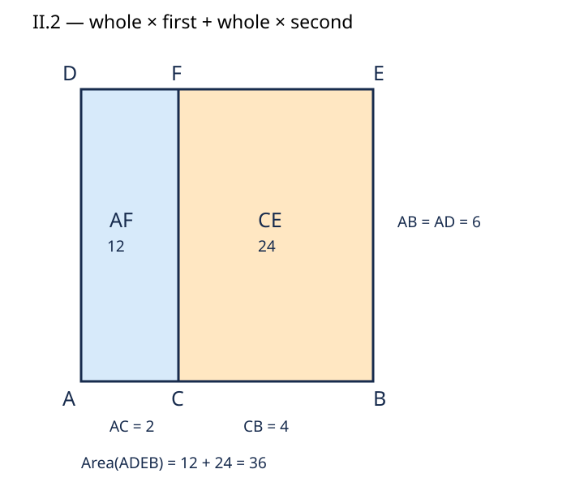

# 《几何原本》II.2：切开正方形以后，两块矩形究竟由哪两条边围成？

## 约公元前300年 · 数学与推理前史补读 · 深读v1

**把正方形切成两块，整块当然等于两块之和——为什么还值得单列一条命题？** 关键不止是“分开再加回来”。欧几里得把两块逐一识别为“整体线段与一段所围成的矩形”，让图形分割成为以后能够引用的、带有明确对象名称的结论。证明短，不等于输入条件、命名关系和推理方向可以省略。

本篇只精读第二卷命题2及必要定义、相邻评注。它承接[II.1](euclid-elements-ii1.zh-CN.md)，是从图灵1936—1937年样稿回到古代证明传统的**前史补读**，不是把古代书籍章节冒充现代AI论文，也不宣称任何一篇是“第一篇AI论文”。目录按作品大致年代排列；同卷命题的顺序不是可独立确定的发表时间。收录是有来源、有边界的教学选择，不声称穷尽早期传统。

下文严格区分：**原文**（可定位的命题步骤）、**教学重构**（补足隐含条件及现代记号）、**分析延伸**（现代验证类比）、**真实实跑**（附件实际运行）。本文不是全文翻译，不把手算或一般论证伪装成计算结果。

## 1 书目、版本与为什么要读这一小节

| 文献层 | 本次阅读位置 | 用途与限制 |
| --- | --- | --- |
| Euclid, *Elements*, Book II, Proposition 2 | 作品传统年代约公元前300年 | 年代是作品背景估计，不是II.2已知首创年份；不是作者手稿 |
| T. L. Heath, *The Thirteen Books of Euclid's Elements*, 1908, vol. I | 印页376完整II.2；印页377–378相邻评论；卷首ERRATA | 原证、字母图及解释分开；[扫描入口](https://archive.org/details/thirteenbookseu02heibgoog) |
| Richard Fitzpatrick, *Euclid's Elements of Geometry*, revised and corrected 2008 | 印页51完整II.2、印页52顶部脚注；印页50定义1 | 希腊文与现代英译对读，括号补词和现代代数脚注不是古代符号；[双语PDF](https://farside.ph.utexas.edu/Books/Euclid/Elements.pdf) |
| David E. Joyce, Clark University | [II.2正文与Guide](https://mathcs.clarku.edu/~djoyce/elements/bookII/propII2.html)、[定义1](https://mathcs.clarku.edu/~djoyce/elements/bookII/defII.html) | 在线点名核对；Guide是现代评论 |

勘误检查限于所用Heath卷首ERRATA及本次对读；其中没有印页376–378的项目。没有据此声称所有传本都无误，或已经完成希腊文抄本校勘。阅读完整短命题后还须读评论：不能把上一条命题的后注当作II.2原文，也不能把下一条的陈述算作本篇已完成。

**历史问题。** 第一卷提供平行线、平行四边形与作正方形的技术；第二卷定义1允许按相邻两边指称直角平行四边形。II.1处理一个共同高与任意有限分段，II.2把共同高指定为被分割的整条线段，整块遂成为正方形。其问题不是测量某张图的面积，而是对任意合法切点给出可重复使用的面积关系。

**前人关系的证据边界。** Fitzpatrick导言把《原本》描述为整理此前希腊数学成果的作品，并提及Pythagoras传统、Hippocrates、Theaetetus、Eudoxus等。这不能据以把II.2单独归给其中某人。本篇可直接核实的是书内构造依赖：I.46作正方形、I.31作平行线，以及定义1的矩形命名；不编造某位前驱的优先权、当时学校的贡献排名或古代机构隶属。

**为何与II.1重复？两种评论不要混成事实。** Joyce指出它是II.1的特例，并据直接另证提出II.1可能后来插入的猜测。Heath在相邻评论强调把特殊形式单列，便于后续引用，也便于看清几何构造。两者是不同的解释思路；“可由前条推出”不能单独证明文本插入年代。我们无需裁决编纂史，便能验证当前传本的证明是否成立。

Heath还联系I.47中的正方形分割：分割事实本身并非这里才出现，II.2进一步把每块明确认作由整体及对应分段围成的矩形。这里的思想动机是本文依据证明组织作出的解释，不声称读到了古代作者私人写作意图。

## 2 把一句话改写成可检查的输入与目标

**原文结构。** 给定线段AB，在内部任意取C。把AB作为一个整体，分别与AC、CB组成矩形；两矩形之和等于AB上的正方形。“任意”不表示概率抽样，不要求二等分。全文只有一个内切点，不能把“each segment”扩成任意多段却仍声称是原命题逐字范围。

**教学记号。** 记R(u,v)为相邻边长u、v所指定的矩形面积量；Q(u)为边长u的正方形面积量。这里先不把R定义成数字乘法。AB与BA表示同一非负长度，不因书写方向相反而互为负数。目标写成：

$$
R(AB,AC)+R(AB,CB)=Q(AB).
$$

这是现代摘要式，而非原文代数公式。长度量不能与面积量相加，矩形名称也不能自动读成对角线长度。

原命题的非退化解释要求A、C、B共线且依次排列，AB正长。C取端点时某块退化为零宽，现代面积理论可扩展解释，但不再是两个正长矩形的原构造。C在线段外时必须另改用有向长度或面积差，不能仍按正长度相加。

## 3 字母地图：AE、AF和CE都是区域简称

在AB上作正方形ADEB；沿边界依次A、D、E、B。过C画CF平行AD（亦平行BE），F落在DE内部。原图把AB画在上方，本文原创图将上下翻转，AB在下方、DE在上方；字母对应及区域边界不变，纸面方向不是数学条件。

| 简称 | 完整边界顶点 | 用来辨认的两条相邻边 | 所代表的面积量 |
| --- | --- | --- | --- |
| AE | A、D、E、B | AD与AB，且AD=AB | Q(AB) |
| AF | A、D、F、C | DA与AC，且DA=AB=BA | R(BA,AC) |
| CE | C、F、E、B | BE与BC，且BE=AB | R(AB,BC) |

AE、AF、CE使用一对对角顶点命名整个四边形，**不是说三条对角线满足加法关系**。F不在AB上，C不在DE上；把F错置到另一条边会改变分割证书。

图中AB=6、AC=2、CB=4，面积36=12+24；数值仅为教学例，比例不承担一般证明。下文先说明所有合法构造为何成立，再用有理数实例检查实现。

## 4 不借乘法分配律，逐步重建原证明

### 4.1 建立能被切开的整体

**原文：** 用I.46在AB上作正方形ADEB。因此它不仅有四条等边，也有直角。若只画等边菱形，下一步虽可分成平行四边形，却不能按定义1将子块叫作矩形。作正方形的全部第一卷证明不是在本篇重新从公设开始复刻；这里明确调用已经建立的构造。

### 4.2 将一个切点搬到对边

**原文：** 由I.31过C作CF平行AD或BE。

**教学补足：** 正方形中AD与BE平行，AB与DE平行。C位于AB内部，沿侧边方向的切线在对边内部交于F；两块的横边仍在互相平行的AB、DE上。平行线角关系保证它们都是直角平行四边形。原文显式引用I.46、I.31；这里说到平行线角关系是补足隐含结构，不假装原页另写了所有依赖编号。

### 4.3 先有无遗漏、无重复的区域分解

**原文：** 整个AE等于AF与CE之和。

**教学解释：** 两块共享边CF，内部互不相交，且合起来恰是整正方形。共享边没有二维面积，所以没有重复计入一个面积块。这里只需要有限图形分割的面积可加性，不需要无限积分、概率或现代集合测度体系。原文把此步写得简短，但它不是“两个算出来的数碰巧一样”。

### 4.4 逐块替换为命题要求的名称

- 整块AE确是AB上的正方形，这是第一步的产物。
- 左块AF由DA与AC围成。正方形给DA=AB，而AB与BA是同一长度，所以它就是整体BA与分段AC围成的矩形。
- 右块CE由BE与BC围成。正方形给BE=AB，所以它就是整体AB与分段BC围成的矩形。

注意真正用来识别左块的高是DA，右块的是BE。CF当然也具有同样长度，但原证不必先多证明一个CF=AB再绕回来。借已有边辨认图形，减少了不必要的证明负担。

### 4.5 结论来自代换，不是先偷用目标恒等式

把第三步中的三个区域名称，替换为第四步已证明的面积量，即得到第2节目标。逻辑链为：**构造正方形 → 合法内部平行切线 → 两块完整覆盖 → 识别每块相邻边 → 面积等式**。现代数值公式是这条链的后续表示，不是原证的起点。

## 5 如何严格解释“切线确实在内部”

这一节是**现代教学重构**，不是古代坐标文本。设A为原点或任意平移基点，u为AB向量，v为AD向量。正方形条件是u、v非零、垂直且等长。给定0<t<1，令C=A+t·u、F=A+t·u+v、D=A+v、E=A+u+v、B=A+u。

因u、v线性独立，任一点A+s·u+r·v的参数s、r唯一。整块对应0≤s≤1、0≤r≤1；左块对应0≤s≤t，右块对应t≤s≤1。两区间并集正好是[0,1]，交集只有t，因此两个内部不交、共享边恰为CF。这说明分割合法性，并不依赖读图“看上去没缝”。

由点的定义，CF向量就是v，DF向量是t·u，FE向量是(1−t)·u；于是平行关系及F在DE内部均有明确证据。如果t=0或1，严格内部性消失；如果t>1，右块不再是原正方形内的子块；如果u与v共线，参数表示不唯一且整体退化。程序应拒绝这些情况，而不是只检查末端面积总和。

## 6 与II.1和现代代数的精确对应

II.1允许独立的共同高h，并把整底边拆为x、y。II.2是其中h=x+y的两段特例。原书却另作正方形证明，所以“数学上可由II.1立即推出”与“原文实际调用II.1”必须分开；本原证没有显式调用II.1。

选择长度单位，令AB=L、AC=x、CB=L−x。只有此时，把矩形面积数值表示为两边度量的积，得到：

$$
L \cdot x+L \cdot (L-x)=L^2,\qquad L\gt0,\quad 0\lt x\lt L.
$$

这是本篇的现代标量模型。Joyce Guide列出的更一般分配律，若要成为本题的**正方形**形式，还必须让共同乘数等于两分段之和；少了这一限制，整块只是矩形，不一定是正方形。Fitzpatrick印页52顶部脚注明确说：若a=b+c，则ab+ac=a²。这同样属于译者解释，不是欧几里得使用字母多项式的证据，也不能不加条件地改写成双向等价。

在现代算术内当然可提出L·x+L·(L−x)=L·[x+(L−x)]=L²。但这只能叫**现代代数重构**。如果声称用它证明古代分割论证，便把解释所需的分配律当前提，模糊了证明方向。

同理，有理数代码、行列式、鞋带公式都建立在现代算术上。它们能检查点名、构造、覆盖与计算是否一致，不能成为乘法分配律的无循环基础证明。古代几何论证也没有要求各段有共同整数量尺；附件只处理有理数坐标，并不穷尽不可通约的长度。

## 7 手算与反例：总面积相同不是全部验收条件

### 7.1 不等分的整数例

取AB=5、AC=2、CB=3。左矩形的边是5和2，面积10；右矩形边是5和3，面积15；整正方形面积25。等式25=10+15成立。这里**不是**“把边2与边3的两个正方形拼成边5的正方形”：那两块面积分别4、9，总13，不是25。把“整体与分段”读成“分段与自身”正是易错点。

### 7.2 分数例不需等分

取AB=3/2、AC=1/2、CB=1。两块面积3/4和3/2，总9/4，等于边3/2的正方形。没有整格网也可解释分割；数字仅为选定单位后的表述。

### 7.3 旋转后仍然成立

取A=(1,−2)、u=(3,4)、v=(−4,3)、t=2/5。u与v内积0、长度都为5，故整体确为正方形。B=(4,2)、D=(−3,1)、E=(0,5)、C=(11/5,−2/5)、F=(−9/5,13/5)。AC长2、CB长3，两块面积10和15。负坐标不是负长度；旋转和平移也不改变正方形资格。

### 7.4 条件删去后会怎样

1. **外切点误当内切点。** 令A=0、B=5、C=7。按普通正长度，AC=7、CB=2，两个“整体乘分段”面积35+10=45，不是25。写成5·7+5·(−2)=25只是改用了有向量的代数延伸。
2. **任意矩形误当正方形。** 底5、高4，按宽2、3分割，面积8+12=20。分割完全正确，但目标若仍是边5的正方形就应为25。缺少的条件是共同高等于整体底边。
3. **等边菱形误当正方形。** u=(5,0)、v=(3,4)均长5，但不垂直；面积为20而非25。两条带面积仍相加为20，说明面积和检查可能通过却不能证明直角条件。
4. **对角线读法。** 边5、切为2与3时，整块对角线长5√2；两块对角线长√29、√34，其和不等于5√2。AE=AF+CE只能按区域面积理解。
5. **总和掩盖坏证书。** 两个各占整块一半面积的区域即使总面积对，也可能位置重叠并留下等面积缺口。必须核对顶点及共享边，不只比较一个标量。

这些例子没有反驳II.2，而是明确哪些误读或扩展已改变命题。

## 8 主张—证据账本

| 主张 | 来源位置 | 证据层与边界 |
| --- | --- | --- |
| 以AB整体分别与两分段成矩形 | Heath印376陈述及目标；Fitz51 | 原文；不是分段平方之和 |
| 正方形ADEB、过C作CF平行AD或BE | 同页构造段，标I.46/I.31 | 原文；点名对齐 |
| AE由AF和CE组成 | 同页证明第一句与图 | 原文简述，内部不交与覆盖由教学补足 |
| AF用DA=AB，CE用BE=AB辨认 | 同页逐块说明 | 原文，不多造CF前置引理 |
| 特例单列的教学与引用理由 | Heath印377–378相邻评论 | 评论者解释，不是古代作者自述 |
| II.1可能插入的想法 | Joyce Guide | 现代猜测，未当作确定文本史 |
| 现代代数脚注及式子的专门化 | Fitz印52顶部脚注、Joyce Guide | 译者/导读层，与原几何证明区分 |
| 参数矩形的唯一表示与覆盖 | 本文第5节 | 现代证明重构；不冒充原文字句 |
| 精确有限案例与拒绝测试 | 附件源码及真实日志 | 实现一致性证据，不是一般定理证明 |

## 9 最小复现：从候选图到可核验的证书

[复现附件](../../reproduction/euclid-elements-ii2/README.md)以Python标准库Fraction处理精确有理数。输入包括基点、底边与侧边向量和切点参数；验证应检查正长、等边、垂直、严格内部点序、每个顶点、共享边和独立多边形面积。构造器生成候选证书，检查器应能拒绝错点、错分区及不合格整体，而不是无条件相信生成器。

本篇没有训练集、学习基线或准确率排行榜；它是理论教学的低成本复现。指标分开记录为：合法实例数、非法输入拒绝数、单元测试数、Notebook代码格数与命令退出码，不把它们加成“证明数量”。测试还应在优化模式运行，确保关键合同不用会被`-O`删掉的assert。

本次真实执行29项unittest，在普通、`-O`、`-OO`三模式全部通过；其中一项网格测试含64个有效构形。另运行4个算例，七条主运行命令退出码均为0。独立技术审查另行检查90个合法构形和819个篡改或非法证书，三模式均通过。Notebook五个代码格实际经`compile/exec`顺序执行并在新命名空间回放一致；execution_count保留null，未启动Jupyter kernel。初审发现points容器伪装会抛异常，已增加显式类型检查与回归测试后重跑；不把初次结果当作修复后的证据。整数图读数36=12+24，斜置/反射例25=10+15，分数尺度例1/4=1/12+1/6，均以附件真实输出为准，不与第7节的独立手算例混同。它不重建全部古代尺规过程、全书公理基础或形式证明助理认证；它只能检查声明模型内的有限实例。

## 10 局限、合理延伸和现代推理联系

**没有证明的事。** II.2不把任意四边形分成矩形，不建立无限面积可加性，不讨论负长度，不证明任意图像识别器都能找到切点。古代短证明依赖已有几何背景；本文显式写出输入合同，不等于完成从公设到现代实数面积理论的全部基础化。

**两个合理延伸。** 第一，把C趋近端点，可在另行给定零面积约定的现代模型中取得退化边界；不能因此说原文已经给出零宽矩形构造。第二，在正方形两方向继续作有限分割可得到网格，但需要新的分割步骤；本轮不借此启动下一条命题，也不把整个第二卷计为完成。Joyce提及后书XIII.10使用本命题，本文将其作为检索线索，不声称已独立核验XIII.10全证。

**分析延伸。** 现代AI可能给出正确的末端等式，却把矩形边指错，或把菱形误认成正方形。因此评估不应只看最后的25=25；还应核对对象类型、条件、依赖和区域对应。让生成者交付结构化证书、让独立检查者查验，是本篇提出的教学类比，不是欧几里得预测现代AI的史实。

## 11 复盘与带答案练习

复盘时按五个问题走：整体真是正方形吗？C真在内部吗？CF真是那条平行切线吗？AF、CE各由哪两条边围成？把面积量转成数字时新增了什么约定？这五问比只背L²=Lx+L(L−x)更接近读懂原证。

1. **“随机切开”是否必须二等分或使用随机数？** 答：都不是；任意合法内点即可。
2. **原文中BA与AB会相消成0吗？** 答：不会；都是同一正长度，而非有向向量。
3. **AF四个边界顶点是什么？** 答：A、D、F、C；AF是对角顶点简称，不是待相加的线段。
4. **为什么AF对应整体与AC？** 答：相邻边DA、AC围成直角，且正方形给DA=AB=BA。
5. **CE为什么不用CF来证明共同高？** 答：可直接用其边BE=AB；CF等长虽成立，却非原证必需的额外步骤。
6. **I.46和I.31各提供什么？** 答：前者作出正方形，后者过给定点作平行线。只有等边而没有直角不足以替代前者。
7. **从II.1推出II.2要补什么限制？** 答：只有两段，且共同高等于两段之和，即等于整底边；不能仅写一般分配律便结束对应。
8. **整体长7、两段长3和4，两个面积与总面积是多少？** 答：21、28，总49；不是9+16。
9. **分数例的单位如何变化？** 答：在同一计量单位下，把所有几何长度放大k倍，面积放大k²倍；若几何对象不变而仅更换单位，长度数值与面积数值须作对应换算，不能混用厘米与米的裸数。
10. **复算旋转例C与F。** 答：C=(1,−2)+(2/5)(3,4)=(11/5,−2/5)；再加(−4,3)得F=(−9/5,13/5)。
11. **为何区域参数表示唯一？** 答：若两组参数给同一点，差满足(s−s′)u+(r−r′)v=0；u、v非零垂直因而线性独立，两个系数都为0。
12. **t=6/5时为什么不能仍叫内部切割？** 答：C在B外，F也在相应对边延长线上；普通非负面积的两块不能照原方式覆盖整体。
13. **相加面积与整体相同足以验证图吗？** 答：不足；还要检查正方形资格、子块顶点、无重叠与完整覆盖。
14. **很多有理数测试都通过，是否证明不可通约长度的命题？** 答：不能；一般性来自几何证明，有限计算只核验所选实例与实现。
15. **现代代数一行证明是否没价值？** 答：有价值，它能压缩关系与辅助计算；错误在于不标明转换条件，或把它冒充原文的论证方向。
16. **两位评论者提出不同历史解释，该如何处理？** 答：分别归属、保留不确定性，不能从证明依赖关系直接断定插入者与年代。

## 附件与独立审查

- [源码、环境、真实命令日志、结果与Notebook](../../reproduction/euclid-elements-ii2/README.md)
- [独立来源审查](../../reproduction/euclid-elements-ii2/source-review.zh-CN.md)
- [独立技术审查](../../reproduction/euclid-elements-ii2/technical-review.zh-CN.md)

仅公开原创中文解析、自有教学代码、原创图及经核对的运行证据，不公开原版PDF、全文翻译、私人对话或账户信息。AI辅助制作与独立代理审查不等于已获人类专家或证明助理认证。
