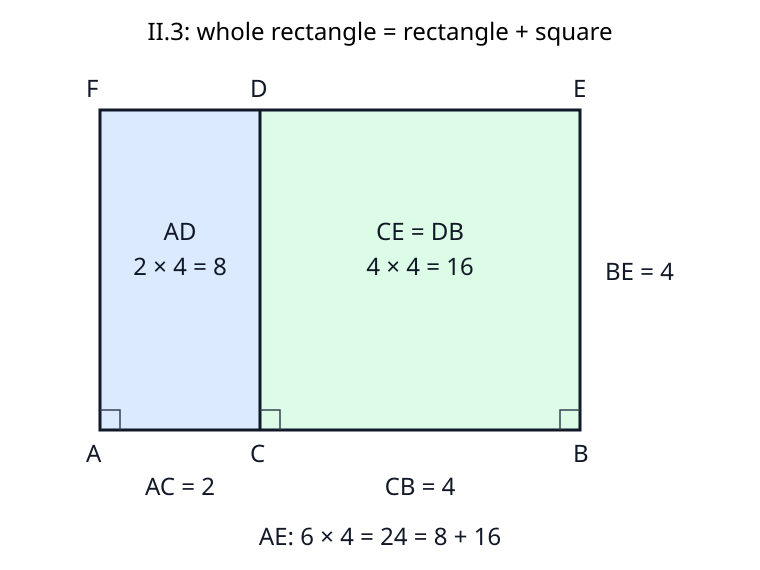

# 《几何原本》II.3：选定哪一段，就必须保留哪一块正方形

## 约公元前300年 · 数学与推理前史补读 · 深读v1

**把一个矩形切成两块，看上去只需一句“整体等于部分之和”。但怎样保证其中一块真是命题要求的正方形？** II.3的关键是先在选定分段上作正方形，再把它扩成整个矩形。高度不是任意选的，也不是整条线段的长度。若忽略这一点，面积相加即使完全正确，也可能证明了别的命题。

本篇承接[II.2](euclid-elements-ii2.zh-CN.md)，只处理II.3及直接相关评论。这是从图灵1936—1937样稿回到古代几何的**年代跳转与前史补读**，不把《原本》章节称作现代AI论文，不声称它或图灵论文是第一篇AI论文，也不声称目录穷尽早期推理传统。古代作品约略年代不是各命题独立发表或发现的日期。

阅读层次分为**原文证据、教学重构、分析延伸、真实实跑**；下面的中文是原创解析，不是全文翻译。短命题同样要交代输入、对象、依赖与失败边界，不能用一个熟悉的恒等式替代阅读。

## 1 书目、版本、历史问题与前人关系

| 文献 | 实读范围 | 用途与边界 |
| --- | --- | --- |
| Euclid, *Elements*, Book II, Proposition 3 | 作品传统年代约公元前300年 | 几何证明传统的一个单元，不指定本命题首创者或独立年代 |
| T. L. Heath, *The Thirteen Books of Euclid's Elements*, 1908, vol. I | 印页378完整II.3；印页377–378相邻联合评论、378末至379上后注；卷首ERRATA | [扫描入口](https://archive.org/details/thirteenbookseu02heibgoog)；古代论证与现代历史评论分层 |
| Richard Fitzpatrick, *Euclid's Elements of Geometry*, revised and corrected 2008 | 印页52完整II.3希英对照及其下方代数脚注；第二卷定义1作为命名背景 | [双语PDF](https://farside.ph.utexas.edu/Books/Euclid/Elements.pdf)；同页最顶部脚注属于II.2，不可误归II.3 |
| David E. Joyce, Clark University | [II.3全文与Guide](https://mathcs.clarku.edu/~djoyce/elements/bookII/propII3.html) | 点名、现代代数对应及数论后用线索；Guide不是古代正文 |

本次勘误核查限于Heath所用卷首ERRATA与以上版本对读；该表没有印页377–379项目。CE与DB的名称变化在Heath、Fitzpatrick和Joyce中一致出现，且可由图形解释，不应擅自“纠正”为排印错误。本篇没有完成全部抄本校勘，也不声称所有版本不存在异文。

**历史问题不是求一个数。** 第一卷已建立作正方形与平行线的技术；第二卷把由相邻两边指定的矩形作为可比较的面积对象。II.1有独立共同高与有限底边分割；II.2把高取为整底边而得到大正方形；II.3把高取为其中一段，保留小正方形而扩展大矩形。这三种关系数学上密切相关，但目标对象并不相同。

**前人关系和作者机构采用一致证据标准。** 可直接核实的前驱是书内I.46、I.31和第二卷定义1；原证不具现代研究机构署名。不能仅凭古希腊数学传统便把II.3归给某位著名数学家或学派。Heath在后注谈到Heron、Pappus及Lardner的相关方法：前两者晚于欧几里得传统年代，后者是近代作者，不能反向列为II.3成书前的同时代合作者。这些评论提供接受史线索，不证明发现优先权。

**为什么特例值得独立证明？** Heath印377–378为直接作图辩护，认为对II.2、II.3而言，图能更清楚显示结果，不必依靠对前条结论的记忆。把这读成教学与引用便利的解释是合理的；把它写成已知的欧几里得私人动机则超出证据。我们关注的是：一个可复用结论不仅要真，还要让读者清楚哪个区域对应哪个表达式。

## 2 输入、目标与“前述分段”

令A、C、B依次在同一直线上，C严格处于AB内部。原文选BC作为“其中一段”。所求关系是：AB与BC围成的矩形，等于AC与CB围成的矩形加上BC上的正方形。

为避免提前偷用乘法，先以R(u,v)表示由相邻边长u、v确定的矩形面积量，Q(u)表示边长u的正方形面积量。目标的**现代摘要**为：

$$
R(AB,BC)=R(AC,CB)+Q(BC).
$$

这不是原文的符号。BC与CB是同一普通长度，不是互相抵消的有向数。面积量不能与长度量直接相加。

“其中一段”允许选另一段，但必须同步改变整式：若选AC，整体要改为AB与AC围成的矩形，平方项也要改为AC上的正方形。**不能左边选BC，右边却平方AC。** “任意切分”不要求等分，也没有概率分布的含义。

内部条件保证AC、CB都正长。取C为端点需要现代零面积约定；取外点需要不同的差量或有向解释，都不能仍声称是原构造的两个非退化部分。

## 3 原图字母：CE和DB为什么都能是同一正方形

先在CB上作正方形CDEB，边界顺序为C、D、E、B。将ED沿E经过D向外延长，过A画AF平行CD或BE，交延长线于F。原图上排A、C、B，下排F、D、E。

| 原文简称 | 完整区域边界 | 相邻边与身份 |
| --- | --- | --- |
| AE | A、F、E、B | AB与BE；BE=BC，故为整体乘选定段的矩形 |
| AD | A、F、D、C | AC与CD；CD=CB，故为两分段围成的矩形 |
| CE | C、D、E、B | 在CB上作出的正方形 |
| DB | D、E、B、C | 同一正方形，只改用另一对对角顶点命名 |

AE、AD、CE、DB在这段证明里是区域简称，不是待相加的对角线长度。CE与DB两种简称并非新增第二个方块，也不是面积等式里悄悄换了对象。

图是本项目原创教学重画，将原图上下翻转，A、C、B在下方，F、D、E在上方；位置与比例不充当证明，区域命名须以表中的顶点边界核对。整体一般不是正方形；仅右侧区域由I.46保证为正方形。

## 4 逐步重建原证明，不先用分配律

### 4.1 在被选段上取得正确的高

**原文步骤：** 在CB上作正方形CDEB，引用I.46。由正方形身份，CD=BE=CB，且邻边垂直。这里一次取得两种必要事实：高度等于所选段，区域有直角。只有等边菱形不能替代正方形。

### 4.2 延伸并封闭整体矩形

**原文步骤：** 延长ED至F，过A作AF平行CD或BE，引用I.31。

**教学补足：** 正方形已有DE平行CB；A、C、B共线，因此FE也平行AB。AF平行BE，所以外框AFEB是平行四边形；已有直角使它成为矩形。由于A在C外、与B分居C两侧，F落在ED越过D的延长线上，而不是DE内部。这里需要点序和交点存在，不能仅把“随手画到某处”当作构造。

原文只标I.46和I.31；把第一卷平行线角性质、交点位置展开，是本文的教学补足，不是声称原页逐条写出了这些编号。

### 4.3 先建立区域分解

原文给AE等于AD与CE之和。CD是分界，左区域AFDC和右区域CDEB内部不重叠，合起来没有缺口，恰为AFEB。共享线段不是另一块二维面积。因此这是有限图形分割关系，不是三个独立测量值恰好相等。

### 4.4 将区域替换成目标表达式

整体AE由AB和BE围成，而BE=BC，所以它代表R(AB,BC)。左块AD由AC和CD围成，而CD=CB，所以它代表R(AC,CB)。右块CE和DB是同一作出的正方形，所以它代表Q(BC)。将这三项代入区域分解，目标成立。

这一步最值得慢读：平方项不是从一个代数乘积“看出来”的，而是第一步真的作出的正方形；矩形高度不是图上量出来的，而由该正方形的等边性质给出。原证明的方向为**先造小正方形 → 扩为大矩形 → 区域分割 → 辨认边长与面积名称**。

## 5 现代坐标重构：补足点序、覆盖及计算合同

本节是现代模型，不冒充原文使用坐标或实数乘法。取基点A、非零向量u=AB，参数0<t<1；令C=A+t·u。取v垂直u，并使其长度等于(1−t)倍u的长度。定义B=A+u，F=A+v，D=A+t·u+v，E=A+u+v。则CD=BE的向量是v，CB的向量是(1−t)u，因此CDEB确是正方形。

程序无需开平方，只须核对：

$$
u\cdot v=0,\qquad v\cdot v=(1-t)^2(u\cdot u),\qquad u\cdot u\gt0,\qquad 0\lt t\lt1.
$$

长度平方等式加正长度保证所需等长，垂直条件独立保证直角。两项都不能删。

**覆盖证明。** u与v非零且垂直，所以线性独立。任一点A+s·u+r·v有唯一参数。整体矩形对应0≤s≤1、0≤r≤1；左块对应0≤s≤t；右块对应t≤s≤1。两参数区间恰拼成[0,1]，仅在s=t共享边，故无重叠内部且无遗漏。F、D、E的参数依次是0、t、1，所以F位于ED越D的延长线上。这一论证回答了原短证明略写的几何位置问题。

**面积的现代解释。** 选长度单位，记x=AC、y=CB，二者都正。于是AB=x+y。把矩形面积数值表示为两边乘积，得到：

$$
(x+y)\cdot y=x\cdot y+y^2,\qquad x\gt0,\quad y\gt0.
$$

Fitzpatrick印52本命题下方脚注是同一种恒等式，但其a对应这里的y，其b对应这里的x；切勿直接把字母名硬套到点A、B。Joyce Guide则把整体与两分段另记为三个变量。变量改名必须连同角色与关系一起转换。

现代代数可以一行由分配律推出该式。然而本篇的几何证明并没有先援引数的分配律；把行列式、Fraction代码或上述一行计算说成古代证明的基础，会混淆解释方向。程序中的精确有理数只核验这个现代模型的实例，不穷尽不可通约长度，也不重建全部尺规作图公理。

## 6 算例与真正有诊断力的反例

以下是**手算教学例**；是否列入程序实跑，以附件结果为准。

1. **不等分。** AC=2、CB=3，则整体AB=5，高必须3。整体面积15，左块6，右方块9；15=6+9。若平方2，则6+4=10，目标已被换掉。等分例看不出这个错误，因此测试不能只有等分。
2. **分数长度。** AC=1/2、CB=3/2，则AB=2，整体面积3，左块3/4，右块9/4。无需整数网格，也不要求两段可用同一种整数小格直观铺满。
3. **旋转平移。** A=(1,−2)，u=(3,4)，t=2/5，v=(−12/5,9/5)。整体底长5、高长3；C=(11/5,−2/5)，B=(4,2)，F=(−7/5,−1/5)，D=(−1/5,7/5)，E=(8/5,19/5)。u·v=0，v·v=9，面积依旧15=6+9。负坐标不是负长度。
4. **任意高不能冒充所选段。** 底5分成2和3，改高4。面积仍可分为8+12=20，但右块不是边3的正方形。正确的区域加法并不蕴含原目标15=6+9。
5. **等长却不垂直。** u=(5,0)，t=2/5，v=(9/5,12/5)，v长3，但与u不垂直。整体面积12，左块24/5，右块36/5；仍相加，却不是矩形与正方形的目标。只验高度长度或总面积都不够。
6. **外切改变命题。** A=0、B=5、C=7时普通长度AB=5、AC=7、CB=2。左边5·2=10，右边7·2+2²=18，不相等。用CB的有向值−2可以写另一代数等式，却已换了长度规则。
7. **面积和掩盖错位置。** 把一块移到另一块上，面积数值可能不变，但会有重叠与缺口；因此检查器必须核对点坐标、区域边界和输入条件，不能只验一个加法。

这些反例反驳的是条件删减或对象误读，不是反驳欧几里得的合法内切命题。

## 7 II.1、II.2、II.3的关系及后注能走多远

II.1的共同高可以任意，II.2取高=整底，II.3取高=某一段。因此II.3数学上是II.1的特例，但传本原证选择直接作图，没有在这一步标注“由II.1”。与II.2相比，本篇的正方形从整体缩为一块，而另一块仍是矩形。依赖关系与实际文本证明路线须分开记。

**Heath后注的延伸，不是II.3原文。** 印378末至379上讨论用II.1、II.2、II.3组合取得平方差关系，并提及Lardner的推导。用现代长度L>s>0重写这段思路：II.2先把Q(L)拆成R(L,s)+R(L,L−s)；II.3把第一项拆成Q(s)+R(L−s,s)；II.1把剩余两个共享边L−s的矩形合为R(L−s,L+s)。于是Q(L)=Q(s)+R(L−s,L+s)，再按面积量消去Q(s)。

这说明单个小结论可成为较长推理中的接口。我们没有借这一后注宣布完成II.4或II.5、II.6，也不把后世的组合方式归为原作者在II.3中已写出的证明。Joyce指向IX.15的是数论中的类似关系；本篇没有完整核验IX.15，保留为后续检索线索。

## 8 主张、证据位置与可信范围

| 主张 | 可核实位置 | 类型与边界 |
| --- | --- | --- |
| 选定段BC决定整体矩形及平方项 | Heath印378陈述/目标；Fitz52 | 原文；不是两段平方之和 |
| CB上正方形，延ED，过A作平行线 | Heath378构造及I.46/I.31；Fitz52 | 原文；F在D外的点序由教学补足 |
| AE=AD+CE，DB为CB正方形 | Heath378逐项辨认，Fitz52图文 | 原文；CE/DB是同区域的别名，不另造对象 |
| 特例直接作图的清楚性 | Heath377–378联合评论 | 评论者判断，非古代作者自述 |
| 平方差组合 | Heath378末–379上 | 后注延伸，不是II.3命题文本 |
| 现代乘法式 | Fitz52下方脚注及Joyce Guide | 现代解释；需指定变量角色和长度单位 |
| 参数区间证明覆盖与点序 | 本文第5节 | 教学重构；依赖现代向量背景 |
| 有限精确运行与篡改拒绝 | 附件源码、命令日志及独立技术审查 | 实现证据，不是一般命题的计算证明 |

## 9 最小复现与真实运行边界

[附件](../../reproduction/euclid-elements-ii3/README.md)使用Python标准库精确有理数，区分候选构造器与检查器。检查输入的类型、非零与严格内部参数，再核对垂直、平方边长、所有命名点、区域边界及多边形面积。测试应包含斜置与反射，避免只对横平竖直示意图有效；还应检查恶意篡改，避免生成器与检查器共享错误时“自证正确”。

本单元是理论教学，没有训练数据、机器学习基线或预测准确率。验收指标是合法构形、非法拒绝、单元测试、Notebook代码格、命令退出码和审查绑定，而非所谓证明成功率。有限测试不证明一般定理；现代面积算法也不构成无循环的分配律基础证明。

本次真实执行21项unittest，在普通、`-O`、`-OO`三种模式全部通过；其中网格项含64个构形。另有4个实跑算例：整数例24=8+16，旋转例15=6+9，反射例24=8+16，分数例3/2=1/2+1。七条主运行命令退出码均为0。独立技术检查在三种模式各核验120个有效构形、360个面积对照，以及2273个篡改或非法输入拒绝；这些是不同统计口径，不相加当作定理数量。

Notebook五个代码格经标准库`compile/exec`按序执行，并在新命名空间回放一致；execution_count保留null，未启动Jupyter kernel。已安装Notebook技能的模板脚本本环境不可定位，因此手工建立同类结构并执行核查；没有擅自安装依赖或把模板生成成功写入记录。附件保存源码、环境、命令、退出码和真实日志；任何代码或参数变化都须重跑，不能借旧日志验新版本。

## 10 局限、合理延伸与现代推理联系

本篇没有建立无限面积可加性，不支持负边长，不证明任意四边形都可照图切成正方形，也没有形式化验证全部第一卷依赖。现代端点退化可以单独定义零面积，但不得把其可计算性写成原文已有零宽矩形。换选另一段可通过重新作图得到对称版本，不能只改最后一个平方项。

一个有意义的延伸是把“所选段”当作贯穿证明的参数：构造、命名、测试与输出必须引用同一个对象。在自动证明或AI生成解答中，仅有一个正确末端等式还不足以验收；对象别名CE/DB是否一致、平方项是否跟随选定段、范围是否仍为内切，都是独立义务。这是本文的现代分析类比，不是声称欧几里得预见了现代AI。

## 11 复盘与带答案练习

复盘路线：**先固定选定段 → 在它上作正方形 → 扩展整体 → 验点序和覆盖 → 把区域映回边长 → 最后才转成数字。** 这条路线比只背分配律更能发现误读。

1. **原证选择哪一段？** 答：BC；所以整体高和平方边均为BC。
2. **CE和DB是否两块不同正方形？** 答：不是；边界C-D-E-B与D-E-B-C只是同区域从不同顶点开始写。
3. **F在哪里？** 答：在ED从E经过D继续延长的一侧，与D、E的顺序为F-D-E；它不是原正方形内部点。
4. **I.46提供的事实为何不只是一条等边？** 答：还保证正方形的直角与相关平行结构；只有长度相等的菱形不足。
5. **整体AE为什么一般不是正方形？** 答：其底AB=AC+CB严格大于高CB。
6. **若选AC，正确目标怎样写？** 答：R(AB,AC)=R(AC,CB)+Q(AC)；需要另将高设为AC，不能保留旧整体。
7. **AC=4、CB=1时面积是多少？** 答：整体5、矩形4、正方形1；5=4+1，不是4+16。
8. **AC=1/3、CB=2/3呢？** 答：整体2/3、矩形2/9、平方4/9，合计2/3。
9. **对角线名称怎样排除误读？** 答：按完整四边形边界解释简称；区域相加不意味着对角线长度相加。
10. **第5节为何非零且垂直就够保证参数唯一？** 答：若两组参数差给零向量，分别与u、v作内积，两系数乘各自正平方长均为0，故两系数都为0。
11. **为什么等分测试太弱？** 答：AC=CB时错用另一个平方仍数值相同，掩盖所选段混淆。
12. **如果检查器只验三块面积和，会漏什么？** 答：错误的高度、斜平行四边形、顶点篡改、重叠与缺口、错平方对象。
13. **t=0或1为何拒绝？** 答：至少一段退化，超出本次严格内部的原几何合同；现代零面积扩展要另行声明。
14. **有理数例全部通过是否涵盖不可通约长度？** 答：不涵盖；一般性依靠几何证明，程序只覆盖声明模型内有限实例。
15. **能否说II.3原文由II.1一行推出？** 答：数学上可作特例推导，但原页实际给出直接构造，两种陈述不可混同。
16. **Heath平方差后注中三条命题各做什么？** 答：II.2拆大平方，II.3从一矩形分出小平方，II.1把余下共享边的两矩形合并；不是只凭II.3独立推出全部关系。

## 附件与独立审查

- [源码、环境、命令、真实日志、结果与Notebook](../../reproduction/euclid-elements-ii3/README.md)
- [独立来源审查](../../reproduction/euclid-elements-ii3/source-review.zh-CN.md)
- [独立技术审查](../../reproduction/euclid-elements-ii3/technical-review.zh-CN.md)

仅公开原创中文解析、自有教学代码、原创图与经过检查的运行证据；不公开原版PDF、全文翻译、私人对话或账户信息。AI辅助制作和独立代理审查不等于人类专家背书或证明助理认证。
