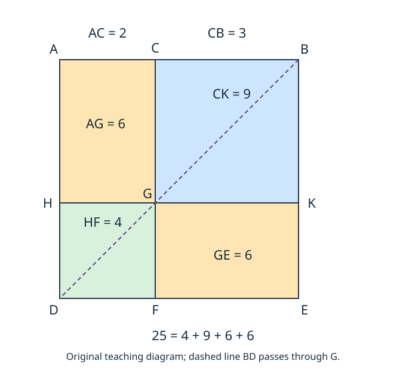

# 《几何原本》II.4：两个小正方形与两块余形，怎样拼回整体

## 约公元前300年 · 数学与推理前史补读 · 深读v1

**平方和的展开容易记，四块图形的身份却不能靠眼睛猜。** 把一条线切成两段，再在整条线上作正方形，为什么某两块一定是正方形，而其余两块恰好贡献两次同一个矩形？II.4的原证先解决这些几何资格，最后才得到面积关系。熟悉的代数公式是它的现代解释，不是阅读原证明的替代品。

本篇承接[II.3](euclid-elements-ii3.zh-CN.md)，完整阅读II.4及相关版本评论；这是从图灵1936—1937样稿回到古代的**年代跳转与前史补读**，不把古代书籍命题称为现代AI论文，也不指定“第一篇AI论文”。目录只覆盖已核文献，不声称穷尽早期数学、推理或各地区传统。

以下区分**原文证据、教学补足、现代分析、真实实跑**。中文解释、例子和代码为本项目原创，不是任何译本的全文翻译。

## 1 书目、版本与历史问题

| 文献 | 本次范围 | 用法与限制 |
| --- | --- | --- |
| Euclid, *Elements*, Book II, Proposition 4 | 作品传统年代约公元前300年 | 这是作品背景，不是本条独立发现或发表日期 |
| T. L. Heath, *The Thirteen Books of Euclid's Elements*, 1908, vol. I | 印379–380完整命题；380译注、381完整评论及382首段多分段延伸；卷首ERRATA | [扫描入口](https://archive.org/details/thirteenbookseu02heibgoog)；所读扫描PDF400–403，印刷页与文件页序不混同 |
| Richard Fitzpatrick, *Euclid's Elements of Geometry*, revised and corrected 2008 | 印52末命题起句、53完整构造证明、54首结尾及代数脚注 | [希英对照PDF](https://farside.ph.utexas.edu/Books/Euclid/Elements.pdf)；脚注是现代译者解释，不倒署古代作者 |
| David E. Joyce, Clark University | [II.4全文及Guide](https://mathcs.clarku.edu/~djoyce/elements/bookII/propII4.html) | 辅助核对标号及后续用途索引，网页Guide与命题正文分层 |

**本条解决的是对象比较，不是数值求值。** [II.1](euclid-elements-ii1.zh-CN.md)比较共同高的矩形分割；[II.2](euclid-elements-ii2.zh-CN.md)把整体正方形切成两矩形；II.3把某段上的正方形嵌进整体乘该段的矩形。II.4同时显出两段的平方，并解释大平方与两小平方之间还缺哪些区域。关键前驱是书内I.46的正方形构造、I.31的平行线构造、I.5/I.6的等腰三角形正逆关系、I.29/I.34的边角性质和I.43的余形等积。

这组可定位依赖，比笼统说“古人已经懂代数”更精确。古代原证没有现代研究机构署名；本篇不因作者名气赋予某位前人首创权，也不把后世评注者当作欧几里得同时代合作者。Heath讨论Theon、Clavius、August和Heiberg，属于传承、替代证明与编校史，不能直接证明最初发现者或写作动机。

从教学角度看，II.4把“构造后验证对象”“复用已有结论”“等量替换后合成”连成一条短证明链。将这看作可检查推理的前史是本文的分析选择，不是声称原作者研究过现代自动定理证明。

## 2 输入、符号与原图的四块

输入是同一直线上的A、C、B，顺序为A—C—B，C严格在AB内部。两段都正长，“任意切分”不要求等分，也不是概率意义的随机抽样。原文要证明：整段上的正方形，等于两分段上的正方形之和，再加两次由两段围成的矩形。

先用现代摘要符号Q(u)表示边长u上的正方形面积量，R(u,v)表示相邻边长u、v的矩形面积量：

$$
Q(AB)=Q(AC)+Q(CB)+2R(AC,CB).
$$

这时还没有把长度乘法当作证明规则。Q和R比较的是面积，不能把它们与一条线的长度相加。“两次矩形”是两份同面积量，不是把两条边都加倍；后者会得到四倍面积。

原构造在AB上作正方形ADEB，连BD。过C作CF平行AD或EB，交BD于G；过G作HK平行AB或DE，H、K分别在AD、BE上，F在DE上。**BD是对角线；GH是横向分割线的一部分，不是对角线。** 原图通常AB在上、DE在下，下面原创图保持这一纸面方向；坐标模型则把AD方向记为正向v，不把纸面上下当作数学性质。

| 区域简称 | 完整边界（按本图循环） | 需要证明的身份 |
| --- | --- | --- |
| HF | H—D—F—G | 边HG=AC的正方形 |
| CK或KC | C—G—K—B | 边CB的正方形；两名称指同一区域 |
| AG | A—H—G—C | 相邻边AC、CG=CB的矩形 |
| GE | G—F—E—K | 与AG等积的另一余形 |
| AE或ADEB | A—D—E—B | 原来在AB上作出的整体正方形 |

用两对角顶点简称区域，并不表示把对角线长度拿来相加。也不要因AG和GE被叫作余形，就把它们误认成BD穿过的两个方块：**BD穿过HF和CK；AG、GE是剩下的两块。**

## 3 沿原证逐步走：先取得正方形资格

### 3.1 构造的是大正方形，不是直接假定两小方块

I.46给出ADEB的等边与直角；I.31提供两族平行线。由平行关系，四小块先都是平行四边形。此时将其中任一块直接称为正方形，仍缺等边和直角的说明。

交点G并非任取：它是CF与BD的交点，而HK必须通过这个G。若把HK挪高或挪低，四块仍可覆盖整体，但小块一般不再是所需正方形，余形也一般不等积。第5节以参数方式补足交点存在和内部位置；它是现代证明说明，而非声称古代正文写了坐标。

### 3.2 为什么BC=CG：平行角、等腰、逆命题三步接合

**原文链条。** CF平行AD，BD横截它们，由I.29得角CGB等于角ADB。大正方形BA=AD，所以在三角形ABD中，由I.5得角ADB等于角ABD。G在BD上，C在BA上，故角ABD就是角GBC。于是三角形CGB中，角CGB与GBC相等；I.6把等角转为对边相等，得BC=CG。

每个箭头承担不同义务：I.29搬运角；I.5使用大正方形的等边；I.6从小三角形等角取得小块邻边相等。把最后一步写成I.5的“自动逆推”会隐藏一次独立定理调用。

### 3.3 等边还不够：逐角检查CGKB

CGKB已经是平行四边形。I.34给CB=GK与CG=KB；结合BC=CG，四边相等，得到等边四边形。

接着原证另证直角。CG平行BK，CB为截线；I.29给角KBC与GCB之和为两直角。角KBC本来就是大正方形B处的直角，因而角BCG也为直角。I.34又把这两个角分别传给对角CGK和GKB。于是四个角都直，配合四边相等，CGKB才符合正方形定义。

这段似乎重复，却防止“等边即正方形”的常见错误。菱形可以四边等长而没有直角。反之，矩形四角直也未必等边；两份证据必须合起来。

### 3.4 HF“同理”怎样展开

原文简写HF同样为正方形，且在HG上；HG=AC由平行四边形对边相等给出。为使这句可复查，下面给一个**教学补足**，不伪称原页逐句列出：

- AG=AHGC是平行四边形，故AH=CG=CB，HG=AC。
- 大边AD=AB，且AD由AH、HD组成，AB由AC、CB组成。由等量减去等量，HD=AC。
- 因此HD=HG；HDFG是平行四边形，故四边相等。
- HD沿AD，HG平行AB，大正方形在A处直角经平行线传递到H；再由平行四边形角性质取得其他直角。

所以HF的边长确为AC，不仅是“看上去像方形”。原证也可按另一小三角形的等腰角关系重复前面的路线；这里用等量相减把被省略的长度关系写清。

## 4 余形等积与四区覆盖：为什么是两次矩形

**原文调用I.43。** 在同一平行四边形ADEB中，G在对角线BD上，通过G的两条线分别平行外边，因此AG与GE是关于该对角线的两块余形，面积相等。I.43的输入结构完整满足，不能只因为两块颜色相同就套用它。

AG是由AC、CG围成的矩形；已经证明CG=CB，所以其面积就是R(AC,CB)。GE与AG等积，故二者一起等于两份R(AC,CB)。这一步用的是等积替换，不要求把一块真的剪下旋转搬过去；本图中两矩形也可通过刚体运动对应，但那不是原文在此引用的证明依据。

再把HF和CK分别替换为Q(AC)、Q(CB)。四块的内部互不相交，合起来恰是ADEB；CF和HK是共同边界，不额外贡献二维面积。因此相加得到命题目标。原证明顺序为：

**作整体正方形 → 对角线定位分割 → 验小方块等边与直角 → 余形等积 → 辨认边长 → 四区合成。**

只检查最后四个面积数值之和，不能验证前面每个对象的身份。把一块平移到另一块上，总面积数值不变，却造成重叠和缺口；因此区域覆盖是独立的证明义务。

## 5 现代坐标模型：精确交点与无重叠覆盖

本节是教学重构。取A为基点，非零向量u、v满足下式，L为它们共同的长度；t表示AC占AB的比例：

$$
u\cdot v=0,\qquad u\cdot u=v\cdot v\gt0,\qquad 0\lt t\lt1.
$$

令B=A+u，D=A+v，E=A+u+v，C=A+t·u。BD上的点可写为B+r·(D−B)=A+(1−r)·u+r·v；CF上的点为A+t·u+s·v。因u、v线性独立，交点必须有1−r=t、s=r=1−t，故：

$$
G=A+t\cdot u+(1-t)\cdot v.
$$

两参数t和1−t都严格在0与1之间，G因此在对角线和大方形内部，交点唯一。再得H=A+(1−t)·v，K=A+u+(1−t)·v，F=A+t·u+v。设a=tL、b=(1−t)L，则CG=b，HG=a，两段都正且L=a+b。

**覆盖不是图感。** 每一点有唯一参数A+x·u+y·v。整体是参数方形0≤x≤1、0≤y≤1；竖线x=t和横线y=1−t把它分成四个闭矩形。对应区间如下：

| 区域 | x区间 | y区间 | 长度身份 |
| --- | --- | --- | --- |
| AG | [0,t] | [0,1−t] | a乘b |
| CK | [t,1] | [0,1−t] | b乘b |
| HF | [0,t] | [1−t,1] | a乘a |
| GE | [t,1] | [1−t,1] | b乘a |

两个x区间覆盖[0,1]、只共享端点t；两个y区间亦然。其笛卡尔积覆盖整个参数方形，任意两块内部不相交。非奇异线性映射保持这种覆盖和内部不相交性质，因此旋转、平移或反射不影响结论。共享边界可以同时属于两闭区域，却没有二维面积。

选定长度单位，用两邻边乘积表示矩形面积数值，得到常见的现代式：

$$
(a+b)^2=a^2+b^2+2\cdot a\cdot b,\qquad a\gt0,\quad b\gt0.
$$

Fitzpatrick印54脚注提供这个对应。现代环代数能用分配律直接证明它，对任意实数乃至更广的交换环也成立；但负数版本不是原证的正长度分割。程序用有理坐标和行列式检查实例，面积算法本身已使用现代乘法规则，所以不能拿该算法作为“独立证明分配律”的基础。

## 6 算例与会暴露误读的反例

下列为手算教学；真实执行的输入与输出以附件为准。

1. **不等分整数。** a=2、b=3，大平方边5、面积25。HF为4，CK为9，两个余形各6，所以25=4+9+6+6。只留一个交叉项会得到19；漏掉两块矩形则只有13。
2. **分数。** a=1/2、b=3/2，大面积4；小平方1/4与9/4，两余形各3/4。它们合为4，不需要整数小格铺砌。
3. **平移旋转。** 取A=(1,−2)，u=(3,4)，v=(−4,3)，t=2/5。共同边长5；C=(11/5,−2/5)，G=(−1/5,7/5)。两分段长2与3，仍是25=4+9+6+6。坐标出现负数不表示边长为负。
4. **反射。** 把v改为(4,−3)，内积仍0、平方长度仍25，只反转图的定向。面积用绝对行列式，不应把顺时针的多边形误判成负面积几何。
5. **HK错过G。** 在边5的大方形中取C距A为2，却把横线放在离AB为2的位置，而非3。四块面积为4、6、6、9，和仍25；但CK为3乘2、HF为2乘3，都不是所声称的小正方形。两个余形为4与9，不等积。总和正确掩盖了对象错误。
6. **外框不是正方形。** 宽5、高4的矩形，用其对角线和C距左端2的位置作同样分割。I.43余形等积仍可成立，但沿对角线的两块长宽比继承外框，通常不是正方形。因此I.43不能单独推出II.4。
7. **等边斜框。** u=(5,0)，v=(3,4)等长但不垂直。类似分割给菱形而非正方形，面积只有20，不是边长5的平方25；等边条件不能替代直角条件。
8. **外切。** A=0、B=5、C=7时，普通长度AC=7、CB=2。把它们硬代原目标，右边49+4+28=81，与25不等。代数用7+(−2)=5可成立另一式，但已经引入有向数和减法，不是原来的内部线段分割。

这些是对错误简化的反例，而不是对满足原假设的命题的反例。等分例a=b很容易隐藏交换标签的问题，验收必须含不等分、斜置、反射和非法构形。

## 7 传本推论、替代证明与适用勘误

Heath印380末译注说明“两次矩形”的希腊表述及区域名补词。他明确选择用面积一类名词解释四区域相加；不能据两个字母就把它读成线段代数。

**传本推论不能无条件归为原文。** Heath印381讨论一个通行推论：正方形中关于对角线的平行四边形也是正方形。这正对应图中HF和CK，而非余形AG、GE。Heath把它判为插入，转述Heiberg先前的怀疑及1903年纸草片段的证据，并提及可能与Theon有关。本文核读的是Heath的报告，未独立校阅该纸草或全部希腊传本，故不把编校判断升级为我们独立认证的作者归属。Fitzpatrick与Joyce的本条正文没有另列这一推论。

Heath还说August以前若干希腊文本载有归给Theon的第二证明，Heiberg随August省去；它主要改写小方块资格的证明。评论注意到原证逐个证明四个角为直角，而该替代写法在已建立平行四边形结构后，直接以一个直角收束。**一个直角可以在平行四边形中传给其余角，却不能对任意四边形这样做。** 本文没有取得所有旧版第二证明全文，不伪造其逐句复原。

**Heath印381的半代数路线。** II.2先把Q(AB)分为R(AB,AC)与R(AB,CB)；II.3分别把这两矩形拆成Q(AC)+R(AC,CB)和Q(CB)+R(AC,CB)。相加即可得到II.4。Heath举Clavius及后世版本为例。这是有明确出处的替代路线，不是原传本主证明实际引用了II.2、II.3。

印381下部也利用本图看平方差：从整体去掉CK，余下可按矩形AF（A—D—F—C）与FK（F—E—K—G）来组合，再用II.1把共同边AC的两矩形合并。它解释为何同图有多种面积分组，但不把这段评注当作另一个已完成阅读单元。

本次适用勘误核查限所读Heath卷首ERRATA与两现代版本对读；该勘误表没有印379–382的项目。不会从“2008修订版”推断所有错误已排除，也不声称完成传本校勘。传本推论与证明取舍是版本层次问题，和印刷勘误不是同一种证据。

## 8 合理延伸：多段公式为何出现每一对两次

Heath印382首段指出，可把线段分成任意有限多段，整体平方等于各段平方与每对段所围矩形的两倍之和。下面给出本文的现代教学证明，不归为古代正文的符号形式：

$$
\left(\sum_{i=1}^{n} a_i\right)^2
=\sum_{i=1}^{n}a_i^2+2\cdot\sum_{1\le i\lt j\le n}a_i\cdot a_j,
\qquad a_i\gt0.
$$

在大正方形两边各按同一分段次序分割，产生n乘n格。第i行第i列是边a_i的正方形；不同i、j的两个对称位置分别是a_i乘a_j和a_j乘a_i，二者面积相等。每个非对角格恰进入一对，所有格无遗漏、不重叠，所以交叉项的系数为2，而非凭记忆填上。

也可归纳：一段时显然；把前n段视为一整体与第n+1段应用II.4，再用II.1分开新矩形，新增项正是旧各段与新段的配对。这是有限分割；不推断无限级数的收敛与面积可加性。程序是否测试此延伸须以附件声明为准，数学说明本身不冒称实跑。

## 9 主张、证据位置与边界账本

| 主张 | 证据位置 | 能支持什么 |
| --- | --- | --- |
| 整体平方等于两平方和两次矩形 | Heath379陈述、380收束；Fitz52末–54首 | 本阅读单元的目标，不是任意外切 |
| BD定位G，过C和G作平行线 | Heath379图文；Fitz53 | 不是自由选择HK高度 |
| BC=CG的角链 | Heath379末；Fitz53 | I.29、I.5、I.6角色不同 |
| 小方块等边与四直角 | Heath380上半 | 不以视觉或单独等边代替资格证明 |
| 余形AG、GE等积及四区相加 | Heath380中下；Fitz53–54 | 等积与覆盖各有条件 |
| Theon替代证明与推论插入判断 | Heath381 | 所读评论者的报告；未直接复核全部古传本 |
| II.2与II.3组合的替代证明 | Heath381 | 后世路线，不冒充主证引用次序 |
| 多段推广 | Heath382首段 | 有限段；本文另给网格/归纳解释 |
| 交点唯一、参数区间覆盖 | 本文第5节 | 现代坐标模型中的一般论证 |
| 有理算例、异常拒绝、代码运行 | 附件源码、日志及技术审查 | 有限实现证据，不是一般定理的穷举证明 |

## 10 最小复现与实际执行范围

[复现附件](../../reproduction/euclid-elements-ii4/README.md)用Python标准库有理数，保存构造器、独立于输出面积等式的结构检查、单元测试、环境、命令与真实日志。模型先核非零、垂直、等长和内部参数，建立九点及四块完整边界，再核多边形面积；不是按待证等式筛选输入。反射须保持无向面积，篡改点位与区域边界须能被拒绝。

本篇是理论教学，没有训练集、机器学习基线或预测准确率。评价量是明确构形合同内的有效案例、非法拒绝、测试方法、代码格执行和命令退出码。不同统计口径不相加充作“证明了多少定理”。有限有理数不能穷尽不可通约长度，坐标计算也没有形式化证明全部第一卷公理依赖。

本次18项unittest在normal、`-O`、`-OO`三种模式全部通过，其中网格测试含64构形；七条主命令退出码均为0。四个实跑算例中，整数、旋转、反射例均为25=4+9+6+6；分数例为1=4/49+25/49+10/49+10/49。独立技术检查不调用构造器生成正例，在三种模式各检查240个外部构形、1200个面积对照、6480个点位或边界篡改拒绝与42个非法输入拒绝；后两者合6522次拒绝，不与单元测试或算例相加当作独立定理。

Notebook五个代码格用标准库`compile/exec`按序真实执行，并在新命名空间回放，输出一致；`execution_count`保留null，未启动Jupyter kernel，也不声称前端渲染或完整nbformat模式认证。已读取安装的Notebook技能，但本机未找到脚手架`new_notebook.py`，因此按规范手建，未安装额外依赖、未伪称模板运行成功。多段推广仅给数学教学解释，不列为本程序已测试的功能。日志、源码、环境与命令逐项保存，修改参数或实现后应重跑。

## 11 局限与现代推理联系

本篇未认证全部抄本谱系、最早发现者或完整《原本》；没有完成后续II.5。几何结论受正长度、内部切分、欧氏正方形和有限区域分割约束。现代数域中的恒等式范围更广，必须与历史几何对象分开。

对自动推理而言，本篇给出三个具体教训。第一，候选图上的一个名字不自动具有对应数学类型：先证明四角直、四边等，才能调用正方形结论。第二，定理接口必须验输入：I.43需要同一外框、同一对角线上的交点和两族平行线，不是随意两块矩形。第三，数值相等与结构正确不同：错误切割也可能有正确总面积。这些是现代分析类比，不是原作者关于AI的主张。

## 12 复盘与带答案练习

复盘时依次追问：作了哪个整体？G受什么约束？两小块为何等边且直角？哪两块才叫余形？四区为何无遗漏？最后才能把它们写成现代公式。

1. **II.4只说两小平方之和吗？** 答：不是；还要两份两段所围矩形。a=2、b=3时漏掉它们会把25错成13。
2. **原图的对角线是哪条？** 答：BD。GH是通过G的分割线部分，不能将其当作对角线。
3. **G能任取在CF上吗？** 答：不能；还须在BD上，才能获得相应等边关系与I.43余形结构。
4. **I.5与I.6分别在哪用？** 答：I.5从BA=AD推出大三角形底角相等；I.6从小三角形CGB等角推出BC=CG。
5. **四边相等为何还要另证直角？** 答：等边菱形可为斜形，不满足正方形定义。
6. **HF究竟在哪条边上？** 答：在HG上，而HG=AC；“在AC上”说明边长对应，不表示HF实际接触原线段AC。
7. **CK与KC是不同方块吗？** 答：不是，二者以相反顺序使用同一对角顶点命名同一区域。
8. **AG与GE各在哪里？** 答：分别为AHGC和GFEK；它们不被BD穿过，是余形，而HF、CK位于对角线两端。
9. **a=1、b=4时四块多大？** 答：HF=1、CK=16、AG=GE=4，总和25。
10. **a=1/3、b=2/3呢？** 答：平方为1/9、4/9，余形各2/9，总和1。
11. **两倍矩形是否把两邻边都加倍？** 答：不是；两边都加倍会变四倍。两份面积或只把一边加倍才是两倍数值。
12. **第5节为何G唯一？** 答：u、v独立，交点的两种表达必须逐系数相等，强制r=s=1−t。
13. **闭区域共享边会破坏无重叠吗？** 答：不破坏内部不相交；共享边是零二维面积，不是额外区域。
14. **错置HK后总面积仍正确，检查器应看什么？** 答：对角线交点、九点关系、小块边界、等长垂直及身份，不能只验总和。
15. **传本推论说的是所有四块都正方形吗？** 答：不是；关于对角线的两块HF、CK是方块。AG、GE在不等分时为非方矩形，且该推论的传本地位还有Heath所述插入判断。
16. **能用II.2和II.3重建II.4吗？** 答：能；先拆成两矩形，再对各矩形用II.3，得到两个小平方与两个交叉矩形。它是替代证明，不是主证逐步引用。
17. **三段1、2、3的推广怎样算？** 答：整体36；平方和14；三对乘积2、3、6之和11，两倍22；14+22=36。
18. **有限测试是否证实所有正实长度？** 答：没有；一般性来自几何或明确现代模型中的证明，测试只支持有限实现行为。

## 附件与独立审查

- [源码、原创图、环境、命令、真实日志与Notebook](../../reproduction/euclid-elements-ii4/README.md)
- [独立来源审查](../../reproduction/euclid-elements-ii4/source-review.zh-CN.md)
- [独立技术审查](../../reproduction/euclid-elements-ii4/technical-review.zh-CN.md)

只公开原创解析、自有教学代码与检查过的运行证据，不镜像原PDF或全文翻译，不公开私人对话、账户信息和秘密。AI辅助制作及独立代理审查不等于人类专家背书或证明助理形式认证。
