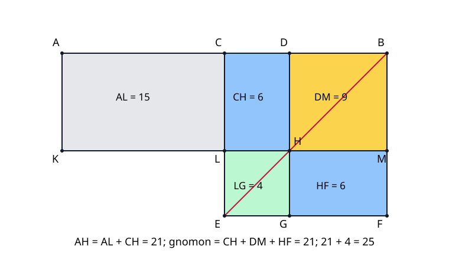

# 《几何原本》II.5：不等分少掉的面积，为什么恰是一块平方

## 约公元前300年 · 数学与推理前史补读 · 深读v1

**把一条固定长的线切成两段，两段围出的矩形为什么在平分时最大？偏离中点以后，少掉的面积又如何精确计算？** II.5没有先写二次函数。它先把一个长矩形变成曲尺形，再把缺角的正方形补回去。这里最值得读的，是“面积相等”如何在不同形状之间转移，而不是把熟悉的平方差公式贴在图旁边。

本篇承接[II.4](euclid-elements-ii4.zh-CN.md)，完整阅读第二卷命题5和相关版本评论。它是从图灵1936—1937样稿向古代的**年代跳转与AI推理前史补读**，不是现代AI论文，也不争称“第一篇AI论文”。收录以实际核验的文献为范围，不声称穷尽世界各地数学与推理传统。

以下明确区分**原文证据、教学补足、现代分析、真实实跑**。中文论述、例子和程序均为原创解析，不是现成译本的全文翻译。

## 1 书目、版本和问题位置

| 文献 | 本次阅读范围 | 证据用途与限制 |
| --- | --- | --- |
| Euclid, *Elements*, Book II, Proposition 5 | 作品传统年代约公元前300年 | 年代属于作品背景，不是独立命题的确切发现日期 |
| T. L. Heath, *The Thirteen Books of Euclid's Elements*, 1908, vol. I | 印382–383完整命题；383–385相关评论；卷首ERRATA | [扫描入口](https://archive.org/details/thirteenbookseu02heibgoog)；所用PDF403–406页，不把文件页序当印刷页码 |
| Richard Fitzpatrick, *Euclid's Elements of Geometry*, revised and corrected 2008 | 印54–55，完整希英对照II.5及脚注 | [PDF](https://farside.ph.utexas.edu/Books/Euclid/Elements.pdf)；代数公式脚注属于现代译者说明 |
| David E. Joyce, Clark University | [II.5命题正文与Guide](https://mathcs.clarku.edu/~djoyce/elements/bookII/propII5.html) | 辅助核对图名和理解路线；Guide的两处问题见第8节，不照抄 |

II.1–II.4逐步处理矩形分割与平方组合，II.5换了一个观察角度：不只比较“整体与各部分”，还把**中点作为固定参照**，用另一个切点与中点之间的距离来衡量变化。第二卷定义2的gnomon（曲尺形）因此成为有用的中间对象。

书内直接依赖包括I.46正方形构造、I.31平行线构造、I.43余形等积和I.36等底同平行线间平行四边形等积。小方块资格的补足还用到I.5、I.6、I.29、I.34。与前文的关系是结构性的：II.4训练我们辨认对角线两侧的小方块与余形；本条用这些余形搬运面积，并非把II.4的代数展开当作原文引理。

Heath在383–385页把本条与二次方程、面积应用、固定周长矩形及整数直角三角形规则相联系。他还援引Proclus关于毕达哥拉斯学派的归属说法，并作进一步历史推断。**这是1908年评注中的传承线索和解释，不是原命题自述的研究目的，也不足以给出某位发现者、准确年份或现代机构署名。** 对知名作者与其他传统采用同一标准：没有直接证据的优先权不由声望补足。

## 2 两次切分，不是一次切成四段

设A、B是线段端点，C为中点，D为另一个严格内部切点，且D不与C重合。原图采用A—C—D—B的次序；因此AD长于DB，CD是偏离中点的距离。左侧切点的对称处理见第6节。

“切成相等和不等的部分”指同一整段分别按C和D考察：AC=CB，而AD与DB不等。不能误解成四条彼此独立的输入线，也不能把CD误认为两条不等段之差；后者是CD的两倍。

记Q(s)为边长s的正方形面积，R(s,t)为邻边长s、t的矩形面积。命题的现代摘要是：

$$
R(AD,DB)+Q(CD)=Q(CB).
$$

这是面积等式，不是线段长度之和。CD可以很短，但其平方是一块面积，不能直接用CD替换Q(CD)。令CB=r、CD=d，则AD=r+d、DB=r−d，且0＜d＜r。本篇暂把r、d当长度符号；直到第5节才选择现代数值模型。

### 原图的构造

在CB上作正方形CEFB，连接对角线BE。过D作DG平行CE，H是DG与BE的交点，G在EF上。过H作KM平行AB，分别交CE于L、BF于M；过A作AK平行CE，与KM相交于K。

下面把以对角顶点简称的区域还原成完整边界；这样可防止把线段CH当成区域CH，或把两个字母自动当作相邻边。

| 简称 | 循环边界 | 几何角色 |
| --- | --- | --- |
| CEFB | C—E—F—B | 在半段CB上作的整体正方形 |
| CH | C—L—H—D | 左上余形 |
| HF | H—G—F—M | 右下余形 |
| DM | D—H—M—B | 右上小正方形 |
| LG | L—E—G—H | 左下缺角正方形 |
| CM | C—L—M—B | 正方形上方条带，CH加DM |
| DF | D—G—F—B | 右侧条带，DM加HF |
| AL | A—K—L—C | 外接在左侧的矩形 |
| AH | A—K—H—D | AL加CH，邻边为AD与DH |

正文表按一个循环方向描述区域；反向绕行描述同一区域。代码接口则采用复现README列出的固定有序边界，不能把反向列表原样当作合规证书。

gnomon NOP是CH、DM、HF这三块的合体，即大正方形去掉LG后剩下的曲尺形。**N、O、P是标示曲尺形的辅助字母，不是三角形的三个顶点。** 程序用上述三个有明确边界的区域表示它，不把虚线弧当作一条新的面积边界。

## 3 原证明的面积转移链

### 3.1 第一块桥梁：CH与HF等积

BE是正方形的一条对角线，H在BE上，经过H的两条分割线分别平行正方形的两组边。它们满足I.43的配置，故两块余形CH与HF等积。

这里不能把“两个矩形看起来一宽一窄”当理由。I.43需要的是共同外框、对角线上的同一个点和规定的平行关系。若H挪离BE，四块仍可铺满大正方形，但余形未必等积，后续推理便断了。

### 3.2 同加DM，得到CM与DF等积

原文给CH=HF两边各添DM。左侧CH与DM邻接成上方条带CM，右侧HF与DM邻接成右方条带DF，所以CM=DF。

这一步有两个层面。等量加同量是面积运算；“它们组成哪个整体”是区域覆盖判断。DM在两个比较对象中各出现一次，并不表示同一个最终拼图中把DM叠放两次。每一边独立组成一个区域。

### 3.3 中点条件把AL接入

AC=CB是中点给出的关键数据。矩形AL和CM分别以AC、CB为底，又位于同一对平行线AB与KM之间；由I.36二者等积。因此AL=CM=DF。

如果C不是中点，这一步就没有等底依据。可见“C是中点”不是为了画面居中，而是在证明中承担一次实质的等量替换。

### 3.4 同加CH，把长矩形变为曲尺形

给AL=DF两边各加CH。左边AL与CH拼成矩形AH；右边DF与CH拼成gnomon NOP。于是AH与gnomon等积。

矩形AH的横边是AD，竖边是DH。原文随后使用DH=DB，把AH认定为两条不等段AD、DB所围的矩形。为什么DH=DB、为什么LG是CD上的平方，需要第4节把简写的几何资格展开。

### 3.5 补回LG，结束证明

在AH与gnomon等积后，两边各加LG。右边gnomon与LG恰好组成整个CEFB；左边则是AD、DB所围矩形加CD上的平方。面积关系即得到。

以“[区域]”表示面积，原证骨架可压缩为一条教学记录：

$$
[CH]=[HF],\quad [CM]=[DF]=[AL],\quad [AH]=[\mathrm{gnomon}],\quad [AH]+[LG]=[CEFB].
$$

这行记录不能独自取代前面的图形解释。尤其最后一式需要知道LG是被去掉的那一块，而不是任意一块同面积但放错位置的平方。

## 4 把原文的两个“就是”补成证明

### 4.1 为什么DH=DB

CE=CB，所以三角形CEB等腰，角CEB等于角EBC（I.5）。DH平行CE，HB沿EB，故角DHB等于角CEB（I.29）；BD沿BC，BH沿BE，故角DBH等于角CBE。两底角相等，三角形DBH由I.6得到DB=DH。

于是DM具有两条相邻等边DB与DH。由正方形外框和平行线关系，其四角是直角；所以它不仅是菱形或平行四边形，而是正方形。原命题不需要重新完整证明每次出现的直角，但教学核验必须指出其来源。

### 4.2 为什么LG的边长为CD

CM是矩形，因此CL=BM；DM又给BM=DH=DB。大边CE=CB，从CE中扣去CL，与从CB中扣去DB是等量扣等量，所以LE=CD。矩形CH还有LH=CD。LG的两邻边LE与LH相等，四角由原正方形和平行线得直角，故LG为边长CD的正方形。

注意LG并不实际建在原线段CD的位置上。所谓“CD上的平方”在此是边长等于CD的正方形面积量；原线段在上边，缺角方块在左下。位置不同不妨碍同边长平方的面积相同。

### 4.3 交点存在、内部性与无重叠

原图把H、L、M、G画在规定边内，读者不可直接将图像当作公理。后面的坐标重构会显示：0＜d＜r迫使H的竖向参数r−d严格处于0与r之间，且水平参数d严格在0与r之间。两条内部切线把平方分为四格，四格内部两两不交、闭边界可以共享，合起来没有缺口。

这是对原文隐含位置条件的现代补足。它不是声称欧几里得用了坐标，也不声称古代构造公理中的所有连续性问题已由有限程序解决。

## 5 一个明确的现代模型

令C为原点，u沿CB，v沿CE，二者非零、垂直且等长。以u、v为参考基底，不必取平方根。设t=CD/CB，0＜t＜1。各点的无量纲坐标如下，实际位置为C+xu+yv：

| 点 | 参数坐标 |
| --- | --- |
| A、C、D、B | (−1,0)、(0,0)、(t,0)、(1,0) |
| E、G、F | (0,1)、(t,1)、(1,1) |
| K、L、H、M | (−1,1−t)、(0,1−t)、(t,1−t)、(1,1−t) |

BE上任一点可写成(1−s,s)。同时在D的竖线上要求1−s=t，所以s=1−t。u与v线性独立，因此系数相等确实给出唯一交点，不只是找到一个看起来合适的点。

令S为整个正方形的面积，即u·u（因为u、v等长且垂直）。四格分别为：CH=t(1−t)S，DM=(1−t)²S，HF=t(1−t)S，LG=t²S。左矩形AL=(1−t)S，AH=(1+t)(1−t)S。由此得到：

$$
(1+t)(1-t)S+t^2S=S.
$$

展开前一项得(1−t²)S，补t²S后恰为S。这里用的是实数或有理数代数以及现代面积公式，**不是用计算机无循环地证明分配律**。几何原证的路线是第3节的等积转移；现代模型则提供点位、区域与面积的可执行规格。

程序的坐标输入限定为整数或Fraction。有理向量可以表示许多旋转、反射和平移，且平方长度与面积保持精确；但不包含所有实数坐标，也不声称覆盖每一种不可通约配置。一般结论来自证明，不来自网格大小。

## 6 原图没有画出的分支

### 6.1 D在左半段

若次序是A—D—C—B，交换端点A与B，镜像上述构造即可。两段AD与DB的名称交换，围出的矩形面积不变；CD距离和半段长度也不变。因此命题仍成立。镜像是明确的对称归约，不是让程序把负参数偷偷取绝对值后声称原图未变。

本次实现只接受原图的右半分支0＜t＜1。左半结论由这里的数学归约给出，不列为程序已直接接受的输入范围。

### 6.2 D=C和端点

原命题说“不等分”，因此D=C不在其严格输入中。但现代扩展到d=0时得到r²+0=r²：曲尺形退化为整个平方，缺角方块消失。固定总长矩形面积的最大值恰在这个边界达到。程序拒绝该退化输入不表示恒等式在那里错误，而是它的非退化几何证书规格较窄。

若D=A或B，其中一段长度为0，矩形也退化；现代面积式仍可延拓，但不是两条正长不等段围成的普通矩形。若D在AB外，则“切分整段”的前提已经消失，不能随意拿有向线段代数冒充本条几何命题。

### 6.3 固定和为何平分最大

在现代长度模型中，设x=AD、y=DB，固定x+y=2r。原命题说明xy=r²−d²，d=|x−y|/2。所以不等分时d²严格正，面积严格小于r²；平分时达到r²。若两次偏移满足0≤d₁＜d₂，则d₂²−d₁²=(d₂−d₁)(d₂+d₁)＞0，第二个矩形更小。

这不仅告诉我们哪个最大，还给出精确损失d²。固定周长P的矩形有x+y=P/2，因此半和r=P/4，最大面积为P²/16。它不是在比较所有形状中谁的面积最大，更不是圆的等周问题。

## 7 算例、反例与错误诊断

### 7.1 整数手算：总长10，偏移2

令CB=5、CD=2，则AD=7、DB=3。CH与HF各6，DM为9，LG为4。CM=6+9=15，DF=9+6=15，AL也为15，AH=15+6=21，gnomon=6+9+6=21。最后21+4=25。每一步与原证明的一次合成或替换对应，不只是检查终值。

若同一总长改偏移1，矩形为6乘4，面积24；偏移2时为7乘3，面积21，两次面积差为2²−1²=3。偏移增加一单位，不等于面积减少一单位。

### 7.2 分数手算

取r=1、d=1/3。两段为4/3与2/3，矩形8/9，缺角平方1/9，合1。两余形各2/9，DM=4/9；AL=2/3。用浮点近似也能画图，但不应拿0.888…和0.111…的近似和来代替这里的精确等量关系。

### 7.3 移动H：铺满并不等于证明成立

仍取r=5、d=2，但把过H的横线错误放在距顶边2的位置，而正确高度应为3。四格仍能铺满25：左上4、右上6、右下9、左下6。但是CH≠HF，DM与LG均不是所需平方。若只检查四格面积总和等于25，错误证书会漏网。

更极端地，把一份合法证书的所有顶点整体挪走，却仍声称它对应原来的输入，也可能保留面积与边长。检查器必须把点名绑定到输入C、u、v、t，不能只验证“某处存在一个类似的图”。

### 7.4 把CD写成AD−DB会怎样

在7和3的例子中，AD−DB=4，而CD=2。若补上4²，会得到21+16=37，不是25。缺的平方建立在两段差的一半上。这也是把“两个切点之间的线段”译成“两段之差”时必须补明的因子。

### 7.5 C不是中点，链在哪断

设AB=10，取AC=4、CB=6、CD=2，仍令D在C右侧。AD=6、DB=4，左边矩形加CD平方为24+4=28，却不是CB平方36。外部矩形AL与上条带CM底长不等，I.36的等底前提失败。其余平行构造再整齐也救不了这次替换。

## 8 从平方差到二次问题：解释必须带条件

**现代分析，亦与Heath评注对应。** 设两正数之和为2r，积指定为q。由II.5转写得d²=r²−q，然后两数为r+d与r−d。存在两条正长不等段要求0＜q＜r²；q=r²给相等两段，q=0给退化端点，q＞r²无实数解。

$$
x=r+\sqrt{r^2-q},\qquad y=r-\sqrt{r^2-q},\qquad 0\lt q\lt r^2.
$$

有序对(x,y)有两个互换的解；若问题只问不区分次序的两段，则是一组长度。Heath印384–385讨论这一点时，把两个数的交换与同一个矩形联系起来。不能一面把x指定为较短段，一面又无条件宣称它有两个合规值。

若q=b²且0＜b＜r，可以构造一直角三角形，让**r为斜边、b为一条直角边，另一条直角边为d**。I.47给d²=r²−b²，再在中点两侧取距离d。这是二次问题的构造解释，不是II.5本条原证增加的步骤。

本次核对发现Joyce网页Guide在这一解释段把所求CD称为斜边；按其前述关系应是r=BC为斜边，CD为另一条直角边。Guide随后构造的切点用D，但结尾又写G、AG、GB。这里保留统一的D标号，依据几何关系纠正解释，不把网页辅助说明的错误归给欧几里得命题。Heath印384的构造把OD作为半长对应的斜边，关系是自洽的。

**版本标号。** Heath印383说明手稿图中有两个M，因而调整曲尺形标号避免混淆；Fitzpatrick印55也注记希文重复M，并谨慎称可能有误。本文使用英文版NOP约定。这是具体文本证据，不声称所有抄本已经逐一校验。

**整数三角形延伸。** Heath印385把差平方形式用于传统归于毕达哥拉斯与柏拉图的整数规则。现代检验可取奇整数n≥3，三边n、(n²−1)/2、(n²+1)/2；后两平方之差为n²。比如n=3给3、4、5。本文仅展示由恒等式推出的算例，不把这条推导证明成历史上确曾如此发现；这些扩展也不是本次代码已经实现的整数三角形枚举器。

## 9 主张与证据账本

| 主张 | 可定位证据 | 本篇处理 |
| --- | --- | --- |
| 相等与不等两次切分；CD在两切点之间 | Heath382；Fitz54 | 中点、严格内部与不重合条件拆开说明 |
| CEFB、BE及三组平行构造 | Heath382；Fitz54 | 完整区域边界与交点身份展开 |
| CH=HF，添DM得CM=DF | Heath382；Fitz54 | I.43条件与分区合成分别核验 |
| AL=CM依赖AC=CB | Heath382；Fitz54 | 指出I.36等底同平行线要求 |
| AH等于gnomon，补LG还原大平方 | Heath382–383；Fitz54–55 | 补足DH=DB与LG正方形资格 |
| 重复M与NOP标号调整 | Heath383；Fitz55脚注 | 英文版约定，不混合希英标号 |
| 平方差、二次方程及两根 | Heath383–385 | 评注与现代分析，不当原命题原话 |
| 固定周长矩形最大面积 | Heath384–385 | 明确平分是原严格输入之外的退化边界扩展 |
| 对历史归属的说法 | Heath383–385对Proclus及传统的讨论 | 降格为被引传统和评注判断，不据此断定首创 |
| 坐标证书与测试统计 | 下列真实运行附件 | 本次实现证据，非一般定理或形式认证 |

本次查看Heath卷首ERRATA（PDF第16页），其中未见II.5或印382–385页的条目；这不等于证明所有版本均无错误，检查范围和版本限制另见独立来源审查。原文图像与文字抽取交叉核对；抽取失败或标号乱码不靠猜字补出所谓原文。

## 10 最小复现与真实运行

[复现目录](../../reproduction/euclid-elements-ii5/README.md)包含自有构造器、独立于构造器调用的检查器、单元测试、算例、原创SVG、Notebook、环境及逐命令真实日志。输入C、u、v、t采用第5节规格，只接受普通整数或Fraction；拒绝bool、float、字符串、坏点容器、零边、非方矩形、非直角菱形、端点与中点退化等。

检查器逆解各点的仿射坐标，绑定11个点名与输入、固定有序区域，验证H在BE上、DH=DB、大小正方形资格，再用鞋带面积检查11项等量关系。四格的覆盖由指定顶点及内部切线保证，不由面积和单独推定。接口不承诺抵御任意恶意Python对象或超大整数资源耗尽。

本次20项unittest在normal、`-O`、`-OO`三模式均通过，网格项含64构形；七条主命令退出码均0。四算例中默认、旋转和反射例为21+4=25，分数例为45/49+4/49=1，各区域的中间值都保存。生产检查使用显式异常，不依赖优化时消失的assert。

独立技术检查另行构造输入证书，不调用`construct`产生正例；每种模式检查240个外部构形、2400项面积对照、8400次篡改拒绝及57个非法输入拒绝，三种模式均通过。篡改覆盖点位、区域边界与输入绑定等。各计数按测试用途报告，不把它们相加成“验证了多少条定理”。

Notebook五个代码格按序用标准库`compile/exec`真实执行，随后在新命名空间回放，输出一致。**未启动Jupyter kernel**，`execution_count`保持null；未声称Jupyter前端渲染或完整nbformat模式认证。已读安装的Notebook技能，环境未找到脚手架`new_notebook.py`，所以按结构规范手建，未安装新依赖或伪称运行过helper。

在复现目录执行`python3 run_all.py`可重跑主证据；独立检查的命令和退出码见[独立运行记录](../../reproduction/euclid-elements-ii5/independent-run-summary.json)。改变实现或参数后应重新生成日志，不能把旧结果当新结果。左右切点归约、二次方程构造、最大值与整数三角形在正文作数学分析，不列为程序已实现的额外功能。

## 11 局限与对自动推理的启发

本条没有现代实验数据集、训练基线或统计性能指标。其证据是几何证明；本项目代码用于检查一个现代模型及其实现行为，不把不同测试数量包装成“更强定理”。未完成整个第二卷、所有抄本谱系、最初发现者判定或证明助理认证；后续单元不计入本篇完成范围。

对今天的自动推理，可以提出三项有边界的分析。第一，中间表示可能改变形状而保持目标量：从矩形AH到gnomon不要求全等，只要求证明等积。第二，规则调用必须携带资格：I.43需要对角线与平行结构，I.36需要等底与共同平行线。第三，结果数字相同不能替代对象身份和覆盖证书；点位错误、区域重叠或输入错绑，都可能隐藏在一个正确总和后面。

这些是本文对证明检查器设计的类比，不是声称古代作者研究了AI，也不是由一套有理坐标程序推出通用自动证明系统已经可靠。生成候选构造与验证候选构造是两项工作；验证范围应按实际检查项陈述。

## 12 复盘与带答案练习

复盘时按顺序回答：谁是中点？谁是另外的切点？哪个点必须落在对角线上？先替换哪两块？中点条件在哪一次替换使用？最后缺的是哪块平方？能回答这些，才算把公式重新读成证明。

1. **CD等于两条不等段之差吗？** 答：它等于差的一半。AD=r+d、DB=r−d，二者差2d。
2. **NOP为何不是三角形？** 答：三字母及弧线标记的是gnomon，即CH、DM、HF三块合体；不对应三个边界顶点。
3. **本条哪一步真正使用C为中点？** 答：以AC=CB使AL与CM等底且位于同一对平行线间，由I.36得等积。
4. **为什么不能从CH与HF面积数值相等就调用I.43？** 答：I.43的前提是一个规定的对角线余形配置；数值巧合不是那些几何前提的证明。
5. **添DM之后两边是什么？** 答：CH+DM组成CM，HF+DM组成DF，两条带等积。
6. **AH与gnomon是否全等？** 答：一般不是。一个矩形，一个缺角形；原证只建立面积相等。
7. **为什么DH=DB？** 答：外方给等腰三角形CEB；平行角转移到DBH，再由I.6等角对等边。
8. **LG如何获得正方形资格？** 答：LH=CD，且LE=CE−CL=CB−DB=CD；平行与外方给直角。
9. **r=5,d=1时损失多少？** 答：1；两段6与4，积24，较最大25少1。
10. **r=5,d=3时四格各多大？** 答：CH=HF=6，DM=4，LG=9，gnomon16，16+9=25。
11. **总长10、指定积24有何切分？** 答：r=5，d=1，两段6与4；交换次序给另一有序解。
12. **总长10、指定积26可行吗？** 答：不可行；26超过半长平方25，d²会是负数。
13. **q=r²为何程序仍拒绝？** 答：对应D=C，超出严格不等分、非退化证书输入；恒等式和最大值扩展并未因此失败。
14. **把横切线随便移动，四格面积总和仍为整体，是否通过？** 答：不应通过；H还需在BE上，DM与LG的平方身份、两余形等积也需检查。
15. **D在左半时怎么办？** 答：交换A、B并镜像归约；矩形两边交换面积不变。不能把原点名未改的图直接说成右分支。
16. **二次问题里哪条是斜边？** 答：半长r，另两边为b和d；要满足r²=b²+d²。
17. **固定周长P的最大面积是什么？** 答：P²/16，在边长P/4的正方形达到；只比较矩形类。
18. **有限精确试验能证明所有实数情形吗？** 答：不能。精确意味着所算样本无舍入误差，不意味着样本覆盖无限论域；一般性来自证明。

## 附件与审查

- [源码、原创图、环境命令、真实日志及Notebook](../../reproduction/euclid-elements-ii5/README.md)
- [独立来源审查](../../reproduction/euclid-elements-ii5/source-review.zh-CN.md)
- [独立技术审查](../../reproduction/euclid-elements-ii5/technical-review.zh-CN.md)

仅公开原创解析、必要书目链接、自有代码与检查过的运行证据，不镜像PDF或全文翻译，不公开私人对话、账户和秘密。AI辅助写作及独立代理审查不等于人类专家背书或形式证明认证。
