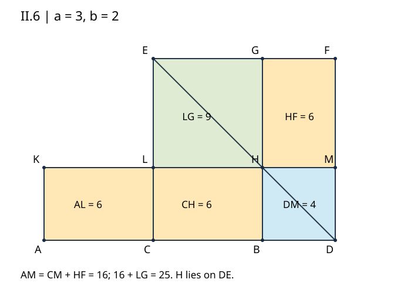

# 《几何原本》II.6：把线段向外延长，为什么仍能补成平方

## 约公元前300年 · 数学与推理前史补读 · 深读v1

**给定两条正长线段的差，再给定它们围成的矩形面积，能把两条线段找出来吗？** II.6先提供一个面积恒等关系：把原线段平分，再沿原方向延长，用“延长后的整段乘延长部分”围出矩形，补上半段的平方，恰好得到更大的一块平方。它不是把II.5的图随手拉长；中点、外部点、对角线、余形和补回的平方，必须重新对齐。

本篇承接[II.5](euclid-elements-ii5.zh-CN.md)，完整阅读第二卷命题6及相关评论。它是从图灵1936—1937样稿回溯古代的**年代跳转与AI推理前史补读**，不是现代AI论文，也不宣称任何一篇为第一篇AI论文。收录以实际核对的来源为范围，不声称穷尽各文明的数学和推理文献。

全文区分**原文证据、教学补足、现代分析、真实实跑**。中文解释、例题及代码是原创教学工作，不是现成译本全文翻译。

## 1 书目、版本与历史问题

| 文献 | 本次范围 | 用途与限制 |
| --- | --- | --- |
| Euclid, *Elements*, Book II, Proposition 6 | 作品传统年代约公元前300年 | 年代归于作品背景，不能据此断定单条命题发现时间 |
| T. L. Heath, *The Thirteen Books of Euclid's Elements*, 1908, vol. I | 印385–386命题全文；386–388评注；卷首ERRATA | [扫描入口](https://archive.org/details/thirteenbookseu02heibgoog)，对应所用PDF406–409页；文件页序与印刷页不同 |
| Richard Fitzpatrick, *Euclid's Elements of Geometry*, revised and corrected 2008 | 印55–56完整希英对照II.6与代数脚注 | [PDF](https://farside.ph.utexas.edu/Books/Euclid/Elements.pdf)，脚注的符号公式不是古代正文 |
| David E. Joyce, Clark University | [II.6正文、图与Guide](https://mathcs.clarku.edu/~djoyce/elements/bookII/propII6.html) | 辅助核对；Guide有局部线段名错误，见第8节，不能直接照用 |

第二卷前四条展示矩形分割和平方组合，II.5处理整段内部的不等分，II.6处理延长线。两者都借助第二卷定义2的gnomon（曲尺形），但补方的对象不同：II.5补“偏离中点”的平方，II.6补“原半段”的平方。结构类似不表示符号可以原封不动移植。

原证直接使用I.46构造正方形、I.31作平行线、I.36等底同平行线间平行四边形等积，以及I.43对角线两侧余形等积。本文补足小正方形资格时还使用I.5、I.6、I.29、I.34。二次问题的构造解释另用I.47；它不属于II.6原证明的必需步骤。

Heath印386–387把“在给定线段上应用一个超过一个正方形的矩形”与二次方程联系起来，并讨论Hippocrates的月牙形求积片段，经Simplicius引述Eudemus而传承的材料。这里有多重证据层级：较早人物的工作、后世引述、1908年的解释，以及对当时可能使用机械嵌入法的推测。**本文没有直接校勘该古代片段，不能把Heath的推测写成已证实的发现史，也不能据此宣布某人首创现代配方法。** 各作者和传统采用同样的可核实标准，不用名气补足证据。

## 2 先把“整段”说清楚

设A—C—B—D依次共线，AC=CB，BD为加在B端的正长延长部分。原段是AB；加长后的整段是AD；半段加延长部分是CD。三个量不能都简称为“全长”。

记Q(s)为边长s的正方形面积，R(s,t)为邻边长s、t的矩形面积。本条的现代面积摘要是：

$$
R(AD,DB)+Q(CB)=Q(CD).
$$

令半段CB=a，延长BD=b，则a、b都严格大于0，AB=2a，AD=2a+b，CD=a+b。这里a、b首先是长度；表达式Q把长度转成面积。线段长度不能直接与面积相加。

### 原图构造

在CD上作正方形CEFD，连接对角线DE。过B作BG平行CE，交DE于H，交EF于G。过H作KM平行AB，分别交CE于L、DF于M；过A作AK平行CE，与KM相交于K。外接矩形在正方形左侧，不改变大正方形的边长。

下表用循环边界展开两个字母的区域简称。CH在面积语句中指矩形，不是线段CH；DM在“DM=DB”中却是线段，语法角色需看上下文。

| 简称 | 循环边界 | 作用 |
| --- | --- | --- |
| CEFD | C—E—F—D | CD上的整体正方形 |
| AL | A—K—L—C | 左侧外接矩形 |
| CH | C—L—H—B | 左上余形 |
| HF | H—G—F—M | 右下余形 |
| BM | B—H—M—D | 右上小正方形 |
| LG | L—E—G—H | 左下缺角正方形 |
| CM | C—L—M—D | 顶部条带，CH加BM |
| AM | A—K—M—D | AL加CM；目标矩形 |

本文表可沿反方向绕同一区域；程序证书提交点位，区域循环顺序由程序固定，不由输入者随意更换。程序将本表BM小方块以键名DM表示，二者边界相同。gnomon NOP表示CH、BM、HF三块合体。N、O、P仅是原图标识曲尺形的辅助字母，不是一个三角形的边界顶点。

## 3 原证为什么先比较AL、CH与HF

### 3.1 中点把外部矩形接进来

AL与CH以AC、CB为底，同在AB与KM两条平行线之间。中点给AC=CB，故由I.36二者等积。这是原证第一处实质使用中点条件，不是为了让图看起来左右均匀。

共同高度是两条平行线的间距；在当前正交图中它也等于CL和BH。原证可以直接援引等积命题，无须先写“底乘高”。若用现代面积公式核查，二者分别为a乘b，但这个数值解释须与原证路线区分。

### 3.2 对角线把左上面积移到右下

H在正方形对角线DE上，两条经过H的分割线分别平行两组边。它们满足I.43，故余形CH与HF等积。于是AL、CH、HF三块等积。

等积不要求三块在图上同一位置。AL与CH为横向矩形，HF则旋转了形状方向。原证明需要的是面积替换，而不是把外接矩形硬塞到不相同的边界中；实际“剪下来旋转”是帮助想象的教学模型，不是原文额外提出的运动公理。

### 3.3 同加CM：左边成长方形，右边成曲尺形

在AL=HF两边各加CM。左边AL与CM沿CL接合，成为整个AM。右边CM与HF沿HM接合，成为gnomon NOP。因此AM与gnomon等积。

这一步比II.5少一层条带转移；不要误把II.5的“先加DM，再加CH”搬来。本条原链是**AL=CH=HF，直接同加CM**。CM本身含CH与BM，所以曲尺形恰是CH、BM、HF，不含LG，也不把BM算两次。

### 3.4 识别矩形的两条边

AM的上边是AD，右边是DM。原文用DM=DB，把AM解释为AD与DB所围的矩形。这个等长关系不是由“看图像一个小方块”得来，第4节给出其资格证明。

最后，把LG补到AM和gnomon两边。LG是CB上的平方的等面积副本；右边gnomon加LG是整个CEFD，也就是CD上的平方。得到本条结论。

以方括号表示区域面积，原证可以记录为：

$$
[AL]=[CH]=[HF],\qquad [AM]=[CM]+[AL]=[CM]+[HF],\qquad [AM]+[LG]=[CEFD].
$$

这是索引，不是自足证明。每次“加”还要说明边界贴合、内部不重叠以及拼出哪个整体；单独的数字总和不足以证明空间覆盖。

## 4 两块小正方形的资格，不能省成一句“显然”

### 4.1 为什么DM=DB

正方形CEFD给CE=CD，三角形CED等腰，故角CED=角CDE（I.5）。BH平行CE，HD沿ED，DB沿DC。由平行角关系，三角形BHD的角BHD等于角CED，角BDH等于角CDE，所以两角相等。由I.6得BH=BD。

BM是由正方形边和平行线组成的矩形，BH=DM（I.34），故DM=DB。并且BH=BD，两邻边相等、夹角为直角，BM为边长DB的正方形。这里“等边”与“直角”各有来源：一个非直角菱形也能四边等长，不能冒充正方形。

### 4.2 为什么LG是CB上的平方

CH为矩形，LH=CB，CL=BH=BD。大边CE=CD=CB+BD，减去CL=BD后得LE=CB。因此LG有两条相邻边LH、LE都等于CB；由外正方形及平行线知角为直角，于是LG为边长CB的正方形。

LG不必实际建在原线段CB的位置上。命题需要的是与CB等边长的平方面积。将“在某线段上的平方”理解成只准放在那条原线段旁，会误解古代面积比较的对象。

### 4.3 内部交点与四格覆盖

因为a、b都正，B在CD内部，且BH=b小于CD=a+b。H便严格位于大正方形内。两条过H的平行分割线形成四个非退化矩形，内部两两不交，共享边界不算面积重叠，四格正好覆盖大平方。

这个位置关系可由原几何构造补足，也可用第5节现代坐标直接说明。后者让程序可以检查内部性，但不应把坐标法倒写成古代原文已采用的语言。

## 5 现代坐标模型：把每个点绑定到输入

以A为原点，沿AB和垂直方向选正交等长基向量u、v。本节a、b改作相对于该基底的正坐标系数，各点写成A+xu+yv，其中x、y为下表系数。令S=u·u，则实际半长为a√S、延长为b√S，单位参数正方形面积为S。第2节把a、b直接当长度的记号对应S=1；非单位基底不能混用这两层含义。

| 点 | 参数坐标 |
| --- | --- |
| A、C、B、D | (0,0)、(a,0)、(2a,0)、(2a+b,0) |
| E、G、F | (a,a+b)、(2a,a+b)、(2a+b,a+b) |
| K、L、H、M | (0,b)、(a,b)、(2a,b)、(2a+b,b) |

DE上点的参数坐标满足x+y=2a+b。B的平行线满足x=2a，联立得y=b，所以H=(2a,b)，且解唯一。不是先写恒等式再用它筛选H，而是先求构造交点。

四格面积为CH=abS、BM=b²S、HF=abS、LG=a²S。AL=abS，CM=(a+b)bS，AM=(2a+b)bS，CEFD=(a+b)²S。相应代数式为：

$$
(2a+b)bS+a^2S=(a+b)^2S.
$$

左侧展开为2abS+b²S+a²S，正好等于右侧。这个展开使用现代数系、乘法分配律及面积公式，是原结论的一种重构和实现规格；它不是以计算机测试证明分配律，也不是整个希腊几何体系的形式化。

代码仅使用普通整数和Fraction的精确有理数。u、v允许有理旋转、反射、缩放和平移；等长垂直避免把任意平行四边形误当平方。但有理输入没有覆盖全部实数或不可通约配置。一般性由数学论证支持，而不是由网格枚举支持。

## 6 手算、边界与反例

### 6.1 半段3，延长2

AB=6，AD=8，CD=5。AL、CH、HF各为6；BM为4，LG为9；CM=6+4=10；AM=6+10=16；曲尺形=6+4+6=16。最后16+9=25。检查原链时，先看6=6=6，再看10+6=16，最后才看16+9=25。

若误用AB乘DB，只得12，补9为21而不是25，恰少了BM的面积4。这个反例直接定位“加长后的整段”被漏写成“原段”造成的错误。

### 6.2 分数例子

令a=1、b=1/2。AB=2，AD=5/2，CD=3/2。矩形面积5/4，小平方为1，合9/4；CH=HF=AL=1/2，BM=1/4。用Fraction可保留这些精确值；浮点显示1.25并不坏，但不能将舍入误差范围当作原等式。

### 6.3 中点若错了，哪里失败

取AC=2、CB=3、BD=1。AD=6，CD=4。左侧R(AD,DB)+Q(CB)=6+9=15，右侧为16。AL与CH同高，却底长2与3不同，所以第一次等积替换失败。图中仍有平行线、对角线和四格，不代表可以删去中点前提。

### 6.4 H若离开对角线，四格总和仍可能正确

在a=3、b=2例中，正确H高度2。若误把横分割放在高度1，四格仍覆盖边长5的平方：CH=3，BM=2，HF=8，LG=12，总和仍25。但CH≠HF，DM≠DB，LG不是所需平方。因此只检查面积总和会漏过关键错误。

即使一份错证书恰好保留最终等式，也应核对点位与输入的绑定。把所有点整体平移，却声称输入原点未变，不应获准；真实几何对象的身份比结果数字更强。

### 6.5 零、负数与方向

b=0时现代式仍成立，但D=B、H=B、小方块及曲尺形退化，不在本次严格正长证书范围。a=0也使原段AB消失。负b若使用有向数可能仍满足代数恒等式，却改变A—C—B—D的次序；它不是原命题允许的“加上一条正长线段”。

若向A端延长，可以交换A、B名称后按同样论证处理。程序接口没有自动吸收所有有向线段约定。反射图形与把延长长度变成负数，是两种不同操作。

## 7 II.5与II.6：相似结构，不同约束

II.5在固定和下求两段：中点到切点的偏移越大，矩形面积越小；半长平方是上界。II.6则在固定差下求两段：AD−DB=AB固定，延长b越大，矩形面积越大，且没有同样的有限上界。

可直接比较b₂＞b₁＞0时两面积之差：(2a+b₂)b₂−(2a+b₁)b₁=(b₂−b₁)(2a+b₁+b₂)＞0。这是现代分析，说明二次问题的正长度解至多一个；不是从几个样本观察“似乎单调”。

两条命题都能写成平方差，但平方的角色互换。II.5是“半长平方减偏移平方等于矩形”，II.6是“半长加延长的平方减半长平方等于矩形”。同一个代数形状不抹去两种几何输入范围。

## 8 二次问题与一次容易画错的圆

**Heath评注与现代教学延伸，不是原证附加步骤。** 给定原段AB=L＞0，指定矩形面积为c²，c＞0，求正长延长x=BD，使(L+x)x=c²。令r=L/2；由II.6，CD²=r²+c²。

构造BQ垂直AB且BQ=c，连接CQ。在直角三角形CBQ中，CQ²=r²+c²（I.47）。以C为圆心、CQ为半径画圆，与AB从B向外的射线交于D。于是**CD=CQ**。因CQ＞CB，D确在B外。II.6再给AD乘DB=c²。

关键不是把BD取成CQ。正确延长是CQ−CB。比如L=6、c=4，CQ=5，故BD=2、AD=8，乘积16。若错取BD=5，则AD=11，乘积55；即使画了一个正确的3—4—5直角三角形，也没有得到所求矩形。

现代根式给出：

$$
BD=\sqrt{r^2+c^2}-r,\qquad AD=\sqrt{r^2+c^2}+r,\qquad r=L/2.
$$

由于c＞0，根号严格大于r，BD为正；另一代数根−r−√(r²+c²)为负，不满足几何输入。若把未知改成AD，则满足x²−Lx=c²，并选择大于L的根。Heath印388说明从该几何观点只取一个合规解，不能把代数的两个实根都当作正长延长方案。

### 网页Guide的局部错误

本次对照Heath印385–388与Fitzpatrick印55–56发现，Joyce Guide“Explanation of the proof”中把AM或对应曲尺形写成AB乘DB，而命题正文及原图要求AD乘DB；同段末尾把大平方的边写为DB，应为CD。最后构造段又把圆弧截出的关系写成BD=CQ，应为CD=CQ。上述6、4的手算能直接检测后一个错误。

这是网页辅助说明的局部线段名问题，不代表其命题正文错误，更不能归给欧几里得原命题。本文保留可核查来源并逐项说明修正依据，不默默改写后宣称来源完全一致。

### “超过一个平方”究竟指什么

矩形AM以AD=AB+BD为一边，以DB为另一边。把它沿B处分为“原段AB乘DB”的部分和“延长BD乘DB”的部分，后一块就是边长DB的正方形BM。所谓超过，是相对于把矩形应用到原段AB而言；不是说矩形总面积一定大于任意给定平方。

Heath印387给出的Simson构造和印386–387对Hippocrates片段的讨论属于评注层。该历史片段中可能使用的neusis（把一段指定长度嵌入规定位置）与此处圆规直尺构造不能混为同一种已核实操作。本篇不复现那份片段的全部求积论证。

## 9 一个有条件的逆命题

Heath印388转述Pappus在关于Apollonius《圆锥曲线》的引理中给出II.5、II.6的逆向结论。本篇只对II.6型关系作现代证明，不声称阅读并译出Pappus原卷。

设A—C—B—D，令AC=p、CB=q、BD=b，均正。如果AD乘DB加CB平方等于CD平方，则(p+q+b)b+q²=(q+b)²。展开并消去共同的q²、b²后，得到(p+q)b=2qb，继而(p−q)b=0。因为b＞0，可以除以b，得p=q，所以C确为中点。

正长延长条件在逆命题中同样关键：若b=0，等式变成q²=q²，无论p是否等于q都成立。比如p=2、q=3、b=0就不能推出中点。它说明从结果反推前提需要额外条件，而不是“正向成立，因此逆向当然成立”。

这里的展开与除法是现代数值重构；Heath的历史归属是转述证据，二者应分别说明。代码核心验证给定中点配置，不应把这个逆命题证明称作额外实现的自动发现功能。

## 10 主张与证据账本

| 主张 | 第一手或可定位来源 | 本文处理 |
| --- | --- | --- |
| AB平分、BD沿直线延长；目标矩形AD×DB | Heath385；Fitz55 | 区分AB、AD、CD，严格正长输入 |
| CD上的平方、DE及平行构造 | Heath385–386；Fitz55–56 | 明确H、L、M、G交点与区域边界 |
| AL=CH=HF，同加CM得AM=gnomon | Heath386；Fitz56 | I.36与I.43前提分开，不套用II.5链 |
| DM=DB，LG等于BC平方 | Heath386；Fitz56 | 补足等腰角、等边、直角与相减 |
| 应用矩形且超过一个平方 | Heath386 | 解释AB×DB与DB²分区，不混淆总面积 |
| Simson圆构造 | Heath387–388 | 圆心C，CD=CQ；BQ为给定平方边 |
| Hippocrates片段及传承 | Heath386–387评注 | 仅间接史料与评注推测，不断定优先权 |
| Pappus逆命题 | Heath388转述 | 另给现代代数证明及b=0反例 |
| 现代恒等式 | Fitz56脚注 | 与原几何证明分层，不当古代原符号 |
| 复现行为和计数 | 附件真实日志及独立技术审查 | 有限实现证据，不冒充一般证明 |

本次检查Heath卷首ERRATA，未见II.6或印385–388对应条目；这只是特定版本、特定范围的检查，不证明所有传本无误。图中的点名字母与OCR抽取交叉核对，公式以实际页图为准，不把乱码补成未经验证的原式。

## 11 复现与验证边界

[复现目录](../../reproduction/euclid-elements-ii6/README.md)保存自有构造器、检查器、测试、算例、原创图、Notebook和真实环境命令日志。它围绕第5节的有理正交坐标规格，检查点位与输入一致、对角线交点、平行边界、两小方块资格、余形等积、条带合成和最终面积关系。

生产检查使用显式异常，避免`python -O`去掉assert后错误输入获得通过。测试需同时含正例、非法输入和证书篡改；仅用同一构造器生成再交回自身检查，仍可能共享错误，因此另有独立技术检查从外部规格建立证书并计算面积。

本次20项unittest在normal、`-O`、`-OO`三模式全部通过，其中网格测试覆盖64构形；四个算例覆盖默认、分数、旋转缩放平移及反射。主运行七条命令退出码均0，见[主运行记录](../../reproduction/euclid-elements-ii6/run-summary.json)。默认例得到AM=16、LG=9、整平方25；其他参数的中间区域面积保存于results.json。改变参数后必须重跑，不能沿用旧日志声称新实跑。

独立技术检查不调用construct生成正例，每种模式建立240份外部证书、对照2160项区域面积、拒绝8400次篡改及83个非法输入，三模式均通过。另显式检查DM=DB和DE对角线。日志见[独立运行记录](../../reproduction/euclid-elements-ii6/independent-run-summary.json)。这些计数描述不同检查用途，不相加包装成定理数量。

生产verify先调用construct共享规范以核对点坐标，然后才作面积等检查，因此它不是完全独立的第二份构造算法；外部技术检查用于降低同源错误风险，仍不是证明助理认证。证书只提交点位，区域边界为内部固定常量，不提供任意多边形或自定义区域证明接口。代码不承诺抵御任意恶意Python对象或超大整数资源耗尽。

Notebook五格按顺序用标准库compile/exec真实执行，并在新命名空间回放比对。**未启动Jupyter kernel**，execution_count保持null，不声称前端渲染或完整nbformat模式校验。已读安装Notebook技能，环境未找到脚手架helper，采用其规范的手建JSON方式；未安装新依赖或伪称运行过helper。

这里不把手算误报成日志，不声称实现了二次根式构造、Pappus原证明或通用几何定理证明器。正文的逆命题、历史讨论和尺规延伸是数学分析，不是额外的程序功能。

## 12 局限、复盘与自动推理启发

本条是理论证明，没有现代训练数据、基线模型或统计性能指标。复现的精确性是有理算术无舍入误差，并不意味着覆盖所有实数；独立双审也不是人类专家背书或证明助理认证。第二卷后续命题不计入本单元完成范围。

对自动推理的启发是本文分析。首先，规则需要对象资格：调用I.43时必须证明H在对角线上，而不是仅检查两块面积相等。其次，名称错误可能保留“听起来正确”的叙述：AB与AD只差一个字母，却少了一整块平方。最后，验证对象应绑定到输入，不能只接受最终数字恰好正确的证书。

原证还展示一种可复用的中间表示：外接矩形与曲尺形不同形，却可以通过有证据的等积替换连接。同一目标量可在不同表示间保持，但每次转换必须交代条件。它是一种教学类比，不是声称古代作者研究了AI或现代程序验证。

### 带答案练习

1. **“整段加延长”是哪条线？** 答：AD，而不是原段AB；半段加延长为CD。
2. **a=3、b=2时目标等式是什么？** 答：8×2+3²=5²，即16+9=25。
3. **AL=CH使用什么条件？** 答：AC=CB且两矩形在AB与KM同一对平行线之间，调用I.36。
4. **CH=HF能只凭图形相似认定吗？** 答：不能；须核对H在DE上及两条过H的平行分割线，才可调用I.43。
5. **本条同加哪块？** 答：CM。AL+CM=AM，HF+CM=gnomon。
6. **曲尺形包括哪三块？** 答：CH、BM、HF；不含LG，也不重复BM。
7. **DM为何等于DB？** 答：由大方等腰三角形和平行角关系得BH=BD，再由矩形对边BH=DM。
8. **LG如何获得平方资格？** 答：LH=CB，LE=CE−CL=CD−BD=CB，且角为直角。
9. **把AB×DB代替AD×DB漏掉什么？** 答：漏掉BD²，即右上小方块BM。
10. **四格面积之和正确是否足够？** 答：不足；错误H也可切出四格，须另查对角线、等积与平方资格。
11. **a=1、b=1/2的矩形面积是多少？** 答：5/4，补1得9/4。
12. **给AB=6、指定面积16，BD是多少？** 答：半长3，CQ=√(9+16)=5，BD=5−3=2。
13. **应令BD=CQ还是CD=CQ？** 答：CD=CQ，因为圆心是C。BD等于CQ−CB。
14. **二次方程有负根，为什么几何只留一个？** 答：负根不满足正长延长和A—C—B—D次序。
15. **若b=0，逆命题为何失败？** 答：面积等式退化为q²=q²，不能从(p−q)b=0除以零得到p=q。
16. **固定差时面积有II.5那样的上界吗？** 答：没有；(2a+b)b随b＞0严格增加且无界。
17. **Joyce Guide出错是否意味着原命题错误？** 答：不是。应逐层对照正文、原图、Heath与Fitz；本篇定位的是辅助说明的线段名。
18. **有理数试验可以证明不可通约情形吗？** 答：不能。有限样本与数域限制仍在；一般结论应由论证承担。

## 附件与审查

- [源码、环境、命令、日志、Notebook与原创图](../../reproduction/euclid-elements-ii6/README.md)
- [独立来源审查](../../reproduction/euclid-elements-ii6/source-review.zh-CN.md)
- [独立技术审查](../../reproduction/euclid-elements-ii6/technical-review.zh-CN.md)

仅公开原创解析、必要书目链接、自有代码和已检查运行证据，不镜像原文PDF或全文翻译，不公开私人对话、账户或秘密。
