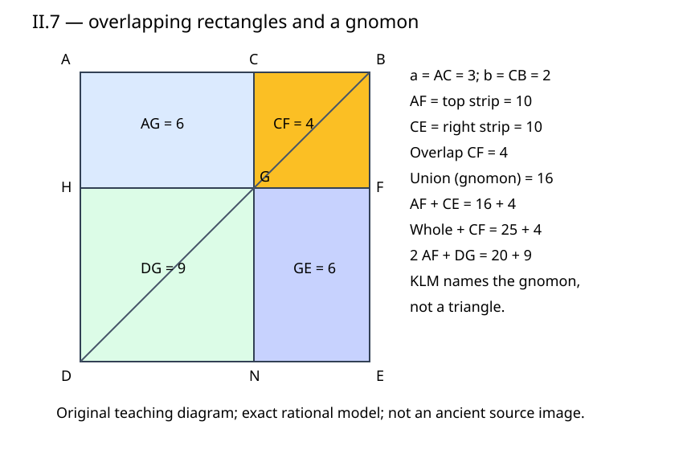

# 《几何原本》II.7：两块矩形重叠，为什么要多算一个平方

## 约公元前300年 · 数学与推理前史补读 · 深读v1

**把同一张图上的两个矩形面积相加，交叠处应该算一次，还是两次？** II.7的要点不只是得到“差的平方”公式，而是认清两个面积总和里，有一块小正方形出现了两次。把这个重数漏掉，即使所有线都画对，证明仍然会少一块面积。

本篇承接[II.6](euclid-elements-ii6.zh-CN.md)，完整阅读第二卷命题7及其紧随评注。它属于从图灵1936—1937样稿回溯古代的**年代跳转与AI推理前史补读**，不是现代AI论文，也不宣称某篇是第一篇AI论文。收录范围以实际核对材料为界，不声称穷尽各文明的推理史。

下文分别标出原文、教学补足、现代重构和真实实跑。中文讲解、例题、程序与图为原创；不是现成译本的全文翻译。

## 1 文献、历史问题与阅读顺序

| 材料 | 本次实际范围 | 作用与限制 |
| --- | --- | --- |
| Euclid, *Elements*, Book II, Proposition 7 | 作品传统年代约公元前300年 | 不能把作品年代当作命题发现日期，也不据作者名气判断首创 |
| T. L. Heath, *The Thirteen Books of Euclid's Elements*, 1908, vol. I | 印388–389完整II.7及389紧随评注；卷首ERRATA | [扫描入口](https://archive.org/details/thirteenbookseu02heibgoog)；所用PDF409–410页，印刷页与PDF页序不同 |
| Richard Fitzpatrick, *Euclid's Elements of Geometry*, revised and corrected 2008 | 印56–57希英对照、图及II.7脚注 | [PDF](https://farside.ph.utexas.edu/Books/Euclid/Elements.pdf)；现代脚注公式不当作古代正文符号 |
| David E. Joyce, Clark University | [II.7正文、图与Guide](https://mathcs.clarku.edu/~djoyce/elements/bookII/propII7.html) | 交叉检查本命题；网页Guide的后续使用说明仅作为导航 |

第二卷不是一套以字母为未知量的现代代数教材。它以正长线段、矩形、平方和曲尺形为对象，把不同构造出的面积联系起来。用现代代数式概括很方便，却会压缩掉“这一块为何是平方”“这两个简称是否是同一区域”“相加时是否重复覆盖”等具体义务。

前四条建立分割与平方组合；II.5和II.6分别讨论中点下的内部不等分与向外延长。本条回到**任意内部分割**，没有中点要求，没有延长段。直接依赖I.46的正方形构造和I.43的余形等积；图中平行线可由I.31作出。小方块资格需要补足平行角、等腰三角形、直角和等边关系，而不能从外观断定。

Heath印389将它解释为“差的平方”关系，与II.4的“和的平方”相对照，并说明两式相加或相减与II.9、II.10、II.8的代数形式有关。这是近代评注的组织方式，不是证明这些命题最初按现代公式生成的历史证据。本篇不以这种对应推断某个古代作者已使用现代符号代数。

先建立区域身份，再读原证明；若只关心实现，可在理解第3节的重叠后读第6、10节。带答案练习在末尾。不存在训练数据、基线模型、损失函数或性能排行榜；本条适合证明重建与教学核验，而非机器学习式复现。

## 2 命题到底比较什么

设A—C—B依次共线，C严格在AB内部。所选分段为BC，另一段为AC。用Q(s)表示边长s的正方形面积，R(s,t)表示邻边为s、t的矩形面积。原命题的现代摘要为：

$$
Q(AB)+Q(BC)=2R(AB,BC)+Q(AC).
$$

面积相加不是线段相加：AB+BC是长度，Q(AB)+Q(BC)才是两块面积之和。原式右边“二倍矩形”也不是把矩形两边都加倍；两边同时加倍会令面积变为四倍。

令AC=a、BC=b，a、b均正，AB=a+b。切点可在左半，也可在右半；a=b同样合法。这里与II.5“不等分”的条件不同，不能沿用上一程序的拒绝规则把中点排除。

### 原图与省略的作图步骤

在AB一侧作正方形ADEB，连接对角线DB。过C作CN平行AD，交DB于G、交DE于N；过G作HF平行AB，分别交AD、BE于H、F。原文简写为作平方并画成图，本篇把这些线逐一展开。

外框的顺序为A—D—E—B。A在左上，B在右上，D在左下，E在右下；这里只是便于对图的方位约定，整体旋转或反射不影响命题。

| 原文简称 | 展开的循环边界 | 面积角色 |
| --- | --- | --- |
| AG | A—C—G—H | 左上余形 |
| GE | G—F—E—N | 右下余形 |
| CF或BG | C—B—F—G | 同一右上小平方，两条不同对角线命名 |
| DG或GD | D—H—G—N | 左下小平方 |
| AF | A—B—F—H | 整个上条带，AG与CF合成 |
| CE | C—B—E—N | 整个右条带，CF与GE合成 |
| 曲尺形KLM | A—C—B—E—N—G—H | 左上、右上、右下三格的合体；可去掉共线冗余点C |
| ADEB | A—D—E—B | 全平方 |

曲尺形的边界也可简记A—B—E—N—G—H。它是外平方去掉左下DG后的L形区域，不是顶点K、L、M围成的三角形。KLM是原图用来指示该曲尺形的辅助字母。本篇原创图用颜色与名称表示它，避免把辅助标识误作可求三角形面积的顶点。

在面积语句中AG通常表示一个矩形；在“连接AG”一类语句中两个字母又可指线段。本条尤其要注意**CF和BG是同一个小平方的别名**。原证明后半从CF换写BG不是新增加一块不同的小方块，也不应自动宣布为排印错误。

## 3 原证明逐步重建：相同面积，保留相加的次数

### 3.1 对角线两侧的余形等积

G在对角线DB上，过G的两条线分别平行外正方形两组边，因此AG与GE正是I.43的两个余形。由I.43，它们等积。

这一步利用的是对角线身份，不是“图形大概对称”。C一般不是中点，AG与GE方向不同、位置不同；等积足以用于面积替换，不要求它们在纸面上重合。I.43本身已在前面的第一卷单元中证明，本篇援引它，不从最后的平方公式倒推出余形等积。

### 3.2 同加CF，得到AF与CE等积

向AG与GE的面积各加一次CF。左边AG和CF相邻，成为上条带AF；右边GE和CF相邻，成为右条带CE。故AF与CE等积，它们面积之和便是AF面积的两倍。

“各加一次”值得慢读。两个比较式中都可以出现同一个区域的面积，这是一种数量运算，不要求在同一张纸上实际剪出两份CF。若采用剪拼直觉，需要想象两份图形的拷贝；数量加法与唯一物理区域并集并不是同一个操作。

### 3.3 为什么会出现额外的一个CF

把AF拆成AG+CF，把CE拆成CF+GE。两者相加便是AG+GE+两次CF。曲尺形只含AG、GE和一次CF，因此AF加CE等于曲尺形加另一次CF。

用方括号表示面积，关键链可以写成：

$$
[AF]+[CE]=([AG]+[CF])+([CF]+[GE])=[KLM]+[CF]=2[AF].
$$

这里KLM指曲尺形。式子中的第二个CF就是两个条带共同的交叠区域。条带并集只是曲尺形，面积小于两个条带的面积和，差额恰为CF。共享边界没有二维面积，不影响上述计数；真正重复的是有正面积的整个右上方块。

这并非另加一条“额外假设”。它是把两个面积和按组成块记账后的结果。现代集合语言可称它为本图的容斥计数，但这种术语是教学说明，不是声称原文定义了现代测度理论。

### 3.4 把AF识别成目标矩形

AF的两邻边为AB与BF。由小平方资格可知BF=BC，故AF就是AB与BC所围矩形的一个实例。因此曲尺形加CF的面积等于目标矩形面积的两倍。

如果只根据AB是上边就直接把AF写成AB乘BC，实际上偷偷用了尚未交代的BF=BC。第4节将把这条长度等式与平方资格展开，以便知道这一步为何成立。

### 3.5 两边补上DG，整理成命题两侧

再同加DG。DG是AC上的平方的等面积副本。左边曲尺形加DG恰好填满外平方ADEB，另一个CF仍保留；右边为二倍目标矩形加AC平方。于是得到外平方加BC平方等于二倍矩形加AC平方。

原文写“曲尺形加BG、GD两个平方”，随后写成“整体ADEB加CF”。它不是把三块不重叠区域简单并起来：曲尺形已经含右上平方一次，另加BG便使它出现两次；GD补齐左下缺角。把BG和CF认成同一块，就能准确追踪这一点。

逻辑次序是：余形等积 → 同加一块 → 两等积条带之和 → 重叠记账 → 识别矩形 → 补全大平方。最终公式只是这条链的压缩标签。

## 4 “是正方形”要证明两种资格

### 4.1 BF为什么等于BC

外平方给AB=AD，三角形ABD为等腰三角形，因此角ABD与角BDA相等（I.5）。CB沿BA，BG沿BD，CG平行AD，利用平行角关系，三角形BCG的角CBG与角BGC分别对应上述两角，故两角相等。由I.6，BC=CG。

CBFG由外框边和两组平行线组成，是矩形；其对边CG=BF（I.34），所以BF=BC。两邻边相等并且为直角，故它确为正方形。只证明四边相等仍不足够，非直角的菱形就是反例；本图直角性来自外正方形及平行线。

### 4.2 DG为什么是AC的平方

矩形ACGH给HG=AC、AH=CG=BC。外框AD=AB=AC+BC，减去AH=BC可得HD=AC。因此左下矩形DHGN的相邻边HD、HG都等于AC，角仍为直角，于是DG为AC上的平方的等面积副本。

它的位置不在原线段AC旁，却有同样边长。这正是面积比较允许的对象替换：比较“在某长度上所作平方”的面积，不是要求每块都贴着原线段原位不动。

### 4.3 内部性与覆盖

a、b正保证C在AB内部；作图的G也在DB内部。两条分割线于是把外平方分成四个正面积矩形。它们内部两两不交，正好覆盖外框。曲尺形加DG成为整体所需的覆盖关系，由这些平行分割及点序支持，而不是由四个面积数字凑巧加成同一个数支持。

若用第6节坐标证明内部性，G距顶边为b，外框高为a+b，确有0＜b＜a+b。坐标解是现代核验方式；原几何论证不需要把一切输入变成可通约整数。

## 5 手算与故意算错：定位错误而不是只看最终值

取AC=3、BC=2、AB=5。AG=GE=6，CF=4，DG=9；AF=CE=10。两个条带面积和20，曲尺形面积6+4+6=16，差4恰为CF。补DG后得到20+9=29，而外平方25加CF4也是29。

这个例子说明三种不同的错法：

1. 若把两个条带的面积和当成它们的并集，就把20错写成16，少了重叠4。
2. 若只写“大平方=二倍矩形+小平方”，就会写25=20+9，同样错4；左边漏了所选段BC的平方。
3. 若把“二倍矩形”解释为长宽各倍增，会得到40而非20，错误发生在倍数而非分割上。

分数例：a=1/2、b=3/2，总长2。外平方4、所选段平方9/4，合25/4；二倍矩形为6、剩余平方1/4，亦25/4。两个余形均3/4；曲尺形15/4，另加9/4得6。小段AC比所选BC短没有任何问题，原证不要求哪一段更大。

等分例：a=b=1。两条带各2，交叠1，并集3，大平方4。最终4+1=4+1。中点在II.7并不退化，四块小格都是正面积；因此本条程序必须接受等分。

### 离开对角线，最终目标式仍可能掩盖错图

仍设a=3、b=2，若横切线放在距顶部1而非2的位置，则AG=3，GE=8，CF=2，DG=12，上条带5，右条带10。四格仍覆盖外平方25；输入长度3、2也仍满足29=29的代数关系。但图中AG≠GE，BF≠BC，CF与DG都不是所声称的平方，原证明不能在此图上运行。

这解释了为什么验证器不能只计算输入的多项式恒等式。它还应把提交点位绑定到输入原点、基向量和对角线交点。把一份正确图整体平移却不更新输入原点，几何内部关系未变，但证书已经不是指定构造的证书，应当被拒绝。

### 端点、负数和任意四边形

a=0或b=0时恒等式作为现代代数式仍成立；但切点并到端点，某些矩形及曲尺形退化，不在本次严格内切的几何输入范围内。负数可用于有向代数，却不能直接当作原命题的正长分段。整体反射和输入负分段是两回事。

若把外平方换成宽5、高4的矩形，仍可以画对角线、得到等积余形，却不能把右上角或左下角任意叫作BC、AC的平方。I.43适用并不意味着本命题全部资格已满足；不同前提各自承担不同的证明责任。

## 6 精确坐标模型与计算规格

**现代教学重构。** 选原点O及非零等长正交基u、v，参数点(x,y)对应O+xu+yv。u沿AB，v朝正方形内部，允许有理旋转、平移、反射和缩放。记S=u·u=v·v＞0，u·v=0；a、b此时是正坐标系数，实际长度AC=a√S、BC=b√S。前面手算直接把a、b作长度，对应S=1。

| 点 | 参数坐标 |
| --- | --- |
| A、C、B | (0,0)、(a,0)、(a+b,0) |
| D、N、E | (0,a+b)、(a,a+b)、(a+b,a+b) |
| H、G、F | (0,b)、(a,b)、(a+b,b) |

对角线DB满足x+y=a+b；CN满足x=a，联立便得G=(a,b)。这是从构造求交点，不是用最终面积等式挑选点位。所有点随后由平行线唯一确定。

在二维等长正交基下，面积尺度为绝对行列式|det(u,v)|=S，无论基底方向是否反射。四块面积为abS、b²S、abS、a²S；两个条带面积都为(a+b)bS；曲尺形为(2ab+b²)S。故程序应核对：

$$
(a+b)^2S+b^2S=2(a+b)bS+a^2S,
\qquad [AF]+[CE]-[KLM]=b^2S.
$$

第一式是命题的坐标形式，第二式直接记录重叠次数。若基向量取u=(3,4)、v=(-4,3)，则S=25；a=3、b=2的所有面积应是单位基例的25倍，而不是5倍。把坐标系数错当实际长度会在非单位基测试中暴露。

代码只接受整数和精确Fraction，不把二进制浮点自动解释为“差不多正确”。有理基与分段可覆盖许多精确构形，但不覆盖所有实数和不可通约配置。一般性来自上面的证明，而非有限网格；程序也不是整个《几何原本》公理系统的形式化。

## 7 与差平方公式的关系：原文与近代评注分开

Heath印389建议把AB、BC看成两条已知线段，且AB较长，AC就是二者差。令x=AB、z=BC，则x＞z＞0；本命题整理为：

$$
(x-z)^2=x^2+z^2-2xz.
$$

这个整理是现代代数说明。原证采用面积相加和补齐整体，未要求把“负面积”当作独立几何对象。若把右侧理解成先从x²中减2xz，在z接近x时中间值会负，例如x=5、z=4时25−40为−15；正确的总式仍是25+16−40=1。**等式的合法性不保证每种随手安排的逐块扣除都对应实际包含关系。** 原图的曲尺形和额外平方避开了这个误导。

II.4可解释和的平方，II.7可解释差的平方。两者组合确能导出后续一些恒等式；但本轮只完成II.7，没有以几行代数替后续命题登记完成，也不把代数捷径倒写成原作者的编排动机。

一个简单的现代推论是两正数平方和至少为其积的两倍，因为差平方非负；相等只在两数相等时。原命题严格内切下x＞z，差平方正，故其实是严格大于。把等号情形补入一般代数命题，需要放宽到x=z的边界，这不等于原内切构造也保持非退化。

与AI推理的联系仅是一种现代分析：验证一段推导，不能只对末行作代数化简，还应检查对象身份、使用次数和前提范围。一个检查器即使能确认恒等式，也未必能确认给定文字确实描述了同一张合法图。这不是声称欧几里得研究了机器学习，也不是本篇实验对任何模型能力的评测。

## 8 两类“相同”与一种不能省的记录

第一类相同是区域身份：CF和BG就是同一区域，其边界顶点相同。第二类相同是数量相等：AG和GE是不同区域但等积。前者允许别名归并，后者允许面积替换。把两者混为一谈，就可能以为GE可以从图上删除，因为它已经“等于AG”；实际上面积和里它仍贡献一次。

同样，AF和CE等积，但空间上并非同一条带。它们共同含CF，因此记录多重集合式的面积和比只记录区域并集更贴合原证明。对于程序，可把各原子块出现次数编码为四元向量，按AG、CF、GE、DG顺序：AF为(1,1,0,0)，CE为(0,1,1,0)，两者和(1,2,1,0)；曲尺形为(1,1,1,0)，额外CF为(0,1,0,0)。再加DG得到(1,2,1,1)，即全平方(1,1,1,1)再加CF。

这份向量记录是本文教学工具，不是声称原文使用线性代数，也不取代余形等积或平方资格。它特别适合查出“数值巧合”：若两原子块面积恰好相等，仅比数字可能看不出交换或漏记身份，系数记录仍能指出不同的推导。

## 9 主张、证据位置与版本边界

| 主张 | 可定位证据 | 本文处理 |
| --- | --- | --- |
| 任意内切，比较全段与BC的平方和 | Heath388；Fitz56–57 | 明确a、b正而可相等，无中点前提 |
| 外平方ADEB，DB与平行分割线 | Heath388图；Fitz56图 | 展开原文省略作图步骤，固定循环边界 |
| AG=GE，同加CF得AF=CE | Heath388；Fitz57 | I.43前提与相邻组成分别说明 |
| AF+CE=曲尺形+CF | Heath388–389；Fitz57 | 明示交叠区域算两次，区分和与并集 |
| BF=BC，DG为AC平方 | Heath389；Fitz57 | 补足等腰角、平行角、直角与相减 |
| BG/CF在证明中交替命名 | Heath389；Fitz57 | 同一小平方的不同对角简称，不视作新块或勘误 |
| 差平方与II.4对照 | Heath389评注 | 近代解释与原证明分层 |
| 后续II.13及卷X使用 | Joyce Guide | 仅导航提示，本篇不声称逐条审完后续引用 |
| 数值、拒绝行为及执行模式 | 附件运行日志、独立技术审查 | 仅实际运行的有限实现证据 |

本次检查Heath卷首ERRATA，未见II.7或印388–389相应条目。这里仅报告所读版本和范围，不保证所有传本无错。尤其印388在II.7标题之前的Pappus逆向命题段属于II.5、II.6的评注，不应因同页就移植为II.7的历史或逆命题来源。

Fitzpatrick的英文脚注把命题写成代数恒等式，是现代译者帮助理解的注解；正文采用的a、b与脚注可能选取相反的分段，比较时应先映射长度身份。图中文字若OCR混淆字母，须回到页图，本篇不以乱码推断新版本差异。

## 10 最小复现与独立核验

[复现目录](../../reproduction/euclid-elements-ii7/README.md)包含自有几何构造与验证、测试、算例、原创图和Notebook。检查目标是：点位绑定到输入、对角线交点、两小平方与两个余形、两个条带相加时的重叠补偿、全平方覆盖及最终面积等式。

生产验证使用显式异常，不依赖优化模式会删除的assert。证书仅提交规定点位，区域边界由程序固定；它不是允许任意多边形、自定义引理或自然语言证明的通用验证器。接受某份证书，表示它符合这份具体坐标规格，不表示原书全部公理已经机器认证。

实际主运行七条命令退出码均0。20项unittest在normal、`-O`、`-OO`三模式分别通过，其中网格项覆盖64构形；四算例包括默认、所选段较长、分数和非单位旋转缩放。默认得到AG=GE=6、CF=4、DG=9、AF=CE=10、曲尺形16、整体25。不同用途的检查不相加包装成定理数量。记录与最终审查绑定如下：

- [主运行与算例](../../reproduction/euclid-elements-ii7/run-summary.json)。
- [独立运行](../../reproduction/euclid-elements-ii7/independent-run-summary.json)。
- [独立来源审查](../../reproduction/euclid-elements-ii7/source-review.zh-CN.md)。
- [独立技术审查](../../reproduction/euclid-elements-ii7/technical-review.zh-CN.md)。

独立技术检查在normal、`-O`、`-OO`每模式建立240份外部证书，比较1920项区域面积，核对720项重叠、并集和结论关系，拒绝8880次篡改及83个非法输入；三模式均退出0。独立脚本初稿曾把CF的反向顶点顺序写错并触发失败，改成正确的GFBC后完整重跑三模式通过；该错误在审查脚本，不是生产算法缺陷。

生产构造器与验证器可能共享坐标规格，因此“自己生成自己通过”并不能排除同源错误。独立技术检查应从外部规格建证书，并另算有向多边形面积的绝对值，检查旋转、反射、非单位尺度、等分、非法输入与篡改。有限测试可以发现错误，不能证明所有实数情形，更不能证明一般定理。

Notebook五格代码以标准库compile/exec逐格真实执行，并在新命名空间回放比对。**未启动Jupyter kernel**，execution_count保持null，不声称检验了前端渲染或完整nbformat模式；已读安装技能，未找到本地脚手架helper，采用明示结构生成的后备方式，未安装额外软件。本篇没有运行学习算法，没有声称训练或完整复现一个AI系统。

## 11 带答案练习

### 练习1：先算重叠，再算公式

AC=4，BC=1。求AG、GE、CF、DG、两条带、曲尺形、公式两侧。

**答案：** AG=GE=4，CF=1，DG=16；AF=CE=5；曲尺形4+1+4=9；两条带之和10=9+1。大平方25加1为26，二倍矩形10加16也为26。

### 练习2：原文为什么改叫BG

某读者看到“同加DG”后原文出现BG、GD，断言漏掉CF。你如何回答？

**答案：** 先列循环边界：BG与CF都是CBFG的对角简称。原先曲尺形+CF再加DG，正是曲尺形+BG+GD。换名未改变区域和次数；不可仅按字母字符串把CF和BG当两个新对象。

### 练习3：等分会失败吗

把程序设计成拒绝AC=BC，理由是前面的II.5要求不等分。是否合理？

**答案：** 不合理。II.7只要求严格内切；等分时四格均为正面积平方，余形等积与重叠链仍成立。不同命题的输入前提不能凭相邻关系继承。

### 练习4：只检查外框覆盖够吗

a=3、b=2而横切高度1的图，四格面积仍合25。为什么证书必须拒绝？

**答案：** G不在DB，AG=3而GE=8；BF=1不等于BC=2，CF面积2不等于BC平方4。覆盖只验证了整体分区，没有验证I.43与平方资格的前提。

### 练习5：尺度因素

u=(3,4)、v=(-4,3)，a=4、b=1。外平方面积、额外小平方和两条带之和分别多少？

**答案：** S=25，外平方25×25=625，小平方1×25=25，条带和10×25=250；再加DG面积16×25=400得650，与625+25一致。长度尺度5，面积尺度25。

### 练习6：符号减法不等于任意剪除

x=5、z=4，能先从边长5平方中剪去两块5×4矩形且不重叠，再补边长4平方吗？

**答案：** 不可能按这个要求剪除，待剪总面积40大于25。代数式25+16−40=1成立，但不承诺这个空间操作。原证用两个相交条带的面积和并显式补偿重叠，避免把代数中间数硬译成可见剩余区域。

### 练习7：测试证明了什么

一个实现通过一万份有理证书，能否宣布已证明任意实长的II.7？

**答案：** 不能。它说明这些输入上的实现结果，且还可能共享同一错误规格。一般证明靠几何关系或具有明确实数前提的代数推导；程序验证、规格准确性与理论一般性是三个不同层次。

## 12 复盘

本条最值得保留的并不是一个熟悉公式，而是一种核验习惯：把区域身份、数量相等和计数次数分开记录。AG与GE是不同区域等积，CF与BG是同一区域别名，AF与CE则等积且相交。只有同时保留这三种信息，才看得见为什么原式要多出一个平方。

下一次遇到“把两块加起来”，先问它们是否相交；遇到“这就是一个平方”，先找等边与直角的理由；遇到“现代公式一样”，再问原输入范围和中间对象是否仍合法。本篇到II.7为止，不以延伸讨论计作下一命题完成。
