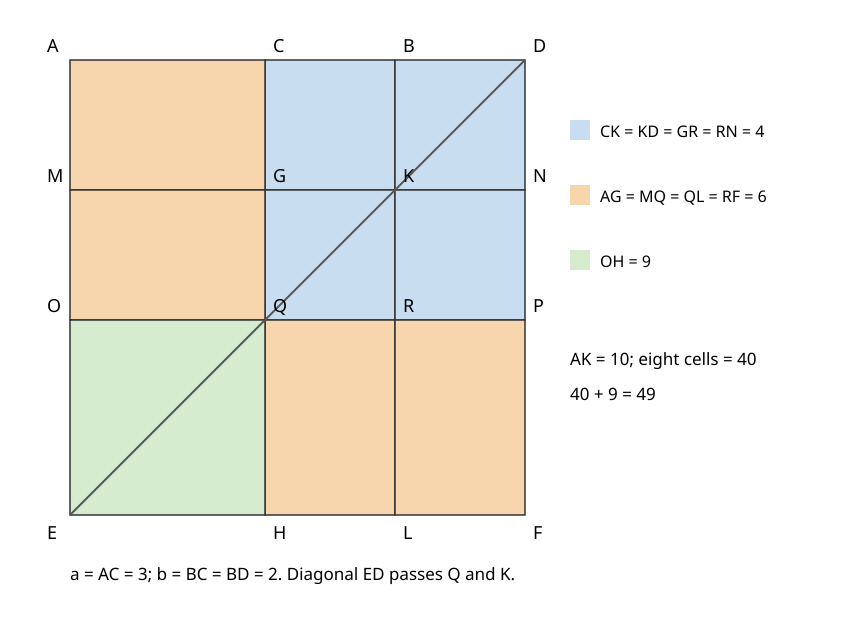

# 《几何原本》II.8：八块区域为什么恰好是四倍矩形

## 约公元前300年 · 数学与推理前史补读 · 深读v1

**图上出现八块，为什么结论却是四倍？** 关键并非把八除以二，而是先证明四块属于第一种面积、另四块属于第二种面积，再把每种各取一块拼成目标矩形。II.8把两次余形等积与两组四倍计数叠在一起；其中每一个“两字母名称”必须指向正确的区域。

本篇承接[II.7](euclid-elements-ii7.zh-CN.md)，完整阅读第二卷命题8及Heath紧随评注。它是从图灵1936—1937样稿回溯古代的**年代跳转与AI推理前史补读**，不是现代AI论文，也不声称存在已经确定的“第一篇AI论文”。收录遵循可核查材料与思想问题，不依据作者或机构名气；这里的文献线索并不穷尽古代数学传统。

正文与教学图为原创中文分析，不是既有译本的全文翻译。下文把原证明、教学补足、近代评注、现代模型与真实实跑分别说明。

## 1 书目、问题和历史层次

| 来源 | 本次实际范围 | 使用方式 |
| --- | --- | --- |
| Euclid, *Elements*, Book II, Proposition 8 | 作品传统年代约公元前300年 | 命题发现日期与具体作者贡献不能仅由汇编署名确定 |
| T. L. Heath, *The Thirteen Books of Euclid's Elements*, 1908, vol. I | 印389–392：II.8完整正文、图、两种替代证明；卷首ERRATA | [扫描入口](https://archive.org/details/thirteenbookseu02heibgoog)，PDF410–413页；印页与文件页序不同 |
| Richard Fitzpatrick, *Euclid's Elements of Geometry*, revised and corrected 2008 | 印57–59：希英对照、图和脚注 | [PDF](https://farside.ph.utexas.edu/Books/Euclid/Elements.pdf)，区分原文与现代公式脚注 |
| David E. Joyce, Clark University | [II.8正文、图与Guide](https://mathcs.clarku.edu/~djoyce/elements/bookII/propII8.html) | 交叉检查图名、推理次序及代数摘要 |

第二卷把线段围成的矩形和正方形作为面积对象。II.4处理和的平方，II.7处理差的平方；II.8的关系可由这两条组合得到，但原证明选择另一条路线：将一张较大正方形细分成九格，把其中八格组成曲尺形。**可由旧命题推出，不代表原文采用了这条最短推导。**

Heath印391报告Pappus引用此命题、Euclid的《Data》命题86使用它，并提到抛物线性质；又把第一种替代证明关联到Clavius等人的做法。这些是本次读到的近代评注所报告的历史线索，不是本篇已经独立阅读Pappus、Data和Clavius全套原文的结论。Joyce所说本条未用于《Elements》其余部分，与Heath谈《Data》等其他著作不矛盾，不能把“书内未再用”扩大成“历史上无用途”。

作品通常置于希腊化时代初期的数学汇编背景，不能把十九、二十世纪编辑者的代数符号倒投为约公元前300年的书写形式。也不能从一个平方恒等式直接推出古代已有现代机器学习或自动定理证明系统。这里值得研究的是对象身份、局部证明复用与面积计数的可检查结构。

## 2 命题的输入和输出

A—C—B依次共线，C严格在AB内部。选定BC作为“所说的那一段”，剩下的是AC。在B外延长AB至D，使BD=BC。因此A—C—B—D共线，AD是AB与BC接成的同一条直线段。

用Q(s)表示边长s的正方形面积，R(s,t)表示邻边s、t的矩形面积。命题的现代摘要是：

$$
4R(AB,BC)+Q(AC)=Q(AB+BC).
$$

“同一条直线”不是两条任意夹角线段首尾相接后的折线长度，更不是把AB与BC当成两条正交边求斜边。四倍矩形是四份面积；把两邻边同时加倍，虽也得到四倍面积，但那不是原图的八格证明。

记AC=a、BC=b，a、b均为正，AB=a+b、AD=a+2b。a=b合法，本条没有II.5的不等分限制。端点C=A或C=B会使若干面积退化，本篇几何输入不接受；代数式在零值仍成立属于扩展，而非原构造已经涵盖退化图。

### 2.1 展开“把图画成双重”

在AD下方作正方形AEFD，连对角线ED。过B作BL平行AE，交ED于K、交EF于L；过C作CH平行AE，交ED于Q、交EF于H。过K、Q各作平行AD的线，分别交左右外边于M、N和O、P。G是CH与MN交点，R是BL与OP交点。由此得到三列、三行。

字母L既是底边上的一个点，不能在同一解释中又不加区分地当作边长变量。以下坐标将总边长记为s。S、T、U是曲尺形标识，不是三角形顶点；原图的虚线弧用于指示区域，不是证明依赖的圆。

### 2.2 两字母区域的完整边界

| 名称 | 循环边界 | 角色 |
| --- | --- | --- |
| CK | C—B—K—G | 第一组左上小格 |
| KD或DK | B—D—N—K | 第一组右上小格，同区域别名 |
| GR | G—K—R—Q | 第一组左下小格 |
| RN | K—N—P—R | 第一组右下小格 |
| AG | A—C—G—M | 第二组上侧左格 |
| MQ | M—G—Q—O | 第二组中侧左格 |
| QL | Q—R—L—H | 第二组下侧中格 |
| RF | R—P—F—L | 第二组下侧右格 |
| OH | O—Q—H—E | 留下的左下平方 |
| AK | A—B—K—M | AG与CK拼成的目标矩形 |
| CP | C—D—P—Q | 包含第一组四格的大平方 |
| ML | M—K—L—E | 第二次I.43应用所在矩形 |

这里CK并非线段CK的长度，除非句子明确谈“连接”或“长度”。同一对字母能在不同句法位置命名线段或以该线段为对角线的区域。DK/KD只是倒序命名，不是多出第五块。

八格合体的边界可写A—D—F—H—Q—O；加上OH后才是外平方。这一边界说明重数为一，与II.7两条带重叠而需额外记一次小平方的情形不同。

## 3 原证明逐步重建

### 3.1 先传递长度，尚未计算面积

BD=BC是作图条件。矩形对边相等给出GK=CB、KN=BD，故GK=KN。同样QR=CB、RP=BD，故QR=RP。这两组等长用于I.36，并不要求先写出任何乘法公式。

还需BK=BD。K处于正方形AEFD的对角线ED上，BD平行EF、BK平行AE；外平方对角线所成的相应锐角相等，故直角三角形BDK的两直角边相等。可从外平方的等腰直角三角形、平行角与I.6补足这一点。由矩形对边相等，CG=BK=BD。又Q在同一对角线上，右上由C、D、P、Q围成的图形也是正方形，CQ=CD。这里同样可由直角三角形CDQ的两个锐角相等得到CQ=CD，再结合两组平行线保证四个直角，并非从外观断言。由于CD=CB+BD=2BD，而CG=BD，剩余GQ=BD。因此CG=GQ。

原文还把GK与GQ相连使用，隐含的正方形资格不能仅凭图像“看起来齐整”代替。本篇后面的坐标核验可帮助发现漏写关系，却不是这段综合证明的先决条件。

### 3.2 第一组：四个小格等积

CK和KD的上底CB、BD等长，并处在AD与MN这对平行线之间，故由I.36等积。GR和RN的上底GK、KN也等长，并处在MN与OP之间，故由I.36等积。

接着看CP：其对角线DQ是外对角线DE的一部分，K在其上。过K的平行分割给出两个余形CK与RN。I.43说明这两个余形等积。

把三条联系接成链，就得到CK、KD、GR、RN全部等积。因此它们面积总和是CK的四倍。这里I.43提供的是两行之间的桥梁；仅有“第一行两块相等、第二行两块相等”，不能推出四块全相等。

### 3.3 第二组：另四块等积

上一步已补足CG=GQ，所以AG、MQ以CG、GQ为等长底，位于AE与CH之间；由I.36等积。QR=RP，所以QL、RF以QR、RP为等长底，位于OP与EF之间；再由I.36等积。

再看ML。其边界M—K—L—E中的对角线EK属于原对角线ED，Q在EK上。过Q的两条平行分割所留下的余形是MQ和QL。因此I.43给出MQ与QL等积。

这次三条联系把AG、MQ、QL、RF接成同一个面积类。它们的总面积是AG的四倍。注意第一组四格与第二组四格**不一定互相等积**：仅当a=b时，它们才恰好全部相同。原证明不需要这个特殊条件。

### 3.4 八块变四倍：先分组，再配对

曲尺形STU由上述八个区域不重叠地组成。因此：

$$
[STU]=4[CK]+4[AG]=4([CK]+[AG])=4[AK].
$$

方括号表示面积。AG与CK共享CG而内点不重叠，合起来的循环边界是A—B—K—M，正是AK。八个区域并不是凭数量直接变成四个，而是四份CK加四份AG，等于四份两者合成的矩形。

AK的邻边为AB与BK，BK=BD=BC，所以AK具有目标矩形AB乘BC的面积。原文有一句把“四倍矩形AB、BD”与“四倍AK”比较，读起来似乎重复，作用正是把图形名称转换为命题中的两条指定线段。

### 3.5 补上OH，封闭目标

OH的直角由两组平行线继承。OQ=AC，而QH=AC：Q在外平方对角线上，使左下子矩形EQ成为正方形，EH=AC。故OH是AC上平方的等积实例，不是仅因四边形位于角落就自动成为平方。

把OH面积同时加到八格曲尺形与四倍目标矩形上。曲尺形与OH共同覆盖外平方AEFD，只有公共边界而没有正面积交叠；于是得到四倍AB、BD矩形加AC平方等于AD平方。最后代入BD=BC，便得到命题。

此处真正需要核查的是三个对象：目标矩形的高确为BC，缺角格的边长确为AC，九格并集确为外平方。只验证最后一个数字等式，会把前两类错误掩盖掉。

## 4 现代坐标模型：让每个名称都可验收

以下是教学重构，不是声称原文使用坐标或乘法面积公式。取s=a+2b，在标准正交坐标中设置：

| 水平层 | 从左到右 |
| --- | --- |
| y=0 | A=(0,0)，C=(a,0)，B=(a+b,0)，D=(s,0) |
| y=b | M=(0,b)，G=(a,b)，K=(a+b,b)，N=(s,b) |
| y=2b | O=(0,2b)，Q=(a,2b)，R=(a+b,2b)，P=(s,2b) |
| y=s | E=(0,s)，H=(a,s)，L=(a+b,s)，F=(s,s) |

ED的方程是x+y=s，所以K与Q都在ED上；先由直线求交得到它们，而非从结论面积反求坐标。三列宽为a、b、b，三行高为b、b、a。因此第一组四格各b²，第二组四格各ab，OH为a²，AK为(a+b)b。九格覆盖可由网格区间直接证明：各列内部互斥且并成[0,s]，各行也如此，其笛卡尔积给出整个平方。

以a=3、b=2为例，外平方边7、面积49。四个小格各4，总16；四个长格各6，总24；曲尺形40；OH为9；AK为10。这里8块的40=4份10，不是8块都等于5，也不是8份目标矩形。

程序还允许把规范点(x,y)映成o+xu+yv，要求u、v为非零、等长且正交的有理向量。若共同平方长度为k，所有面积统一乘k；线段实长统一乘sqrt(k)。因此非单位基不能仍把面积记成原来的ab。平移、旋转、反射均不改变正确的面积关系，但非等长基会把外平方压成矩形，不能冒充原命题的合法输入。

### 4.1 两种压缩推导的地位

令x=AB、y=BC，因C内分，x大于y且均正。由a=x−y、AD=x+y，可以把命题写为：

$$
(x+y)^2-(x-y)^2=4xy.
$$

现代展开法左右直接相消，证明的是一个多项式恒等式，对任意实数x、y都成立。然而几何读法依然要求长度和内部顺序；负值或x=y导致零长度时，代数有效不等于原图可用。

Heath印391的第一种替代证明把II.4与II.7连接起来：II.4给出AD平方等于AB平方、BC平方及两倍目标矩形；II.7把前两平方的和替换为另两倍目标矩形加AC平方。两次二倍合为四倍。这是已有命题复用的短路线，能检查结论，但不能说明原文为什么要画九格。

Heath印391–392还有另一幅图：沿BA向A外侧延长至D，使AD=BC，在BD上作平方，再放入四个目标矩形和余下AC平方。它与正文沿AB向B外侧延长不是同一套字母位置。本文只介绍这条替代构造的安排，不将其图名字母挪入正文或声称代码已逐步模拟第二幅图。附带代码针对正文九格构造。

## 5 反例与错误诊断

### 5.1 把四倍写成二倍

a=3、b=2时，二倍目标矩形加缺角只有20+9=29，外平方49，相差20。此错误可来自只记录两块等积而忘记另外两块，或把两次四格类错误合并。数值能发现错误，但证明定位应回到第3.4节的分组。

### 5.2 八块不等于八份AK

同例八份AK为80，曲尺形只有40。每份AK包含一块6和一块4；它不是单独一格。若a=b，九格都同大，更容易在图像上误读；因此测试既需要等分也需要不等分。

### 5.3 延长段没有复制BC

改令BD=c，若仍坚持原命题左侧四倍AB乘BC，则一般不能等于新的AD平方。取a=3、b=2、c=1，左侧49而新外平方边6、面积36。问题不在面积算法，而在输入没有满足BD=BC。先检查前提再检查结论，才能区分非法实例与理论反例。

### 5.4 共享面积不代表共享对象

CK与RN等积，但不是同一地区；DK与KD则是同一地区。若用一个集合把所有相等面积去重，会把四份合并成一份；若把别名当成不同区域又会重复计数。正确实现应以规范边界识别对象，以单独的等积关系表达数量相等。

### 5.5 只核验恒等式会漏掉坏证书

给出a=3、b=2却把Q从(a,2b)改到(a+1,2b)，最终用参数算出的49=49仍然成立，但Q不再满足对角线和纵线交点约束。验证器必须检查点的字段、类型和几何约束，再计算区域，而不是无视证书只打印参数恒等式。本复现的篡改测试就是针对这种失败方式。

## 6 主张、证据与局限账本

| 主张 | 证据位置 | 本篇处理 |
| --- | --- | --- |
| 延长BD=BC、外平方与双重分割 | Heath389–390；Fitz57–58 | 补出平行线、交点和区域边界 |
| 第一组四块等积 | Heath390上半；Fitz58 | 两次I.36加CP内一次I.43 |
| 第二组四块等积 | Heath390下半；Fitz58 | CG=GQ、QR=RP及ML内余形桥接 |
| 八块为四倍AK | Heath390末–391首；Fitz58 | 显式保留区域身份与计数 |
| OH是AC平方并补满 | Heath391；Fitz58–59 | 补足正方形资格与覆盖 |
| II.4、II.7的替代路线 | Heath391 | 近代评注层，不替换正文证明 |
| 另一侧延长的四矩形拼法 | Heath391–392 | 介绍构造差别，不纳入当前代码覆盖 |
| 历史用途与引用 | Heath391评注 | 按评注转述，未独立校读所引著作 |
| 程序结果 | 附件真实日志与独立审查 | 有限有理样本和受限证书接口，不是全形式化证明 |

卷首勘误页已目视核对，没有发现针对本条印389–392的条目；这一结论只针对已检查的那张勘误表，不能推出全部版本绝无错误。Fitzpatrick脚注采用的a、b约定与本文不完全同名，比较时先对照“选定分段”和“剩余分段”，不能仅凭字母交换判为公式错误。

范围上的缺口也应保持清楚：正文几何允许不可公度长度；程序只运行精确有理参数和有理基。标准库分数算术避免本实验的舍入误差，但不因而穷尽连续平面。程序所验证的是一个明确构造族的输入及证书，不是任意Euclid证明文本。外部独立检查减少同源实现错误，却不等于证明助理认证或人类专家评审。

## 7 对推理系统的合理延伸

**本文分析。** 本条提供一个适合检查器教学的例子：先把符号映射为对象，再验证等积边，再检查聚合。原图有两个局部证明子图，每个由I.36、I.36、I.43三条联系连通四个区域。最终组合依赖的是局部输出的正确接口，而非重新计算所有旧定理。

现代系统若把“相等”混成一种关系，就可能把区域同一、面积相等、边长相等混用。本条至少需要三种类型：点/线段/区域，以及两种不同判断：对象别名和数量等价。把类型写清楚，是比“模型最后答对49”更强的检查目标。

另一个启发是覆盖证明与等积证明应分开。即便八个区域各有正确面积，如果它们有重叠或缺口，总和也不一定是曲尺形。这里网格提供可检查的无重叠分区；在一般图形任务中，需要额外的几何覆盖论证。本篇没有据此宣称任何AI模型已经具备可靠视觉推理。

在程序验证语言中，结论接口可以承诺“这份合法输入的规范构造通过全部检查”，不能承诺“任何看似相近的图片都满足定理”。通过率、拒绝非法输入的数量、证明一般性，是三种不同的证据。

## 8 最小复现与复盘路线

附件保存自有源码、原创图、环境信息、实际命令、单元测试、算例、Notebook及独立审查。核心使用Python标准库的精确有理运算，不需GPU、训练数据、模型基线或付费服务。

[复现入口](../../reproduction/euclid-elements-ii8/README.md)给出可重跑命令；[来源审查](../../reproduction/euclid-elements-ii8/source-review.zh-CN.md)核对原文和本文；[技术审查](../../reproduction/euclid-elements-ii8/technical-review.zh-CN.md)给出独立构造、面积比较、篡改拒绝和最终正文哈希。实际运行20项单元测试，normal、-O、-OO三模式均通过，其中网格项覆盖64个正整数构形。四个算例输出分别为：a=3,b=2时四倍AK为40、OH为9、全平方49；a=b=2时32+4=36；a=1,b=4时80+1=81；a=2/3,b=5/7时580/147+4/9=1936/441。Notebook五个代码单元按顺序以标准库compile/exec执行，随后在新命名空间回放并核对已存输出；没有启动Jupyter kernel，不能称为内核执行或完整交互渲染验证。每条实际命令、退出码与环境版本均保存在附件。独立技术脚本不调用生产construct生成外部证书；每模式240份外部证书、14个区域共3360次面积比较、40080次篡改拒绝和49项非法参数拒绝全部通过。三模式均为真实exit0；这些数量表示本次有限检查覆盖，不是无穷域正确性证明。

建议按四步复盘：先不看公式，口述两组四块；再把每个区域名展开成循环边界；然后核查两个I.43分别作用于CP和ML；最后才运行代码比较面积。若只能记住平方差公式，却不能指出八格中哪四块属于哪一组，就还没读懂原证明的组织方式。

## 9 带答案练习

### 题1 八格为什么不是八倍目标矩形？

**答案。** 四格各等积于CK，另四格各等积于AG。AK由AG与CK组成，所以总和是四份AK。没有断言每格等于AK。

### 题2 列出第一组等积的三座桥。

**答案。** CK=KD由等底同平行线I.36；GR=RN也由I.36；CK=RN由CP中I.43。缺少第三条时两行之间仍无根据。

### 题3 第二次I.43作用于外平方吗？

**答案。** 此处直接作用于ML，即M—K—L—E，其对角线EK经过Q，余形是MQ与QL。它嵌于外平方，但不能省略局部宿主和分割点身份。

### 题4 a=2、b=5时逐项计算。

**答案。** AB=7、AD=12；四个b²小格各25，总100；四个ab格各10，总40；OH=4；AK=35。140+4=144=12²。此例选定分段较长仍合法。

### 题5 a=b=1应拒绝吗？

**答案。** 不应。任意内分允许中点，九格各1，八格曲尺形8=4×2，再加OH的1得9。把II.5的不等分限制复制到本条是接口错误。

### 题6 令x=AB、y=BC后，x=y为什么不能直接作为原图实例？

**答案。** 它使AC=x−y=0，C与A重合，缺角平方退化。代数恒等式仍成立，只说明代数扩展允许该值，不说明严格内分构造满足。

### 题7 非单位正交等长基u=(3,4)、v=(-4,3)怎样改变面积？

**答案。** 共同平方长度为25，映射把长度扩大5倍、面积扩大25倍。a=3、b=2时AK面积250、OH225、外平方1225；四份250加225等于1225。只旋转而忘记缩放因子会误报。

### 题8 两条区域名顺序反过来是否都是同一区域？

**答案。** 对这里按相对顶点命名的KD/DK是；但不能把任意两个名称因面积相同就当同一对象。CK和RN边界不同，只等积。必须回到明示的区域表。

### 题9 给出不画九格的短证明，并指出它的局限。

**答案。** II.4展开AB+BC的平方，II.7把AB平方与BC平方之和替换成二倍目标矩形加AC平方，合并得到四倍。它证明结论，却没有解释九格的对象识别、CP与ML余形、或程序证书如何检查。

### 题10 有限测试通过能证明所有实长情形吗？

**答案。** 不能。有限有理实例甚至不穷尽全部有理输入。一般证明来自几何推导；测试支持本次代码在明确输入集合上的行为，并能揭示类型、缩放、重数和篡改接受错误。

## 10 版本说明

本篇为AI辅助的原创中文深读v1，核验日期2026年10月29日。读到II.8正文及相关评注为止；后续命题未在本单元中完成。公开材料不包含来源PDF、全文翻译或私人工作记录。独立审查是独立执行路径的核验，不包装成人类专家背书；准确覆盖范围以本文账本和附件真实日志为准。
