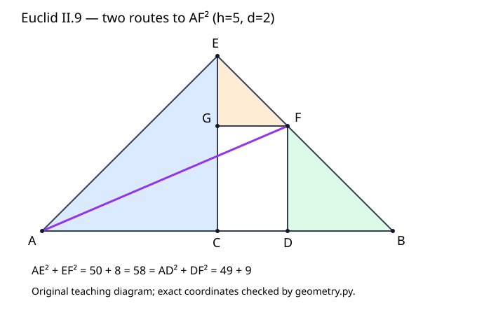

# 《几何原本》II.9：不画正方形，怎样证明两个平方和相等

## 约公元前300年 · 数学与推理前史补读 · 深读v1

前几篇把大正方形分成小块，沿余形、曲尺形和覆盖关系计算面积。II.9忽然换了路线：图上只画线段和三角形，结论却仍然谈正方形面积。诀窍不是省略面积，而是让**同一条辅助线AF的平方获得两份不同的计算证书**。一份证书通向不等分后的两段，另一份通向半段与偏离中点的距离。

本篇承接[II.8](euclid-elements-ii8.zh-CN.md)，完整读II.9及Heath相关评注。它属于从图灵1936—1937样稿回溯古代的年代跳转与AI推理前史补读，不是现代AI论文，不把图灵样稿或这部古代著作称为第一篇AI论文。目录依可核查材料与思想问题收录，不按作者、机构名气优待，也不声称穷尽古代传统。

下文为原创中文分析，不是现有译本的全文翻译。**原证明**、**教学补足**、**近代评注**、**现代推论**、**真实实跑**分别标明。读者应能回答：哪些角已经证明是直角，哪条边是斜边，哪一个等式允许替换，以及为什么左右两种切点不必分别发明定理。

## 1 书目与这次转向的意义

| 文献 | 实读范围与定位 | 证据层级 |
| --- | --- | --- |
| Euclid, *Elements*, II.9 | 作品传统年代约公元前300年 | 汇编年代不等于命题发现日期，也不能据署名确定每条证明的个人归属 |
| T. L. Heath, *The Thirteen Books of Euclid's Elements*, 1908, vol. I | 印392–395：II.9正文、图、两种补充证明；卷首ERRATA | [扫描入口](https://archive.org/details/thirteenbookseu02heibgoog)，PDF413–416页；印页与PDF页序不可混用 |
| Richard Fitzpatrick, *Euclid's Elements of Geometry*, revised and corrected 2008 | 印59–60，II.9希英对照、图、公式脚注 | [PDF](https://farside.ph.utexas.edu/Books/Euclid/Elements.pdf)；脚注代数式是现代解释，不是古代原符号 |
| David E. Joyce, Clark University | [II.9正文及Guide](https://mathcs.clarku.edu/~djoyce/elements/bookII/propII9.html) | 交叉检查正文、辅助讲解及后续使用提示；网页的代数变量需独立校对 |

**Heath评注，印394。** 他指出第二卷前八条的证明独立于I.47，而从第九条起转而使用I.47；II.9与II.10也不再把结论涉及的各个矩形、正方形直接画出。这个判断限定在第二卷的这组证明，不是说欧几里得此前所有命题都只是“剪纸”。I.47本身当然已在第一卷出现，并且我们已经[单独读过I.47](euclid-elements-i47.zh-CN.md)。

因此这里可以观察到一种证明策略的转换：先前追踪面积区域的边界、重数和覆盖；现在追踪三角形的直角资格与边长替换。两者都要交代对象，只是对象管理发生在不同层面。图上不画正方形，并不取消“边长平方代表该边上正方形面积”的几何意义。

Heath还把II.9与下一条之间的关系类比于II.5与II.6的内分/外延关系，并写出和、差平方的统一表述。本单元只完成II.9；对下一条的提及只是所读评注的定位，不算已经阅读或发布II.10。Joyce提示本条用于第十卷X.60的一个引理，这是后续阅读线索，本篇没有独立重建那一引理，不将其作为当前证明的前提。

## 2 输入不是任意四点

原文给一条AB，在C等分，在D不等分。先按图取A—C—D—B依次共线。C是中点，D严格在CB内部。设AC=CB=h、CD=d，则AD=h+d、DB=h−d，且0<d<h。这里的“等分与不等分”是同一整段上的两个切点，不是两条不同总长的线。

用Q(s)表示边长s的正方形面积，结论是：

$$
Q(AD)+Q(DB)=2\bigl(Q(AC)+Q(CD)\bigr).
$$

两边都是面积，不是长度；右侧的2乘整个括号。若只把AC的平方加倍而不加倍CD的平方，结论通常错误。Q(AD)+Q(DB)也不是Q(AD+DB)，后者还多一个交叉矩形的两倍。

### 2.1 D在另一半怎么办

原定理不要求不等分点只能落在中点右边。若原来A—D—C—B，则交换端点的名称A、B；两项Q(AD)、Q(DB)互换，和不变，半段长和CD也不变。因此可把它归约到所画情形。这是**教学补足的对称归约**，不是说原图同时画出了两种情形。

在代码里，所构造的核心证书采用右半规范位置；反射整个坐标图不会改变这个命名顺序所代表的几何关系。若输入接口只接受正偏移d，就不能把输入负d被拒称为“定理不适用于左半”。这是接口范围与定理范围的区别。

### 2.2 退化值的边界

D=C意味着d=0，已经不是“不等分”；D=B意味着d=h，DB=0，三角形FDB退化。代数式可以延续到这两个值，但原来的非退化三角形证明步骤不再逐句适用。复现拒绝它们，不把数值等式成立误判成构造合法。更远的D在AB外，属于另一个几何配置，本篇不让它悄悄混进输入。

## 3 为什么要造一个高为半段的屋顶

在C处作CE垂直AB，使CE=AC=CB；连AE、BE。过D作DF平行CE，与EB相交于F；过F作FG平行AB，与CE相交于G；连AF。

图是本文重画的教学图，不是原书扫描。E位于C正上方只是坐标显示习惯，旋转或反射不改变证明。F必须是DF与EB的交点，G必须落在CE上；不能把它们当作可任意拖动的辅助点。

| 对象 | 构造或已知条件 | 后面承担的任务 |
| --- | --- | --- |
| C | AB中点 | 让左右半段都等于CE |
| E | CE垂直AB，CE=AC | 产生两块等腰直角三角形 |
| F | 过D的竖向平行线与EB的交点 | 同时属于AEF与ADF两套直角计算 |
| G | CE与过F的水平平行线交点 | 把偏移CD转成GF，并产生EG=GF |
| AF | 连接A和F | 两份平方和证书共用的中间对象 |

构造权限来自I.11（在直线上一点作垂线）、I.3（截取等长线段）、I.31（过点作平行线），连接两点使用直线公设。图中的交点位置不是靠“画得像”保证。以本节的右半内部切点为前提，DF进入三角形CEB并在边EB内部相交，FG则在CE内部相交；下一节的坐标模型给出这些位置的独立核算。这里不把坐标核算倒称为原文采用的存在性证明。

**动机重建。** 为什么偏偏CE=h，而不是随便一个高？因为这会使ACE和ECB各有一对等长直角边，于是屋顶顶角AEB恰是直角。若CE换成其他长度，AF仍可画出，但AEF一般不再是直角三角形，第三次I.47就失去资格。辅助线的尺寸不是审美选择，而是为后来那次定理调用预先设计条件。

## 4 在计算平方以前，先把角与等长边证明完

### 4.1 两个半直角拼出顶角

AC=CE，所以在ACE中，I.5给出∠EAC=∠AEC。∠ACE是直角，I.32说明另两角之和为一个直角；两角相等，因此每个都是半直角。对ECB同理，∠CEB和∠EBC也各是半直角。

EC在∠AEB内部，故∠AEB=∠AEC+∠CEB，是一个直角。F在射线EB上，所以∠AEF与∠AEB是同一个角，也是直角。**F属于EB**这条关联就是把大图的角资格传递给小图的依据。

这里可用现代45度描述“半直角”，但原证明不需要角度单位，更不使用三角函数。若只写“这显然是45度”，就会把I.5与I.32承担的工作藏起来。

### 4.2 小三角形EGF的两条腿相等

EG沿EC，EF沿EB，所以∠GEF是刚才的半直角。FG平行AB，而EC垂直AB，I.29将直角传递到∠EGF。EGF三角形余下的∠EFG也为半直角，于是∠GEF=∠EFG。由I.6，面对这两个等角的边GF与EG相等。

注意次序：先从平行关系得到直角，再由角和得到另一角，最后由等角推出等边。不能在同一个论证里先假设EG=GF来证明角相等，再拿角相等“证明”EG=GF。

### 4.3 小三角形FDB复制短段DB

BF沿BE，BD沿BC，因此∠FBD=∠EBC，是半直角。DF平行EC，DB沿AB，故∠FDB为直角。三角形角和再给∠DFB为半直角。I.6于是给FD=DB。

这一步特别容易漏。第四次I.47产生的是AD与**DF**的平方和，而题目要求AD与**DB**的平方和；FD=DB才让这两份表达式连接起来。把图中“竖边看起来等于横边”当作依据，等于漏掉了最后替换的许可证。

### 4.4 矩形CDFG把CD送到GF

CD平行GF、DF平行CG，所以CDFG是平行四边形。由I.34，其对边GF=CD。它实际上是矩形，但本处只需要对边相等，不必额外证明四角均直角才应用I.34。

至此准备完四件事：AEF在E处直角；ADF在D处直角；EG=GF=CD；DF=DB。再加ACE原本在C处直角及AC=CE，平方运算的每一步都有了明确入口。

## 5 四次I.47，汇合到同一AF

下表把原文印393–394的计算压成四张证书。Q只表示平方的面积，不是任意函数。

| 次数 | 直角三角形 | 直角顶点与资格 | 斜边 | 输出 |
| --- | --- | --- | --- | --- |
| 1 | ACE | C，构造CE垂直AB | AE | Q(AE)=Q(AC)+Q(CE)=2Q(AC) |
| 2 | EGF | G，FG平行AB | EF | Q(EF)=Q(EG)+Q(GF)=2Q(CD) |
| 3 | AEF | E，由两半直角相加且E,F,B共线 | AF | Q(AF)=Q(AE)+Q(EF) |
| 4 | ADF | D，DF平行CE | AF | Q(AF)=Q(AD)+Q(DF) |

第三张证书把前两张相加，第四张则走向待证左侧。综合得到：

$$
\begin{aligned}
Q(AF)&=Q(AE)+Q(EF)=2Q(AC)+2Q(CD),\\
Q(AF)&=Q(AD)+Q(DF)=Q(AD)+Q(DB).
\end{aligned}
$$

两个量等于同一个Q(AF)，故相等。这里无需求AF的长度，更不需要开平方。证明既没有比较两张不同图的“相似程度”，也没有把平方和直接当作长度和。它比较的是同一条线段所确定的同一个面积对象。

### 5.1 为什么不是五次勾股定理

ECB也是直角三角形，但这里只用它证明半直角；没有计算EB的平方。AEB也是直角三角形，却没有用AB作斜边计算。图里有直角三角形，不表示每个都调用了I.47。明确列出四次实际调用，能区分几何准备和面积计算，避免把“有六个三角形”误说成“应用六次勾股”。

### 5.2 有向量知识也不应跳过这层

现代读者可以说AE与EF的向量点积为零，因此平方范数可加。但这替换了原文的角度推导系统。本文在实跑中用点积检查直角，只把它标为现代证书核查；它不能冒充原文已经写出内积空间的语言。

## 6 现代坐标重构与一个完整手算

取A=(0,0)、C=(h,0)、B=(2h,0)、D=(h+d,0)、E=(h,h)。EB所在直线满足x+y=2h，DF所在直线满足x=h+d，故F=(h+d,h−d)。G=(h,h−d)。由0<d<h，F在EB内部、G在CE内部，所有相关三角形非退化。

直接可见EG=GF=d，DF=DB=h−d；AE的向量为(h,h)，EF为(d,−d)，点积hd−hd=0，故AE垂直EF。这里没有调用待证恒等式来“验证”直角，而是从构造的坐标关系单独算出。

平方长度分别为AE²=2h²、EF²=2d²、AF²=(h+d)²+(h−d)²。因AE与EF垂直，它们组成的折线两边平方之和也是AF²。故原证明在坐标下对应：

$$
(h+d)^2+(h-d)^2=2(h^2+d^2),\qquad 0\lt d\lt h.
$$

作为实数多项式等式，它对任意实数h,d成立；作为本篇所画非退化内切配置，必须保留右侧条件。删除条件会扩大代数等式的域，却不会自动扩大原构造的合法域。

### 6.1 h=5，d=2

这给AB=10、AD=7、DB=3、CD=2。点E=(5,5)、F=(7,3)、G=(5,3)。逐步核算：

1. ACE：25+25=50，因此AE²=50。
2. EGF：4+4=8，因此EF²=8。
3. AEF：50+8=58，因此AF²=58。
4. ADF：49+9=58，因此AD²+DB²=58。
5. 题目另一侧：2×(25+4)=58。

AF本身等于√58，通常不是有理数，但所有平方值均为整数。精确复现因此无需浮点近似√58，也无需因为边长开根号就引入容差。把“坐标有理”与“所有线段长度有理”混为一谈，会不必要地收窄实验。

### 6.2 分数与尺度

取h=3/2、d=1/2，则AD=2、DB=1、CD=1/2，左侧4+1=5，右侧2×(9/4+1/4)=5。构造只依赖相加、相减与垂直关系，不偏爱整数。

若图整体放大三倍，所有长度变三倍，平方值变九倍；原例的58变522，而非174。代码允许正交等长但非单位的两条基向量，正是为了测试这个量纲。参数h,d是基坐标系中的系数，物理边长还要乘共同基长度；不能在非单位基上把h²直接当实际面积。

### 6.3 左半点的手算

若AB=10，原D距离A为3，则原顺序A—D—C—B。交换端点后，新AD=7、新DB=3、CD仍2，归约到上例。原左侧3²+7²仍58。这个解释不要求为负d伪造一份右半构造证书。

## 7 两种替代证明：结论相同，依赖不同

### 7.1 Heath印394的半代数证明

这里仍把平方、矩形看作面积，现代记号只是帮助跟踪。AD=AC+CD。由II.4，Q(AD)=Q(AC)+Q(CD)+2R(AC,CD)。另一方面，对CB在D处分段使用II.7，Q(CB)+Q(CD)=2R(CB,CD)+Q(DB)。

将这两式交叉相加，再利用AC=CB，使R(AC,CD)=R(CB,CD)，从等量两边减去同样的两倍矩形，得到Q(AD)+Q(DB)=Q(AC)+Q(CB)+2Q(CD)=2Q(AC)+2Q(CD)。

这条链完全避开AF与I.47。它说明已读旧命题足以重建结论，不说明原作者“本来应该采用更短方法”。更不能倒过来把本条结论作为II.7的前提，再说II.7证明本条；依赖方向必须先固定。

### 7.2 Heath印394–395的几何分割证明

这张补充图重新使用了一组字母，与第3节的三角形图不是同一图；以下CK、NE、OQ等均只指补充图的区域，不能与主图的边AF或DF混算。Heath还构造AD、DB上的正方形，并在较大的AD平方内切出一块AC平方与两块CD平方。大平方的其余部分是两个矩形CK、NE；它们分别等积于KN、PM。另一张DB平方可换成等大的OQ平方，KN、PM、OQ合成第二块AC平方，于是总量为两块AC平方加两块CD平方。

为避免把这段说成凭图挪块，可以用现代面积尺寸核查它的账本。令h=AC、d=CD，较大平方边长h+d。先取h²和2d²，剩余面积为2hd−d²；再加短段平方(h−d)²，得到h²。这个代数核查只检验面积总账，不证明指定CK、NE确实可按原分割边界移动。原图的矩形对应和位置依据见Heath印394–395；本篇的自有程序只验证原来的三角形构造，不声称也执行了这套分割移动。

这两个补充证明可作为选路练习：一条把已知面积等式组合消项，一条把剩余区域重新拼合。正文选AF路线，重点是同一中间对象的双重表达。不要把三种方法揉成一份来源不清的“原证明”。

## 8 反例如何找出真正的前提

**非中点C。** 令A=0、B=10、C=4、D=7，仍把CD=3、AC=4代入所声称的式子。左侧7²+3²=58，右侧2×(4²+3²)=50。差8。这直接说明“C在AB上”不够，必须是中点。

**任意高度E。** 保持A=0、C=5、B=10、D=7，但把E改成(5,4)。F=(7,12/5)。从E指向A与F的向量分别为(−5,−4)和(2,−8/5)，点积−10+32/5=−18/5，并非零。题目涉及的原长度恒等式仍然成立，但这张错误辅助图不能支持第三次I.47。结论真与所给证据有效是两回事。

**不是正交基。** 把标准图沿斜基变形，平行与中点可能保留，但直角一般消失。仿射变换并不普遍保留欧氏长度平方；复现只接受正交等长基，不能把任意可逆坐标变换当作刚性相似变换。

**把平方和误换成长度和。** 取h=5、d=2，(h+d)+(h−d)=10，不等于2(h+d)=14。原定理中的平方不能随意删掉；证明需要勾股关系，不是一般线性和式。

**篡改F却保留最后结论。** 因最后结论只涉及A、B、C、D，有人能把F任意移走，同时让最终标量58=58继续成立。若验证器只看最终等式，就接受了失效证据。因此复现检查所有点位置、相关垂直与等长关系、四个I.47等式，而不是只计算待证式。

## 9 合理延伸：平均、偏差与平方和

以下是现代推论，不声称Euclid在讲统计学。设两段长为u、v，半总长h=(u+v)/2、偏离中点的距离d=|u−v|/2，则本条给u²+v²=2h²+2d²。固定u+v时，h固定；不平衡增加的平方和恰是2d²。

因此在正长度且总长固定的范围，平方和在u=v时最小。原II.9假设不等分，故其严格非退化版本只给“大于均分极值”的部分；把等分值纳入结论，可直接代入代数式验证，不需要假装原辅助三角形在d=0仍非退化。

更一般的向量平行四边形恒等式可以用内积展开得到，但它包含多维向量与内积的额外定义。本篇只有一维两段的几何模型，不能由一次图例声称证明所有范数空间都成立。比如平面上的1范数，取x=(1,0)、y=(0,1)，两项和/差的范数平方和为4+4=8，而2(||x||²+||y||²)=4，便不满足对应恒等式。推广须声明欧氏内积条件。

**与可检查推理的联系。** AF像一个共享中间结果：左右两条证明路径都要指向同一对象，并在每次调用定理前检查前提。这给自动证明或教学检查器一个有用范式，但只是本文方法论延伸。古代文本并没有给出机器可读证明格式，附带Python检查器也不是一个完备的欧氏几何证明助理。

## 10 来源校对与主张账本

Heath卷首ERRATA本次已目视核查，没有列出II.9印392–395的对应更正；这只能说明所读勘误页未列本处，不能宣布所有版本完全无误。Fitzpatrick正文与Heath在四次I.47和等长替换上相符，脚注将不等段记为a、b，是另一套变量而非图上顶点名。

Joyce Guide的第二种代数解释写AC、CB为y，又把BC设为x。按图BC=CB已经等于y，不能同时将x视为独立短段；其紧接的(2y−x)²+x²表达式所需的x应为DB（或BD）。这是辅助讲解的变量名问题，不是本文发现欧几里得原命题错误。以AC=CB=5、DB=3代入可得7²+3²=58；若把BC也置为x=5，就把切点依赖误消掉，只剩均分特例。正文保留明确的h、d约定以免继承歧义。

| 主张 | 实际定位 | 本篇核验边界 |
| --- | --- | --- |
| 同段等分与不等分的条件 | Heath392；Fitz59 | 左半归约由本文补足，退化值另分层 |
| CE等半段、两组平行线与AF | Heath392图及构造；Fitz59 | 坐标用于独立位置核验，不冒称古代符号 |
| 半直角、EG=GF、FD=DB | Heath392–393；Fitz59–60 | I.5/I.6/I.29/I.32逐步展开 |
| GF=CD与四次I.47 | Heath393–394；Fitz60 | 确认每次直角、斜边及等长替换 |
| 第二卷证明方法转向 | Heath394评注 | 限定本卷，非古代数学整体史断言 |
| 半代数及分割替代证法 | Heath394–395 | 阅读并解释，程序未模拟分割方案 |
| Joyce变量名问题 | Guide“Interpretations”第二段 | 用图定义与公式交叉核验，不替作者臆造新定理 |
| 第十卷使用提示 | Joyce Guide末段 | 只列线索，未宣称已完整核验X.60 |
| 平均偏差与范数反例 | 本文现代推论 | 不归属Euclid，不以有限代码证明推广 |

## 11 真实最小复现与可重跑证据

附件见[复现说明](../../reproduction/euclid-elements-ii9/README.md)、[独立来源审查](../../reproduction/euclid-elements-ii9/source-review.zh-CN.md)、[独立技术审查](../../reproduction/euclid-elements-ii9/technical-review.zh-CN.md)。公开目录提供源码、测试、原始结果、命令、环境、Notebook和净化后的真实日志，不附原书PDF。

复现对象是现代有理数坐标模型。给h、d以及平移与正交等长基，构造七点；验证器检查参数、点证书和四条平方长度链。点积检查直角，平方距离避免开方；代码使用显式异常，不依赖会被-O删除的assert来执行生产输入验证。单元测试的断言仍是测试框架自己的验收机制，两者不可混同。

2026-10-29实际运行：20项单元测试分别在普通、`-O`与`-OO`三种模式通过，覆盖64组精确网格；四个算例、五个Notebook代码单元首次执行和新命名空间重放均通过。Notebook采用标准库`compile`/`exec`执行，**不是Jupyter内核执行**。七条构建/运行命令退出码均为0，见[运行摘要](../../reproduction/euclid-elements-ii9/run-summary.json)及[Notebook检查](../../reproduction/euclid-elements-ii9/notebook-check.json)。独立技术核验不调用生产`construct`，另以EB交点参数生成七点；每种模式均检查240份外部证书、2640项平方比较、960条路线、1440个直角、480项左右规范化，拒绝8880个篡改和84项非法输入，见[独立摘要](../../reproduction/euclid-elements-ii9/independent-summary.json)。三种模式是同一测试集的优化级别复查，不算三倍不同样本。有限网格、篡改与非法输入测试支持实现覆盖，不证明所有实数输入，也没有逐公理形式化原文。

还要区别两种独立性：生产验证器按其规范重算点，与构造器可能共享设计，能抓错但不是完全独立数学证明；独立技术审查另从参数关系产生外部证书，并核算平方与几何关系，减少同源错误，却仍只是有限实跑。一般性来自前面逐步推导的证明条件，不来自通过次数的大小。

## 12 带答案的练习

### 题1 为什么D=C不能直接套完整图证

**答案。** F=E且G=E，EGF和AEF至少有重合顶点，不再是原文要求的非退化三角形。等式仍成立，但须直接代入d=0或另作极限/代数说明，不得对退化三角形照搬角和与斜边资格。

### 题2 h=4、d=1，逐次算四张证书

**答案。** AD=5、DB=3；AE²=16+16=32，EF²=1+1=2，AF²=32+2=34；另一条路AF²=25+9=34。右侧2×(16+1)=34。AF长√34无需计算小数。

### 题3 若只有EG=GF，没有GF=CD，证明停在哪里

**答案。** 第二次I.47只得到EF²=2GF²；目标需要2CD²。CDFG平行四边形与I.34对边等长补上GF=CD。缺少这一步，不能凭两个短线段“看起来一样”替换。

### 题4 任意正交基都能直接沿用h、d的数值面积吗

**答案。** 还须两条基等长，才能保留CE=AC等条件。即使等长但非单位，所有实际平方值仍乘共同基的平方长度。不能把坐标参数直接当物理长度。

### 题5 把CE改为2h，目标恒等式是否因此为假

**答案。** 目标关于原线段仍真，错误的是新辅助图的证明路线；AEF一般不直角。对证明证书的拒绝不等于否定命题，正如错误程序输出一个真命题不构成有效证明。

### 题6 用II.4与II.7重证，哪两项必须消去

**答案。** 两倍矩形R(AC,CD)与两倍矩形R(CB,CD)，因为AC=CB而等积。消项后留下AC、CB各一平方和CD的两份平方，才合并成题目右侧。

### 题7 固定AB=12，切成8和4，比均分的平方和多多少

**答案。** h=6、d=2；8²+4²=80，均分为36+36=72，多8=2d²。这里的最小值在原严格不等分域的边界，不是域内某个不等分点取到。

### 题8 只检查最终恒等式，为什么抓不住移动F

**答案。** 最终式只包含A、B、C、D。移动F不改变那些量，却可能破坏EB上的关联、DF平行、AEF直角和中间I.47证书。必须检验中间对象而不是只看最终标量。

### 题9 Joyce的x为什么不能同时表示BC和独立短段

**答案。** BC=CB=h已经由中点固定；要使(2h−x)和x成为两不等段，x须取DB。把BC=x只会强迫x=h，无法描述任意D。字母的交换必须连同定义一起做。

### 题10 五句话复述证明，不用展开平方

**参考答案。** 作与半段等长的垂线，得到两块等腰直角三角形。借平行线再得到EG=GF=CD及DF=DB，并证明AEF直角。I.47使AE²=2AC²、EF²=2CD²。对AEF应用I.47，AF²等于题目右侧。对ADF应用I.47并替换DF=DB，AF²又等于题目左侧，因此两侧相等。

## 13 复盘与版本说明

读懂II.9的标准不是能够迅速展开(h+d)²，而是能为四次I.47各指出直角来源、斜边身份、等边替换，以及它们为何最终会合到同一AF。原图的简洁来自先前命题承担了大量工作，并非可以省略条件。

本篇由AI辅助撰写，为原创中文教学解析；独立审查是分开的来源核查与技术核查，不意味着人类专家认证或证明助理逐公理验证。核验日期2026年10月29日，深读v1。仅II.9单元完成，不把历史线索、下一命题或有限实验扩张为已经完成的研究范围。
