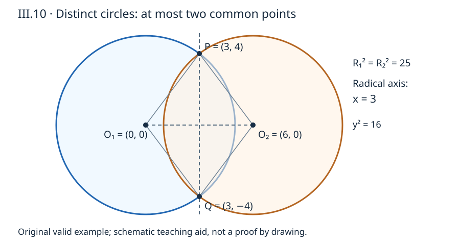

# 《几何原本》III.10：两个圆为何不可能共享第三个点

> 约公元前300年的数学前史补读；实读Heath 1908卷II印23–24页、Fitzpatrick 2008印80–81页及Joyce导读。本文为原创中文解析，不是全文翻译。完成范围仅III.10，不把既有暂缓项目计入完成；目录不声称穷尽，也不把图灵1936–1937论文称为第一篇AI论文。

**问题不是画出两个交点，而是排除第三个。** 两个不同的圆可能分离、相切或相交；图上常见的两个交点不能证明所有情形都如此。III.10用一条更强的识别链回答：若三个互异点同时属于两个圆，两圆的中心就受同一组独立约束控制；中心相同且已有共同点，半径也相同，于是所谓两个不同圆其实是同一个圆。

这篇短命题值得慢读，因为它把三个容易混淆的工作拆开了：辅助对象的存在、解的唯一性、以及对象是否真的不同。现代坐标消元则让“至多两个”成为一个可核验的一元二次方程结论。二者相关，但不能把后者冒充古代原文。

## 1 书目、收录范围与证据标识

| 项目 | 本单元范围 |
| --- | --- |
| 原作 | Euclid，*Elements*，卷III命题10；约公元前300年是作品时代估计，不是每条结果的首次发现日期 |
| 主读 | T. L. Heath，*The Thirteen Books of Euclid’s Elements*，1908卷II，印23–24页；命题、证明、术语及另证评注 |
| 对照 | Richard Fitzpatrick，*Euclid’s Elements of Geometry*，2008希英对照，印80–81页 |
| 在线导航 | David E. Joyce，Book III Proposition 10，正文、依赖链接及Guide |
| 定位区别 | Heath PDF第36–37页对应印23–24页；Fitz本处印80页末开始命题，印81页上部结束 |

[Heath扫描](https://www.wilbourhall.org/pdfs/Heath_Euclid_II.pdf)、[Fitzpatrick版本](https://farside.ph.utexas.edu/Books/Euclid/Elements.pdf)、[Joyce III.10](https://mathcs.clarku.edu/~djoyce/elements/bookIII/propIII10.html)是必要书目入口。正文区分**原文**、**教学重构**、**分析推论**、**真实实跑**。原文图像和编辑评论分别读取，不根据OCR残缺符号猜补证明。勘误核查范围由[来源审查](../../reproduction/euclid-elements-iii10/source-review.zh-CN.md)列明；不由“未见相关条目”断言所有传本无误。

本系列先有1930年代样稿，再回填更早数学与推理文献，因此这是明确的年代回跳。这里研究证明依赖与约束，并非声称Euclid研究现代人工智能。我们沿可定位的文献和书内关系收录，不用作者名气代替相同的阅读标准。

## 2 历史问题：从构造一个圆到识别同一个圆

卷III前几节已经逐渐建立接口：III.1提供圆心与弦的垂直平分线关系；III.5排除相交的不同圆同心；III.9从多条等长连线认出中心。III.10把这些局部事实组合为交点数量上限。这里的“圆”应按圆周理解，Heath印23页专门指出这一术语用法。若把圆理解成含内部的闭圆盘，两个圆盘交集完全可能包含一片区域，结论即不成立。

**原文依赖。** I.10二等分弦，I.11从弦中点作垂线，III.1推论保证圆心落在弦的垂分线上，III.5在最后形成矛盾。III.9不是主读版本原证明实际调用的步骤。Joyce指向后续III.24的使用；这里仅记录依赖方向，不把后章算作本单元已读。

**版本史边界。** Heath印23–24页报告，较早文本有两种证明，Simson选择另一路，而August与Heiberg把它移入附录；Heath又经an-Nayrīzī的传述将另证联系于Heron。本文只是准确转述Heath的编辑说明，没有独立校勘这些作者全部原著，也不据此确定最初发现者。与主证不同，这个另证直接调用III.9，因而必须核查“中心位于另一圆内”的前提，见第6节。

## 3 命题规格：不同、互异、圆周，缺一不可

**教学重构。** 在同一欧氏平面中，令C₁、C₂为半径严格正的圆周；它们作为点集不同。结论是公共点至多两个。所谓三个公共点，指A、B、C两两不同，不是把一个交点记录三次。结论数的是几何点，不是代数方程根的重数。

- 相切可以有一个公共点；本定理不要求切线，也不先假定交叉穿越。
- 不相交可以有零个公共点；“至多二”绝不是“一定有二”。
- 两个描述若给出同一中心、同一正半径，就是同一个圆，公共点无穷多。这不是反例，因为“不同圆”已被撤除。
- 半径正、二维欧氏距离、精确点集是模型前提。球面、任意闭曲线、含噪点云都需要重新陈述问题。

**三个圆周点为何不共线？** 可用已读III.2：若三点共线，必有一个在另两个之间；它又应严格在圆内，不可能同时在圆周上。这里利用的是III.2的严格内部结论，而非预借III.10。后文也给独立坐标解释：非零方向直线代入圆方程得到最高次系数正的二次方程，因此最多两个不同参数根。

## 4 原证重建：共享两条约束，锁定同一中心

### 4.1 反证假设与两条弦

**原文。** 假设两圆相交超过两个点，图中标出B、G、F、H，连BH和BG，分别在K、L二等分，作经过中点且垂直相应弦的两条直线。原图使用四个公共点，但后续论证只用B、G、H，F没有承担额外推理工作。[Heath印23页；Fitz印80–81页](https://farside.ph.utexas.edu/Books/Euclid/Elements.pdf)

为避免大量交叉标签，下面把这三点重新叫A、B、C，取弦AB和AC，垂直平分线叫ℓ₁、ℓ₂。这是教学换名，不是新的原文引文。

### 4.2 先证明相交存在，不凭图画指定P

设第一个圆的中心为O₁。由III.1推论，O₁在ℓ₁上，也在ℓ₂上。因此两线至少已有一个共同点。无需先说“画出来它们会交”，也无需把任意两条垂分线都当成必相交。

Heath印24页将“两垂分线会相交”列为未证假设；Joyce Guide指出，前面已经证明第一个圆心同时在两线上，足以提供存在性。本文采用这个明确写出的补步，而不是隐去两位编者的分歧。**已有见证的存在，与无条件假设新交点存在，不是同一件事。**

### 4.3 再证明唯一，排除两条线其实重合

A、B、C不共线，故AB与AC是两条不同而相交的直线。若ℓ₁与ℓ₂重合，AB、AC都垂直于同一直线，就应平行，与它们共享A且不同矛盾。因此ℓ₁、ℓ₂不同。两条不同直线不能拥有两个不同公共点，所以其唯一公共点正是O₁。

这一段是教学展开：存在性由“已有圆心”承担；唯一性由“独立弦方向与不同直线”承担。只写“垂分线唯一交点”会把两项证明义务揉成一句。

### 4.4 对第二个圆应用同一约束

AB、AC也是第二个圆的弦，不需重新构造中点或换垂线。令其中心O₂；III.1推论又给O₂同时属于ℓ₁、ℓ₂。由唯一性，O₂=O₁。原文随后用III.5：两个相交的不同圆不可能有相同中心，得到矛盾。

**现代等价收尾。** A已是公共点，两圆到共同中心的半径都等于OA，因此半径相等；同中心同半径定义出相同圆周，与“两圆不同”冲突。它清楚展示不同圆假设到底在哪里用到，也说明论证只要求公共点，不要求在交点处穿过对方内部。

于是两不同圆不能有三个互异公共点。倘若有更多，也能任选三个，故一并排除。

### 4.5 直径不会让构造失效

若AB是直径，其中点恰为O₁，仍能用I.11在该中点作AB的垂线。这里没有“连接圆心与弦中点后延长”的零线段问题。应当作的是弦的垂分线，而不是试图从零向量取得方向。这也解释与III.9原证退化讨论的区别。

原书的反证图不是两个真实圆共享四点的实验截图。Joyce说明那是“不可能图”：图帮助安排待反驳假设，不能反过来充当可实现性证据。附件原创SVG使用真实可实现的两交点构形，不仿造假四交点圆。

## 5 现代消元：二次曲线为什么只剩一个二次方程

**教学重构。** 写两圆中心U、V，半径r、s均正。点X属于二圆等价于两条平方距离方程同时成立。把第二条减第一条，二次的X·X抵消，得到：

$$
2(V-U)\cdot X=|V|^2-|U|^2+r^2-s^2.
$$

这个一次方程是公共点的必要条件，不是充分条件；还须代回任一圆。若U=V，右侧非零时无解，右侧为零时两圆重合。因此一定要先单独处理同心分支，不能直接除以中心距离。

若U≠V，令n=V−U，d²=n·n>0，a=(d²+r²−s²)/(2d²)，H=U+an，w=(−n₂,n₁)。消元方程中所有解恰可写成X=H+tw：H在中心连线上，w与n垂直，所以这条线既经过H又垂直UV。代回第一圆并利用n·w=0、w·w=d²，有：

$$
|X-U|^2=a^2d^2+t^2d^2=r^2,\qquad t^2=\frac{r^2}{d^2}-a^2.
$$

令q=r²/d²−a²。q<0没有实数t；q=0仅t=0一个几何点；q>0有t=±√q两个不同点，因为w非零。于是异心圆的交点数只能为0、1、2。这个推导还给出可计算分类，不只提供上界。

**必要性与充分性核验。** 得到t²=q后，不应只说“两个候选看起来在圆上”。按推导它们满足第一圆；又满足消元方程，所以第二圆平方距离也等于s²。这一回代解释算法为什么没有伪交点。反之任何共同点必须先在该直线上，再满足该一元方程，所以没有遗漏。

不用开方也可以精确判断数目。定义整数或有理式D：

$$
D=4d^2r^2-(d^2+r^2-s^2)^2=4d^4q.
$$

因为4d⁴>0，D与q同号。对照源码时注意：源码以D记中心距平方（即本文d²），以N记本文的判别量D；这些只是记号映射，不是不同公式。若输入中心坐标与半径平方是有理数，D可以完全用精确有理运算计算；交点坐标却未必有理。**精确判定交点个数不等于能用有理数列出全部交点。** 本复现明确区分这两种输出。

这里一次式通常称根轴，是现代解析几何解释；原文没有写此公式。两条一般二次曲线可能有四个交点，但圆的相同二次项相减后变成直线，所以不能把“一般二次”直觉替换本模型的特殊结构。本文不以此冒充一般代数曲线相交定理的证明。

## 6 短另证的接口漏洞：III.9不能无条件调用

Heath所载另证取第一个圆中心K，连接到第二圆的三个公共点；这些线段都为第一个圆的半径，因此等长。若K在第二圆内，III.9就能推出K是第二圆中心，再用III.5矛盾。

问题在“若”。K是第一圆中心，不自动意味着它位于第二圆内。Heath印24页明确批评这一遗漏，并说明圆外情形可用III.8关于等长线段数量的结论；圆周上情形需要其III.8评注所述对应命题。本文不将原先只对圆内点成立的III.9偷换成全平面版。

**教学替代。** 第4节垂分线证明本来就不要求K相对于第二圆的位置，因此可直接避免这三分。或者使用已另行证明的全平面三点等距唯一性坐标定理，但须承认换用了更强的前提接口。不能因为知道结论是真的，就把一个缺少调用条件的短证判为完整。

这是与程序验证相关的窄而准确的类比：一个函数要求“输入点在圆内”，调用者仅证明“它是另一个圆的中心”不满足契约。修正可以补前提、分情况或改用条件更弱的函数；不能靠测试例恰好都落在圆内来掩盖缺口。

## 7 手算例、反例与稳定性

### 7.1 恰有两个：上界能达到

C₁为x²+y²=25，C₂为(x−6)²+y²=25。相减得12x=36，即x=3；代回得y²=16，公共点为(3,4)、(3,−4)。U=(0,0)、V=(6,0)、a=1/2、q=4/9，w=(0,6)，与上式一致。第三个公共点没有“藏在另一侧”，因为消元与回代已经穷尽所有解。

### 7.2 一点、零点、重合必须分别输出

两半径5圆中心距10时，x=5、y=0，仅一点；距12时x=6，代回y²=−11，无实交点。中心相同而半径5与3时没有公共点；中心和半径均同则重合，有无穷多公共点。把“重合”归为两点或错误异常，都会把数学规格写坏。

内切也属于一个公共点：C₁半径5、中心(0,0)，C₂半径3、中心(2,0)，相减得x=5，故唯一公共点(5,0)。此处无需把III.11以后的古典切线结论预先用作本命题依据；这是独立坐标例。

### 7.3 精确交点可以不是有理点

两个单位圆中心(0,0)、(1,0)，公共点横坐标1/2，纵坐标±√3/2。若程序只查整数网格，会报告没有点；若只接受有理坐标列表，也不能因此把两个交点改成零个。判别与坐标表示应分别报告。

### 7.4 撤除模型条件的反例

若是圆盘，单位圆盘与自己或近邻圆盘的交集通常有面积。若换成圆与椭圆，例如x²+y²=1与x²/2+2y²=1，则x²=2/3、y²=1/3，共四个点。这只说明“两个圆”是关键条件，不反驳III.10。

三维中的两个不同球面可以交于整条圆：x²+y²+z²=25与(x−6)²+y²+z²=25共同满足x=3、y²+z²=16。消元仍成立，但剩下的是平面与球面，不再是直线与圆；维数改变了解数。

### 7.5 接近相切时，精确分类不等于噪声稳定

两个单位圆中心距d，公共弦中点横坐标d/2，相对中点的高度平方为1−d²/4。当d从略小于2跨到略大于2，点数由2经1变0。任意固定舍入容差都会把某些足够接近相切的输入混同。

因此附件以有理数精确比较平方量，不把浮点“接近零”当作等于零；真实测量则需要另设误差区间与“不确定”输出。唯一性、存在性、可表示性、数值稳定性是四个问题。“测试通过”不能解除模型和数据的不确定性。

## 8 最小复现：什么真的运行，什么仍靠证明

[复现入口](../../reproduction/euclid-elements-iii10/README.md)保存源码、环境、命令、真实日志与教学Notebook。实现面向精确有理坐标及明确输入条件；圆的数量分类与坐标表示分开。本次普通、-O、-OO三模式各21项测试通过，各包含600个精确实例（25种平移×4种正有理缩放×6种中心差方向）；另保存6个算例，5格Notebook顺序compile/exec与只读回放成功，六条子进程命令均退出0。Notebook明确不是Jupyter kernel执行。API参数r1、r2是平方半径，与本文r、s为半径的记号不同，调用时必须转换。无理交点或重合时坐标接口返回None，必须结合数量分类区分，不能据此断言无交点。

这不是全文逐行形式化，不是古典尺规工具，更不是通过有限枚举证明全体实圆结论。一般结论由第4节几何证明和第5节代数推导承担；有限测试负责检查实现有没有把同心除零、重根重复计数、非有理坐标和非法输入混淆。

| 主张 | 证据位置 | 限制 |
| --- | --- | --- |
| 两圆不能共享第三个互异点 | Heath23、Fitz80–81；第4节 | 不含重合圆，不指圆盘 |
| 主证是两条共同弦垂分线 | 同上 | 不冒称原文根轴代数 |
| 交点存在性评注有分歧 | Heath24、Joyce Guide | 本文用已有中心作见证补明 |
| III.9另证漏位置条件 | Heath23–24 | 另证历史归属仅转述Heath |
| 消元与判别式分类 | 第5节原创推导、附件实现 | 有理输入有限测试非实数域形式证明 |
| 相切附近分类敏感 | 第7.5节手算族 | 非噪声圆拟合基准实验 |

[独立来源审查](../../reproduction/euclid-elements-iii10/source-review.zh-CN.md)与[独立技术审查](../../reproduction/euclid-elements-iii10/technical-review.zh-CN.md)绑定最终正文摘要。只公开原创解析、教学代码、必要来源链接和检查过的净化证据，不公开原书PDF、全文翻译、私人对话或账户信息。

## 9 带答案练习

**1. 为什么原图画四点，证明却只需要三点？**  
答：任选公共点A及另两点B、C，形成两条方向独立的公共弦；它们的垂分线已足以唯一锁定两圆中心。第四点不参与这一推理。

**2. “两条垂分线相交”怎样不靠画图证明？**  
答：第一个给定圆的圆心由III.1推论同时在两线上，已经是共同点见证。接着还需三点不共线，保证两线不同，才能说交点唯一。

**3. 为什么只证同心还不够说明矛盾？**  
答：同心不同半径圆可以存在。这里还握有公共点A，两个半径都等于OA，故圆完全重合，才与不同圆假设冲突。原证以III.5封装这一排除。

**4. 若AB为直径，哪一步需重新定义？**  
答：不需改变弦垂分线构造；用I.11从中点作垂线即可。不要把“连中点与中心”作为唯一定义，因为那段长度为零。

**5. 第5节消元一次式成立，能直接判X为交点吗？**  
答：不能；根轴上绝大多数点不在任何一圆。例如第7.1节(3,0)满足x=3，却到原点距离3而非5。必须回代圆方程。

**6. 两单位圆中心距1，有理网格没找到公共点，说明什么？**  
答：只说明网格没有包含交点；实际两点含√3。判别式为正能精确给出两点数量，不依赖把根写成有理数。

**7. q=0时二次方程有二重根，几何上几个点？**  
答：一个，X=H。正负零是同一个参数，重数不是点集基数。

**8. 用III.9证明III.10时，应审查哪条前提？**  
答：被选中心K是否在第二圆内。仅知它是第一圆中心不够；需补圆内/圆上/圆外分支或改用垂分线主证。

**9. 对x²+y²=25与(x−2)²+y²=9分类并回代。**  
答：相减得4x=20，x=5；第一圆给y=0。第二圆回代为(5−2)²=9，因此恰有一个公共点(5,0)。

**10. 用五句话复盘。**  
参考答：假设两个不同圆共享三个互异点。三个同圆点不共线，给出两条不同公共弦的垂分线。第一圆心提供两线相交的存在见证，而两线不同保证唯一性。第二圆心也同时满足两条约束，故两圆同心。公共点又迫使半径相同，使两个不同圆变成同一个圆，矛盾。

## 10 阅读后的方法总结

这条命题并不是“多测一个点就总能认出一个对象”。它依赖圆周模型、欧氏平面、互异点与独立约束。它给今日推理系统的启发较为具体：把对象同一性写进规格；用已知见证解决存在性；对唯一性单独给出理由；调用前驱定理时核对输入条件；把精确数学结论与数值实现、噪声资料分别验收。

本文为AI辅助的原创教学解读，不代表人类专家认证；独立代理审查也不等于证明助理形式认证。三种证据各司其职：原文定位说明古代论证实际说了什么，重建证明说明结论为何成立，真实日志说明这一份有限实现实际做了什么。
