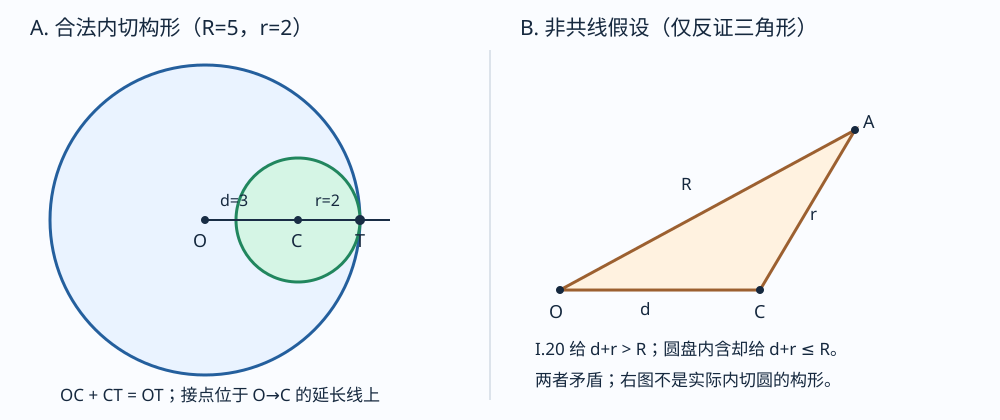

# 《几何原本》III.11：内切的接点为什么落在连心线的延长线上

**一个圆在另一个圆内相接，为什么接点一定在两个圆心的同一方向？** III.11的证明只有几行，真正的困难却是：图上看见的内外、远近和延长方向，哪些已经是前提，哪些仍须证明？本篇把原证的长度矛盾、Heath指出的缺口，以及一个明确声明假设的现代补证分开。

## 0 书目、范围与读法

- 文献：Euclid，《几何原本》（*Elements*），卷III命题11。作品通常置于约公元前300年的数学传统；这个估计不是本命题某日首发的记录。
- 主读版本：T. L. Heath，*The Thirteen Books of Euclid's Elements*，1908，卷II，印刷页24–26。III.11正文自24页下部起，到25页上部止；其后的Camerer讨论及Heath自己的缩短方案属于近代编辑评注，不是Euclid正文。[扫描版本](https://www.wilbourhall.org/pdfs/Heath_Euclid_II.pdf)
- 对读：Richard Fitzpatrick，2008希英双语版，印刷页81–82，完整III.11文字与图。此处英语字母F、G对应希腊文本不同字母，本文统一用英语图的标号。[双语版](https://farside.ph.utexas.edu/Books/Euclid/Elements.pdf)
- 辅助对照：[Joyce III.11正文与Guide](https://mathcs.clarku.edu/~djoyce/elements/bookIII/propIII11.html)。网页特别提醒大圆身份及图示假设；不是一篇独立发现该定理的现代研究论文。
- 勘误边界：实际查看Heath所附勘误表，其中没有针对卷II第24–26页的条目；这只报告所核表的范围，不声称所有版本从未有勘误。Fitzpatrick这两页没有III.11专属校正脚注。

这是从1936–1937图灵样稿向更早数学前史的**补读与年代跳转**，不是把古代书籍章节称作现代AI论文，也不把图灵论文称作第一篇AI论文。选择理由是可定位的证明结构和条件管理，标准不取决于作者名气。目录并不穷尽古代或近代相关材料。

**层次标识：**“原证”只指版本可定位的推理；“编辑评注”指Heath转述或提出的解释；“教学重构”使用现代点、圆盘和向量；“分析延伸”讨论验证方法；“真实实跑”仅指附件实际运行结果。本文是原创中文解析，不是全文翻译。阅读主线为第1–6节，复核走第7–10节。

## 1 历史问题：已知道相接，为什么还要找接点的位置

卷III前段先建立圆心、弦、距离排序和圆的公共点约束。[III.1](euclid-elements-iii1.zh-CN.md)让“取圆心”有构造依据；[III.6](euclid-elements-iii6.zh-CN.md)排除不同相切圆共心；[III.10](euclid-elements-iii10.zh-CN.md)控制不同圆的公共点数。III.11不是重新证明圆心存在，而是在给定内切关系后，确定接点相对于两圆心的方向。

把圆周上一点写成两个距离条件，还没有直接得到它的方向。两个相交圆也有公共点，那些点通常不在连心线上。因此“到两个圆心分别等于两半径”必须与内切条件组合，不能单独替代内切。

原证的策略不是先作公切线，也不是使用后来章节的切线垂直半径。它反设接点不在目标射线上，连接接点与两圆心，用[I.20](euclid-elements-i20.zh-CN.md)的严格三角不等式制造一条过长的半径。这是一种以已建立的长度关系解决位置问题的办法。与III.10的“三个公共点迫使同圆”相比，III.11多了不等式和方向信息。

Heath第25页说August和Heiberg将一个附加或替代证明置于附录，但它与正文变化很少；本文只报告Heath的版本说明，没有独立校读这些编辑的附录。Camerer的补足亦经Heath转述，不能据此宣称已直接读过Camerer原著。前驱关系这里主要是《原本》内部命题依赖，不借章节顺序推断每项成果的真实发现先后。

## 2 先把对象、假设和目标说准

### 2.1 原文图的字母

| 符号 | 本文所指 | 应避免的误读 |
|---|---|---|
| ABC | 外侧的圆，圆心F | ABC不是三角形名称 |
| ADE | 内侧的圆，圆心G | 不能只凭画得较小就证明全圆内含 |
| A | 给定接点 | 位置是待证内容，不能预先画到FG上当证据 |
| D | 从F朝G并越过G的射线与内圆周的前方交点 | 不是任意直径端点 |
| H | 同一射线与外圆周的前方交点 | D、H允许暂时重合 |
| FA、GA、FG | 线段长度 | 无向长度不能直接编码射线方向 |

原文有“从G连接到F再延长”的措辞，但图和后续运算实际使用**从F朝G，越过G继续延长**。Heath第25页明确指出方向必须朝内圆中心。这里不是交换线段端点那么无害：支持直线FG=GF，而射线FG与射线GF不同。

### 2.2 三种不同的“相接”规格

第一，古典定义以相遇而不穿越为核心，其“内部”语义带有局部位置直觉。Heath正是追问：从接点附近的内侧，怎样合法推出整个圆都在内侧？

第二，现代圆盘规格可以明确写成：两个不同的正半径圆，内圆闭圆盘包含于外圆闭圆盘，且给定一点A同时在两圆周上。这个规格没有把连心线结论写入前提，且足以推出接点唯一。

第三，程序可以使用度量判据：外半径R大于内半径r，中心距离d满足d=R−r。它便于精确验证，但只有证明它与第二种规格相通，才不是把想得到的距离关系偷放进“内切”的定义。

下面先保留原证，再用第二种规格证明第三种判据及方向结论。我们**不声称已从Euclid全部原始公理形式化推出圆的连续性和内外分离**。

### 2.3 目标不止一句“共线”

目标点序是F—G—A，其中G严格在F和A之间；切点在连心线段FG之外。内切时两条指向A的半径FA和GA同向，而非让A位于两圆心之间。外切的典型点序反而为F—A—G，那是下一命题的不同情形，本篇只用作边界对照，不将其算作下一单元已完成。

不同圆必须排除：重合圆有无穷多个公共点，两个“圆心”相同，没有非零连心方向。半径为零也不属于本文的圆；它会使除法、方向和古典定义同时退化。

## 3 原证逐步拆解：从折线过长到半径次序矛盾

以下先处理A不在直线FG上的分支，补证所需的前提单独列出。

1. 按III.1取得两圆心F、G。作为教学补足，可用III.6排除不同相切圆共心（不是声称原文显式引用III.6），两中心不同，因此FG是一条非零线段。
2. 反设沿F→G的延长方向不能到达A，在此方向标出内圆交点D和外圆交点H。必须已经保证G在外圆内，以及D不比H更远；这两点不是I.20的内容。
3. 连接AF与AG。在当前非共线分支，A、G、F形成非退化三角形，故I.20给出AG+GF大于FA。
4. A和H在同一个外圆上，所以FA=FH。这里要求F确实是外圆心；若H仍取外圆交点，却把F误作内圆心，FA=FH就没有依据。
5. F、G、H依次排列，故FH=FG+GH。在严格不等式两边减去同一个FG，得到AG大于GH。
6. A和D在内圆周，故AG=GD。于是GD大于GH；可是内含和所选射线要求GD不大于GH，矛盾。

核心算式的完整接口为：

$$
AG+GF\gt FA=FH=FG+GH
\quad\Longrightarrow\quad GD=AG\gt GH,
\qquad GD\le GH.
$$

**为什么用“不大于”而不是“小于”？** 原图画D在H之前，正文按“小者反大”表达矛盾。但即使D=H，得到GD>GH也一样不可能。Heath第26页特意保留这一分支。若先假设只有A这一个公共点来排除D=H，再以本命题建立接点唯一性，就容易把未证明的唯一性绕回来。

**为什么不能把这六步用于共线A？** 共线时三角不等式可能取等，I.20的非退化三角形条件不满足。证明“目标射线以外都不可能”，必须把另一条射线和线段内部的可能位置也处理。第5节用现代模型一次完成这些分支；第4节先解释Heath为何讨论得比正文长。

## 4 图不是免费的公理：Heath的修补与它的边界

### 4.1 Camerer路线：由局部内侧到整体内含

Heath第25–26页转述Camerer的次序：先论证两圆不能另处相交，再推出一个全在另一个内部，再确定外圆半径较大，最后排除接点在反向延长线和不共线等情形。

第一步的直觉是：若内圆从接点附近的内侧跑到外侧，又回到内侧，就会产生额外相交。两处不同的出入点连同已知接点违反III.10；如果试图从同一点出去再回来，则要解释为何圆不会形成双环节点。Heath记述了用半径穿过两个环来排除的论证。

这些叙述触及曲线连续性、区域分离及圆的简单性。它们揭示原图欠下的证明义务，但不是现代拓扑公理化证明。本文不会把“当然要出去再回来”一句写成已经逐公理认证的事实。

### 4.2 Heath的较短路线：只补本次需要的次序

Heath第26页提出不必先铺开全部结论，只需明确向G延长，并证明GD≤GH。若反而GD>GH，沿圆弧在A与D之间会有额外交点X；关于连心线的对应点可由III.7、III.8的等距伙伴结构说明，因而两圆会拥有至少三个公共点，与III.10冲突。

该路线仍使用圆弧出入及对应点存在的解释；本文将它归为Heath编辑补证，不伪装成Euclid正文。III.7、III.8不同位置假设也不能省掉后就机械套用。更稳妥的现代对应说法是反射保持两个圆心及到它们的距离，故一个离轴公共点产生另一个离轴公共点；但这是现代等距变换重构。

### 4.3 反向共线并非“显然同样”

若A位于G→F越过F的方向，即A—F—G，则GA=GF+FA>FA。另一方面，按上述射线次序，GD≤GH<FH=FA；再用GA=GD，就得到GA同时大于和小于FA。此处严格的GH<FH来自FG>0，而不是来自D与H必须不同。

若A在F与G之间，在明确的圆盘内含规格下也不可能：G在外圆严格内部，线段FG及其内部点都在外圆内部，A却应在外圆周上。原文没有逐一写出这些位置排除，不能用非退化三角形一句代替。

## 5 教学重构：不用图示次序偷渡结论

### 5.1 现代模型与内含判据

在欧氏平面取外圆心O、内圆心C，半径R、r皆正，两圆不同。记d为OC长度。闭圆盘是到其中心距离不大于半径的点集，圆周则取等号；两者不能混称。

假设内圆盘包含于外圆盘，且T为两圆周公共点。若O=C，公共点使R=r，两圆重合，违反不同圆前提，所以d>0。

沿O到C的单位方向u=(C−O)/d，构造内圆周的前方点P=C+ru。因为P在外圆盘内，又OP=d+r，得到d+r≤R。这是内含给出的**上界**。

另一方面，公共点T满足OT=R、CT=r，由非严格三角不等式OT≤OC+CT得到R≤d+r。这是公共点给出的**下界**。二者相夹：

$$
d+r\le R\le d+r,
\qquad d=R-r\gt0.
$$

反过来，若R>r且d=R−r，对任意内圆盘点X，有OX≤OC+CX≤d+r=R，所以内含成立；并且P=O+Ru=C+ru同时在两圆周。于是“内含加公共点”和“R>r且d=R−r”在这个模型中确实等价，而不是仅仅名字相同。

### 5.2 等号究竟怎样强迫方向

不能只写“由三角不等式等号条件显然”。令v=T−C，则长度为r，T−O=du+v且长度为R=d+r。展开平方，消去d²+r²，再除以2d，得u·v=r。

现在计算差向量的平方长度：v的平方范数为r²，ru的平方范数为r²，交叉项为2r(u·v)=2r²，因此v−ru的平方长度为0。欧氏平方和非负且为零只在向量零时发生，所以v=ru。于是

$$
T=C+ru=O+Ru
=O+\frac{R}{R-r}(C-O),
\qquad O\;—\;C\;—\;T.
$$

这给出接点的精确位置与唯一性：任意公共点都必须等于这个T。不需先假设“只有一个接点”，也没有拿III.13作为前提。因为r>0及d>0，点序严格，T不会等于任一圆心，也不会在连心线段内部或反向射线上。

向量乘法、范数平方和内积是教学工具，不是古希腊原文符号。它们给出明确模型中的一般证明；后面的有理数测试只检查实现实例，不承担这项全实数证明。

### 5.3 一个常被图掩盖的自由度

O是否位于内圆盘内不固定。仍取R=d+r：当d<r时，O在内圆内；d=r时，O在内圆周；d>r时，O在内圆外。三种情形都可以内切。原图通常选第一种，若程序无根据强加d<r，就漏掉另外两类。

固定外圆O和R后，选择方向u及任意0<r<R，可令C=O+(R−r)u，得到一族内切圆。它们的接点同为O+Ru。此处是一族合法构造，不是说任意放置的小圆都内切。

## 6 手算、反例与规格压力测试

以下均为现代教学算例；是否出现在机器日志中以附件命名记录为准，不把手算冒充运行。

### 6.1 三种大圆心位置，结论不变

取O=(0,0)，方向u=(1,0)，内圆半径r=2。

| d | 外半径R=d+r | 内圆心C | 接点T | O相对内圆 |
|---:|---:|---|---|---|
| 1 | 3 | (1,0) | (3,0) | 内部 |
| 2 | 4 | (2,0) | (4,0) | 圆周 |
| 3 | 5 | (3,0) | (5,0) | 外部 |

每行都满足OT=R、CT=2且O—C—T。若看某幅图就规定大圆心必须在小圆内，第三行立即反驳这个附加限制。

### 6.2 非轴向有理例，逐项代入

取O=(1,−2)，u=(3/5,4/5)，d=3，r=2，R=5。于是C=(14/5,2/5)，T=(4,2)。

- C−O=(9/5,12/5)，平方长度为81/25+144/25=9。
- T−O=(3,4)，平方长度为25。
- T−C=(6/5,8/5)，平方长度为100/25=4。
- 两位移的二维行列式为(9/5)(8/5)−(12/5)(6/5)=0，点积为6>0。

最后两项分别检验共线和同向；只检验行列式为零还不足以选出正确射线。

### 6.3 有公共点不够：相交圆

取O=(0,0)、C=(6,0)，两个半径皆为5。T=(3,4)到两中心距离皆为5，且另一公共点为(3,−4)。T不在x轴上。这没有反驳III.11，因为它们相交而非内切，R>r和d=R−r均不成立。

### 6.4 内含不够：没有接触

取R=5、r=2、d=1。任意内圆点到O的距离最多3，所以两圆盘内含，但圆周不能相接。只有d+r≤R而无公共点，不能把≤改写成=。

### 6.5 共线不够：错误接点与外切

取O=(0,0)、C=(3,0)、R=5、r=2。内圆的反向端点(1,0)虽在连心线上且在内圆周，却不在外圆周，不能被“共线检查”接受为接点。

另取半径5和2，中心O=(0,0)、C=(7,0)，接点(5,0)在两中心之间。它是外切而非III.11的内切，距离为半径和，不是半径差。判别器如果只检查“公共点加共线”，会把两种关系混在一起。

### 6.6 极限并不等于合法退化输入

当固定R而r趋近R，中心距离趋近0，内切圆可以越来越接近重合；但r=R时，方向不再由两个不同圆心确定。公式里的R−r变成零，不能继续使用。浮点“差不多相等”可能把这一界限抹掉；本篇用有理数精确运算，只承诺该表示域，不宣称解决带噪测量的容差选择。

## 7 证据位置与阅读评价

| 关键主张 | 可核位置 | 本文处理 |
|---|---|---|
| 内切圆连心线延长经过接点 | Heath II p24命题；Fitz pp81–82 | 完整命题，不扩大为任意相交圆 |
| I.20与共同FG消去 | Heath pp24–25原证；Fitz p81 | 明列非共线、半径身份和F—G—H |
| 延长必须朝内圆心 | Heath p25评注 | 纠正把无向线段与射线混同 |
| 内含、半径大小、位置分支尚需补足 | Heath pp25–26转述Camerer | 保留连续性和分离论证边界 |
| D与H可以相等 | Heath p26 | 矛盾只需GD≤GH |
| 反向共线的独立排除 | Heath p26末段 | 不错误套严格三角不等式 |
| 内含与距离差等价、接点唯一 | 第5节原创现代重构 | 不是原式或原文已完成的形式化 |
| 程序正确处理所列输入 | 附件真实日志及独立技术审查 | 有限实施证据，非一般定理证明 |

原证优点是极短且复用已有工具：圆的等半径关系提供等式，三角形提供严格不等式，线段相加把它们接起来。局限不是结论错误，而是图示信息未全部进入显式前提。批评应精确指出“哪一步需要哪个位置关系”，而非笼统评价古代几何不严格。

## 8 最小复现如何对应证明，而不伪造证明

[复现说明、命令与完整附件](../../reproduction/euclid-elements-iii11/README.md)提供精确有理坐标模型、命名案例、单测、参数遍历、Notebook及真实日志；[独立来源审查](../../reproduction/euclid-elements-iii11/source-review.zh-CN.md)和[独立技术审查](../../reproduction/euclid-elements-iii11/technical-review.zh-CN.md)分别记录原文核对与实现核验。

图左是合法内切构形；右只画反事实非退化三角形及其长度矛盾，不把不可能同时成立的两圆关系绘成一个“实测样本”。

**真实实跑。** CPython 3.12.14、纯标准库，26项单测在普通、`-O`、`-OO`三模式全部通过；每模式检查600构形，另有4个合法与3个拒绝命名例。独立技术核验每模式另作6084项关系对照、32448个整数候选点、648份外部有理证书、3240次点篡改及1296次内外次序拒绝，具体口径与日志见审查。五格Notebook执行和独立只读回放通过，非kernel。数目描述有限工作量，不是定理的可信度评分。

实现的工作是检查给定中心、半径和候选接点，或在内切度量条件已满足时生成唯一候选，再独立代入两圆方程和方向条件。生成公式并不能自己证明输入是内切；公共点检查也不能自己替代关系分类。精确分数消除舍入误差，却不消除程序错误，所以还需要非法输入、篡改证书、旋转平移及边界分支测试。

Notebook采用标准库按顺序compile/exec执行并保存输出，再作回放核对；这不是Jupyter kernel执行或页面交互认证。没有训练数据、基线模型、精度排行榜或硬件性能主张；这里适用的复现条件是Python版本、标准库、输入域、命令、断言方式与实际输出。三角不等式和等号方向的全称结论由第5节数学推导承担，不由跑过多少样本承担。

本单元不实现一般实数圆线求交，不复原全部Euclid公理系统，不用不可能的非共线内切图生成“真实几何案例”。原创图中的反证示意须按逻辑假设图阅读，而非把所有标注都当可同时实现的数据。

## 9 合理延伸：从几何图到可审计的推理接口

**分析延伸，并非原文的AI主张。** 图像理解系统看到一个小圆在大圆里，可能自动把“两个圆”“内含”“相切”“中心位置”“接点唯一”作为一个整体。III.11说明这些是不同的断言：有些是输入，有些是待证结论，有些只来自画法。

一个可审核流程应先列出对象及约束，再说明使用哪个定理、定理的适用条件是否已检查，最后保留反例和失败原因。若模型生成候选接点，可以用精确验证器检查它；通过只证明指定模型中的这些约束，不证明模型忠实反映一张含噪照片，也不证明所有生成的解释都可靠。

另一个教训是选择足够弱的中间接口。原证真正需要GD≤GH，不需要GD<GH。多加一个严格条件会让等号分支遗漏，还可能迫使证明提前借用接点唯一性。减少不必要的前提，比给图上每个“显然”都附一个更强定理更可控。

## 10 复盘与带答案练习

### 题1 连心线经过接点，能否直接写A在线段FG内？

**答案：** 不能。内切的点序为F—G—A，A在线段外。把直线、射线、线段混同会把内切与外切的位置关系颠倒。

### 题2 原证从AG+GF>FH减去GF时，为什么能把余项写为GH？

**答案：** 必须先有F—G—H，从而FH=FG+GH。代数减法本身正确，不代表任何图中的长度都可这样分解；G若在H另一边，该等式就不同。

### 题3 D=H时是否破坏原证？

**答案：** 不破坏。反证给GD>GH，而D=H给相等，已经矛盾。不应为了符合原图而另加D≠H。

### 题4 证明内含推出d+r≤R，为什么不能只检中心C在大圆内？

**答案：** C在内部只给d<R，不控制内圆半径。要检沿O→C方向的最远点P=C+ru，此点到O为d+r；这才把半径信息带入。

### 题5 R=5、r=2、d=1能否内切？

**答案：** 不能。虽然内含成立，d+r=3<5，没有公共圆周点。公共点给出的R≤d+r恰好排除这种空隙。

### 题6 已知行列式为零，为何仍需方向检查？

**答案：** 行列式为零只说明两个向量平行，允许反向。接点需要T−C是C−O的正倍数，还需两半径代入。第6.5节的(1,0)说明共线与一条圆方程都不足够。

### 题7 用第6.2节的数据求接点，不调用圆圆求交程序。

**答案：** R/(R−r)=5/3，T=O+(5/3)(C−O)=(1,−2)+(3,4)=(4,2)。分别代入平方距离25和4，再查同向，不能只比较生成器与自己返回的同一公式。

### 题8 d=r意味着什么？会破坏III.11吗？

**答案：** 外圆心O恰在内圆周上。取r=d=2，R=4，C=(2,0)，T=(4,0)，仍合法内切，非退化方向不变。

### 题9 若把“内切”在程序里定义为d=R−r，测试是否证明了古典原命题？

**答案：** 没有。程序检验的是现代度量规格及实现。还需第5节那样的数学桥接，且若要从古典局部接触定义出发，仍须处理内外及连续性条件。有限测试更不能证明全部实数情形。

### 题10 用四步复述全文证明，并指出一个不允许偷用的结论。

**参考答案：** 明确不同正半径圆、内含和公共点；用最远内圆点得d+r≤R，用公共点得R≤d+r；等号强迫公共点方向与连心方向一致；由显式公式得到接点及其唯一性。不允许先以接点唯一性排除全部额外交点，再声称这一证明首次给出了唯一性而不交代依赖。

复盘时检查四件事：半径属于哪个圆，延长朝哪个中心，严格不等式是否有非退化资格，图上的点序是否已变成可引用前提。它们比背诵“内切连心线过切点”更接近读懂这段证明。

---

本篇为AI辅助的原创中文教学深读，版本v1。没有宣称人类专家认证或证明助理形式认证。来源与技术双审的核验边界见附件；本单元只完成III.11，不把相邻命题顺带计为完成。
