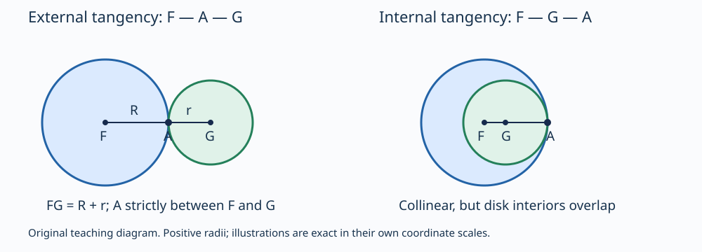

# 《几何原本》III.12：外切接点为什么位于两个圆心之间

**两个圆在外侧相接，为什么连接圆心的线段必须穿过接点？** 画出两只挨在一起的圆不难；困难在于不把图上希望成立的位置偷偷当作前提。III.12用半径相等和三角不等式把“接触”转化为“点序”。本篇同时检查原证的图示假设、文本后增争议，以及可独立验算的现代模型。

## 0 书目、版本与阅读范围

- 文献单元：传世《几何原本》（*Elements*）卷III命题12。作品传统约为公元前300年，但**不能因此把本条的现存编排确认为当时已经存在**；下文说明后增争议。
- 主读：T. L. Heath，*The Thirteen Books of Euclid's Elements*，1908，卷II，印刷页27下–28为本条正文，28–29为紧接的校史与证明评注；另核30页顶部续评及现代分类讨论开头。[扫描本](https://www.wilbourhall.org/pdfs/Heath_Euclid_II.pdf)
- 对读：Richard Fitzpatrick，2008希英双语版，印刷页82下–83上，完整III.12及图。本文沿英语图使用F、G等字母，不混用希文图的标号。[双语本](https://farside.ph.utexas.edu/Books/Euclid/Elements.pdf)
- 辅助导航：[Joyce III.12](https://mathcs.clarku.edu/~djoyce/elements/bookIII/propIII12.html)。现代网页的简短Guide不是古代作者亲署的说明，历史判断仍回到Heath的论据。
- 勘误边界：核查所附Heath勘误表及Fitzpatrick本条页下注；未发现其中针对III.12的专属数学更正。这不是穷尽所有版本勘误的声明。Heath将整条置于方括号，属于文本地位标示，不是“定理错误”；Fitzpatrick局部方括号也不能自动解释成作者勘误。

这是从图灵1936–1937样稿向古代推理前史的**补读与年代跳转**。古代几何章节不是现代AI研究论文；图灵样稿亦不被称为第一篇AI论文。本库按证据可得性与推理价值收录，不穷尽历史，也不按作者名气给予不同核验标准。

本文标签：“原证”指版本中的证明；“编辑评注”指Heath所述；“教学重构”指现代坐标、圆盘及代数；“分析延伸”指应用解释；“真实实跑”只指附件代码的实际执行。正文是原创中文解析，不是全文翻译。先读1–5节重建论证，再读6–10节核对例子、代码和答案。

## 1 历史动机：位置结论不能由接点的名字代替

[III.11](euclid-elements-iii11.zh-CN.md)讨论内切时连心线的延长方向；本条把外切单独处理。外切希望得到F—A—G，内切则通常是F—G—A。两者都可粗略说成“共线”，却有不同的加减关系：外切对应两半径之和，内切对应半径之差。丢掉点序，就会把这两种情形混在一起。

为什么不用“切线垂直半径”立即证明？那会改变这里的论证依赖。本条只需要已能取圆心的[III.1](euclid-elements-iii1.zh-CN.md)、同圆半径相等、[I.20](euclid-elements-i20.zh-CN.md)的三角不等式，以及从外侧相接取得的次序条件。公切线与半径的垂直关系不是原证的捷径。

### 1.1 本条的作者与编排不能说得过满

Heath第28页转述Heron对III.11的评论：内切已经处理，接着给出外切的证明。Heath据相关传承认为Heron与an-Nairizi的版本在这个位置并无独立III.12；Campanus和Nasir al-Din at-Tusi的版本则将简短外切说明附于III.11。由这些材料，Heath推测Theon或另一位编辑把Heron所给的证明独立编成了命题12。

这里有三个不同判断：传世文本包含本条；某些传承把外切证明放在不同位置；现行独立编号可能后增。第三项是**Heath的历史推测**，不是本文已直接校遍古代手稿后确定的作者事实。尤其不能写成“Heron首次发现了外切定理”或“Theon在某年发明III.12”。本次直接读的是Heath的转述，不冒称直接读过Heron、an-Nairizi、Campanus或at-Tusi原版本。

第29页还讨论Pappus关于Apollonius《相切问题》的引理：同一直线上、A两侧的AB与AC分别作为直径时，两圆在A外切；另一个引理将穿过接点与一个圆心的线关联到另一个圆心。这些是Heath说明的相关逆向命题，不据传世卷次替它们排出确定的发现年代。内部前驱I.20、III.1与相关后世评注，和现代AI联系是不同层次的历史关系。

## 2 原文符号与需要分开的三种规格

| 标记 | 含义 | 不能偷偷假定的事 |
|---|---|---|
| ABC、ADE | 两个圆 | 字母组合不是三角形 |
| F、G | 两圆圆心 | 开始尚未由图证明接点在FG上 |
| A | 给定外侧接点 | 共同圆周点不自动等于外切点 |
| C | 从F朝G的射线离开F圆周的位置 | 必须选择朝另一圆的交点 |
| D | 从G朝F的射线离开G圆周的位置 | 不是同一直线的另一端任意点 |
| R、r、d | 教学记号：两半径及中心距 | 原文不以代数变量表述 |

原图画的是反设情形：A不在线FG上，而线经过F、C、D、G。它服务于归谬，不是一对真实外切圆的可实现精确坐标图。因此不能用一张“近似像原图”的数值图当作满足全部假设的实例。

**古典规格。** 卷III关于相接的定义以两圆相遇而不相互穿过为核心，外侧相接还包含内外位置意义。由局部接触到全局次序需要说明，正是编辑评注所检查的内容。

**现代几何规格。** 为避免把结论写进定义，下文选正半径闭圆盘，其两个开圆盘无公共点，且存在给定A同时在两圆周上。这里“闭”允许边界接触，“开”排除边界；若写成两个闭圆盘完全不交，就连接点也被排除了。该规格比未经形式化的古典措辞更明确；本文不声称已从《原本》全部原始公理机械推导出它。

**计算规格。** 可用平方距离等式d²=(R+r)²检查外切。这只是方便机器处理的判据，必须先证明与上述现代规格等价。否则用判据作前提再“验证判据”，只是一轮循环。

目标不仅是F、A、G共线，而是A严格位于两中心之间。由于半径为正，A不能等于F或G。交换两圆身份应改变标号而不改变接点。

## 3 原证逐步展开：同一长度为何既长又短

### 3.1 先处理非共线反设

1. 给定外侧相接于A的两圆，取中心F、G。反设连接中心的线不经过A，因此F、A、G构成非退化三角形。
2. 沿中心线取面向对方的圆周点C、D；图示次序为F—C—D—G。
3. 同圆半径给出FA=FC、GA=GD，因此FA+AG=FC+DG。这里AG=GA只是同一无向长度。
4. 若C与D严格分开，线段相加得到FG=FC+CD+DG，且CD大于零。因此FG大于FA+AG。
5. 但在非退化三角形FAG中，I.20给出FA+AG大于FG。两个相反的严格不等式不可能同时成立。
6. 非共线反设被排除。余下应核对接点究竟在线段内，还是在其两侧延长线上；不能直接把“支持直线上”替换成“在线段上”。

原证的关键不是代入两个半径，而是**为什么能按所需方向把FC与DG当作FG里互不重叠的部分**。若D在C之前，FC+DG会重叠计数；“整体大于部分”就不能提供第4步。

### 3.2 C=D并不会破坏证明

Heath第28页明确允许C、D重合。此时没有正的中间段，原文的FG大于FA+AG应换成FG等于FA+AG。等号仍与非共线三角形的严格I.20矛盾。

因此足够使用弱关系FG≥FC+DG，而不是要求每一步都严格。严格性从非共线三角形的一侧产生就足够了。这里正体现了补证的原则：**不要为了沿用图中的空隙，错误排除边界情形。** 在最终真实外切构形中，C=D=A恰恰就是正常情况，而非异常。

### 3.3 外侧与次序：Heath如何补足图示条件

Heath第28–29页要求C不在G圆内部、D不在F圆内部；在此条件下可用F—C—D—G或C=D。若次序反转，按他延续前条的论证，两圆在接点附近的外侧关系与C、D处的内部关系之间会产生另一次相交，再由关于连心线的对称性产生另一边的对应公共点，与A合计三个公共点，违背[III.10](euclid-elements-iii10.zh-CN.md)。这是一种对图示次序的论证，并非原证那几行长度等式本身。

这一补足仍使用圆弧连续过渡及对称位置的几何背景。把它转述出来不等于已经在现代证明助理中公理化圆的内外分离。下节直接声明现代圆盘模型，以可逐步代数核验的方式绕开这项含混；它与Heath的文本修补是两条有区别的路线。

### 3.4 为什么还要排除延长线

如果A在线FG上但位于G外侧，F、A、G不是三角形，第5步不能使用严格I.20。Heath第29页给出另一段长度比较：在已取得的C、D次序下，FC≤FD，而FD小于FA，却又有FC=FA，矛盾。A位于F外侧时交换两个圆的角色作同类处理。半径为正另排除A=F或A=G。

这不是定理额外增加的附会要求，而是“连接两中心的线段穿过接点”必须交付的点序保证。原证、编辑补证、下面的现代证明应分别记账，不能把后两者全部标为Euclid原文。

## 4 现代教学重构：从不重叠推出半径和，而非预设它

在欧氏平面取F、G，半径R>0、r>0。记D(F,R)为到F的距离不超过R的闭圆盘，D°(F,R)为距离严格小于R的开圆盘，∂D为圆周。选定的假设是

$$
D^\circ(F,R)\cap D^\circ(G,r)=\varnothing,
\qquad A\in\partial D(F,R)\cap\partial D(G,r).
$$

令d为FG的长度。先不假定d=R+r，也不假定A共线。

### 4.1 不重叠给出下界

构造加权点X=(rF+RG)/(R+r)，它是沿FG按正权重内分的点。若d小于R+r，则

$$
|X-F|=\frac{R d}{R+r}\lt R,
\qquad |X-G|=\frac{r d}{R+r}\lt r.
$$

两个严格不等式说X同时在两个开圆盘中，违背假设。所以d≥R+r。这一步甚至涵盖F=G：此时X就是共同中心，明显属于两个正半径开圆盘。因此相同中心已经被排除，无须先引用未来关于接点唯一性的命题。

反向也成立：若d≥R+r，任何同时属于两内部的Y都会给出d≤FY+YG<R+r，矛盾。因此下界本身与两开圆盘不交等价，正是附件`interiors_disjoint`所用判据的一般依据。

注意：X是为了反驳d过小而构造的测试点，不是预先把它命名为接点A。只有后面等号得到后，才会证明X=A。

### 4.2 共同边界点给出上界

A在两圆周上意味着FA=R和AG=r。路径F到A再到G不短于直线FG，所以d≤R+r。与上一段合并得到d=R+r。上界来自共同点，下界来自内部不重叠；删掉其中任一前提，等式就未必成立。

### 4.3 等号如何给出方向，而不只是一个长度

设向量a=A−F、b=G−A。其长度分别为R、r，且a+b=G−F。平方展开d²=R²+r²+2a·b，再用d=R+r，得到a·b=Rr。因此

$$
\left|\frac{a}{R}-\frac{b}{r}\right|^2
=2-\frac{2(a\cdot b)}{Rr}=0.
$$

欧氏长度的平方为零仅当向量为零，所以a/R=b/r。两向量不是反向抵消，而是同向。移项得到唯一可能的点

$$
A=\frac{rF+RG}{R+r}
=F+\frac{R}{R+r}(G-F).
$$

因为0<R/(R+r)<1，A严格位于F、G之间。这也说明接点唯一：任何同时满足两个边界条件的点都必须等于这个固定表达式。本段的唯一性是**现代模型的推论**，不是借用尚未在本篇精读的III.13，也不把III.13算作已完成。

### 4.4 反向验证：判据确实足够

反过来给正半径与d=R+r。按上一公式构造A，即得FA=R、AG=r，所以存在公共边界点。若某点Y在两个开圆盘内，则FY<R、YG<r，三角不等式给d≤FY+YG<R+r，矛盾。于是两开圆盘不交。

因此在正半径欧氏圆盘模型中，“两个内部不相交且有公共边界点”与“中心距等于半径之和”等价，并且接点位置明确。有限程序可以检查等价后的代数判据，但这个一般等价性来自上述证明，不来自测试数目。

## 5 同一结论的几种证据，不能混成一种

| 路线 | 输入 | 关键桥梁 | 范围与限制 |
|---|---|---|---|
| 原几何反证 | 外侧相接及图示辅助点 | 半径相等、部分相加、I.20 | 次序与退化分支需解释 |
| Heath补充 | 古典外侧接触与既有圆性质 | III.10、对称和内外过渡；另排延长线 | 不是完整现代公理化认证 |
| 本文现代重构 | 正半径开圆盘不交且给定共同边界点 | 加权内点、三角不等式、欧氏等号 | 明示现代模型，不冒充古文 |
| 程序证书 | 精确有理中心、半径、候选点 | 平方距离与有理代数 | 检查具体实例，不证明全实数命题 |

Heath第29–30页还评价H. M. Taylor的另一编排：先证明不在连心线上的公共点会导致相交，再用逆否推得接点共线。Heath认为这种纯逻辑转换不合Euclid惯常论证方式，并另检验相关后续结论。**“不合原作者风格”不等于“逆否推理无效”**；要区分史学评价、逻辑有效性与几何前提是否已证。本文没有独立校读Taylor原书，不把转述写成完整复现。

同页现代教材的中心距分类也说明一种不同组织方式：把外离、相交、内含、两种相切统一分类。本篇只完整证明外切判据；对照分类用于检验输入边界，不把相关教材整套证明或全卷III算作已经完成。

## 6 手算、反例与边界

### 6.1 非水平的精确外切例

取F=(0,0)、G=(3,4)，R=2、r=3。中心距为5，等于半径和。由公式A=(6/5,8/5)。FA的平方为36/25+64/25=4；AG的平方为81/25+144/25=9。因此两半径正确，参数R/(R+r)=2/5在0、1之间。FG不需要水平，也不需要坐标为整数；图的朝向无关。

交换两圆：F'=(3,4)、R'=3、G'=(0,0)、r'=2，同样得到A。若把分子权重错写成RF+rG，会在不等半径时得到错误点；只测等半径圆就发现不了这个bug。

### 6.2 有共同点不够

F=(0,0)、G=(6,0)，两半径都是5。共同点(3,4)、(3,−4)满足各自圆周方程，却不在连心线上。中点(3,0)同时在两个开圆盘内，正好违反外切的关键前提。它反驳的是“只要有共同点就共线”，不是III.12。

### 6.3 内部不交也不够

F=(0,0)、G=(6,0)，两半径都是2。d=6>4，内部不交，但没有共同边界点。用d≤R+r的必要条件即可排除任何公共点，不能凭“不交”输出一个接点。

### 6.4 内切也只有一个共同点，却不是外切

取F=(0,0)、R=5，G=(3,0)、r=2，公共边界点A=(5,0)。此时d=R−r，不是R+r；点序F—G—A而非F—A—G，两开圆盘重叠。若程序只检查“候选点同时在两个圆上”，这个例子会被误收为外切，说明证书需要检查几何类型。

### 6.5 正半径、同心和数值近似

同心不同半径无共同边界点；同心同半径为同一个圆且开圆盘重合，均非本模型的外切。若允许R=0，则所谓圆退化为一点，开圆盘为空，接点可等于F，严格介于两中心之间的结论失效，所以正半径不是装饰。

浮点数把“恰好相等”变成“误差小于某阈值”时，任务已经变成近似分类。取0<ε<1，中心距为5−ε和5+ε的两组半径2、3圆，分别属于相交与外离，ε再小也不是精确外切。附件采用有理数与平方距离避免舍入，但不声称解决测量噪声或任意实数输入。

## 7 最小复现：验证的是证书，不是古代图画

附件入口：[复现说明与实际命令](../../reproduction/euclid-elements-iii12/README.md)。实现使用Python标准库和精确有理数，保留源代码、测试、环境、真实日志、可重跑Notebook及原创示意图。它不读取未许可原书全文，不上传原文PDF，也不训练模型。

教学接口分清三件事：由已给定中心和正半径分类；在外切判据成立时计算接点；核查另给候选点是否是该对圆的外切接点。无效类型不能静默改成“近似正确”。后两件事使用已经证明的现代判据，不声称独立从局部古典接触定义发现了定理。

测试必须覆盖不等半径、交换身份、平移、转向、负坐标、错误候选点、相交及内切、同心和零负半径；尤其需要优化模式，确保输入防御不是会被`python -O`删除的`assert`。有限枚举只覆盖写明的有理参数集，不是任意圆对全覆盖。

Notebook按标准库顺序执行代码单元并保存实际输出；若没有通过Jupyter内核执行，就明确标为`compile/exec`核验，不能把JSON文件存在称作内核与页面渲染均通过。图形像素只帮助理解，接点判据仍由代数检查。

### 7.1 实际运行记录

本次[运行摘要](../../reproduction/euclid-elements-iii12/run-summary.json)与[环境](../../reproduction/euclid-elements-iii12/environment.json)保存了真实命令和返回码。主实验结果如下：

| 实跑项目 | 本次结果 | 不能推成什么 |
|---|---|---|
| 单元测试 | 30项，普通、`-O`、`-OO`各通过 | 三次重复不变成90种不同测试 |
| 精确构形网格 | 每模式4平移×6方向×4第一半径×10第二半径=960构形；双圆序共1920份证书 | 不覆盖任意实数中心、任意圆对 |
| 命名算例 | 4合法、3预期拒绝，含相交、内切、外离对照 | 拒绝不是运行失败，也不证明所有错误都会被检出 |
| Notebook | 5代码格顺序`compile/exec`，再只读回放比对通过 | 非Jupyter内核、非前端显示认证 |

[普通测试日志](../../reproduction/euclid-elements-iii12/logs/tests.log)、[优化日志](../../reproduction/euclid-elements-iii12/logs/tests-O.log)、[二级优化日志](../../reproduction/euclid-elements-iii12/logs/tests-OO.log)、[算例日志](../../reproduction/euclid-elements-iii12/logs/examples.log)、[Notebook日志](../../reproduction/euclid-elements-iii12/logs/notebook.log)与[回放日志](../../reproduction/euclid-elements-iii12/logs/notebook-replay.log)分别保留。六条编排命令实际返回码均为0。网格是外切合法构形，不能充作全分类覆盖；非外切分支另由单测、命名拒绝例及独立审查测试。

图左为实际外切，A在两中心之间；图右为内切对照，A在较小圆心之外。图不复刻原证的反事实构形，不由视觉比例提供数学证据。独立技术审查的另行测试、源码哈希和正文绑定见审查附件；不会把主作者自己的重复运行称为独立审查。

## 8 主张与证据位置账本

| 主张 | 可核位置 | 本文性质与边界 |
|---|---|---|
| 外侧相接时连心线穿过接点 | Heath II 27下–28；Fitzpatrick82下–83上 | 完整本条读核，原创分析而非全文译 |
| 半径相等与I.20产生相反比较 | Heath28正文；Fitzpatrick83上 | 原证拆步，补明线段相加所需点序 |
| III.12独立编排可能后增 | Heath28校史评注 | 编辑推测；相关旧版本未直接校遍 |
| C=D亦可使用反证 | Heath28末 | 用弱不等式重构边界，不伪称原文严格式原样适用 |
| 反向点序与延长线需排除 | Heath28末–29上 | 区分编辑补证与原文几行证明 |
| Pappus相关逆向引理 | Heath29中 | 经Heath转述，不冒称直接读Pappus原著 |
| Taylor的逆否路线及风格评价 | Heath29–30顶部 | 史学风格与逻辑正确性分开 |
| 中心距与半径和、唯一接点公式 | 本文第4节 | 现代欧氏圆盘重构，不是古文代数式 |
| 精确程序行为与Notebook | 附件源代码、真实日志、独立技术审查 | 有限实例证据，不是一般定理证明 |

[独立来源审查](../../reproduction/euclid-elements-iii12/source-review.zh-CN.md)检查版本、历史措辞及主张归属；[独立技术审查](../../reproduction/euclid-elements-iii12/technical-review.zh-CN.md)检查推导、反例、源码和真实回放。审查绑定正文最终SHA256，审查意见不等于人类专家或形式证明器认证。

## 9 局限与合理延伸：一份证书应承诺多少

**分析延伸。** 在几何约束系统中，模型提出“这两个物体相接”，验证器应区分候选位置、几何类型和输入域。两个边界等式只验证共同点；外切还要排除内部重叠。一个三角形证明只覆盖非共线分支；要交付所有输入，退化情况不能由图像直觉略过。这些是从本例提炼的方法，而非断言古代作者已经研究现代AI系统。

另一条教训是先证明判据，再实现判据。实现把d²与(R+r)²比较，之所以不产生平方后的符号伪解，是因为d非负、R+r严格正。若忘记半径验证，代数运算仍可输出一个数，但不再是圆几何定理的实例。

本篇没有提供古希腊文本的批判校勘，没有形式化Euclid全部公理，也没有把外切定义推广到所有凸体。对一般凸体，“中心”可能不唯一或没有相同意义，不能直接套用圆的半径论证。它也没有重现原书所有命题、一般无理数求交算法、噪声几何识别或完整Jupyter前端测试。可读懂且可核查的小范围，优于没有证据的大范围声明。

## 10 复盘与带答案练习

### 题1：为什么只说“圆周相交于A”不能推出共线？

**答案。** 两半径5、中心(0,0)与(6,0)有公共点(3,±4)，均不在线y=0上。外切的内部不重叠条件不可省略。

### 题2：原证FG>FA+AG用到了什么，除了半径相等？

**答案。** 用到了F—C—D—G的点序及CD为正。只有这样FC和DG才是FG里不重叠的两部分；半径相等本身只给和的替换，不给大小关系。

### 题3：C=D时证明失败吗？

**答案。** 不失败。此时FG=FC+DG=FA+AG，与非退化三角形FA+AG>FG矛盾。应将一侧改为弱不等式，不应要求一段不存在的正空隙。

### 题4：为什么排除非共线之后还未写完？

**答案。** A仍可能在支持直线两端延长线上；这时不能再用严格三角不等式。需另用次序和半径比较排除，或用现代等号条件导出0<R/(R+r)<1。

### 题5：用加权点直接证明两内部不交推出d≥R+r。

**答案。** 反设d<R+r，取X=(rF+RG)/(R+r)。它到两中心的距离分别是Rd/(R+r)<R、rd/(R+r)<r，故在两个内部，矛盾。计算未用接点A，也未预设d等于半径和。

### 题6：为何等号意味着同向而非反向？

**答案。** 令a=A−F、b=G−A。平方展开得到a·b=Rr。两个单位向量之差的平方为2−2=0，所以a/R=b/r；反向时点积是−Rr，不能满足此式。

### 题7：R=2、r=3、F=(0,0)、G=(3,4)的接点是什么？

**答案。** A=F+(2/5)(G−F)=(6/5,8/5)。权重是到F的半径R除以半径和，不是r除以半径和。把两圆交换后同一点保持不变。

### 题8：一个点满足两个圆周方程，程序就应接受外切证书吗？

**答案。** 不应。还须核查正半径、外切类型或等价的中心距判据；相交和内切例都能满足两个边界方程。错误候选、无效输入与几何上不外切，应有明确处理。

### 题9：如何证明接点唯一而不引用III.13？

**答案。** 在已声明的现代模型内，对任何共同边界点重复等号推导，都得到同一个(rF+RG)/(R+r)。这只是本文现代推论，不冒充已经完成下一条古典命题的精读。

### 题10：Heath说可能由后人加成独立命题，是否表示定理不成立？

**答案。** 否。文本来源、编号历史和数学有效性是三个问题。作者归属不能由一个正确证明决定，正确证明也不会因独立编号较晚而失效。本次仅报告Heath所据材料与推测范围。

### 题11：很多精确测试通过能否证明任意实数坐标的定理？

**答案。** 不能。它们检查有限输入及代码行为；一般结论靠第4节的任意对象证明。程序只处理有理数的限制、Notebook不是内核执行的限制，也必须保留。

### 题12：用四句话复述本篇。

**参考答案。** 原证用中心线上两半径的和与三角形两边之和作相反比较。辅助点序、C=D边界以及接点落在延长线的情形需要额外说明。现代模型先由不重叠取得中心距下界，再由共同点取得上界，等号的方向条件给出内分接点。文本后增争议、一般证明与有限代码核验各有不同证据，不能彼此替代。

---

版本：深读v1；核验日期2026-10-29。本文由AI辅助撰写，以可定位来源、原创推导和可复核附件为依据；不表示人类专家或证明助理已完成认证。仅完成III.12这一阅读单元，不宣称整卷或相关古代数学已穷尽。
