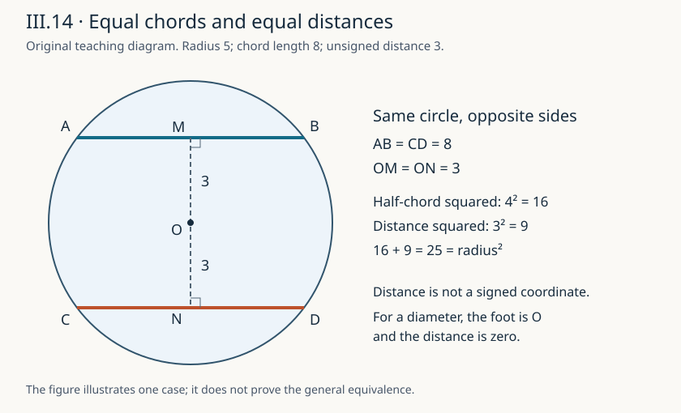

# 《几何原本》III.14：等弦为什么恰好等距于圆心

**同一只圆里，弦长和圆心到弦的距离并不是两项独立的数据。** III.14把它们联成一个双向判断：弦相等，当且仅当它们离圆心一样远。真正值得精读的不是记住口诀，而是看作者怎样把完整弦降成半弦，把几何位置改写为两个直角三角形，再在两个平方和之间消去不同的一项。

## 0 书目、范围与证据层级

- 阅读单元：Euclid，传世《几何原本》卷III命题14。作品传统年代约公元前300年；直接所读是后世编辑和翻译版本，并不据此保证现存每句均原封不动来自该年代。
- 主读：T. L. Heath，*The Thirteen Books of Euclid's Elements*，1908，卷II，印刷页34下–36上为完整III.14，36为紧接本命题的Heron补证说明。[扫描本](https://www.wilbourhall.org/pdfs/Heath_Euclid_II.pdf)
- 对读：Richard Fitzpatrick，2008希英双语版，印刷页84–85，完整双向证明及ABCD/ABDC字母次序脚注。[双语本](https://farside.ph.utexas.edu/Books/Euclid/Elements.pdf)
- 辅助核对：[Joyce III.14](https://mathcs.clarku.edu/~djoyce/elements/bookIII/propIII14.html)。Guide将证明与直角三角形全等联系起来，并指出下一命题使用本条；这是导读分析，不是古代正文的额外定理。
- 校订边界：Fitzpatrick85脚注说希文圆名字母顺序为ABCD，而英译依图写ABDC。本篇采用英译图的顺序，不把标签调整当作几何对象变化。卷内校注和所见勘误材料的核验范围由[来源审查](../../reproduction/euclid-elements-iii14/source-review.zh-CN.md)记录；不以没有独立勘误条目代替逐段读证明。

本篇是从图灵1936–1937样稿向古代推理文献的**AI前史补读与年代跳转**，不是现代AI论文，也不把图灵称作第一篇AI论文。收录依据是可查来源和可分析的问题，不声称穷尽历史，也不按作者、机构或方向名气降低标准。中文是原创解析，不是原文全文翻译。

下文把“原证”“教学补足”“现代重构”“分析延伸”“真实实跑”分开。读者可先走第1–4节的两条证明，再看第5–7节边界与模型，最后用练习检查是否真的掌握条件。

## 1 历史问题：怎样比较不同方向的两条弦

圆周上四个点形成两条弦，方向可以不同、位置可以在中心同一侧或不同侧，也可以相交。直接把一条弦搬到另一条上比较，需要额外的运动解释；原证选择在各自原位比较它们。

它需要一座桥：[III.3](euclid-elements-iii3.zh-CN.md)说明通过圆心且垂直非直径弦的直线平分这条弦。因此，比较全弦等于比较半弦。半弦、中心到弦的垂线段、圆半径构成直角三角形；两条半径天然相等。[I.47](euclid-elements-i47.zh-CN.md)于是提供共同的平方和。

内部前驱还包括[III.1](euclid-elements-iii1.zh-CN.md)取圆心、[I.12](euclid-elements-i12.zh-CN.md)从线外一点作垂线、卷III定义4的“等距”。这不是证明之后才随手补上的参考书目：每一个依赖各解决一个不同问题，分别是中心存在、垂足构造、平分资格和距离含义。

紧接的III.15把相等关系推进为大小次序。本篇只说明这一依赖位置，不将III.15或整卷计为完成。Heath36还转述Heron经an-Nairizi保存的一项补充，讨论圆心在两弦之间。本篇没有直接读那部评注原书，也不把这一简短转述扩写成“任意两条等弦必在圆心相反两侧”。对不平行的直线，“两条之间”本来就需要另定意义；本文的证明不需要两弦平行或中心夹在二者之间。

## 2 符号、距离与不能隐藏的输入条件

沿用英译图：圆心E，弦AB与CD，垂足分别F、G，连接EA与EC。半径长度记R，半弦长记h₁=AF、h₂=CG，垂距记d₁=EF、d₂=EG，全弦长记L₁、L₂。

“弦”在现代说明中指两个**不同**圆周点连成的线段，不是圆盘内部任意短线段，不是相应的整条无限直线，也不是弧。两条弦可以重合；端点次序交换不改变长度或距离。

卷III定义4以从圆心作出的垂线长度判定等距。现代点到直线的距离是非负数；对于真正的弦，垂足恰在中点，所以到支撑直线的距离也等于到弦线段的最短距离。这一事实要证明，不能对任意线段照搬。

原证调用I.12和III.3时明确把弦当作不经过圆心的情形。若弦是直径，垂足就是E，“EF为一条非零垂线段”和“AEF是直角三角形”都失效。**零距离可以定义，但零线段没有可供直接套用三角形定理的角。** 第5节单独补直径分支，不把现代补足冒充原文原句。

## 3 第一方向：等弦推出等距

### 3.1 从全长到半长

先处理两条都非直径。按III.1取E；按I.12作EF、EG垂直于各弦的支撑线。III.3使F、G分别成为弦中点，所以AB是AF的两倍，CD是CG的两倍。若AB=CD，则AF=CG。

最后一步的内容不是“图上看起来各一半”。它是在相同倍数下比较正线段：若AF大于CG，两倍AF也大于两倍CG，矛盾；小于同理。因此相等。

### 3.2 两个平方和共用一个半径

EA和EC都是同圆半径，长度相同；AEF、CEG在垂足处为直角。I.47分别给出两条等式，现代记法为

$$
h_1^2+d_1^2=R^2=h_2^2+d_2^2.
$$

这里的平方在原证中是在线段上作的正方形面积；本文的实数平方记法是教学压缩，不声称欧几里得使用这一代数公式。

### 3.3 消去的是什么

因为h₁=h₂，两项半弦平方相等。从相等的平方和各减去这项，余下d₁²=d₂²。非负长度的平方相等推出d₁=d₂：若一个更长，它的平方严格更大。按定义4，两弦等距于圆心。

这一方向的已知相等项是**半弦平方**；余项是**垂距平方**。不要把“同一半径”误说成“两个三角形全等已知”。原证确实可以由平方消去得到相等边，随后建立全等，但不能未经论证先把想要的边相等塞进全等条件。

## 4 第二方向：等距推出等弦

仍用相同构造，重新设置前提：现在已知EF=EG，而不是已知AB=CD。III.3依然给出AB=2AF、CD=2CG；这一平分事实来自垂直与圆心，不依赖两弦本来相等。

1. 同圆半径EA=EC，因此两半径平方相等。
2. 对两个直角三角形各用I.47，仍得到上一节的共同平方和。
3. 这一次从两侧减去相等的**垂距平方**，余下AF²=CG²。
4. AF、CG为正长度，故AF=CG。
5. 两倍相等线段相等，所以AB=CD。

原证把两方向都展开，而不以“逆命题显然”略过。逻辑上P推出Q并不自动给出Q推出P；本条逆向成立，是因为共同平方和允许交换被消去项，而不是因为任何几何定理都可反用。

现代统一式为

$$
L^2=4(R^2-d^2),\qquad 0\le d\lt R.
$$

当R固定，L的相等与d的相等互相决定。右边并没有弦的方向角，因而方向不影响本条结论；但这不意味着方向和位置全部由长度唯一决定。

## 5 教学补足：垂足、最短距离与直径

### 5.1 垂足为什么在弦里面

对于非直径，III.3给中点结论。现代也可不借图示：设M=(A+B)/2、u=B−A。两端点满足到E等距，展开两距离平方之差，得到(E−M)·u=0。因为A≠B，u非零；所以M是E到支撑线的垂足。M位于两个端点的严格中间。

对线上任意点X=M+tu，交叉项为零，因此

$$
\lVert E-X\rVert^2=\lVert E-M\rVert^2+t^2\lVert u\rVert^2.
$$

后一项非负且仅t=0时为零，因此M是唯一最近点。它在弦上，线距离和线段距离才相同。这是现代一般证明；不把“点积展开”归给原文。

### 5.2 零距分支不使用退化三角形

若d=0，则M=E。A和B位于过E的同一直线、同一圆周且不同，必在相反方向，故AB=2R。这是直径。

反过来，若AB是直径，则中点E，距离为0。两条直径都长2R且均为零距，因此双向成立。若只有一条是直径，另一条非直径有d>0；由非退化I.47得到其半弦平方R²−d²<R²，半弦小于R，故全弦小于2R。两边的“相等”同时为假，仍满足等价关系。

这样补足并未先引用下一条“直径最长”作前提；这里只使用本条的平方关系推出该局部比较，避免拿尚未重建的后继结论倒填证明。

### 5.3 为什么要排除端点相同

A=B时，u=0，支撑直线没有由两个端点唯一确定，投影除数为零。可以另建“点状退化弦”的定义，但那不是当前接口。程序应拒绝它，不把零长度自动归入有效几何并返回看似漂亮的公式。

## 6 手算、反例与条件的作用

### 6.1 等长而不平行

圆心(0,0)、R=5。第一条弦A=(-4,3)、B=(4,3)，长度8，垂足(0,3)，距离3。第二条C=(3,-4)、D=(3,4)，同样长度8，垂足(3,0)，距离3。两弦互相垂直而非平行；交点(3,3)在圆盘内部。这说明原证不需要两弦平行、互不相交或分别在中心两侧。

两个半弦长度均4，4²+3²=25。把第二条换为y=-3上的弦，距离仍3，不是−3；有向坐标符号与无向距离不能混用。

### 6.2 不等长也能核验“当且仅当”

仍在R=5的圆中，y=3的弦长8；y=4的弦端点为(-3,4)、(3,4)，弦长6。垂距分别3和4。两个相等判断都为假；“False iff False”为真，不是证明器误把两弦判为相等。

### 6.3 同圆条件不能悄悄删掉

半径5的圆中，距中心3的弦长8；半径√13的圆中，距中心3的弦长4。后者端点可取(-2,3)、(2,3)。等距不保证等弦，因为共同半径平方已经不存在。

另一个方向：半径5的圆中半弦4、距离3；半径√32的圆中半弦4、距离4，端点(±4,4)。两弦同长8却不等距。根号半径是手算模型，不冒充只接受有理半径接口的实跑算例。

若是两只**等半径**圆，则原代数证明仍成立，即使圆心不同。这是明确条件下的现代推广，不是把原文“同一圆”擅改成“任意圆”。

### 6.4 任意内线段不适用

R=5的圆盘中，(-1,0)至(1,0)与(-2,0)至(2,0)到中心距离都0，长度却2与4。它们并非圆周端点定义的弦，半径不是这些端点到圆心的长度，I.47的共同斜边桥梁断掉。输入校验必须检查端点真的在圆上。

## 7 合理延伸与不应夸大的含义

**几何延伸。** 固定R后，弦长只确定距离d，不确定支撑直线方向或弦在圆心哪一侧。给定0<d<R，可转动一条弦得到无穷多个等长位置；“等距”是一个数值约束，不是对象唯一性证明。

**证明工程延伸。** 两方向共用一个不变量，却消去不同项。将证明写成结构化依赖时，应记录“共同半径”“垂足是中点”“长度非负”各自的来源。少了任意一个桥步，符号运算可能依然流畅，结论却已经换了适用域。

**AI推理联系。** 一个系统若从图像读出端点，再提交精确坐标证书，可以由检查器核验坐标满足哪些条件。但这种证书不能认证图像识别准确、文字已正确形式化，或整个古代证明体系无缺口。模型生成候选和程序验证有限对象是可分工的步骤，不是智能能力的一项实验结果。

**数值限制。** 本篇精确有理运算不会出现浮点“差一点为零”的容差争议；但只能直接处理其接口允许的精确数。真实测量有误差时，应使用误差区间和稳定性分析，不能把精确相等测试原样拿去作为测量结论。没有实验数据集、训练基线或模型指标，本单元也不伪造这些项目。

## 8 可追溯的主张与证据

| 主张 | 定位 | 本篇处理 |
|---|---|---|
| 等弦与等距双向命题 | Heath34–36；Fitz84–85 | 完整两方向阅读 |
| 圆心、垂线、半弦 | Heath34–35；III.1、I.12、III.3 | 逐项标出依赖 |
| 两次平方和消去 | Heath35–36；Fitz84–85 | 说明两个方向消去项不同 |
| 等距的垂线含义 | 卷III定义4；原证复述 | 区分无向距离与坐标符号 |
| ABCD/ABDC差异 | Fitz85脚注 | 标为编辑图序问题 |
| Heron补充 | Heath36评注 | 只作二手编辑转述，不补造原书论证 |
| 直径零距、投影与唯一最近点 | 本文第5节 | 现代教学补足，不伪装原文 |
| 不同半径反例与等圆推广 | 本文第6节 | 自有手算与分析推论 |

## 9 复盘与带答案练习

1. **“半径相等，所以两弦相等”漏了什么？** 半径只给共同平方和。还需垂距相等，或另外取得足够条件。R=5中y=3与y=4两弦就是反例。
2. **正向证明减去哪个量？** 减去相等半弦的平方，得到垂距平方相等；逆向则减去垂距平方。
3. **为何不用一般SSA全等？** 一般边边角不足以保全等。本例有直角、相同斜边以及一条对应直角边相等，平方关系才唯一确定另一条直角边；这需要专门理由。
4. **F在延长线上而不在线段内行不行？** 对有效弦不发生，因垂足等于中点。对任意短线段则可能；这时线距离与线段距离不一定相同。
5. **弦经过圆心时能对AEF直接用I.47吗？** 不能，F=E导致退化；应由直径长度2R、零距离单独处理。
6. **端点交换会改变结果吗？** 不会；中点不变，方向u变为−u，长度平方和投影不变。
7. **距中心3与−3是不是不等距？** −3是可能的有向坐标，不是非负距离。y=±3两条支撑线离原点都为3。
8. **等距为什么不意味着平行？** 第6.1节水平、竖直两弦均距中心3。方向自由度没有被距离固定。
9. **两只不同圆能否推广？** 若半径相等可用同一平方关系；若半径不同一般不行。应写出半径条件，不能只写“两圆”。
10. **R=13、弦长24，垂距是多少？** 半弦12，d²=169−144=25，非负d=5。
11. **R=13、d=12，弦长是多少？** 半弦平方169−144=25，半弦5，全弦10。
12. **穷举很多有理点是否证明所有实数情形？** 不能。一般证明来自端点等距展开、正交分解与非负性；枚举检验实现和具体证书。

复盘时依次问：输入真是弦吗；垂线非退化吗；半弦是怎样获得的；半径是否共同；消去哪一项；平方相等怎样返回长度相等。六个问题比一句“由勾股定理显然”更接近理解原证。

## 10 复现与版本说明

[复现说明、命令、Notebook和日志](../../reproduction/euclid-elements-iii14/README.md)提供低成本标准库教学核验；[独立来源审查](../../reproduction/euclid-elements-iii14/source-review.zh-CN.md)和[独立技术审查](../../reproduction/euclid-elements-iii14/technical-review.zh-CN.md)分别记录文献与证明/实现核查。本次28项单测在普通、-O、-OO三模式实际通过；每模式324条精确弦、11664对有序弦比较。算例含4个同圆比较、1个不同半径反例、2个拒绝输入。五格Notebook实际顺序compile/exec并只读回放，明确不是Jupyter kernel执行；手算根号半径例不计入此接口的实跑。程序从端点独立计算投影，再检查中点和平方关系，不以待证等式筛选输入。真实运行支持实现的有限行为，不取代第3–5节一般证明。

本文由AI辅助编写，深读v1，核验日期2026年10月29日。独立审查是不同执行角色的核验，不冒称人类专家或证明助理认证；本单元不覆盖全卷，不把有限测试视作一般定理证明。
