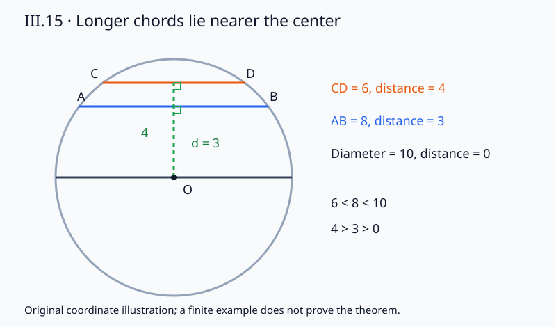

# 《几何原本》III.15：越靠近圆心，弦为什么越长

**把两条弦画得一近一远，并不等于证明较近者更长。** III.15先把任意方向的一条弦换成等长的辅助弦，再比较两组三角形。最值得注意的地方恰是原证走得最快的一步：为什么辅助弦张开的圆心角较大？这一步在图上很明显，却需要位置、相交和角的包含关系共同支持。

## 0 书目与本篇边界

- 阅读单元：Euclid，传世《几何原本》卷III命题15。作品传统年代约公元前300年；本篇实际阅读后世编辑、翻译的传本，不声称每句都能直接确认为该年代原稿。
- 主读：T. L. Heath，*The Thirteen Books of Euclid's Elements*，1908卷II，印刷页36下至37，完整命题、证明与评注。[扫描本](https://www.wilbourhall.org/pdfs/Heath_Euclid_II.pdf)
- 对读：Richard Fitzpatrick，2008希英双语版，印刷页85下至86，含两条本命题脚注。[双语本](https://farside.ph.utexas.edu/Books/Euclid/Elements.pdf)
- 定义上下文：卷III定义4、5以从圆心作出的垂线长度解释等距与较远。前提是圆心距离，不是图上到某条直径的水平间隔。
- 导读核对：[Joyce III.15](https://mathcs.clarku.edu/~djoyce/elements/bookIII/propIII15.html)。这里只借它核对依赖导航；编辑导读不当作古代正文。

Fitzpatrick指出原文设定中“较近于直径AD”应改读为“较近于圆心”，因为有关直线不必平行；又指出圆心角大小没有证明，只诉诸图示。Heath37同样讨论角序缺口，并比较Simson采用的平方证明及其所加逆命题。下面将这几层分开，不静默修成“原文已经完整证明”。卷I所附跨三卷勘误表未列III.15项；这不等于所有版本均无错误。适用校注与所见勘误范围见[来源审查](../../reproduction/euclid-elements-iii15/source-review.zh-CN.md)。

本条是从图灵1936–1937样稿向古代推理文献的**AI前史补读与年代跳转**，不是现代AI论文。图灵样稿也不称作第一篇AI论文。收录标准是来源可核、问题可分析，不宣称穷尽，不按作者机构名气区别质量。本文为原创中文解析，不是全文翻译。

## 1 历史问题与思想动机

[III.14](euclid-elements-iii14.zh-CN.md)已经建立同圆等弦与等距的双向关系。现在的问题是：距离不等时，长度怎样排列？“不等距所以不等长”只能排除相等，不能直接确定哪个更长。III.15必须补上严格大小的方向。

原证不用把不同方向的两条弦强行叠合。它在较远弦的垂线上截取较短的距离，作一条新的弦MN，使MN与原来的较近弦BC等长。这样，原来任意朝向的比较就被规范为两条平行弦MN、FG的比较。这是本篇的主要思想：先用已经证明的相等关系换一个更容易比较的对象，再使用不等式定理。

依赖分工如下：[I.12](euclid-elements-i12.zh-CN.md)提供垂线，[I.3](euclid-elements-i3.zh-CN.md)截取给定长度，[I.11](euclid-elements-i11.zh-CN.md)在直线上立垂线，III.14保证替换不改弦长，[I.20](euclid-elements-i20.zh-CN.md)比较三角形两边和与第三边，[I.24](euclid-elements-i24.zh-CN.md)把夹角大小转成底边大小。补足角序还需要[III.3](euclid-elements-iii3.zh-CN.md)的弦中点性质以及明确的点序论证。

Heath37说Simson省去辅助弦，采用与Theodosius《球面学》I.6相似的平方比较，并加逆命题。这是Heath的历史转述，不等于本文直接查验了Simson或Theodosius原书，更不据此断言欧几里得不知道平方方法。Heath关于作者为何没有采用该方法的解释属于推测，应保留这种证据强度。

## 2 输入、记号与三种不同判断

圆心E，半径R>0，AD为直径。BC是较近弦，FG是较远弦；圆心到它们的垂足分别为H、K。先研究非直径情形，因此0<EH<EK<R。

取L在射线EK上，使EL=EH。由于EH<EK，点序是E—L—K。过L作垂直EK的直线，与圆交于M、N；M与F位于EK同一侧，N与G位于另一侧。MN和FG平行，且L、K分别是各弦中点。

现代记号用全弦长L₁、L₂，垂距d₁、d₂，半弦h₁、h₂。正文中的点L与长度L₁不是同一类对象。距离一律非负，不能把支撑线坐标的正负号当作远近。

要区分三件事：

1. **原命题第一部分：** 任何直径都比任何非直径弦长；各条直径彼此等长。因此“最大”不是“只有一条最大弦”。
2. **原命题第二部分：** 两条非直径弦，较近者更长。
3. **现代完整次序与逆向：** 弦长严格较大，当且仅当垂距严格较小；等长对应等距。逆向可由正向与III.14排除其余两种次序，但它不是原文另列的一段证明。

“弦”要求两个不同圆周端点。圆盘内部任意短线段、弧长和无限直线长度都不在这里的比较域内。

## 3 原证路线：先替换，再比较

### 3.1 辅助弦存在且保持长度

由定义5，较近关系给EH<EK。I.3允许在EK上取EL=EH；L确在E和K之间。过L的垂线到中心距离小于R，应有两个不同圆周交点M、N。古典图把这一求交直接画出；现代补足可令E为原点、EK为横轴，直线x=EL与圆满足y²=R²−EL²>0，故有正负两个根。此处用实数平方根和坐标，是补足存在性的教学方法，不冒充原文的尺规公设证明。

EH=EL，所以III.14给BC=MN。注意它比较的是同一圆内的两条真弦，而不是所有等距线段。MN与FG因为都垂直EK而平行；原来的BC不必与它们平行。

### 3.2 直径大于较近弦

AE、ED、EM、EN都是半径，所以AD=AE+ED=EM+EN。由于EL>0，E不在MN上，三角形MEN非退化。I.20给EM+EN>MN，故AD>MN=BC。

这一步可以对任意非直径弦直接使用：连接其两端点与圆心，两半径之和是2R，严格大于这条弦。没有必要为证明“所有非直径弦”都先另外找一条更远的弦。这个量词整理使最大性不依赖图中恰好出现BC、FG两条弦。

### 3.3 以夹角比较底边

ME=FE=R，NE=GE=R。若已经证明角MEN>角FEG，I.24便给MN>FG，结合MN=BC得到BC>FG。

原文正是在这里略过角序说明。不能以“MN较长，所以张角更大”补它：MN>FG正是当前待证结果，会形成循环。也不能仅从图中两条线平行就断言所有张角关系。下面重建足够的次序证据。

## 4 教学补证：角MEN为什么确实包含较小角

把E置于(0,0)，使射线EK沿正横轴。写EL=a、EK=b，0<a<b<R。FG端点可记F=(b,v)、G=(b,−v)，v>0，且b²+v²=R²；MN端点M=(a,w)、N=(a,−w)，w>0，a²+w²=R²。这些坐标只是固定方向和中点，不把弦长结论当输入。

射线EF在x=a处遇到P=(a,av/b)，射线EG遇到Q=(a,−av/b)。比例a/b严格介于0与1，所以P在E与F之间，Q在E与G之间；EP=(a/b)R<R，EQ<R。

P与M具有同一横坐标a。由距离平方比较，a²+(av/b)²<R²=a²+w²；两纵坐标均为正，故av/b<w。同理Q在L与N之间。因此直线MN上点序是M—P—L—Q—N。P、Q是本文补入的新标签，不是原图原有文字。

于是射线EP位于EM与EL之间，EQ位于EL与EN之间；EP与EF同向，EQ与EG同向。非平角MEN由三个正角MEF、FEG、GEN组成。中间角FEG严格小于整体MEN，所需夹角比较成立。

这一补证对应Heath37所指出的方向：MN与EF、EG的交点在圆内，比M、N更靠近垂足L。我们把存在性和严格次序写成现代坐标计算，以便读者检查，而不宣称已经给出了完全不含连续性补充的古希腊形式系统。

## 5 现代平方重构与逆命题

原证走“等距换弦—角序—I.24”的路。另一条现代路线直接使用III.14中重建的共同平方关系。对任意有效弦，中点是垂足；即使是直径，也可由坐标恒等式处理零距。于是

$$
L_i^2=4(R^2-d_i^2),\qquad 0\le d_i\lt R.
$$

两式相减，得到精确的次序桥梁：

$$
L_1^2-L_2^2=4(d_2^2-d_1^2).
$$

若d₁<d₂，由距离非负知d₁²<d₂²，故L₁²>L₂²；长度为正，故L₁>L₂。反过来同样逐步倒推。平方函数在负数域不保此次序，因而“非负距离”不是可删的装饰条件。

还可不用直接倒推代数而给逻辑逆证：已知L₁>L₂。若d₁=d₂，III.14给长度相等，矛盾；若d₁>d₂，原命题正向给L₁<L₂，也矛盾。非负实数三歧性排除两项，剩下d₁<d₂。这个证明明确指出额外使用的排序原则。

### 5.1 直径边界

当d=0，弦中点为圆心，两个不同圆周端点相反，全长2R。当d>0，L²=4R²−4d²<4R²，所以L<2R。两条直径等长，不存在一个直径严格长于另一个。原文把“其余弦”另外列出，正是避免把严格最大误读为直径之间也有严格次序。

当d趋近R，弦长趋近0；但d=R时只有切点，两个端点重合，不是本接口中的有效弦。极限可以讨论，不能偷换输入域。

### 5.2 一个不需要求根的检查式

实现可以比较平方而不近似开平方。弦长平方由端点差直接计算，垂距平方由圆心到支撑线投影计算，最后检验差值恒等式及相反次序。这样不是先用待证公式算出L，再让同一个公式证明自己。最短距离和中点资格仍要独立核查。

## 6 手算、反例与图示陷阱

**同圆严格比较。** R=5、E=(0,0)。y=3的弦端点(−4,3)、(4,3)，长度8；y=4的弦端点(−3,4)、(3,4)，长度6。8²−6²=28，4(4²−3²)=28。水平直径长10，大于两条非直径弦。

**不同方向也成立。** 将第二条改成x=4，端点(4,−3)、(4,3)，仍长6、距4。与第一条方向不同，不影响比较。原辅助弦的作用就是使原本方向不同的对象可在一个规范图里比较。

**有向坐标不等于距离。** y=−4的弦距中心4，y=3的弦距中心3。尽管−4<3，前一条弦反而较短。输入有符号位置，结论需要无符号垂距。

**同圆条件不可删。** 半径5圆中距3的弦长8；半径13圆中距5的弦长24。后一条更远却更长。两个圆的半径项不再消去，不能套同圆结论。等半径的不同圆可推广，因为相同R仍能消去；这只是现代推广，不是原文“任意圆”。

**同距没有严格大小。** 同圆y=3与y=−3两弦都长8。重复弦或端点反序也应给相等，程序不能把严格比较强制返回一真一假。

**最大不等于唯一。** 圆中任意方向的直径均长2R，故最大弦有无穷多条。若约束方向固定，则该方向过圆心的直径唯一；这是多了约束之后的另一个问题。

**任意内线段反例。** 圆内一条过中心的短线段可长1，另一条不经过中心的线段可长2。第一条距中心更近却不更长。它们端点不在圆周上，不能借共同半径构造直角三角形。有效弦与内部线段必须从输入层区分。

## 7 延伸、局限与AI推理联系

平方差公式不仅给方向，还给变化量：距离平方增加Δ时，弦长平方减少4Δ。它不是说弦长随距离线性减少。把d从0增至1、从3增至4，对R=5的长度变化并不相同。靠近切点时，长度对距离扰动更敏感；这提示测量问题应保留误差界，而非拿精确相等测试直接判断实物。

“等价替换”也是证明工程的重要结构：BC换成MN必须附III.14及同圆、等距证据；随后角序又要有自己的证据。若系统只输出一个漂亮的辅助图，就跳过了推理链最脆弱的部分。本文的精确检查器验证有限输入中的坐标条件及代数关系，不认证自然语言解释、图像识别、古代作者意图或全部欧氏公理。

本单元没有数据集、训练过程、模型基线、准确率或智能评测。不能把枚举许多有理弦说成证明所有实数情形，也不能把通过测试说成实现了通用几何证明器。一般命题由第3–5节证明承担；程序承担可重复的算例与错误输入检验。

## 8 主张与证据位置

| 主张 | 证据位置 | 处理方式 |
|---|---|---|
| 直径最大，其余近弦长于远弦 | Heath36–37；Fitz85–86 | 原命题两部分 |
| 以MN等长替换BC | Heath36；Fitz85；III.14 | 标出构造和等距资格 |
| I.20及I.24两次大小比较 | Heath37；Fitz85–86 | 分开长度和、夹角与底边 |
| “近于直径”用词问题 | Fitz86第一条本命题脚注 | 按圆心垂距解释，不静默改传本 |
| 圆心角序缺口 | Heath37评注；Fitz86第二条脚注 | 用新点P、Q及严格次序补证 |
| Simson平方法、逆向及Theodosius比较 | Heath37 | 二手历史说明，不冒称直读原书 |
| 零距、切点边界与平方差 | 本篇第5节 | 现代一般重构 |
| 有理证书测试 | 复现日志及技术审查 | 真实有限运行，不替代定理 |

## 9 复盘与带答案练习

1. **为何“不同距离”还不足以推出正确的严格大小方向？** III.14仅给相等的等价，否定它只能知不等；还需III.15的不等式论证。
2. **MN的作用是什么？** 与BC等长而平行于FG，将任意方向比较规范为同侧平行弦比较。
3. **L必须放在EK的哪里？** 射线EK内且E—L—K，因为EL=EH<EK；放在反向射线上不能直接沿用原图的角包含证明。
4. **为什么MN确有两个端点？** EL<R，坐标求交给正的R²−EL²，所以正负两根不同。这个存在性补足不是一张图就能代替。
5. **证明角MEN更大时能引用MN更长吗？** 不能，MN>FG就是当前目标，会循环。
6. **辅助点P为何在EF内部？** P=(a/b)F，0<a/b<1；从而EP<R，再由同横坐标距离比较得P位于L、M之间。
7. **直径最大是唯一最大吗？** 否，所有方向的直径都长2R；它们都严格大于非直径弦。
8. **R=13，距离5与12的两弦分别多长？** 半弦分别12与5，全弦24与10；较近者较长。
9. **弦长平方差为60，垂距平方之差是多少？** 较短弦的垂距平方减较长弦的垂距平方为15；注意次序相反。
10. **怎样只用正向和III.14证明逆向？** 假设较长弦距离相等或更远，分别由III.14或正向得到相等或更短，均矛盾。
11. **同圆y=−4与y=3哪条弦更长？** 后者，真实距离3<4；坐标有向值不能替代距离。
12. **为什么不把切点视作有效弦？** 两端重合导致支撑线不能由该点对唯一决定；本篇定义排除它，极限讨论另行标明。
13. **不同半径时平方差还只由垂距差决定吗？** 否，还多4(R₁²−R₂²)项，同圆或等半径是消去它的条件。
14. **重复端点次序会改变比较吗？** 不会，方向反号但长度平方、投影垂足与距离不变，应专测这种不变性。
15. **程序独立计算投影有什么意义？** 避免把待证式作为唯一数据来源，但仍只是实现核验，不自动成为全部实数命题的证明。

复盘顺序：先检查真弦和共同圆，再确认距离无向；明确辅助对象为何存在、为何等长；补角序而非照图断言；最后把原证、现代逆向和有限运行分开。

## 10 复现与版本

[复现说明、源码、Notebook及真实日志](../../reproduction/euclid-elements-iii15/README.md)、[独立来源审查](../../reproduction/euclid-elements-iii15/source-review.zh-CN.md)和[独立技术审查](../../reproduction/euclid-elements-iii15/technical-review.zh-CN.md)分别提供执行、文献与数学实现证据。程序检查精确有理端点，独立投影、计算弦长平方、垂距平方及相反次序；不以待证等式筛选输入。29项单测在普通、-O、-OO三模式实际通过；每模式405条弦、18225次有序比较，含36条直径。另有4个同圆比较、1个不同半径反例和2个非法输入拒绝。五格Notebook顺序compile/exec及只读回放，明确不是Jupyter kernel。正文第6节半径13反例是手算；代码另用半径1与5展示删去同圆条件的失败，两者不混计。

本文由AI辅助编写，深读v1，核验日期2026年10月29日。独立审查为不同执行角色，不冒称人类专家或证明助理认证。仅本阅读单元完成，不把III.16、整卷或全部年代目录计为完成；既有暂缓不改变。
