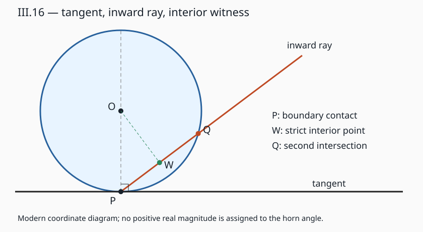

# 《几何原本》III.16：切线旁为什么插不进另一条直线

**圆弧与切线之间明明有空隙，为什么不能从接点再插入一条直线？** 关键不是空隙有没有面积，而是对每个朝圆内一侧的固定非零倾角，足够靠近接点时，这条直线都会进入圆内。III.16把切线构造、局部位置和曲线角的历史争论放在同一命题中。若把三者简单译成“一个正角小于所有正角”，反而会制造原文没有使用的实数模型。

## 0 书目、来源与范围

- Euclid，传世《几何原本》卷III命题16及推论。作品传统年代约公元前300年；实际阅读的是后世编校传本，不断言每一句均为当时原稿。
- T. L. Heath，*The Thirteen Books of Euclid's Elements*，1908，卷II印37下—39的完整命题与推论，39—43上评注。[扫描本](https://www.wilbourhall.org/pdfs/Heath_Euclid_II.pdf)。43页III.17正文不计本篇完成。
- Richard Fitzpatrick，2008修订希英双语版，印86下—88上，含推论方括号材料。[双语本](https://farside.ph.utexas.edu/Books/Euclid/Elements.pdf)。定义I.8、I.9区分一般平面角与直线角；定义III.2以接触而延长后不切入圆内说明直线切圆。
- Heath卷I所附跨卷勘误表确有本篇评论相关项：卷II印41行27的人名由Christoph Schlüssel改为Christoph Klau。正文采用Clavius称呼，保留勘误说明，而不是声称“本篇没有勘误”。

这是从图灵1936–1937样稿向古代推理文献的**AI前史补读和年代跳转**，不是现代AI论文；图灵样稿也不称为第一篇AI论文。收录依来源可核与问题可分析，不按机构名气差别对待，不宣称穷尽。本文是原创解析，不是原文全文翻译。来源分层与所见版本范围见[独立来源审查](../../reproduction/euclid-elements-iii16/source-review.zh-CN.md)。

## 1 问题如何从弦转向切线

[III.14](euclid-elements-iii14.zh-CN.md)和[III.15](euclid-elements-iii15.zh-CN.md)研究有两个不同端点的弦。III.16转而在直径端点立垂线，证明它在圆外，从而取得切线。这里不能先把“切线垂直半径”当定义，再以此证明同一性质。

本命题有三个层次：

1. 从直径端点作垂线，除接点外不进入圆，也没有第二个圆周点。
2. 接点附近，切线与圆弧之间不存在另一条通过接点、保持在外部空隙中的直射线。
3. 用当时的曲线角语言描述：半圆角大于任意锐直线角，剩余角小于任意锐直线角。

第三层不是第一层的普通数字改写。半圆角在这里由直径方向与圆弧形成，**不是圆周角定理中“半圆所对的圆周角”**；后者属于III.31，不可偷用。

依赖中，[I.11](euclid-elements-i11.zh-CN.md)给端点垂线，[I.5](euclid-elements-i5.zh-CN.md)给等腰三角形底角相等，[I.17](euclid-elements-i17.zh-CN.md)排除三角形两角合为两直角，[I.12](euclid-elements-i12.zh-CN.md)给辅助垂足，[I.19](euclid-elements-i19.zh-CN.md)给大角对大边。现代代数补证另用实数坐标与点积，不冒称古典原证。

## 2 原图、假设与需要补明的点序

沿Heath的拉丁标签：圆心D，直径AB，接点A。AE在A处垂直AB；假定的插入直线为AF。由D向AF作垂线DG；从D向G的射线与圆周相遇于H。

若AF真的位于圆外的角隙里，则G在圆外，点序应为D—H—G。因此DH<DG。另一方面，在直角三角形DAG里，AD是斜边，而DG是直角边，所以AD>DG。由于AD=DH，两种比较矛盾。

这段点序并非可以靠画图不加说明。首先AF不能与AD重合，也不能就是AE；它要位于有关锐角扇区。其次G是所假定外部直线上的点，所以外部假设给DG>半径；如果G恰在圆周，已有DG=半径，同样与DG<AD矛盾。若G在圆内，则“整条插入线保持在空隙”已经失败。后文用一个显式内部点替代图示假设，使这几种情况都可检查。

## 3 原证第一段：为什么垂线在圆外

### 3.1 排除进入圆内

原文假定这条垂线像AC那样进入圆内，并连接圆心D与另一个圆周交点C。DA=DC是半径相等，I.5给角DAC=角ACD。角DAC按构造是直角，故角ACD也是直角。非退化三角形ACD中两角之和不能等于两直角（I.17），矛盾。

这里原图中的“若进入便继续遇到圆周C”包含圆的有界性与求交存在的背景。它不应被说成单凭I.5已经完成的命题。现代补足可以直接对垂线上每个非A点计算距离，避免先要求第二交点存在。

### 3.2 排除第二个圆周点

假定垂线上有C≠A且C在圆周，同样得到等腰三角形中两个直角的矛盾。因而“落在圆外”不包括接点A本身：A仍在圆周。把结论理解为整条线没有任何圆周点，会连构造的起点都删除。

原文的推论据此确认该垂线切圆。它使用接触且不切入的概念，不是预先输入“交点恰为一个”的现代分类器。

## 4 原证第二段：不能插入究竟量化了什么

假定AF从A沿圆与AE之间伸出而不进入圆。DG垂直AF，角AGD是直角，角DAG是锐角。I.19于是给AD>DG。圆周半径DH=AD，故DH>DG。

但若AF留在圆外，G也在圆外，则从D到G应先经过H，得到DH<DG。这是同一对长度的相反严格次序，不是“短线看起来比长线长”的视觉判断。

不能插入的对象有两个限制：**必须通过A，必须是固定方向的直线或射线。** 远离A可以在空隙内放下一小段不通过A的线段；弯曲曲线也能留在切线与圆弧之间。这都不反驳命题。命题也不是声称圆弧和切线在某个邻域完全重合。

原文随后把不能插入转为两种曲线角与锐直线角的大小关系：若存在反向的直线角比较，就能在空隙中插入一条边，违反已证结论。这里需要接受该曲线角的区域比较语言。若改用现代两切向方向的夹角，就必须说明换了定义，不能保持同一个词却悄悄换对象。

## 5 现代一般证明：给每条倾斜射线一个内部见证

令圆心O、半径R>0，P是圆周点。令v=O−P，u是非零方向，q=u·u>0，k=v·u。射线写作X(t)=P+tu，t≥0。因为v·v=R²，展开距离平方得到

$$
\lVert X(t)-O\rVert^2-R^2=qt^2-2kt=t(qt-2k).
$$

这一个恒等式分别处理所有情况，而不是只画一条几乎水平的射线。

### 5.1 切向 k=0

对每个t≠0，右边qt²>0，故点严格在圆外；t=0才是P。直线的正负两侧都成立。因此与半径垂直的支撑线只有P一个圆周点，且没有圆内点。结论是算出来的，不是“切线”这个输入标签的含义。

### 5.2 向内 k>0

方程右边在0<t<2k/q时为负，故这整个开段都在圆内。特别取

$$
t_*={2k\over q},\qquad t_m={k\over q},\qquad
\lVert X(t_m)-O\rVert^2-R^2=-{k^2\over q}\lt0.
$$

t_*是第二个圆周交点参数，t_m是中间内部点，同时也是支撑线垂足参数。于是任意向内非切向射线都有可明确构造的内部见证。不论倾角多小，k只要严格为正，见证就存在。

更强的局部量词也成立：给任意邻域半径ε>0，选0<t<min(2k/q, ε/√q)，则X(t)既在圆内，又距P小于ε。因而不是“很远才割圆”，而是任意接点邻域里都割入圆内。此处平方根只是一般实数证明；程序提供有理参数证书，并不实现所有实数输入。

### 5.3 向外 k<0

正向射线每个t>0都在外部，但反向方向−u满足−k>0，会进入圆内。因此**射线向外不等于整条直线是切线**。这也说明为什么只检查屏幕上射线的一侧会误判。

### 5.4 唯一切线与垂足距离

任一过P的非切向直线总有一侧向内，所以不能成为切线。平面中过P且垂直非零OP的直线只有一条，故切线唯一。这个现代推论不与“同一切线上两条相反射线”混为两条切线。

支撑线到心距离的平方为R²−k²/q，不超过R²，等号恰在k=0。非切向时垂足严格在圆内。这把原文的DH与DG次序矛盾变成不依赖图示朝向的恒等式；它是现代重构，不是Heath逐字原证。

## 6 角隙、极限与历史争论

取规范位置P=(0,0)、O=(0,R)，切线y=0。圆在接点附近的下边界为y=R−√(R²−x²)。有理化给

$$
{y\over x}={x\over R+\sqrt{R^2-x^2}}\longrightarrow0\quad(x\to0^+).
$$

对固定斜率m>0，足够小的正x满足下圆弧高度y<mx；同时取x<R且mx<R，则mx低于上圆弧R+√(R²−x²)，所以射线点确在圆内，而不只是位于下弧上方。这里“弧比任意正斜率更平”是一个量词陈述：**先给m，再选邻域**。它不提供一个统一正邻域，使所有m>0同时满足同一个比较。

现代用切向夹角度量时，接触角为0，半径与圆弧切向的夹角为直角。不存在一个正实数h小于每个正实数角度，因为取h/2立即矛盾。这个事实不能单独证明古代语言“自相矛盾”：它首先证明，若保留正的角隙对象，就不能无说明地把它当作普通实数角度。

Heath39–43讨论Proclus及13—17世纪争论。下列内容均是**本次实际阅读Heath的历史转述**，不是直接读过所引所有原著：

- Proclus将半圆角与角状接触隙作为真角讨论；同类量若能倍增超过彼此，与“小于任意直线角”的关系产生困难。
- Campanus讨论从割线转到切线时，直线角与半圆角的比较为何不经过相等；Cardano讨论可增大接触隙而仍小于任意直线锐角的悖论表达。
- Peletier否认接触隙是通常的角量；Clavius为其保留量的地位，但区分与直线角的种类。Heath41的人名勘误见第0节。
- Heath以Wallis的解释收束：接触处的初始倾斜与离开接点后的弯曲程度应区别。我们可用现代切向与曲率说明类似区分，但不把现代微分定义倒灌为Wallis或欧几里得的完整理论。

Heath关于Democritus著作题名的改读，以及欧几里得为何提到这些角的动机，是他明确带猜测语气的历史解释，不能升级为确定史实。本文不复述这些猜测为AI思想的必然起源，也不把“角状”一词说成欧几里得本章使用的术语。

## 7 推论文本与两种唯一性

Heath39的推论只确认端点垂线切圆。Fitzpatrick88把“直线只接触于一点，因为两点连线进入圆内”的扩展置于方括号。Heath43说Heiberg把该扩展作为Theon增补删去，并区分Simson另加的“同一点只有一条切线”。这两项分别是：

1. 给定切线与给定圆，接点唯一。
2. 给定圆周点，过该点的切线唯一。

前者不是后者的逻辑同义反复。本文现代代数同时推出两项，但不据此抹掉传本文本层次。III.2可支持两圆周点间的线段在圆内，从而排除一条切线有两个接点；这是与本文参数恒等式不同的路线。

## 8 手算、反例与边界

令O=(0,5)，P=(0,0)，R=5。

- u=(1,0)：q=1、k=0。任意非零t都有距离差t²>0，确是切线。
- u=(4,3)：q=25、k=15。第二交点t_*=6/5，内部见证t_m=3/5；X(t_m)=(12/5,9/5)，距离平方16，小于25，差−9。
- u=(100,1)：q=10001、k=5。t_*=10/10001，见证5/10001；距离差−25/10001。倾角很小仍严格在内，浮点容差可能把这种负数吞掉。
- u=(4,−3)：正向射线向外，反向却割入；不能凭正向图形称整线相切。
- u=(0,1)：沿半径向内，t_*=10、见证t=5恰为圆心。一般模型允许此例，但它不是原图“锐角隙中的斜线”，两种输入域不可混同。
- 零方向、零半径、非圆周起点必须拒绝。否则q除零、退化圆或缺失v·v=R²会破坏推导。

在切线与弧之间可画曲线y=x²/(4R)，在足够小的正x上它低于圆弧且高于切线。这个教学反例表明“不能插入直线”不可改成“不能插入任何曲线”。同样，一小段远离P的水平线段可以处于空隙，不反驳过P射线结论。

## 9 复现范围与真实证据

[复现目录](../../reproduction/euclid-elements-iii16/README.md)保存自有标准库代码、命令、环境、测试日志、算例、Notebook和独立技术审查。模型输入有理圆心、正的半径平方、圆周点与非零有理方向，以精确分数计算k、q、第二交点、垂足与内部见证。它不靠输入“切线”标签预设结论。

Notebook按顺序实际compile/exec并独立回放；这是标准库执行，不是Jupyter kernel。有限测试核查实现和证书，不证明全实数定理，不重建全部古典连续性公设，也不实现古代曲线角的加法或大小理论。一般证明在第5节，历史解释在第6节，不能互相替代。

图是规范位置下的教学重画，不是原书扫描。28项单测在普通、-O、-OO三模式通过，每模式1728构形和6912次射线幂值检查；四方向算例、三个狭斜例和两个非法拒绝均有真实日志。实际运行统计和独立审核结论见复现README及[技术审查](../../reproduction/euclid-elements-iii16/technical-review.zh-CN.md)。

## 10 主张与证据位置

- 端点垂线外置：Heath37–38；Fitzpatrick86–87。I.5/I.17反证为原证，距离平方展开为现代补证。
- 无可插入直线：Heath38；Fitzpatrick87。DG、DH的次序显化为教学补足；显式内部见证为现代一般证明。
- 半圆角与剩余角：Heath38–39；Fitzpatrick87。不是III.31的圆周角，也不是正实数无穷小的既定定义。
- 推论增补：Heath43评注、Fitzpatrick88方括号，必须区别两种唯一性。
- 历史争论：Heath39–43；只声称读过这一转述，未声称穷尽古代或中世纪原始文献。
- 代码、Notebook与测试：本篇复现目录和真实日志，不以手算冒称实跑。

## 11 局限、延伸与复盘

圆的正曲率、圆周起点与固定直线方向在证明中各有作用。对一般非光滑边界，切线可能不唯一；对直线边界，沿边界移动会有无穷多个共有点。不能将本命题无条件推广到所有凸集或所有曲线。

合理的现代延伸是把边界函数的“一阶方向”与“二阶离开速度”分开：切向角相同不意味着曲率相同。但本文未给一般微分几何定理或数值稳定算法，不以圆的精确例子证明任何训练系统性质。

对AI推理的教学联系在于量词和对象类型：程序可为每个方向返回一个反例见证；证明还必须解释为什么所有合法方向都能如此。对一组很小斜率检查成功，不能替代“任意正斜率”；把曲线角、普通角度、曲率都装入同一数字字段，也会制造类型错误。这是本文分析，不是欧几里得的AI主张。

复盘时问四件事：是否排除了起点？比较的是射线还是整线？“不能插入”是否要求通过接点？历史角对象是否被悄悄换成现代实数？这四问比记住一句“切线垂直半径”更接近本篇实际困难。

## 12 练习与答案

1. 为什么k=0足以证明没有第二交点？答：距离差为qt²，q>0，实数t≠0时严格为正。
2. k>0时给出一个内部点。答：t=k/q，距离差−k²/q<0。
3. 如何把内部点放进任意ε邻域？答：取正t同时小于2k/q和ε/√q；两上界均正。
4. k<0是否证明直线相切？答：否，只证明正射线向外，负方向会进入。
5. u变为cu、c>0，几何交点是否改变？答：k变ck，q变c²q，参数缩为原来的1/c，tu不变。
6. c<0有什么不同？答：整线不变，正反射线交换；切向分类不变，向内向外交换。
7. 原证为什么不能同时使用两个直角？答：I.17规定非退化三角形任意两角和小于两直角。
8. “空隙存在”为什么不推出能插直射线？答：圆弧高度是二阶小量，固定正斜率直线高度是一阶量；靠近接点时直线会跨入圆内。
9. 为什么不能设正实数h表示“小于所有正角”的接触角？答：取正角h/2即矛盾；必须改角的定义或数系，不能静默混用。
10. 半圆角是不是90度圆周角？答：不是，这里边界是直径与弧；现代切向定义可给90度，但与III.31圆周角对象不同。
11. 给定切线只有一个接点，是否自动证明给定接点只有一条切线？答：否，量词位置不同；后者需额外排除其他方向。
12. R=5、u=(4,3)的内部见证距离是多少？答：平方为16，距离4；第二交点参数6/5，别把见证3/5当第二交点。
13. 有限精确测试能证明任意实方向吗？答：不能；它检查有理输入实现，覆盖全实数的是恒等式与符号论证。
14. 本篇读到Heath对Wallis的转述，可以写“已读Wallis原文”吗？答：不能；应说明二手来源和未查原著的边界。

本篇只完成III.16。III.17与后续命题、全书及年代目录中的未读缺口不计完成；既有暂缓项目保持暂缓。

本文由AI辅助编写，深读v1，核验日期2026年10月30日。独立审查指不同执行角色，不冒称人类专家或证明助理认证。
