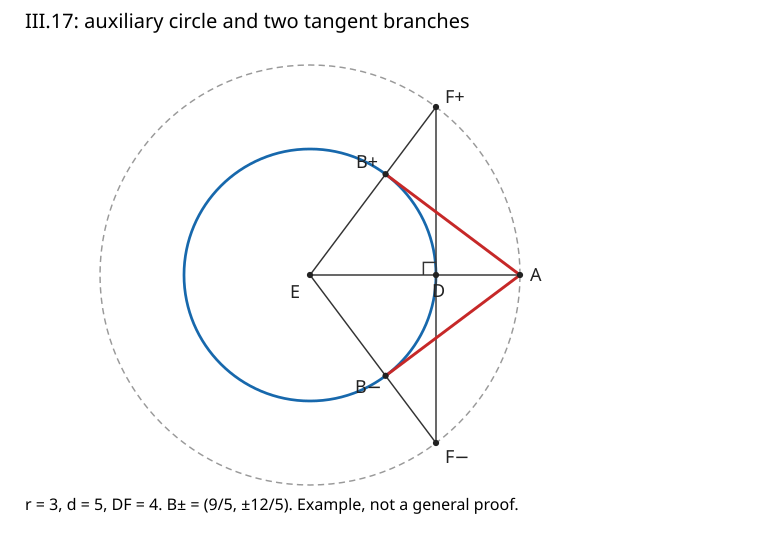

# 《几何原本》III.17：怎样从圆外一点构造切线

**知道半径的垂线是切线，不等于已经知道应该在哪个圆周点作这条垂线。** III.17解决的正是这个定位问题：给定点A，切点B尚未知，不能先画AB再宣布它垂直EB。原构造绕道一个同心大圆，把容易制造的直角，经两边及夹角相等，转移到真正的切点。

## 0 书目、版本与收录范围

- Euclid，传世《几何原本》卷III命题17，作品传统年代约公元前300年。实际研究后世编校传本，不断言每句都是原作者手稿。
- T. L. Heath，*The Thirteen Books of Euclid's Elements*，1908，卷II印43命题全文、44上评注。[扫描本](https://www.wilbourhall.org/pdfs/Heath_Euclid_II.pdf)。43上仍属III.16评注，44下已是III.18，不混入本命题正文。
- Richard Fitzpatrick，2008修订希英双语版，印88下—89的III.17及相邻边界。[双语本](https://farside.ph.utexas.edu/Books/Euclid/Elements.pdf)。本篇按拉丁字母标记解释构造，未全文翻译希腊文。
- Heath卷I前置跨卷勘误表一并核对；所见表未列III.17印43–44的专门更正。这个结论只限所查版本和勘误表，不等于所有传本无误。[卷I](https://www.wilbourhall.org/pdfs/Heath_Euclid_I.pdf)

这是从图灵1936–1937样稿向古代推理文献的**AI前史补读与年代跳转**，不是现代AI论文，也不称图灵样稿为第一篇AI论文。以来源可核和问题可分析为收录标准，不依作者机构名气区别要求，不声称穷尽历史。本文为原创教学解析，原文、编者评注、现代补证和实际运行分别标明。

## 1 历史问题与前人关系

[III.16](euclid-elements-iii16.zh-CN.md)已证明：从直径端点作垂线，它接触圆而不进入圆内。这是“给定切点”的构造。本篇把输入换成“给定一个点”，切点变成输出，因而需要一个新的定位机制。

原证调用[III.1](euclid-elements-iii1.zh-CN.md)找圆心、[I.11](euclid-elements-i11.zh-CN.md)作垂线、[I.4](euclid-elements-i4.zh-CN.md)的两边及夹角全等，以及III.16推论。它没有借用下一命题III.18“切线必垂直半径”的逆向性质。构造证明需要的是已知的充分条件，不必提前调用逆定理。

Heath印44指出，构造显出两条切线、等长及关于连心线对称的性质，并把这些说明联系到经an-Nairīzī传下来的Heron材料。这里是对Heath历史评注的转述，未声称独立读过Heron原著，也不把这些附加性质全部塞回欧几里得正文。

同页还提到常见的另一构造：作以AE为直径的圆，其与原圆的交点就是切点。但这条简便证明需要III.31的半圆圆周角定理，按本书编排属于后出依赖。它可以作后世比较，不能用来假装解释了III.17为什么在此处成立。

## 2 输入、标签及可行域

给定一个非退化圆，圆心E、半径r>0；给定点A。原图把A置于圆外，设EA=d>r。

- D：从E朝A的射线与原圆相交的点，故E—D—A，ED=r。
- 辅助圆：圆心仍是E，半径EA=d。
- F：过D垂直EA的直线与辅助圆的一个交点。
- B：射线EF与原圆的交点，故E—B—F，EB=r。
- AB：待证为切线的最终输出。DF只是辅助线，不是原圆切线的输出。

原命题标题没有在“给定点”前写出外点限定，实际构造和图示却采用外点。Heath印44特别说明省略圆周上点的情形可由III.16直接处理。现代完整接口应分三类：

1. d>r：有两个不同切点、两条切线。
2. d=r：A就是接点，作EA的垂线。不是把两个相同端点的“AA”当作一条直线。
3. d<r：不存在通过A且不进入圆内的直线，因为A本身已是内点。

第三类不是算法失败后留下的空白，而是输入要求不可满足。若r=0，圆已退化，本篇不把它纳入古典圆的定义；若A=E且r>0，则属于内点。

## 3 原构造一步一步做了什么

### 3.1 先造一个可控直角

求出E并连EA。以E为心、EA为半径作辅助圆。取D在原圆与EA之间的正确射线上。过D作DF垂直EA，延长到辅助圆。

为什么相交？D距E为r，严格小于辅助圆半径d，因此D在辅助圆内部。过一个内点的直线向两边延伸，各遇到圆周一次。原文使用这一圆线求交背景；仅仅援引I.11并不能证明求交存在。现代代数补足是，在以EA为横轴的坐标中，交点纵坐标满足 y²=d²−r²>0，有正负两个解。这里用实数正数有平方根来解释存在性，明确是现代补证。

### 3.2 再把方向送回小圆

连接EF。由于EF=d而r<d，射线EF上唯一距E为r的点B位于E、F之间。连AB。这一步没有要求AB与EB垂直；那个直角必须在证明中取得，不能作输入条件。

EF和EA夹成一个角。ED与EA同向，EB与EF同向，因此角DEF与角BEA是同一对射线构成的无向夹角。所谓“共同角”不是两个三角形碰巧都标了字母E，而是两组边方向严格对应。

### 3.3 用I.4转移直角

比较三角形DEF与BEA，顶点对应是D↔B、E↔E、F↔A。

1. DE=BE，因为都是原圆半径。
2. EF=EA，因为都是辅助圆半径。
3. 夹角DEF=BEA，由上述射线关系。
4. I.4给两三角形全等，特别是角EDF=角EBA，并有DF=BA。
5. 角EDF按构造为直角，所以角EBA也是直角。
6. EB是原圆半径，延长成直径后，B是直径端点。III.16推论给AB切原圆。

如果错把D对应A，便会把正确的边长配对弄乱。这里也不是“斜边和一条直角边相等”的快捷全等判定；原文明确使用两边及其夹角。证明直角时，更不能把未知的角EBA先认作直角来使用直角三角形全等。

## 4 现代坐标重建：存在、正确性与全体解

此节是现代教学重构，不是原文符号。平移旋转后取E=(0,0)，A=(d,0)，D=(r,0)，令h为d²−r²的正平方根。两个辅助点分别为F₊=(r,h)、F₋=(r,−h)。B在EF上缩放r/d，因此

$$
B_{\pm}=\left(\frac{r^2}{d},\ \pm\frac{r\sqrt{d^2-r^2}}{d}\right),\qquad d\gt r\gt0.
$$

首先直接相加两坐标的平方得r²，故B在原圆。其次B·A=r²，故B·(A−B)=0，说明EB垂直AB。A−B不为零，因为A在圆外而B在圆上。

还可以不把“垂直即切线”当术语定义，直接证明整条线除B外在圆外。令X(t)=B+t(A−B)，t是任意实数。展开平方，交叉项为零：

$$
\lVert X(t)\rVert^2-r^2=t^2\lVert A-B\rVert^2.
$$

右侧在t≠0时严格为正，在t=0时为零。这既给不进入圆内，也给只有B一个圆周点。注意t遍历全体实数，而不只是线段参数0到1；切线是整条直线。

### 4.1 为什么恰好只有这两条

“构造出了两条”只证明至少两条，还需要排除第三条。设过A的一条直线在B接触圆且不进入圆内，方向v=A−B非零。对B+tv展开圆幂，线性项为2t(B·v)。若B·v≠0，选择符号相反且足够小的t，就让线性负项压过二次正项，产生内点，矛盾。因此B·v=0。

又因B在圆上，B·A=B·B=r²。A=(d,0)给B横坐标r²/d，代回圆方程只剩上述两个纵坐标。d>r保证二者不同。这个排除论证是现代补证，不提前引用未读的III.18。

### 4.2 边界为什么要换输出类型

d=r时两个公式都给B=A，向量A−B为零，不能代表直线。因此圆上情形必须另给一个非零垂直方向，例如A=(r,0)时用方向(0,1)。圆内情形可以由内点定义直接排除，也可由一般切点条件得r²=|B·A|≤rd<r²的矛盾；后者用到现代柯西不等式，不是原证。

## 5 手算例子与容易误判的反例

### 5.1 半径3、外点距离5

取E=(0,0)、A=(5,0)、D=(3,0)，辅助圆半径5。h=4，故F₊=(3,4)，B₊=(9/5,12/5)。圆上检查为81/25+144/25=9。切线方向A−B₊=(16/5,−12/5)，与半径的点积是144/25−144/25=0。切线段长度是4，等于DF，而不是辅助圆半径5。

整线平方距离为9+16t²，所以t=−1或2的延长线点也在圆外。下方镜像B₋=(9/5,−12/5)给第二条切线；它与上方切线不重合。

### 5.2 “随便选一个圆周点”不行

仍取r=3、A=(5,0)，选T=(0,3)。T在圆周，却有T·(A−T)=−9，不为零。线段上从T朝A走很短一段便进入圆内。圆周成员关系只检查了一个约束，未检查相切。

### 5.3 把辅助点F当切点不行

F=(3,4)距E为5，不在半径3的原圆上。它位于辅助圆上并不赋予原圆切点资格。原构造必须缩回B，而不是只连AF就停止。

### 5.4 圆上点与内点

A=(3,0)时切线是x=3，可用非零竖直方向描述。把AB长度0当成构造成功，会丢掉直线的方向。A=(1,0)时在圆内，无切线，不应为满足“总返回一条线”而生成复数点。两类都需要在取平方根或归一化前分类。

### 5.5 不要把有理样本覆盖当全实数覆盖

例如r=1、d=2，h=√3，切点含√3。几何构造完全可行，却不属于只保存有理坐标的精确小程序可以直接表示的那部分实例。拒绝该表示域外输入，不是断言该圆没有切线。

## 6 对称性、等长与合理延伸

现代公式显示两切点关于EA镜像，两个切线段长度相等：其平方均为d²−r²。原全等证明也已给每条AB=DF，而辅助圆的上下交点对称，故两个DF长度相等。等长是几何推论，不是将两个结果强行设为同一个输入长度后得到的“实验发现”。

以AE为直径的圆提供另一种定位方式：若交点B的角EBA是直角，就能调用III.16。Heath明确把该简法放在知道III.31之后。本篇只说明它与现代方程的关系，不把它换成原构造，也不将III.31计为完成。

在自动几何或AI辅助推理里，本例可作“候选生成与独立检查”的小示范：生成器提出B，检查器分别核圆周成员、非零方向、半径正交及整线圆幂。这样的分解能抓出字母错配或退化输出，却没有证明自然语言模型一般可靠，更不是现代AI实验性能结论。

## 7 局限与复盘

原证很短，是因为许多可作图背景没有展开：圆心可得、射线取对、辅助线有交点、线段在同向射线上以及非退化三角形。现代补证应把这些条件显化，而不是因为古文省略，就断言其结论错误。

本篇没有做传本谱系的全面研究，也没有重新校勘希腊文；Heath对Heron的历史说明是二手证据。计算只实现已声明的精确教学输入域，不是完整尺规作图系统、一般实代数求交器或证明助理。浮点画图只能帮助读者辨认标签，不能替代精确判等和存在性证明。

复盘时依次问：输入点在哪里？哪个直角先被构造？哪个直角是待证？两三角形的对应顺序是什么？求交为何存在？两条结果何以不同？圆上分支为何不能沿用零向量？每个问题都有独立答案，才能称为读懂了构造。

## 8 主张与证据位置

| 主张 | 依据 | 边界 |
|---|---|---|
| 同心辅助圆、D处垂线、EF与AB | Heath II印43；Fitz88–89 | 图示外点，本文展开点序 |
| DEF与BEA由I.4全等，移交直角 | 同上证明 | 不是预设未知直角 |
| 正交半径足以给切线 | III.16推论，本篇末步 | 不是先用III.18逆向 |
| 两切线等长、等倾角与Heron材料 | Heath印44上 | 编者历史评注的二手转述 |
| 圆上分支省略，可直接用III.16 | Heath印44上 | 本文接口另行输出非零方向 |
| AE直径圆简法依赖III.31 | Heath印44上 | 后出比较，非原构造 |
| 恰两条及内点无解、整线幂值 | 本文第4节现代证明 | 与原文严格分层 |

独立阅读范围、勘误边界见[来源审查](../../reproduction/euclid-elements-iii17/source-review.zh-CN.md)，数学和代码核验见[技术审查](../../reproduction/euclid-elements-iii17/technical-review.zh-CN.md)。

## 9 最小复现与真实执行

[复现README](../../reproduction/euclid-elements-iii17/README.md)给源码、环境、命令、参数域、真实日志及Notebook入口。程序用精确数检验同心辅助圆构造链，不把圆周点自动认成切点。圆内输入、圆上特殊分支和表示域外输入的区别必须保留。

Notebook以标准库逐格compile/exec并独立回放，不声称Jupyter kernel运行。作者实跑为28单测三模式，各324构形、648双分支证书及3240幂值检查。范围与独立核验另见复现README及技术报告；未把手算例子冒充日志。有限参数遍历能发现实现错误，不能证明第4节对所有实数输入的命题。公开目录只含原创解析、教学代码与清洁运行证据，来源扫描留在阅读工作区，不随仓库发布。

## 10 带答案练习

1. **D和B都是原圆点，为什么不能交换它们的角色？** 答：D先在EA射线上用于作垂线；B从EF射线取得并连接A。虽有ED=EB，只有证明完成后才知道AB垂直EB。交换构造步骤会把待求点当已知。
2. **I.4的正确对应是什么？** 答：DEF对应BEA，D↔B、E↔E、F↔A；DE=BE、EF=EA，夹角DEF=BEA。直角EDF对应EBA。
3. **辅助圆为什么不是半径r？** 答：若辅助圆也半径r，D处垂线只在D接触它，F=D，不能形成原证的非退化三角形。半径d>r使垂线穿过辅助圆内部并有两交点。
4. **r=5、d=13时手算两切点。** 答：h=12，B=(25/13,±60/13)，切线段长12；坐标平方和25，B·A=25。
5. **r=1、d=2有无切线？有理实现拒绝说明什么？** 答：有两个，B=(1/2,±√3/2)。拒绝只表示精确有理输出域不含此实例，不是几何无解。
6. **仅核B在圆周且A在圆外足够吗？** 答：不够。第5.2节的T=(0,3)是反例。还要核方向非零及点积为零，或其他等价切线证据。
7. **整线圆幂为什么不能只检t=0和t=1？** 答：两端外/边界不排除中间入圆。一般恒等式在任意实t成立，才保证整条延长线也不切入。
8. **构造两条能否推出恰两条？** 答：不能单靠构造。还需任意切点满足B·A=r²，再与圆方程联立只得两解；或给出另一个一般排他论证。
9. **A在圆周时为什么AB=0不是切线？** 答：两个重合点不能确定直线；要保留A和一条非零、垂直EA的方向。
10. **用AE直径圆能否替代本篇原证？** 答：作为后出解法可以；若借III.31而未声明，则破坏本篇的依赖次序。原证用I.4将已造直角转移到B，不用半圆角定理。
11. **把r变负后平方等式还成立，是否仍合法？** 答：不合法。平方等式不能恢复正长度和圆的非退化条件，输入层必须拒绝r≤0。
12. **这份代码对AI推理可靠性证明了什么？** 答：只支持其明确参数域和已执行测试的实现检查。它没有测量语言模型，更不能从有限几何证书推出一般AI可靠性。

本文为AI辅助原创解析，版本深读v1，核验日期2026年10月30日。仅III.17阅读单元完成，不将III.18或全书计为完成。
