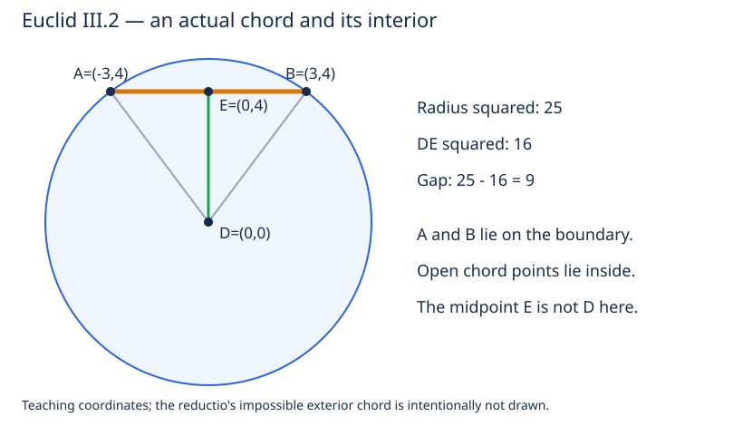

# 《几何原本》III.2：弦为什么不能跑到圆外

## 约公元前300年 · 数学与推理前史补读 · 深读v1

在圆周取两点，连起来的线段当然在圆里。这句话有三个容易混过去的地方：端点本来就在圆周，所谓“在里面”到底指哪些点？排除了圆外，为什么还要排除圆周？若弦经过圆心，原证用到的三角形已经压成直线，证明是否仍然成立？

III.2的价值正在于把图形直觉变成可以追问条件的论证。它接续[III.1圆心构造](euclid-elements-iii1.zh-CN.md)，但不是现代AI论文。本系列从图灵1936—1937样稿回溯古代，是明确的年代跳转与数学推理前史补读；不称图灵为第一篇AI论文，也不声称已穷尽前史。收录依据问题及可核验文献，不以作者或机构声望代替证据。本单元仅覆盖III.2及必要评注、补证，后续命题不计完成。

本文区分**原文、后世评注、教学补足、现代重构、真实实跑**，不提供原文全文翻译。只想建立直觉可读2、5、7节；重建原证读3–4节；复核来源与实现读1、8–10节。

## 1 文献、年代与前人关系

| 材料 | 实读范围 | 用途及限制 |
| --- | --- | --- |
| Euclid，*Elements*，III.2 | 编纂传统约公元前300年 | 年代指作品传统，不是本命题可考的首次发现日期 |
| T. L. Heath，*The Thirteen Books of Euclid’s Elements*，1908卷II | 印8–10，PDF21–23页 | [扫描](https://www.wilbourhall.org/pdfs/Heath_Euclid_II.pdf)：完整命题与图，直接证明、延长线、交点数评注 |
| Richard Fitzpatrick，*Euclid’s Elements of Geometry*，2008修订版 | 印71–72，PDF同页；定义I.15–17见印6 | [希英对照](https://farside.ph.utexas.edu/Books/Euclid/Elements.pdf)，希腊底本Heiberg1883–1885版 |
| David E. Joyce，Clark University | [III.2及Guide](https://mathcs.clarku.edu/~djoyce/elements/bookIII/propIII2.html) | 对照原证字母、反证图和省略步骤；Guide不是古代正文 |

原文的前驱并非现代“凸集”概念，而是第一卷的[I.5等腰底角](euclid-elements-i5.zh-CN.md)、[I.16外角比较](euclid-elements-i16.zh-CN.md)、[I.19大角对大边](euclid-elements-i19.zh-CN.md)，再加圆心到圆周等距的定义。它不需要圆周角定理，也不应倒过来用第三卷后章证明本条。

Heath印9给出不必先假设弦在外部的直接证明，关联他在I.24下讨论的三角形内部线段比较；印9–10归于Camerer的补充是弦向两边延长后落在圆外，归于De Morgan的建议则是补入直线与圆至多两个交点。这些是**Heath所转述的后世讨论**，本次没有独立读取这些作者的全部原著，不把它们写成欧几里得自述。现有材料也不足以指定III.2的最初发明者或同期竞争成果；不虚构从古希腊到AI的直接技术传承。

检查了Heath卷I随卷勘误表（其中含其他卷条目），未见针对卷II印8–10的条目。这个结论只覆盖所查勘误表；“2008修订版”也不等于保证无误。III.1的平分线段I.9误引问题已在上一篇说明，不能误搬成III.2的新发现。

## 2 把“在圆里”的量词补清楚

**原文。** 圆周上任取两点，连接它们的直线落在圆内。这里的“直线”在命题语境中是两点之间的线段，不是向两端无限延伸的整条支持直线。

**教学规格。** 令D为圆心，r为正半径，A、B为两个不同圆周点。要证明的是：任取严格介于A、B之间的E，距离DE严格小于r。A、B本身距离等于r，因此不能把端点算作严格内点。C是原图圆周上的命名点，不是本证需要测量或计算的第三个输入。

可分别说：闭线段AB包含在闭圆盘中；开线段AB包含在开圆盘中。古典“圆”常指被圆周围成的平面图形，现代“圆”也常只指边界，故本文明确使用“圆周/圆盘”。前一句比后一句弱，不能用“不在外面”自动替代“严格在里面”。

符号约定：XY表示非负距离；角XYZ以Y为顶点，仅在相关射线非零且构成相应三角形时使用。F只在原文外点反证中表示从D朝E的射线与圆周相交处，点序为D–F–E。现代重构另用t表示E在A到B方向上的比例，u=A−D、v=B−D为平移后的向量。

**基础边界。** 原证借助直线点序、圆心在内部、射线遇到边界，以及内外与径向长短的关系。这些不应由一张图免费充当完整公理化证明。本篇保留古典论证，同时在现代欧氏实平面中给出另一套明确模型；后者不是对古典全部连续性与点序公理的形式认证。

## 3 原证逐步走查：外点会造成怎样的矛盾

先处理D不在AB支持直线上的情形。任取严格内点E，暂假设它在圆外。连接DA、DB、DE，并在从D到E的方向取圆周点F，故DF=r且DF<DE。

1. **等腰条件。** A、B同在圆周，所以DA=DB。I.5给出三角形DAB的两底角相等。因A–E–B，射线AE与AB相同，BE与BA相同，因此角DAE=角DBE。这里把“相同射线”说清楚，比照着图说两角一样更可靠。
2. **外角比较。** 在非退化三角形DAE中，把AE延长到B。I.16说外角DEB大于不相邻内角DAE。注意这不是DAB的外角，也不是角DEA。
3. **把比较移到同一个三角形。** 用第1步替换，得角DEB>角DBE。现在两角都属于三角形DEB。
4. **角转边。** I.19说明在三角形DEB里，角DEB对着DB，角DBE对着DE，因此DB>DE。
5. **矛盾落地。** DB=DF=r，于是DF>DE；但假设E在圆外已给出DF<DE，不能同时成立。因此这个严格内点E不可能在圆外。

上述链条与Heath印8–9、Fitzpatrick印71–72一致。原图把AEB表现得像向外弯曲的线，Joyce也提醒这是一幅用于不可能假设的图。**不能把该图当真实欧氏构形测坐标，更不能要求程序生成一条既是直线又向圆外拱起的合法弦。** 反证图记录假设关系，不是存在性见证。

## 4 原文一句“类似可证”隐藏了什么

### 4.1 圆周分支必须单独排除

原文接着说，类似可证该线也不在圆周上，没有展开细节。教学上仍取任意严格内点E，但改假设E在圆周。只要D、A、B不共线，第3节的步骤1–4完全不需要“圆外”条件，所以仍得DB>DE。现在圆的等距定义给出DB=DE，直接矛盾，不必再引入F。

量词要落实到每一个E，而不只是排除“整条线段都在圆周上”。由每个严格内点既非外点又非圆周点，配合内/边界/外三种位置的分类，才得到开线段全部在内部。

### 4.2 为什么直径不能硬套角度证明

若D在AB支持直线上，A、B到D等距又互不相同，它们不能位于D的同一侧：同射线上同一正距离只能定位一个点。故点序A–D–B，且DA=DB=r。

任取A–E–B：若E=D，DE=0<r；若E在A与D之间，DE<DA=r；若E在D与B之间，DE<DB=r。至此三种位置均覆盖。这里用的是一维点序及整体大于部分，**不是给零长度射线或退化三角形套I.16**。

原文没有逐行列这个分支，本文明确标作教学补足。直径是合法弦，不是“异常输入”应被排除；A=B则根本没有两个不同端点之间的开线段，应在规格中另行排除。

### 4.3 更短的直接证明与阅读顺序

Heath印9指出反证并非必要：对非直径弦的任意严格内点E直接做角比较，就有DE<r，两种反证假设都省了。本篇第3节实质已展示同一路线，只是在最后与外点假设对撞。这种改写更方便教学，但不能说欧几里得原文已按直接证写出。

III.1构造弦中点时曾默认弦位于内部；Heath印8也指出双弦方法对三点非共线的依赖可由III.2解决。这里应分开“圆的定义保证有圆心”与“用III.1算法找到圆心”：本命题的存在性论证可从已存在的D出发，不必把III.1构造的所有未明说条件一起当作已证明。完整重排公理体系是更大的工作，本篇不声称已经完成。

## 5 现代重构：严格性可以量化

以下为本文欧氏向量模型，不冒称古典公式。令A、B相对D的向量为u、v，且两者平方长度都等于r²。线段内插点相对D为w=(1−t)u+tv，0<t<1。

先把平方展开：w·w=(1−t)²(u·u)+2t(1−t)(u·v)+t²(v·v)。又有(u−v)·(u−v)=u·u−2u·v+v·v，所以2u·v=2r²−|u−v|²。代回后，r²的系数是(1−t)²+2t(1−t)+t²=1，从而

$$
\lVert E-D\rVert^2=r^2-t(1-t)\lVert A-B\rVert^2.
$$

定义余量m为r²−DE²，则

$$
m=t(1-t)\lVert A-B\rVert^2\gt0\qquad(0\lt t\lt1,\ A\ne B).
$$

三个正因子给出严格性，距离非负且r>0，因此DE<r。这一公式同时涵盖非直径、直径、E=D；不需要给中心点定义角。它还告诉我们严格性在哪里丢失：t=0或1是端点，A=B是重合端点，余量都变成零。

把“闭圆盘是凸集”当成已经证明的定理，可以很快得到非严格包含；但若以凸性来证明凸性，就只改了术语而没有推导。上述平方恒等式提供了独立的代数理由。严格内点性质比非严格凸性更强：正方形边上的两个不同点之间仍可能留在边界，所以一般凸集不能照抄这一结论。

## 6 图、算例与故意失败的输入

图只表现合法的非直径圆弦及其中点，是原创教学图，不是反证假设图或原书扫描。下面先给可手算的值，真正程序输出另见复现记录。

取D=(0,0)、r=5、A=(−3,4)、B=(3,4)。两端点平方距离都是25，弦长平方36。

| 情形 | t及点E | DE² | 余量25−DE² | 结论 |
| --- | --- | ---: | ---: | --- |
| 中点 | 1/2，(0,4) | 16 | 9 | 严格内部 |
| 四分点 | 1/4，(−3/2,4) | 73/4 | 27/4 | 严格内部 |
| 左端点 | 0，(−3,4) | 25 | 0 | 圆周，不是严格内点 |
| 超出B | 3/2，(6,4) | 52 | −27 | 圆外，不满足内插条件 |
| 直径中点 | A=(−5,0)、B=(5,0)，t=1/2 | 0 | 25 | E=D，合法内部 |

最后一行换了端点，弦长平方为100，不能继续套上一行的36。平移到D=(2,−1)，同步平移A、B、E后差向量与上述余量不变；这检验的是坐标原点不应改变几何关系。

**失败不是反例推翻定理，而是前提缺失。** 取A=(−6,4)、B=(6,4)，虽然两端到D等距，但平方距离为52而非25。中点(0,4)仍在半径5圆内，并不能倒推端点本来在圆周。再取A=B=(3,4)，内插永远回到该圆周点，说明端点互异条件不可省。

**近端点问题。** 在第一组弦取t=1/100，余量为891/2500，严格为正却很小。若使用浮点数与统一容差，很容易把“接近圆周”混成“在圆周”；本实现使用精确有理数，不宣称解决带噪图像的圆检测问题。

## 7 从本条能推出什么，不能推出什么

**本文推论。** 一条直线不可能有三个不同点都在同一圆周：三点线性排列后，总有一个在另外两个之间，III.2会要求它严格在圆内，与圆周条件矛盾。这不证明每条直线都与圆相交；外部直线零交点、切线一个交点均与“至多两个”相容。

**后世评注及现代核验。** Heath印9–10记Camerer提出弦延长线在圆外。第5节恒等式在t<0或t>1时给t(1−t)<0，故DE²>r²，直接证明这一扩展。它只针对已有两个不同圆周交点的支持直线，不是任意从圆外点出发的直线。

**与AI推理的有限联系。** 自动几何系统需要把“在直线上”“在线段上”“在开线段上”分成不同谓词。图像识别出一个大致形状，并不等于已经获得精确的点序与等距前提。LLM生成证明时若把外角DEB误写成内角DEA，或忘记直径分支，结论虽真，证据链仍坏。本篇证书只是这种条件显式化的教学演示，不是对某个AI模型能力的评测，也没有训练数据、基线精度或性能优越性的实验主张。

## 8 实现怎样与证明对齐

复现以标准库Fraction表示圆心、端点、半径平方和t，逐项检查正半径平方、端点互异、两端位于指定圆周，以及参数范围。平方距离不要求开方，故半径本身可不是有理数，而全部输入证据仍可精确。

原文的角比较链在正文重建；程序检验的是现代平方模型及证书一致性，不模拟希腊尺规操作，也不认证原书所有公理。它不能从有限坐标断言一个未知图像真的是圆，不是处理任意输入的几何证明器。有限测试能发现实现偏离，不替代第3–5节的全称证明。

[源码、命令、环境、真实日志与Notebook](../../reproduction/euclid-elements-iii2/README.md)保存实际运行证据；真实结果为23项单测在普通、-O、-OO三种模式通过，每模式含900组网格（10个有理圆周点的45对×2平移×2正尺度×5参数），另保存5个命名算例。测试覆盖边界和错误证书；三个模式不是三个独立实现。Notebook采用标准库逐格compile/exec并独立回放，未声称Jupyter kernel或nbformat完整模式认证。修改源码、公式或Notebook后必须重跑相关检查，不能把旧输出当新结果。

## 9 主张与证据位置

| 主张 | 证据位置 | 责任边界 |
| --- | --- | --- |
| 圆周两点的连接线在内部 | Heath印8–9，Fitz印71–72，III.2 | 严格内点规格为本文显式解释，端点仍在圆周 |
| 外点反证I.5→I.16→I.19 | 同上命题证明 | 点序/非退化条件在本文补明 |
| 圆周分支可类似排除 | Heath印9、Fitz印72末段 | 原文省略，§4.1展开 |
| 直接证明路线 | Heath印9评论 | 后世评注，不归原文 |
| 弦延长线在外及至多两交点 | Heath印9–10评论 | §7另给现代推导，不冒充原证逐字已有 |
| 直径含中心分支 | 本文§4.2及§5 | 教学补足，不对零射线用角定理 |
| 平方余量、数值表、条件反例 | 本文§5–6 | 原创现代重构及手算，实跑另留日志 |

独立审查分别见[来源审查](../../reproduction/euclid-elements-iii2/source-review.zh-CN.md)和[技术审查](../../reproduction/euclid-elements-iii2/technical-review.zh-CN.md)。审查绑定正文哈希，描述所查范围，不冒称人类专家或证明助理认证。

## 10 练习与带答案复盘

**题1：“两端点都在圆周，所以整条直线在圆内”错在哪里？**
答案：命题指两端点之间；延长线t<0或t>1的余量为负，反而在外。即使限定线段，端点也不在严格内部。

**题2：第3节I.19究竟在哪个三角形使用？**
答案：DEB。角DEB的对边DB，角DBE的对边DE。若在DAE里直接写DB是对边，连三角形都换错了。

**题3：为什么只排除圆外还不够？**
答案：剩下圆内或圆周两个可能。取严格内点E在圆周，重复角比较得DB>DE，与两者都是半径矛盾。端点不是这个假设中的E。

**题4：E=D时怎样证明，为什么不能比较角DEB？**
答案：DE=0<r；射线ED是零向量，没有正常角定义，角比较路线不适用。直径的一维分支或平方模型直接覆盖。

**题5：用同一组A=(−3,4)、B=(3,4)，取t=1/3算余量。**
答案：E=(−1,4)，DE²=17，余量8；t(1−t)·36=(1/3)(2/3)36=8。

**题6：证明至多两交点，是不是证明一定有两个？**
答案：不是。至多是上界，存在性另需条件。三个假设交点中取中间点可反证上界，却不能创造任何交点。

**题7：把r²=25改成26，保持原两端点，能直接运行同一证明吗？**
答案：不能；端点的平方距离仍25，已经不在新圆周。它们可能仍处在新圆盘内，但那是另一个输入规格，程序应拒绝伪称圆周端点的证书。

**题8：测了几千个有理点，就证明所有实数点吗？**
答案：没有。样本有限且域更窄。全称结论来自角比较或平方恒等式及正性推导；测试负责检验实现与该模型一致，二者互补而不能互相冒充。

复盘可用四句话：先说清严格内点而非端点。再用等腰、外角、大角对大边得到距离严格小于半径。把直径和零射线分支另行覆盖。最后用现代平方余量解释严格性在哪里成立、在哪里消失，同时保留原文和教学模型的区别。

本文为AI辅助原创中文解析，核验日期2026年10月29日。仅本单元完成；既有暂缓项目不变。
