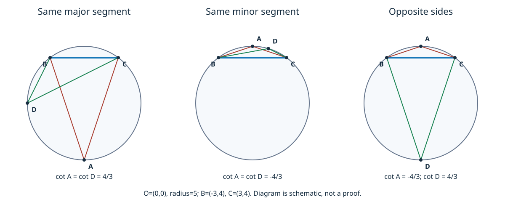

# 《几何原本》III.21：同一弓形，为什么视角不变

## 约公元前300年 · 数学推理前史补读

沿同一段圆周移动观察点，看固定弦的角度为什么不变？《几何原本》III.21把这个运动直觉压缩成一条很短的证明：两个圆周角分别是**同一个**圆心角的一半，因此相等。但“同一弓形”不是可删去的装饰，而且古典证明对角的范围有一个必须补足的边界。

本篇的学习目标是：准确识别同弓形条件；重建原证与Heath转述的Simson补证；独立证明优弓形、劣弓形及半圆三种情况；用精确有理数核验例子，而不把有限测试称为一般证明。这是古代几何著作的一个阅读单元，不是现代AI研究论文，也不把图灵1936–1937年样稿称作第一篇AI论文。

## 1 书目、年代与实际阅读范围

- **著作与单元：** Euclid，《Elements》，卷III命题21。约公元前300年是作品的传统年代定位，不是这条命题的可考发现日期，更不是现存手稿出版日期。
- **实读译注本：** T. L. Heath，*The Thirteen Books of Euclid's Elements*，1908，卷II，印刷第49页完整命题及第49–51页评注；为辨别调用范围另核第47–49页III.20评注。[Heath卷II扫描](https://www.wilbourhall.org/pdfs/Heath_Euclid_II.pdf)
- **对照本：** Richard Fitzpatrick，*Euclid's Elements of Geometry*，2008修订本，印刷第91–92页III.21（第92页其后已进入下一命题）；卷首说明所列希腊文本底本为Heiberg 1883–1885。译本不是公元前原始手稿。[双语本及版本说明](https://farside.ph.utexas.edu/Books/Euclid/Elements.pdf)
- **勘误核查：** 核Heath卷I卷首“Errata（勘误表）”，所核表未列卷II第49–51页或III.21的相应更正；这不等于穷尽一切版本勘误。Fitzpatrick以标明修订的2008本为准。[Heath卷I](https://www.wilbourhall.org/pdfs/Heath_Euclid_I.pdf)

**年代关系与收录口径。** 本单元从已读[III.20](euclid-elements-iii20.zh-CN.md)续入同一古代著作；相对于仓库1930年代标杆，它属于明确的前史回填。理论前驱先按可核对的书内依赖记录：I.5、I.32支撑III.20，III.1给圆心，III.20提供二倍角关系。这里没有可靠证据把III.21首次发现归给某位前欧几里得作者，也不把同一卷的编排顺序误写成发现年代。Heath转述的Simson补证和Serenus应用是后世评注线索，不是欧几里得时代的同期证据；本文没有直接校读这些作者各自的原版著作。此目录采用同一“可定位文本—明确假设—逐步推理—独立核验”标准，不按作者名气筛选，也不声称覆盖古代几何全部文献。

下文区分：**原文**为上述版本的命题和证明；**后世评注**为Heath的历史与技术讨论；**教学重构**为本文新编符号、补足说明和坐标证明；**实跑**仅指附件程序确已运行的结果。所有图为自绘示意，不以像素测量作为证明。

## 2 历史问题：如何把移动的顶点从结论中消去

固定两个圆周点，连接成一条弦。顶点在圆周的一侧移动时，连接顶点与两端的线段长度通常都在变，三角形也不全等；因而不能用“两条边没变”解释顶角不变。III.21找到不随顶点移动的共同对象：**弦另一侧那条固定弧，以及它对应的中心角**。

这与III.20的任务不同。III.20比较圆心与一个圆周顶点；III.21比较两个圆周顶点。证明不分别测量它们，而把它们接到同一个中间量，再消去这个量。这种“共享对象—分别归约—传递相等”的结构很适合学习依赖检查。

动机也有一个反面：如果两个顶点位于弦的不同侧，它们所对的不含自身的弧就不同。只记住“端点一样”，会把相等错误地推广到互补角。正确的定理必须同时记住圆、底弦与所选弓形。

## 3 假设与符号：弓形不是弧，弦相同也不够

先统一本文符号，以免和原图混淆。给定欧氏平面中的圆，圆心为 $`O`$，半径 $`r>0`$；$`B,C`$ 是不同的圆周点；$`A,D`$ 是另外的圆周点，均不等于 $`B,C`$。目标角为 $`\alpha=\angle BAC`$ 与 $`\delta=\angle BDC`$，取通常的非反角，均严格介于0与180度之间。

弦 $`BC`$ 把圆盘分成两块弓形，每块由弦及一条圆弧围成。**角在一个弓形内**，是说其顶点在该弓形的圆弧上、两边连接底弦端点；不是说任意顶点放在圆盘这块区域里都行。对给定圆和底弦，顶点 $`A,D`$ 在直线 $`BC`$ 同侧，等价于它们位于同一条开圆弧，因而在同一弓形内。

- **优弓形：** 所在弧大于半圆；顶点所对的另一条弧小于半圆，角为锐角。
- **劣弓形：** 所在弧小于半圆；所对的另一条弧大于半圆，角为钝角。
- **半圆：** 底弦为直径；两侧圆周角均为直角。

这三条角型分类将在第6节证明，不拿它们预先当作原文已证前提。“所对的弧”在本文始终指两端为 $`B,C`$、**不包含角顶点**的那条弧。同侧两个顶点对应同一条这样的弧；异侧时对应互补的两条弧。不能不分方向地选择两条半径间较小的中心角来配所有圆周角。

附件允许 $`A=D`$，此时相等是同一角与自身比较；原图的两个不同顶点是主要讨论对象。端点重合、顶点撞到底弦端点、零半径不属于定理域。

## 4 原文证明：两次III.20，共享一次中心角

**原文定位：** Heath II第49页；Fitzpatrick第91页至第92页开头。原文记底弦为 $`BD`$，角顶点为 $`A,E`$，圆心为 $`F`$；圆弧 $`BCD`$ 是两角共同的底弧。这里暂时使用原文字母：

1. 取给定圆的中心 $`F`$（Fitzpatrick注明III.1），连 $`BF,FD`$。
2. $`\angle BFD`$ 在圆心，$`\angle BAD`$ 在圆周，两者以同一弧 $`BCD`$ 为底；由III.20，前者是后者的两倍。
3. 对 $`\angle BED`$ 再用一次III.20，得到它也被**同一个** $`\angle BFD`$ 加倍。
4. 同量的两半相等，故 $`\angle BAD=\angle BED`$。

教学上可写成一行依赖关系：

$$
\Theta=2\alpha,\qquad \Theta=2\delta
\quad\Longrightarrow\quad \alpha=\delta.
$$

最后不是“两个圆心角碰巧看起来相等”，而是根本只用了一个圆心角。消去2所依赖的是角量加法与次序的普通性质；若假设一半大于另一半，那么加倍仍严格较大，与同量矛盾。无须假装这里已经调用现代实数坐标，但也不能把代数消去的解释冒充原文字句。

**范围缺口。** Heath在第49页末明确指出：若III.20使用的中心角限制为小于两直角，这段证明只直接处理**大于半圆的弓形**。半圆会要求平角，劣弓形会要求反角；它们不能在不说明角概念扩展的情况下直接塞回这段原证。原定理陈述的范围比图上直接覆盖的情形宽，正确做法是补证，而非悄悄把现代反角观念归给原文。

## 5 后世补证：把小弓形拆成两个已会处理的大弓形

**Heath转述的Simson补证，II第49页末至第50页上半。** 继续沿用本节的原文字母：底弦 $`BD`$，顶点 $`A,E`$ 在不大于半圆的弓形 $`BAED`$ 内。通过圆心 $`F`$ 作直径 $`AC`$，即把 $`AF`$ 延长到对径点 $`C`$，再连 $`CE`$。

现在不能只说“作一条辅助线就显然成立”，要逐个核对调用条件：

1. $`C`$ 位于底弦另一侧的弧上，不等于 $`B,D`$。若 $`C`$ 是底端点之一，$`A`$ 与该端点互为对径，会使原来那条不大于半圆、以 $`B,D`$ 为端点的开弧容不下 $`A`$。这排除了零分量角。
2. 对底弦 $`BC`$，含 $`A,D,E`$ 的弓形大于半圆：其弧包含从 $`A`$ 到对径点 $`C`$ 的一整个半圆，并且还多出到 $`B`$ 的非零一段。于是可用第4节已证的优弓形情形，得到 $`\angle BAC=\angle BEC`$。
3. 同理，对底弦 $`CD`$，含 $`B,A,E`$ 的另一弓形大于半圆，得到 $`\angle CAD=\angle CED`$。
4. 因 $`C`$ 位于原底弦的另一条开弧，射线 $`AC`$ 与 $`EC`$ 分别落在角 $`BAD`$ 与 $`BED`$ 内部，故可以相加，而不是错误地取差。于是两个整角相等。

这份补证把“不大于半圆”的情形送入两次“大于半圆”的已知情形；它不需要先证明后面的圆内接四边形命题，也不必把反角引入古典中心角。半圆也包含在这个构造中：原底弦虽是直径，新选的两条底弦都不是直径。

**边界与历史层次。** Heath第47–48页讨论经an-Nairizi转述的Heron对III.20范围的扩展，那是另一条修补路线；本文只把它当作Heath给出的历史线索，不宣称直接读了Heron文本。Simson补证的归属同样据Heath，不冒充欧几里得原证明。两种修补策略不同：一种扩展可调用定理的角范围，一种把待证构形拆回原范围。

## 6 教学重构：一个不依赖后章的完整坐标证明

为了把同侧、异侧与直径放进同一个可审计模型，作刚性坐标变换：让弦中点为原点、弦沿横轴。由两端到圆心等距，圆心横坐标必为0。设半弦长 $`a>0`$，于是 $`B=(-a,0)`$、$`C=(a,0)`$、$`O=(0,h)`$，半径平方为 $`a^2+h^2`$。$`h`$ 可以正、负或零，它是**带符号**的中心高度。

任一合法圆周顶点 $`P=(x,y)`$ 满足

$$
x^2+(y-h)^2=a^2+h^2,
\qquad x^2+y^2-a^2=2hy.
$$

因直线 $`y=0`$ 与该圆仅交于 $`(-a,0),(a,0)`$，合法顶点必有 $`y\ne0`$。从顶点指向底端点的向量为 $`u=(-a-x,-y)`$、$`v=(a-x,-y)`$。逐项计算得点积为 $`x^2+y^2-a^2=2hy`$，行列式为 $`2ay`$。

对通常内角 $`\theta=\angle BPC`$，点积给出 $`|u||v|\cos\theta`$，行列式绝对值给出 $`|u||v|\sin\theta`$。后者非零，因而可以相除：

$$
\cot\theta
=\frac{u\cdot v}{|\det(u,v)|}
=\frac{2hy}{2a|y|}
=\frac{h}{a}\mathrm{sgn}(y).
$$

**为什么这个量足够判定角？** 在 $`0<\theta<\pi`$ 内，余切严格递减，故一一对应；也可用恒等式直接核对：若两余切相等，交叉相乘得到两角之差的正弦为0，角差又严格介于 $`-\pi,\pi`$，所以只能为0。不能改用余切的平方，因为那会抹掉锐角和钝角的区别。

于是三类结论分别成立：

- **同侧：** 两个 $`y`$ 同号，余切相等，故两角相等。顶点横坐标和距弦远近全部消去了。
- **异侧：** 两余切互为相反数。由于 $`\cot(\pi-\theta)=-\cot\theta`$ 且余切在上述范围单射，两角之和为 $`\pi`$。这不是引用下一命题，而是本模型的新推论。
- **直径：** $`h=0`$ 时余切均为0，故角均为 $`\pi/2`$。若异侧两角又相等，则余切同时相等和相反，只能为0，因此反推 $`h=0`$。所以“异侧不相等”必须加上非直径条件。

若 $`h\ne0`$，与圆心同侧的圆周部分是优弧，该侧 $`hy>0`$，余切为正，角锐；另一侧是劣弧，余切为负，角钝。由此得到第3节分类，而非从示意图猜角型。

这是一份对所有合法实坐标都成立的代数—三角证明，工具箱不同于欧氏原证。计算程序只实现有理坐标子集，并不因此覆盖所有实数输入；相反，一般证明也不能自动保证某段代码没有实现错误。

## 7 算例与反例：保持哪些条件，结论才保持

### 7.1 同圆同侧，边长变了但余切不变

取圆心 $`(0,0)`$、半径5、底弦端点 $`B=(-3,4),C=(3,4)`$。在优弧上取 $`A=(0,-5)`$ 与 $`D=(-5,0)`$。

在 $`A`$ 处两向量是 $`(-3,9),(3,9)`$，点积72、行列式绝对值54，余切为 $`4/3`$。在 $`D`$ 处为 $`(2,4),(8,4)`$，点积32、行列式绝对值24，余切仍为 $`4/3`$。两个角都约36.87度；小数仅帮助直觉，精确相等来自有理比值和角域。

换成劣弧上的 $`A=(0,5)`$ 与 $`D=(7/5,24/5)`$：前者点积为−8、行列式绝对值6；后者分别为 $`-32/5`$ 与 $`24/5`$。两余切都为 $`-4/3`$，角约143.13度。这正是不能用“小中心角的一半”敷衍的分支。

### 7.2 删除同侧条件

同一圆和底弦，改取 $`A=(0,5)`$ 与 $`D=(0,-5)`$。余切分别为 $`-4/3,4/3`$，角互补但不相等。它们共享端点，却不共享不含顶点的那条底弧。

### 7.3 异侧相等的例外

底弦改为直径 $`B=(-5,0),C=(5,0)`$，顶点仍在 $`(0,5),(0,-5)`$。两个点积均为0，两角都是90度，同时相等又互补。程序应分别记录“异侧关系为互补”和“这一次也相等”，不能用单个标签把例外抹掉。

### 7.4 删除同圆条件，或把顶点放进弓形内部

取 $`B=(-1,0),C=(1,0)`$，$`A=(0,1),D=(0,2)`$。两个顶点在底弦同侧，但 $`A`$ 处余切0，$`D`$ 处点积3、行列式绝对值4，余切 $`3/4`$；角不同。这四点不共圆。若改用 $`D=(0,1/2)`$，它在单位圆盘内部，也不能套用圆周角定理。再如 $`A=B`$ 会产生零向量，角未定义，不能把除零后的值当作0度。

## 8 从同角到轨迹：合理延伸的边界

**后世评注。** Heath第50页讨论逆命题：在同一底边同侧，顶角相等的三角形顶点共圆；其反证把另一顶点所在射线与已知圆的第二交点作比较，借I.16排除外角等于相对内角。这里还需说明第二交点存在及所在射线的位置，不能仅凭草图跳过。Heath第50–51页另转述Serenus关于同底同侧同顶角三角形周长的应用；本文不将该应用当作本单元已完整复现的定理。

**本文的独立逆向推导。** 在第6节坐标系中，设非端点 $`P=(x,y)`$ 与给定顶点在同侧，并有同样的余切。即使暂不假设 $`P`$ 在圆上，一般向量公式仍给 $`(x^2+y^2-a^2)/(2a|y|)`$。令它等于该侧的 $`h\mathrm{sgn}(y)/a`$，乘回分母便得 $`x^2+(y-h)^2=a^2+h^2`$。所以同侧等角确实恢复同一个圆方程。这是轨迹结论，依赖同侧和非退化；只保存余切平方会把另一个反射圆也混进来。

**与自动推理的联系是分析，不是历史因果声明。** 可将定理调用看作带条件的接口：输入含“同圆、非端点、同侧”证据，输出等角关系；若只传两个端点，接口信息不足。证明系统或模型生成的解释最容易在这种压缩处丢条件。精确检查器能拒绝不在给定圆上的点，却不能凭少数成功例子认证一个任意图像中的曲线就是圆，也不能取代一般证明。

## 9 最小复现：精确证书与真正运行的边界

附件[复现说明](../../reproduction/euclid-elements-iii21/README.md)、[源码](../../reproduction/euclid-elements-iii21/geometry.py)、[测试](../../reproduction/euclid-elements-iii21/test_geometry.py)采用Python标准库的整数与 `Fraction`；浮点和布尔值被拒绝，半径以平方传入，避免无理开方。输入给定圆心、半径平方、弦端点和两个顶点；程序先核共圆和非退化，再由点积/行列式求余切、由有向面积判同侧。证书记录关系、余切、直径标志及是否相等；验证器重新计算并检查字段与类型，不只是相信记录里的 `equal=True`。

**实跑结果：** 18个单元测试在普通、`-O`、`-OO`三模式全部通过。每模式枚举10个不同有理圆周点：45条无序底弦，每条配余下8点中的28对无序顶点，合计1260构形；其中同侧840、异侧420，底弦为直径112、至少一角为钝角406。后两类与前两类交叉，不相加；三模式重复同一网格，不称3780个独立构形。四个命名例输出与第7节手算一致。[环境](../../reproduction/euclid-elements-iii21/environment.json)、[运行项目与返回码](../../reproduction/euclid-elements-iii21/run-summary.json)、[完整普通测试日志](../../reproduction/euclid-elements-iii21/logs/test_geometry-normal.log)可复核。 它复现的是第6节教学模型与第7节命名例，不是古代尺规操作的机械模拟、符号证明助理或完整实数几何判定器。有限网格用有理参数生成圆周点，不包含所有圆周点，也不把通过次数解释为一般定理的可信度百分比。

[教学Notebook](../../reproduction/euclid-elements-iii21/teaching.zh-CN.ipynb)逐步走过条件、命名例、反例、输入拒绝和有限网格。执行方法是标准库逐单元 `compile/exec` 及独立只读回放，**不是Jupyter内核执行**；输出与日志保留这一限制。运行说明给出重新生成结果的命令，改参数后必须重跑，不能沿用旧日志。

## 10 证据位置与未完成事项

| 主张 | 可定位依据 | 层次与范围 |
|---|---|---|
| 同一弓形内角相等；同一中心角两次加倍 | Heath II49；Fitzpatrick91–92开头 | 原文，全文命题范围已读 |
| 原中心角范围使直接证明仅覆盖优弓形 | Heath II49末，联系47–49 | 后世技术评注，不默许反角 |
| 通过对径点拆成两个优弓形 | Heath II50上半，49末归Simson | 后世补证；本文另写位置检查 |
| 同底同侧等顶角的逆向轨迹 | Heath II50中段 | 后世评注；本文给独立坐标推导 |
| Serenus周长应用 | Heath II50末–51上部 | 阅读到的后世线索，未声称完整复现 |
| 余切等式、异侧互补、直径例外 | 本文第6节 | 现代教学证明，不冒充原文公式 |
| 输入拒绝、有限有理网格、证书复算 | 附件源码与真实日志 | 实跑；不推出全实数定理 |

本单元不展开下一命题的完整深读，不宣布后续章节已完成；也没有校勘所有古希腊手稿，未对Simson、Heron、Serenus的传本作独立文献史认证。数学上的完整一般证明与历史版本核验的范围分别列出，不能相互替代。

## 11 带答案练习

1. **只给出“四点共圆”，能否判定两个共底弦圆周角相等？**
   **答：** 不能。还要判断顶点在弦哪一侧；异侧一般互补，直径时才同时相等。第7.2节给出精确反例。
2. **“同一弓形”和“同一条底弧”是否指同一条弧？**
   **答：** 不是。顶点位于所说弓形的边界弧上；圆周角所对的底弧是不含顶点的另一条弧。同侧两个顶点共享这条另一弧。
3. **为什么第4节不能直接证明劣弓形情况？**
   **答：** 对应底弧大于半圆，中心角若仍限制小于180度就不匹配。须如Simson分解为两个优弓形，或明确另证现代反角版III.20，不能只换图不换条件。
4. **坐标证明为什么必须用行列式绝对值，却保留点积符号？**
   **答：** 通常内角的正弦为正，面积取绝对值；点积的正负区分锐钝。把两者都绝对值化会把第7.1节的36.87度与143.13度混同。
5. **在 $`a=3,h=-4`$ 的归一化模型中，$`y>0`$ 一侧角锐还是钝？**
   **答：** 余切为−4/3，故钝；圆心在下侧，上侧为劣弧。注意这是把原例弦的高度4平移到0后的坐标，不是原全局圆心改变了。
6. **若异侧两个合法圆周角相等，如何证明底弦是直径？**
   **答：** 余切一方面相等，一方面相反，故都为0；第6节中 $`a>0`$、$`y\ne0`$，于是 $`h=0`$，圆心在底弦上。
7. **同侧等角的逆向证明可否省掉同侧？**
   **答：** 不能在上述方程推导中省略。相同余切而换另一侧会改变恢复的中心高度符号，通常得到关于底弦反射的另一个圆；直径是两圆重合的特殊情况。
8. **1260个精确构形全部通过，证明了定理吗？**
   **答：** 没有。它只检验这组输入上实现与证书的一致性。一般性来自第5节补证或第6节对任意合法实坐标的推导；代码仍需独立技术审查。

## 12 复盘：一句短定理背后的三层责任

先说清对象：同一个圆、同一底弦、同一侧的圆周顶点。再说清推理：原证将两个角接到同一中心角，但要用补证覆盖半圆和劣弓形。最后说清证据：坐标恒等式解释为什么位置消去，精确程序只核验有限实例和实现行为。

若能不看图重述“为什么另一条底弧相同、为什么两个加倍关系调用合法、为什么补证要用对径点、为什么异侧只有直径例外”，就已经比背诵“同弧所对圆周角相等”多掌握了一层可审计的数学知识。

**核验说明：** 原创中文教学解析，AI辅助撰写，核验日期2026-10-30；非全文翻译、非人类专家或证明助理认证。[独立来源审查](../../reproduction/euclid-elements-iii21/source-review.zh-CN.md)与[独立技术审查](../../reproduction/euclid-elements-iii21/technical-review.zh-CN.md)记录最终正文哈希及各自范围。
