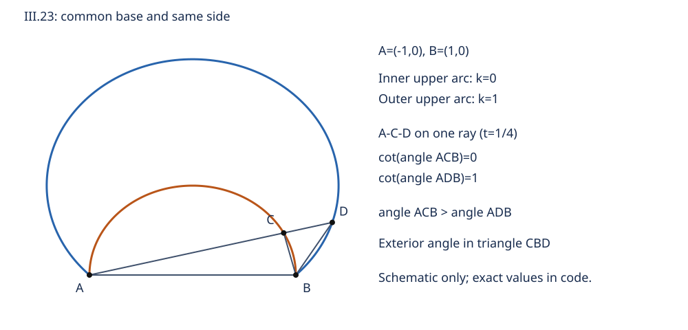

# 《几何原本》III.23：同一条弦上的弓形为什么不能任意鼓起

## 约公元前300年 · 数学推理前史补读

固定一条弦，两端不动，圆弧仍可以变得很浅，也可以向外鼓起。可是，如果还规定弓形内所容的角，剩下的自由度就消失了。III.23用一个很短的反证说明这一点：假如有两个不同的候选，就能让三角形的一个外角等于一个不相邻内角，与I.16冲突。

这条短证明有两项不能省略的阅读工作：先说明两弓形为什么可以画成内外包含，再区分“形状大小相等”与“放在同一位置重合”。忽略前者会偷用图形次序，忽略后者会把镜像误当成原命题的反例。

这是古代数学推理的前史补读，不是现代AI论文；图灵1936–1937年标杆也不被称为第一篇AI论文。本文分开标记**原文、后世评注、教学重构、分析推论、真实实跑**。现代坐标和代码是原创教学材料，不是原书全文翻译。

## 1 书目、实读范围与历史位置

- **原作单元：** Euclid，*Elements*，卷III命题23。约公元前300年是著作的传统年代定位，不是这条命题首次发现的可证日期。
- **主译注本：** T. L. Heath，*The Thirteen Books of Euclid's Elements*，1908，卷II，印刷第52页末至53页的命题、证明与评注。[扫描本](https://www.wilbourhall.org/pdfs/Heath_Euclid_II.pdf)。已实际目视跨页证明和图，不依赖OCR补出字母。
- **对照本：** Richard Fitzpatrick，*Euclid's Elements of Geometry*，2008修订本，印刷第92页末–93页III.23；卷首说明其希腊文本依据Heiberg 1883–1885版。[双语本](https://farside.ph.utexas.edu/Books/Euclid/Elements.pdf)。这里对照命题边界、字母和图，不自称手稿校勘。
- **适用勘误：** 对照Heath卷I卷首Errata，所核表未列卷II第52–53页III.23的改正；不表示穷尽其他版本勘误。[卷I扫描](https://www.wilbourhall.org/pdfs/Heath_Euclid_I.pdf)。Heath在本命题后的补充是证明评注，应与正式勘误表区别。

**有来源的年代和依赖链。** 卷III定义11规定相似弓形以所容角相等为准；[I.16](euclid-elements-i16.zh-CN.md)给出外角严格大于远内角；[III.10](euclid-elements-iii10.zh-CN.md)排除两不同圆有超过两个交点；[III.21](euclid-elements-iii21.zh-CN.md)使同一弓形内的角具有一致性。这些是书内逻辑前驱，不等于发现年代的排列。[III.22](euclid-elements-iii22.zh-CN.md)是上一阅读单元，但III.23并不直接用它的四边形结论。

Heath第53页回顾Clavius等早期编辑对“同侧”的讨论，并转述Simson对遗漏预备论证及措辞的修订。本文通过Heath核对这些后世意见，没有独立校读Clavius或Simson原版，不能把二手归述写成已核原书，更不能据此指定命题发现权。在所核材料中，没有足够依据认定某位前欧几里得作者或同期竞争者首先提出III.23；保留这一空白比填入名人可靠。

相对1930年代标杆，这是明确的古代回填；相对本次卷内阅读，则沿III.22续读III.23。收录按原文可定位、条件可分解、证明可重建的统一标准，不按作者机构影响力筛选，不声称穷尽早期几何史。

## 2 问题与动机：相似不是“看着像”

**原文。** 命题排除在同一条直线段上、同一侧构造两个相似而不等的圆弓形。这里的“同一条直线”由端点A、B限定为共同的底，不是只要底都在一条无限直线上，也不是只要求两条底等长。

圆弓形是弦与相应圆弧围成的区域。本文讨论非退化圆，A、B不同，所选开弧位于底线的一侧。弓形可以小于、等于或大于半圆；不能只看常见的浅弓图就把大弓形排除。

**定义III.11。** “相似”的判据是所容角相等，即在所选弧上取非端点P，连接PA、PB所成的通常角。这是定义III.8的弓形内角，不是定义III.7中弦与弧之间的曲线角。这里不是在弦内部任取一个点，也不是圆心角、弧长、弓高或面积相等。角取0至180度之间的非反角；III.21保证同一开弧上的选择不改变它。

**教学目标。** 对固定底和指定侧，给定这个角至多确定一个弓形的实际位置。这里“至多”是唯一性，不是“任意角都有构造”的存在性证明。原命题表述为不能有相似而不等者；证明连两个不重合的同侧候选也排除了。Heath记Simson以“不重合”替换“不等”，正好把证明所得的位置唯一性说得更直接。

不要反过来把“相似”定义为“由缩放获得的同一形状”，再用共同底推出缩放比1；那样换掉了本篇实际采用的定义，隐藏了需要解释的几何桥梁。

## 3 假设和量词：比较的是哪两个对象

固定互异的A、B及底线的一个开半平面H。设S、T分别由经过A、B的圆及其位于H中的弧确定；端点属于边界，角的顶点不取端点。令其所容角分别为α、β。

**教学重构的强结论**是：

$$
\begin{gathered}
\mathrm{base}(S)=\mathrm{base}(T)=AB,\qquad
\mathrm{side}(S)=\mathrm{side}(T)=H,\\
\alpha=\beta\quad\Longrightarrow\quad S=T.
\end{gathered}
$$

这里S=T表示作为平面点集重合，不仅是可通过刚体运动叠合。所容角相等的量词覆盖各弓形内所容的角；在III.21保障下，每个弓形选一个合法顶点比较即可。不能把一个偶然画出的等角当作对任意位置、任意曲线的结论。

必要的背景包括欧氏平面、通常线段延长、圆盘凸性以及圆弧连续性。后两者在现代补写中帮助说明交点和包含关系；不是原文另外列出的公设，也不是从电脑图像读出来的定理。

## 4 先补图示义务：两个候选为什么不会交叉

**后世评注，Heath II53。** Simson指出，原证明画两个弓形一内一外之前，应该先排除另一种情况：两弧除A、B外又相交。若发生这种情况，两个不同圆就有至少三个共同点，与III.10冲突。Heath认为这个预备步骤在本命题同样必要。

把情况逐项拆开：

1. 如果支撑圆相同，指定同一底和同一侧已经选定同一弧，两弓形重合，无须反证。
2. 如果支撑圆不同，两圆已在A、B相交。III.10排除第三交点，包括不能把一个额外的接触点当作绕开交点约束的例外。
3. 在同侧，两条弧不能从“在另一个圆盘内”变成“在其外”，而不在中途接触另一圆。连续弧上的内外关系因而不改变；两圆盘在弦附近都有共同的内部点。于是同侧弓形只能严格嵌套，不能互相穿越。
4. 交换名称后，令ACB为内层、ADB为外层。从A向内层弧的一个非端点C作射线，继续至外层弧D。内层点C在外层圆盘内部，射线离开外层圆盘时才到D，因此点序是A、C、D。

步骤3–4是**教学补写**，不是声称欧几里得原文写出了现代连续性论证。第6节会再用独立坐标计算证明全部嵌套关系与共同射线的存在，避免仅凭示意图相信它们。注意，这里只用“两个不同候选圆有共同底”，尚未使用相似角条件，因而没有用结论预设包含。

## 5 原文短证逐步展开：同一个角被迫既大又相等

**定位：Heath II52末–53；Fitzpatrick92末–93。** 保持原图字母，画直线ACD，连接CB、DB。

1. 原文反设两个候选相似而不等；这里按后世补足的不重合强形式展开：反设有两个相似而不重合的同侧候选。经上一节的预备步骤，取A、C、D共线且C严格位于A、D之间。
2. C在内弓形弧上，D在外弓形弧上；由相似弓形的定义，角ACB等于角ADB。
3. 观察三角形BCD：从C看，射线CA与CD方向相反，所以角ACB是它在C处的外角。
4. 从D看，A与C在同一方向，射线DA与DC相同，所以角ADB就是三角形BCD在D处的内角CDB。
5. 这个内角不与C处外角相邻，I.16给出严格不等式；和步骤2发生矛盾。

$$
\angle ACB>\angle CDB=\angle ADB,
\qquad\text{但相似要求}\quad\angle ACB=\angle ADB.
$$

这里不是泛泛地说“外角大于内角”：必须指出是哪一个三角形、哪一个外角、哪一个远内角。若C在AD之外或A、C、D的顺序错了，射线关系就会改变，不能继续套用这一行。

原文调用I.16已经足够，不必借I.32把外角写成两远内角之和。后者可以另作教学检验，却不是原证所需的更强前提。矛盾排除不重合候选，当然也排除了相似而不等的候选；这解释了为什么Simson的改写抓住了证明实际达到的强度。

## 6 坐标重建：一项参数控制整族弓形

以下全部为**现代教学重构**，不冒称原文解析几何。经平移、旋转和等比例缩放，设A=(-1,0)、B=(1,0)，指定上半平面。经过这两点的圆心必在线段中垂线上，因此所有候选圆可写为

$$
x^2+y^2-2ky=1,\qquad O=(0,k),\qquad R^2=1+k^2,\qquad k\in\mathbb R.
$$

半径始终为正。上侧弓形S_k为y≥0且x²+y²−2ky≤1的区域。这里k可以正、零或负：正值时上侧选的是大于半圆的弓形，零为半圆，负值为小于半圆的弓形。

### 6.1 不依赖角条件的严格嵌套

若k₂>k₁，对任何y>0，减去更大的2ky会严格减小左式。因此S_k₁内的上侧点都在第二个圆盘内；第一条开弧上的点也严格位于第二个圆盘内部。两圆的公共点满足两圆方程相减：2(k₂−k₁)y=0，故y=0，再得x=±1。除了A、B，不可能有第三个公共点。

选射线P(u)=(-1+u,tu)，t>0。代入圆方程并提取u，得到

$$
u\bigl((1+t^2)u-2(1+kt)\bigr)=0,
\qquad u_k=\frac{2(1+kt)}{1+t^2}.
$$

只要1+k₁t>0，两个第二交点的参数都为正，且u_k₂−u_k₁=2t(k₂−k₁)/(1+t²)>0。对任意有限的k₁，总能选足够小的正t满足条件。这就给出真实的A-C-D点序；不能任取一个指向上方的斜率而不检查正参数，否则可能沿错误射线取到交点。

### 6.2 从点积与行列式恢复所容角

对上侧圆弧点P=(x,y)，y>0，取向量PA=(-1-x,-y)、PB=(1-x,-y)。点积是x²+y²−1，行列式为2y；设它们夹角为θ_k，则

$$
\cot\theta_k=
\frac{PA\cdot PB}{|\det(PA,PB)|}
=\frac{x^2+y^2-1}{2y}=k.
$$

在0<θ<π上，cot严格递减且一一对应。因此相等所容角给相同k，圆心、半径及指定侧区域都相同。这是一份**独立的现代唯一性证明**；它还直接覆盖小弓形、半圆和大弓形，不依靠浅弓示意图。

分母用绝对值不可省略。若点在下半平面，|2y|=-2y，得到cotθ=-k，而不是k。混掉这一符号会把镜像角分类弄错。为避免反三角函数舍入，复现以有理数的点积/绝对行列式比值精确检查相等；需要向人展示角度时才用近似值，近似输出不参与证明或相等判定。

## 7 手算例子与三个不同的“反例”问题

### 7.1 不相似的同底同侧候选

取k₁=0、k₂=3/4，t=1。第二交点参数分别为1和7/4，故C=(0,1)、D=(3/4,7/4)。两点分别满足对应圆方程，且A-C-D依次共线。内弓形所容角为90度，外弓形所容角满足cotθ=3/4，约53.1301度。所以外角ACB严格大于远内角ADB，它们不相似。

这是“固定底和同侧仍不能随意省略相似”的见证，不是违反定理的实例。若以圆心高度相同或弓高相近代替真正的相似角条件，就改变了问题。

### 7.2 去掉共同底，会出现相似而不等

把一个合法弓形整体放大2倍并平移，角保持，底长和弓高变成2倍，面积变成4倍。它与原弓形相似而不等，但不再具有同一底。这里只给现代缩放解释，不将面积比例当作原证的一步。

“同一直线”也不够：把底AB换成这条直线上另一段等长底，复制同一个弓形，位置就不同。这说明共同端点的读法有实质作用。

### 7.3 去掉同侧：镜像反驳的是什么

把某个上侧弓形关于AB反射，得到下侧弓形。两者所容角相等，不是同一位置的点集，却彼此全等、面积相等。**它反驳删去同侧后的位置唯一性，不反驳原命题中“不等弓形不能相似”的判断。**

Heath第53页记Clavius等编辑指出：同侧对欧几里得这幅图的证明必要，但即使异侧，也不能在同一底上得到相似而不等的弓形，因为把其中一个绕底翻到另一侧就回到同侧情形。这里引用的是Heath归述的后世论证，不是原文额外一段。

例如k=3/4的上侧弓形反射后属于圆心参数-3/4的下侧弓形，下侧公式给cotθ=-(-3/4)=3/4。相反，同一个k=3/4圆的上、下两弓形所容角互补而非相等；只有k=0的半圆特例两边都是直角。把“翻折弓形”与“原圆另一半”混为一谈，会产生伪反例。

## 8 局限与合理延伸

**局限。** 这是一条精确欧氏几何命题，输入必须真的是圆弓形。一般曲线可能经过A、B和另一个给定点，却在别处不同；一个角相等不会使任意曲线重合。实验数据中近似等角也不意味着点集精确相等，更不消除测量误差。退化底A=B、端点作角顶点、共线向量和零半径都不在规格内。

**分析推论。** 给定底、侧和所容角，是对圆弓形的一种参数识别。但唯一性不等于数值稳定性：k=cotθ在θ接近0或π时变化很快，有限角度误差可能造成很大的圆心高度误差。本文没有给测量仪器误差模型，也未把有限有理网格当作稳定性实验。

**与自动推理的有限联系。** 辅助线不是独立的万能动作。生成A-C-D后，必须提交“同线、C在A与D之间、C和D分别在正确弧上”的证据；角替换也必须保留顶点和射线方向。一个只匹配公式字面形式的系统可能把错误点序也当成证明。这是本文对证明证书设计的类比，不是欧几里得提出了现代AI方法，也不是本次代码获得了通用几何证明能力。

## 9 主张与证据位置

| 主张 | 证据位置 | 本文处理与边界 |
|---|---|---|
| 同底同侧相似不等弓形不可能 | Heath II52末–53，Fitzpatrick92末–93 | 实读命题与完整跨页证明 |
| 相似用所容角相等定义 | 卷III定义11；III.23原证明直接调用 | 不用外观或缩放定义偷换 |
| 外角与远内角发生矛盾 | III.23调用I.16 | 补全三角形BCD、射线CA/CD与DA/DC关系 |
| 应先排除额外交点 | Heath II53转述Simson；III.10 | 区分原文短证和后世补充，补连续性与嵌套说明 |
| 不重合比不等更精确表述证明所得 | Heath II53 | 不把镜像当不等反例 |
| 异侧不等者仍不可相似 | Heath II53归述Clavius等 | 翻折回同侧；未独立校读编辑原书 |
| k参数、点序及cot恒等式 | 本文第6节逐式推导 | 现代教学重构，不是原文公式 |
| 代码通过有限检查 | 下列实跑记录 | 有限输入与实现核查，不替代一般证明 |

## 10 复现范围与真实运行

本篇只做低成本标准库精确几何核验，不涉及训练数据、学习基线或预测精度。核心指标是坐标方程残差恰为0、交点参数严格正且有序、角比值按Fraction精确相等、非法输入明确拒绝。没有把浮点“接近0”报告为严格证明。

[复现说明与文件清单](../../reproduction/euclid-elements-iii23/README.md)记录源码、运行命令、环境、Notebook与真实日志。实验覆盖有限有理参数、两侧符号、退化输入和镜像分类；它不覆盖所有实数参数，不是原书构造工具的物理复制，也没有形式化全部欧氏公设。一般性来自第4–6节的证明，日志用于发现实现与这些规格不一致的地方。

**真实实跑。** CPython 3.12.14、Linux、仅Python标准库。20项单元测试在普通、`-O`、`-OO`三模式各全部通过；每模式检查45个有理参数、1080次圆周角与侧的核查、990对严格嵌套圆。三模式重复同一组样本，不把重复执行包装成三倍不同数据。近等值例保留10^-30的cot差，不用浮点容差吞掉差别。[统计摘要](../../reproduction/euclid-elements-iii23/run-summary.json)和[普通模式单测原日志](../../reproduction/euclid-elements-iii23/logs/test_geometry-normal.log)可复核。

**独立技术核验。** 另一份检查器从180个任意有理点反解圆心，再用通用向量点积/行列式和圆心距离方程校验，不以主程序的射线生成式当唯一判据。每模式另核180次镜像距离保持、300个A-C-D见证、3720次笛卡尔网格成员/包含、8项非法输入和3个正文精确例；普通、`-O`、`-OO`均通过。[独立源码](../../reproduction/euclid-elements-iii23/independent_checks.py)与[原始核验日志](../../reproduction/euclid-elements-iii23/logs/independent-normal.log)保留输入范围和结果。这仍是有限核查，不是证明助理认证。

Notebook包含5个代码单元，实际按顺序compile/exec并回放输出，全部通过。没有启动Jupyter内核，execution_count保持null；这不等同于内核执行、完整nbformat验证或Notebook界面渲染。[Notebook](../../reproduction/euclid-elements-iii23/teaching.zh-CN.ipynb)与[回放日志](../../reproduction/euclid-elements-iii23/logs/verify_notebook-normal.log)明确保留这一边界。

在复现目录执行 `python3 run_all.py` 可重跑三模式并重建证据；`python3 make_diagram.py`生成自绘示意图。不要修改代码后继续把旧日志当新结果。源码与环境文件、逐条命令和退出码见复现目录；无需安装第三方依赖。

图示使用k=0与k=1的两个不相似候选，说明嵌套与点序；不是说图中两个弓形满足相似假设。图中坐标来自精确模型，绘图采样不参与角相等判定。

## 11 自测、答案与复盘

**题1：为什么相似不能解释成两弓高相等？**

答：原定义比较所容角。固定同底同侧后弓高相等确实可确定同一圆，但这是另一项待证明的参数关系，不是定义III.11。拿它直接替换相似会绕过原命题的核心。

**题2：原证在使用I.16前，必须指出哪三个事实？**

答：三角形是BCD；A、C、D共线且C在AD内部，因此CA反向于CD；DA与DC同射线。因此ACB是C处外角、ADB是D处远内角。仅有“共线”而没有点序不够。

**题3：两个候选弓形相交时怎么办？**

答：先辨支撑圆是否同圆。同圆同底同侧已经重合；不同圆已有A、B两个公共点，再有一个就违反III.10。不能一边假定它们可以交叉，一边继续使用内外层图。

**题4：k=-2时能否取t=1作为第6节共同上射线？**

答：不能，1+kt=-1，第二交点参数为负，点在反向射线上。取t=1/4则1+kt=1/2>0，参数u=16/17，点为(-1/17,4/17)，符合上侧圆方程。这展示构造存在与任意选参数都合法的区别。

**题5：上侧两个圆分别k=1/2和k=1，它们相似吗？**

答：不相似；所容角的cot分别1/2和1，角不同。k较大时上侧弓形更大、所容角更小。不要把区域包含方向与所容角大小方向写成同向。

**题6：镜像是否推翻原命题？**

答：否。它们不重合但全等，不是相似而不等。镜像只说明没有指定侧时不能要求唯一的实际位置。原命题关于不等者的排除可借反射扩展到异侧。

**题7：同一个圆的上下弓形是否总相似？**

答：不是。上下cot值为k和-k，两角互补；相等只发生k=0，两者为半圆。反射一个弓形会把圆心参数也变成-k，与保留原圆取另一侧不同。

**题8：测试一万组都通过，为什么还要证明？**

答：有限有理参数没有覆盖全部实数；代码也可能把同一错误同时用于生成数据和判定。一般结论需靠独立推导，独立技术核查应尽可能使用不同计算路径，测试只能支持被检查的实现行为。

**五句复盘。** 共同底和指定侧仍容许一族圆弓形。不同支撑圆不能有第三公共点，所以同侧候选可以排序为内外层。穿过内层点的射线在外层取得更远点，从而给出A-C-D。相似要求两个所容角相等，而外角定理要求前者严格较大，产生矛盾。要说清这一证明，还必须区分不重合与不等、唯一性与存在性、有限检验与一般定理。

本文由AI辅助撰写，为有来源的原创中文教学解读；不表示有人类专家或证明助理完成认证。[独立源审](../../reproduction/euclid-elements-iii23/source-review.zh-CN.md)和[独立技术核查](../../reproduction/euclid-elements-iii23/technical-review.zh-CN.md)的范围在附件中明确列出。阅读单元仅为III.23，不把后继命题列为本篇已完成成果。
