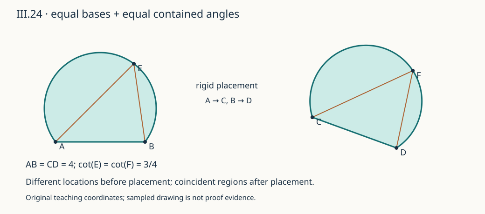

# 《几何原本》III.24：等长的底如何把相似弓形变成相等弓形

## 约公元前300年 · 数学推理前史补读

两块圆弓形可以画在纸上相距很远的位置，底边方向也不同。若它们的底等长，并且弓形内所容的角相等，为什么就能断定两块图形相等？III.24的办法不是计算面积，而是先搬动一块，使两条底重合，再用前一命题排除剩余的形状差异。

短证最容易被误读的地方，是把“搬过去以后重合”缩写成“原来就在同一位置”，或者把三种不重合情形都交给“两圆最多有两个交点”处理。本文会分别说明：等底保障端点对应，相似保障搬动后的弓形不能严格内含或外含，III.10则只排除弧交叉的第三种情况。

这是古代数学推理前史的补读，不是现代AI论文；图灵1936–1937年深读标杆也不被称为第一篇AI论文。以下区分**原文、后世评注、教学重构、分析推论、真实实跑**。解析几何、自有代码和练习用于解释证明义务，不冒充古代原文或全文翻译。

## 1 书目、版本与历史关系

- **阅读单元：** Euclid，*Elements*，卷III命题24。约公元前300年是作品的传统年代定位，不是这条命题发现时间的精确记录。
- **主译注本：** T. L. Heath，*The Thirteen Books of Euclid's Elements*，1908，卷II，印刷第53页末至54页；同时读第53页III.23后的相关评注。[扫描本](https://www.wilbourhall.org/pdfs/Heath_Euclid_II.pdf)。实际核对了跨页证明、三种情况及图示。
- **对照本：** Richard Fitzpatrick，*Euclid's Elements of Geometry*，2008修订本，印刷第93–94页，含第94页解释III.23用途的脚注。[双语本](https://farside.ph.utexas.edu/Books/Euclid/Elements.pdf)。希腊文本的版本背景由该书说明关联Heiberg 1883–1885版；本文不是手稿校勘。
- **勘误边界：** 核查Heath卷I卷首Errata及本命题评注；所核勘误表没有给出III.24、卷II第53–54页的改正。[卷I扫描](https://www.wilbourhall.org/pdfs/Heath_Euclid_I.pdf)。第54页的分号是译注者主动说明的标点处理，不能写成欧几里得本人发布的勘误，也不声称已穷尽其他版本订正。

### 有来源的年代与逻辑目录

| 位置或年代 | 文献关系 | 本次可以确认什么 |
|---|---|---|
| 约公元前300年的《原本》体系 | 定义III.6、III.8、III.11 | 圆弓形、所容角及相似弓形的术语背景 |
| 同书的逻辑前驱 | [I.4](euclid-elements-i4.zh-CN.md)、[I.8](euclid-elements-i8.zh-CN.md)、共同观念4 | 叠合证明的先例，以及重合对象相等的依据 |
| 同书的直接依赖 | [III.23](euclid-elements-iii23.zh-CN.md)、[III.10](euclid-elements-iii10.zh-CN.md) | 分别排除同底同侧相似的内外差异与不同圆的第三交点 |
| 同书的角背景 | [III.21](euclid-elements-iii21.zh-CN.md) | 一个圆弓形内所容角不随合法顶点变化 |
| 后世编辑，见1908年Heath归述 | Simson对III.23–24的处理 | 把交点预备论证提前至III.23，III.24直接引用位置唯一性 |
| 1908 / 2008译注 | Heath II54 / Fitzpatrick94脚注 | 都明确内外两种情况依靠III.23，不是III.10 |

上表中的卷内前驱是逻辑顺序，不是发现年代顺序。Heath第53页关于Clavius及Simson的记载是本文实际读到的后世归述；没有独立校读这两位编辑的原版，不能升级为第一手版本结论。所核材料不足以确认III.24的某位前欧几里得发现者或同期竞争者；不为凑年代链臆造人物。

相对于1930年代标杆，本篇是明确的古代回填；相对于上一单元，是III.23之后的顺序补读。收录标准是原文可定位、假设可检查、推导可重建，对作者与机构采用相同标准，不声称穷尽数学或AI前史。

## 2 当时的问题：从共同底走到等长底

**原文主张。** 两个相似圆弓形，若分别建立在等长线段上，则彼此相等。原图把第一块记作AEB、第二块记作CFD，底分别为AB、CD。E、F用于指示所选圆弧，不要求叠合时E必然落在F；结论针对整个弓形，而不是任意标记点逐一对应。

圆弓形是弦与选定圆弧围成的区域，不是单独的弧，也不是扇形。相似按定义III.11比较弓形内所容的角：在所选开弧上取一点P，连到弦端点，得到通常的非反角。它不是圆心角，也不是弦与弧的曲线角；不能在弦的内部随便取点作顶点。

III.23处理“同一底、同一侧”；III.24只给“等长底”。因此新工作不是再证明一次外角反证，而是把后一输入合法地转换成前一输入。**问题的动机在于复用已经建立的唯一性，而不是引入圆弓形面积公式。**

“相等”在《原本》中不能一律翻成现代集合相等，甚至一般的等积图形也未必全等。本命题的证明更具体：它展示经过叠合可以完全重合，从而得到相等。现代可把这里的结论解释为全等，因而也有等面积；但本文没有声称原文先定义了现代等距变换群。

## 3 假设、符号与结论的精确强度

设S、T为两个非退化圆弓形，底端点分别是互异的A、B和互异的C、D。允许小于半圆的劣弓形、半圆、大于半圆的优弓形；原文画出的较浅弓形不是额外假设。所容角α、β均严格在0与π之间。

**教学重构的规格：**

$$
|AB|=|CD|>0,\qquad \alpha=\beta
\quad\Longrightarrow\quad \exists f\text{为平面等距变换},\quad f(S)=T.
$$

这里的f允许反射。结论是存在一种搬动方式，使图形重合；并不是S=T在原坐标位置成立。A映到C、B映到D是本证的端点对应选择，若还要求保存平面定向，可能需要交换目标端点，不能同时无说明地固定所有要求。

叠合前两条底可在不同直线上，两弓形也不必在某条共同直线的同一侧。**同侧条件在叠合时安排，而不是原定理对原位置的限制。** 将AB放在CD上后，如果弓形落在目标底的另一侧，可以再关于CD反射；两端点不动，所容角与长度仍保持。这是本文把原证默许的摆放条件显式化。

此处采用欧氏平面、圆与通常角、允许刚性搬动的背景。把这些写出来不等于宣称原文已经把叠合完全公理化。若采用严格现代公理系统，需给出等距变换存在与保持性质的定理，或换成相应的全等公理。第6节给出一份明确坐标实现作为解释，而不是对全部欧氏公理的形式认证。

## 4 原文证明逐步展开

**定位：Heath II53–54；Fitzpatrick93–94。**

### 第一步：放置第一个端点和底的方向

把A放到C，把从A指向B的底边放到从C指向D的射线上。因为AB和CD等长，B到C的距离恰好为CD，故B落在D。只有A重合或只有两底共线都不够：若射线方向相反，B可能落在C的另一边；若长度不同，B会落在D之前或之后。

### 第二步：使所选弧位于同一侧

按第3节的安排，将搬来的弓形放在CD的目标侧。搬动没有改变长度、圆的性质和所容角；所以搬来的弓形与CFD仍相似，现在确实共享底CD和指定侧。

这里不能先说“因为相似，两块已经能叠合”，再调用III.23；这会把需要证明的事情预先当成假设。相似此时只提供等角，底长条件也只完成两个端点的安置。

### 第三步：反设弓形尚未重合，分三种情况

| 搬动后假设 | 排除依据 | 为什么适用 |
|---|---|---|
| 一块严格落在另一块之内 | III.23 | 共同底、同侧、相似；该命题的外角反证排除不重合候选 |
| 一块严格包在另一块之外 | III.23，交换名称 | 与上一情形对称，不是新的交点论证 |
| 两弧在端点之外交叉，如假想CGD | III.10 | 支撑圆已有C、D两个共同点，再交叉就有第三个共同点 |

这里“严格内含/外含”指两块仍共享底边但区域不相等，不是说包含端点和底边的闭集全部落在对方内部。

如果支撑圆本来相同，同一底同一侧选出的弧已相同，不进入第三种情况。若支撑圆不同，III.10才是“最多两个交点”的适用版本；重合圆有无穷多个公共点，并不违反该命题。

**为何这些情况足够？教学补写。** 同侧连续圆弧若不交叉，其相对内外关系不能在途中改变；否则内外切换时必经过另一圆周。由共同弦和圆盘几何，两条不同候选只能内外嵌套。前篇已经给出相减圆方程及有序射线的独立推导，不能只凭原图假设嵌套。本节保留原证的三分支结构，使每项排除有明确归属。

### 第四步：由重合结束到相等

三种不重合情况均被排除，搬来的整块弓形与CFD重合。共同观念4保证重合的对象相等，因此原先的两块弓形相等。注意这一步使用的是搬动保持图形，不是把它压扁、拉伸或剪裁后“凑成”同一块。

证明链可缩写为：等底→端点重合；允许同侧安置且保持等角→可用III.23；交叉→违反III.10；剩下整体重合→共同观念4。每个箭头需要不同的条件。

## 5 一个分号为什么影响证明阅读

**后世评注，Heath II54。** Heath说明，他把希腊文本在“落在其外”之后的逗号改为分号，为的是明确“圆与圆交于多于两点”只针对第三种交叉情形。前两种内外情形，由对III.23的默示引用排除。Fitzpatrick第94页脚注也指明前两种可能已被III.23排除。

这不是吹毛求疵：两个圆通过同一弦端点，并在该侧形成大小不同的嵌套弓形，完全可以只有两个公共点。只有加上相似条件，III.23才排除它们。若把III.10一口气用于三种情况，相似假设就无处使用，甚至会错误地推出“凡等底圆弓形都相等”。

**Heath II53转述Simson。** Simson在III.23先排除第三交点，并用“不重合”替代“不等”的表述；这样III.24在底重合后，可以直接引用III.23而省去交叉段。本文不把这种后世重排伪装成欧几里得原文的证明次序。两条路线的逻辑任务相同，但交点预备工作放置的位置不同。

## 6 现代重构：给叠合一份可检查的证书

本节全部是**教学重构**。它证明一个一般坐标模型中的结论，不是把有限样本提升为一般定理，也不把现代“相似变换”偷换成定义III.11。

### 6.1 一块圆弓形的局部坐标

令底中点为M，半底长a>0，单位向量e沿A到B，单位法向量n指向所选弓形的一侧。二者互相垂直。每点写成M+xe+yn。两个端点局部坐标为(-a,0)、(a,0)。圆心到两个端点等距，相减平方距离可得圆心沿e的坐标为0；故写作(0,k)，k为有符号高度。

$$
A=M-ae,\qquad B=M+ae,\qquad O=M+kn,\qquad R^2=a^2+k^2.
$$

弓形S在局部坐标中为：y≥0，并且x²+y²−2ky≤a²。k>0时选中优弓形，k=0时为半圆，k<0时为劣弓形；k可以任意有限实数。半径并不作为额外自由参数，因为经过两个端点已给出上述关系。

### 6.2 从角条件推出尺度无关的参数

在所选开弧取P=(x,y)，y>0。向量PA=(-a-x,-y)、PB=(a-x,-y)，所以

$$
PA\cdot PB=x^2+y^2-a^2=2ky,\qquad |\det(PA,PB)|=2ay.
$$

对于两非零向量夹成的通常角θ，点积与行列式绝对值之比为cotθ；这里分母严格正。因此

$$
\cot\theta=\frac{2ky}{2ay}=\frac{k}{a}.
$$

这先说明同一圆弧上所容角恒定；更重要的是说明定义中的相似比较的是无量纲比k/a。由于cot在(0,π)上一一对应，角相等当且仅当这个比相等。不是只比较cot平方：平方会把锐角与钝角的符号差别抹掉。

现在给两块弓形的参数(a₁,k₁)、(a₂,k₂)。等底给a₁=a₂；相似给k₁/a₁=k₂/a₂，因此k₁=k₂。于是半径平方也相同。但仅半径相同仍不足以保证所选弓形正确，下面的对应还必须把选侧一起搬过去。

### 6.3 构造整块区域的刚体对应

设第二块局部框架为M₂、e₂、n₂，第一块为M₁、e₁、n₁。定义

$$
f(M_1+xe_1+yn_1)=M_2+xe_2+yn_2.
$$

任意两点局部坐标差为(Δx,Δy)，在两套正交单位基下，距离平方都是(Δx)²+(Δy)²；所以f保持距离且可逆。点积保持，行列式绝对值保持，故通常角保持；其定向可以反转，正是允许镜像的含义。

它把两端点、圆心分别映到对应端点、圆心，并且保留局部y≥0。由于两块的a、k相同，圆盘不等式完全相同，从而**每一个点**属于第一块当且仅当其像属于第二块。这证明的是整个区域的双向对应，不是只核对三个点或若干采样点就宣布图形相同。

这种证明明确交付了叠合所需的对象、可逆性与保持性质；但它建立在现代实数坐标与等距几何上，不是原文三分支证明的逐行形式化。

## 7 手算例子与删条件后的反例

### 7.1 一份有方向变化的完整证书

取M₁=(0,0)，e₁=(1,0)，n₁=(0,1)，a=2，k=3/2。圆心O₁=(0,3/2)，半径R=5/2；上侧弓形是优弓形。P=(0,4)在圆弧上，PA=(-2,-4)、PB=(2,-4)，点积12，行列式绝对值16，所以cotθ=3/4。

另一块取M₂=(7,1)，e₂=(0,1)，n₂=(-1,0)，同样a=2、k=3/2。则C=(7,-1)、D=(7,3)，圆心O₂=(11/2,1)。两底均长4，弧点对应为P'=(3,1)。明确映射是

$$
f(x,y)=(7-y,\ 1+x).
$$

它是旋转加平移：A映C、B映D、O₁映O₂、P映P'。第一块在水平底上方，第二块在竖直底左边；原位置不同不妨碍相等。验证映射时只检查P会不够，区域全体对应已由第6.3节证明。

### 7.2 等底但不相似：III.10不能排除嵌套

仍令a=2，比较k=0与k=3/2的上侧弓形。前者是半径2的半圆，后者是上例优弓形。两圆方程相减，得到3y=0，故共同点只有(-2,0)、(2,0)；它们没有第三交点。第二块严格包住第一块的上侧内部，所容角的cot分别0、3/4，所以不相似。

这同时展示：等底不足以推出相等；把III.10用来排除内外两情形是错误的。真正缺少的是相似条件和III.23。

### 7.3 相似但底不等：角没有给出绝对尺度

把第7.1节第一块扩大2倍，参数变为a=4、k=3，半径5；cot仍为3/4，但底长由4变8。图形相似而不全等。现代面积随整体放大变为4倍是进一步推论，不是III.24的原证步骤。

### 7.4 同一圆的另一侧，不等于镜像那块图形

对上例圆保留圆心(0,3/2)而选择下侧，若把n改为(0,-1)，局部k变为-3/2，所以cot=-3/4；所容角与上侧角互补，不相似。它是同圆的劣弓形。

若把整块上侧弓形关于底线反射，圆心也反射到(0,-3/2)，所选侧向下；在向下局部法向中k仍为3/2，所以所容角仍相等，整块全等而位置不重合。只有半圆k=0时，同一个圆的两个半圆所容角本来就相等。

### 7.5 只有一个等角，不足以认证任意曲线

把上例的圆弧换成曲线y=4−x²，限制-2≤x≤2。它有同样两个端点，也经过P=(0,4)，因此P处两条连线仍给同一个角。然而Q=(1,3)在该曲线上，却不在上例圆周：x²+y²−3y−4=-3，而不是0。它不是待比较的圆弓形，一个匹配的角不能把它认证为原圆弧。

这是输入类别错误的反例，不是III.24的反例。“给定圆弓形”的假设必须保留，尤其不能由有限图像采样擅自补上。

## 8 退化边界、局限与延伸

- **零底不在范围内。** A=B会使a=0，角的两条端点射线退化，k/a无定义。不能靠令a趋零把极限图形自动算入原命题。
- **端点不能作角顶点。** P=A或P=B会产生零向量；弦上其他共线点也不给合法的弓形内所容角。代码必须拒绝，而不是返回0或某个默认角。
- **优劣弓形不需要另定公式。** k的符号区分选侧区域；半圆k=0是合法情形，不是除零错误。
- **精确相等不等于近似相等。** 微小角误差可以隐藏不同的k/a；当θ靠近0或π时，cot变化尤其快。本文没有实验测量模型，不能把精确命题当作图像匹配误差保证。
- **结论不依赖学习数据。** 这是理论单元，没有训练集、准确率或统计显著性。测试指标是精确残差、等距/等角保持、双向区域成员关系与非法输入拒绝；不是预测性能。

**分析推论：形状参数与尺度参数分离。** 对这个圆弓形族，k/a记录所容角，a记录尺度。等底固定尺度，相似固定形状，两者合起来消除剩余自由度。若把底、侧和角都写进规范表示，可把比较问题转换到统一坐标；不过这依赖对输入确为圆弓形的承诺。

**与自动推理的有限联系。** 归约并不是只改名：将“等底”转换为“同底”必须有一个保持对象性质的对应。一个证明系统若只看AB=CD，就把两条线段或两个区域当作同一对象，会遗漏搬运步骤；若以数值近似等角代替严格相似，也会超出原定理。本文的代码是有限教学核验器，不是通用几何证明器，也不主张欧几里得提出了现代AI。

## 9 主张—证据账本

| 主张 | 证据位置 | 证据层次与限制 |
|---|---|---|
| 等底上的相似圆弓形相等 | Heath II53–54；Fitzpatrick93–94 | 完整命题及跨页原证 |
| 叠合后第二端点也重合 | 同上，AB=CD段 | 原文；补射线方向说明 |
| 内外两情况靠III.23，交叉靠III.10 | Heath II54标点评注；Fitzpatrick94脚注 | 后世明确的依赖解释，不混成一个交点推理 |
| Simson提前处理交点并简化III.24 | Heath II53末 | 二手归述，未校读Simson原版 |
| 重合导致相等 | 原证末；Fitzpatrick标C.N.4 | 不等同于原位置集合相等 |
| 同侧安置与允许反射 | 本文第3、6节 | 叠合条件的教学显式化 |
| cotθ=k/a与等距映射 | 本文第6节逐式推导 | 现代证明，不是古代公式 |
| 有限代码和Notebook实跑 | 复现目录和原日志 | 检查实现范围，不替代一般定理 |

## 10 最小复现与实际核验

[复现说明](../../reproduction/euclid-elements-iii24/README.md)保存原创源码、环境、命令、测试日志、Notebook和图。实现只使用标准库有理数精确运算；一般角函数不参与相等判定。一般性来自第4、6节的证明，有限样本只检查实现与规格是否一致。

**真实实跑。** 在CPython 3.12.14、Linux环境，仅使用Python标准库，28项单元测试于普通、`-O`、`-OO`三模式各全部通过。每模式检查39个参数配置、156个刚体放置、936次开弧测角、6552次成员对应、39对不等底缩放对照；三模式重复同一输入，不将它们包装成三倍不同数据。[统计摘要](../../reproduction/euclid-elements-iii24/run-summary.json)与[单测原日志](../../reproduction/euclid-elements-iii24/logs/test_geometry-normal.log)可逐项复核。

**独立核验与修正。** 独立技术审查发现公开world接口尚未拒绝float/bool，与精确输入承诺不一致；补入输入检查及两项回归测试后，全部三模式重新运行。另一份[独立检查器](../../reproduction/euclid-elements-iii24/independent_checks.py)从任意有理弧点反解圆心，不复用主程序射线生成式作为唯一依据；每模式另核60个反解实例、360次全局刚体放置、1440对距离、7200次成员关系、360个非相似对照、正文5组例子与6项非法输入，三模式均通过。[独立原日志](../../reproduction/euclid-elements-iii24/logs/independent-normal.log)保留有限范围。修错与日志是实现证据，不是对一般定理的实验认证。

[Notebook](../../reproduction/euclid-elements-iii24/teaching.zh-CN.ipynb)含5个代码单元，实际按顺序compile/exec并逐字回放输出通过。没有启动Jupyter内核，execution_count保持null；未宣称完整nbformat模式验证或Notebook界面渲染。[回放日志](../../reproduction/euclid-elements-iii24/logs/verify_notebook-normal.log)明确这一边界。

下载复现目录后在该目录执行`python3 run_all.py`重建作者三模式证据；独立检查可运行`python3 independent_checks.py`，另用`-O`、`-OO`重复。`make_diagram.py`产生自绘SVG；图中浮点采样仅用于显示。源码变动后必须重跑，不可沿用旧日志冒充新结果。

图展示刚体对应及条件差别；绘图采样不是数学相等的判据。

## 11 带答案练习与复盘

**题1：AB=CD后，为什么不能直接说AEB=CFD？**

答：等底只固定端点距离，同一底上仍有一族不同圆弓形。还需把底和侧对应起来，使用相似角条件排除剩余形状差异。

**题2：第7.2节两弓形不同且嵌套，是否违反III.10？**

答：没有。两支撑圆恰有两个共同端点，没有第三交点。它们的cot值0与3/4不同，违反的是相似输入条件，而不是几何定理。

**题3：叠合时E必须映到F吗？**

答：不一定。E、F表示各自所选弧上的标记点，未指定相同局部位置。整体弧可以重合，而两个任取标记不重合；不能凭标记不重合否认结论。

**题4：给定a₁=3、k₁=-2，另一块a₂=6，要相似应取什么k₂？它们相等吗？**

答：k₂/a₂=-2/3，故k₂=-4。底分别长6、12，不满足等底，所以相似而不全等。负k表明两者均为所选侧的劣弓形。

**题5：固定a=2，k=3/2与k=-3/2半径相同，是否相似？**

答：若两者都选局部上侧，不相似，cot分别3/4与-3/4，所容角互补。只知道半径和弦长，尚未指定选择优弓形还是劣弓形。

**题6：为什么第6.3节比检查三点距离更充分？**

答：它给出可逆、全域的等距对应，并逐项保留整个圆盘不等式与半平面条件。三点距离一致可以帮助确定一个刚体映射，却不能认证未知任意曲线恰好就是该圆弧。

**题7：如果坚持只允许保定向搬动，又固定A映C、B映D，会怎样？**

答：底的对应可能把所选侧送到错误一侧，此时需要反射才满足全部要求。原结论没有同时强加“端点对应固定且必须保定向”的附加限制；也可研究交换目标端点的对应，但不能悄悄变更规格。

**题8：若一千次精确测试全部通过，得到了什么？**

答：得到了这批输入下实现行为通过检查的证据，没有覆盖所有实数、所有可能实现错误或全部公理。一般命题依赖证明；独立检查应尽量不用同一生成公式自证正确。

**五句复盘。** 相似圆弓形比较的是所容角，不是图像外观。等长底允许把端点一一叠合，但还要把所选侧安置一致。内外差异靠III.23排除，额外交叉靠III.10排除，二者不能混写。整体重合之后才由共同观念得到相等，原位置不同不妨碍结论。现代坐标证书与有限实跑帮助检查这条链，不取代原文和一般证明。

本文由AI辅助撰写，是有来源的原创中文教学解读，不表示已获人类专家或证明助理认证。[独立来源审查](../../reproduction/euclid-elements-iii24/source-review.zh-CN.md)和[独立技术审查](../../reproduction/euclid-elements-iii24/technical-review.zh-CN.md)说明实际范围。本单元只完成III.24，不把后继命题列为已完成成果。
