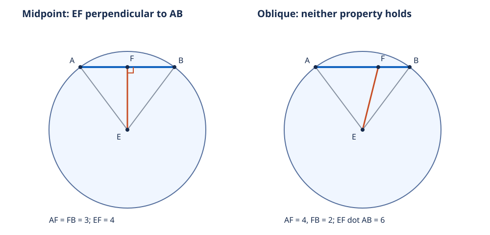

# 《几何原本》III.3：平分与垂直，为什么要加“经过圆心”

## 约公元前300年 · 数学与推理前史补读 · 深读v1

画一条弦，再连圆心与弦中点，看起来一定垂直。但若弦本来就是直径，中点恰好是圆心，“连起来”连的究竟是什么？反过来，一条线垂直一条弦，为什么还不能直接断言它把弦平分？

III.3把三个条件拆开：经过圆心、平分弦、垂直弦。它不是把“对称”当作万能理由，而是在非退化图形中分别证明两个方向。它接续[III.1圆心定位](euclid-elements-iii1.zh-CN.md)和[III.2弦内点](euclid-elements-iii2.zh-CN.md)，是数学与推理前史，不是现代AI论文。本系列从图灵1936—1937样稿回溯古代，明确是年代跳转与前史补读，不称图灵为第一篇AI论文，也不声称穷尽文献。收录以问题和可核验证据为准，不按作者或机构声望改变标准。

本文区分**原文、后世评注、教学补足、现代重构、真实实跑**。只覆盖III.3和必要前驱，不提供原文全文翻译，也不计后续命题完成。直觉路线读2、5、7节；证明路线读3–4节；复核路线读1、6、8–10节。

## 1 文献、历史问题和证据位置

| 材料 | 本次实读范围 | 作用 |
| --- | --- | --- |
| Euclid，*Elements*，III.3 | 作品传统年代约公元前300年 | 年代不等于本命题首次发现的可考日期 |
| T. L. Heath，*The Thirteen Books of Euclid’s Elements*，1908卷II | 印10–11，PDF23–24 | [扫描](https://www.wilbourhall.org/pdfs/Heath_Euclid_II.pdf)，完整两方向、图和短评 |
| Richard Fitzpatrick，*Euclid’s Elements of Geometry*，2008修订版 | 印72–73，PDF同页 | [希英对照](https://farside.ph.utexas.edu/Books/Euclid/Elements.pdf)，据Heiberg1883–1885希腊版 |
| David E. Joyce，Clark University | [III.3正文与Guide](https://mathcs.clarku.edu/~djoyce/elements/bookIII/propIII3.html) | 对照字母和引用；Guide不是古代正文 |

原文的动机是把第一卷的三角形判据移用于圆：圆给出半径相等，弦中点或垂直条件再提供另外的等量，拼出可以调用的全等条件。没有必要提前引入圆周角定理，也不能用后来的弦距定理循环解释本条。

前驱包括[I.8三边判角](euclid-elements-i8.zh-CN.md)、[I.5等腰底角](euclid-elements-i5.zh-CN.md)、[I.26两角与对应边](euclid-elements-i26.zh-CN.md)、第一卷定义10的直角和定义15的圆。III.1在原证中用于取得圆心；III.2提供弦内部的背景，但不是两次全等推理的替代品。

Heath印11称本条为III.1推论的两个“部分逆命题”，并转述De Morgan希望把它紧接III.1排列。这里只核对Heath的评述，不声称独立读过De Morgan的全部原著。印10上半页关于直线与圆交点数的评论仍属于III.2，不能移作III.3新增论证。材料不足以确定本命题的最初发现者或同期竞争工作，本文不补造传承故事。

检查Heath卷I所附勘误表中涉及其他卷的条目；未见针对卷II印10–11的修正。这个否定结论限于所查表，不保证所有版本无误。Fitzpatrick的修订版标识也不意味着证明中的图形前提无需解释。

## 2 给条件分工：三个谓词而不是一句口号

**原文规格。** 圆内一条经过圆心的直线，若平分另一条不经过圆心的弦，就与它垂直；若与它垂直，就平分它。

沿用原图：E是圆心，A、B是不同圆周点，AB不经过E；CD是经过E的直线，在F与AB相交。C、D用于命名支持线，证明实际使用的是EF。这里“弦”指圆周端点之间的线段，不是任意放在圆盘里的短线段。

设G表示“该直线经过E”，M表示“F为AB中点”，P表示“该直线垂直AB”。在上述圆、弦和相交条件下，III.3证明G且M推出P，及G且P推出M。III.1推论提供的是M且P推出G。这解释了“部分逆”：不是把一句话简单倒过来，就自动得到所有方向。

**教学补足。** 非直径条件保证E不在AB的支持线上，故E≠F，EF是真正非零线段，两三角形EAF、EBF也不共线。若允许直径，形式上写出“公共EF=0”仍然成立，但三角形全等定理已失去适用条件。等式合法不代表可用它作几何推理。

正向的F是中点，自然严格位于A、B之间。逆向若把“相交”扩大为支持线相交，需先补明垂足不会在弦外：若点序F–A–B，则等腰三角形EAB的A角是直角三角形EAF的外角，由I.16大于一个直角；I.5使B角同样大于一个直角，与I.17任意两角之和小于两直角冲突。另一侧对称；F=A或B则等腰三角形有两个直角，同样不可能。因此原图使用的A–F–B点序可以补证，而不是偷偷当作计算结果。

## 3 正向：平分如何给出垂直

**原文证明重建，Heath印10。**

1. 取圆心E并连接EA、EB。由同一圆的半径定义，EA=EB。
2. 假设CD在F平分AB，故AF=FB。FE是两个三角形共有的边，FE=FE。
3. 比较三角形AFE与BFE。三组边分别相等，I.8给出∠AFE=∠BFE。要比较的是F处的角，不是先假定E处的角相等。
4. 因A、F、B共线且F居中，两角是直线上的邻角。由定义I.10，直线立在另一条直线上而构成相等邻角时，每个角都是直角。
5. EF与AB垂直。E、F都在CD上且互异，EF所在直线就是CD，结论才转移到CD。

第三步是三边资料转成角关系；第四步是角关系转成垂直。若只说“两三角形对称，所以垂直”，会把需要证明的反射结构预先塞入前提。这里也不需要用角度数值90来计算，直角定义已经足够。

## 4 逆向：垂直怎样恢复平分

**原文证明重建，Heath印10末–11。**

现在换假设，不沿用AF=FB。保留同一圆和经过圆心的CD，令CD与AB垂直于F。

1. EA=EB，三角形EAB等腰；由I.5，∠EAB=∠EBA。F在A、B之间，射线AF与AB同向，BF与BA同向，所以可写为∠EAF=∠EBF。
2. ∠AFE和∠BFE都是直角；所有直角相等（公设4），因此第二组对应角相等。
3. EF为公共边。在两个小三角形中，EF分别位于第一组相等角∠EAF、∠EBF的对面，是I.26允许的“对应角对边”情形。
4. I.26给出剩余对应边相等，特别是AF=FB，故CD平分AB。

原文用的是**I.5加I.26**，不是直接套用现代“斜边直角边”判据，更不是在尚未得到AF=FB时循环调用正向SSS。用其他已证定理可以给出短证，但须标为替代证明。这里保留较长的原路线，正是为了检查角、边位置与定理接口。

## 5 手算和反例：把被省略的条件拿出来

### 5.1 正常构形

取E=(0,0)，半径5，A=(−4,3)，B=(4,3)，F=(0,3)。两端点平方距离均为25，AF=FB=4，EF长3。过E、F的直线x=0与AB所在直线y=3垂直。两小三角形的边为3、4、5，但原证不依赖这是勾股数组。

### 5.2 同一圆、过圆心但不平分

改交点为F=(1,3)。直线EF经过圆心，AF=5、FB=3，不平分；其方向(1,3)与弦方向(8,0)点积为8，不垂直。两者同时为假并不反驳“等价”，反而提醒我们：经过圆心本身不会使任意交线垂直。

### 5.3 缺少经过圆心

仍取同一AB。直线x=1垂直AB，却把它分成5和3；直线通过F=(0,3)、方向(1,1)，会平分AB却不垂直。两例分别否定去掉G后的P推出M与M推出P。

### 5.4 为什么排除直径

取A=(−5,0)、B=(5,0)、E=F=(0,0)。直线y=x经过E并平分AB，却不与AB垂直。正向因此真正失效，不只是原证明不方便。垂直直径的过心直线仍然平分直径，但这是保留的单向结论，不能据此把原文的双向条件无声扩大。

若程序以EF=(0,0)与AB点积为0就宣布垂直，会把所有过E方向都判成垂直。零向量没有确定方向，所以输入验证必须先拒绝它，不是等结果出来再补一句免责声明。

### 5.5 “在圆内”还不够

E=(0,0)，半径5，A=(−2,3)、B=(4,3)都在闭圆盘内，但不是同圆周端点。x=0经过圆心又垂直AB，分段长度为2和4。缺少EA=EB时，逆向的I.5已经无法启动。圆盘成员资格不能替代弦端点资格。

图为原创教学图，采用附件的3–4–5构形；它与正文4–3–5构形同理，坐标选择并非原图测量。

## 6 现代重构：一个可检查的误差恒等式

以下不是欧几里得原文。设弦向量v=B−A，F在AB的支持线上，F=A+t v，s=v·v。A≠B使s严格为正；同圆周条件为两端点到E的平方距离相等。展开并相减，可得(A−E)·v=−s/2，因此：

$$
(F-E)\cdot v=(t-\tfrac12)s,\qquad s=\lVert v\rVert^2\gt0.
$$

逐项看：F−E=(A−E)+t v，将前面的−s/2加上t s即可。它对任意实t成立，不需要预设F在弦内。若EF非零且所考察直线就是EF，点积为零等价于垂直；又因为s>0，零点只能是t=1/2。这同时恢复中点位置和唯一性。

还可以从距离差观察同一个事实：

$$
\lVert F-A\rVert^2-\lVert F-B\rVert^2=(2t-1)s=2(F-E)\cdot v.
$$

左式展开为t²s−(t−1)²s。非负距离的平方相等等价于距离相等；在支持线上，解唯一为中点。第一式告诉我们垂直残差，第二式告诉我们分段不平衡，两者只是相差一个常数因子。

本节先用了欧氏内积和平方距离模型，不能反过来称其为原始公理体系的独立形式验证。它的优点是让计算证书能精确检查每一步，而不是浮点“看起来差不多”。非直径条件仍有角色：恒等式在直径中点给出0，但此时F−E为零，不能代表任意指定的过心直线方向。

## 7 合理延伸及局限

**教学推论。** 对非直径弦，圆心和中点确定唯一一条直线；本条证明它是垂直平分线。在圆心已知的前提下，垂直条件和中点条件可以互相校验，减少重复约束。不过它不表明从噪声点估计圆心的统计方法正确，也没有给出误差分布、优化收敛率或测量容差。

若半径数据不等，先前推导的常数项不再是−s/2，垂足一般不在中点。实际工程中把近似等距硬当精确等距，会把测量偏差误诊为作图错误。本篇精确有理模型刻意不模拟这种噪声场景；没有训练数据、基线模型或性能指标，不能伪装成现代实验论文。

**推理研究启发，而非历史因果主张。** 一个可靠检查器不仅检查代数等式，还要检查定理的前置条件、角所对的边和非零方向。III.3是小型例子：把零边、非弦和不经过圆心三个反例放进去，能够测试证明步骤的适用域。这里并不声称古代作者提出了机器证明或现代AI架构。

## 8 最小复现与实际证据

[源码、环境、命令、日志和Notebook](../../reproduction/euclid-elements-iii3/README.md)实现现代有理坐标模型。它不是自动重建欧几里得全部公设的证明器，也不是任意尺规构造或一般求交系统。实例生成只覆盖选定的有理族，完整数学证明仍由3–4节和6节的一般推导承担。

复现的验收重点是：端点互异且同圆周、弦非直径、交点确在弦内、方向非零；合法证书中的中点/垂直判断和残差恒等式；非法输入与篡改证书必须拒绝。测试普通、`-O`、`-OO`三模式，避免依赖可被优化删除的assert来保住输入边界。Notebook的实际执行方式与保存输出在附件说明，不把顺序compile/exec称作Jupyter内核运行。

独立技术审查会另算例子、修改证书和重放Notebook；来源审查逐条核对原文与评注。审查报告绑定最终正文SHA256，正文后改时须重核绑定。本次24项单测在三模式通过，每模式900构形（60个中点、840个非中点），4个合法命名算例与三类条件反例，Notebook五格真实顺序执行。附件采用A=(−3,4)、B=(3,4)的同半径构形，正文5节另用A=(−4,3)、B=(4,3)，不能混用数值。独立核验统计见技术审查报告。

## 9 主张与证据地图

| 主张 | 证据位置 | 层级 |
| --- | --- | --- |
| 非直径弦、过心线的两方向 | Heath印10–11；Fitz印72–73 | 原文 |
| 三边→F处等角→直角 | Heath印10，第11–22行附近 | 原文重建 |
| 等腰底角与公共EF对边→I.26 | Heath印11，第26–35行附近 | 原文重建 |
| 两个部分逆及De Morgan排列建议 | Heath印11命题后短评 | 后世评注 |
| 垂足不在弦外的I.16/I.17补证 | 本文2节 | 教学补足 |
| 点积/平方距离残差恒等式 | 本文6节逐项展开 | 现代重构 |
| 特定测试和Notebook输出 | 附件日志、独立技术审查 | 真实实跑，不是一般证明 |

## 10 复盘与带答案练习

1. **正向为什么不能只用EA=EB、EF=EF两边相等？** 答：两边不够确定F角。还要AF=FB构成三边条件；没有它，5.2的F=(1,3)就是反例。
2. **逆向I.26使用的公共EF对应哪一组角？** 答：EF对着∠EAF和∠EBF，而不是对着F处直角。必须把边的对应位置一起检查。
3. **5.2中第一式的数值是多少？** 答：v=(8,0)，s=64，t=5/8，(t−1/2)s=8；第二式为25−9=16，恰为两倍。
4. **若F=(0,3)，过F的任意直线是否都垂直AB？** 答：不是；中点只给出点，不给出方向。要求该线同时经过E，才唯一确定EF。
5. **直径反例为什么不能通过“零向量垂直一切”补救？** 答：代数正交允许零向量，但几何直线必须有非零方向；零向量无法指定y=x或y轴。必须保留对象类型和前提。
6. **F在AB外部时平方差恒等式还成立吗？** 答：成立，只要F在支持线上且端点等距。比如5.1取t=2，s=64，平方差为192、点积为96；它不会得到垂直。附件对原命题输入可选择拒绝外点，恒等式的数学适用域则更广。
7. **III.1推论能替代III.3两方向吗？** 答：它给“平分且垂直→经过圆心”；本条给另外两种成对条件推出第三项。不能无证从一个蕴涵推出其逆。
8. **有限有理网格全通过证明了全部实数构形吗？** 答：没有。它检验实现和指定实例；一般结论来自原证或明确模型中的符号推导。证明与测试互补而不互相冒充。

复盘时沿三层检查：先问圆、弦、点序、方向是否合法；再问相等边角是否对应；最后问结论是不是当前方向真正推出的。这个顺序比先看一幅漂亮对称图更可靠。

[独立来源审查](../../reproduction/euclid-elements-iii3/source-review.zh-CN.md) · [独立技术审查](../../reproduction/euclid-elements-iii3/technical-review.zh-CN.md) · [复现与真实日志](../../reproduction/euclid-elements-iii3/README.md)
