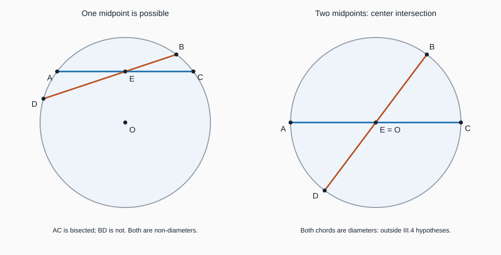

# 《几何原本》III.4：不能互相平分，不等于谁也不能被平分

## 约公元前300年 · 数学与推理前史补读 · 深读v1

两条弦在圆内交叉，交点恰好平分第一条弦，是否也能平分第二条？如果两条都不经过圆心，III.4给出的答案是否定的。但它并没有说交点不能平分其中任何一条。一个“同时”被漏掉，正确命题就会变成错误命题。

本条接续[III.3过心线的平分与垂直](euclid-elements-iii3.zh-CN.md)，把同一个定理使用两次，让两个单独看来正常的条件发生冲突。这是数学与推理前史，不是现代AI研究论文。本系列从图灵1936—1937样稿回溯早期材料，明确属于年代跳转与补读；不称图灵为第一篇AI论文，不声称穷尽历史，也不按作者、机构声望改变证据要求。

本文区分**原文重建、教学补足、现代分析、真实实跑**。只覆盖III.4及必要前驱，不提供全文翻译，不计后续命题完成。直觉路线读2、5、9节；证明路线读3、4、6节；复核路线读1、7、8、10节。

## 1 书目、问题来源与阅读范围

| 来源 | 实读位置 | 本文用途 |
| --- | --- | --- |
| Euclid，*Elements*，III.4 | 作品传统年代约公元前300年 | 命题身份；不等于已知首次发现日期 |
| T. L. Heath，*The Thirteen Books of Euclid’s Elements*，1908卷II | 印11–12，PDF24–25 | [原版扫描](https://www.wilbourhall.org/pdfs/Heath_Euclid_II.pdf)，命题、图与完整反证 |
| Richard Fitzpatrick，*Euclid’s Elements of Geometry*，2008修订版 | 印73–74，PDF同页 | [希英对照版](https://farside.ph.utexas.edu/Books/Euclid/Elements.pdf)，基于Heiberg1883–1885希腊版 |
| David E. Joyce，Clark University | [III.4正文和Guide](https://mathcs.clarku.edu/~djoyce/elements/bookIII/propIII4.html) | 字母、引用与现代教学评论的交叉检查 |

**历史问题。** 第三卷开始把第一卷的三角形和直线定理用于圆。III.1定位圆心，III.3把过心线的平分关系变成直角关系，III.4再问：两个这样的直角关系能否同时安放在一个交点上？它的价值是条件组合的排除，而非新的数值公式。

原证明确调用[III.1](euclid-elements-iii1.zh-CN.md)与[III.3](euclid-elements-iii3.zh-CN.md)。所有直角相等使用公设4；结尾“较小等于较大”的矛盾依赖整体大于部分的共同概念及图形角内部次序。本文另把这个图形前提解释出来，不用后来的弦积定理倒过来证明。

Heath印11上方关于“部分逆命题”和De Morgan排列建议的短评属于III.3；印12下方合并命题的评注属于III.5与III.6。本次所读页面没有III.4专属历史评注，不能把相邻段落借来填充本条。材料也不足以确定最初发现者或同期竞争工作，本文不补造人物传承。

检查Heath卷I附勘误表涉及卷II的条目，所见为印41姓名更正，未见针对卷II印11–12的修正；这只限定于该表，不声称所有版次没有勘误。Fitzpatrick两页中的命题和引用与Heath一致。Joyce Guide的“逆否”说法需要一个几何补步，见第4节；这属于解释精度问题，不宜宣称古代正文印错。

## 2 先把“互相”翻译成逻辑

沿用原文标号：F是圆心，A、B、C、D在同一圆周上；弦AC与BD在E相交。两条支持线不同，且都不经过F。这里“弦”意味着圆周端点间的非零线段，不是任意圆盘内短线段；“相交”使用圆内的真交叉，不把两条重合弦当成两条交线。

设P表示AE=EC，Q表示BE=ED。原结论是“P和Q不同时成立”，也就是至少一个平分条件失败。它不是“P失败并且Q失败”。三种可能的真值组合是：都不平分、只平分AC、只平分BD；第四种“都平分”才被排除。

“AC平分BD”指交点E是BD的中点；“BD平分AC”则指E是AC的中点。不要因主语变化而混掉被平分的对象。为避免歧义，下文多用“E平分哪一条弦”。

非直径条件还有证明作用：E位于两条弦上，F却不在任何一条支持线上，故F≠E。连接FE得到真正的方向。若E=F，用零向量写点积为零，并不能得出任何直角。

## 3 原文反证：两次III.3怎样冲突

**原文证明重建，Heath印11–12；Fitzpatrick印73–74。**

1. 保留同圆、真交叉、两弦都不过圆心的前提，反设它们互相平分，即AE=EC且BE=ED。两个等式必须同时进入假设。
2. 由III.1取得圆心F，连接FE。F≠E已由前提保证，不是依赖所画图片的偶然位置。
3. FE经过圆心，且在E平分不经过圆心的AC。由III.3正向，FE与AC垂直，因此∠FEA是直角。
4. 同一条FE又在E平分不经过圆心的BD。再次应用III.3，FE与BD垂直，因此∠FEB也是直角。
5. 由公设4，两个直角相等。原图中较小的∠FEA与较大的∠FEB却是严格包含关系，得到部分等于整体的矛盾。
6. 因而撤去“同时平分”的反设，保留原前提，得到III.4。

这里不是从“画不出来”推导不存在。每次引用都有明确接口：同一圆给出III.3所需的半径关系；过心线FE把中点条件转换为直角；交线不同则禁止两个不同方向同时成为同侧垂线。

### 补足原图的角次序

**教学补足，而非原文逐句内容。** 任意标号的∠FEA和∠FEB未必恰好按原图大小嵌套，不能把这一点当作对所有图形自动成立。两条不同的弦支持线都经过E，且均不含F。对每条线，选择位于FE同一个开半平面的一条射线；必要时把A换作C、把B换作D。E处于弦内部，所以每侧都有相应端点。

这两条选中射线在同一半平面，方向不同，其中一条与EF构成的角严格包含另一条。若两条支持线都垂直FE，两角又都必须是直角，遂与严格包含矛盾。换标号没有改变平分或垂直条件，只是显式补上原图末步使用的位置关系。这也可表述为：过E、在FE同一侧的垂线方向唯一。

不要把此补足写成“两条垂线一定平行，所以不能相交”然后完全省掉理由；这里恰好要解释为什么同一点的两条不同垂线不可能存在。反证首先在角的层次结束，不需要引进圆周角或圆幂。

## 4 一个更积极的结论，以及不能跳过的补步

**现代教学推论。** 同一圆内，两条不同相交弦若互相平分，则交点是圆心，而且两条都是直径。

Joyce Guide把“交于圆心”称为本命题的逆否形式。作为几何结论它正确，但仅做命题逻辑变换还少了一步：原命题的前件是“两条都不经过圆心”，其否定首先只给出“至少一条经过圆心”，而不是直接给出E=F，更不是直接给出“两条都经过圆心”。

补齐如下：

1. 假设P且Q。由III.4的逆否，至少一条弦经过圆心。无妨设AC经过F。
2. 由于A、C在同一圆周，FA=FC，且圆心位于这条弦的两端之间，所以F是直径AC的中点。
3. E也是AC的中点。非零线段的中点唯一，故E=F。中点唯一可由直线次序与整体大于部分证明，不靠视觉估计。
4. BD经过E，于是也经过F，是另一条直径。

反向也成立：两条不同直径交于圆心，圆心到四端点都是半径，所以互相平分。**允许直径后的这个完整刻画是本文推论，不是把原命题非直径条件偷偷删掉。**

## 5 手算：真值、退化与反例

以下为原创教学坐标，不是古图的测量数据。均取圆心F=(0,0)、半径5，除非另说。

### 5.1 两条都不被平分

A=(−4,3)、C=(4,3)，B=(3,4)、D=(3,−4)，交点E=(3,3)。四点到F的平方距离都是25；两条支持线分别为y=3和x=3，都不过F。AE=7、EC=1；BE=1、ED=7，所以P、Q都假。这是合法实例，却不是一般证明。

### 5.2 只平分AC，而且两条都非直径

保留A、C，改B=(3,4)、D=(−24/5,7/5)，交点E=(0,3)。BD的支持线为y=x/3+3，不经过F；D的平方距离为576/25+49/25=25。E位于BD内部，对B→D的参数为5/13。

AE=EC=4，因此P真。EB²=10，ED²=128/5，并不相等，因此Q假。BD中点为(−9/10,27/10)，不是E。此例直接推翻“非直径交弦的每一条都不会被平分”的错误加强。交换两条弦的角色，就得到P假、Q真的第三种允许组合。

### 5.3 两直径：为什么不能删条件

A=(−5,0)、C=(5,0)，B=(0,5)、D=(0,−5)，E=F=(0,0)。两条互相平分。这不反驳III.4，因为前件“两条都不过圆心”为假。此时FE长度为零，原证的两次III.3也不可调用。

### 5.4 只允许一条直径会怎样

令AC仍为y=3的弦，BD为x=0的直径。E=(0,3)平分AC，但BE=2、ED=8，不平分BD。虽然不满足原文的“两条都非直径”，仍不发生同时平分。第4节的加强结论解释了原因：若同时平分，E必须是F，不可能仍在y=3。

### 5.5 重合弦不是交叉的第二条约束

若把BD重复设成同一条AC，那么同一个非中心中点当然平分两份名称。支持线相同，没有两个独立方向，原证“较小角/较大角”也不再存在。因此程序必须拒绝把重复弦、重合线当作真交叉，而不是事后引用III.4宣布几何矛盾。

图中O对应正文圆心F；左图精确对应第5.2节，右图采用另一对斜交直径，同样只展示第5.3节的边界。图像仅帮助阅读，不从像素测量证明。

## 6 现代数学重构：两个约束为什么锁定圆心

以下是现代实平面向量分析，不冒充原文算法。设v=C−A、w=D−B，m=(A+C)/2、n=(B+D)/2，e=E−F。点积与平方范数采用普通欧氏度量。

展开同圆周条件，可以得到：

$$
\lVert C-F\rVert^2-\lVert A-F\rVert^2
=2(m-F)\cdot v=0,\qquad
\lVert D-F\rVert^2-\lVert B-F\rVert^2
=2(n-F)\cdot w=0.
$$

第一式不是神秘公式：把C=m+v/2、A=m−v/2代入，两项共同的平方与四分之一长度项抵消，留下中点偏移与弦方向的点积。另一条弦同理。

若E同时是两个中点，则m=n=E，得到e·v=e·w=0。把v、w作为矩阵的两行，其方程逐行写为：

$$
v_x e_x+v_y e_y=0,\quad w_x e_x+w_y e_y=0,\qquad
\Delta=v_xw_y-v_yw_x\ne0
\quad\Longrightarrow\quad e=0.
$$

两条不同的相交直线不平行，故行列式非零。用消元看得更清楚：第一行乘w_y、第二行乘v_y后相减，得Δe_x=0；类似相减得Δe_y=0。于是E=F。若同时坚持两弦不过F，矛盾随即出现。

**为什么同方向会失败？** 若Δ=0，两个约束可能只是重复，不能消去两个坐标。上节重复弦就是实际反例。它说明“有两条式子”不等于“有两条独立信息”。

**一般性与实现边界。** 这段代数推导对所有满足前提的实数坐标成立；附件只用有理坐标进行精确运算。有限网格检查能够发现实现错误，但不会把对有理测试集的通过提升为对所有实数构形的证明。实平面模型也不等于对《几何原本》全部公设进行机械化形式验证。

## 7 程序究竟验证什么

附件接收给定的圆心、半径平方和四端点，以非平行有理直线的行列式公式算出交点E及两参数，而不是从照片识别圆或自动证明未知图形。先检查正半径、端点互异与同圆周、非零弦、两支持线方向独立及算得的E在两弦严格内部，再算两个中点标志和直径标志。

合法输入可以包含直径，用于边界比较，但会明确标出是否符合III.4原前件。不能把“原命题不适用”记作“原命题失败”。输出核验必须重新从输入计算关键字段，不能信任证书自称的true/false；bool与整数在Python中存在相等陷阱，也要显式区分。

输入使用整数和精确有理数，不接受浮点近似伪装成精确证明。非法几何输入直接拒绝；故意篡改的证书应判为不匹配，不得靠assert语句承担安全验证，因为优化模式可能删除assert。

[源码、环境、实际命令、测试与Notebook](../../reproduction/euclid-elements-iii4/README.md)给出执行入口。真实运行24项单测，在normal、-O、-OO三种模式各通过；每模式600个变换构形，含360个原命题范围案例和120个双中点案例（均为两直径）。5个命名算例保留精确参数和真假标志；这些计数是有限覆盖，不是统计置信度。Notebook采用标准库按格compile/exec与只读重放，明确不是Jupyter内核执行，执行计数保持null。没有训练数据、基线模型或准确率比较，故不虚构实验指标。

## 8 主张与证据位置

| 主张 | 证据 | 不能扩大成什么 |
| --- | --- | --- |
| 两非直径交弦不能同时互相平分 | Heath印11–12；Fitz73–74，完整反证 | 不能说每条都不被平分 |
| 两次平分导出两次直角 | 原文两次III.3引用 | 不允许零线段FE代入 |
| 原图以小角等于大角结束 | 两版本末句；本文第3节补同侧射线 | 不能假定任意字母次序都有原图嵌套 |
| 互相平分的交点是圆心 | Joyce Guide；本文第4节补直径中点步骤 | 不是仅靠语句取逆否就完成全部几何推理 |
| 同时中点给出满秩齐次约束 | 本文第6节消元 | 不是欧几里得原有矩阵语言 |
| 精确输入与证书一致 | 附件源码及真实运行 | 不是一般定理或图像识别正确性证明 |

Heath相邻命题的评注不混入III.4；目前没有可靠依据声称本条直接影响某个现代AI系统。它与现代约束检查的联系是方法层面的教学类比，不是未经取证的历史因果。

## 9 局限与合理延伸

**近似不是精确。** 两条几乎平行的弦会使Δ很小，数值误差可能被放大。若E离圆心仍有固定距离，但两弦方向都近似垂直于EF，那么两个点积残差都可很小，却不能因此断言E就是圆心。实际测量需要长度归一、误差尺度与条件数分析，本文的精确Fraction核验没有完成这些工作。

**证据的独立性。** 两个中点断言若来自同一份错误坐标，不能因为写了两条就当作相互验证。几何证明中方向独立解决的是数学约束独立，不解决传感器或数据来源独立。二者不可互换。

**对推理系统的教学意义。** 把前提拆成“对象资格”“适用条件”“局部结论”和“组合矛盾”，可以检查定理调用接口。尤其是不能把否定合取误写成否定每项，也不能用结论中隐含的非退化条件补救错误输入。这是本文分析，不是声称已经复现自动几何证明系统。

## 10 复盘练习与答案

1. **III.4允许P真、Q假吗？** 允许。它只否定P且Q；第5.2节给出两非直径的精确反例。把P、Q分别都否定是错误加强。
2. **为什么必须先证明F≠E？** 因为两弦不经过F而E在弦上。若F=E，FE为零线段，无法命名直角或调用III.3。
3. **仅取逆否，能否直接推出两弦都是直径？** 不能。先得至少一条直径，再由共同中点和直径中点唯一得E=F，才使另一条也过心。
4. **第5.2节的D是否真在圆周上？E是否在BD内部？** D平方距离为625/25=25；B+(5/13)(D−B)=(0,3)，且5/13严格介于0与1。EB²=10与ED²=128/5不等。
5. **两条相同弦算不算III.4反例？** 不算原前提中的两条不同交线。但它确实反驳漏掉“不同方向”后的加强版，是输入检查必须保留的负例。
6. **不用求逆矩阵证明e=0。** 将e·v=0与e·w=0按第6节交叉相乘消元，得到Δe_x=Δe_y=0。Δ非零，两坐标均为零。
7. **某个浮点测试把两个残差都算到10的负12次方以下，是否已经找到圆心？** 没有。需说明单位、归一化、输入误差与方向独立的数值稳定性；精确为零的定理不能无条件换成接近零。
8. **通过有限网格与三种Python模式验证后，还缺什么？** 对一般构形的数学证明仍由正文承担；测量准确性、任意求交算法、完整古典公理形式化和未知图像认证都不在当前实现内。

复盘时问四件事：到底否定了哪个合取？每次III.3是否都有非零方向？末步角的包含关系是否已说明？加强结论是否补齐了从“一条直径”到“共同圆心”的桥梁？

## 11 复现与审查入口

- [复现说明及真实日志](../../reproduction/euclid-elements-iii4/README.md)
- [独立来源审查](../../reproduction/euclid-elements-iii4/source-review.zh-CN.md)
- [独立技术审查](../../reproduction/euclid-elements-iii4/technical-review.zh-CN.md)

本单元完成不代表第三卷、全书或AI前史已经穷尽。后续命题另行处理；既有暂缓项目不因本篇发布而视为完成。
