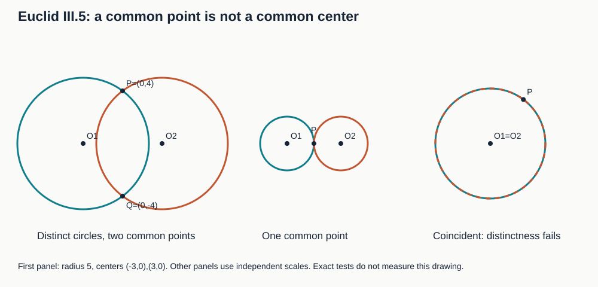

# 《几何原本》III.5：共享一个点，为什么不能共享圆心

## 约公元前300年 · 数学与推理前史补读 · 深读v1

两条圆周相交，共有点已经给定。为什么它们不可能再共有圆心？关键不是图上两个中心画得分开，而是：一旦共同圆心到共同点的距离确定，两条圆周的半径就被同一个量锁定。若连圆心也相同，我们得到的是同一条圆周，而不是两条彼此切过的圆周。

这一短证明值得精读，因为它暴露三类容易隐藏的前提：**对象不同不等于名字不同；有公共点不等于一定交叉；等长不等于不同位置。** 在[III.4](euclid-elements-iii4.zh-CN.md)之后，本单元从弦的关系转到两圆关系，沿原书顺序检查证明条件，而不是按名气选择材料。

这是数学与推理前史补读，不是现代AI实验论文。全系列从图灵1936—1937样稿回溯更早材料，属于明确的年代跳转；不称图灵为第一篇AI论文，不声称此目录穷尽历史，也不把古代命题直接说成现代算法的发明。本文区分**原文重建、教学补足、现代分析、真实实跑**。只计III.5完成，邻接III.6的比较不计其独立深读完成。

直觉路线读2、5、9节；证明路线读3、4、6节；复核路线读1、7、8、10节。

## 1 书目、来源与收录边界

| 来源 | 实读位置 | 用途 |
| --- | --- | --- |
| Euclid，*Elements*，III.5 | 作品传统年代约公元前300年 | 命题身份，不等于已知该定理首次发现日期 |
| T. L. Heath，*The Thirteen Books of Euclid’s Elements*，1908卷II | 印12，PDF25；比较印13 | [原版扫描](https://www.wilbourhall.org/pdfs/Heath_Euclid_II.pdf)：完整命题、原图及合并III.5/6的评注 |
| Richard Fitzpatrick，*Euclid’s Elements of Geometry*，2008修订版 | 印74–75，PDF同页 | [希英对照](https://farside.ph.utexas.edu/Books/Euclid/Elements.pdf)：基于Heiberg1883–1885希腊版，核字母及跨页收尾 |
| David E. Joyce，Clark University | [III.5正文与Guide](https://mathcs.clarku.edu/~djoyce/elements/bookIII/propIII5.html) | 交叉引用和只用一个公共点的现代评论 |

Heath卷I附勘误表已经目视核查，所列卷II修正涉及印41姓名，未见本单元印12条目。这只是该勘误表的核查范围，不是断言所有版本永无勘误。Fitzpatrick的III.5末句跨到印75，不能把页74底截断当作原文结束。

证据链中的早期材料是第一卷定义15的等距性质、共同概念1的等量传递和共同概念5的整体大于部分；第三卷前四条提供圆心、弦与中点的阅读背景，却不是本证每条都要调用的前提。原文不引用勾股定理、弦积或后来的圆幂理论。Heath印12谈III.5和III.6可以合并，是现代编辑评注；印13关于内切字样及Camerer的讨论属于III.6，不移作本命题的古代正文。本文没有足够材料确认本条的首次提出者或同期争论，不补写未经核实的传承故事。

## 2 历史问题：两次“等半径”为什么不只是重复

原文面对的是两条彼此切过的圆周ABC与CDG，在B、C处相遇。它暂时假设共同圆心E，连接EC，再画穿过两圆周的EFG。C的特殊性在于它同时属于两圆周，所以EC能进入两套半径等式。

如果拿第一圆的任一点和第二圆的另一个任意点作比较，并不能直接知道两条半径相等。公共点让同一条EC成为连接两份信息的中间量。这与III.4把III.3调用两次不同：本条甚至不需要三角形全等，而由定义与点序产生矛盾。

这里的思想动机可概括为：**检查两个对象的描述是否还能同时成立。** “不同的相交圆”“同一中心”“共同边界点”三项不能同时保留。证明不要求找出实际圆心的位置，也不提供求交算法。

## 3 假设和符号先于图形直觉

原文字母角色如下：C为公共圆周点，B为另一交点；E为反设的共同圆心；F属于圆周ABC，G属于圆周CDG；EFG在同一条射线上，图中F严格位于E与G之间。A、D用于命名圆周，不参与等式链。

需明确四项条件。

1. **圆周而非圆盘。** 古典定义的circle是由圆周围成的平面图形；本文现代模型专门取其边界点集，不把这个术语转换暗中当作原文定义。本文比较的是边界点到中心的半径。两个同心圆盘当然可以重叠，但这不意味着它们的圆周有公共点。
2. **两圆不同。** 两份对象记录、两种颜色或两个名字，可以描述同一条圆周。原文“切过彼此”排除整条重合。若改用现代集合交非空作为“相交”的唯一解释，就必须另加不同圆条件。
3. **半径正。** 圆心不是圆周点；退化的零半径点集不在本单元的普通圆范围内。
4. **同射线上的严格次序。** 若F=G，便没有“较短等于较长”；若F、G在相反射线上，也不能用整体与部分作同一比较。

原文说穿过E的线可任取，图却用于读出不同交点。**教学补足：所选方向应使F、G不同，不能恰把两次交点都选成C。** 对原文的两条真正交叉且不重合的曲线，可在分开的弧段方向选择图示射线；这把示图负担说清楚，不声称单靠画图就完成了现代公理化的存在证明。若不想依赖这项示图选择，可用第4.2节的等距集合论证直接完成重构。

## 4 原证明逐步拆开

### 4.1 原文的两条等式与一个严格不等式

**原文重建。**

- 反设E同时是两圆的圆心。
- C与F同在第一圆周，定义15给出EC=EF。
- C与G同在第二圆周，同一定义给出EC=EG。
- 共同概念1使EF=EG：两者都等于同一条EC。
- 图示点序E—F—G使EG由EF和正的FG组成，故EG大于EF。这与等式冲突。
- 排除反设，得到两圆不能共心。

小心最后一步：冲突的不是“同一长度不能画两次”，而是**同一射线从同一端点出发，严格较远点的距离不可能与较近点相等**。改变出发点或射线方向就不能照搬它。

B未进入等式链。这不意味着题设多余到可以把两圆重合也算进去，而是说明证明所需的公共点信息，比“恰有两个交点”弱。Heath印12明确说，只要不整条重合，切过或接触可统一讨论；同时给出同心且有一个公共圆周点就全部重合的观察。Joyce Guide也强调没有使用B。二者均是解释，不是本文发明的古代引文。

### 4.2 不依赖F/G图序的现代教学补证

采用现代欧氏平面中“圆周是到中心距离等于某个正数的全部点”的定义。设两圆共同中心E、半径r和s，公共点C满足EC=r及EC=s，于是r=s。对任意点X，X属于第一圆周当且仅当EX=r；用r=s替换，就等价于EX=s，也即X属于第二圆周。任意X的成员资格相同，两圆周作为集合相同。

这证明更强而干净的条件式：**共心且有公共点，必重合。** 再结合“原题的两圆不同”，才得到不共心。现代的全体等距点定义明确提供“充分性”，不能把它无声塞回古代定义的字面表述，冒称我们已经形式化Euclid的全部圆存在公理。

这里的逆否是：在共心条件下，不同圆周没有公共点；或者在不同圆条件下，有公共点就不共心。它不是“中心不同就一定相交”。后者是逆命题，下一节会给反例。

## 5 算例、反例与条件删除实验

以下首先是**可手算的现代例子**，运行覆盖另见第8节。圆记为“中心；半径平方”，避免近似开方。

### 5.1 真正切过的两个圆

取O₁=(0,0)、O₂=(6,0)，半径平方都为25。P=(3,4)到两中心的距离平方分别是9+16和9+16，均为25；Q=(3,−4)也如此。两个中心明显不同。这个例子符合原题，也说明“圆的大小相同”不等于“中心相同”。

它还给出反向检查：若有人把第二中心改回(0,0)却坚持说是另一条不同圆周，中心和半径数据已经把两圆识别为同一几何对象。错误在对象身份，不在等式算术。

### 5.2 共心但不相遇

中心均为(0,0)，半径平方25与9。若公共点P存在，P的距离平方就必须同时等于25和9，从而25=9，矛盾。不能用“内圆盘被外圆盘包含”反驳此结论，因为圆周与圆盘是不同对象。

### 5.3 有公共点却不切过

外切例：中心(0,0)、(10,0)，半径平方均25，P=(5,0)在两圆周上。内切例：中心(0,0)、(3,0)，半径平方25与4，P=(5,0)到两中心的距离分别5与2。它们都不共心，但单个公共点证书无法告诉程序究竟是接触还是切过。这里用于说明Heath的合并观察，不宣称已复现III.6的全部原证与评注。

### 5.4 非同心并不充分

取中心(0,0)和(20,0)，半径都5。若公共点P存在，三角不等式给20≤5+5=10，矛盾。两中心不同但两圆分离，故原命题的逆命题为假。此处三角不等式是现代反例的依据，不是III.5原文步骤。

### 5.5 重合是必须保留的分支

两份数据都是中心(0,0)、半径平方25，则P=(3,4)既是公共点，两中心又相同。它反驳“任何有公共点的两个圆记录都不共心”，却不反驳III.5。程序若仅比较对象编号不同，便会把这个合法重合分支误判成定理矛盾。

### 5.6 原图矛盾只需一维核算

在同一射线上取E=0、F=2、G=3，则EF=2、EG=3。若反设通过公共EC迫使两者相等，得到2=3；问题不是找不到这样的数字，而是反设要求同一组量同时满足等长和严格包含。这是反证的教学示意，不把它当成一对满足所有假设的真实共心交圆。

## 6 平方距离模型：公共点怎样成为约束

**现代分析。** 取中心O₁=(a,b)、O₂=(c,d)，半径平方R,S均正；P=(x,y)是待核的公共点。两项成员条件为：

$$
(x-a)^2+(y-b)^2=R,\qquad (x-c)^2+(y-d)^2=S.
$$

第一式减第二式。展开后x²、y²消去，整理得到：

$$
2(c-a)x+2(d-b)y=R-S+c^2+d^2-a^2-b^2.
$$

每一步的作用清楚：平方消元把两项二次约束压成一项必要的线性约束。若a=c且b=d，左边为0，右边缩成R−S，因此任何公共点都要求R=S。反过来，同中心同半径平方在正半径条件下描述同一圆周，与第4.2节一致。

若中心不同，至少一个线性系数非零。公共点必须在该直线上，但**满足这条直线不是充分的公共点证明**。例如5.1两圆得到12x=36，故x=3；点(3,0)满足此线性等式，却只有平方距离9，不在半径平方25的圆周上。恢复y必须继续使用至少一条圆方程，不能把消去后的必要条件当成原问题的等价单条件。

本式常可作为后续两圆求交的入口，但本篇程序不求一般交点、不处理无理坐标，也不完成一套圆幂理论。它只用精确有理输入核给定见证和这项消元恒等式。半径平方是编码选择；它允许无需开方地认证距离，不能据此说古代证明已经使用笛卡尔坐标。

## 7 主张与证据位置

| 主张 | 证据与性质 | 不支持什么 |
| --- | --- | --- |
| 切过的两圆不共心 | Heath印12、Fitz74–75命题与完整反证 | 不支持中心不同必相交 |
| EC分别等于EF、EG | 原文两次圆定义调用 | 不支持两个任意圆的半径都相等 |
| EF不能等于EG | 原图严格点序及共同概念；点序说明为教学补足 | 不支持F=G或反向射线情形 |
| B没有进入证明 | 原文步骤可直接检查；Joyce Guide | 不支持把重合圆纳入原题 |
| 共心+公共点则重合 | Heath印12评注；第4.2节现代集合证明 | 不宣称古代原文逐句已有集合语言 |
| 线性消元条件必要而非单独充分 | 第6节展开与(3,0)反例 | 不构成完整求交算法 |
| 有限证书与实现行为 | 自有代码与真实日志，独立技术核验 | 不替代一般实数定理或公理形式验证 |

## 8 低成本复现与真实实跑

复现输入是二维有理中心、正半径平方以及可选的给定公共点。`circle_relation`在共心时区分重合与不交；对非同心数据只报告中心不同、相交关系未决。公共点证书接口另行检查该点是否确在两圆周上，不能把“没交给程序公共点”解释成“不存在公共点”。

公开附件含原创源码、测试、环境版本、完整命令、真实日志、退出码和教学Notebook。Notebook采用标准库逐格compile/exec与输出回放，不是Jupyter kernel执行；不虚构内核运行次数。程序使用Fraction精确有理数，明确拒绝布尔值冒充整数以及不合法圆。独立审查另造样本与篡改证书，不仅重复作者的成功样例。

实际运行24项单测，在normal、-O、-OO三模式均通过；每模式600个变换构形（120个重合、480个互异且有公共点），由5个命名证书×5个非零尺度×3平移×4旋转×2镜像生成。另保存两个仅圆关系对照，Notebook为5个代码格。这里的手算例与命名实跑例不全采用相同坐标：实跑交圆中心为(−3,0)/(3,0)，相当于第5.1节整体向左平移3；实跑外切半径为1，是第5.3节外切例的等比缩放。原始输出与独立技术审查以附件为准。

图中面板独立尺度；它说明三类都能给出公共点，不承担一般定理证明。有限网格只检查实现的输入和输出契约；一般结论由第4节数学论证承担。我们没有从照片识别圆心、没有给测量误差作概率保证，也没有复现古代尺规操作的物理过程。

## 9 局限、合理延伸与复盘

1. 原图的反证承载点序和交点选取；读懂图不等于完成全套连续性公理化。本篇给出另层现代补证，不假装消除了所有古典基础问题。
2. “一个公共点”足以支持不同圆不共心，却不足以区分相切、横截或重合；重合还需要独立的对象相同判断。
3. 输入精确不代表现实数据准确。两中心数值接近、半径近似相等时，不应套用精确对象相同判定。容差还要涉及尺度与测量模型。
4. **本文延伸：** 对约束系统，保留原约束和消元约束的方向关系很重要。推导出的必要条件用于筛除候选，不能直接取代全部原条件。对自动推理的启发在于前提与对象身份审计，不是一个未经证实的历史影响断言。
5. 有限有理实现没有覆盖全部实数圆周，更不验证所有古代版本的文本。已读范围与尚未处理范围分开记录，短命题也不因篇幅小而免除证明条件检查。

## 10 带答案练习

1. **原证为什么选择公共点C而不是两个不同圆周上的任意点？** 同一EC能同时作为两圆半径，因而把两套等长关系连接起来。两个任意点只给各自半径，未必相等。
2. **E—F—G中的“严格”删去会怎样？** 若F=G则没有正的FG，等长完全正常，末步不能矛盾。
3. **“圆1和圆2编号不同”能保证不是重合圆吗？** 不能。相同中心及正半径给相同几何圆周，标签不决定对象身份。
4. **用第5.1节数据验证消元式，并找一个伪公共点。** 系数为12x=36；(3,0)满足消元式，但两距离平方是9而非25，故须核原方程。
5. **若同心半径平方分别为25和9，为什么不用遍历所有点就能判断不交？** 任意公共点都迫使其同一距离平方同时为25和9，等量传递产生矛盾。有限枚举不是这个证明。
6. **两个中心相距20、半径都5为何不是III.5的逆向证明？** 它们正是逆命题反例：中心不同但公共点不存在，三角不等式20≤10不成立。
7. **同心且有公共点得到什么？还需哪项前提才能推出不共心？** 前者推出两圆重合。若另有两圆不同，则反设共心被排除。
8. **证书接受一个公共点，是否证明两个圆切过？** 不证明。外切、内切与重合也有公共点；须增加相应分类条件或另一项独立分析。
9. **为什么输入R是半径平方却仍要求R>0？** 保持普通非退化圆的范围；R=0是单点，R<0在实欧氏平面无圆周，不能与正常圆混用。
10. **本篇实验和一般证明各解决什么？** 实验检查有限输入、类型、证书和程序一致性；证明处理规定模型下任意符合假设的圆。两者不能互相冒名。

复盘：找出共用的量；明确对象是否不同；为末步不等式写出严格次序；对消元结果标注“必要”；把原文、评注、现代补证和日志分层。

## 11 附件入口

- [复现说明、源码、Notebook与真实日志](../../reproduction/euclid-elements-iii5/README.md)
- [独立来源审查](../../reproduction/euclid-elements-iii5/source-review.zh-CN.md)
- [独立技术审查](../../reproduction/euclid-elements-iii5/technical-review.zh-CN.md)

本单元完成不代表第三卷、全书或AI前史穷尽；既有暂缓项目不因本篇发布而视为完成。
