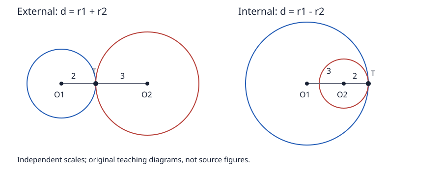

# 《几何原本》III.6：相切不共心，为什么不必先证明只有一个接点

## 约公元前300年 · 数学与推理前史补读 · 深读v1

两圆相切，不可能有同一个圆心。图一画，这句话似乎无需证明；真正值得追问的是：**反证最后使用的两个交点为什么不同？这是否偷偷借用了后面才证明的“相切只有一个接点”？** III.6的短小等式链，与Heath保存的Camerer质疑，恰好让我们检查“证明需要多少前提”。

本篇承接[III.5](euclid-elements-iii5.zh-CN.md)，不把相切直接当成相交的换名。我们重建原证，分别说明内切、外切和重合边界，再用现代坐标推导相切证书与唯一点的关系。前者是古典阅读，后者是教学扩展，不能互相冒充。

这是数学与推理前史补读，不是现代AI实验论文。系列从1936—1937年图灵样稿回溯到古代，是明确的年代跳转；不称图灵为第一篇AI论文，也不声称覆盖全部前史。本文按同一来源和论证标准收录短命题，不据作者影响力免除检查。原文、编辑评注、教学补足、现代分析、真实实跑在下文分层标明。

## 1 书目与实际阅读范围

| 材料 | 实读位置 | 用途 |
| --- | --- | --- |
| Euclid，*Elements* III.6 | 作品传统年代约公元前300年 | 标明命题身份；不是本条首次发现日期 |
| T. L. Heath，*The Thirteen Books of Euclid’s Elements*，1908卷II | 印13，PDF26；并核印12、14边界 | [扫描](https://www.wilbourhall.org/pdfs/Heath_Euclid_II.pdf)：完整命题、图、内切用词及Camerer评注 |
| Richard Fitzpatrick，*Euclid’s Elements of Geometry*，2008修订版 | 印75完整III.6；印70定义III.3 | [希英对照](https://farside.ph.utexas.edu/Books/Euclid/Elements.pdf)：基于Heiberg1883—1885希腊版，核字母与论证 |
| David E. Joyce，Clark University | [III.6正文及Guide](https://mathcs.clarku.edu/~djoyce/elements/bookIII/propIII6.html) | 比较III.5与III.6、现代导读 |

Heath卷I所附勘误表经目视核对，其中卷II条目是印41的人名修正，未见印13修正。该结论仅指已见表，不表示所有版次无误。Heath印13将部分英文版本命题里的“内切”限定词判作插入，并解释原图只示内切；这是**Heath的编辑判断**，不是本文发现的手稿勘误，也不直接改称“Heiberg勘误”。Fitzpatrick此处命题不限定内切。

前驱材料包括第一卷圆定义15的等半径性质、共同概念1的等量传递、共同概念5的整体大于部分；第三卷定义3把接触说成相遇而不相割。该古典定义没有直接把“公共点集合恰含一个元素”写成定义。III.5是相邻的相割情形，二者可合并的观察见Heath印12；III.13仍是后续命题，不作为III.6原证的先决定理。没有可靠资料足以为本条补出独立首创者或同期学派争论，故不编造这些信息。

## 2 历史问题：一处相遇怎样约束两个圆

在上一条中，原图为切过彼此的两圆；本条换为接触。古典顺序没有先宣布一个现代集合论总命题再机械套用，而是保留这两个图形类型。两条证明都把公共点变成两套半径信息共用的中间量。

本条原文以ABC和CDE命名两圆，C为接触点，F是反设的共同圆心。连FC，再画穿过F的FEB，E在内圆周，B在外圆周。FC既是第一圆半径，又是第二圆半径；FE和FB于是必须相等。图中F—E—B的严格次序却要求FB较长。

问题不在等量传递，而在“严格较长”的根据。若E=B，两个名字落在同一个点，末步就没有矛盾。Camerer的质疑正落在这里：是否先假定了两圆除C以外不再相遇，而这一点要到III.13才证明？Heath的答复缩小了需要：**不必排除所有其他公共点，只须找到一条从反设共同中心出发、与两圆相遇于不同点的线。** 内切图形中，内圆接触外圆之前的弧处在外圆内部，提供所需的分离位置。这是对示图负担的编辑解释，不应藏在“任意画一条线”的口号里。

## 3 符号、假设与逻辑形式

### 3.1 原文字母

- C：两圆共同接触处，不是圆心。
- F：暂时假设存在的共同圆心，反证结束后撤销。
- E：圆CDE上的辅助点；B：圆ABC上的辅助点。
- F、E、B：同射线且E在F与B之间；需要FE和EB均为正。
- A、D：圆名中的其他标记，不参与长度等式链。

普通圆的半径为正。圆心在圆内部，而不是圆周上。Euclid的circle指圆周围成的图形；本文现代坐标模型只取边界点集。圆盘相交、圆周相遇、曲线相割、曲线相切是不同关系。

### 3.2 需要排除什么

相切讨论的是不同的圆，而不是给同一圆周两个名字。Heath印12的合并评论明确保留“不全部重合”。若把“相遇而不相割”粗糙编码成“至少一公共点且未输入两交点”，程序会把证据缺失当成不相割，甚至把完全重合纳入相切。

本篇古典结论是“相切 ⇒ 不共心”。现代重构采用不同的正半径圆；其否证形式是“共心且有公共点 ⇒ 两圆相同”，再与不同圆前提冲突。不能把箭头反过来：异心不保证相切，可能相割、分离或一圆严格含于另一圆内。

## 4 原证明：把两次定义调用与末步点序拆开

**原文重建，内切示图。**

1. 假设F同时是两圆的中心。
2. C、B位于圆ABC的边界，圆定义给FC=FB。
3. C、E位于圆CDE的边界，同一定义给FC=FE。
4. 由共同概念1，FE=FB。此时只是等式，没有矛盾。
5. 所选辅助射线有F—E—B，故FB由FE与正的EB组成，FB大于FE。
6. 同一对线段不能既相等又严格不等，排除共心反设。

第5步不能换成“E和B标签不同”。也不能把反证图当作满足所有假设的精确真实构形：反设本来就是要导出不可实现的约束组合。

**教学补足。** “任取FEB”须理解为选取能体现严格不同交点的辅助方向，不能选FC使两个圆周交点都落在C。Heath说明只需这样的一个方向，不须先证明其他所有方向都不再相遇。其逻辑区别是：存在一条线产生不同交点，比“除C外没有任何共同点”弱得多。用较弱前提即可完成本证，就不应引入更强、尚未建立的后续定理。

### 4.1 外切怎样处理

原文命题没有限定内切，图只画内切。Heath说外切的情况容易，并认为原证也可使用；本文不把这句话扩写成原文已经给了另一幅完整外切证明。以下给出独立标明的现代补证，同时覆盖内、外切，不要求从内切图硬读出外切点序。

设两圆共心F、正半径r和s，公共点C给FC=r及FC=s，于是r=s。采用现代“到中心距离等于半径的全部点”作为圆周定义，则任意X属于第一圆周当且仅当FX=r，也当且仅当FX=s，故属于第二圆周。两圆周相同，不能是两条不同的接触圆周。

该证明只用了公共点，没有用“接点唯一”，所以不会预用III.13。它比III.6题设更一般；其集合语言与定义中的充分性是现代教学选择，不声称完全形式化古代圆公理。

## 5 相切证书的现代模型：存在与唯一分别验证

为了比III.5仅核公共点前进一步，最小复现将圆写成二维中心O、正的有理半径r。两个中心记O、P，半径r、s；令u=P−O、d为中心距离。程序不对任意有理距离开方，而在候选相切分支使用正的r+s或|r−s|作为d，再检查d²是否等于u的平方长度。

**现代判据：** 外切对应d=r+s；内切对应d=|r−s|且d>0。内切时若r=s就有d=0，是重合而非相切，必须先分支处理。这里只讨论普通欧氏圆。判据不是III.6原文字面内容，以下推导解释其证书为何足够，不以运行数目作证明。

### 5.1 外切的存在点与唯一性

假设d=r+s>0。候选T=O+(r/d)u。由于u长度为d，OT=r；PT=s，故T是公共点。设任意另一公共点X，v=X−O。两条圆方程相减得：

$$
2u\cdot v=r^2+d^2-s^2=2rd.
$$

最后一个等号把d=r+s代入并展开。现在比较X与候选T：

$$
\lVert v-(r/d)u\rVert^2=r^2-2(r/d)(rd)+(r^2/d^2)d^2=0.
$$

在实欧氏平面，平方长度为零的向量只能是零，所以X=T。存在点和唯一性是两段论证，不是“查到一个点所以只有一个点”。此外两开圆盘不相交：若X严格在两盘内，三角不等式将给d≤OX+PX<r+s=d，矛盾。这说明这里的现代外切构形与“相遇而不相割”一致。

### 5.2 内切的正差与嵌套

不失一般性设r>s>0，d=r−s>0。仍取T=O+(r/d)u，这次r/d>1，T在从O经过P向前延长的射线上，而不是O、P之间。OT=r，PT=r−d=s，存在性成立。任意公共点X仍满足同一消元式，因为r²+(r−s)²−s²=2r(r−s)=2rd，所以上述零平方长度证明原封不动给X=T。

对小圆盘任意Y，OY≤OP+PY≤d+s=r，因此小圆盘包含在大圆盘内。这里不用预先宣称只有一个接点，而用代数证明唯一点，再用距离说明嵌套。若s>r，交换两圆角色即可。

半径相等的所谓“内切”不能通过把d=0塞进r/d来求点。分母为零不是偶然实现故障，而是不同数学分支：共心等半径给整条重合；共心不同半径无公共圆周点。

## 6 手算、反例与边界

以下为教学手算；具体实跑清单见附件，不把没有执行的坐标称为日志结果。

1. **外切。** O=(0,0)、r=3；P=(5,0)、s=2。d²=25=(3+2)²，T=(3,0)，两距离平方为9、4。代入消元式得10x=30，右边逐项为r²+d²−s²=9+25−4=30，故x=3；第一圆方程随后给y=0。
2. **内切。** O=(0,0)、r=5；P=(3,0)、s=2。d=3=5−2，T=(5,0)，在OP延长线上。消元6x=25+9−4=30；再得y²=25−25=0。大圆盘包含小圆盘，不等于两圆周重合。
3. **仅有公共点，不足相切。** O=(0,0)、P=(6,0)，r=s=5。C=(3,4)与D=(3,−4)都是公共点。d²=36，既不等于100也不等于0。一个C证书不应被当作相切证书。
4. **异心但分离。** 中心距20、半径均5。若有公共X，则20≤5+5，矛盾。III.6的逆命题为假。
5. **内含但不接触。** O=(0,0)、r=5；P=(1,0)、s=2。小圆盘任意点到O至多3，小于5，两个圆周无公共点。看图“一个圆在另一个里面”不是内切判据。
6. **重合与同心不同大小。** 同中心半径均5时公共点无穷多，不应被判内切；同中心半径5、2时没有公共点。两种同心情形都不符合题设，原因却不同。
7. **差一点相切。** 半径3、2，中心距5+ε，ε>0时两圆分离；5−ε在0<ε<4时相割。精确相切是边界事件，不能拿浮点“很接近”代替零余量。

例1消元是10x=30而非某个凭记忆填的常数；这个小核对展示复盘的要点：每一项都应从半径和中心数据重新计算，不能只检验最后画出来像接触。

## 7 主张、证据与归属

| 主张 | 证据位置 | 限制 |
| --- | --- | --- |
| 接触两圆不共心 | Heath印13、Fitz印75完整III.6 | 不提供相切检测算法 |
| FC=FB、FC=FE导FE=FB | 原文两次圆定义与等量传递 | 不把不同标签当不同交点 |
| FE严格小于FB | 原图点序；Heath印13关于辅助方向的评注 | 只需某一条线，不借用III.13全局结论 |
| 内切限定是插入词 | Heath印13编辑评注 | 不冒称自己完成希腊手稿校勘 |
| 相遇而不相割的定义 | Fitz印70定义III.3 | 不是字面定义“恰好一公共点” |
| 共心+公共点则重合 | Heath印12合并观察；本篇现代集合补证 | 现代定义与古代措辞分层 |
| 距离判据、候选点与唯一性 | 第5节现代平方距离推导 | 不归属Euclid原文，不作为后续命题全篇完成 |
| 精确有限实现行为 | 源码、真实日志和技术独审 | 不认证实物测量或全实数程序 |

Joyce Guide认为III.6未在后文使用。这里仅报告其导读观察，没有完成全书引用图普查。命题的阅读价值也不必由后续引用次数决定：它让我们看到同一反证骨架如何跨图形类型复用，以及如何避免不必要的强前提。

## 8 最小复现与真实执行

复现以Python标准库精确有理数处理中心和正半径。它不识别图片，也不从带噪测量拟合圆；输入圆参数须已经给定。相切检测、候选点构造、证书核验的范围与退化分支在[复现说明](../../reproduction/euclid-elements-iii6/README.md)列明。普通公共点与相切证书分开，重合不能当成内切成功。

实际执行了24个测试的normal、-O、-OO三种模式，每种模式检验600个经平移、正缩放、镜像形成的构形，均通过；这不是600条一般定理。另保存5个命名相切证书、3个关系对照。五格Notebook已真实顺序compile/exec并只读回放比对输出。命令、环境和每步退出码见附件run-summary.json，独立技术核验另列于审查记录。

图中两幅使用独立比例。API内切公式允许半径交换时分母为负；第5节为了教学先按大圆在前推导，两者等价。

五格Notebook组织教学步骤；实际执行方式与保存输出以附件为准，不能把标准库compile/exec说成Jupyter kernel运行。源码、环境、准确命令、退出码和净化日志随文公开，不附未许可PDF或全文翻译。图为自有教学图，不复制原书扫描。

## 9 局限、合理延伸与复盘

- 原证中的“任取”和图示严格次序需说明，本文给出编辑解释与另层现代补证，不声称填平古典几何全部连续性公理。
- 现代相切判据依赖正半径及欧氏距离。退化点圆、非欧氏空间、一般曲线切触都不在本程序规格中。
- 有理输入限制是低成本实现边界。即使普通圆参数精确，任意两圆交点可能无理；本程序不因此伪造近似点为精确见证。
- 相切判定对误差敏感。若输入是测量值，需另设区间或误差模型；本篇没有对噪声、容差、概率作承诺。
- **本文延伸：** 自动推理或规格检查应区分“需要某个见证”与“断言所有其他见证不存在”。在本例，较弱的存在分离方向足够导出矛盾，没必要为此先接管更强的全局定理。这是现代方法论类比，不是Euclid直接影响现代AI系统的历史证据。

复盘顺序是：先辨接触与公共点；再找共享半径；为末步写出严格点序；检查是否调用后续命题；最后把原证、补证与程序的输入契约分开。一般证明由逻辑与代数承担，有限运行用于发现实现和说明的不一致。

## 10 带答案练习

1. **为何FC能连接两套半径等式？** 因C是同一个公共圆周点，F又被反设为共同中心，FC同时属于两份半径定义；两个任意边界点不能自动做到这一点。
2. **FE=FB本身为什么不矛盾？** 不同射线上等长很正常；须有F—E—B严格同射线点序，得到正EB与FB=FE+EB。
3. **若选FEB正好沿FC，两个交点都是C怎么办？** 该方向不能提供末步严格不等式，应改用能给不同交点的方向，或采用现代共心等半径必重合的补证；不能硬说C比自身近。
4. **Heath回应Camerer时减弱了哪项要求？** 不需先排除除C以外的全部共同点，只需存在一条辅助线给不同交点。前者是更强的全局性质。
5. **第三卷定义3是否直接说接点唯一？** 没有，所读定义说相遇而不相割。现代唯一点解释需独立推导，不能倒塞回定义免证。
6. **外切例r=3、s=2、d=5中为何T在两中心之间？** r/d=3/5介于0与1，故T=O+(3/5)(P−O)在线段OP内部；OT=3、PT=2。
7. **内切r=5、s=2、d=3为何同一公式给延长点？** r/d=5/3大于1；T越过P，PT=5−3=2。用外切的“在线段内部”去限制它会误拒合法内切。
8. **r=s且d=0能作为内切吗？** 不能。这是重合分支，r/d无定义，公共点不是唯一；必须在除法前排除。
9. **第6节交圆C=(3,4)为什么不能单独证明相切？** D=(3,−4)也是公共点，而且中心距既非两半径和也非非零差。成员资格不是相切分类。
10. **重复600个成功例是否证明一般定理？** 否。样本规模只给有限实现证据；一般唯一性来自任意公共X的消元与零平方长度论证，古典不共心结论来自原证或明确标注的现代补证。

## 11 附件与范围声明

- [源码、环境、日志及Notebook](../../reproduction/euclid-elements-iii6/README.md)
- [独立来源审查](../../reproduction/euclid-elements-iii6/source-review.zh-CN.md)
- [独立技术审查](../../reproduction/euclid-elements-iii6/technical-review.zh-CN.md)

本单元只计III.6完成，不计III.7、III.13、第三卷或全部AI前史完成；既有暂缓项目保持原状态。本文是依据所列材料的原创中文分析，不是原文全文翻译，不冒称人类专家或证明助理认证。
