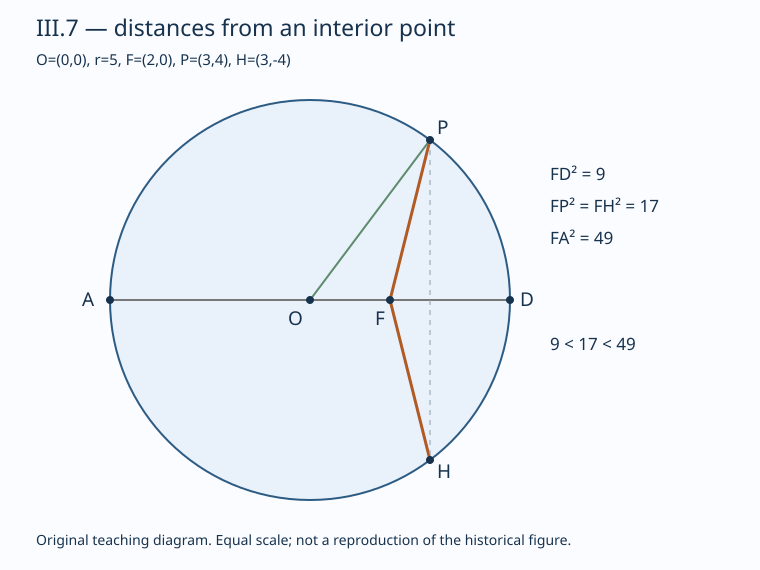

# 《几何原本》III.7：最长最短之外，等距为什么只有一对

## 约公元前300年 · 数学与推理前史补读 · 深读v1

从圆内一个偏离圆心的点出发，走到圆周：沿直径穿过圆心的方向最远，反方向最近。难处不是看见这两个极值，而是说明中间距离怎样严格排序，以及为什么每个非极值距离恰好对应两个端点。**“至多两个”“存在两个”和“每个距离都有两个”不是同一句话。**

本篇承接[III.6](euclid-elements-iii6.zh-CN.md)，转向距离比较。III.7的原证调用第一卷三角形不等式、铰链不等式和全等；Heath保存的De Morgan批评提醒我们：从一个观察点看到的角次序，不能不加解释地换成另一个观察点的角次序。本文保留这处文本问题，再提供明确标为现代教学重构的补足。

这是数学与推理前史，不是现代AI论文。由1936—1937年图灵样稿回溯古代是年代跳转；图灵样稿不称第一篇AI论文，目录不声称穷尽。收录不按作者影响力免审，短命题也须检查条件、证明和反例。这里没有训练数据、基线或学习指标，评价对象是论证与受限程序是否准确。

## 1 书目、版本与阅读边界

| 材料 | 实读位置 | 角色 |
| --- | --- | --- |
| Euclid，*Elements* III.7 | 作品传统年代约公元前300年 | 作品身份，不据此断言本命题首创年代 |
| T. L. Heath，*The Thirteen Books of Euclid’s Elements*，1908卷II | 印14–15完整命题；印15–16角序评注 | [扫描](https://www.wilbourhall.org/pdfs/Heath_Euclid_II.pdf)，PDF27–29 |
| Richard Fitzpatrick，*Euclid’s Elements of Geometry*，2008修订版 | 印75末至77上，完整III.7及两脚注 | [希英对照](https://farside.ph.utexas.edu/Books/Euclid/Elements.pdf)，基于Heiberg1883—1885希腊版 |
| David E. Joyce，Clark University | III.7正文、Guide及Note | [转录与导读](https://mathcs.clarku.edu/~djoyce/elements/bookIII/propIII7.html)，用于版本互核 |

Heath在印15说明译文中“同一直径”是为清楚而补，关于最短线两侧的“各一条”也是解释性增词。Fitzpatrick印77脚注推测“更近”应作角意义理解，并明确指出原文的圆心角比较除图外没有证明。本文不把这些编辑说明冒充Euclid正文，也不把自己补出的分析法说成古代原证。Fitzpatrick印76英文有连续重复的BF大于CF句，不影响数学链，本文不据此虚构一条新推导。

Heath印16还介绍Taylor、Nixon改用圆心角作判据的改写，以及Heron改以圆心到直线的垂距衡量“近”的另一问题。本文只读取其区别说明，不声称复现印16后延续的Heron完整证明。本文“近”不是点到直径的垂直距离，更不是无定义的视觉印象。

前驱是I.20两边和大于第三边、I.24两边分别相等时较大夹角对较大底边、I.23复制角、I.4边角边全等。III.1提供圆心构造背景；本篇可以把圆心作为已知输入，不伪称实现该构造。同期材料和本命题独立首创者在所读范围内不可确定，故不编造具体师承。Heath卷I所附勘误表的相关核查结论见来源独审；未见本条修正不等于所有版本绝无错误。

## 2 命题先拆成三件事

设E是半径r的圆心，F是圆内非中心点。取直径AD，使点序为A—E—F—D；记EF=d，于是0<d<r。

1. **极值：** FA=r+d最大，FD=r−d最小，其他圆周点P给严格中间距离。
2. **排序：** 在固定一个开半圆中，端点从D沿弧走向A，距离FP严格增加。
3. **等距：** 给定不在直径端点的圆周点G，直径另一侧恰有一个H使FG=FH，除此没有第三个圆周点。

第三项不是“任给正数都能画出两条”，更不是每个极值也有两个不同点。若目标长度小于r−d或大于r+d，没有端点；等于任一极值只有一个；严格处于两者之间才有两个。这是后文现代模型的完整分类。

原文字母B、C、G在同侧，按A到D方向排列，故FB>FC>FG。H在另一侧，是G的等距伙伴；K是假定的第三点。古典straight line在这里指从F至圆周的线段，不能把它换成穿过F的无向整条直线后仍照抄计数。

## 3 原证第一部分：极值不靠微积分

### 3.1 最长

对不在AD上的B，三角形BEF非退化。I.20给BE+EF>BF。圆的等半径性质给BE=AE，而A—E—F给AE+EF=AF，所以AF>BF。这个严格号来自非退化三角形，不是近似画图。

### 3.2 最短

对不在AD上的G，同一命题给GF+FE>GE。用GE=ED，再两边减去正线段EF，得到GF>ED−EF=FD。减法必须依赖E—F—D及d<r，否则“剩余线段”会换方向。

端点另论：A与D的距离分别r+d与r−d，前者严格大于后者，因为d>0。这样两个极值的唯一性也清楚：非轴点均严格夹在其间，另一个轴点不相等。若F=E，所有半径等长，严格性立即消失。

## 4 原证排序：I.24以前还欠什么

原文把三角形BEF与CEF比较：BE=CE、EF公共，若角BEF大于CEF，I.24就给BF>CF；同理CF>GF。这里I.24接口使用的是**圆心E处的角**。如果“FB比FC更靠近FA”最初在F处量角，则尚需证明这种次序在E处保持。

Heath印15引用De Morgan对此缺口的指出，随后引入辅助交点M，并借助从同一点向同一直线引出的斜线段长度与其偏离垂线程度之间的比较，补足角序关系；印16另述改用圆心角直接陈述的版本。这两种做法不能混为原文已经证明。Fitzpatrick脚注也只指出图示负担，没有给出完整修补。

一种谨慎读法是先明确按同半圆圆心角排列B、C、G，再应用I.24。这样所得排序是真的，但改变了判据表述。若要保留F处角意义，还须说明两种顺序等价。下面给出可逐行核查的现代补证，**不是Euclid的推导，也不是程序实跑**。

令E=(0,0)、F=(d,0)，P=(r cosθ,r sinθ)，上半圆0<θ<π。θ是从ED向EP的圆心角；α是从FD向FP的普通角。FP非零且其纵坐标为正，故α连续取值于(0,π)。设x=r cosθ−d、y=r sinθ，方向角求导分子为xy'−yx'=r²−rd cosθ。分母是x²+y²>0。由于r−d cosθ≥r−d>0，α随θ严格增加；两端分别趋于0与π。因此从F看到的方向次序与圆心处的弧序一致。相对于FA的角为π−α，故越靠近FA意味着α越大、θ也越大，正好支持原证的I.24比较。

这段补证采用实数坐标、三角函数和微积分，比古典工具更强；其价值是公开桥步，而非用现代方法掩盖文本省略。程序只核验有限有理点排序，不认证这条导数对所有实角的结论。下半圆由反射同理；跨两侧不能用“更近”建立全体点的严格线性顺序，因为镜像点等距。

## 5 原证第二部分：为什么恰好一个伙伴

**存在。** 对给定非轴G，按I.23在EF另一侧复制角GEF，射线与圆周相遇于H。GE=HE、EF公共、夹角相等，I.4给FG=FH。反射后的角位于另一半平面，G与H是不同点。射线与圆周的相遇是该圆几何构造背景；本文不声称I.23单独证明任意曲线求交。

**至多。** 若还有不同于G、H的K，它必在一个开半圆或是A、D。极值已排除端点；若K与G同侧，严格排序给FK不等于FG；若与H同侧，则FK不等于FH。两案都矛盾。原文图只画K在H侧，教学上需把另一侧也明确覆盖。

这里“只有一条”指除已给FG以外的伙伴FH，并不推翻开头“共有两条”。若G是D或A，复制角变成零角或平角，H重合于G，不能算第二点。这也是为什么“给定非极值”的资格不能省略。

## 6 现代精确模型：平方距离、余量与两解

以下为教学重构。E=(0,0)，F=(d,0)，圆周P=(x,y)满足x²+y²=r²，0<d<r。展开PF²=(x−d)²+y²，用圆方程消去x²+y²：

$$
PF^2=r^2+d^2-2dx,\qquad PF^2-(r-d)^2=2d(r-x),\qquad (r+d)^2-PF^2=2d(r+x).
$$

非轴圆周点有−r<x<r，所以两项余量严格为正。这同时给出极值边界；当x=r或−r时，仅相应余量为零。平方根在非负数上严格递增，比较平方不改变长度次序。对于两个点P、Q，PF²−QF²=2d(x_Q−x_P)，所以轴投影越小，距离越长。这不把弧长等同横坐标，而是提供等价排序量。

若PF=q，先由上一式解出x，再代回圆方程：

$$
x=\frac{r^2+d^2-q^2}{2d},\qquad y^2=r^2-x^2.
$$

分母2d不能为零。若r−d<q<r+d，平方后的不等式给−r<x<r，故右端严格正，有一正一负两个实数y；若q取端点则y=0只得一点；范围外右端负或无合法长度，不得实点。两个解为(x,y)、(x,−y)，关于EF直径反射。因此“恰两点”是代数解数证明，不依赖枚举多少样本。

平移、旋转不改变距离；实现采用有理单位方向u，把x替换成(P−E)与u的内积，F=E+du。镜像为E+2xu−(P−E)。这是坐标无关的反射表达，但程序的有理输入域仍比全部实数几何窄。

## 7 手算、反例与容易混淆的指标

取r=5、d=2，A=(−5,0)、D=(5,0)，最大距离7、最小3。G=(3,4)给FG²=1+16=17，H=(3,−4)同样为17；两余量分别17−9=8及49−17=32，和公式2d(r−x)、2d(r+x)一致。

同一上半圆取B=(−3,4)、C=(0,5)、G=(3,4)。三者距离平方为41、29、17，形成严格链49>41>29>17>9。B和G到直径AD的垂距都为4，长度却不同；所以“更近”不能未经定义就解释成端点到直径的距离。

令q=5，解得x=(25+4−25)/4=1，y=±√24。两解真实存在但坐标不全有理。本篇Fraction程序不会因此输出虚假的有理解，也不声称枚举了所有距离对应点。

- F=E：任意圆周点距离都等于r，有无限多个伙伴，d>0不可删除。
- G=D：最短距离仅D取得；G=A同理。极值不属于恰两点的非轴域。
- F在圆外：沿同一射线可能有两个交点，不能照搬本篇内点的方向参数顺序；后续III.8另论，本篇未完成它。
- P不在圆周：把(3,3)输入上例，PF²=10，圆方程不成立，消元前提失效。
- 两点在不同半圆：G和H不相同却等距；因此严格排序须限定同一半圆及不同位置。
- 只用浮点近似：接近中心时长度差很小，舍入可能消掉严格号。有理精确运算避免这类误判，但不能解决任意实数表示。

## 8 从证明到最小复现

附件实现一个精确证书核验器，而不是自动古典证明器。输入圆心、正半径、有理单位方向、偏心距、一个非轴圆周点，输出F、两个极值端点、镜像点、平方距离及两项余量；核验器重算并检查结构与类型。另一个比较接口检查同一开半圆两点的投影和距离次序。

[源码、Notebook及真实日志](../../reproduction/euclid-elements-iii7/README.md)给出准确命令、环境、返回码和统计。程序以Fraction保存有理数，不把布尔值当整数通过；非法中心、端点、外点、非单位轴和非圆周点应被明确拒绝，而不是悄悄当成合法定理输入。对证书修改字段后重新验证，测试验证器不是只相信声称的结论。

Notebook采用已保存的代码单元顺序compile/exec并回放，**不是Jupyter kernel执行**；不伪造内核execution_count或宣称完整交互复现。测试与Notebook是实际执行证据；§3–6的一般推导才承担普遍数学结论。没有机器学习数据、基线、精度或速度竞赛指标。本次24项测试在normal、-O、-OO三模式分别通过，各覆盖504个构形；Notebook实际执行五个代码格。网格数量说明覆盖，不是证明强度的百分比。

图为原创坐标教学图，需与原文字母说明区分；图中等距伙伴和极值边界不靠像素测量成立。独立技术审查重算案例和错误输入，独立来源审查核原文、评注归属及命题范围，两份报告与最终正文摘要绑定。

## 9 主张与证据位置

| 主张 | 证据 | 限制 |
| --- | --- | --- |
| 穿心线段最长、剩余直径最短 | Heath印14，Fitz印76，I.20链 | F严格内点且非中心，非轴比较才严格三角形 |
| 中间距离严格排序 | 同页I.24步骤 | 圆心角条件须明确；F角序桥步原文省略 |
| 等长伙伴存在 | Heath印15，Fitz印76–77，I.23/I.4 | 给定非轴点，复制在另一侧 |
| 不存在第三点 | 同上反证末段 | 两侧和两极值分别覆盖 |
| 角序缺口及替代陈述 | Heath印15–16，Fitz印77脚注 | 编辑讨论，不冒充原文证明 |
| 距离平方公式、两解分类 | 本文§6代数推导 | 现代实数欧氏模型，d非零 |
| 有限证书与拒绝测试 | 附件真实日志及独立技术审查 | 不证明所有实数构形或原典完备性 |

## 10 局限与合理延伸

本篇不是对《几何原本》完整公理化的形式验证。它显式采用圆周、内点、反射及点序背景；分析补证引入现代工具，不能据此宣称古典省略已经由原文自身消除。原典“近”的措辞需要解释，改用圆心角能简化接口，但也改变读者最初观察位置。

一个与推理系统有关的现代类比是：两模块分别使用不同排序键，即使各自内部正确，交换接口也需要保序证明。另一个是“恰好两个”的证明义务拆成构造与排除多余解，边界输入要单独分类。这是本文方法论延伸，不声称Euclid提出了AI算法。

若以后扩展到外点，应重新审计射线交点数、近远交点和切线边界，不能仅把d<r改成d>r继续沿用证书。本单元没有完成III.8，也未穷尽圆几何或AI前史。

## 11 复盘与带答案练习

1. 为什么F非中心不够，还要说它是严格内点？答：最短部分ED−EF必须为正，内点还确保一条向外射线只有一个前方圆周端点；外点是不同命题域。
2. 最长证明调用哪一条？答：I.20用于BE+EF>BF，再用BE=AE和点序A—E—F，不是直接调用勾股。
3. 最短证明中为何能相减？答：GF+EF>ED两边减EF保序；E—F—D给ED−EF=FD。
4. I.24需要的角在何处？答：在E处，不是F处；从F角次序到E角次序是需要补的接口。
5. r=5、d=2、P=(−3,4)，距离平方是多少？答：25+4−4(−3)=41，最大平方49差8。
6. 同例q=3与q=7各有几个端点？答：分别一个D和一个A；不是两个重名点。
7. q=5为何程序未必能输出精确坐标？答：x=1、y=±√24，Fraction域不能表示该无理坐标；一般数学存在不等于该程序构造能力。
8. d=0时消元公式哪里失败？答：除以2d非法，且距离恒为r，等距解无限，不是微小误差问题。
9. 若K假定为第三点但落在G侧而非H侧怎么办？答：与G比较同侧严格排序；若落H侧与H比较；若轴端点则极值已排除。
10. 504个构形样本都通过是否证明“恰两点”？答：否。普遍结论由固定x后y²方程的解数证明，样本只验证代码在所跑输入上的实现。

阅读完成的标准不是记住“最长最短”，而是能分别交代严格号、角序桥接、伙伴存在与唯一以及极值例外。
