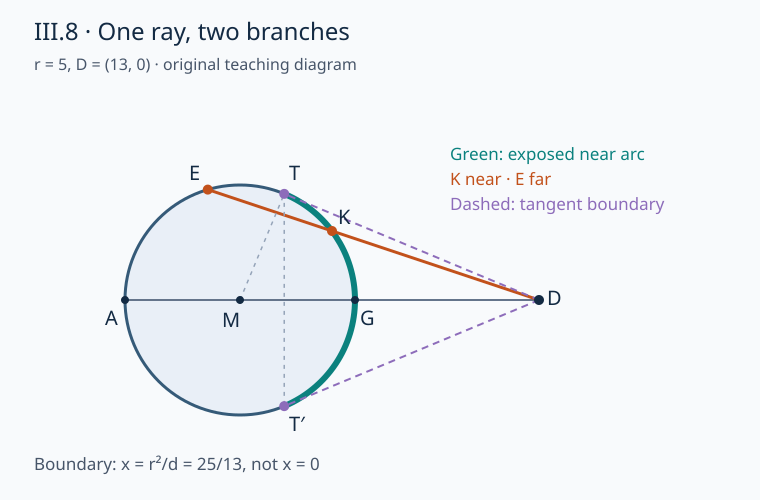

# 《几何原本》III.8：同一条视线，为什么一段变长而另一段变短

## 前史补读与阅读范围

**从圆外看一个圆，偏离圆心方向更多，并不意味着到圆周的线段一律更长。你必须先说明取的是第一次遇到圆周，还是第二次。** III.8把这两个分支分开：近交点的距离随偏角增大，远交点的距离随偏角减小；穿过圆心的方向同时给出最短与最长线段。最后还问：给定一个非极值距离，为什么恰有左右两个圆周端点？

这不是现代AI论文，而是演绎、几何约束与证明核查的数学前史补读。作品通常置于约公元前300年；这不等于已考定III.8的首次发现者或确切成篇年。本仓此前已读到近现代文献，本篇仍属明确的年代回跳，不宣称穷尽早期文献，也不把图灵1936–1937样稿称为第一篇AI论文。按相同证据标准收录这个非独立期刊论文的命题单元，而不是按作者名气决定质量。

- **作品与单元：** Euclid，*Elements*，Book III，Proposition 8。
- **实际主读版本：** T. L. Heath，*The Thirteen Books of Euclid’s Elements*，1908，卷II，印刷17页下部至19页完整命题与证明，20页评论；扫描PDF第30–33页。[Heath卷II扫描](https://www.wilbourhall.org/pdfs/Heath_Euclid_II.pdf)
- **对读版本：** Richard Fitzpatrick，2008希英对照本，印77–79页，含命题、证明、两个脚注；采用其英文标记M、D、A、G等，不把旁边希文字母直接逐个替换成英文。[希英对照本](https://farside.ph.utexas.edu/Books/Euclid/Elements.pdf)
- **电子互核：** David E. Joyce的III.8正文及导读，作为便利转录与现代解释，不替代扫描。[III.8页面](https://mathcs.clarku.edu/~djoyce/elements/bookIII/propIII8.html)
- **勘误边界：** 核过Heath卷I所附勘误表，未见针对卷II印17–20页的条目；这只是该表的核查，不是“所有版本绝无勘误”。Fitzpatrick在本命题脚注标出角序未证，属于编者批注，不是欧几里得自行发表的勘误。Joyce导读中“从A沿圆周到D”的D是圆外点，不能照此理解为圆周运动；本篇不沿用这句措辞。

下文标签严格分层：**原证重述**是对原证明的原创解释；**教学重构**使用现代坐标、三角函数或代数补足接口；**分析延伸**讨论方法意义；**真实实跑**只指附件实际执行。没有全文翻译、扫描镜像，也没有宣称证明助理或人类专家认证。

## 1 问题从哪里来：圆内的一条路径到了圆外会分叉

[III.7](euclid-elements-iii7.zh-CN.md)研究圆内非圆心点到圆周的距离。射线从圆内出发，向前只有一个圆周出口。III.8把起点移到圆外：有的射线不碰圆；有的先入圆再出圆；临界方向只接触一点。于是“那条线到圆的距离”不再是完整输入。

原文用“凹的一侧圆周”和“凸的一侧圆周”区分远端与面向观察点的近端。这里的凹凸是相对于圆外点所见的圆周部分，不是说同一个圆突然违反凸性。全文比较的是从固定点到圆周端点的**线段长度**，不是两条无限直线之间的垂距，也不是圆心到直线的距离。

历史依赖应先从书内关系说明，而非虚构一次发明事件：III.1提供圆心构造；I.20提供严格三角不等式；I.24在两边固定时比较夹角与对边；I.21比较三角形内的折线路径；I.23复制角，I.4用SAS得到等长。III.8将它们接成极值、排序和解数三种任务。Heath印20页另转述De Morgan对隐藏位置假设的批评，以及Heron替代论证的得失。这些是传承与解释材料，不是“Heron先证明了III.8”的年代证据；本文没有独立重校Heron原著。

## 2 先约定对象，才有可以检验的结论

### 2.1 原图与现代模型

沿用英文版标记：M为圆心，D在圆外，直径端点依次为D—G—M—A。于是DG最短，DA最长；E、F、C是远弧上的示意点，K、L、H是近弧上的示意点。原图用多个点表达次序，并非要求圆上只有这些点。

**教学重构。** 平移旋转坐标，使M=(0,0)、D=(d,0)，圆半径r>0且d>r。G=(r,0)，A=(-r,0)。圆周点P=(x,y)满足x²+y²=r²。用θ表示从正x轴到MP的上半圆圆心角，0≤θ≤π；用α表示从D指向M的方向到DP的非负视线偏角。二者顶点不同，不能混写。

图为本文教学坐标图，不是扫描原图；同一射线上K、E共享α却有两个长度。切线只为标出分支边界，图与下述代数说明不以尚未读到的III.16或III.36作原证前提。

### 2.2 近弧不等于靠右的半圆

近弧是射线第一次进入圆周的端点集合。其坐标条件是dx>r²；远弧是dx<r²；dx=r²给出两者共同的切点边界。在上半圆，相应分界角为θ*=arccos(r/d)，严格小于π/2。因而有些x>0的圆周点已经是远端，不能用“右半圆”代替“近弧”。

为什么这个条件不是凭图猜的？P处半径MP与入射方向P−D的内积为r²−dx。为负时，从D沿射线走到P仍朝圆心一侧深入，是近根；为正时已走出圆，是远根；为零时相切。更直接的射线二次方程将在第5节给出，独立确认这个判据。

**精确表述。** 在直径同一侧，α从0增至切线偏角时，近支距离严格增加，远支距离严格减少；α=0时两长度是d−r与d+r。比较左右两侧要用偏角的绝对值；镜像点具有相同长度，因此不可能在整圆上建立“任意两个不同点距离严格不同”的全序。

## 3 原证逐步走通：五个结论不是同一个论证

### 3.1 最长：把已知直径段改写成两边之和

**原证重述，对应Heath印18页。** AM=EM，且M在DA之间。因此DA=DM+AM=DM+EM。非共线三角形DME中，I.20给DM+EM>DE，所以DA>DE。对任意不在直径上的远端点同理。直径近端G单独比较：DA=d+r，DG=d−r，差为2r>0，不能把D、M、G当非退化三角形套I.20。

这里的技巧是先把欲比较的一段改写为另一三角形的两边和，再使用已有不等式。半径相等是让两种表达接上的桥。

### 3.2 远支排序：I.24需要的是圆心处的角

原证对三角形DME与DMF比较：ME=MF，MD公共；若∠EMD>∠FMD，I.24给DE>DF，再同样得DF>DC。

但是命题中“更靠近穿过圆心的方向”说的是D处视线偏角更小。**D处偏角小，并不是在所有位置都自动推出M处角大。** Fitzpatrick印79页的‡脚注明说这个角序只由图指示而未证明；Heath印20页将E在三角形DFM外部列为隐藏假设。本篇接受I.24本身，不把缺失的接口藏在“显然”中；第5节只在远支上证明正确的次序转换。

### 3.3 最短：从三角不等式中减去同一半径

非共线三角形DMK中，MK+KD>MD。又MK=MG=r且MD=MG+GD，所以减去半径得到KD>GD。原证不是“看起来G最近”，而是把严格下界转移给KD。对A这一个共线点另用DA>DG，避免退化三角形。

### 3.4 近支排序：内部折线才可用I.21

在三角形MLD中，如果K严格位于内部，则I.21给MK+KD<ML+LD。由于MK=ML，消去半径得DK<DL；同样比较L、H，得DL<DH。

这一步不只是代数消去。I.21的输入契约包含**K在三角形MLD内部**。K在圆上或“画得比较靠近G”不足以替代该条件；对远端交点使用同一句话会错。Heath印20页明确指出这个位置假设，并用辅助交点及斜线长度比较补它。下文第5.3节另给现代可核的内部性证明，而不冒称是原文未写出的坐标式。

### 3.5 等长伙伴：构造、验等与排除第三个

原证在M处于MD的另一侧复制∠KMD，令另一射线遇圆于B。MK=MB、MD公共、夹角相等，I.4给DK=DB。这是存在性与验等。若再有另一点N且DN=DK，则DN=DB；在可比较的同一侧、同一分支内，与已经证明的严格排序冲突，所以不能有第三个。

推广这段到整个圆还需两项说明。第一，K不能取G或A，否则镜像构造返回自身而非另一点；“两条相等”不是说任何给定长度均有两个解。第二，近远两分支不能不经论证混用同一排序。第6节给全圆两解分类和近远距离范围，补齐跨分支检查。**构造出两个不是至多两个；至多两个也不自动保证存在两个。**

## 4 版本评论教我们检查什么

Heath印20页说，De Morgan所指出的两个位置假设类似III.7的缺口：K落在DLM内，E落在DFM外。他令DE与FM、LM相交，利用半径及斜线比较补足。本文保留这一历史定位，但选择另一套现代代数接口给读者直接复核；不能把现代补证归给欧几里得。

同页Heron材料比较直径两侧的线。当比较第二交点即远端时，以圆心到割线的垂距及勾股关系比较可行；但第一次相交的近端情形，直接从两组较大分量做减法不能确定差的大小。Heath叙述的修补经II.12取得割线段乘积相等，再从远端较长推出近端较短；这与后来通常从III.36推出的性质有关。本文第5节的根乘积有相同现代代数形态，但它是由方程直接推导，不把未来命题当成原证可免费调用的事实。

这是一个很具体的错误模式：若a>b且c>e，不能单凭这些信息断定a−c>b−e。加法的保序规则不能原封不动搬给差。对于本文近端，正是“总投影减半弦”这种差，令看似顺手的替代证明失效。

## 5 教学补证：先分支，再证明单调和内部性

### 5.1 射线方程把一个模糊名词拆成两个根

取指向圆的单位方向u=(-cosα,sinα)，射线上点为D+tu，t≥0为从D走出的长度。代入圆方程，得到

$$
t^2-2d\cos\alpha\,t+d^2-r^2=0,\qquad
 t_{\pm}=d\cos\alpha\pm\sqrt{r^2-d^2\sin^2\alpha}.
$$

射线在前向与圆相交要求0≤α≤arcsin(r/d)。在这个区间判别式非负、cosα>0，且d²−r²>0，所以两根都为正。若只问二次方程有没有实根，背向方向也可能有两个负根，但不满足t≥0，不能算前向射线交点。较小的t−是近端，较大的t+是远端。α=0给d−r、d+r；临界α处根号为0，两根合并为同一射线上的切点。更大的α没有前向射线交点，不应给它硬造一个“近圆点”。

可直接核分支条件：交点x=d−t cosα；将近远根代入，或用圆点沿射线的径向变化，得到第2节的dx与r²比较。这是解析几何重构，不是复现古典圆线求交公设。

### 5.2 单调不必求导，但必须保持正性

设c=d²−r²>0，s=dcosα。则t+=s+√(s²−c)，且t−t+=c。α从0向切线方向严格增加时，s严格减小；函数s和√(s²−c)在s≥√c上均随s增加而增加。因此t+严格减小。又t−=c/t+，分子固定为正、分母正且变小，所以t−严格增加。

这样证明了原命题的D处视角排序，而不偷偷交换顶点。远支t+减小又对应第6节距离式中的x增加、θ减小，故较小的α对应较大的θ，即∠EMD>∠FMD；这才给I.24提供所需角序。近支关系相反，不能把这个结论越界搬去使用。

还可从投影看见乘积：t−t+=d²−r²与α无关。它解释为什么同一割线远端变短时近端变长。乘积恒定不是本篇实跑猜出来的规律，而是二次方程根关系的推论。

### 5.3 K确实在MLD内部：写出正重心系数

为了补I.21的输入，取同侧近弧点K=(r cosκ,r sinκ)、L=(r cosλ,r sinλ)，其中0<κ<λ≤θ*=arccos(r/d)。近支上这种圆心角次序等价于视线偏角次序，可由上节的距离与x次序推出。令

$$
a=\frac{\sin\kappa}{\sin\lambda},\qquad
b=\frac{r\sin(\lambda-\kappa)}{d\sin\lambda},\qquad
K=aL+bD+(1-a-b)M.
$$

先逐坐标检验：y坐标为a r sinλ=r sinκ；x坐标为r sinκ cosλ/sinλ+r sin(λ−κ)/sinλ=r cosκ。a>0、b>0。剩下不是凭图认定，而要证a+b<1。

把其正分母d sinλ乘过去，所需分子是d(sinλ−sinκ)−r sin(λ−κ)。用和差式写成2sin((λ−κ)/2)乘以括号d cos((λ+κ)/2)−r cos((λ−κ)/2)。前因子正。因为平均角小于λ≤θ*，所以d cos((λ+κ)/2)>r，而r cos((λ−κ)/2)<r，括号也正。因此第三个系数严格为正，K严格位于非退化三角形MLD内部，I.21可以合法使用。

这段补证用实坐标与三角恒等式，不是古典公理系统的逐条形式化。它给出一个透明的现代保证：内部点的三个重心权重均为正。G与L重合等边界不在κ、λ的严格条件中，应由极值比较或同一点等号另行处理。

## 6 一条距离公式，完成全圆的解数分类

对任意P=(x,y)在圆上，平方距离展开为

$$
DP^2=(d-x)^2+y^2=d^2+r^2-2dx,\qquad
x=\frac{d^2+r^2-\ell^2}{2d},\qquad y^2=r^2-x^2.
$$

这里ℓ≥0是指定的目标长度。第一式的推导只用x²+y²=r²；后两式来自DP=ℓ，除以2d合法因为d>r>0。

- 若d−r<ℓ<d+r，则−r<x<r，y²>0，两个实解y=±√(r²−x²)，分别在直径两侧。
- 若ℓ=d−r或ℓ=d+r，x为r或−r，y=0，只有G或A一个端点。
- 若ℓ在上述闭区间外，|x|>r，没有实圆周端点。

这是“恰好两个”的完整存在与上界证明：固定距离先唯一确定x，再至多给两个y；严格内区间又保证这两个真的不同。镜像把y换成−y，不改变平方距离。它不要求两个端点恰好落在某个有理网格，真实解允许无理坐标。

近弧dx>r²使DP²<d²−r²，远弧dx<r²使DP²>d²−r²。故一个严格近弧长度不可能和一个严格远弧长度相等；在切界，两者等于√(d²−r²)。上、下两个切点彼此镜像，仍是两个不同圆周端点。**一条射线在相切时两个根合为一个，不等于固定切线长度在全圆上只有一个端点。** 这是本命题最容易混淆的两个计数问题。

## 7 手算、反例与可复核预测

### 7.1 同射线二根的具体例子

取r=5、d=13，圆心M=(0,0)，D=(13,0)。沿单位方向u=(-12/13,5/13)前进，方程为t²−24t+144=0，唯一根t=12：这实际上是切线，不是普通割线。切点为(25/13,60/13)，满足13x=25；镜像切点(25/13,-60/13)也距D为12。

改取圆上点P=(4,3)。DP²=90，13x=52>25，所以它是近点。用非单位方向v=P−D=(-9,3)，点D+sv的二次方程是90s²−234s+144=0，其根为1和8/5。因此远点Q=D+(8/5)v=(-7/5,24/5)，DQ²=(64/25)90=1152/5。长度乘积DP·DQ=(8/5)·90=144=d²−r²。这里参数s不是长度，不能把8/5写成DQ。

### 7.2 “靠右就是近弧”的反例

同样r=5、d=13，P=(7/5,24/5)虽然x>0，却有13x=91/5<25，所以是远弧。其DP²=194−182/5=788/5>144，正落在远距离范围。只判断左右半圆会将它分错。

### 7.3 “视线角相同，长度也相同”的反例

上一割线P=(4,3)与Q=(-7/5,24/5)从D看方向完全相同，却有DP²=90与DQ²=1152/5。两个端点均在圆上，不是数值误差。若算法只存α、不存near/far标签，问题本身就没有单一输出。

### 7.4 把外点或极值条件删掉会怎样

若D=M，所有圆周点到D的长度均为r，无穷多个而非两个；若D在圆内，两条正射线交点的模型失效，一个代数根在反向，不能继续称作“近支”。若取ℓ=d−r，伙伴就是G自身，不能报告两个不同点。若r=0，圆退化成点，原命题对象也消失。实现应拒绝不在契约中的输入，而非把异常数值当几何结论。

## 8 真实实跑：证书与测试究竟核了什么

[复现目录与命令](../../reproduction/euclid-elements-iii8/README.md)提供标准库有理数实现、单元测试、真实结果、环境记录和教学Notebook。核心用Fraction保持等式精确；从**已给且已核的圆周点**诱导割线，再求另一有理交点，避免伪称实现全部实数圆线求交。分类使用dx−r²的精确符号，不用浮点接近零冒充切线。

正文中的连续参数单调、三角内部性和全实数解数来自第5–6节的数学推导；附件有限构形只验证实现对相应输入的行为。证明与实验各有工作，不互相顶替。对非有理平方根，证书可保留平方值而不伪造精确小数。Notebook采用标准库顺序compile/exec与独立只读回放，**不是Jupyter kernel执行或Notebook界面渲染认证**；本次实际执行30项单元测试，各在普通、`-O`、`-OO`三模式通过；每模式遍历1071个参数构形（包含重复几何点）。另核242个分支样本和236个相邻严格次序比较。5个Notebook代码单元顺序执行并只读回放一致，8个记录命令均退出0。统计范围与完整日志见附件。

本篇没有训练集、基线模型、准确率或GPU实验；它是理论阅读，适当的“最小复现”是有限精确证书与错误输入检查，不是造一张貌似机器学习的结果表。源码、运行环境、重跑命令、日志和限制一起保存，不能只留下一个“测试通过”的口号。

## 9 主张与证据账本

| 主张 | 来源位置或推导位置 | 核验层级与边界 |
|---|---|---|
| 远支最长、近支最短、各自排序、成对等长 | Heath II印17末–19；Fitzpatrick77–79 | 完整III.8阅读；非整卷完成 |
| 原证的三角不等式、夹角比较、内部折线与SAS | Heath18–19的I.20/I.24/I.21/I.4边注；角复制对应I.23 | 原证重述，不把现代式当古文 |
| 两个图示位置假设 | Heath20首段，Fitzpatrick79‡脚注 | 编者评论；并非推翻命题结论 |
| “nearer”作角意义 | Fitzpatrick79†脚注 | 编者使用推测语气；本篇明确选定解释 |
| Heron近端直接比较失效及乘积修补 | Heath20中下部 | 经Heath转述，未独立校勘Heron原文 |
| 射线二根、分支单调、正重心系数 | 本文第5节 | 现代教学补证，非古典形式认证 |
| 零/一/二解与切线的两个计数口径 | 本文第6节 | 实坐标代数推论，不由样本猜出 |
| 有理测试、Notebook执行及重复回放 | 附件日志与README | 真实有限实跑；不证明一般定理 |

[独立来源审查](../../reproduction/euclid-elements-iii8/source-review.zh-CN.md)与[独立技术审查](../../reproduction/euclid-elements-iii8/technical-review.zh-CN.md)分别核对历史归属和数学/代码，绑定所审正文哈希。它们不是同一作者自称“已经审过”，也不把审查通过等同于覆盖所有后续研究。

## 10 合理延伸与限制

**分析延伸。** 在几何程序、视觉射线求交或候选证明生成中，同样的输入词可能掩盖多分支对象。先保存分支标签，再证明对应的单调性，比给“距离”设计一个未经限定的函数更可靠。一个检查器即使能验证所有算术等式，也仍要核对I.21所需内部性；否则正确定理被调用到错误构形上，输出仍不可靠。

全圆固定距离的纤维有零、一、二点，和射线圆交点的零、一、二根是两个不同映射。切线恰好展示：一个映射的重根不消灭另一个映射的镜像伙伴。程序接口应该说明返回的是端点集合、射线参数根，还是无向直线，而不是只输出一个模糊的“解数”。

这些是现代方法论类比，不是Euclid研究AI、射线追踪或模型验证的历史证据。III.8也没有证明任意曲线上极值唯一、任意距离函数只有两解；椭圆或一般非凸曲线需另建模型。本文的有理测试不覆盖所有实点，现代补证没有逐公理机械形式化，版本校核也不穷尽希腊传本与后世评论。下一命题不在本单元完成范围内。

## 11 练习、答案与复盘

### 题1　为什么DA最长与DG最短不能算同一行证明？

**答案。** 最长把DA换成DM+r，再用三角两边和大于第三边；最短把DM写成DG+r，从MK+KD>DM减去相同半径。两者使用I.20但消去方向不同；共线直径端点要单独处理。

### 题2　r=5、d=13，距离12的圆周点有几个？某一上侧切线有几个交点？

**答案。** 全圆有(25/13,±60/13)两个点。固定上侧切线只有上侧一个点，其射线二次方程为重根。两个问题固定的输入不同。

### 题3　把第7节P=(4,3)的割线参数根8/5当长度，错在哪里？

**答案。** 使用v=(-9,3)不是单位向量，参数s乘的是v。长度为|s|√90；远端长度是(8/5)√90，平方为1152/5。只有单位方向参数t才直接等于长度。

### 题4　为什么K在圆上还不能直接用I.21？

**答案。** I.21需要K在三角形MLD内部。圆上的远端可能在该三角形外。第5.3节不仅验证坐标等式，还证明a、b、1−a−b全正，才补齐调用条件。

### 题5　由t+严格减小怎样推出t−严格增加？

**答案。** 先证明根乘积c=d²−r²为固定正数且t+>0，然后t−=c/t+。少了正性，倒数比较可能变向或无定义；d>r不是可删的装饰。

### 题6　一个严格近点和一个严格远点能等距D吗？

**答案。** 不能。它们的平方距离分别严格小于与大于d²−r²。切点属于分界，不能作为“严格近”与“严格远”的反例。

### 题7　为什么只生成有理圆点仍是有用但有限的复现？

**答案。** 它允许用精确分数检验圆上性、距离恒等式、分支与镜像，不把浮点误差混入等号。然而许多实圆点不在有限输入集合中，有限测试不替代全实数证明，也不能声称完成一般无理求交器。

### 题8　如果只看见两条等长线，能否断言没有第三条？

**答案。** 不能。需要同侧严格排序并排除跨分支，或用第6节消元：距离唯一固定x，圆方程至多给两个y。构造提供下界，唯一性论证提供上界。

复盘只保留五个问题：比较的是哪个端点分支？角的顶点在哪里？调用I.21前内部性由什么保证？“两个”在计数哪种对象？日志究竟验证有限输入还是被误写为一般证明？能逐项作答，才真正从图形直觉走到了可审查的推理。

---

本篇为AI辅助原创中文深读v1，核验日期2026-10-29。完成范围为III.8及所列译注、现代补证和有限教学复现，不是《几何原本》全书校勘、全文翻译或完整形式化。
