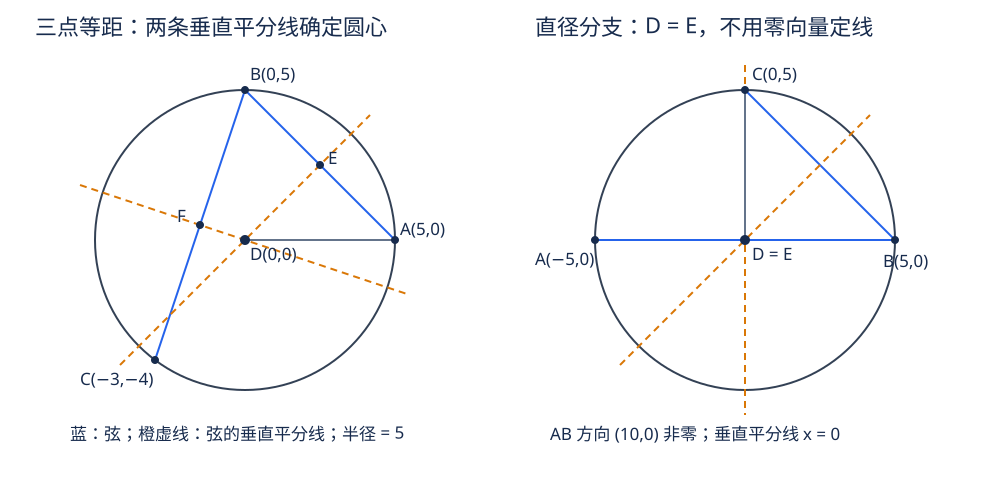

# 《几何原本》III.9：三条等长线，为什么足以认出圆心

> 公元前约300年的数学前史补读；实读Heath 1908卷II印21–22页、Fitzpatrick 2008印79–80页及Joyce导读。本文是原创解析，不是原书全文翻译。这里的“完成”只指III.9阅读单元；既有暂缓项目不计完成。本系列不是穷尽目录，也不把图灵1936–1937论文称为第一篇AI论文。

**先看问题。** 圆心到圆周每一点都一样远，这是圆的定义给出的方向。反过来，一个点只到两个圆周点一样远，能不能就叫圆心？不能。第三个互异圆周点增加了什么？它让两条独立的垂直平分线锁定同一个点。III.9不是凭三次测量猜测整个圆周，而是在“这些点属于同一个给定圆”的前提下，证明一个唯一性结论。

读者可以依次检查三件事：等距怎样变成垂直平分线约束；两条约束为什么真正独立；当辅助线长度变成零时怎样补证。最后一件尤其重要：图画得一般，并不等于证明已经处理所有合法输入。

## 1 文献、年代与证据层次

| 项目 | 本文采用的范围 |
| --- | --- |
| 原作 | Euclid，《Elements》，卷III命题9；通常把该著作置于公元前约300年，不能把每条命题的发现时间都定在该年 |
| 主读版本 | T. L. Heath，*The Thirteen Books of Euclid's Elements*，1908，卷II，印21–22页：命题及证明、编辑史和另证评注 |
| 对照版本 | Richard Fitzpatrick，*Euclid's Elements of Geometry*，2008，希英对照，印79–80页：完整III.9 |
| 在线定位 | David E. Joyce，Book III Proposition 9，命题、依赖链接和Guide |
| 校勘边界 | 目视核对所读Heath卷I附勘误表，未见针对卷II III.9印21–22页的条目；这不是宣称所有版本无误 |

[Heath扫描](https://www.wilbourhall.org/pdfs/Heath_Euclid_II.pdf)与[Fitzpatrick对照本](https://farside.ph.utexas.edu/Books/Euclid/Elements.pdf)的PDF页序不同于印刷页码。Fitzpatrick印79页上部仍是III.8，其两条脚注属于III.8，不能误移给本命题。[Joyce III.9](https://mathcs.clarku.edu/~djoyce/elements/bookIII/propIII9.html)便于逐步回到依赖命题。

下文使用四种标签：**原文**是所读版本明确作出的陈述与证明步骤；**教学重构**补出省略的条件或用现代记号重新证明；**分析推论**讨论识别、数值和建模意义，不声称古人使用这些术语；**真实实跑**仅指附件保存的实际执行，不把手算冒充程序输出。

## 2 历史问题：把定义倒过来，需要多少证据

**原文。** III.9从圆内一点D出发，假设向圆周作出的等长线段多于两条，结论是D为圆心。证明选取三条DA、DB、DC，并不要求逐点测遍圆周。[Heath印21–22页](https://www.wilbourhall.org/pdfs/Heath_Euclid_II.pdf)

前驱关系可以沿书内明确依赖追踪，而不是给作者排一个现代影响力名次：

- I.10提供线段二等分；I.8用三边相等推出相应角相等。
- 定义I.10把一条直线上的相邻等角识别为直角。
- III.1推论指出，弦的垂直平分线经过圆心。这把局部弦约束与给定圆的中心连接起来。
- III.7已证明非圆心的圆内点不能向圆周引出三条等长线段。其逆否形式足以给III.9另证，但这不是此处原文采用的垂分线证明。
- Joyce导读指出III.9在III.25中使用。这里只标依赖方向，不把未在本单元展开的后章算作本篇完成。

**版本史，限定于Heath转述。** Heath印22页称Aristotle《Meteorologica》III.3，373a13–16引用了这一结果，并报告De Morgan把它看作III.7部分结论的逻辑等价形式。我们没有据此宣称已经独立通读该处Aristotle原文，更不能由引文反推出Euclid本人首次发现此定理。Heath还说明August和Heiberg采用这里的垂分线证，把Simson采用的另一证明移至附录；这提示“欧几里得的证明”在不同编辑本中需要明确版本。

这一单元被收录为推理与数学建模前史，而不是现代AI实验论文。对AI的联系在于约束独立性、证书检查与退化输入；它们是今天的分析视角，不是把古代几何追认为机器学习研究。

## 3 假设和符号：三次记录不等于三个约束

设给定的是欧氏平面中半径为正的圆，圆心记O，半径记R。A、B、C是圆周上**三个互异点**；D位于圆内，且DA=DB=DC。E为AB中点，F为BC中点。长度DA等都是非负实数；直线AB和线段AB在使用时区分。

| 符号或条件 | 为什么需要 |
| --- | --- |
| O、R | 描述给定圆；证明前不预设D=O |
| A、B、C互异 | 重复A三次并没有得到第三个圆周点，不能排除非圆心候选 |
| R>0 | 排除退化“圆”，保证圆周有不同点 |
| 三点不共线 | 三个互异圆周点自动满足；现代求交计算仍应显式检验 |
| D在圆内 | 原命题范围；后面的坐标证明可以推出更强结论，但要另行标明 |
| 距离严格相等 | 不是屏幕上看起来一样长，也不是浮点容差下足够接近 |

为什么同一圆上三个互异点不共线？**现代教学补足**：把任意直线写成P+tV，V非零。代入到O的距离平方等于R²，得到关于t的二次方程，最高次系数为V·V>0，因此最多两个不同实根。这是坐标模型中的独立论证，不借用后面的III.10圆圆相交命题，也不是称Euclid在此写下了二次方程。

## 4 原证逐步拆开：先定位两条线，再定位一个点

### 4.1 一条等距关系给一条垂直平分线

**原文的一般位置证明。** 连AB、BC，用I.10分别取中点E、F；连ED、FD并延长。

先看三角形AED和BED：AE=BE是中点条件；ED是公共边；AD=BD是题设。由I.8，两三角形在E处的角相等。由于EA和EB是反向射线，这两个相邻角组成平角，所以各为直角。于是ED所在直线垂直平分AB。由III.1推论，圆心O在这条线上。

对三角形BFD、CFD重复相同推理，得到FD所在直线垂直平分BC，圆心O也在这条线上。D按构造同时属于两条线。原文最后利用两线唯一公共点为D，得O=D。[Fitzpatrick印80页](https://farside.ph.utexas.edu/Books/Euclid/Elements.pdf)

每一步的工作不同：三边相等负责把距离变成角；相邻等角负责直角；III.1负责把弦的对称轴变成圆心约束；两线交点唯一负责最后的识别。省去任何一层，都容易把“图上像中心”冒充证明。

### 4.2 为什么不是两条重合的约束

**教学重构。** AB与BC共享B，而且A、B、C不共线，故这两条弦所在直线不同且不平行。若它们的垂直平分线重合，则AB、BC都垂直于同一直线，从而相互平行；与共享B且不共线矛盾。因此两条垂分线不同。欧氏平面两条不同直线不能共享两个不同点：它们已共享D，故不能再有O≠D。

这说明第三点的作用不是“再多一票”。第二条等距条件必须产生独立方向的约束。把A或B重复报为C，会使这个论证失效。

### 4.3 必须补上的退化情形：D正好等于中点

若D=E，ED是零长度，不能说“延长ED”；AED也不是合法三角形。不能把这种输入删掉，因为圆心与直径中点本来就会重合。Heath印22页转述Camerer已指出AB或BC经过D的情形需要考虑；下面给出明确补证，而不把补证归入原文。

若D在AB上且DA=DB，则D只能是AB中点。确切说，若D在AB外侧，距离差等于非零AB，不可能相等；因此A—D—B，D=E。

处理办法是保留**垂直平分线本身**，不要求用ED定义它：D=E时，D当然在通过E且垂直AB的直线上；III.1推论保证O也在该线上。对BC同理：若D≠F，使用上面的三角形证明；若D=F，则D又在该垂分线上。但E=F会由A+B=B+C推出A=C，与互异矛盾，所以两处不会同时退化。两条垂分线仍不同，唯一公共点仍为D，故O=D。

这里“通过中点作垂线”可用I.11，并非由一个零向量产生方向。这一补法覆盖所有位置，不必事先知道AB是直径。证明完成后才可断言：在D=E情形，AB确为直径。

图为原创坐标示意，不是原书插图或测量证据。

## 5 现代模型：为什么平方以后反而变简单

**教学重构。** 写A=(a₁,a₂)、B=(b₁,b₂)、C=(c₁,c₂)、D=(x,y)。令u=B−A、v=C−A；u₁、u₂等表示坐标。定义p=(|B|²−|A|²)/2，q=(|C|²−|A|²)/2。等距方程|D−A|²=|D−B|²两边展开，|D|²抵消，得到u·D=p；另一对得到v·D=q。因此求中心只需解两个一次方程，而不是保留两个二次方程。

$$
u_1 x+u_2 y=p,\qquad v_1 x+v_2 y=q.
$$

令Δ=u₁v₂−u₂v₁。三点不共线等价于Δ≠0。消去y与x分别得到：

$$
x=\frac{p v_2-u_2 q}{\Delta},\qquad y=\frac{u_1 q-p v_1}{\Delta}.
$$

这两个式子也给出算法：计算差向量、右端、行列式；拒绝Δ=0；算出唯一解；最后回代检查原始平方距离。回代不是多余的：它能发现代码在差向量方向、分母符号或输入规范化上犯错。

已知给定圆的真实中心O满足OA=OB=OC，因此O也是这个方程组的解。D也满足；唯一性推出D=O。这和垂直平分线证明在现代模型中表达了同一结构，但并不是原文的坐标推导。

**分析推论。** 这个坐标证明其实不需要预设D在圆内。三个互异给定圆周点的等距点必是中心，从而自然在圆内。不要倒过来把“任意三个点的外心在三角形内”当作结论：钝角三角形的外心在三角形外，圆内与三角形内是不同条件。

## 6 算例、反例与输入边界

### 6.1 两点证据不够

给定圆x²+y²=25，取A=(3,4)、B=(3,−4)、D=(1,0)。DA²=DB²=20，且D在圆内，却不是O=(0,0)。所有位于AB垂直平分线y=0上的点都到A、B等距；两条距离记录只给一个独立方程。

加入C=(−5,0)，DC²=36，第三条件拒绝这个假中心。对真正中心，三项平方距离全部为25。

### 6.2 可手算的线性系统

用同一组A、B、C，有u=(0,−8)、v=(−8,−4)，p=q=0，Δ=−64。第一个方程给y=0，第二个给x=0。这里D由唯一解确定；最后检查三个点到D的平方距离均为25。负行列式只表示取点顺序的方向，不表示输入非法。

### 6.3 原构造最容易漏掉的直径例

A=(−5,0)、B=(5,0)、C=(0,5)、D=(0,0)。三条距离都是5，E=D；若代码以D−E当垂线方向，会得到零向量并错误拒绝。正确方法用弦AB的方向(10,0)产生垂直方向(0,10)，或直接使用等距线方程。这个例子不是定理的反例，而是某种实现或不完整证明的反例。

### 6.4 重复点、共线点和给定圆不能混为一谈

- A、B、A三个输入槽位只代表两个不同点，不能使用III.9。
- 三个互异共线点不可能属于同一非退化圆；也不可能有一个平面点同时到它们等距。在线性系统中，秩退化需要拒绝，不应输出“任意中心都可以”。
- 对任意三个非共线点求得外心，只证明它们确定一个外接圆。要认证它们属于某个**事先给定**的圆，还必须检查到给定O的距离平方均为R²且R²>0。
- 接收布尔值当整数、接收近似小数却宣称有理精确，都是程序接口错误，不是几何发现。

## 7 一个短另证，以及为什么不能过分信任另证图

**原结论的逻辑重述。** III.7给出：圆内非圆心点向圆周引出的同长线段至多两条。若D拥有三条且端点互异，假设D不是圆心将立即矛盾。这是Joyce Guide强调的捷径；它依赖III.7已经证明的数量结论，不是本篇垂分线原证的替代文字。[Joyce导读](https://mathcs.clarku.edu/~djoyce/elements/bookIII/propIII9.html)

Heath还列出Simson采用的另证：假设另有圆心E，沿DE作直径，用III.7的距离大小关系与三条等长相冲突。Heath转述Todhunter的提醒是：不能在所有位置都照图断言DC>DB>DA；E可能落在角ADC内部，完整严格排序会失败，但仍可得到DC或DA之一小于DB，足以反驳三者全等。这是一条有用的证明审查原则：**反证只需要一个可靠的不等式，不需要强行证明图上貌似成立的全排序。** 此处讨论是Heath所载编辑评注，不冒充重新核对Simson、Todhunter全部原著。

## 8 从精确识别到测量：第三点并不自动带来稳定性

**分析推论。** 精确非共线性保证唯一解，不保证对误差不敏感。取A=(−1,0)、B=(1,0)、C=(0,ε)，ε>0。前两点的等距条件给x=0；代入第三点得到：

$$
y=\frac{\varepsilon^2-1}{2\varepsilon}.
$$

ε很小时，外心的纵坐标绝对值很大；其导数为1/2+1/(2ε²)，小的高度误差可以引起大的中心误差。这里每个ε对应的是一个不同的外接圆，不是假装在固定半径圆上自由改变第三点。

因此最小复现使用有理数精确等式，避免把舍入误差混进定理检查；但它也不因此成为真实测量的稳健圆拟合器。处理噪声需要另设误差模型、条件数阈值、更多采样点和拟合/验证策略。仅给等距判断加一个固定容差，不能保证所识别中心足够准确。

对今天的约束系统，值得保留的不是“三个样本总够用”，而是三个更窄的结论：先证明约束独立性；把存在、唯一和稳定分开；用原始条件回代验收解。有限数据的结论依赖模型，换成非欧氏距离、三维空间或任意曲线，定理不能原样照搬。例如三维中三个非共线点的等距集合是一条垂直于其平面的直线，并非唯一一点。

## 9 最小复现与证据账本

[复现入口](../../reproduction/euclid-elements-iii9/README.md)包含原创Python标准库代码、测试、环境与命令、真实日志及Notebook。程序实现的是有理坐标下的垂分线交点/外心计算和给定圆条件检查，不是古典尺规构造模拟器，也不是形式证明内核。平方距离避免了不必要的开方；整数或有理输入的算术是精确的，覆盖范围却仍是有限测试。

Notebook采用顺序compile/exec运行及独立回放，**不是Jupyter kernel执行**；本次五格Notebook执行及只读回放成功；normal、-O、-OO各24项测试通过，各模式含600个精确构形（25种平移×4种正有理缩放×6种三点形状），另保存五个算例。六个子进程均退出0，完整口径见附件README与日志。原文的一般定理由第4节证明和第5节模型推导承担，不能由“测试全通过”取代。正例、两点假中心、直径退化、重复与共线拒绝、平移缩放和点序变化是不同检查目标，不应把同一个算例换很多数字就称作独立定理证明。

| 主张 | 证据位置 | 不包含什么 |
| --- | --- | --- |
| 圆内点有三条互异等长连线即圆心 | Heath印21–22、Fitz印79–80；本文第4节 | 不是近似测量判据 |
| 原证明走两条弦的垂直平分线 | Fitz印80，Heath印21–22 | 不是原文使用线性代数 |
| 辅助连线可能退化 | Heath印22Camerer评注；本文直径例 | 不代表命题错误 |
| III.7给另证 | Joyce Guide；Heath印22逻辑评注 | 不等同于本版原证明 |
| 有理坐标实现通过所列测试 | 附件源码与保存日志 | 不证明所有实数输入、不证明古典公理系统 |
| 测量可能病态 | 本文ε族推导 | 不是原文的数值实验 |

[独立来源审查](../../reproduction/euclid-elements-iii9/source-review.zh-CN.md)与[独立技术审查](../../reproduction/euclid-elements-iii9/technical-review.zh-CN.md)记录审查对象和正文摘要校验值；来源证据、证明审查和真实运行分开保存。公开附件只含原创解析、教学代码、必要书目链接与净化执行证据，不附原书PDF或全文翻译。

## 10 练习、答案与复盘

**题1：三个长度相等，为什么还要说明三个端点互异？**  
答：若第三端点重复A，仍只有DA=DB一个独立关系。第6.1节D=(1,0)就满足三个输入槽位A、B、A的“等距”，却非圆心。

**题2：原证中I.8以后，如何得到直角？**  
答：E在线段AB内部，EA、EB是反向射线；AED和BED相邻且相等，组成平角，故各为直角。若D=E，角根本没有定义，必须转入第4.3节补证。

**题3：为什么AB中点一定是圆心这句话错误？**  
答：一般弦中点并非圆心；例如半径5圆上的A=(3,4)、B=(3,−4)，中点为(3,0)。只有再利用第三个点的等距条件，或已经证明AB过圆心，才能作更强结论。

**题4：D=E时，怎样避免零方向？**  
答：用I.11在E处对非零弦AB作垂线；D在该线上由D=E直接成立，O在该线上由III.1推论成立。无需把零长度ED延长。

**题5：交换B、C使Δ变号，外心会变吗？**  
答：不变。两个方程交换，相关分子和分母同时改变符号，唯一解相同。实现应测试点序变化，而不是要求Δ为正。

**题6：三点共线时，除以零后返回原点可否作为默认值？**  
答：不可以。它掩盖了无合法非退化外接圆的情况。应明确拒绝输入，并区分重复点与三个互异共线点的原因。

**题7：已知三个任意非共线点的外心，就验证了它们在用户指定圆上吗？**  
答：没有。要额外检查用户指定圆的正半径和三点圆周归属；否则算出的可能是另一个圆。

**题8：ε族为何没有推翻唯一性？**  
答：每个固定ε>0的Δ非零，解仍唯一。敏感性讨论的是输入变化时解如何变化；唯一性不保证变化很小。

**题9：可以用III.7把本文压成一句话吗？**  
答：若III.7的“非中心至多两个等距圆周点”已经完整证明，逆否确可另证III.9；但本单元仍需读清所选版本的原证及其退化补足，不能把来源不同的证明混写。

**五句复盘。** 两个圆周点的等距关系给一条垂直平分线；第三个互异点给第二条独立垂分线。给定圆心必须同时位于两线上。候选等距点也同时位于两线上，包括它恰为某弦中点的情形。两条不同直线的公共点唯一，于是候选就是圆心。程序可以检查精确坐标证书，但一般证明、数值稳定和测量可靠性是三份不同责任。

## 来源

1. Euclid / T. L. Heath，1908，*The Thirteen Books of Euclid's Elements*，卷II，III.9印21–22页及同页评注：[扫描](https://www.wilbourhall.org/pdfs/Heath_Euclid_II.pdf)。
2. Euclid / Richard Fitzpatrick，2008，*Euclid's Elements of Geometry*，III.9印79–80页：[希英对照PDF](https://farside.ph.utexas.edu/Books/Euclid/Elements.pdf)。
3. David E. Joyce，*Euclid's Elements*, III.9：[命题与Guide](https://mathcs.clarku.edu/~djoyce/elements/bookIII/propIII9.html)；前驱[I.8](https://mathcs.clarku.edu/~djoyce/elements/bookI/propI8.html)、[I.10](https://mathcs.clarku.edu/~djoyce/elements/bookI/propI10.html)、[III.1](https://mathcs.clarku.edu/~djoyce/elements/bookIII/propIII1.html)、[III.7](https://mathcs.clarku.edu/~djoyce/elements/bookIII/propIII7.html)。
