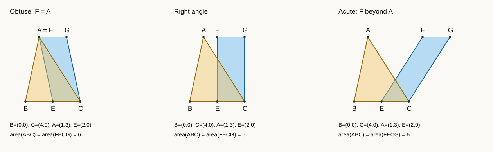

# I.42：给定角内构造等积平行四边形

这是原创的有理坐标教学重构，不是古代原证的形式化或完整尺规复现。原证依赖 I.10、I.23、I.31、I.38、I.41；程序把已复制到 E 的方向作为输入，未实现任意给定角的尺规复制。理论说明见[中文深读](../../papers/ancient/euclid-elements-i42.zh-CN.md)。

## 运行

只需 Python 3 标准库，无第三方安装或密钥。在本目录执行：

```bash
python run_all.py
python draw_figure.py
```

`run_all.py`按顺序运行 `python -m unittest -v test_geometry`、`python -O -m unittest -v test_geometry`、`python -OO -m unittest -v test_geometry`、`python run_examples.py`、`python create_notebook.py`、`python verify_notebook.py`，保存合并 stdout/stderr 和真实退出码。详见 [环境](environment.json)、[运行清单](run-summary.json)、[测试日志](logs/tests.log)、[优化模式](logs/tests-O.log)、[双优化模式](logs/tests-OO.log)、[算例输出](logs/examples.log)。日志不包含账户、用户名、主机名或私有路径。

本次三模式各 **23 个单测通过**，批量 **129 个合法输入**、**12 个非法输入直接拒绝**。129 为 120 个正/负高度、反向基线、多个顶点/方向的笛卡尔积，加 9 个可逆仿射变换后的斜底案例。单测另检查 F=A、G=A、角为锐/直/钝、极小正角方向、方向缩放、证书换绑和伪造。准确结构见 [cases.py](cases.py) 和 [results.json](results.json)。这些有限检查不证明一般定理。

## 数学与输入契约

- 输入字典恰有 A、B、C、u 四字段；每个是两坐标点/向量，只接受 int 或 Fraction，拒绝 bool、浮点数、字符串。
- ABC 非退化；u 不平行 BC，并且从 E 沿 u 指向 A 所在半平面。反向射线即使所在直线相同也拒绝。
- E 是 BC 中点。F 是 E+t u 与过 A 平行 BC 的支持线的交点，t 必须为正；G=F+(C-E)。平行四边形边序 F→E→C→G。
- 核验 BE=EC 所对应的两半面积、两平行方向、复制后的同向射线、F/G 所在支持线、三角形分割与两倍面积链。面积输出采用两倍面积以免误读；示例 ABC 两倍面积12，真实面积6。
- E 与 A 不可能重合（否则 ABC 退化），但 F=A 或 G=A 完全合法。程序不通过退化两点名定义支持线。
- 验证器重新构造预期证书再比较规范 JSON，绑定所有输入，包括方向向量的具体数值。相同面积不允许换绑。它与构造器共享实现，不是独立数学核；独立审查另列报告。

## Notebook 与图

[教学 Notebook](teaching.zh-CN.ipynb) 有五个代码格，使用标准库 compile/exec 顺序真实执行并嵌入输出；[回放核验](notebook-check.json)在新命名空间逐格执行并比较 stdout。**并未启动 Jupyter kernel**，也不声称检验交互式前端。模板辅助脚本在本环境指定安装路径不存在，因此自行建立最小 nbformat 4.5 JSON，保留生成器供复跑。



图由[原创生成器](draw_figure.py)画出，三个面板共用 A=(1,3)、B=(0,0)、C=(4,0)，仅改变方向；颜色叠加表示区域可以不同，不表示原三角形必须包含于构造的平行四边形。

## 局限

该数据域是有理坐标和有理方向；任意实数角未全覆盖。坐标交点公式是现代解释，不替代原文交线存在、同侧选择和综合几何证明。程序中的命题编号仅为教学依赖标签，不会自动证明几何定理，也不验证原文历史归属。运行和优化模式结果仅适用于记录的环境。
