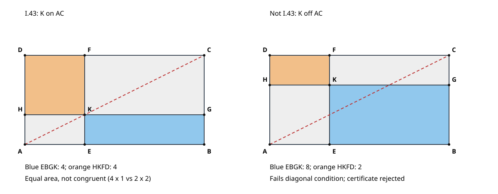

# I.43：平行四边形对角线旁的余形等积

本附件是原创有理坐标教学重构，不是古代原证的形式化，也不是完整几何证明器。原证以 I.34 三次对角二分和共同概念的加减为核心；本程序通过精确分数核验它的面积分割接口。见[中文深读](../../papers/ancient/euclid-elements-i43.zh-CN.md)。

## 运行与真实证据

只需 Python 3 标准库，不需要第三方安装、服务或密钥。在本目录执行：

```bash
python run_all.py
python draw_figure.py
```

`run_all.py`依次运行正常、`-O`、`-OO`三种模式的 unittest，再生成算例、Notebook并回放。每次子进程的真实 stdout/stderr、命令和退出码保存在[日志](logs/tests.log)、[优化模式](logs/tests-O.log)、[双优化模式](logs/tests-OO.log)、[算例日志](logs/examples.log)、[Notebook执行](logs/notebook.log)、[回放](logs/notebook-replay.log)。另有[环境](environment.json)和[运行摘要](run-summary.json)。日志不记录用户名、主机名或私有路径。

本次三模式各 **21 个单测通过**，批量 **50 个合法案例**、**13 个非法输入直接拒绝**。合法集是2种平移、5组独立方向（含斜边、负定向）、5个内部分数的笛卡尔积。非法集覆盖离开对角线、两端点和外部点、退化、非平行四边形、错误类型及字段。单测另检验极近端点、剪切、缩放、证书篡改与输入换绑。见[cases.py](cases.py)、[测试源码](test_geometry.py)和[精确结果](results.json)。有限案例不证明一般定理。

## 输入与证书契约

- 输入字典恰含 A、B、C、D、K，四边形边界顺序 A→B→C→D。坐标只接受 int 或 Fraction，拒绝 bool、float、字符串。
- 令 u=B−A，v=D−A，必须线性独立，且 C=A+u+v。K=A+t(u+v)，必须严格满足0<t<1。端点虽可使代数面积公式连续延拓，但不算作原文非退化分割的合法输入。
- E=A+tu，H=A+tv，G=B+tv，F=D+tu。关于对角线的两块为 A-E-K-H、K-G-C-F；余形为 E-B-G-K、H-K-F-D。BK、KD在原文里是用对顶点简称整个区域，不是比较两条线段。
- 所有面积由有理鞋带公式计算，不使用浮点误差容限。证书记录全部点、输入、t及各区域面积；比较大三角形、两对小三角形和余形，并检查面积分割。
- `verify`重建预期证书，再比较规范JSON；因此它共享构造器实现，不冒充独立数学核。独立技术检查另由审查报告提供。规范JSON区分数字/布尔值/字符串，额外字段或输入换绑均失败。
- `split`是一般网格生成辅助函数，不是合法证书接口。它允许分别给出s、t以展示离开对角线的反例；只有`make_certificate`通过完整校验才发出I.43证书。

标准例A=(0,0)、u=(6,0)、v=(0,3)、t=1/3，两余形面积均4。蓝色矩形边长4与1，橙色矩形边长2与2，所以等积并不意味着全等。若网格参数改为s=1/3、t=2/3，则两面积分别为8和2，而且K不在AC上，证书直接拒绝。

## Notebook与原创图

[教学Notebook](teaching.zh-CN.ipynb)包含五个代码格，由[生成器](create_notebook.py)使用标准库compile/exec顺序真实执行并保存输出；[回放核验](notebook-check.json)在新的命名空间再次执行，逐格比较输出。**没有启动Jupyter kernel**，也未测试交互前端。已检查技能指定的模板辅助脚本路径，本环境不存在，故生成最小nbformat 4.5结构，不安装新依赖。



[图像源码](draw_figure.py)按精确案例坐标生成原创SVG，灰色是关于对角线的两块，蓝橙是余形，红虚线为AC。右图特意违反I.43前提，不是对定理的反驳。

## 局限

只覆盖有理坐标非退化平行四边形和有理内分点，不声称穷尽任意实数输入。鞋带公式是现代模型工具，不替代原文综合证明。证书不是自然语言解释、原文年代归属或一般定理的自动认证。有限实跑和三种优化模式仅报告本环境下结果。
