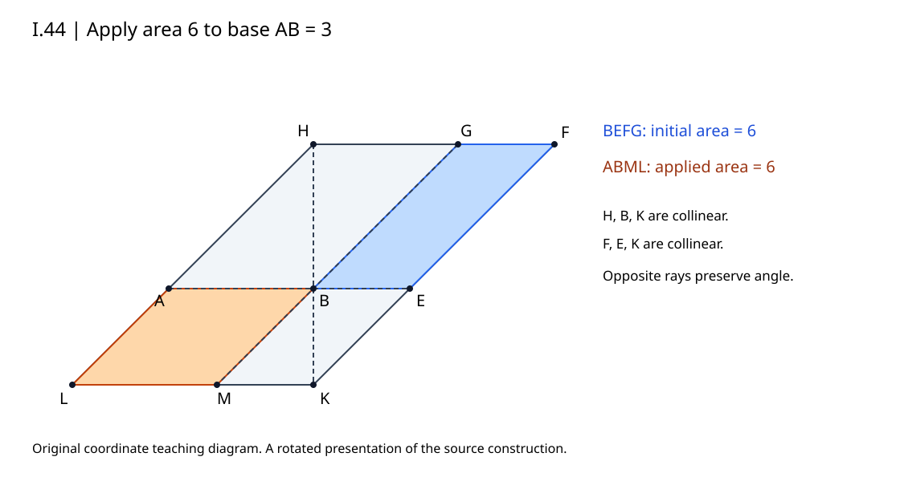

# I.44 最小精确教学复现

这不是《几何原本》的完整复现或自动证明器。程序将原文构造放入一个规范有理坐标系，检查点线关系、延长方向、平行四边形面积和角的两射线反向关系；原文的第五公设交点论证及 I.43 余形证明仍由[正文](../../papers/ancient/euclid-elements-i44.zh-CN.md)逐步重建。初始 BEFG 已有给定面积，来自 I.42 的数学接口，本程序不模拟尺规复制动作。

## 模型与范围

输入 a、b、S 是正有理数，分别为给定底边 AB、辅助底边 BE、给定三角形面积。角用方向 (p,q) 表示，q>0，p 可正、零、负以包含锐角、直角、钝角。B=(0,0)，A=(-a,0)，E=(b,0)。令 v=S/(bq)·(p,q)，则 G=v，F=E+v，H=A+v。构造 K=E-(b/a)v，M=-(b/a)v，L=A+M，所得四边形按 A-B-M-L 顺序。

K=H+((a+b)/a)(B-H)，系数大于1，说明 HB 在 B 之后遇 K。K=E-(b/a)(F-E)，说明 FE 在 E 之后遇 K。H-A-L、G-B-M 也有正确延长次序。两余形 BEFG 与 ABML 面积均为 S；BM 与 BG 反向、BA 与 BE 反向，所以角 ABM 与 EBG 相等。点名与原文相同，图只旋转了呈现方向。

q=0（平角或零角）、q<0（不符合所选上半平面规范）、非正长度或面积，及浮点、布尔值、字符串等非精确输入直接拒绝。q<0 并不是所有几何构造都不存在，只是不属于这个规范输入；若要反射整个图，应连同模型规范一起变换，不可只颠倒一条射线。此模型没有声称覆盖每种坐标、每种图示次序或所有可构造无理角。

## 运行

Python 3 标准库，无第三方依赖。进入本目录后：

```sh
python run_all.py
python draw_figure.py
```

`run_all.py` 逐次运行正常、`-O`、`-OO` 单测、案例和 Notebook，并在任一失败时停止。真实命令与退出码见 `logs/`、`run-summary.json`，环境见 `environment.json`。21 个单测在三个模式均通过。确定性网格有72个合法有理案例，12个非法输入直接拒绝；逐项坐标及结果见 `results.json`。核验器是同模块共享实现，不冒称独立证明；另有独立技术审查。

Notebook `teaching.zh-CN.ipynb` 的5个代码格由标准库 `compile/exec` 顺序真实执行，并在新命名空间再次执行比较输出，结果见 `notebook-check.json`。**没有启动 Jupyter kernel**。Notebook按nbformat 4.5结构用标准库生成，未安装额外软件。

`geometry.py` 为核心，`test_geometry.py` 为单测，`cases.py` 定义案例，`run_examples.py` 保存结果。`draw_figure.py` 生成原创 SVG；只有显示用坐标转浮点，数学检查保持 Fraction 精确算术。

## 如何解读结果

- 合法网格覆盖三个底边a、两个辅助底边b、两个面积、三种角方向p、两个q；不是随机搜索，也不是对所有有理数穷尽。
- 改变辅助b而保持a、S、p/q，最终A、B、M、L不变，是现代坐标恒等式的有限检查。
- 错摆A、反转BM、交换F/G或篡改K会使证书核验失败，即使部分面积碰巧仍相等。
- 非退化、给定底边、等积、角条件必须同时满足。等积不等于全等，更不能只凭图形外观判断。
- 有限实跑不能证明一般命题，不能替代原文第五公设或I.43；一般正确性需正文推导。


