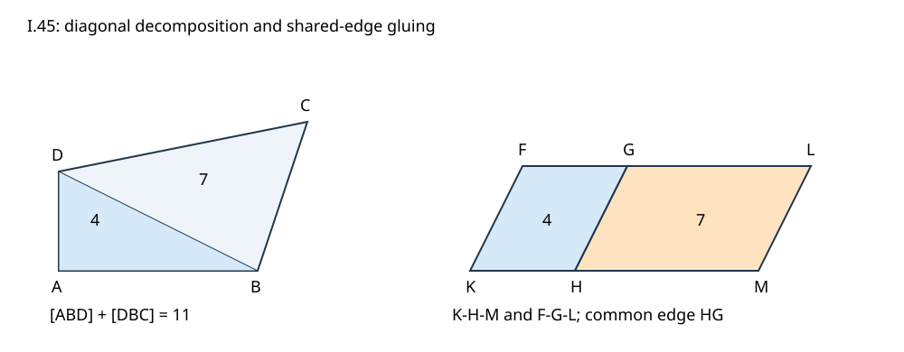

# I.45 最小精确教学复现

本附件以有理坐标检查原文四边形分割与两块平行四边形拼接，不是完整《几何原本》复现、尺规动作模拟或通用多边形三角剖分器。一般证明见[中文深读](../../papers/ancient/euclid-elements-i45.zh-CN.md)。I.42/I.44作为“给定面积与角的平行四边形”数学接口；程序直接给出规范坐标，不声称运行古代尺规的每一步。

## 模型

输入依边界排列的严格凸四边形A-B-C-D，顺时针或逆时针均可；精确整数/Fraction坐标。四个转向必须严格同号。DB将它分成ABD和DBC，分别面积S1、S2。

给定h>0和角方向(p,q)，q>0、p可正零负。令v=(hp/q,h)，K=(0,0)，F=v，H=(S1/h,0)，G=H+v，M=((S1+S2)/h,0)，L=M+v。种子区域K-F-G-H、追加区域H-G-L-M恰共边HG，内部不交，最终边界K-F-L-M。K-H-M及F-G-L有严格顺序；角HKF、GHM、FKM是同一个普通内角。面积S1+S2来自不重叠拼接，不是任意两个图形的面积相加就可推定其并集面积。

这里选择自由高度h是现代规范坐标重构，不把I.45原命题改称“指定h”的原文。给定方向涵盖规范中的锐、直、钝角，但有理坐标网格不覆盖全部可构造无理角。q<0只是超出所选上半平面规范，不能据此宣称几何问题不存在。凹四边形、自交、共线、重复顶点及非四边形直接拒绝；它们中某些也可做等积构造，但需要另行证明分割方法，本代码未实现。原文命题所述一般直线形与本代码严格凸四边形范围应分开。

## 运行与文件

Python 3标准库，无需第三方依赖，进入本目录运行：

```sh
python run_all.py
```

`geometry.py`提供`construct(vertices,h=2,p=1,q=2)`和`verify(vertices,h,p,q,certificate)`，后者严格验证证书字段与Fraction类型，拒绝布尔值伪装精确数。核验器与构造共享原语并比较规范点位，不冒称独立证明；独立审查另列。

`test_geometry.py`共20单测，正常、-O、-OO三模式真实通过。`cases.py`网格72合法例：三个缩放、两个边界方向、两个高度、三个p、两个q。14非法输入由构造器直接拒绝。`results.json`保留逐项精确结果，`logs/`保存命令、输出、退出码；`environment.json`和`run-summary.json`记录环境与真实运行时间。

Notebook的5代码格由`create_notebook.py`逐格真实标准库compile/exec执行，`verify_notebook.py`新命名空间回放并比较输出。**未启动Jupyter kernel**。已读取安装的Notebook技能；其默认脚手架CLI本环境不存在，按技能结构要求用标准库生成nbformat4.5，无额外安装。`notebook-check.json`记录回放结果。

基准输入A=(0,0)、B=(4,0)、C=(5,3)、D=(0,2)，h=2,p=1,q=2：两面积4与7，总11，输出F=(1,2)、H=(2,0)、G=(3,2)、M=(11/2,0)、L=(13/2,2)。

`draw_figure.py`由该精确基准生成原创SVG，显示转换才使用浮点；数学计算始终Fraction。图已用现有Inkscape渲染并目视检查标签与区域，未安装新软件。



## 边界与解释

- 合法网格不是穷尽证明；有限实跑不能代替I.14/I.29/I.33的原文论证。
- 面积、角、共享边、反侧、拼接共线和外边界都须成立。代码分别核验这些条件，点位/面积/字段篡改被拒。
- 将p改号通常改变角度；只保面积不足以满足题意。共同正比例改变p和q表示同一条射线，输出不变。
- 图形等积不等于全等；输出平行四边形不必保持输入边长或形状。
