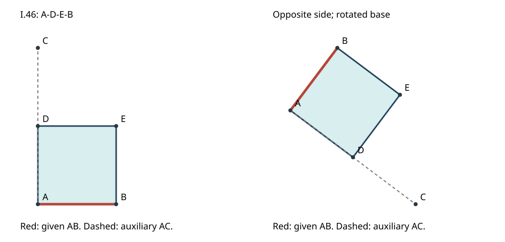

# I.46：给定线段上的正方形，精确教学模型

[中文深读](../../papers/ancient/euclid-elements-i46.zh-CN.md) · [来源审查](source-review.zh-CN.md) · [独立技术审查](technical-review.md)

## 目的与范围

原文点名为A、B、C、D、E，正方形边界次序A—D—E—B；C只是垂直射线上的辅助点，不是正方形顶点。原证使用I.11、I.3、I.31、I.34、I.29及定义22。这里的向量旋转是另标的现代坐标教学重构，不把后来的I.47作为原证前提，也不声称模拟尺规动作。

输入A、B为整数或Fraction有理坐标，必须不同，side为整数+1或-1。以u=B−A和w=side·(−u_y,u_x)，置D=A+w、E=B+w、C=A+2w。C是人为选取的足够长垂线示例，证书允许任何严格位于D以外的同射线C。原文并不要求AC恰好是AD的两倍。

verify不调用construct，不靠重造证书后比较。它直接核验输入、射线同侧、垂直与等长、两条平行线交点、边界连续四边等长、四个邻边点积为零及严格凸性。非法输入直接抛ValueError；格式错误或几何不满足的证书返回False。布尔值不是坐标或方向整数，浮点数不进入精确模型。

## 实跑与命令

仅Python标准库，无安装步骤。从本目录执行：

```bash
python run_all.py
```

它顺序执行normal、-O、-OO下的unittest；案例、Notebook创建执行、独立命名空间回放及原创SVG生成。每条命令、真实stdout/stderr与退出码见[run-summary](run-summary.json)和[日志](logs/)。环境版本见[environment.json](environment.json)，未记录私人路径、主机名或环境变量。

- 21单元测试在三个模式均通过。
- 48合法有理案例：3种平移×8种非零方向×2侧。
- 12非法输入直接拒绝，含零底、浮点、布尔、维度错误与非法side。
- 针对伪造证书测试矩形、非直角菱形、交叉配对、错误交点、错误底、C位于错误射线或与D重合、side布尔、元数据浮点等。
- [案例结果](results.json)的斜边示例A=(0,0)、B=(3,4)，得到D=(−4,3)、E=(−1,7)、C=(−8,6)，平方边长25。

[Notebook](teaching.zh-CN.ipynb)有五个代码格，已以标准库compile/exec自上而下真实执行并保存stdout，再在新命名空间回放比对。没有启动Jupyter kernel；[检查记录](notebook-check.json)不应解读为kernel集成测试。已读安装技能，但其默认scaffold脚本在本环境不存在，因此用自有nbformat4.5生成器，不安装新技能或依赖。



## 检查覆盖不等于证明

程序只覆盖有理坐标和有限样本。向量公式可作一般代数推导，但测试本身不能证明所有实数输入、原尺规构造存在或历史依赖的正确性。面积的鞋带计算与平方边长是现代独立算例输出；并非Euclid I.46原证以面积或勾股公式证明正方形。图仅展示两个实例，不能代替原命题的一般证明。
