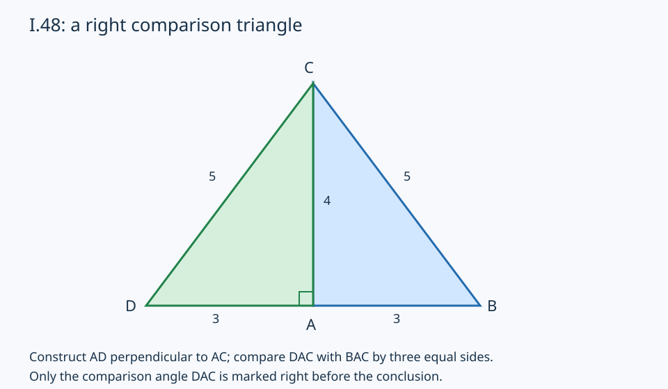

# I.48：用直角比较三角形证明逆命题

[中文深读](../../papers/ancient/euclid-elements-i48.zh-CN.md) · [来源审查](source-review.zh-CN.md) · [独立技术审查](technical-review.md)

## 原证与模型

原文在A作AC的垂线，取AD=AB，连接DC。I.47只用于已经由构造保证直角的DAC；由输入平方和及等量替换得到DC与BC的平方相等，再由正长度得到DC=BC。AD=AB、AC公共、DC=BC提供I.8的三边相等，故BAC与DAC相等而为直角。这不是把I.47的箭头直接倒过来。

本程序使用Python Fraction精确有理点，不模拟实际尺规。公开入口只检查输入类型、三角形非退化，以及BC²=AB²+AC²；**不把AB与AC垂直作为入口条件**。随后对AB²/AC²用整数isqrt分别求分子分母平方根，以所得有理比值缩放AC的90度旋转向量，将D放在与B相反的一侧。反侧是本模型选定的非重合构造分支，不是原定理额外前提。

输入边长本身不必有理。例如AB=(2,1)、AC=(-2,4)，两边长度分别为根号5和2根号5，比例仍有理。对于任意满足前提的非退化有理三点，平方根比值必为有理：现代坐标恒等式将平方和前提化为u·v=0，再由det(u,v)²=|u|²|v|²得到sqrt(|u|²/|v|²)=|det(u,v)|/|v|²。**这段是说明程序表示范围的现代代数旁证，不替代正文的综合几何证明；construct并不使用这个结论来筛选输入。** 独立rational_sqrt工具对负数或非有理平方的输入显式拒绝，此拒绝在满足全部入口前提的有理三角形中理论上不会发生。

verify不调用construct。它直接检查原始点绑定、D的类型、AD非零、AD垂直AC、AD²=AB²及反侧选择，再检查比较三角形平方关系、DC²=BC²和SSS对应角的点积，最后核验BAC点积为零。距离平方是现代欧氏坐标度量；程序不能据此声称独立验证古代公理系统。验证器严格拒绝浮点、布尔值、缺点、多点、移动顶点、同侧重合D和不同原三角形。

## 真实运行

无需安装依赖。在本目录运行：

```bash
python run_all.py
```

[环境](environment.json)仅保存Python版本和依赖，不记录主机、账户、私有路径或环境变量。[命令与退出码](run-summary.json)列出七条命令及真实日志。

- 21单元测试，normal、-O、-OO三模式通过。核心判断不用可被优化移除的assert。
- 72合法例，3平移×4非零方向×3正有理比例×2取向。案例生成器用旋转生成测试族，但公开construct入口依据平方和而不是垂直；不能把该测试族说成穷尽所有输入。
- 12非法输入在construct入口直接拒绝，包含零边、共线、不满足平方和、极小非直角扰动、布尔/浮点/字符串/维度异常/空值。
- 测试包括逐点逐坐标篡改、缺点/多点、D=A或D=B、交换B/D、错误原始输入及类型攻击。

[真实结果](results.json)：A=(0,0)、B=(3,0)、C=(0,4)时D=(-3,0)；AB²=AD²=9，AC²=16，BC²=DC²=25，DAC与BAC点积均0。接近直角的C=(1/10²⁰,1)配A=(0,0)、B=(1,0)仍不满足精确前提，明确拒绝，不使用容差将其当作定理实例。

[Notebook](teaching.zh-CN.ipynb)五代码格已由标准库compile/exec顺序真实执行、保存输出，再在新命名空间回放逐格比较。[回放记录](notebook-check.json)明确未启动Jupyter kernel。读取已装Notebook技能后发现默认scaffold脚本不存在，使用自有nbformat4.5生成器，未安装额外技能或包。



图中只先标构造得到的DAC直角，BAC直角留给结论；3-4-5是实跑算例，不是一般证明。SVG由draw_figure.py生成并本地渲染目视检查。

## 限制

这里核对有限有理坐标构造与证书，不证明所有实数三角形，也不验证史实、传本归属或完整公理依赖。程序没有扩展到任意非欧几里得度量，不将“数值接近平方和”当作精确前提。I.48只完成当前阅读单元，不能据此宣称AI前史或《几何原本》全书完成。
