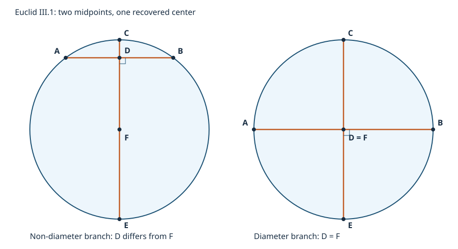

# Euclid III.1：圆心恢复的最小教学实跑

本附件服务于[中文深读](../../papers/ancient/euclid-elements-iii1.zh-CN.md)。原始命题位置见[Euclid III.1](https://mathcs.clarku.edu/~djoyce/elements/bookIII/propIII1.html)。代码与图为原创现代有理坐标教学重构，不是古代程序、完整尺规构造器或一般定理证明。

## 输入契约与不做的事

`recover_center(A,B,C,E)` **不接收圆心**。输入是弦端点 A、B，以及其垂直平分线与给定圆周的两个交点 C、E。每个坐标只能为 Python `int` 或 `fractions.Fraction`。程序算 D=(A+B)/2、F=(C+E)/2，并检查：

1. AB 与 CE 的端点各不重合。
2. D 在 CE 直线上且严格在 C、E 之间。
3. AB 与 CE 垂直。
4. A、B、C、E 到 F 的距离平方相等且为正。

返回八字段证书 A/B/C/E/D/F/radius_squared/branch。`verify_certificate` 重新计算并核验全部字段、键集和类型，明确拒绝 bool/float、错中点、错圆心和假半径；有效性判断不使用可被 `-O` 移除的 assert。正常分支 D≠F，直径分支 D=F，后者不使用不存在的射线 DF。

本代码**不产生一般圆与直线的交点 C、E**，不读取图像，不证明有限点以外的未知曲线就是圆，也不覆盖所有含无理数的尺规情形。四点证据通过表示这些有限数据落在恢复出的同一圆上；要把它用于原命题，调用者另负有“C、E 确为该给定圆的交点”的输入义务。

`sample` 是独立的已知圆心测试数据生成器，`transform` 是测试用精确相似变换。它们不可冒充从未知圆发现交点。负缩放在二维相当于额外半转，不是镜像反射。恢复函数不调用生成器。

## 可复现命令

Python 3，只用标准库，无第三方包、密钥或外部数据。先进入本目录：

```sh
python -B run_all.py
```

执行 23 项单测，分别普通、`-O`、`-OO`；每种模式包含 240 组非直径/直径、上下弦、尺度、转动和平移组合，包含极端精确有理尺度及非法输入测试。生成五个命名例子、原创 SVG 和五格 Notebook 实跑。真实输出见 [运行汇总](run-summary.json)、[环境](environment.json)、[normal](logs/tests-normal.log)、[-O](logs/tests-O.log)、[-OO](logs/tests-OO.log)、[算例](logs/examples.log)、[Notebook](logs/notebook-execute.log)。失败命令会返回非零码；日志不含主机、账户和绝对路径。

## 具体算例

- A=(-3,4)、B=(3,4)、C=(0,5)、E=(0,-5)：D=(0,4)，F=(0,0)，半径平方25。D并非圆心。
- A=(-5,0)、B=(5,0)，同 C、E：D=F=(0,0)，属于直径分支。
- 上例以余弦3/5、正弦4/5旋转并平移(3,-7)：恢复 F=(3,-7)，半径平方仍25。
- 缩放 -1/3 并平移(1/2,-4/3)：F=(1/2,-4/3)，半径平方25/9。
- 仅将首例 C 改成(0,6)：拒绝，因四点到恢复中点距离不一致。将证书 F 替换为 D 也拒绝。



## 文件说明与 Notebook 边界

- [geometry.py](geometry.py)：恢复和核验，不依赖外部程序。
- [test_geometry.py](test_geometry.py)：单元测试；[run_examples.py](run_examples.py)：明确数值实例。
- [教学 Notebook](teaching.zh-CN.ipynb)、[生成器](create_notebook.py)、[执行器](verify_notebook.py)。使用标准库 JSON 构造 Notebook，不引入第三方依赖。
- Notebook 五个代码单元实际以标准库 `compile/exec` 顺序执行、保存输出；**不是 Jupyter kernel 运行，不声称已验证内核集成**。可在常规 Jupyter 中从本目录打开自行运行，但那不是这里的运行证据。
- [draw_figure.py](draw_figure.py) 可重新生成原创图；图展示二维模型，不是证明证据。

原文的证明依赖、候选圆心的共线补足和唯一性在正文逐步重建。23 单测或 240 组构形都不可能替代一般证明。
