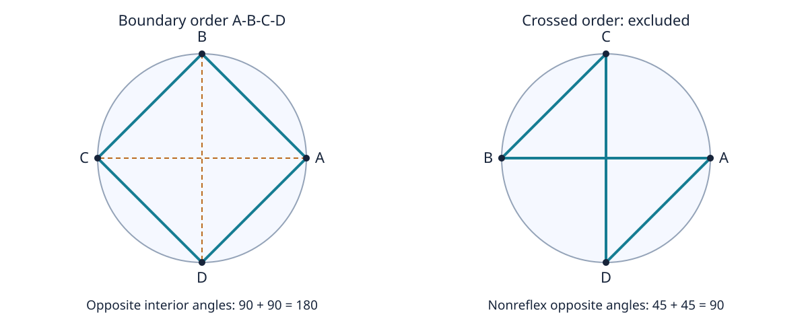

# Euclid III.22：对角互补与顶点次序

本附件是原创现代坐标教学重构，不是古代实验、形式化公理证明或一般定理的穷举证明。只依赖 Python 标准库。对应[中文深读](../../papers/ancient/euclid-elements-iii22.zh-CN.md)。

## 输入域与可检查关系

`geometry.py` 的 `certificate(vertices, center, radius2)` 接受四个顶点、给定圆心和正半径平方；坐标和圆参数限 `int` / `Fraction`，拒绝 `bool` 与浮点数。先检查四点不同、圆周归属，再检查四个连续转向同号且非零。这对四点强制严格凸边界次序；顺时针、逆时针都可以，交叉连接不可以。合法域检查没有预筛选“对角互补”结论。

角 ABC 的向量是 u=A−B、v=C−B。程序直接算 `cot(ABC)=dot(u,v)/abs(cross(u,v))`，保留 dot 的正负；不能把负 cot 取绝对值。合法内角严格在 (0,π) 内，cot 严格递减，故 `cot α = −cot γ = cot(π−γ)` 等价于 α+γ=π。它检查两对角，不凭“四边形角和”只猜另一对。

原证关系另列字段：在三角形 ABC 中，BAC 与 BDC 同弦 BC、ACB 与 ADB 同弦 AB；两次等角替换由原始坐标重新计算。记 u=cot BAC、v=cot ACB，`(u*v−1)/(u+v)` 是这两个角之和的 cot；分母正是 `sin(BAC+ACB)/(sin BAC sin ACB)`，对非退化三角形为正。程序比较拼角值与 ADC 的 cot，再比较它与 ABC 的 cot 是否互为负数。`same_segment`、`split_matches_D`、`triangle_sum` 都是计算结果，不是预填常量。没有声称这些字段构成独立形式证明器。

## 真实实跑与重跑

在本目录执行：

```sh
python run_all.py
```

- [20 个 unittest](test_geometry.py)：正方形、非矩形、顺逆时针、循环起点、原证替换/拼角、平移缩放、交叉反例、重复点、非共圆、内部点、半径/类型/形状错误、退化角、极近但不同的点、精确网格和独立浮点检查。
- [有限网格](geometry.py)：12 个不同有理单位圆点（11 个有理参数及遗漏端点），选四共495组，乘3组圆心/正缩放、2种边界方向，**每模式2970配置、5940对角对、5940同弓形等角检查**。其中492配置含直角，2934配置含钝角；两者可重叠。三模式使用同一网格，不是8910个独立样本。
- [独立浮点oracle](independent_oracle.py)：不使用主程序cot及证书，用向量 `atan2(abs(cross),dot)` 检查同网格两对角和，绝对容差1e−12弧度。共享的是输入集合，不是角度算法；它是数值交叉检查，不是精确证明，也没有用来认可极近点测试。
- [教学Notebook](teaching.zh-CN.ipynb)：5个代码格由[生成器](create_notebook.py)实际顺序 `compile/exec` 并捕获输出；[回放器](verify_notebook.py)再次执行并逐字比较。**没有启动Jupyter kernel**，execution_count保持null。已读安装技能；其本地scaffold脚本未找到，故按nbformat4结构生成，未安装软件。已有Jupyter环境可从本目录打开重跑。

[环境](environment.json)和[运行汇总](run-summary.json)记录真实环境及退出码；[命名例](run_examples.py)输出正例和交叉反例。每项分别在普通、`-O`、`-OO`执行，逻辑不依赖可被优化移除的assert语句。日志见[普通测试](logs/test_geometry-normal.log)、[-O测试](logs/test_geometry-O.log)、[-OO测试](logs/test_geometry-OO.log)、[普通例子](logs/run_examples-normal.log)、[普通浮点oracle](logs/independent_oracle-normal.log)、[普通Notebook回放](logs/verify_notebook-normal.log)，另有各项O/OO日志。

## 关键反例与边界

- 单位圆正方形依边界顺序 `(1,0),(0,1),(-1,0),(0,-1)`：四个cot都是0。
- 将中间两点交换形成交叉顺序：每个顶点的较小非反角是45°，两“对角”的和为90°，不是180°。程序拒绝把它当作凸内接四边形。这不否认其他有向角理论，只说明不能偷换角定义。
- t=1/10¹²的有理圆周点与(1,0)极近但不相同，精确输入可合法验证；t=0会重复点，必须拒绝。数值接近和数学退化是两回事。
- 四边形 `(0,0),(2,0),(2,1),(0,2)` 不在默认给定圆上，程序拒绝；这不是计算并反驳所有非共圆四边形。一般非共圆反例请看正文。



[原创图脚本](make_diagram.py)生成显式1200×480 SVG；图用正方形清楚比较连接次序，虚线是两条对角线。示意图不是测量证据，更不能代替非矩形的一般证明。

## 能力边界

有理有限枚举不覆盖全部实数点；精确算术只避免这些输入的舍入误差。实现使用现代坐标、三角函数关系及严格凸域，是教学核验而非欧几里得原文算法。没有学习数据、训练基线、性能改善或完整形式化复现的主张。逆命题没有被该程序证明；它也不判断历史文字、版本或勘误。

## 独立技术检查

[独立技术审查](technical-review.zh-CN.md)及其[附加脚本](technical_checks.py)不复用作者的点集与角度oracle：每模式840合法排列、1680交叉拒绝，243逆向代数案例及10额外非法输入。运行 `python technical_checks.py`（另可加 `-O` 或 `-OO`）；日志为[普通](logs/technical-checks-normal.log)、[-O](logs/technical-checks-O.log)、[-OO](logs/technical-checks-OO.log)。这仍是有限实现审查，不是一般证明。
